# 第 00 章：CPU、缓存与操作系统基础——低延迟之前的热路径

**本章主线：取数据 → 准备内存 → CPU 调度 → 如何收包。** 开篇先看业务与岗位，随后理解处理器（CPU）和操作系统怎样完成这些工作。

## 先理解：金融业务为什么需要低延迟

交易程序看到一个合适的报价便发出订单，等订单到达交易所时，那条报价已经被撤掉，成交机会随之消失。

**从信息或请求出现，到系统完成相应处理，这段时间足够短，就叫低延迟。** 在交易中，它主要帮助抓住短暂机会、改善成交结果、缩短风险暴露时间。本课先说明哪些业务值得争取这段时间，再看时间花在哪里、怎样减少等待。

### 量化决定怎样交易，低延迟关注多久完成

| 概念 | 含义 |
| --- | --- |
| **量化交易** | 用数据、模型和明确规则做交易决策，例如按模型定期调整持仓 |
| **自动化／算法交易** | 让程序按规则决定或执行交易动作，例如把大单拆成小单、选择发送时机 |
| **高频交易（HFT）** | 在很短的时间尺度上高速交易，通常伴随较短持仓和大量订单、撤单消息 |
| **低延迟技术** | 缩短价格、数量等市场数据（行情）的传输耗时，以及计算、风控、订单处理的耗时 |

前三行说的是怎样交易，最后一行说的是多久完成，它们可以同时出现在一套系统里。**量化交易不一定是高频交易。** [CFA：量化方法](https://www.cfainstitute.org/insights/professional-learning/refresher-readings/2026/active-equity-investing-strategies)、[美国证监会（SEC）：算法交易报告 §I.C、IV.C](https://www.sec.gov/files/marketstructure/research/algo_trading_report_2020.pdf)

### 哪些问题适合用量化方法

需要比较大量资产、反复做同类决策，或用数据检验交易规则时，量化方法就有用：把判断写成模型，按一致的规则计算、验证和执行。

| 业务场景 | 公司或团队是什么 | 模型用来做什么 |
| --- | --- | --- |
| 选股与组合构建 | [AQR](https://www.aqr.com/Our-Firm/About-Us)（美国量化资产管理公司，为客户管理投资组合） | 按盈利能力、风险等特征比较大量股票，构建分散投资的组合。[投资方法](https://www.aqr.com/Learning-Center/Systematic-Equities) |
| 趋势交易 | [Man AHL](https://www.man.com/about-us)（英国资产管理公司 Man Group 旗下的量化投资团队） | 用统计方法识别价格持续上涨或下跌等规律，形成交易信号。[团队介绍](https://www.man.com/ahl) |
| 定价与风险计算 | [Optiver](https://www.optiver.com/join-us/locations/amsterdam/)（荷兰起家的全球做市商，用自有资金交易） | 计算产品价格与风险，持续向市场报出愿意买入、卖出的价格。[工程介绍](https://www.optiver.com/insights/technology-blog/engineering-the-three-pillars-of-trading-pricing-risk-and-execution/) |

同样是用模型，按月选股与实时做市对速度的要求就很不同。前者主要解决选什么、持有多少；后者还要随行情变化及时更新报价。

### 哪些环节特别需要低延迟

**机会消失得快、价格变化得快，或风险需要尽快处理时，低延迟尤其有用。** 下表说明业务需求，具体要快到什么程度，仍由业务决定。

| 业务场景 | 典型团队 | 要及时完成什么 | 慢了可能怎样 |
| --- | --- | --- | --- |
| 抢价与撤单 | 高频交易团队 | 按有利报价成交，或撤掉失效订单 | 好价格消失，或按不利价格成交 |
| 做市 | 做市商、银行交易部门 | 持续给出买卖报价；行情变化后改价，期权等产品可能需批量更新 | 旧报价留在市场，被按过时价格成交 |
| 短期交易 | 量化交易团队 | 抓住短暂价差，响应新闻或订单、成交变化 | 信号失效；配对交易只成交一边 |
| 客户报价与对冲 | 银行、投行市场部门 | 答复客户价格；必要时通过反向或相关交易抵消风险 | 客户在别处成交，或对冲前价格变化 |
| 大单执行 | 基金、券商执行团队 | 拆单，按价格和可成交数量选择订单去向 | 报价过期，执行成本增加 |
| 交易服务 | 交易所、券商、期货公司 | 交易所撮合、发布行情；券商与期货公司检查、转发委托 | 消息积压，交易或风险处置被拖慢 |

抢成交与撤单可能是同一场速度竞赛的两端，国际清算银行（BIS）的研究直接分析了这种竞争。[交易与撤单竞赛研究](https://www.bis.org/publications/working-paper-955-quantifying-high-frequency-trading-arms-race)

**低延迟也能缩短对冲前的风险暴露。** 例如银行向客户卖出美元后，决定到市场买回；两笔交易之间，汇率变化会影响成本，更快买回就能缩短这段等待。[BIS：自动做市与对冲](https://www.bis.org/publications/hanging-phone-electronic-trading-fixed-income-markets-and-its-implications)

**长期投资决策、回测训练和日终对账，通常更看重模型、数据质量与吞吐量，无需追求交易链路的微秒速度。** 不过，长期基金的一笔大单可以分几小时执行，每次决定发单后仍要及时送达。[BIS：执行算法与执行风险](https://www.bis.org/publications/fx-execution-algorithms-and-market-functioning)

### 哪些公司和岗位需要这类工程能力

以下五个岗位直接参与低延迟交易系统的开发、网络建设、性能优化或硬件加速。招聘原文于 **2026-09-14** 核对；知识栏同时列出招聘要求和按岗位职责补充的课程知识，并标明章节。

| 具体岗位与官方招聘原文 | 直接参与的低延迟工作 | 岗位知识要求与本课补充（标注章节） | 本课怎么练 |
| --- | --- | --- | --- |
| **交易网络工程师**<br>Trading Technologies · [Senior Network Engineer – EMEA Coverage](https://tradingtechnologies.com/job/senior-network-engineer-emea-coverage-563100/)<br>布拉格 · 资深岗位 | 建设低延迟交易网络，优化行情和订单传输，排查延迟与组播缺口。 | **招聘必需**：路由交换、组播、Arista/Cisco/Juniper、Linux、网络自动化。<br>**招聘加分**：PTP 对时、硬件时间戳、Solarflare/Onload 内核旁路。<br>**本课补充**：[第 05 章](05-openonload-tcpdirect-dpdk-kernel-bypass.md)：Onload、TCPDirect、DPDK 的收发路径与驱动分工；[第 06 章](06-arista-cut-through-ptp-time.md)：Cut-Through、LANZ、PTP 与硬件时间戳；[第 07 章](07-ebpf-xdp-programmable-network.md)：eBPF/XDP 入口过滤。 | [第 01 章](01-financial-low-latency-architecture.md)认设备与抓包，[第 02 章](02-host-native-trading-system-baseline.md)接入组播；比较不同收发路径，观察交换机排队和时间戳，并用过滤实验核对行情缺口。 |
| **交易系统工程师**<br>宽德量化 · [交易系统工程师](https://www.wizardquant.com/career/%E4%BA%A4%E6%98%93%E7%B3%BB%E7%BB%9F%E5%B7%A5%E7%A8%8B%E5%B8%88)<br>上海／其他 · 校招与社招；社招要求 5 年以上软件经验 | 开发 Linux 低延迟交易系统，优化网络通信与行情处理。 | **招聘列出**：C/C++ 或 Python、Linux 并发与多线程、网络编程；页面同时列出 FPGA、Verilog、PCIe/DMA 等软硬件知识。<br>**本课补充**：[第 00 章](#wait-data)：缓存、内存与调度；[第 03 章](03-live-trading-traffic-and-protocols.md)：ITCH/OUCH 行情与订单协议；[第 04 章](04-low-latency-software-design.md)：SPSC、忙轮询、CPU 隔离；[第 05 章](05-openonload-tcpdirect-dpdk-kernel-bypass.md)：Onload、TCPDirect、DPDK + F-Stack；[第 08 章](08-fpga-from-code-to-device.md)：RTL 电路与主机软件的分工。 | [第 02 章](02-host-native-trading-system-baseline.md)部署交易平台、核对一笔订单；随后解析报文、比较队列交接与网络收发耗时，理解软件与硬件的分工。 |
| **C++ 交易执行开发**<br>IMC · [C++ Software Engineer](https://www.imc.com/us/careers/jobs/4282973101)<br>孟买 · 要求 4～8 年 C++ 经验 | 开发直接影响交易反应速度的软件，处理市场连接、数据和交易算法。 | **招聘列出**：C++ 开发与计算机基础；团队使用 C++20、Linux 等技术，工作中需权衡延迟、吞吐量、可测试性与可维护性。<br>**本课补充**：[第 00 章](#cache-locality)：缓存行、局部性、内存准备；[第 04 章](04-low-latency-software-design.md)：SPSC、忙轮询、CPU 隔离；[第 05 章](05-openonload-tcpdirect-dpdk-kernel-bypass.md)：Onload 透明接入、TCPDirect 专用接口、DPDK + F-Stack 用户态收发。 | 比较不同队列与同步方式；用同一笔订单验证四条收发路径，再比较 P50/P99。 |
| **交易性能工程师**<br>IMC · [Performance Engineer](https://www.imc.com/us/careers/jobs/4531501101)<br>悉尼 · 有生产代码经验 | 分析行情与交易所连接的性能，用统计实验定位瓶颈、量化优化效果。 | **招聘列出**：网络、计算机内部机制、Linux、统计与数据分析；能用 Python、C++ 或 Java 编写并交付程序。FPGA 等低延迟硬件经验是加分项。<br>**本课补充**：[第 00 章](#wait-memory)：缓存、缺页、调度等待；[第 04 章](04-low-latency-software-design.md)：计时起止点、预热、P50/P99；[第 05 章](05-openonload-tcpdirect-dpdk-kernel-bypass.md)：Onload、TCPDirect、DPDK 路径差异与受控比较；[第 06 章](06-arista-cut-through-ptp-time.md)：PTP 与硬件时间戳。 | 固定条件采样，区分队列等待与订单往返；结合网络路径和时间戳，解释典型表现及尾部延迟。 |
| **FPGA 开发实习生**<br>Optiver · [2027 Shanghai FPGA Developer Summer Internship](https://www.optiver.com/join-us/jobs/technology/shanghai/2027-shanghai-fpga-developer-summer-internship/)<br>上海 · 2027 暑期实习，面向符合毕业时间要求的硕博生 | 设计低延迟交易硬件，编写电路逻辑与测试程序，验证处理结果。 | **招聘列出**：数字逻辑、FPGA 架构与工具、VHDL/Verilog、Python 或 C++、Linux、Ethernet/IP/TCP/UDP。<br>**本课补充**：[第 03 章](03-live-trading-traffic-and-protocols.md)：ITCH 行情字段；[第 08 章](08-fpga-from-code-to-device.md)：SystemVerilog、Vivado 仿真与 U250 工程构建；[第 05 章](05-openonload-tcpdirect-dpdk-kernel-bypass.md)：了解 Onload、TCPDirect、DPDK 软件收发路径，理解主机与网卡的分工。 | 用 Vivado 仿真验证过滤逻辑，再完成 U250 工程综合、实现与配置文件生成；结合主机收发路径理解板卡的作用。 |

### 本课沿业务链路找等待

以收到行情后决定下单为例，程序读取市场数据，再决定是否产生订单。一次反应可能经过：

**行情网络 → 程序接收与计算 → 下单前风控 → 订单网络 → 交易所处理。**

<div style="border-left:6px solid #7e22ce;background:#f3e8ff;padding:12px 16px;border-radius:8px;margin:14px 0;">
<span style="display:inline-block;padding:3px 12px;border-radius:6px;background:#7e22ce;color:#fff;font-weight:800;">仅供展示</span>
<span style="font-weight:700;color:#581c87;">这张图回答：一次下单反应经过哪五段。</span>
</div>

<div style="background:#f8fafc;border:1px solid #cbd5e1;border-radius:12px;padding:10px;max-width:820px;margin:14px auto;">
<div style="font-weight:900;color:#0f172a;margin-bottom:8px;">业务链路 · 从行情到交易所</div>
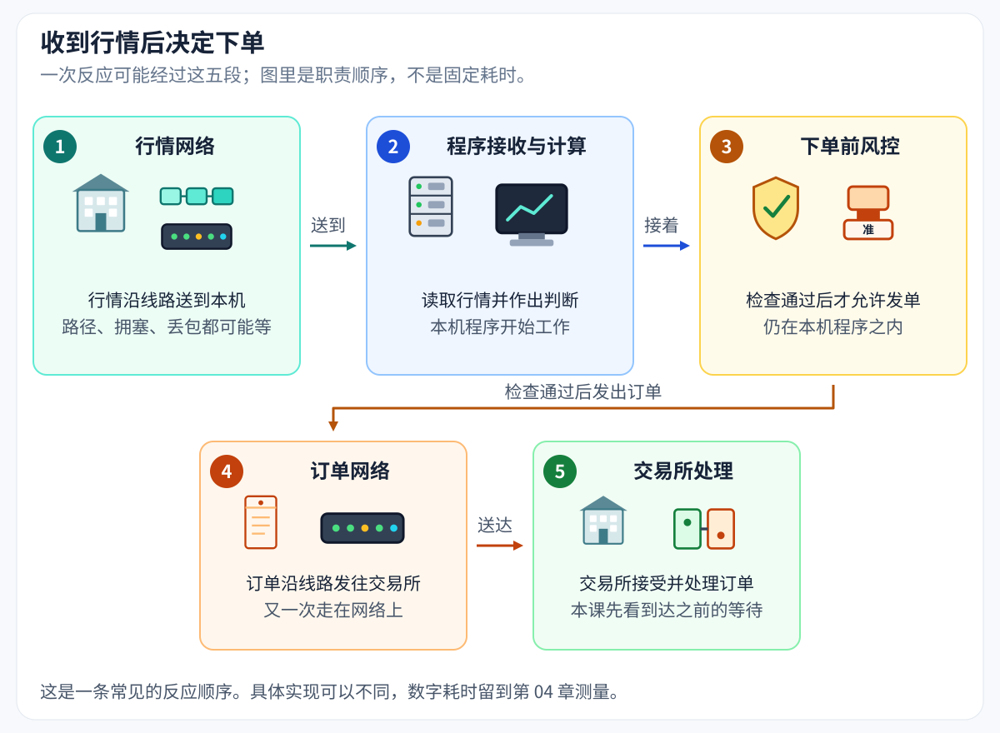
<div style="color:#475569;font-size:13px;margin-top:8px;">先从左到右看行情怎样进入本机程序，再看订单怎样回到交易所。这是职责顺序，不是固定耗时。</div>
</div>

这五段里，第 1、4 段经过网络，需要观察交换机转发、出口排队，并用对齐的时钟比较传输耗时。第 2、3 段在本机处理，需要看取数据、准备内存、等待 CPU 执行及报文收发的耗时。

**网络更快，可以减少传输中的等待。** 主机内部的处理耗时，以及偶尔出现的长等待，也需要测量。下面的全课路线图标出这些问题分别在哪一章展开。

<div style="border-left:6px solid #7e22ce;background:#f3e8ff;padding:12px 16px;border-radius:8px;margin:14px 0;">
<span style="display:inline-block;padding:3px 12px;border-radius:6px;background:#7e22ce;color:#fff;font-weight:800;">仅供展示</span>
<span style="font-weight:700;color:#581c87;">这张图回答：网络与主机的等待，分别在哪一章展开。</span>
</div>

<div style="background:#f8fafc;border:1px solid #cbd5e1;border-radius:12px;padding:10px;max-width:820px;margin:14px auto;">
<div style="font-weight:900;color:#0f172a;margin-bottom:8px;">全课路线 · 每一段落在哪一章</div>
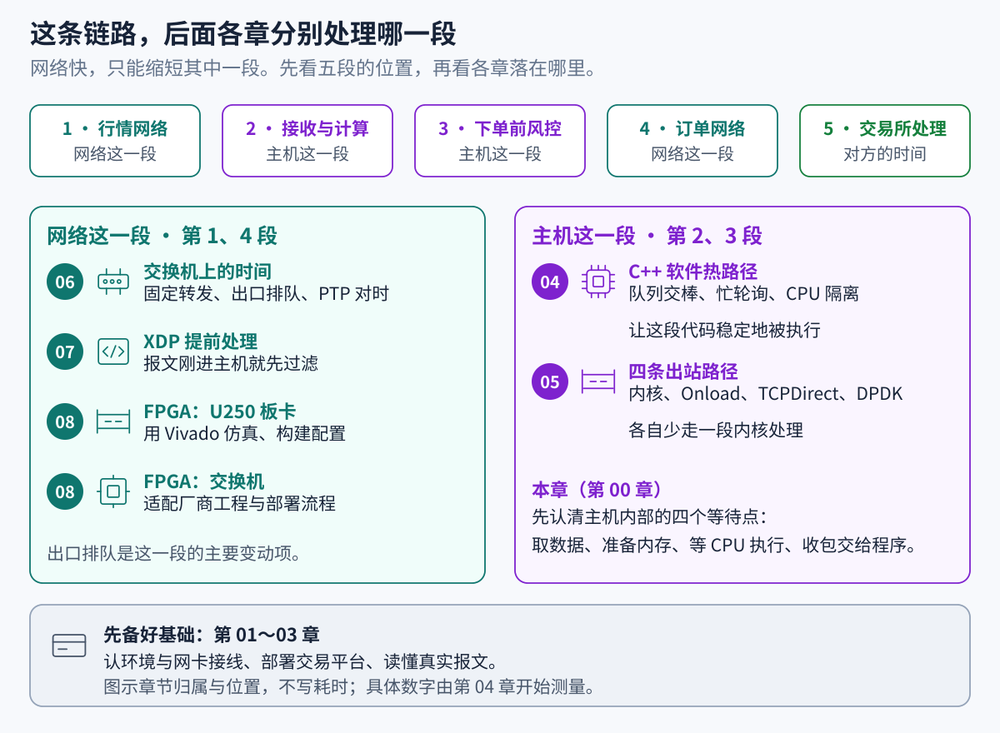
<div style="color:#475569;font-size:13px;margin-top:8px;">青色是网络这一段，紫色是主机这一段。章号只说明各段在哪里展开，不表示优化顺序，也不含耗时。</div>
</div>

本章先聚焦主机内部，用厨房的比喻建立后续实验需要的基础。

## 为什么同一段程序会忽快忽慢

一条行情到达网卡后，程序还要读取、解析和处理它。相同的处理步骤，可能因为中间的等待而耗时不同。

**把服务器想成一间厨房。** 食材送到了，还要存放、取用和处理；主厨可能在找食材，也可能正在忙别的任务。程序中频繁执行的一串处理步骤，叫“热路径”，像厨房里做菜时反复走过的路线。我们先看厨房内部怎样工作，再回到收货口看通知怎样传进来。

<div style="border-left:6px solid #7e22ce;background:#f3e8ff;padding:12px 16px;border-radius:8px;margin:14px 0;">
<span style="display:inline-block;padding:3px 12px;border-radius:6px;background:#7e22ce;color:#fff;font-weight:800;">仅供展示</span>
<span style="font-weight:700;color:#581c87;">这张图回答：四个等待点分别在等什么。</span>
</div>

<div style="background:#f8fafc;border:1px solid #cbd5e1;border-radius:12px;padding:10px;max-width:820px;margin:14px auto;">
<div style="font-weight:900;color:#0f172a;margin-bottom:8px;">四个等待点 · 各自在等什么</div>

<div style="color:#475569;font-size:13px;margin-top:8px;">每张卡片先写技术上在等什么，再给厨房里的对应说法。这四点会互相重叠，不是四个可以相加的数字。</div>
</div>

**学完本章：** 能判断哪些交易环节需要速度，用厨房这个比喻解释四个等待点，并通过小实验看内存何时真正准备好。具体耗时留到第 04 章测量。

<a id="本章路线"></a>

## 本章路线：围绕四个等待点展开

<div style="border-left:6px solid #7e22ce;background:#f3e8ff;padding:12px 16px;border-radius:8px;margin:14px 0;">
<span style="display:inline-block;padding:3px 12px;border-radius:6px;background:#7e22ce;color:#fff;font-weight:800;">本章导航</span>
<span style="font-weight:700;color:#581c87;">四个主题，共 10 个学习步骤：先认清内核分工，四个主题各讲两步，最后用一张图回顾。每节卡片标出当前主题、全章位置和主题内进度。</span>
</div>

**四个主题：** [一、取数据](#wait-data) → [二、准备内存](#wait-memory) → [三、CPU 调度](#wait-cpu) → [四、如何收包](#wait-receive)。这是讲解顺序；一条行情的收包与处理过程中，也会遇到前面讲过的缓存、内存和调度等待。

| 学习步骤 | 所属部分 | 这一步回答 |
| --- | --- | --- |
| 内核边界 | 开始前：认清分工 | 谁管理程序需要的内存、CPU 和网卡？ |
| 1.1 缓存与主内存 | 主题一：取数据 | 数据在手边，还是要去远处取？ |
| 1.2 局部性与缓存行 | 主题一：取数据 | 反复读取或相邻摆放，怎样影响取数据？ |
| 2.1 地址与映射 | 主题二：准备内存 | 程序里的地址怎样对应到实际内存？ |
| 运行 ①：第一次往每页写数据，看见缺页 | 主题二：准备内存 | 领到地址后，实际空间何时准备好？ |
| 3.1 线程与调度 | 主题三：CPU 调度 | 任务准备好了，何时轮到 CPU 执行？ |
| 3.2 暂停与切换 | 主题三：CPU 调度 | 任务开始执行后，为什么还可能暂停？ |
| 4.1 缓冲区与 DMA | 主题四：如何收包 | 谁准备存放位置，谁把报文放进去？ |
| 4.2 通知与应用读取 | 主题四：如何收包 | 报文放进内存后，还要经过哪些处理？ |
| 一页总结 | 回顾：四个等待点 | 一条行情的处理过程中，四种等待各在哪里？ |

<a id="1-内核边界应用通过系统调用使用硬件"></a>

<a id="kernel-boundary"></a>

## 内核边界：先认清应用、内核与硬件

程序在自己的工位上干活。需要内存或网卡时，先到申请窗口提出请求；总控台再安排资源，并操作厨房里的设备。服务器里从上到下就是这四层：应用、系统调用、Linux 内核、硬件。

<div style="border:2px solid #4f46e5;background:#eef2ff;padding:10px 12px;border-radius:8px;margin:14px 0;">
<div style="font-weight:900;color:#312e81;margin-bottom:4px;">导航卡 · 开始前：认清分工</div>
<div style="font-weight:700;color:#312e81;margin-bottom:8px;">类型：原理讲解　这一步回答：谁管理程序需要的内存、CPU 和网卡？　进度：全章第 1 / 10 项 · 这一部分第 1 / 1 项</div>
<span style="display:inline-block;margin:3px;padding:4px 10px;border-radius:6px;background:#15803d;color:#fff;font-weight:800;">内核边界</span>
</div>

| 厨房里的角色 | 计算机里的名称 | 做什么 |
| --- | --- | --- |
| 工位上的程序 | **应用（Application）** | 读取行情、做出判断；需要资源时提出申请 |
| 申请窗口 | **系统调用（System Call）** | 接收程序提出的资源或收发请求 |
| 总控台 | **Linux 内核（Linux Kernel）** | 管理调度、内存、网络栈；驱动也在这一层 |
| 厨房里的设备 | **硬件（Hardware）** | CPU、内存、网卡，经 PCIe 接到主机 |

图中的 **NIC** 是网卡，**PCIe** 是网卡等设备与主机连接的通道。

<div style="border-left:6px solid #7e22ce;background:#f3e8ff;padding:12px 16px;border-radius:8px;margin:14px 0;">
<span style="display:inline-block;padding:3px 12px;border-radius:6px;background:#7e22ce;color:#fff;font-weight:800;">仅供展示</span>
<span style="font-weight:700;color:#581c87;">这张图回答：请求从上往下经过哪四层。</span>
</div>

<div style="background:#f8fafc;border:1px solid #cbd5e1;border-radius:12px;padding:10px;max-width:820px;margin:14px auto;">
<div style="font-weight:900;color:#0f172a;margin-bottom:8px;">内核边界 · 从上往下四层</div>
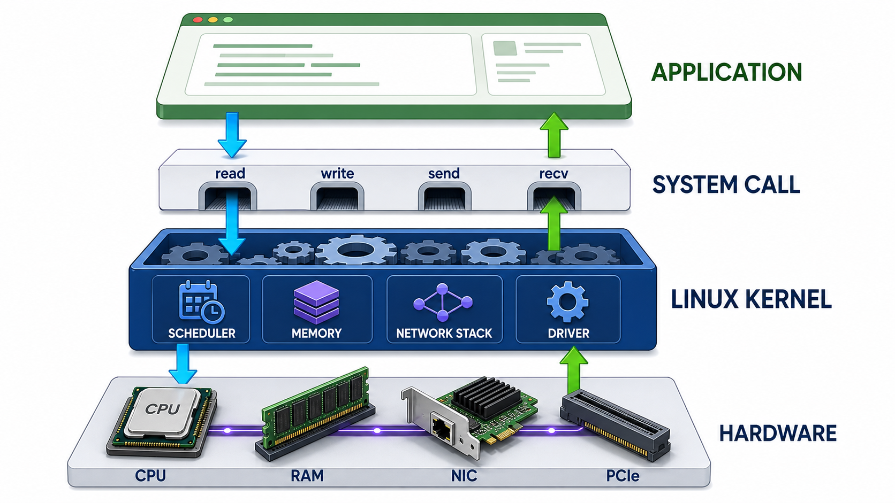
<div style="color:#475569;font-size:13px;margin-top:8px;">沿图从上往下看四层：应用、系统调用、Linux 内核、硬件。蓝色箭头是请求向下，绿色箭头是结果返回。驱动画在内核里，不是单独一层。read/write 是读写，send/recv 是发送和接收。</div>
</div>

**用户态**像在自己的工位上干活；**内核态**像到总控台办事。它们是 CPU 执行代码时不同的权限范围。程序通过系统调用提出请求，由操作系统的内核负责处理。驱动是内核里照说明书操作设备的那一块，仍由 CPU 执行。

| 层级 | 本课程中的例子 | 能做什么 |
| --- | --- | --- |
| 用户态 | 行情解析、交易逻辑 | 处理自己的数据，需要系统资源时发起申请 |
| 内核态 | 调度、内存、网络协议；本课网卡的 `sfc`、`bnxt_en` 驱动 | 内核运行时可以管理系统资源，驱动也在这一层执行 |

应用、内核和硬件的分工认清了，下面从第一个等待点入手：假设内存已经准备好，CPU 取到一份数据还要等什么？

<a id="2-缓存与局部性数据在手边还是要去远处取"></a>

<a id="wait-data"></a>

## 主题一：取数据

<a id="cache-levels"></a>

### 1.1 缓存与主内存：数据在手边，还是要去远处取

先看数据已经可以访问时，CPU 从哪里把它取来。主厨手边有食材，就能直接拿；手边没有，就要去更远的地方取。

<div style="border:2px solid #4f46e5;background:#eef2ff;padding:10px 12px;border-radius:8px;margin:14px 0;">
<div style="font-weight:900;color:#312e81;margin-bottom:4px;">导航卡 · 主题一：取数据</div>
<div style="font-weight:700;color:#312e81;margin-bottom:8px;">类型：原理讲解　这一步回答：数据在手边，还是要去远处取？　进度：全章第 2 / 10 项 · 这一部分第 1 / 2 项</div>
<span style="display:inline-block;margin:3px;padding:4px 10px;border-radius:6px;background:#15803d;color:#fff;font-weight:800;">1.1 缓存与主内存</span>
<span style="display:inline-block;margin:3px;padding:4px 10px;border-radius:6px;background:#f8fafc;border:1px solid #a5b4fc;color:#312e81;font-weight:800;">1.2 局部性与缓存行</span>
</div>

一个 CPU 内有执行指令的**核心（Core）**，相当于实际动手的主厨。**缓存（Cache）** 是核心附近的小容量存储，像手边备料区；**主内存（RAM）** 像后厨仓库。

缓存通常分成 L1、L2、L3 几级，数字越小，通常越靠近核心。各级容量看具体处理器，不能按级别数字直接推断谁更大。先看存储层级图，再理解为什么位置会影响等待。

<div style="background:#f8fafc;border:1px solid #cbd5e1;border-radius:12px;padding:10px;max-width:820px;margin:14px auto;">
<div style="font-weight:900;color:#0f172a;margin-bottom:8px;">存储层级 · 主厨手边的缓存与后厨主内存</div>
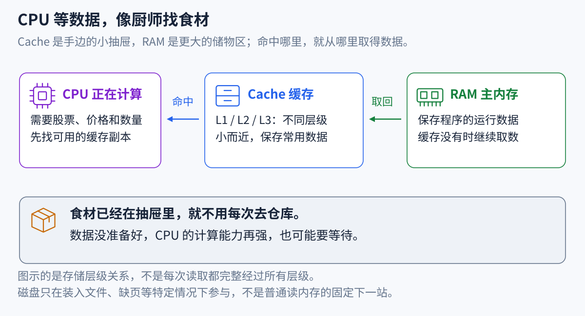
<div style="color:#475569;font-size:13px;margin-top:8px;">先看数据离核心有多近。数据在哪层找到，就从哪层拿；箭头表示位置关系，不是每次必须依次走完的步骤。磁盘只作距离对比，正常报文处理使用缓存和主内存。</div>
</div>

> “The latency of an Instruction with memory operand can vary greatly due to a number of factors, including data locality in the memory/cache hierarchy.”
>
> —— [Intel® 64 and IA-32 Architectures Optimization Reference Manual](https://www.intel.com/content/dam/doc/manual/64-ia-32-architectures-optimization-manual.pdf)

**原文翻译：** 带有内存操作数的指令，其延迟可能因多种因素而有很大差异，其中包括所需数据在内存和各级缓存中的位置。

**通俗解释：** “操作数”指一条指令要处理的对象。一条指令好比一道工序，操作数就是这道工序要处理的原料；通过内存地址找到这份原料，就称为内存操作数。例如“把某个地址里的值加 1”，这个地址里的值就是内存操作数。指令得先把它拿到手才能加，而它此刻是在主厨手边的缓存里，还是要去后厨仓库（主内存）取，会影响这条指令要等多久。

| 存放位置 | 可以怎样理解 | 需要记住什么 |
| --- | --- | --- |
| **寄存器（Register）** | 主厨手中正拿着的东西 | 核心执行指令时直接使用的小容量存储 |
| **L1 / L2 缓存** | 核心手边的台面与抽屉 | L1 更靠近核心；L2 通常更大 |
| **L3 缓存** | 多位主厨共用的备料区 | 常由多个核心共享 |
| **主内存** | 后厨仓库 | 容量较大，从这里取数据通常等待更久 |

对照上表，再看一台个人电脑任务管理器里的处理器页。

<div style="background:#f8fafc;border:1px solid #cbd5e1;border-radius:12px;padding:12px;max-width:820px;margin:14px auto;">
<div style="font-weight:900;color:#0f172a;margin-bottom:10px;">个人电脑实例 · 任务管理器中的三级缓存</div>
<div style="display:grid;grid-template-columns:1.25fr 1fr;gap:12px;align-items:stretch;">
<div style="background:#fff;border:1px solid #e2e8f0;border-radius:8px;overflow:hidden;display:flex;align-items:center;">
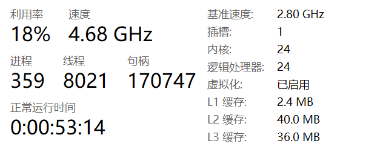
</div>
<div style="background:#fff;border:1px solid #e2e8f0;border-radius:8px;padding:14px 16px;display:flex;flex-direction:column;justify-content:center;color:#334155;font-size:14px;line-height:1.55;">
<div style="color:#64748b;margin-bottom:10px;">24 核 · 整机加总，界面不拆每核多少</div>
<table style="width:100%;border-collapse:collapse;">
<tr><td style="padding:6px 10px 6px 0;font-weight:700;white-space:nowrap;">L1</td><td style="padding:6px 10px;white-space:nowrap;">2.4 MB</td><td style="padding:6px 0;color:#475569;">最靠近核心</td></tr>
<tr><td style="padding:6px 10px 6px 0;font-weight:700;white-space:nowrap;">L2</td><td style="padding:6px 10px;white-space:nowrap;">40.0 MB</td><td style="padding:6px 0;color:#475569;">每核一份加总，均分约 1.67 MB</td></tr>
<tr><td style="padding:6px 10px 6px 0;font-weight:700;white-space:nowrap;">L3</td><td style="padding:6px 10px;white-space:nowrap;">36.0 MB</td><td style="padding:6px 0;color:#475569;">各核共用一份</td></tr>
</table>
<div style="margin-top:12px;">加总后的二级缓存可以比共享的三级缓存更大。</div>
</div>
</div>
<div style="color:#64748b;font-size:13px;margin-top:8px;">这是这台个人电脑的读法，不是缓存层级定律，也不是本课实验机 <code>.101</code> 的规格。利用率、进程数是截图当时的状态；这三行也不表示访问各级要等多久。</div>
</div>

数据所在的位置会影响等待；接着看程序的读取顺序和字段摆放，怎样利用这些缓存。

<a id="局部性反复读取同一处接着读取相邻位置"></a>

<a id="cache-locality"></a>

### 1.2 局部性与缓存行：反复读取同一处，接着读取相邻位置

“局部性”用来描述程序访问数据的集中程度。可以先记住两种情况：

<div style="border:2px solid #4f46e5;background:#eef2ff;padding:10px 12px;border-radius:8px;margin:14px 0;">
<div style="font-weight:900;color:#312e81;margin-bottom:4px;">导航卡 · 主题一：取数据</div>
<div style="font-weight:700;color:#312e81;margin-bottom:8px;">类型：原理讲解　这一步回答：反复读取或相邻摆放，怎样影响取数据？　进度：全章第 3 / 10 项 · 这一部分第 2 / 2 项</div>
<span style="display:inline-block;margin:3px;padding:4px 10px;border-radius:6px;background:#f8fafc;border:1px solid #a5b4fc;color:#312e81;font-weight:800;">1.1 缓存与主内存</span>
<span style="display:inline-block;margin:3px;padding:4px 10px;border-radius:6px;background:#15803d;color:#fff;font-weight:800;">1.2 局部性与缓存行</span>
</div>

| 厨房里的动作 | 程序里的访问方式 | 技术名称 |
| --- | --- | --- |
| 刚用过盐，过一会儿又拿同一个盐罐 | 刚访问过的数据，很快再次访问 | 时间局部性 |
| 拿过盐罐，接着拿旁边的胡椒罐 | 访问某个地址后，又访问它附近的数据 | 空间局部性 |

缓存搬数据时，通常一次搬一整块连续的数据，这一块称为**缓存行（Cache Line）**，可以想成一次拿一小托盘。本课机器一行是 **64 字节（64 B）**；实测规格见[教师说明](assets/00-basics/TEACHER-NOTES.md#机器规格与历史记录)。

例如，处理一条行情时，程序先读价格，再读数量。如果这两个字段在内存中的位置相邻，并且落在同一条缓存行里，取回这一条缓存行就能得到两个字段。

下图再加上序号和标记：`price` 是价格、`qty` 是数量、`seq` 是序号、`flags` 是标记。比较这四个字段放在同一条缓存行，还是分散在四条缓存行。

<div style="background:#f8fafc;border:1px solid #cbd5e1;border-radius:12px;padding:10px;max-width:820px;margin:14px auto;">
<div style="font-weight:900;color:#0f172a;margin-bottom:8px;">局部性对照 · 相同字段，不同摆放</div>
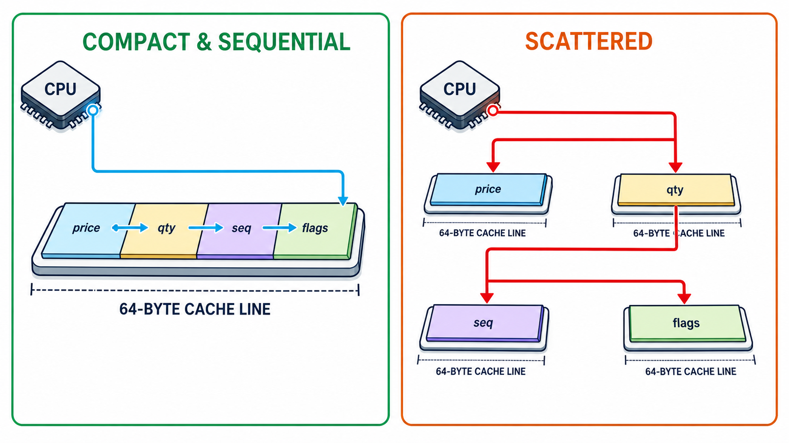
<div style="color:#475569;font-size:13px;margin-top:8px;">左侧四个字段共用一条 64 B 缓存行；右侧分散到四条缓存行。图说明的是搬运范围：字段宽度为示意画法，实际收益取决于真实布局与访问模式。</div>
</div>

- **先后要读取的字段，放在相邻的内存位置：** 可能用较少缓存行取齐所需数据。
- **缓存的空间有限：** 程序读取许多其他数据时，缓存需要存放这些新数据，原来常读的数据副本就可能被替换。下次再读原来的数据，就得从其他缓存或主内存重新取得。

这张图展示四个字段分布在几条缓存行上。程序的实际耗时需要运行测量，第 04 章会用相同任务比较不同写法。

数据放在哪里、程序怎样读它，已经清楚。第二个主题再看，程序刚申请的内存，什么时候才真正能用。

<a id="3-内存地址程序里的地址怎样对应实际内存"></a>

<a id="wait-memory"></a>

## 主题二：准备内存

<a id="memory-address"></a>

### 2.1 地址与映射：程序里的地址怎样对应实际内存

程序读写的是一个地址。这个地址怎样对应到实际内存？如果对应的位置还没准备好，又该由谁补齐？本节先认清这套对应关系，再用实验观察首次写入。

<div style="border:2px solid #4f46e5;background:#eef2ff;padding:10px 12px;border-radius:8px;margin:14px 0;">
<div style="font-weight:900;color:#312e81;margin-bottom:4px;">导航卡 · 主题二：准备内存</div>
<div style="font-weight:700;color:#312e81;margin-bottom:8px;">类型：原理讲解　这一步回答：程序里的地址怎样对应到实际内存？　进度：全章第 4 / 10 项 · 这一部分第 1 / 2 项</div>
<span style="display:inline-block;margin:3px;padding:4px 10px;border-radius:6px;background:#15803d;color:#fff;font-weight:800;">2.1 地址与映射</span>
<span style="display:inline-block;margin:3px;padding:4px 10px;border-radius:6px;background:#f8fafc;border:1px solid #a5b4fc;color:#312e81;font-weight:800;">运行 ①：第一次往每页写数据，看见缺页</span>
</div>

一个正在运行的程序叫**进程**。通常，每个进程都有自己的一套内存地址编号，称为**虚拟地址空间**；程序使用其中的**虚拟地址**来读取或写入数据。

这就像不同厨房各有一本库存账本：两本账本里都可以有“第 10 号”，但对应的货架位置可能不同。同样，两个进程使用相同的虚拟地址，也可能对应不同的实际内存位置。

实际内存位置用**物理地址**表示。程序访问数据时，系统和硬件负责把虚拟地址对应到物理地址，这个过程叫**地址翻译**。

对应关系按固定大小的块来记录，每块叫一**页**。本课机器的普通页是 **4 KiB（4096 字节）**，其中 1 KiB = 1024 字节。[Linux 页表文档](https://docs.kernel.org/mm/page_tables.html)说明了下面两个对象的分工：

| 对象 | 厨房比喻 | 保存什么 |
| --- | --- | --- |
| **页表（Page Table）** | 编号与货架位置的账本 | 虚拟页到物理页的映射，以及访问权限 |
| **地址翻译缓存（TLB）** | 手边记着常用对应关系的小纸条 | 近期用过的地址翻译结果，省去反复查账本 |

从图中的 **①** 开始，先查手边的小纸条，再按查找结果选择分支。图左侧列出常见路线；下面的表逐条解释每根编号箭头。

<div style="background:#f8fafc;border:1px solid #cbd5e1;border-radius:12px;padding:10px;max-width:820px;margin:14px auto;">
<div style="font-weight:900;color:#0f172a;margin-bottom:8px;">地址翻译 · 从①出发，沿条件找到下一步</div>
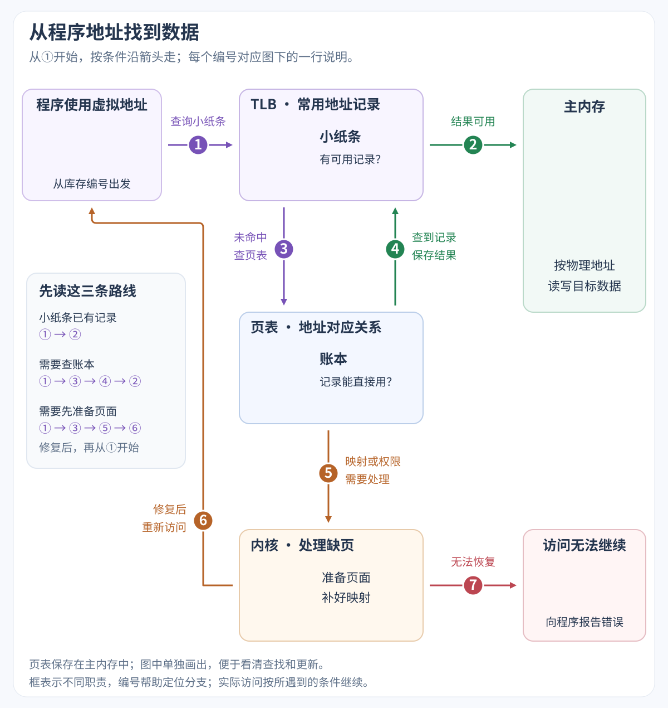
<div style="color:#475569;font-size:13px;margin-top:8px;">紫色是查找，绿色是使用或保存可用记录，橙色是内核处理与重试，红色是访问无法继续。页表本身也保存在主内存中，这里单独画出它的查找职责。</div>
</div>

| <span style="white-space:nowrap;">编号</span> | 从哪里到哪里 | 什么时候走、具体做什么 |
| --- | --- | --- |
| **①** | 程序使用的虚拟地址 → TLB | 程序要读写一个地址时，硬件先查 TLB，看看是否已有可用的地址对应记录。 |
| **②** | 可用的翻译结果 → 主内存中的目标位置 | TLB 中已有可用记录，称为**命中（Hit）**。硬件据此找到物理地址，继续读写目标数据；实际取数据时可以利用主题一介绍的缓存。 |
| **③** | TLB → 页表 | TLB 中没有需要的记录，称为**未命中（Miss）**。硬件接着查页表；只要页表里的记录可用，就能取得翻译结果。 |
| **④** | 页表 → TLB | 查到可用记录后，硬件取得翻译结果，并通常把它保留在 TLB 中，方便后续复用。本次访问根据取得的结果继续到②。 |
| **⑤** | 页表 → 内核 | 映射尚未准备好，或访问权限需要处理时，硬件触发**缺页异常（Page Fault）**，由内核检查并处理。 |
| **⑥** | 内核 → 重新发起本次访问 | 内核成功准备页面、补好映射后，重试刚才的访问；从①再走一次，这次可以继续找到数据。 |
| **⑦** | 内核 → 访问无法继续 | 例如程序访问了无权使用的地址，内核无法为这次访问提供合法映射，就向程序报告访问错误。 |

图中⑤若能在内存中解决，称为次缺页（Minor Fault），例如首次写入时分配物理页；需要从存储设备读入数据，则称为主缺页（Major Fault）。

这里看的是**页**：每条地址对应记录管理一块内存，本课普通页为 **4 KiB**。主题一的**缓存行**是取数据时的搬运单位，本课为 **64 B**。一个管地址对应，一个管数据搬运。

使用**大页（HugePage）**，就像把账本改成按整排货架登记：同样多的内存可以用更少的记录来对应，TLB 也能用有限的记录覆盖更多内存。第 05 章会配置大页。[Linux 大页文档](https://docs.kernel.org/admin-guide/mm/hugetlbpage.html)

下面用一个小实验观察图中的⑤：先申请一段内存，再往每一页写一次数据。我们对比写入前后的次缺页计数，看看增加了多少。

<a id="page-touch"></a>

### 运行 ①：第一次往每页写数据，看见缺页

这一步仍在“准备内存”主题中。用全章唯一的实验，把“**页面尚未准备好**”变成一个能在自己终端看到的数字。

<div style="border:2px solid #4f46e5;background:#eef2ff;padding:10px 12px;border-radius:8px;margin:14px 0;">
<div style="font-weight:900;color:#312e81;margin-bottom:4px;">导航卡 · 主题二：准备内存</div>
<div style="font-weight:700;color:#312e81;margin-bottom:8px;">类型：动手实验　这一步回答：领到地址后，实际空间何时准备好？　进度：全章第 5 / 10 项 · 这一部分第 2 / 2 项</div>
<span style="display:inline-block;margin:3px;padding:4px 10px;border-radius:6px;background:#f8fafc;border:1px solid #a5b4fc;color:#312e81;font-weight:800;">2.1 地址与映射</span>
<span style="display:inline-block;margin:3px;padding:4px 10px;border-radius:6px;background:#15803d;color:#fff;font-weight:800;">运行 ①：第一次往每页写数据，看见缺页</span>
</div>

程序用 `mmap` 向内核申请内存，这是开场[内核边界](#kernel-boundary)中“申请窗口”的一次使用。这里申请的内存不关联文件，称为**匿名内存**。先看图：按 A～E 从上往下读，左边是代码动作，右边是内存和计数的变化。

<div style="background:#f8fafc;border:1px solid #cbd5e1;border-radius:12px;padding:10px;max-width:820px;margin:14px auto;">
<div style="font-weight:900;color:#0f172a;margin-bottom:8px;">首次写入 · 从申请地址到比较缺页计数</div>
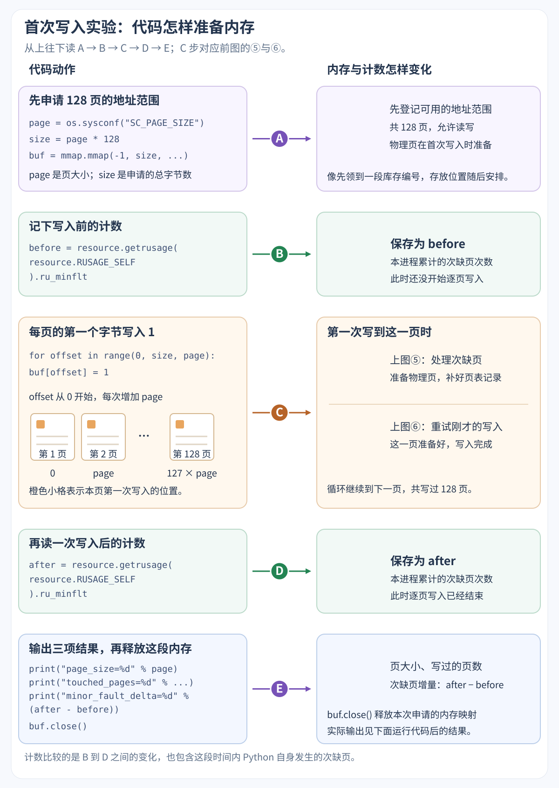
<div style="color:#475569;font-size:13px;margin-top:8px;">本图 A～E 对应下面的代码注释；C 步中的⑤、⑥引用上一张地址翻译图。图中摘录关键代码，完整参数与表达式见下方脚本。</div>
</div>

图里的 `ru_minflt` 是操作系统为本进程记录的累计次缺页次数。B 保存写入前的 `before`，D 保存写入后的 `after`，两者相减就是这段时间的增长量。[计数器说明](https://man7.org/linux/man-pages/man2/getrusage.2.html)

<div style="border-left:6px solid #15803d;background:#dcfce7;padding:12px 16px;border-radius:8px;margin:14px 0;"><span style="display:inline-block;padding:3px 12px;border-radius:6px;background:#15803d;color:#fff;font-weight:800;">需要运行 · 运行 ①</span> <span style="font-weight:700;color:#14532d;">在【课程 Linux 终端】运行；只需 <code>python3</code>；影响范围仅限当前进程申请的这段内存，进程退出即释放；预计数秒。</span></div>

```bash
python3 - <<'PY'
import mmap
import os
import resource

# A. 读取系统页大小，并申请 128 页可读写的匿名内存。
page = os.sysconf("SC_PAGE_SIZE")
size = page * 128
# -1 与 MAP_ANONYMOUS：申请不关联文件的内存。
# MAP_PRIVATE 使用私有映射；PROT_READ/PROT_WRITE 允许程序读写。
buf = mmap.mmap(-1, size,
                flags=mmap.MAP_PRIVATE | mmap.MAP_ANONYMOUS,
                prot=mmap.PROT_READ | mmap.PROT_WRITE)
# B. 记下本进程累计的次缺页次数，作为比较起点。
# 计数覆盖整个进程，也包含 Python 自身发生的次缺页。
before = resource.getrusage(resource.RUSAGE_SELF).ru_minflt

# C. 从第 1 页开始，每次跨过一页，共访问 128 页。
for offset in range(0, size, page):
    # 每页的第一个字节写入数值 1；首次写入会让内核准备这一页。
    buf[offset] = 1

# D. 逐页写完后，再读取一次累计次数。
after = resource.getrusage(resource.RUSAGE_SELF).ru_minflt
# E. 输出页大小、写过的页数和计数增量，随后释放内存映射。
print("page_size=%d" % page)
print("touched_pages=%d" % (size // page))
print("minor_fault_delta=%d" % (after - before))
buf.close()
PY
```

<div style="border-left:6px solid #7e22ce;background:#f3e8ff;padding:12px 16px;border-radius:8px;margin:14px 0;"><span style="display:inline-block;padding:3px 12px;border-radius:6px;background:#7e22ce;color:#fff;font-weight:800;">实测样例 · 输出解读</span> <span style="font-weight:700;color:#581c87;">2026-08-25 在 <code>.101</code> 实测，RUN <code>20260825T045052Z-00-page-fault-shape</code>。三行输出依次是页大小、写过的页数和本进程次缺页增量。</span></div>

```text
page_size=4096
touched_pages=128
minor_fault_delta=128
```

| 字段 | 读法 |
| --- | --- |
| `page_size=4096` | 当前进程看到的页大小为 **4 KiB** |
| `touched_pages=128` | 每页写一次，共写过 128 页 |
| `minor_fault_delta=128` | 这次记录中，进程的次缺页次数增加了 128 |

<div style="border-left:6px solid #0891b2;background:#cffafe;padding:12px 16px;border-radius:8px;margin:14px 0;">
<span style="display:inline-block;padding:3px 12px;border-radius:6px;background:#0891b2;color:#fff;font-weight:800;">关键现象</span>
<div style="font-weight:700;color:#164e63;margin-top:8px;"><strong>对照输出：</strong>看 <code>touched_pages</code> 和 <code>minor_fault_delta</code>：写过 128 页，次缺页增量应接近 128；样例中两项都是 128。</div>
<div style="font-weight:700;color:#164e63;margin-top:6px;"><strong>理解现象：</strong>程序先拿到一段可用地址，第一次往每页写数据时，内核才为这一页准备实际内存，并补上地址对应记录。这正是图中 C 步要观察的过程。</div>
<div style="font-weight:700;color:#164e63;margin-top:6px;"><strong>计数范围：</strong>这里统计的是整个进程，Python 自身的活动也可能让计数多几次，所以结果接近写过的页数即可。</div>
</div>

页面与地址映射准备好，程序才有了可访问的内存。第三个主题看另一种等待：任务已经准备就绪，何时才轮到 CPU 执行？

<a id="4-调度准备好了为什么还要等-cpu"></a>

<a id="wait-cpu"></a>

## 主题三：CPU 调度

<a id="thread-scheduling"></a>

### 3.1 线程与调度：准备好了，为什么还要等 CPU

食材和用具都准备好了，主厨却可能正在处理另一道菜。程序同样可能已经准备好，却在等待 CPU。

<div style="border:2px solid #4f46e5;background:#eef2ff;padding:10px 12px;border-radius:8px;margin:14px 0;">
<div style="font-weight:900;color:#312e81;margin-bottom:4px;">导航卡 · 主题三：CPU 调度</div>
<div style="font-weight:700;color:#312e81;margin-bottom:8px;">类型：原理讲解　这一步回答：任务准备好了，何时轮到 CPU 执行？　进度：全章第 6 / 10 项 · 这一部分第 1 / 2 项</div>
<span style="display:inline-block;margin:3px;padding:4px 10px;border-radius:6px;background:#15803d;color:#fff;font-weight:800;">3.1 线程与调度</span>
<span style="display:inline-block;margin:3px;padding:4px 10px;border-radius:6px;background:#f8fafc;border:1px solid #a5b4fc;color:#312e81;font-weight:800;">3.2 暂停与切换</span>
</div>

**线程（Thread）** 是程序中可以被操作系统单独安排执行的任务，例如专门负责接收行情的任务。可以把线程想成一张任务单，CPU 核心是执行它的主厨。

内核中的**调度器（Scheduler）** 负责选择接下来运行的线程，相当于总控台的排班功能：决定主厨先接哪张已准备好的任务单。[Linux 调度器文档](https://docs.kernel.org/5.15/scheduler/sched-design-CFS.html)

线程已有工作、运行所需的条件也已满足，此时仍可能要等 CPU 的执行机会。**从准备好到真正开始执行之间的这段时间，就是这里要关注的调度等待。**

<div style="background:#f8fafc;border:1px solid #cbd5e1;border-radius:12px;padding:10px;max-width:820px;margin:14px auto;">
<div style="font-weight:900;color:#0f172a;margin-bottom:8px;">从候选线程到处理器 · 先看①～③</div>
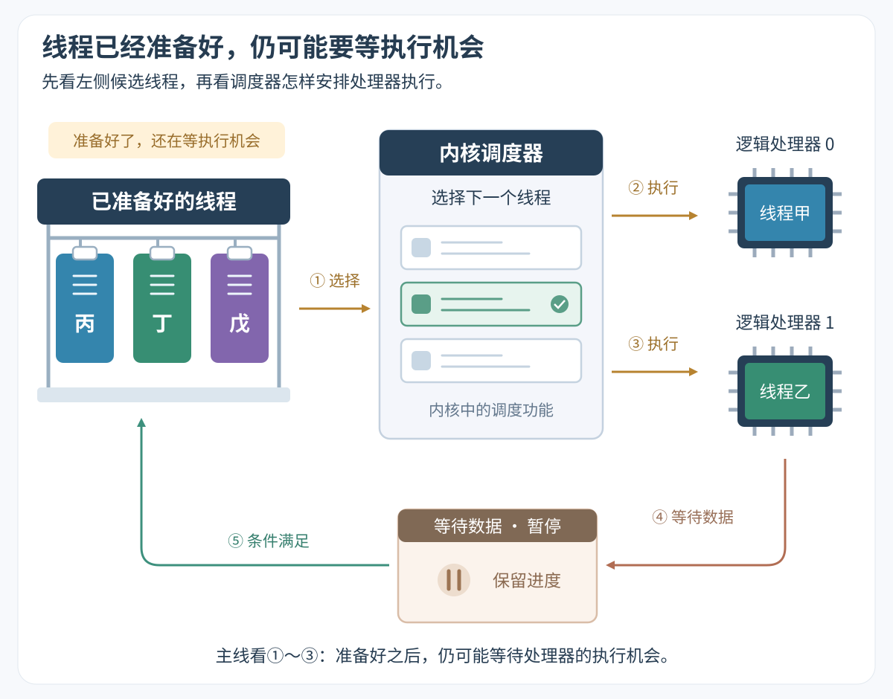
<div style="color:#475569;font-size:13px;margin-top:8px;">①～③看开始前的等待，④⑤看执行中的暂停与恢复。</div>
</div>

| 箭头 | 读图 |
| --- | --- |
| **① 等待与选择** | 线程已准备好（可运行）；处理器可能正忙，仍需等待安排 |
| **②③ 开始执行** | CPU 开始执行被选中的线程 |
| **④ 等待数据** | 执行中暂停等待（阻塞），保留执行状态 |
| **⑤ 条件满足** | 重新变为可运行，等待再次安排；之后从原处继续 |

<a id="cpu-placement"></a>

<a id="32-切换与-cpu-选择执行中会发生什么"></a>

### 3.2 暂停与切换：开始执行后，为什么还会等

主厨做到一半，可能要等食材，也可能先去处理另一张任务单。线程开始运行后，同样可能暂停。

<div style="border:2px solid #4f46e5;background:#eef2ff;padding:10px 12px;border-radius:8px;margin:14px 0;">
<div style="font-weight:900;color:#312e81;margin-bottom:4px;">导航卡 · 主题三：CPU 调度</div>
<div style="font-weight:700;color:#312e81;margin-bottom:8px;">类型：原理讲解　这一步回答：任务开始执行后，为什么还可能暂停？　进度：全章第 7 / 10 项 · 这一部分第 2 / 2 项</div>
<span style="display:inline-block;margin:3px;padding:4px 10px;border-radius:6px;background:#f8fafc;border:1px solid #a5b4fc;color:#312e81;font-weight:800;">3.1 线程与调度</span>
<span style="display:inline-block;margin:3px;padding:4px 10px;border-radius:6px;background:#15803d;color:#fff;font-weight:800;">3.2 暂停与切换</span>
</div>

系统先保存当前线程的执行状态，再切换去执行另一个线程，这叫**上下文切换（Context Switch）**。原线程重新获得 CPU 后，可以从暂停处继续。

**切换本身也要花时间。** 每次保存、恢复状态都要占用 CPU 时间；频繁切换会增加这部分开销。[Linux：调度切换与延迟](https://www.kernel.org/doc/html/latest/admin-guide/cpu-isolation.html#full-dynticks-aka-nohz-full)

**任务耗时里，既有 CPU 实际处理的时间，也有等待执行、等待数据的时间。** 后续实验会观察这些等待怎样影响交易程序。

前三个等待点已经分清：取数据、准备内存、等 CPU 执行。第四个主题回到收货口，看报文从网卡到应用的交接过程。

<a id="5-通知与收包报文怎样交到程序手里"></a>

<a id="wait-receive"></a>

## 主题四：如何收包

<a id="receive-buffer-dma"></a>

### 4.1 缓冲区与 DMA：先备好位置，再放进报文

报文到达应用之前，先要进入主机内存。这一步分清两个动作：驱动准备存放位置，网卡把报文搬进去。

<div style="border:2px solid #4f46e5;background:#eef2ff;padding:10px 12px;border-radius:8px;margin:14px 0;">
<div style="font-weight:900;color:#312e81;margin-bottom:4px;">导航卡 · 主题四：如何收包</div>
<div style="font-weight:700;color:#312e81;margin-bottom:8px;">类型：原理讲解　这一步回答：谁准备存放位置，谁把报文放进去？　进度：全章第 8 / 10 项 · 这一部分第 1 / 2 项</div>
<span style="display:inline-block;margin:3px;padding:4px 10px;border-radius:6px;background:#15803d;color:#fff;font-weight:800;">4.1 缓冲区与 DMA</span>
<span style="display:inline-block;margin:3px;padding:4px 10px;border-radius:6px;background:#f8fafc;border:1px solid #a5b4fc;color:#312e81;font-weight:800;">4.2 通知与应用读取</span>
</div>

沿用厨房的收货比喻：先备好存货区，把位置写进清单，再由网卡照单放货。

| 收货分工 | 名字与职责 |
| --- | --- |
| **存货区** | **接收缓冲区（RX Buffer）**：主机内存中预先准备的空间，用来存放报文 |
| **位置清单** | **接收描述符（RX Descriptor）**：由驱动准备的记录，告诉网卡可把报文写到哪里 |
| **照单放货** | **直接内存访问（DMA）**：网卡直接把报文字节写入主机内存，这段搬运无需 CPU 逐字节复制 |

驱动先把缓冲区及相关记录准备好，再交给网卡使用；后续验收与业务处理仍要由 CPU 执行。[Linux DMA 指南](https://docs.kernel.org/core-api/dma-api-howto.html)

报文已经放进内存，下一步还要安排处理，才能交给应用读取。

<a id="receive-delivery"></a>

### 4.2 通知与应用读取：报文怎样交到程序手里

存货区里有了报文，就像食材已经送达；还要通知验收、处理，再摆到备菜台，主厨才能取用。普通收包同样需要内核处理后，再由应用线程读取。

<div style="border:2px solid #4f46e5;background:#eef2ff;padding:10px 12px;border-radius:8px;margin:14px 0;">
<div style="font-weight:900;color:#312e81;margin-bottom:4px;">导航卡 · 主题四：如何收包</div>
<div style="font-weight:700;color:#312e81;margin-bottom:8px;">类型：原理讲解　这一步回答：报文放进内存后，还要经过哪些处理？　进度：全章第 9 / 10 项 · 这一部分第 2 / 2 项</div>
<span style="display:inline-block;margin:3px;padding:4px 10px;border-radius:6px;background:#f8fafc;border:1px solid #a5b4fc;color:#312e81;font-weight:800;">4.1 缓冲区与 DMA</span>
<span style="display:inline-block;margin:3px;padding:4px 10px;border-radius:6px;background:#15803d;color:#fff;font-weight:800;">4.2 通知与应用读取</span>
</div>

<div style="background:#f8fafc;border:1px solid #cbd5e1;border-radius:12px;padding:10px;max-width:820px;margin:14px auto;">
<div style="font-weight:900;color:#0f172a;margin-bottom:8px;">普通收包 · 从收货口到主厨</div>
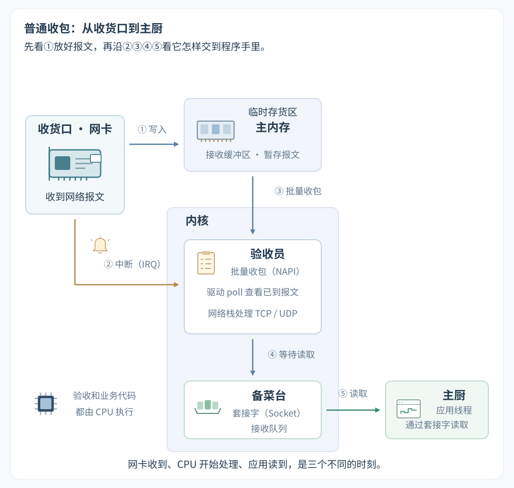
<div style="color:#475569;font-size:13px;margin-top:8px;">①先放好报文，再沿②③④⑤看交接。网卡收到、CPU开始处理、应用读到，是三个不同的时刻。</div>
</div>

| 图中编号与角色 | 在服务器里做什么 |
| --- | --- |
| **① 存货区** | 接收缓冲区是主内存中暂存报文的位置，网卡先把报文写进去 |
| **② 铃声：中断（IRQ）** | 通知有报文待处理；响应通知时先安排收包工作 |
| **③ 验收员：NAPI 批量收包** | NAPI 是内核安排网络事件处理的机制；驱动的 `poll` 查看已到内存的报文，一次可以处理多个。网络栈接着处理 TCP、UDP 等协议 |
| **④ 备菜台：套接字接收队列** | 存放待应用读取的接收数据；套接字（Socket）是程序收发数据的接口 |
| **⑤ 主厨：应用线程** | 获得执行机会后，读取数据，继续处理业务 |

**铃响只说明有货要收。** 批量验收、协议处理和应用读取都需要时间；一次通知可以对应一批报文，中断数与报文数没有固定比例。这些软件工作都由 CPU 执行。[Linux NAPI 文档](https://docs.kernel.org/networking/napi.html)

四个主题都已讲到。下面把它们放回同一条行情处理路径，看每一种等待发生在哪里。

<a id="6-一页总结把四个等待点放回行情处理路径"></a>

<a id="four-waits-summary"></a>

## 一页总结：把四个等待点放回行情处理路径

回到一条行情：网卡把报文放进内存，CPU 执行内核和应用的处理代码。图中的 A～D 分别对应刚学过的四个主题。

<div style="border:2px solid #4f46e5;background:#eef2ff;padding:10px 12px;border-radius:8px;margin:14px 0;">
<div style="font-weight:900;color:#312e81;margin-bottom:4px;">导航卡 · 回顾：四个等待点</div>
<div style="font-weight:700;color:#312e81;margin-bottom:8px;">类型：回顾整理　这一步回答：一条行情的处理过程中，四种等待各在哪里？　进度：全章第 10 / 10 项 · 这一部分第 1 / 1 项</div>
<span style="display:inline-block;margin:3px;padding:4px 10px;border-radius:6px;background:#15803d;color:#fff;font-weight:800;">一页总结</span>
</div>

<div style="background:#f8fafc;border:1px solid #cbd5e1;border-radius:12px;padding:10px;max-width:820px;margin:14px auto;">
<div style="font-weight:900;color:#0f172a;margin-bottom:8px;">行情处理路径 · 四个等待点各在哪里</div>
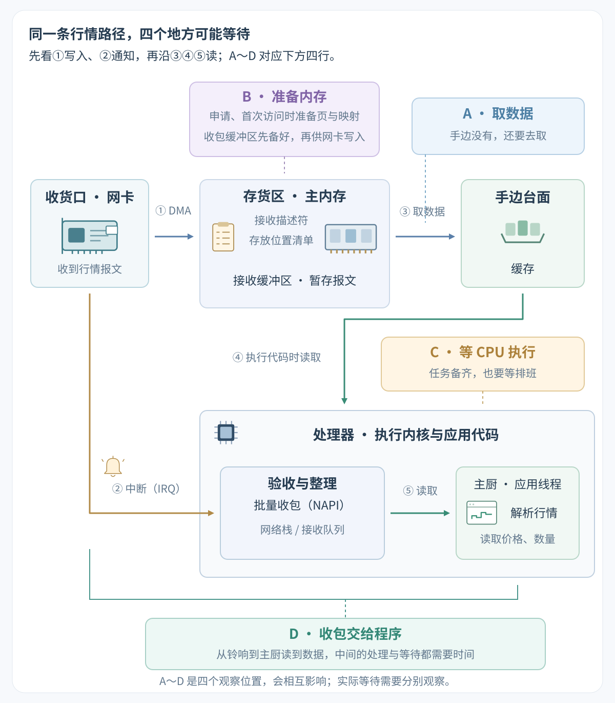
<div style="color:#475569;font-size:13px;margin-top:8px;">常见中断驱动路径：①写入内存 → ②中断通知 → ③④取数并处理 → ⑤应用读取。网卡收到、CPU开始处理、应用读到，是三个不同的时刻；A～D标出可能的等待。</div>
</div>

| 图中等待点 | 为什么会等 | 回到本章哪里 |
| --- | --- | --- |
| **A · 取数据** | 当前缓存没有所需数据，还要从其他缓存或主内存取得 | [主题一：缓存与局部性](#wait-data) |
| **B · 准备内存** | 程序申请或首次访问时，实际空间与地址映射可能还需准备；收包缓冲区要提前备好 | [主题二：地址、映射与首次写入](#wait-memory) |
| **C · CPU 调度** | 任务已经就绪，还要等执行机会；运行中也可能被换下 | [主题三：等待执行、暂停与切换](#wait-cpu) |
| **D · 如何收包** | 报文进了内存，还要经过通知、内核处理和应用读取 | [主题四：DMA 到应用读取](#wait-receive) |

**交给第 01 章的问题：** 接下来去真实机器上认网卡、驱动和接线，再用抓包确认报文到了哪里，把本章的收包流程对应到具体设备。第 04 章继续测量和比较主机内部的等待，第 05 章比较不同收发路径。

## 理解检查

1. **取数据：** 价格和数量落在同一条缓存行里，为什么可能比散落在两条缓存行里更方便读取？
2. **准备内存：** 程序申请到一段地址，是否表示每一页的实际内存都已准备好？本章怎样观察？
3. **CPU 调度：** 线程已经可以运行，是否表示此刻就有 CPU 在执行它？
4. **如何收包：** 网卡完成 DMA 搬运或发出中断通知，是否表示应用已经处理完报文？

**参考要点：**

1. 取回一条缓存行就可能同时拿到两个字段；本课机器一条缓存行为 64 B。
2. 不一定。本章先申请匿名内存，再往每页写一次，观察次缺页计数增长；本课普通页为 4 KiB。
3. 不一定。调度器还要为它安排执行机会，已经就绪的线程仍可能在等待。
4. 不表示。驱动先准备接收缓冲区与位置记录，网卡按记录搬运；之后还要由 CPU 执行内核协议处理，应用线程再读取和处理数据。

## 清理与下一步

实验进程退出后，申请的内存自动释放。接着进入[第 01 章：设备与接线](01-financial-low-latency-architecture.md)。

配套脚本与历史机器规格放在[教师说明](assets/00-basics/TEACHER-NOTES.md)。

## 延伸阅读

本章主机原理主要依据 Linux 内核文档与 Intel 优化手册；业务与技术来源汇总如下。

| 资料 | 继续查什么 |
| --- | --- |
| [CFA Institute：量化投资方法（2026 教材）](https://www.cfainstitute.org/insights/professional-learning/refresher-readings/2026/active-equity-investing-strategies) | 规则、模型与投资决策的关系 |
| [SEC 工作人员算法交易报告（2020）](https://www.sec.gov/files/marketstructure/research/algo_trading_report_2020.pdf) | 算法的多种用途、高频特征、交易系统风险；§I.C、IV.C—D |
| [AQR：系统化股票投资](https://www.aqr.com/Learning-Center/Systematic-Equities) | 用数据与可衡量特征比较股票、构建投资组合 |
| [Man AHL：量化投资方法](https://www.man.com/ahl) | 用统计分析识别趋势等规律，并形成系统化交易方法 |
| [BIS：交易与撤单的速度竞赛（2021）](https://www.bis.org/publications/working-paper-955-quantifying-high-frequency-trading-arms-race) | 为什么旧报价的成交与撤单会形成竞争 |
| [BIS：电子交易、做市与对冲（2016）](https://www.bis.org/publications/hanging-phone-electronic-trading-fixed-income-markets-and-its-implications) | 银行和交易商怎样用自动报价与对冲管理风险 |
| [BIS：外汇执行算法（2020）](https://www.bis.org/publications/fx-execution-algorithms-and-market-functioning) | 拆分交易、选择执行场所与执行风险 |
| [Optiver：定价、风险与执行（2024）](https://www.optiver.com/insights/technology-blog/engineering-the-three-pillars-of-trading-pricing-risk-and-execution/) | 专业做市商的工程职责及及时发布报价的需求 |
| [岗位与课程对应的核对记录](assets/00-basics/JOB-REQUIREMENTS-20260914.md) | 官方岗位原文、要求层级与课程覆盖边界；招聘链接也已就近放入正文岗位表 |
| [Intel 优化手册](https://www.intel.com/content/dam/doc/manual/64-ia-32-architectures-optimization-manual.pdf) | 缓存、主内存与指令等待 |
| [Linux 内存管理](https://docs.kernel.org/admin-guide/mm/index.html) | 内存分配与映射 |
| [Linux 进程资源计数](https://man7.org/linux/man-pages/man2/getrusage.2.html) | 次缺页计数属于整个进程 |
| [Intel 64 and IA-32 Architectures Software Developer Manuals](https://www.intel.com/content/www/us/en/developer/articles/technical/intel-sdm.html) | CPU 架构、内存管理与中断 |
| [Linux 5.15 CFS Scheduler](https://docs.kernel.org/5.15/scheduler/sched-design-CFS.html) | 本课机器内核版本（5.15）对应的调度设计入口 |
| [Linux 页表](https://docs.kernel.org/mm/page_tables.html) | 虚拟地址、物理地址与映射 |
| [Linux 大页](https://docs.kernel.org/admin-guide/mm/hugetlbpage.html) | 大页的用途与配置边界 |
| [Linux NAPI](https://docs.kernel.org/networking/napi.html) | 通知之后怎样批量处理已到报文 |
| [Linux 中断](https://docs.kernel.org/core-api/irq/concepts.html) | 设备发出的中断请求 |
| [Linux DMA 指南](https://docs.kernel.org/core-api/dma-api-howto.html) | 驱动准备与设备直接读写内存 |
