# 第 01 章：认清实验环境——接线、网卡、驱动与交换机

## 先把一条报文的路认清

第 00 章解释了报文进入主机后怎样等待和处理。本章把视线移到真实设备：管理口能登录，数据口就一定能收到报文吗？我们沿着接线检查，最后发送三条 ping 请求，在接收端把它们记录到抓包文件（pcap）中。

继续用厨房来想：报文是一箱箱送来的食材，数据网口是收货口。收货口旁的自动搬运设备像网卡，PCIe 是通往存货区的内部通道，主机内存就是存货区。

<div style="background:#f8fafc;border:1px solid #cbd5e1;border-radius:12px;padding:10px;max-width:820px;margin:14px auto;">
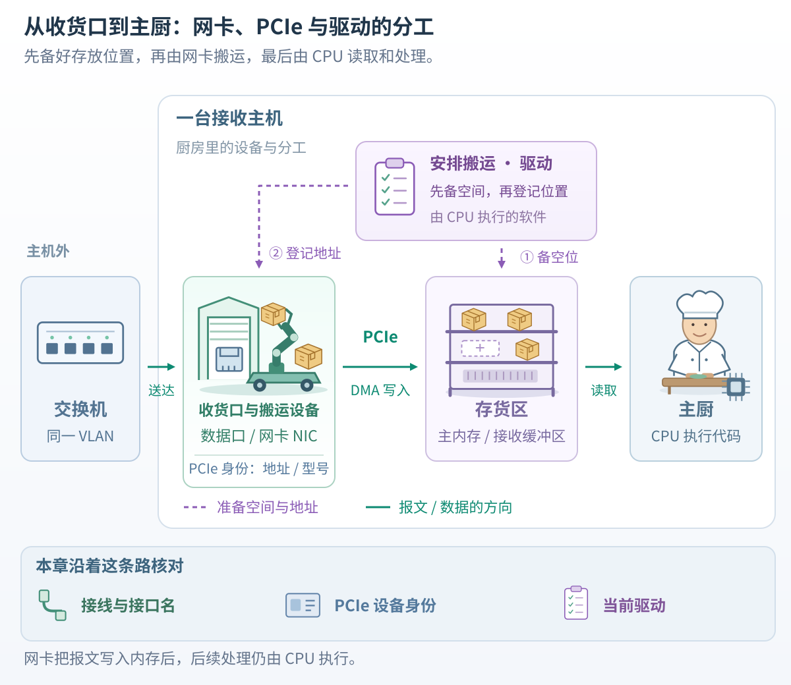
</div>

**驱动先备好接收缓冲区，再把可用地址交给网卡；网卡经 PCIe 用 DMA 把报文写入内存。** DMA 是直接内存访问，这段搬运无需 CPU 逐字节复制；驱动和后续处理仍是 CPU 执行的代码。[Linux DMA 指南](https://docs.kernel.org/core-api/dma-api-howto.html)

交换机连接两端的数据口，VLAN 划定它们所在的二层网络。

本章的检查围绕两台虚拟机（VM）展开：`.1`（`10.1.1.1`）将运行交易所程序 Exchange，`.2`（`10.1.1.2`）将运行交易客户端 Trader。准备阶段还会为 `.1`、`.2`、`.11`、`.101` 四台 VM 补齐工具，恢复交换机登录并配置数据网络。第 02 章再让交易程序使用这条通路。

## 本章学习目标

1. 看懂课程接线，分清每台主机的管理口、X2522 数据口和对应 Arista 端口。
2. 按“接口名 → 设备地址与型号 → 驱动 → 两端链路 → 抓包”逐步核对。
3. 区分接口已启用、链路已连接和报文已到达，按输出判断检查进行到哪一步。
4. 选读[沪市接入案例](#market-access-cases)，认识客户、券商与交易所之间的网络组成。

<div style="border-left:6px solid #7e22ce;background:#f3e8ff;padding:12px 16px;border-radius:8px;margin:14px 0;"><span style="display:inline-block;padding:3px 12px;border-radius:6px;background:#7e22ce;color:#fff;font-weight:800;">本章检查范围</span> <span style="font-weight:700;color:#581c87;">本章检查接口、设备、驱动和链路，并用三条 ping 确认报文到达。交易程序的收发从第 02 章开始。</span></div>

**交换机配置约定：** 本课只修改当前生效的 `running-config`，不保存到 `startup-config`；重启后需重新完成公钥登录与数据网络准备。

## 实验台接线总览

<div style="border-left:6px solid #7e22ce;background:#f3e8ff;padding:12px 16px;border-radius:8px;margin:14px 0;"><span style="display:inline-block;padding:3px 12px;border-radius:6px;background:#7e22ce;color:#fff;font-weight:800;">关键图</span> <span style="font-weight:700;color:#581c87;">全课程实验台接线总览：先认设备与接口归属，再沿四根 DAC 查 IP 和交换机端口；底部保留尚未接入的硬件延伸设计。</span></div>

<div style="background:#f8fafc;border:1px solid #cbd5e1;border-radius:12px;padding:10px;max-width:820px;margin:14px auto;">
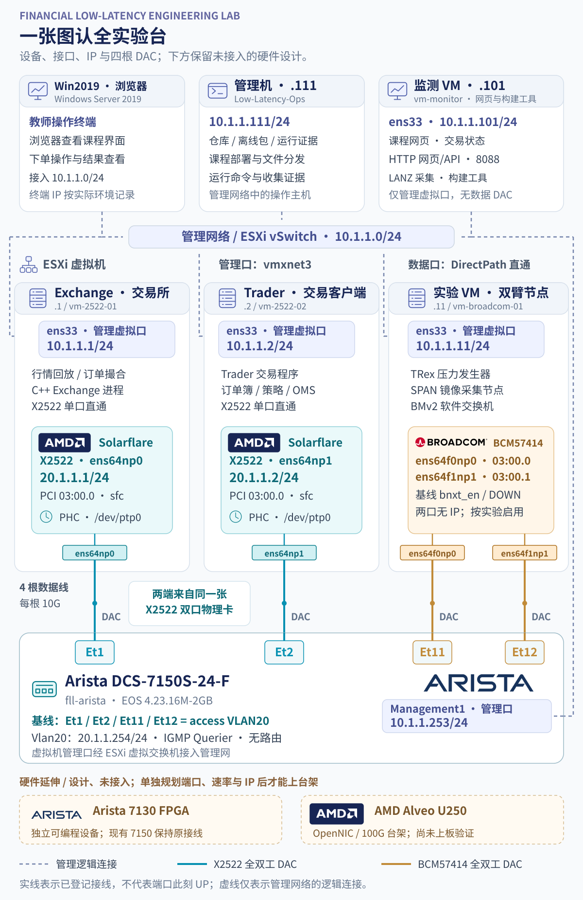
</div>

**先认管理网中的设备：**

| 设备 | 角色 | 管理地址 |
| --- | --- | --- |
| `.111` | 管理机，课程命令中也称跳板机 | `10.1.1.111` |
| `.101` | 监测 VM；网页后台（Gateway）；构建机（Builder，编译课程源码） | `10.1.1.101` |
| `.1` | Exchange VM | `10.1.1.1` |
| `.2` | Trader VM | `10.1.1.2` |
| `.11` | 实验 VM | `10.1.1.11` |
| Arista | 交换机 | `10.1.1.253` |

这些设备接入 `10.1.1.0/24` 管理网，图中虚线表示管理连接。`.1/.2/.11` 的管理口均为 `ens33`，通过 ESXi 虚拟交换机（vSwitch）接入；`.101` 使用虚拟管理口，Arista 使用 `Management1`。

**再看数据线与预留硬件：**

- **沿接口名核对四根数据线。** `.1` 的 `ens64np0` 接 Et1，`.2` 的 `ens64np1` 接 Et2，两者各使用同一张 X2522 双口卡的一口，通过直通方式分配——宿主机把对应网口整体交给虚拟机；`.11` 的 BCM57414 接口 `ens64f0np0`、`ens64f1np1` 分别接 Et11、Et12。每条实线代表一根 10G 全双工直连铜缆（DAC）。
- **区分已接入设备与硬件延伸设计。** 底部 Arista 7130 FPGA、AMD Alveo U250 尚未接入，未分配实际接线或 IP；它们保留为硬件设计示意。

本章通过 `10.1.1.x` 管理网登录设备，在 `20.1.1.x` 数据网发送并抓取 ping 请求。后续交易程序的通信方向和端口见[章末查阅图](#appendix-flows)。

## 本章导航

<div style="border-left:6px solid #7e22ce;background:#f3e8ff;padding:12px 16px;border-radius:8px;margin:14px 0;"><span style="display:inline-block;padding:3px 12px;border-radius:6px;background:#7e22ce;color:#fff;font-weight:800;">本章导航</span> <span style="font-weight:700;color:#581c87;">前三组共 8 项，完成准备与五步检查；第 9 项是章末选读扩展。大框从上往下推进，框内从左往右执行。</span></div>

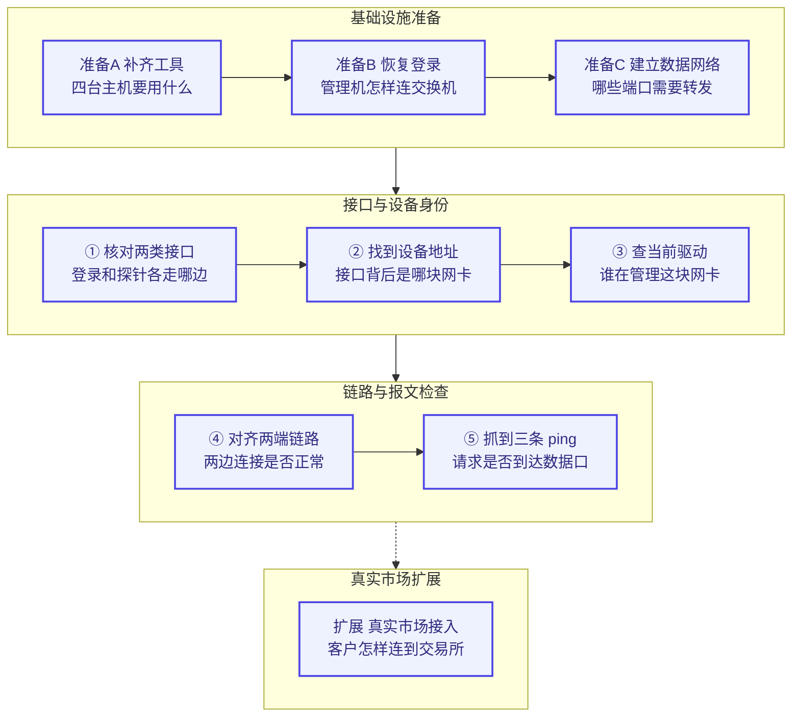

实验顺序：**基础设施准备 → 接口与设备身份 → 链路与报文检查**。完成总结与理解检查后，可选读真实市场扩展。

## 准备 A：核对系统并补齐工具

<div style="border:2px solid #4f46e5;background:#eef2ff;padding:10px 12px;border-radius:8px;margin:14px 0;"><div style="font-weight:900;color:#312e81;margin-bottom:4px;">导航卡 · 基础设施准备</div><div style="font-weight:700;color:#312e81;margin-bottom:8px;">范畴：工具准备　本步知识：四台主机需要哪些基础工具　位置：全章第 1 / 9 项 · 本组第 1 / 3 项</div><span style="display:inline-block;margin:3px;padding:4px 10px;border-radius:6px;background:#15803d;color:#fff;font-weight:800;">准备 A：核对系统并补齐工具</span><span style="display:inline-block;margin:3px;padding:4px 10px;border-radius:6px;background:#f8fafc;border:1px solid #a5b4fc;color:#312e81;font-weight:800;">准备 B：恢复交换机公钥登录</span><span style="display:inline-block;margin:3px;padding:4px 10px;border-radius:6px;background:#f8fafc;border:1px solid #a5b4fc;color:#312e81;font-weight:800;">准备 C：建立课程交换基础拓扑</span></div>

`.101` 兼任构建机，本步同时安装第 02 章编译所需的 `g++-11` 和 `make`。

<div style="border-left:6px solid #15803d;background:#dcfce7;padding:12px 16px;border-radius:8px;margin:14px 0;"><span style="display:inline-block;padding:3px 12px;border-radius:6px;background:#15803d;color:#fff;font-weight:800;">需要运行 · 准备 A</span> <span style="font-weight:700;color:#14532d;">在【跳板机 .111】以 root 运行；顺序处理 <code>.1/.2/.11/.101</code>；核对四台 VM 的 Ubuntu 22.04/amd64 并统一维护用软件源；从 <code>.111</code> 缓存补齐四机基础工具，并给 <code>.101</code> 安装 <code>g++-11</code> 与 <code>make</code>，不访问公网；预期四台系统检查通过且 <code>.101</code> 打印三项工具路径。</span></div>

```bash
#!/usr/bin/env bash
set -Eeuo pipefail
cd /qyt-fll
RUN_ID="$(date -u +%Y%m%dT%H%M%SZ)-01-vm-apt-china-mirror"
OUT="reports/course-runs/$RUN_ID"; mkdir -p "$OUT/raw"
printf 'RUN_ID=%s\n' "$RUN_ID" >"$OUT/run.env"

{
python3 artifacts/tools/check-course-package-cache.py
for host in 10.1.1.1 10.1.1.2 10.1.1.11 10.1.1.101; do
  printf '\n%s / prepare\n===== 补齐基础工具 =====\n从管理机离线缓存安装本机需要的工具。\n$ python3 assets/common/install-offline-packages.py %s base\n' "$host" "$host"
  python3 assets/common/install-offline-packages.py "$host" base
  if [ "$host" = 10.1.1.101 ]; then
    printf '===== 补齐编译工具 =====\n监测 VM 同时负责编译第二部分的交易程序。\n$ python3 assets/common/install-offline-packages.py %s builder\n' "$host"
    python3 assets/common/install-offline-packages.py "$host" builder
  fi
  ssh -o BatchMode=yes -o StrictHostKeyChecking=yes "root@$host" \
    bash -s -- "$host" <<'REMOTE'
set -Eeuo pipefail
REMOTE_HOST="$1"
. /etc/os-release
printf '%s / verify\n===== 查系统版本 =====\n[系统] 对: Ubuntu 22.04（jammy）  证: 与课程离线软件包匹配\n$ cat /etc/os-release\n' "$REMOTE_HOST"; cat /etc/os-release
printf '===== 查处理器架构 =====\n[架构] 对: amd64  证: 与课程软件包的架构一致\n$ dpkg --print-architecture\n'; dpkg --print-architecture
if [ "$ID" != ubuntu ] || [ "$VERSION_CODENAME" != jammy ]; then
  printf 'STOP: this card expects Ubuntu jammy\n' >&2; exit 1
fi
[ -e /etc/apt/sources.list.flle-original ] || cp -a /etc/apt/sources.list /etc/apt/sources.list.flle-original
install -m 0644 /dev/stdin /etc/apt/sources.list <<'SOURCES'
deb https://mirrors.aliyun.com/ubuntu/ jammy main restricted universe multiverse
deb https://mirrors.aliyun.com/ubuntu/ jammy-updates main restricted universe multiverse
deb https://mirrors.aliyun.com/ubuntu/ jammy-backports main restricted universe multiverse
deb https://mirrors.aliyun.com/ubuntu/ jammy-security main restricted universe multiverse
SOURCES
printf '===== 查维护用软件源 =====\n[软件源] 对: 四行 jammy 系列地址  证: 日后维护的来源已登记；本次安装仍使用离线缓存\n$ cat /etc/apt/sources.list\n'; cat /etc/apt/sources.list
printf '系统检查通过；课堂安装使用 .111 离线缓存，不刷新公网索引。\n'
if [ "$REMOTE_HOST" = 10.1.1.101 ]; then
  printf '\n%s / verify\n===== 查编译工具 =====\n[编译工具] 对: 三项都有 /usr/bin/ 下的路径  证: 监测 VM 已能调用第二部分需要的编译与脚本工具\n$ command -v g++-11 make python3\n' "$REMOTE_HOST"; command -v g++-11 make python3
  printf '===== 查编译器版本 =====\n[编译器] 对: g++-11，版本 11.4.0  证: 明确本次构建使用的 C++ 编译器版本\n$ g++-11 --version | head -1\n'; g++-11 --version | head -1
fi
REMOTE
done
} 2>&1 | tee "$OUT/raw/result.txt"
(cd "$OUT" && sha256sum raw/result.txt run.env >SHA256SUMS); printf 'evidence=%s\n' "$OUT"
```

<div style="border-left:6px solid #7e22ce;background:#f3e8ff;padding:12px 16px;border-radius:8px;margin:14px 0;"><span style="display:inline-block;padding:3px 12px;border-radius:6px;background:#7e22ce;color:#fff;font-weight:800;">仅供展示 · 输出解读</span> <span style="font-weight:700;color:#581c87;"><code>.101</code> 的工具检查，只摘命令与三项路径。</span></div>

```text
$ command -v g++-11 make python3
/usr/bin/g++-11
/usr/bin/make
/usr/bin/python3
```

<div style="border-left:6px solid #0891b2;background:#cffafe;padding:12px 16px;border-radius:8px;margin:14px 0;"><span style="display:inline-block;padding:3px 12px;border-radius:6px;background:#0891b2;color:#fff;font-weight:800;">完成后继续</span> <span style="font-weight:700;color:#164e63;">四台系统检查与 <code>.101</code> 工具校验通过后，进入准备 B；出现报错先处理。</span></div>

## 准备 B：恢复交换机公钥登录

<div style="border:2px solid #4f46e5;background:#eef2ff;padding:10px 12px;border-radius:8px;margin:14px 0;"><div style="font-weight:900;color:#312e81;margin-bottom:4px;">导航卡 · 基础设施准备</div><div style="font-weight:700;color:#312e81;margin-bottom:8px;">范畴：工具准备　本步知识：怎样确认交换机身份并恢复登录　位置：全章第 2 / 9 项 · 本组第 2 / 3 项</div><span style="display:inline-block;margin:3px;padding:4px 10px;border-radius:6px;background:#f8fafc;border:1px solid #a5b4fc;color:#312e81;font-weight:800;">准备 A：核对系统并补齐工具</span><span style="display:inline-block;margin:3px;padding:4px 10px;border-radius:6px;background:#15803d;color:#fff;font-weight:800;">准备 B：恢复交换机公钥登录</span><span style="display:inline-block;margin:3px;padding:4px 10px;border-radius:6px;background:#f8fafc;border:1px solid #a5b4fc;color:#312e81;font-weight:800;">准备 C：建立课程交换基础拓扑</span></div>

Arista 交换机运行的操作系统叫 EOS。先核对设备身份，再恢复 SSH 公钥登录。

<div style="border-left:6px solid #7e22ce;background:#f3e8ff;padding:12px 16px;border-radius:8px;margin:14px 0;"><span style="display:inline-block;padding:3px 12px;border-radius:6px;background:#7e22ce;color:#fff;font-weight:800;">仅供展示 · 配机前先认身份</span> <span style="font-weight:700;color:#581c87;">在交换机控制台执行 <code>show version</code>，核对型号、系统版本和主机名。示例中的序列号已隐藏。</span></div>

```text
fll-arista#show version
Arista DCS-7150S-24-F
Hardware version:      02.00
Serial number:         （设备序列号略）
Hardware MAC address:  001c.7368.e239
System MAC address:    001c.7368.e239

Software image version: 4.23.16M-2GB
Architecture:           i686
Internal build version: 4.23.16M-2GB-40226546.42316M
Internal build ID:      bb71297b-4523-465f-a576-6c7d1cb24663

Uptime:                 0 weeks, 2 days, 11 hours and 55 minutes
Total memory:           4009040 kB
Free memory:            3065276 kB
```

| 看哪一行 | 记录值 | 它表示什么 |
|---|---|---|
| 提示符 `fll-arista#` | 主机名已是课程名 | 课程主机名；与型号、管理地址一并核对所连设备 |
| `DCS-7150S-24-F` / `Hardware version: 02.00` | 24 口 7150S | 本章的 VLAN20 和 10G DAC 接在这台交换机上 |
| `Software image version: 4.23.16M-2GB` | i686，build `4.23.16M-2GB-40226546.42316M` | 本章公钥和 VLAN 命令的实测版本 |
| `Hardware MAC` / `System MAC` | `001c.7368.e239` | 交换机自己的系统 MAC，不是 `.1` / `.2` 网卡 MAC |

<div style="border-left:6px solid #15803d;background:#dcfce7;padding:12px 16px;border-radius:8px;margin:14px 0;"><span style="display:inline-block;padding:3px 12px;border-radius:6px;background:#15803d;color:#fff;font-weight:800;">需要运行 · 准备 B</span> <span style="font-weight:700;color:#14532d;">在【跳板机 .111】以 root 运行；需要时按终端提示输入交换机登录密码；完成后应能通过公钥登录，并看到用户账户信息。</span></div>

```bash
#!/usr/bin/env bash
set -Eeuo pipefail
cd /qyt-fll
RUN_ID="$(date -u +%Y%m%dT%H%M%SZ)-01-eos-key-bootstrap"
OUT="reports/course-runs/$RUN_ID"; mkdir -p "$OUT/raw"
printf 'RUN_ID=%s\n' "$RUN_ID" >"$OUT/run.env"

python3 assets/common/eos-key-bootstrap.py \
  >"$OUT/raw/bootstrap-tool.txt" 2>&1
printf '%s\n' 'show users accounts' >"$OUT/raw/eos.plan"
printf '===== admin@10.1.1.253 · EOS public key =====\n'; python3 assets/common/eos_cli.py --mode show \
  --plan "$OUT/raw/eos.plan" --output "$OUT/raw/eos.txt" \
  2>&1 | tee "$OUT/raw/eos-terminal.txt"
(cd "$OUT" && sha256sum raw/* run.env >SHA256SUMS); printf 'evidence=%s\n' "$OUT"
```

<div style="border-left:6px solid #7e22ce;background:#f3e8ff;padding:12px 16px;border-radius:8px;margin:14px 0;"><span style="display:inline-block;padding:3px 12px;border-radius:6px;background:#7e22ce;color:#fff;font-weight:800;">仅供展示 · 关键命令</span> <span style="font-weight:700;color:#581c87;">下面代码块用于讲解脚本发给交换机的命令，不需要执行。</span></div>

```text
switch> enable
switch# configure terminal
switch(config)# username admin ssh-key ssh-ed25519 <公钥正文> flle-course-jump-host-20260722
switch(config)# end
switch# show users accounts
```

| EOS 命令 | 作用 |
| --- | --- |
| `enable` | 必要时从 `>` 进入特权模式 |
| `configure terminal` | 进入 running-config 配置模式 |
| `username admin ssh-key …` | 给 `admin` 安装课程公钥 |
| `end` | 退出配置模式 |
| `show users accounts` | 查看账户、角色与公钥 |

公钥正文是一长串字符，示例用 `<公钥正文>` 代替显示。脚本会从 `/root/.ssh/flle_course_ed25519.pub` 读取完整公钥，自动组成这条配置命令并发送给交换机。

末尾的 `flle-course-jump-host-20260722` 是公钥的备注名，用于标识来源。

<div style="border-left:6px solid #7e22ce;background:#f3e8ff;padding:12px 16px;border-radius:8px;margin:14px 0;"><span style="display:inline-block;padding:3px 12px;border-radius:6px;background:#7e22ce;color:#fff;font-weight:800;">仅供展示 · 账户信息</span> <span style="font-weight:700;color:#581c87;">执行 <code>show users accounts</code>，查看用户账户信息。</span></div>

```text
$ show users accounts
user: admin
       role: network-admin
       privilege level: 15
       ssh public key: ssh-ed25519 AAAA…（公钥内容略） flle-course-jump-host-20260722
```

| 关键行 | 判断 |
| --- | --- |
| `user: admin` / `role: network-admin` | 课程使用的账户和角色存在 |
| `privilege level: 15` | 后续 show 与受控配置命令可执行 |
| `ssh public key: ssh-ed25519 …` | 课程公钥已在 running-config 中，免密登录可用 |

<div style="border-left:6px solid #0891b2;background:#cffafe;padding:12px 16px;border-radius:8px;margin:14px 0;"><span style="display:inline-block;padding:3px 12px;border-radius:6px;background:#0891b2;color:#fff;font-weight:800;">完成后继续</span> <span style="font-weight:700;color:#164e63;">公钥登录成功、账户信息核对无误后，进入准备 C；出现报错先处理。</span></div>

## 准备 C：建立课程交换基础拓扑

<div style="border:2px solid #4f46e5;background:#eef2ff;padding:10px 12px;border-radius:8px;margin:14px 0;"><div style="font-weight:900;color:#312e81;margin-bottom:4px;">导航卡 · 基础设施准备</div><div style="font-weight:700;color:#312e81;margin-bottom:8px;">范畴：工具准备　本步知识：哪些端口需要加入数据网络　位置：全章第 3 / 9 项 · 本组第 3 / 3 项</div><span style="display:inline-block;margin:3px;padding:4px 10px;border-radius:6px;background:#f8fafc;border:1px solid #a5b4fc;color:#312e81;font-weight:800;">准备 A：核对系统并补齐工具</span><span style="display:inline-block;margin:3px;padding:4px 10px;border-radius:6px;background:#f8fafc;border:1px solid #a5b4fc;color:#312e81;font-weight:800;">准备 B：恢复交换机公钥登录</span><span style="display:inline-block;margin:3px;padding:4px 10px;border-radius:6px;background:#15803d;color:#fff;font-weight:800;">准备 C：建立课程交换基础拓扑</span></div>

把 Et1、Et2、Et11、Et12 划入 VLAN20，并配置交换机自身的 `Vlan20` 地址。脚本随后等待已连接端口进入生成树（STP）的 `forwarding` 状态，即可以转发报文。

<div style="border-left:6px solid #15803d;background:#dcfce7;padding:12px 16px;border-radius:8px;margin:14px 0;"><span style="display:inline-block;padding:3px 12px;border-radius:6px;background:#15803d;color:#fff;font-weight:800;">需要运行 · 准备 C</span> <span style="font-weight:700;color:#14532d;">在【跳板机 .111】以 root 运行；前置是准备 B 已完成；配置 VLAN20、Et1/Et2/Et11/Et12 和 Vlan20，重复执行会核对并应用同一组设置，只改 running-config；确认交易口和已连接的工具口进入 <code>forwarding</code>；预期打印最终 STP 状态。</span></div>

```bash
#!/usr/bin/env bash
set -Eeuo pipefail
cd /qyt-fll

RUN_ID="$(date -u +%Y%m%dT%H%M%SZ)-01-switch-course-baseline"
OUT="reports/course-runs/${RUN_ID}"
mkdir -p "$OUT/raw"
printf 'RUN_ID=%s\n' "$RUN_ID" >"$OUT/run.env"

cat >"$OUT/raw/eos-plan.txt" <<'EOS'
configure terminal
no ip routing
vlan 20
name fll
interface Ethernet1
switchport access vlan 20
spanning-tree portfast
interface Ethernet2
switchport access vlan 20
spanning-tree portfast
interface Ethernet11
switchport access vlan 20
spanning-tree portfast
interface Ethernet12
switchport access vlan 20
spanning-tree portfast
interface Vlan20
ip address 20.1.1.254/24
end
show vlan id 20
show interfaces Ethernet1 status
show interfaces Ethernet2 status
show interfaces Ethernet11 status
show interfaces Ethernet12 status
show ip interface brief
EOS

printf '===== admin@10.1.1.253 · EOS course baseline =====\n'; python3 assets/common/eos_cli.py \
  --mode controlled-config --plan "$OUT/raw/eos-plan.txt" \
  --output "$OUT/raw/eos.txt" 2>&1 | tee "$OUT/raw/eos-terminal.txt"
printf '%s\n' 'show interfaces status' 'show spanning-tree vlan 20' >"$OUT/raw/eos-stp-plan.txt"; ready=0
for attempt in $(seq 1 15); do
  python3 assets/common/eos_cli.py --mode show \
    --plan "$OUT/raw/eos-stp-plan.txt" --output "$OUT/raw/eos-stp.txt" \
    >"$OUT/raw/eos-stp-terminal.txt" 2>&1
  python3 assets/01-architecture/check-switch-forwarding.py "$OUT/raw/eos-stp.txt" && { ready=1; break; }; sleep 2
done
cat "$OUT/raw/eos-stp-terminal.txt"; (( ready == 1 ))
(cd "$OUT" && sha256sum raw/*.txt run.env >SHA256SUMS); printf 'evidence=%s\n' "$OUT"
```

<div style="border-left:6px solid #7e22ce;background:#f3e8ff;padding:12px 16px;border-radius:8px;margin:14px 0;"><span style="display:inline-block;padding:3px 12px;border-radius:6px;background:#7e22ce;color:#fff;font-weight:800;">仅供展示 · 输出解读</span> <span style="font-weight:700;color:#581c87;">依次查看 VLAN 成员、接口地址和生成树转发状态。</span></div>

```text
$ show vlan id 20
20    fll                              active    Cpu, Et1, Et2

$ show ip interface brief
Management1       10.1.1.253/24       up           up                1500
Vlan20            20.1.1.254/24       up           up                1500

$ show spanning-tree vlan 20
Et1              designated forwarding 2000      128.1    P2p Edge
Et2              designated forwarding 2000      128.2    P2p Edge
```

| 命令 | 重点输出 | 判断 |
| --- | --- | --- |
| `$ show vlan id 20` | `20 fll active Cpu, Et1, Et2` | 课程数据 VLAN 已建立，Et1、Et2 为活动成员；待用的 Et11、Et12 可以不出现在列表中 |
| `$ show ip interface brief` | `Management1 10.1.1.253/24`、`Vlan20 20.1.1.254/24` | 管理面还是 `.253`；`Vlan20` 是交换机在数据 VLAN 内的接口，与主机同网段，本实验不做路由 |
| `$ show spanning-tree vlan 20` | 已连接的课程口均为 `designated forwarding` | Et1/Et2 必须在线；待用工具口可无链路 |

Et11、Et12 已划入 VLAN20；链路未接通时，`show vlan id 20` 不会显示它们。要查看全部已配置端口，执行 `show vlan id 20 configured-ports`。[命令说明](https://www.arista.com/en/um-eos/eos-virtual-lans-vlans)

<div style="border-left:6px solid #0891b2;background:#cffafe;padding:12px 16px;border-radius:8px;margin:14px 0;"><span style="display:inline-block;padding:3px 12px;border-radius:6px;background:#0891b2;color:#fff;font-weight:800;">完成后继续</span> <span style="font-weight:700;color:#164e63;">Et1、Et2 都能转发后，接下来查看两台主机的网口和 IP 地址。</span></div>

## 运行 ①：核对两类接口

<div style="border:2px solid #4f46e5;background:#eef2ff;padding:10px 12px;border-radius:8px;margin:14px 0;"><div style="font-weight:900;color:#312e81;margin-bottom:4px;">导航卡 · 接口与设备身份</div><div style="font-weight:700;color:#312e81;margin-bottom:8px;">范畴：现场只读　本步知识：登录与探针分别走哪个接口　位置：全章第 4 / 9 项 · 本组第 1 / 3 项</div><span style="display:inline-block;margin:3px;padding:4px 10px;border-radius:6px;background:#15803d;color:#fff;font-weight:800;">运行 ①：核对两类接口</span><span style="display:inline-block;margin:3px;padding:4px 10px;border-radius:6px;background:#f8fafc;border:1px solid #a5b4fc;color:#312e81;font-weight:800;">运行 ②：从接口名找到设备地址</span><span style="display:inline-block;margin:3px;padding:4px 10px;border-radius:6px;background:#f8fafc;border:1px solid #a5b4fc;color:#312e81;font-weight:800;">运行 ③：查当前驱动</span></div>

### 本步理论：管理面和数据面是两条路

同一间厨房可以有人员通道和收货口。同一台 VM 也有两类接口：管理口 `ens33 / 10.1.1.x` 用来登录、发命令；X2522 数据口（`.1` 的 `ens64np0`、`.2` 的 `ens64np1`）使用 `20.1.1.x` 地址，承载探针和后续交易报文。

Linux 中的网络接口对象称为 netdev，`ens33`、`ens64np0` 就是接口名。管理口登录成功，只确认了管理网这条路；数据口要单独检查。

**理论落到实验：** 脚本对 `.1/.2` 各执行两次 `ip -4 -o addr show`，一次读管理口、一次读数据口，据此区分管理网与数据网地址。

<div style="border-left:6px solid #15803d;background:#dcfce7;padding:12px 16px;border-radius:8px;margin:14px 0;"><span style="display:inline-block;padding:3px 12px;border-radius:6px;background:#15803d;color:#fff;font-weight:800;">需要运行 · 运行 ①</span> <span style="font-weight:700;color:#14532d;">在【跳板机 .111】以 root 运行，查看 <code>.1/.2</code> 的管理口与 X2522 数据口地址。</span></div>

```bash
#!/usr/bin/env bash
set -Eeuo pipefail
cd /qyt-fll

RUN_ID="$(date -u +%Y%m%dT%H%M%SZ)-01-plane-map"
OUT="reports/course-runs/${RUN_ID}"
mkdir -p "$OUT/raw"
printf 'RUN_ID=%s\n' "$RUN_ID" >"$OUT/run.env"

{
for item in '10.1.1.1 ens64np0' '10.1.1.2 ens64np1'; do
  read -r host data_if <<<"$item"
  printf '\n===== root@%s =====\n' "$host"
  ssh -o BatchMode=yes -o StrictHostKeyChecking=yes "root@$host" \
    bash -s -- "$data_if" <<'REMOTE'
set -Eeuo pipefail
data_if="$1"
printf '$ ip -4 -o addr show dev ens33\n'
ip -4 -o addr show dev ens33
printf '$ ip -4 -o addr show dev %s\n' "$data_if"
ip -4 -o addr show dev "$data_if"
REMOTE
done
} 2>&1 | tee "$OUT/raw/planes.txt"
(cd "$OUT" && sha256sum raw/planes.txt run.env >SHA256SUMS); printf 'evidence=%s\n' "$OUT"
```

<div style="border-left:6px solid #7e22ce;background:#f3e8ff;padding:12px 16px;border-radius:8px;margin:14px 0;"><span style="display:inline-block;padding:3px 12px;border-radius:6px;background:#7e22ce;color:#fff;font-weight:800;">仅供展示 · 输出解读</span> <span style="font-weight:700;color:#581c87;">查看两台主机的管理口和数据口地址。</span></div>

```text
===== root@10.1.1.1 =====
$ ip -4 -o addr show dev ens33
2: ens33    inet 10.1.1.1/24 brd 10.1.1.255 scope global ens33
$ ip -4 -o addr show dev ens64np0
3: ens64np0    inet 20.1.1.1/24 brd 20.1.1.255 scope global ens64np0
```

```text
===== root@10.1.1.2 =====
$ ip -4 -o addr show dev ens33
2: ens33    inet 10.1.1.2/24 brd 10.1.1.255 scope global ens33
$ ip -4 -o addr show dev ens64np1
3: ens64np1    inet 20.1.1.2/24 brd 20.1.1.255 scope global ens64np1
```

<div style="border-left:6px solid #7e22ce;background:#f3e8ff;padding:14px 18px;border-radius:8px;margin:14px 0;">
<div style="font-weight:900;color:#581c87;margin-bottom:8px;">仅供展示 · 看懂一个接口名</div>
<div style="font-weight:700;color:#581c87;">接口名 <code>ens33</code> / <code>ens64np0</code> 来自 systemd/udev 的 <a href="https://www.freedesktop.org/software/systemd/man/latest/systemd.net-naming-scheme.html">可预测网卡命名</a>：以太网前缀 + 固件给出的 PCI 热插拔槽位号；多端口卡再拼上固件端口名。</div>
<pre style="background:#faf5ff;border:1px solid #c4b5fd;padding:12px 14px;border-radius:6px;margin:12px 0 0;overflow-x:auto;color:#3b0764;"><code>ens64np0
│  │ └─ n + p0   n 表示后面跟 phys_port_name；固件端口名就是 p0
│  └──── s64     PCI 热插拔槽位 64（固件编号）
└─────── en      Ethernet</code></pre>
</div>

| 课程里的名字 | 拆开以后 | 现场对应 |
| --- | --- | --- |
| `ens33` | `en` + `s33` | 管理虚拟口；单口，没有 `n…` 后缀 |
| `ens64np0` | `en` + `s64` + `n` + `p0` | `.1` 的 X2522 口，`phys_port_name=p0` |
| `ens64np1` | `en` + `s64` + `n` + `p1` | `.2` 的 X2522 口，`phys_port_name=p1` |

`s33`、`s64` 使用固件给出的槽位编号；`n` 后面接端口名 `p0` 或 `p1`。执行命令时使用完整接口名；要确认它对应哪块设备，还需在运行 ② 核对 PCIe 地址。

| 命令 | 重点输出 | 判断 |
| --- | --- | --- |
| `.1` `$ ip -4 -o addr show dev ens33` | `2: ens33 inet 10.1.1.1/24` | 管理口，承载登录、控制与观测 |
| `.1` `$ ip -4 -o addr show dev ens64np0` | `3: ens64np0 inet 20.1.1.1/24` | 数据口；后续 ping 与 pcap 用这个端点 |
| `.2` `$ ip -4 -o addr show dev ens33` | `2: ens33 inet 10.1.1.2/24` | 管理口，承载登录、控制与观测 |
| `.2` `$ ip -4 -o addr show dev ens64np1` | `3: ens64np1 inet 20.1.1.2/24` | 数据口名称与 `.1` 不同，命令不能互抄 |

<div style="border-left:6px solid #0891b2;background:#cffafe;padding:12px 16px;border-radius:8px;margin:14px 0;"><span style="display:inline-block;padding:3px 12px;border-radius:6px;background:#0891b2;color:#fff;font-weight:800;">关键现象</span> <span style="font-weight:700;color:#164e63;">两台主机都返回 <code>ens33 / 10.1.1.x</code> 和各自 X2522 数据口 <code>/ 20.1.1.x</code>。若数据口没有 <code>20.1.1.x</code>，先停在这一步，不要继续做设备身份和抓包。</span></div>

接口名和地址已经对应起来。还要确认这个接口背后确实是 X2522，运行 ② 就去查系统登记的设备身份。

## 运行 ②：从接口名找到设备地址

<div style="border:2px solid #4f46e5;background:#eef2ff;padding:10px 12px;border-radius:8px;margin:14px 0;"><div style="font-weight:900;color:#312e81;margin-bottom:4px;">导航卡 · 接口与设备身份</div><div style="font-weight:700;color:#312e81;margin-bottom:8px;">范畴：现场只读　本步知识：接口背后是哪块设备　位置：全章第 5 / 9 项 · 本组第 2 / 3 项</div><span style="display:inline-block;margin:3px;padding:4px 10px;border-radius:6px;background:#f8fafc;border:1px solid #a5b4fc;color:#312e81;font-weight:800;">运行 ①：核对两类接口</span><span style="display:inline-block;margin:3px;padding:4px 10px;border-radius:6px;background:#15803d;color:#fff;font-weight:800;">运行 ②：从接口名找到设备地址</span><span style="display:inline-block;margin:3px;padding:4px 10px;border-radius:6px;background:#f8fafc;border:1px solid #a5b4fc;color:#312e81;font-weight:800;">运行 ③：查当前驱动</span></div>

### 本步理论：一个网口有多种身份

查一台厨房设备时，可以同时看它安装在哪里、铭牌上是什么型号、贴了什么标签。这里也看三项：BDF 定位设备功能，PCI ID 给出厂商与设备编号，MAC 是网口当前使用的二层地址。把它们放在一起，即使接口名改变，也有线索找到原来的数据口。

<div style="border-left:6px solid #7e22ce;background:#f3e8ff;padding:14px 18px;border-radius:8px;margin:14px 0;">
<div style="font-weight:900;color:#581c87;margin-bottom:8px;">仅供展示 · 看懂一个 BDF 地址</div>
<div style="font-weight:700;color:#581c87;">Linux 按 <code>Domain:Bus:Device.Function</code> 编排 PCIe 地址，现场常把完整地址简称 BDF。它表示设备在当前主机内的位置。</div>
<pre style="background:#faf5ff;border:1px solid #c4b5fd;padding:12px 14px;border-radius:6px;margin:12px 0 0;overflow-x:auto;color:#3b0764;"><code>0000:03:00.0
│    │  │  └─ Function 0
│    │  └──── Device/Slot 00
│    └─────── Bus 03
└──────────── Domain 0000</code></pre>
</div>

把完整地址按四段读：`Domain` 是 PCI 域编号，本课为 `0000`；`Bus` 是总线编号；`Device` 是总线上的设备编号；`Function` 是设备提供的功能编号。一个设备可以提供多个功能，系统通过这些编号分别识别它们。这里的设备编号属于系统登记的拓扑，不直接对应机箱槽位。

<div style="border-left:6px solid #7e22ce;background:#f3e8ff;padding:12px 16px;border-radius:8px;margin:14px 0;"><span style="display:inline-block;padding:3px 12px;border-radius:6px;background:#7e22ce;color:#fff;font-weight:800;">关键图</span> <span style="font-weight:700;color:#581c87;">从硬件、软件和网络三个方面，认识同一个数据口的身份。</span></div>

<div style="background:#f8fafc;border:1px solid #cbd5e1;border-radius:12px;padding:10px;max-width:820px;margin:14px auto;">
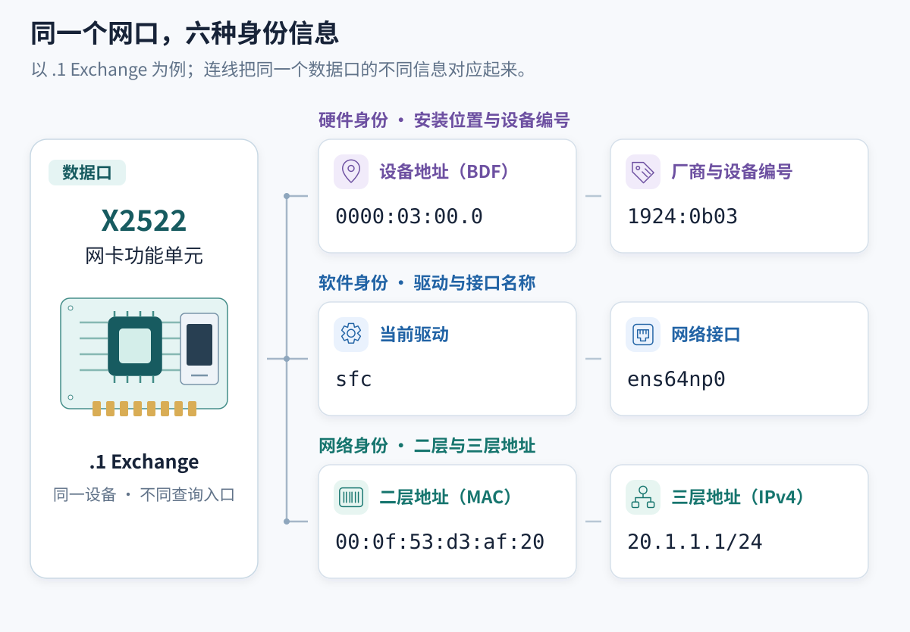
</div>

**读图：** 从硬件地址和型号，找到管理它的驱动，再对应到 Linux 接口、MAC 和 IP。它们描述的是同一个数据口的不同方面。

**理论落到实验：** 依次查出数据口对应的设备位置、MAC 地址和设备编号，再对照结果理解这些查询命令。

<div style="border-left:6px solid #15803d;background:#dcfce7;padding:12px 16px;border-radius:8px;margin:14px 0;"><span style="display:inline-block;padding:3px 12px;border-radius:6px;background:#15803d;color:#fff;font-weight:800;">需要运行 · 运行 ②</span> <span style="font-weight:700;color:#14532d;">在【跳板机 .111】以 root 运行。读取每台数据口的 sysfs 设备路径、MAC，以及对应 PCI 设备的一行 <code>lspci</code>。</span></div>

```bash
#!/usr/bin/env bash
set -Eeuo pipefail
cd /qyt-fll

RUN_ID="$(date -u +%Y%m%dT%H%M%SZ)-01-pci-identity"
OUT="reports/course-runs/${RUN_ID}"
mkdir -p "$OUT/raw"
printf 'RUN_ID=%s\n' "$RUN_ID" >"$OUT/run.env"

{
for item in '10.1.1.1 ens64np0' '10.1.1.2 ens64np1'; do
  read -r host data_if <<<"$item"
  printf '\n%s / verify · %s\n' "$host" "$data_if"
  ssh -o BatchMode=yes -o StrictHostKeyChecking=yes "root@$host" \
    bash -s -- "$data_if" <<'REMOTE'
set -Eeuo pipefail
data_if="$1"
printf '===== 查设备位置 =====\n[设备位置] 对: 路径末段为 0000:03:00.0  证: 找到这个网口对应的 PCI 设备\n$ readlink -f /sys/class/net/%s/device\n' "$data_if"
readlink -f "/sys/class/net/$data_if/device"
printf '===== 查 MAC 地址 =====\n[MAC] 对: 六组十六进制数  证: 读到这个网口当前使用的 MAC 地址\n$ cat /sys/class/net/%s/address\n' "$data_if"
cat "/sys/class/net/$data_if/address"
bdf="$(basename "$(readlink -f "/sys/class/net/$data_if/device")")"
printf '===== 查设备类型与编号 =====\n[设备类别] 对: 0200  证: 以太网控制器\n[厂商 ID] 对: 1924  证: Solarflare Communications\n[设备 ID] 对: 0b03  证: SFC9250 以太网控制器\n$ lspci -nn -s %s\n' "$bdf"
lspci -nn -s "$bdf"
REMOTE
done
} 2>&1 | tee "$OUT/raw/pci-identity.txt"
(cd "$OUT" && sha256sum raw/pci-identity.txt run.env >SHA256SUMS); printf 'evidence=%s\n' "$OUT"
```

<div style="border-left:6px solid #7e22ce;background:#f3e8ff;padding:12px 16px;border-radius:8px;margin:14px 0;"><span style="display:inline-block;padding:3px 12px;border-radius:6px;background:#7e22ce;color:#fff;font-weight:800;">仅供展示 · 输出解读</span> <span style="font-weight:700;color:#581c87;">依次查看设备路径、MAC 地址和 <code>lspci</code> 列出的网卡信息。</span></div>

```text
10.1.1.1 / verify · ens64np0
===== 查设备位置 =====
[设备位置] 对: 路径末段为 0000:03:00.0  证: 找到这个网口对应的 PCI 设备
$ readlink -f /sys/class/net/ens64np0/device
/sys/devices/pci0000:03/0000:03:00.0
===== 查 MAC 地址 =====
[MAC] 对: 六组十六进制数  证: 读到这个网口当前使用的 MAC 地址
$ cat /sys/class/net/ens64np0/address
00:0f:53:d3:af:20
===== 查设备类型与编号 =====
[设备类别] 对: 0200  证: 以太网控制器
[厂商 ID] 对: 1924  证: Solarflare Communications
[设备 ID] 对: 0b03  证: SFC9250 以太网控制器
$ lspci -nn -s 0000:03:00.0
03:00.0 Ethernet controller [0200]: Solarflare Communications XtremeScale SFC9250 10/25/40/50/100G Ethernet Controller [1924:0b03] (rev 01)
```

<div style="border-left:6px solid #7e22ce;background:#f3e8ff;padding:14px 18px;border-radius:8px;margin:14px 0;">
<div style="font-weight:900;color:#581c87;margin-bottom:8px;">仅供展示 · sysfs 与查询命令</div>
<div style="margin-top:10px;color:#3b0764;"><strong>sysfs：</strong>Linux 通过 <code>/sys</code> 这套目录展示设备和驱动信息。<code>/sys/class/net</code> 按接口名组织网口；网口目录里的 <code>device</code> 是一个符号链接，像捷径一样指向对应的设备目录。</div>
<div style="margin-top:8px;color:#3b0764;"><strong><code>readlink -f</code>：</strong>沿符号链接找到最终目录，打印完整路径；这里用它从接口名找到 PCI 设备，路径末段就是设备地址（BDF）。下一步查询驱动时，<code>bus-info</code> 应与这个地址一致。</div>
<div style="margin-top:8px;color:#3b0764;"><strong><code>cat</code>：</strong>打印文件内容；这里读取网口目录中的 <code>address</code>，得到当前 MAC 地址。</div>
<div style="margin-top:8px;color:#3b0764;"><strong><code>lspci</code>：</strong>查询 PCI/PCIe 设备信息。<code>-s</code> 指定要查的设备地址，<code>-nn</code> 同时显示名称和数字 ID；末尾的 <code>rev</code> 表示硬件修订号。</div>
</div>

这里查到的 SFC9250 是控制器名称，X2522 是本课网卡的产品型号。[PCI ID 数据库](https://raw.githubusercontent.com/pciutils/pciids/master/pci.ids)

BDF 是每台虚拟机内部的设备地址，所以两台都可以显示 `0000:03:00.0`。本课把同一张 X2522 的两个端口分别交给这两台虚拟机使用。

<div style="border-left:6px solid #0891b2;background:#cffafe;padding:12px 16px;border-radius:8px;margin:14px 0;"><span style="display:inline-block;padding:3px 12px;border-radius:6px;background:#0891b2;color:#fff;font-weight:800;">关键现象</span> <span style="font-weight:700;color:#164e63;">两台主机分别按输出中的提示核对即可。若提示路径不存在，检查接口名；若厂商或设备 ID 不同，检查是否选中了其他网卡。</span></div>

设备身份已经确认。要让 Linux 使用这个网口，还需要驱动管理它；运行 ③ 检查当前绑定的驱动。

## 运行 ③：查当前驱动

<div style="border:2px solid #4f46e5;background:#eef2ff;padding:10px 12px;border-radius:8px;margin:14px 0;"><div style="font-weight:900;color:#312e81;margin-bottom:4px;">导航卡 · 接口与设备身份</div><div style="font-weight:700;color:#312e81;margin-bottom:8px;">范畴：现场只读　本步知识：当前由哪个驱动管理网卡　位置：全章第 6 / 9 项 · 本组第 3 / 3 项</div><span style="display:inline-block;margin:3px;padding:4px 10px;border-radius:6px;background:#f8fafc;border:1px solid #a5b4fc;color:#312e81;font-weight:800;">运行 ①：核对两类接口</span><span style="display:inline-block;margin:3px;padding:4px 10px;border-radius:6px;background:#f8fafc;border:1px solid #a5b4fc;color:#312e81;font-weight:800;">运行 ②：从接口名找到设备地址</span><span style="display:inline-block;margin:3px;padding:4px 10px;border-radius:6px;background:#15803d;color:#fff;font-weight:800;">运行 ③：查当前驱动</span></div>

### 本步理论：先认出当前驱动名字

设备位置查清以后，还要找到负责操作它的软件。驱动像熟悉设备的人：负责初始化网卡、准备收发缓冲区，并把收包结果交给内核网络栈。`lspci` 确认设备存在，驱动查询则确认由谁管理它。

<div style="border-left:6px solid #7e22ce;background:#f3e8ff;padding:12px 16px;border-radius:8px;margin:14px 0;"><span style="display:inline-block;padding:3px 12px;border-radius:6px;background:#7e22ce;color:#fff;font-weight:800;">关键图</span> <span style="font-weight:700;color:#581c87;">本章检查实线连接的 <code>sfc</code> 驱动路径；虚线保留第 05 章用户态收发的学习入口。</span></div>

<div style="background:#f8fafc;border:1px solid #cbd5e1;border-radius:12px;padding:10px;max-width:820px;margin:14px auto;">
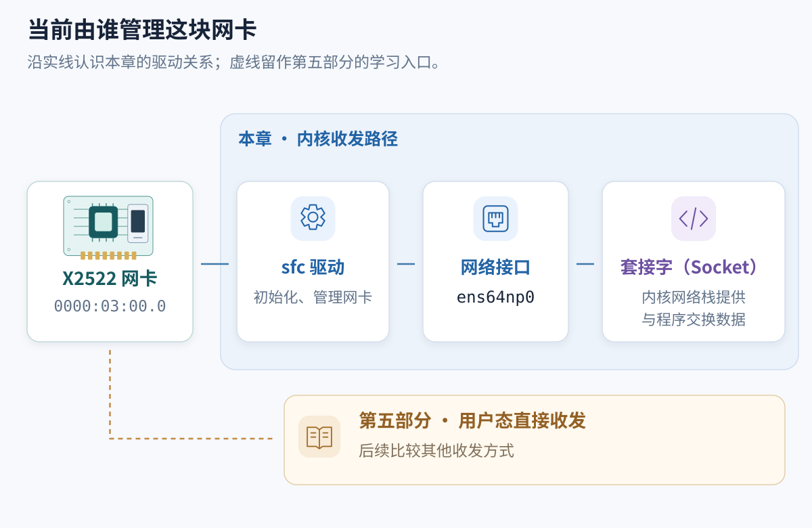
</div>

本章沿实线检查：`sfc` 驱动提供网络接口，内核网络栈通过套接字（Socket）与程序交换数据。虚线只标出第 05 章的学习入口，届时再比较其他收发方式。

**理论落到实验：** 一条线索读 `/sys/bus/pci/devices/<BDF>/driver` 指向哪个驱动目录；另一条用 `ethtool -i` 从接口读出 `driver` 和 `bus-info`。两条都指向同一个名字，并且 `bus-info` 与运行 ② 的 BDF 相同。

<div style="border-left:6px solid #15803d;background:#dcfce7;padding:12px 16px;border-radius:8px;margin:14px 0;"><span style="display:inline-block;padding:3px 12px;border-radius:6px;background:#15803d;color:#fff;font-weight:800;">需要运行 · 运行 ③</span> <span style="font-weight:700;color:#14532d;">在【跳板机 .111】以 root 运行。读取每台数据口对应 PCI 设备的 driver 路径，以及 <code>ethtool -i</code> 里的 driver 和 bus-info。</span></div>

```bash
#!/usr/bin/env bash
set -Eeuo pipefail
cd /qyt-fll

RUN_ID="$(date -u +%Y%m%dT%H%M%SZ)-01-driver-owner"
OUT="reports/course-runs/${RUN_ID}"
mkdir -p "$OUT/raw"
printf 'RUN_ID=%s\n' "$RUN_ID" >"$OUT/run.env"

{
for item in '10.1.1.1 ens64np0' '10.1.1.2 ens64np1'; do
  read -r host data_if <<<"$item"
  printf '\n%s / verify · %s\n' "$host" "$data_if"
  ssh -o BatchMode=yes -o StrictHostKeyChecking=yes "root@$host" \
    bash -s -- "$data_if" <<'REMOTE'
set -Eeuo pipefail
data_if="$1"
bdf="$(basename "$(readlink -f "/sys/class/net/$data_if/device")")"
printf '===== 查当前绑定的驱动 =====\n[驱动归属] 对: 路径末段为 sfc  证: 这个 PCI 设备当前由 sfc 驱动管理\n$ readlink -f /sys/bus/pci/devices/%s/driver\n' "$bdf"
readlink -f "/sys/bus/pci/devices/$bdf/driver"
printf '===== 从网口核对驱动信息 =====\n[驱动] 对: driver 为 sfc  证: 与设备目录查到的驱动一致\n[设备地址] 对: bus-info 为 %s  证: 与运行 ② 查到的 BDF 一致\n[版本] 看: version 是驱动版本，firmware-version 是网卡固件版本\n$ ethtool -i %s\n' "$bdf" "$data_if"
ethtool -i "$data_if"
REMOTE
done
} 2>&1 | tee "$OUT/raw/driver-owner.txt"
(cd "$OUT" && sha256sum raw/driver-owner.txt run.env >SHA256SUMS); printf 'evidence=%s\n' "$OUT"
```

<div style="border-left:6px solid #7e22ce;background:#f3e8ff;padding:12px 16px;border-radius:8px;margin:14px 0;"><span style="display:inline-block;padding:3px 12px;border-radius:6px;background:#7e22ce;color:#fff;font-weight:800;">仅供展示 · 输出解读</span> <span style="font-weight:700;color:#581c87;">以 <code>.1</code> 为例，保留输出中的关键字段。</span></div>

```text
10.1.1.1 / verify · ens64np0
===== 查当前绑定的驱动 =====
[驱动归属] 对: 路径末段为 sfc  证: 这个 PCI 设备当前由 sfc 驱动管理
$ readlink -f /sys/bus/pci/devices/0000:03:00.0/driver
/sys/bus/pci/drivers/sfc
===== 从网口核对驱动信息 =====
[驱动] 对: driver 为 sfc  证: 与设备目录查到的驱动一致
[设备地址] 对: bus-info 为 0000:03:00.0  证: 与运行 ② 查到的 BDF 一致
[版本] 看: version 是驱动版本，firmware-version 是网卡固件版本
$ ethtool -i ens64np0
driver: sfc
version: 5.15.0-164-generic
firmware-version: 8.0.0.1015 rx1 tx1
bus-info: 0000:03:00.0
```

<div style="border-left:6px solid #7e22ce;background:#f3e8ff;padding:14px 18px;border-radius:8px;margin:14px 0;">
<div style="font-weight:900;color:#581c87;margin-bottom:8px;">仅供展示 · sfc 与 ethtool -i</div>
<div style="margin-top:0;color:#3b0764;"><strong><code>sfc</code>：</strong>Solarflare Communications 网卡驱动在 Linux 中使用的简称；系统也用这个名字建立驱动目录 <code>/sys/bus/pci/drivers/sfc</code>。</div>
<div style="margin-top:8px;color:#3b0764;"><strong><code>ethtool -i</code></strong>：从网口视角查询当前驱动、驱动版本、固件版本和 PCI 总线地址。</div>
</div>

本步示例采用课程初始快照，`sfc` 随内核提供，因此 `version` 使用内核版本编号。

<div style="border-left:6px solid #0891b2;background:#cffafe;padding:12px 16px;border-radius:8px;margin:14px 0;"><span style="display:inline-block;padding:3px 12px;border-radius:6px;background:#0891b2;color:#fff;font-weight:800;">关键现象</span> <span style="font-weight:700;color:#164e63;">逐台核两组对应：sysfs 末段 <code>sfc</code> 与 <code>driver: sfc</code> 相同，<code>bus-info: 0000:03:00.0</code> 与运行 ② 的 BDF 相同。</span></div>

驱动已经对应到正确设备。还要确认网线两端建立了 10G 链路，并接入同一个 VLAN，运行 ④ 同时查看主机与交换机。

## 运行 ④：对齐主机与交换机链路

<div style="border:2px solid #4f46e5;background:#eef2ff;padding:10px 12px;border-radius:8px;margin:14px 0;"><div style="font-weight:900;color:#312e81;margin-bottom:4px;">导航卡 · 链路与报文检查</div><div style="font-weight:700;color:#312e81;margin-bottom:8px;">范畴：现场只读　本步知识：网线两端的链路状态是否一致　位置：全章第 7 / 9 项 · 本组第 1 / 2 项</div><span style="display:inline-block;margin:3px;padding:4px 10px;border-radius:6px;background:#15803d;color:#fff;font-weight:800;">运行 ④：对齐主机与交换机链路</span><span style="display:inline-block;margin:3px;padding:4px 10px;border-radius:6px;background:#f8fafc;border:1px solid #a5b4fc;color:#312e81;font-weight:800;">运行 ⑤：抓到三条 ping</span></div>

### 本步理论：接口启用以后，还要查什么

要判断网口能否正常通信，可以像检查厨房能否收货一样，沿着过程一步步看：收货门有没有打开，对应接口是否启用；门外通道有没有接通，对应链路是否建立；试送的货物能否到达，对应探针能否得到回应。网络通信还要核对地址、路由和邻居信息，具体用哪些工具检查，见下表。[Linux 接口状态说明](https://docs.kernel.org/networking/operstates.html)

| 检查什么 | 常用命令或文件 | 怎样理解 |
| --- | --- | --- |
| 接口是否启用（admin up） | `ip link` | 管理员允许接口工作 |
| 链路是否建立（carrier） | `ethtool` | 驱动报告是否检测到链路，并给出速率和双工状态 |
| 地址与路由 | `ip addr`、`ip route` | 本机使用哪个 IP，准备从哪个接口发送 |
| 邻居地址与探针回应 | `ip neigh`、`ping` | 前者查看邻居地址解析状态，后者检查请求是否得到回应 |
| 报文是否被观察到 | pcap、网卡与交换机计数器 | 指定观察位置是否记录到了报文 |

<div style="border:2px solid #7e22ce;background:#faf5ff;padding:14px 16px;border-radius:10px;margin:16px 0;">
<div style="font-weight:900;color:#581c87;margin-bottom:10px;">实体链路 · Cisco SFP-H10GB-CU5M</div>
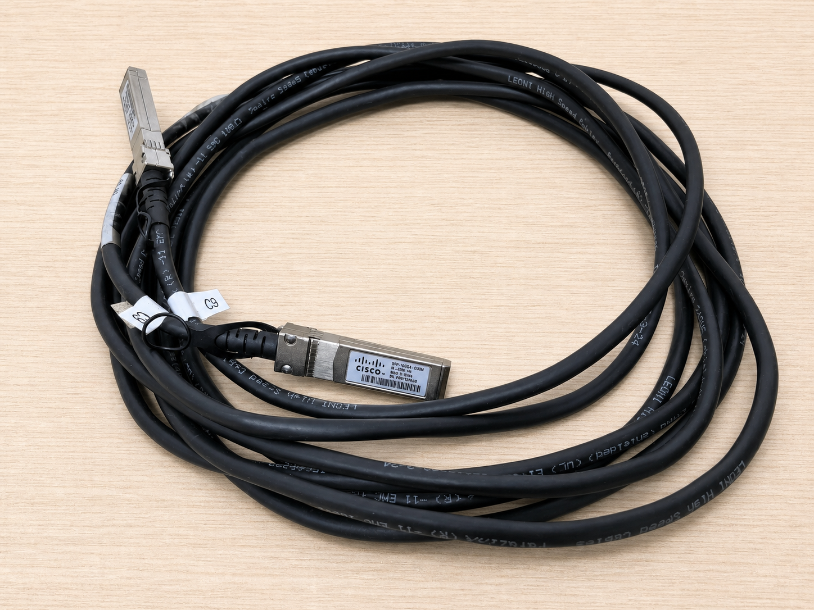
<div style="color:#581c87;font-weight:700;margin-top:10px;">两条数据链路都是 10GBASE-CR SFP+ DAC。照片是 <code>.1 Exchange ↔ Et1</code> 这一根 Cisco SFP-H10GB-CU5M（5 米）；<code>.2 Trader ↔ Et2</code> 是同类的另一根。主机侧把它读成 <code>10000Mb/s</code>、<code>Full</code> 与 <code>Link detected: yes</code>。</div>
</div>

**理论落到实验：** 主机的 `ethtool` 输出应包含 `10000Mb/s`、`Full` 和 `Link detected: yes`；交换机的 `show interfaces ... status` 应显示对应端口连接在 VLAN20，并使用 10G 全双工。把同一根线的两端逐项对照。

<div style="border-left:6px solid #15803d;background:#dcfce7;padding:12px 16px;border-radius:8px;margin:14px 0;"><span style="display:inline-block;padding:3px 12px;border-radius:6px;background:#15803d;color:#fff;font-weight:800;">需要运行 · 运行 ④</span> <span style="font-weight:700;color:#14532d;">在【跳板机 .111】以 root 运行。读取 <code>.1/.2</code> 数据口的 <code>ethtool</code>，以及交换机 Et1、Et2 和 VLAN20 的状态。</span></div>

```bash
#!/usr/bin/env bash
set -Eeuo pipefail
cd /qyt-fll
RUN_ID="$(date -u +%Y%m%dT%H%M%SZ)-01-link-pair"
OUT="reports/course-runs/${RUN_ID}"
mkdir -p "$OUT/raw"
printf 'RUN_ID=%s\n' "$RUN_ID" >"$OUT/run.env"
{
# 主机侧：保留完整输出，课堂只显示链路字段
for item in '10.1.1.1 ens64np0' '10.1.1.2 ens64np1'; do
  read -r host data_if <<<"$item"
  printf '\n%s / verify · %s\n===== 查主机侧链路 =====\n' "$host" "$data_if"
  printf '[链路] 对: 10000Mb/s、Full、yes  证: 本端检测到 10G 全双工链路\n[端口类别] 看: Port 是当前驱动报告的类别，需结合交换机 Type 判断介质\n$ ethtool %s\n' "$data_if"
  if ssh -n -o BatchMode=yes -o StrictHostKeyChecking=yes "root@$host" \
    "ethtool '$data_if'" >"$OUT/raw/host-$host.txt" 2>&1; then
    sed -n -E '/^[[:space:]]*(Speed|Duplex|Port|Link detected):/p' "$OUT/raw/host-$host.txt"
  else
    rc=$?; tail -n 20 "$OUT/raw/host-$host.txt"; printf '完整输出：%s\n' "$OUT/raw/host-$host.txt"; exit "$rc"
  fi
done
# 交换机侧：一次连接查询三项，在每条命令前加入对应说明
printf '%s\n' 'show interfaces Ethernet1 status' \
  'show interfaces Ethernet2 status' 'show vlan id 20' >"$OUT/eos.plan"
printf '\n10.1.1.253 / verify\n'
if python3 assets/common/eos_cli.py --mode show \
  --plan "$OUT/eos.plan" --output "$OUT/raw/arista-links.txt" >"$OUT/raw/arista-terminal.txt" 2>&1; then
  awk '
    /^\$ show interfaces Ethernet[12] status$/ {
      port=($4=="Ethernet1" ? "Et1" : "Et2")
      print "===== 查交换机 " port " 链路 ====="
      print "[端口] 对: connected、20、full、10G  证: 已连接并接入 VLAN20，使用 10G 全双工"
    }
    /^\$ show vlan id 20$/ {
      print "===== 查 VLAN20 活动端口 ====="
      print "[VLAN] 对: active，包含 Et1、Et2  证: VLAN20 已启用，两条数据链路处于活动状态"
    }
    { print }
  ' "$OUT/raw/arista-links.txt"
else
  rc=$?; tail -n 20 "$OUT/raw/arista-terminal.txt"; printf '完整输出：%s\n' "$OUT/raw/arista-terminal.txt"; exit "$rc"
fi
} 2>&1 | tee "$OUT/classroom.txt"
(cd "$OUT" && sha256sum raw/* run.env eos.plan classroom.txt >SHA256SUMS); printf 'evidence=%s\n' "$OUT"
```

<div style="border-left:6px solid #7e22ce;background:#f3e8ff;padding:12px 16px;border-radius:8px;margin:14px 0;"><span style="display:inline-block;padding:3px 12px;border-radius:6px;background:#7e22ce;color:#fff;font-weight:800;">仅供展示 · 输出解读</span> <span style="font-weight:700;color:#581c87;">对照主机与交换机两端的链路状态、速率和 VLAN；交换机示例只保留关键行。</span></div>

```text
10.1.1.1 / verify · ens64np0
===== 查主机侧链路 =====
[链路] 对: 10000Mb/s、Full、yes  证: 本端检测到 10G 全双工链路
[端口类别] 看: Port 是当前驱动报告的类别，需结合交换机 Type 判断介质
$ ethtool ens64np0
	Speed: 10000Mb/s
	Duplex: Full
	Port: FIBRE
	Link detected: yes
```

`Port` 是驱动报告的端口类别：本章快照的内核 `sfc` 报告 `FIBRE`，交换机 Type 的 `10GBASE-CR` 则说明实际使用铜缆。`.2` 的 `$ ethtool ens64np1` 四行相同。

第 02 章安装厂商驱动后，`Port` 会报告 `Direct Attach Copper`；这是驱动填法的变化，接线仍是同一类 DAC。

```text
10.1.1.253 / verify
===== 查交换机 Et1 链路 =====
[端口] 对: connected、20、full、10G  证: 已连接并接入 VLAN20，使用 10G 全双工
$ show interfaces Ethernet1 status
Et1               connected    20       full   10G    10GBASE-CR
```

```text
===== 查交换机 Et2 链路 =====
[端口] 对: connected、20、full、10G  证: 已连接并接入 VLAN20，使用 10G 全双工
$ show interfaces Ethernet2 status
Et2               connected    20       full   10G    10GBASE-CR
```

```text
===== 查 VLAN20 活动端口 =====
[VLAN] 对: active，包含 Et1、Et2  证: VLAN20 已启用，两条数据链路处于活动状态
$ show vlan id 20
20    fll                              active    Cpu, Et1, Et2
```


<div style="border-left:6px solid #0891b2;background:#cffafe;padding:12px 16px;border-radius:8px;margin:14px 0;"><span style="display:inline-block;padding:3px 12px;border-radius:6px;background:#0891b2;color:#fff;font-weight:800;">关键现象</span> <span style="font-weight:700;color:#164e63;">主机侧两台都是 <code>10000Mb/s / Full / yes</code>；交换机侧 Et1、Et2 都是 <code>connected / 20 / full / 10G</code>，VLAN20 为 <code>active</code>。出现 <code>Unknown!</code>、低于 10G、<code>Half</code>、<code>no</code> 或 <code>notconnect</code> 时，直接指出异常字段属于哪一端。</span></div>

两端链路状态符合预期。运行 ⑤ 在 `.2` 抓包，用三条实际请求确认报文到达这个接口。

## 运行 ⑤：抓到三条 ping

<div style="border:2px solid #4f46e5;background:#eef2ff;padding:10px 12px;border-radius:8px;margin:14px 0;"><div style="font-weight:900;color:#312e81;margin-bottom:4px;">导航卡 · 链路与报文检查</div><div style="font-weight:700;color:#312e81;margin-bottom:8px;">范畴：现场只读　本步知识：三条请求是否到达指定接口　位置：全章第 8 / 9 项 · 本组第 2 / 2 项</div><span style="display:inline-block;margin:3px;padding:4px 10px;border-radius:6px;background:#f8fafc;border:1px solid #a5b4fc;color:#312e81;font-weight:800;">运行 ④：对齐主机与交换机链路</span><span style="display:inline-block;margin:3px;padding:4px 10px;border-radius:6px;background:#15803d;color:#fff;font-weight:800;">运行 ⑤：抓到三条 ping</span></div>

### 本步理论：在指定数据口抓三条 ICMP 探针

ping 收到回应，说明请求到达了能回应它的主机；在指定数据口抓到请求，则把到达位置也记录下来。像在收货口留下到货记录，这一步确认报文到了哪里，第 02 章再确认交易程序读取和解析了什么。

`.1` 从数据口发出三条 ICMP Echo Request。`.2` 的 `tcpdump` 在 `ens64np1` 上把匹配帧写入 pcap。本步要看的就是这三条出现在指定数据口上的报文。

<div style="border-left:6px solid #7e22ce;background:#f3e8ff;padding:12px 16px;border-radius:8px;margin:14px 0;"><span style="display:inline-block;padding:3px 12px;border-radius:6px;background:#7e22ce;color:#fff;font-weight:800;">关键图</span> <span style="font-weight:700;color:#581c87;">沿箭头 ① → ② → ③ 读主线，再看 ④a 抓包、④b 回应两条分支。</span></div>

<div style="background:#f8fafc;border:1px solid #cbd5e1;border-radius:12px;padding:10px;max-width:820px;margin:14px auto;">
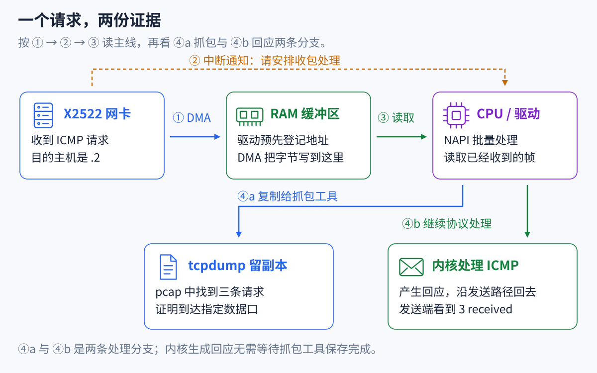
</div>

第 00 章的“存货区、清单、照单放货”，在这台 X2522 上对应同一组动作。本张收包图的步骤编号分别表示：

| 箭头 | 从哪里到哪里 | 发生什么 |
| --- | --- | --- |
| ① | 网卡 → 主内存缓冲区 | 驱动预先准备缓冲区并登记地址；网卡收到请求后，通过 PCIe 用 DMA 把报文字节写进去。[Linux DMA 指南](https://docs.kernel.org/core-api/dma-api-howto.html) |
| ② | 网卡 → CPU | 图示的中断驱动方式中，网卡通知有报文待处理，内核安排 NAPI 收包工作。 |
| ③ | 主内存缓冲区 → CPU / 驱动 | NAPI 调用驱动的 `poll` 函数，批量处理已收到的报文；CPU 读取内存中的数据。[Linux NAPI 说明](https://docs.kernel.org/networking/napi.html) |
| ④a | 接收路径 → tcpdump | 报文副本交给抓包工具，保存到 pcap，供我们查看请求是否到达指定数据口。 |
| ④b | 接收路径 → 内核 ICMP 处理 | 内核生成 Echo Reply，经 `.2` 数据口发回 `.1`；发送端收到回应后，`ping` 才把它计入 `received`。 |

④a、④b 表示两条分支，内核生成回应无需等待抓包工具保存完成。

| 图中对象 | 名字与职责 |
| --- | --- |
| RAM 缓冲区 | 接收缓冲区（RX Buffer）：主内存中预先准备的收包空间 |
| 驱动登记的地址 | 接收描述符（RX Descriptor）：描述可用缓冲区的记录，供网卡找到写入位置 |
| DMA | 直接内存访问：网卡把报文写入主机内存，CPU 无需逐字节搬运；准备和处理工作仍由 CPU 执行 |
| CPU / 驱动 | `sfc` 是本课网卡驱动；NAPI 安排批量收包，驱动的 `poll` 函数处理已收到的报文 |
| tcpdump 留副本 | 抓包使用报文套接字（packet socket）观察二层报文，结果写入 pcap 文件 |
| 内核处理 ICMP | 判断请求是否发给本机，并生成 Echo Reply 回应 |

`tcpdump` 通过报文套接字观察数据，而不是替交易程序接收和解析行情。[Linux 报文套接字说明](https://man7.org/linux/man-pages/man7/packet.7.html)

**理论落到实验：** 脚本先在 `.2` 的 `ens64np1` 启动抓包，再让 `.1` 的 `ens64np0` 发送三条 ping。过滤表达式（BPF）只保留 `.1 → .2` 的 ICMP Echo Request；执行后对照发送统计和 pcap 中的方向、序号。

<div style="border-left:6px solid #15803d;background:#dcfce7;padding:12px 16px;border-radius:8px;margin:14px 0;"><span style="display:inline-block;padding:3px 12px;border-radius:6px;background:#15803d;color:#fff;font-weight:800;">需要运行 · 运行 ⑤</span> <span style="font-weight:700;color:#14532d;">在【跳板机 .111】以 root 运行。先在 <code>.2</code> 的 <code>ens64np1</code> 上抓包，再从 <code>.1</code> 发出三条 ICMP 探针，最后回读 pcap。</span></div>

```bash
#!/usr/bin/env bash
set -Eeuo pipefail
cd /qyt-fll
RUN_ID="$(date -u +%Y%m%dT%H%M%SZ)-01-packet-proof"
OUT="reports/course-runs/${RUN_ID}"
REMOTE="/var/tmp/$RUN_ID"
mkdir -p "$OUT/raw"
printf 'RUN_ID=%s\n' "$RUN_ID" >"$OUT/run.env"
SSH=(-o BatchMode=yes -o StrictHostKeyChecking=yes)
BPF='icmp[icmptype] = icmp-echo and src 20.1.1.1 and dst 20.1.1.2'
cleanup() {
  ssh -n "${SSH[@]}" root@10.1.1.2 "rm -rf -- '$REMOTE'" >/dev/null 2>&1 || true
}
trap cleanup EXIT
{
# 先在 .2 启动抓包，过滤 .1 → .2 的 ICMP echo request
printf '\n10.1.1.2 / capture · ens64np1\n===== 启动接收端抓包 =====\n[抓包范围] 看: 只记录 20.1.1.1 → 20.1.1.2 的 ICMP 请求，抓到三条后结束\n'
printf '$ timeout 8 tcpdump -ni ens64np1 -c 3 -w %s/probe.pcap %s\n' "$REMOTE" "'$BPF'"
ssh -n "${SSH[@]}" root@10.1.1.2 "mkdir -m 700 '$REMOTE'"
ssh -n "${SSH[@]}" root@10.1.1.2 \
  "timeout 8 tcpdump -ni ens64np1 -c 3 -w '$REMOTE/probe.pcap' '$BPF'" \
  >"$OUT/raw/capture.txt" 2>&1 &
CAPTURE_PID=$!
sleep 1
# 再从 .1 数据口发出三条 ping
printf '\n10.1.1.1 / probe · ens64np0\n===== 发送三条 ping =====\n[探针] 对: 3 transmitted、3 received、0%% packet loss  证: 三条请求都有回应\n$ ping -I ens64np0 -c 3 -W 1 20.1.1.2\n' \
  | tee "$OUT/raw/sender.txt"
ssh -n "${SSH[@]}" root@10.1.1.1 \
  'ping -I ens64np0 -c 3 -W 1 20.1.1.2' 2>&1 | tee -a "$OUT/raw/sender.txt"
if wait "$CAPTURE_PID"; then
  printf '\n10.1.1.2 / verify · ens64np1\n===== 查抓包统计 =====\n[抓包结果] 对: 3 packets captured、0 packets dropped by kernel  证: 捕获三条请求，抓包未报告内核丢包\n'
  cat "$OUT/raw/capture.txt"
else
  rc=$?; cat "$OUT/raw/capture.txt"; exit "$rc"
fi
scp "${SSH[@]}" "root@10.1.1.2:$REMOTE/probe.pcap" "$OUT/raw/probe.pcap"
printf '\n===== 读取三条请求 =====\n[报文] 对: 20.1.1.1 > 20.1.1.2、echo request、seq 1/2/3  证: 到达数据口的方向、类型与序号符合预期\n$ tcpdump -nn -r %s/probe.pcap\n' "$REMOTE"
if ssh -n "${SSH[@]}" root@10.1.1.2 \
  "tcpdump -nn -r '$REMOTE/probe.pcap'" >"$OUT/raw/receiver.txt" 2>&1; then :; else
  rc=$?; cat "$OUT/raw/receiver.txt"; exit "$rc"
fi
cat "$OUT/raw/receiver.txt"
} 2>&1 | tee "$OUT/classroom.txt"
(cd "$OUT" && sha256sum raw/* run.env classroom.txt >SHA256SUMS); printf 'evidence=%s\n' "$OUT"
```

<div style="border-left:6px solid #7e22ce;background:#f3e8ff;padding:12px 16px;border-radius:8px;margin:14px 0;"><span style="display:inline-block;padding:3px 12px;border-radius:6px;background:#7e22ce;color:#fff;font-weight:800;">仅供展示 · 输出解读</span> <span style="font-weight:700;color:#581c87;">对照发送与抓包结果，确认三条 ping 请求到达接收端；示例保留关键读数。</span></div>

```text
10.1.1.2 / capture · ens64np1
===== 启动接收端抓包 =====
[抓包范围] 看: 只记录 20.1.1.1 → 20.1.1.2 的 ICMP 请求，抓到三条后结束
$ timeout 8 tcpdump -ni ens64np1 -c 3 -w …/probe.pcap 'icmp[icmptype] = icmp-echo and src 20.1.1.1 and dst 20.1.1.2'
```

```text
10.1.1.1 / probe · ens64np0
===== 发送三条 ping =====
[探针] 对: 3 transmitted、3 received、0% packet loss  证: 三条请求都有回应
$ ping -I ens64np0 -c 3 -W 1 20.1.1.2
PING 20.1.1.2 (20.1.1.2) from 20.1.1.1 ens64np0: 56(84) bytes of data.
3 packets transmitted, 3 received, 0% packet loss, time 2033ms
```

```text
10.1.1.2 / verify · ens64np1
===== 查抓包统计 =====
[抓包结果] 对: 3 packets captured、0 packets dropped by kernel  证: 捕获三条请求，抓包未报告内核丢包
tcpdump: listening on ens64np1, link-type EN10MB (Ethernet)
3 packets captured
0 packets dropped by kernel
```

```text
===== 读取三条请求 =====
[报文] 对: 20.1.1.1 > 20.1.1.2、echo request、seq 1/2/3  证: 到达数据口的方向、类型与序号符合预期
$ tcpdump -nn -r …/probe.pcap
09:30:37.228135 IP 20.1.1.1 > 20.1.1.2: ICMP echo request, id 2, seq 1, length 64
09:30:38.236981 IP 20.1.1.1 > 20.1.1.2: ICMP echo request, id 2, seq 2, length 64
09:30:39.261006 IP 20.1.1.1 > 20.1.1.2: ICMP echo request, id 2, seq 3, length 64
```


ping 结尾还会打印一行往返时间统计，示例省略了这一行。本章只用 ping 检查连通性，延迟怎样测量和比较，第 04 章再展开。

<div style="border-left:6px solid #0891b2;background:#cffafe;padding:12px 16px;border-radius:8px;margin:14px 0;"><span style="display:inline-block;padding:3px 12px;border-radius:6px;background:#0891b2;color:#fff;font-weight:800;">关键现象</span> <span style="font-weight:700;color:#164e63;">发送端统计为 <code>3 transmitted / 3 received / 0% packet loss</code>；接收端 pcap 出现三条 <code>.1 → .2</code> 的 <code>ICMP echo request</code>，序号依次 1、2、3。缺序号、方向相反或接口不对时，先检查抓包接口与过滤表达式。</span></div>

## 本章总结：把检查结果连起来

| 检查结果 | 确认什么 | 适用范围 |
| --- | --- | --- |
| 管理口与数据口地址 | `ens33` 与 X2522 数据口分别使用课程预设地址 | 当前接口基线 |
| 接口 → MAC → BDF → PCI ID | 当前接口对应预期 X2522 设备功能 | 当前设备身份 |
| sysfs + `ethtool -i` | 示例中的 X2522 由内核自带的 `sfc` 驱动管理 | 运行检查时的驱动绑定关系 |
| 主机与交换机链路 | 两端已建立 10G 全双工链路 | 当前链路状态 |
| ping 统计与接收端抓包 | 三条真实探针到达 `.2` X2522 | 本次捕获的三条请求 |

<div style="border-left:6px solid #7e22ce;background:#f3e8ff;padding:12px 16px;border-radius:8px;margin:14px 0;"><span style="display:inline-block;padding:3px 12px;border-radius:6px;background:#7e22ce;color:#fff;font-weight:800;">关键图</span> <span style="font-weight:700;color:#581c87;">本章五项检查对应到这条路径：<code>.1</code> 的 ping 从数据口发出，经 Arista VLAN20 到达 <code>.2</code>，由 <code>tcpdump</code> 写入 pcap。</span></div>

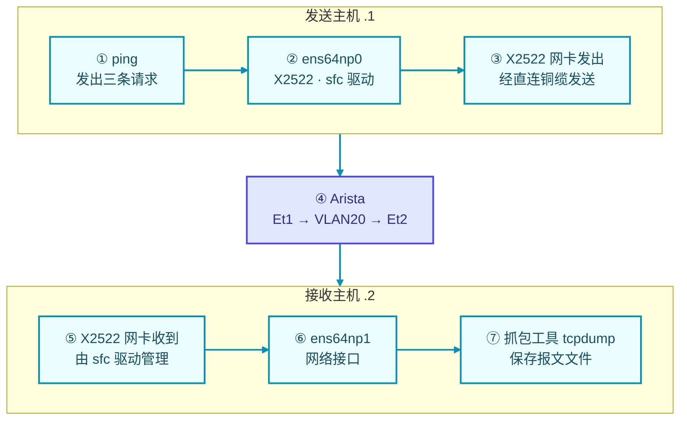

**读图：** ①～③ 是 `.1` 发送请求，④ 是交换机在 VLAN20 内转发，⑤～⑦ 是 `.2` 收到请求并留下抓包记录。接口、设备、驱动、链路和实际报文至此对应起来。

第 02 章会使用本章准备好的构建工具和管理连接，部署 Exchange、Trader 与网页。数据网从承载 ping 转为承载行情和订单，检查重点也随之变成“交易程序是否读到行情、交易所是否返回订单结果”。

## 理解检查

1. `.1` 和 `.2` 各有哪两类接口？真正通过 DAC 接入 Arista 的是哪一个？
2. `readlink`、`lspci`、`ethtool` 和 `tcpdump` 分别能查到哪些信息？
3. `ens64np0`、`0000:03:00.0`、`1924:0b03` 和 `sfc` 分别是什么身份？
4. 主机显示 `Link detected: yes`，这一层证明了什么？本章通过抓包确认了什么？
5. ping 和接收端 pcap 共同证明到哪里？第 02 章从哪一层继续？

## 参考答案

1. 每台主机有管理口 `ens33` 和 X2522 数据口（`.1` 是 `ens64np0`，`.2` 是 `ens64np1`）。通过 DAC 接入 Arista 的是各自的 X2522 数据口。
2. `readlink` 沿 sysfs 目录找到 PCIe 设备功能；`lspci` 按 BDF 读设备类别和 PCI ID；`ethtool -i` 看驱动与 `bus-info`，不带 `-i` 看链路；`tcpdump` 在指定接口上观察二层报文并写入 pcap。
3. `ens64np0` 是 Linux 网络接口名；`0000:03:00.0` 是这台主机上的 PCIe 地址（BDF）；`1924:0b03` 是 PCI 厂商与设备编号；`sfc` 是当前接管这块卡的 Linux 驱动。
4. `Link detected: yes` 证明本端物理链路已经协商起来。抓包进一步确认请求到达 `.2` 的 `ens64np1` 数据口。
5. ping 的 `3 received` 加上 pcap 里三条 `.1 → .2` echo request，证明探针到达指定数据口。第 02 章从应用层继续：部署 C++ Exchange 与两个独立 Trader，让客户端读取行情，由策略或人工操作发起订单，再核对交易所回执。

<a id="market-access-cases"></a>

## 扩展：真实交易网络怎样连接

本节为选读，不影响本章实验，可跳过。先以沪市股票为例，看客户、券商、交易所与行情服务商怎样连接，再用美国的具体接口说明哪些通信加密。

<div style="border:2px solid #4f46e5;background:#eef2ff;padding:10px 12px;border-radius:8px;margin:14px 0;"><div style="font-weight:900;color:#312e81;margin-bottom:4px;">导航卡 · 真实市场扩展</div><div style="font-weight:700;color:#312e81;margin-bottom:8px;">范畴：行业案例　本步知识：客户怎样经过券商与网络接入交易所　位置：全章第 9 / 9 项 · 本组第 1 / 1 项</div><span style="display:inline-block;margin:3px;padding:4px 10px;border-radius:6px;background:#15803d;color:#fff;font-weight:800;">扩展：真实交易网络怎样连接</span></div>

### 先看两条线：下单找券商，行情可另选服务商

**普通客户经券商下单；行情可从券商或行情服务商取得。** 托管只改变服务器位置，委托仍交给券商。[委托规则 §3.1](https://www.sse.com.cn/lawandrules/sselawsrules2025/stocks/exchange/c/c_20260424_10816482.shtml)

<div style="border-left:6px solid #7e22ce;background:#f3e8ff;padding:12px 16px;border-radius:8px;margin:14px 0;"><span style="display:inline-block;padding:3px 12px;border-radius:6px;background:#7e22ce;color:#fff;font-weight:800;">关键图 · 下单与行情分别接到谁</span> <span style="font-weight:700;color:#581c87;">上框看下单；下框看行情：先看客户的 UDP / TCP 推送，再看 LDDS 的实时与补发。</span></div>

<div style="background:#f8fafc;border:1px solid #cbd5e1;border-radius:12px;padding:10px;max-width:820px;margin:14px auto;">
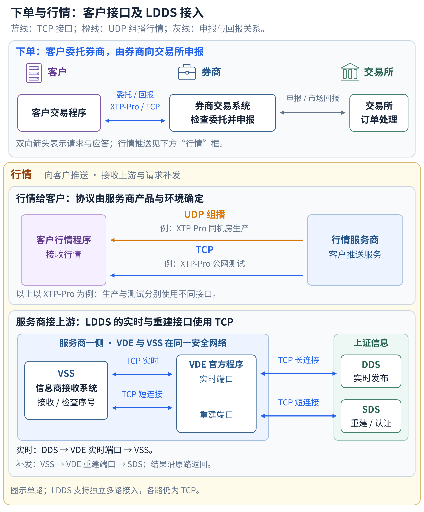
</div>

客户接口与 LDDS 分别举例，不代表中泰的实际上游采购。

### 客户接口：协议按产品与环境确定

以中泰 XTP-Pro 为例：

| 接口 | 传输方式 |
| --- | --- |
| 交易 | TCP，收发委托与回报 |
| 生产行情 | 同机房 UDP 组播 |
| 公网测试行情 | TCP 推送 |

生产与测试按环境区分。[交易接口](https://xtp.zts.com.cn/xtp-pro/API4/交易XTrader-API使用指南QuickStart.html)、[行情接入指引 §1.1、4.1、4.3—4.4](https://xtp.zts.com.cn/xtp-pro/API4/行情服务接入前指引/行情服务接入前指引.html)

### LDDS：实时与补发都走 TCP

**LDDS 是上证信息的低延时行情发布系统。** DDS 发布实时行情，SDS 负责重建与认证。

**VDE 是上证信息提供的接入程序；VSS 是信息商自己的接收系统。** VSS 经 TCP 从 VDE 接收行情、检查序号，缺数据时请求补发。信息商再由处理、分发模块把行情按客户接口用 UDP 组播或 TCP 推送出去；这些模块可合在一个程序中，也可拆开。

- **实时：DDS → VDE 实时端口 → VSS。**
- **补发：VSS → VDE 重建端口 → SDS**，结果原路返回；快照类数据不支持这种重建。

DDS/SDS—VDE—VSS 的连接均使用 TCP；LDDS 支持独立多路接入，每一路仍为 TCP。[LDDS 总册 §2.4—2.9、4.5](https://www.sseinfo.com/services/assortment/market/hqywwd/wdzsjk/c/10821682/files/f79fbdd9f5274766940b7b9b0e0b1eff.pdf)

客户侧回补使用服务商自己的接口。[XTP-Pro 回补 §2.5](https://xtp.zts.com.cn/xtp-pro/API4/行情服务接入前指引/行情服务接入前指引.html)

### 备用线路与 A/B 冗余

上交所技术公司的 **UDP 广域行情**（Level-1 FAST、期权）走独立线路。符合不同运营商、同城双站点地面接入条件的会员，可借交易线路接收**备用 TCP 行情**，并须控制带宽。[行情产品](https://www.ssetech.com.cn/product/exchange/gsdmhqNetwork/)、[接入要求第8条](https://www.sse.com.cn/services/tradingtech/services/c/10761335/files/e7093fcfabbb4089ae059feb0cb6a848.pdf)

交易局域接入的 **A/B 指双路冗余**；TCP / UDP 指传输协议。[局域服务](https://www.ssetech.com.cn/product/exchange/jyjyservice/)

### 加密与认证：美国真实接口的三个例子

<div style="border-left:6px solid #7e22ce;background:#f3e8ff;padding:12px 16px;border-radius:8px;margin:14px 0;">
<div style="font-weight:800;color:#581c87;margin-bottom:8px;">通信保护 · 哪段加密，哪段直接解析</div>
<p style="margin:0 0 10px;">下面分别以美国券商 IBKR（盈透证券）的公网 API 和 Nasdaq 的原生接口为例。<strong>认证确认谁能接入；加密保护传输中的内容。</strong></p>
<table style="width:100%;border-collapse:collapse;background:#fff;">
<thead><tr style="background:#ede9fe;color:#581c87;"><th style="padding:8px;text-align:left;">通信环节与接口</th><th style="padding:8px;text-align:left;">是否加密、怎样使用</th></tr></thead>
<tbody>
<tr><td style="padding:8px;border-bottom:1px solid #ddd6fe;"><strong>客户 → 券商</strong><br>IBKR Web API</td><td style="padding:8px;border-bottom:1px solid #ddd6fe;"><strong>HTTPS / TLS 加密。</strong>官方公网入口为 <code>https://api.ibkr.com/v1/api</code>，客户通过认证后调用接口。<a href="https://www.interactivebrokers.com/docs/web-api/v1/endpoints/introduction">IBKR 官方接入说明</a></td></tr>
<tr><td style="padding:8px;border-bottom:1px solid #ddd6fe;"><strong>券商 → Nasdaq</strong><br>INET FIX 下单接口</td><td style="padding:8px;border-bottom:1px solid #ddd6fe;"><strong>接口本身不加密，有登录校验。</strong>官方明确写明“NASDAQ does NOT support encryption”；先发 Logon，交易所核验分配的 <code>SenderCompID</code> 并确认登录后，才能发订单。<a href="https://classic.nasdaqtrader.com/content/technicalsupport/specifications/TradingProducts/inet_fix_sb.pdf">Nasdaq FIX 规范 §1.2、§4.1</a></td></tr>
<tr><td style="padding:8px;"><strong>Nasdaq → 行情接收方</strong><br>TotalView-ITCH 的 A/B UDP 组播</td><td style="padding:8px;"><strong>原生行情报文不加密。</strong>按官方 MoldUDP64 与 ITCH 格式，接收端直接解析序号、股票、价格和数量，无需先解密；A/B 提供两路冗余。此判断依据完整报文格式与接收流程。<a href="https://www.nasdaqtrader.com/content/technicalsupport/specifications/dataproducts/moldudp64.pdf">MoldUDP64</a>、<a href="https://www.nasdaqtrader.com/content/technicalsupport/specifications/dataproducts/NQTVITCHspecification.pdf">ITCH 规范</a>、<a href="https://www.nasdaqtrader.com/Trader.aspx?id=FeedMIPs">A/B 地址表</a></td></tr>
</tbody>
</table>
<p style="margin:10px 0 0;color:#581c87;">这些结论限定于表中的接口；“不加密”指原生报文，承载线路另加 VPN 等保护时需另行区分。</p>
</div>

第 02 章用实验程序收发行情、委托与回报。接口出处与图件见[配套来源说明](refs/FLLE_Trading_Network_Access_2026-09-10.md)。

<a id="appendix-flows"></a>

## 查阅：实验程序的流量与端口

第 02 章开始运行交易程序后，可按此图查通信方向和端口；第 05、06 章再使用其中的收发切换与队列监测接口。

<div style="border-left:6px solid #7e22ce;background:#f3e8ff;padding:12px 16px;border-radius:8px;margin:14px 0;"><span style="display:inline-block;padding:3px 12px;border-radius:6px;background:#7e22ce;color:#fff;font-weight:800;">关键图 · 流量与端口</span> <span style="font-weight:700;color:#581c87;">蓝色是 TCP，橙色是 UDP；方框标明设备、进程和地址，箭头起点是源、尖端是目的。每条箭头的编号与下表逐项对应。</span></div>

<div style="background:#f8fafc;border:1px solid #cbd5e1;border-radius:12px;padding:10px;max-width:820px;margin:14px auto;">
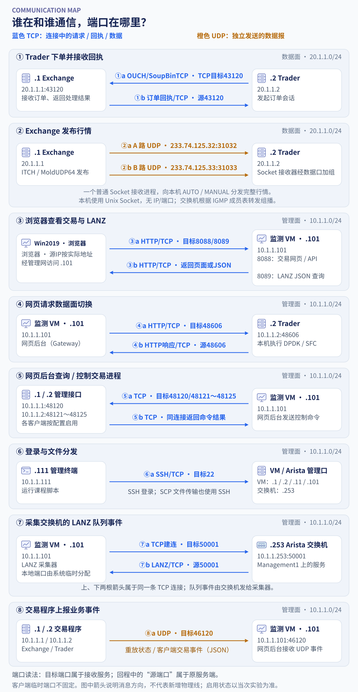
</div>

表内 `.x` 是管理网 `10.1.1.x` 的简称，数据网地址完整写出。图中小写 a/b 是箭头编号；②a、②b 分别对应行情 A、B 路。服务的监听端口固定，客户端临时端口由系统分配。

| 图中编号 | 谁向谁通信 | 用途与返回方向 |
| --- | --- | --- |
| ①a/b | `20.1.1.2 → 20.1.1.1:43120`，TCP | Trader 提交订单；Exchange 沿同一连接返回处理结果 |
| ②a/b | `20.1.1.1 → 233.74.125.32:31032`（A）与 `233.74.125.33:31033`（B），UDP | 两路行情组播；可选仅 A、仅 B 或 A/B 同时发送 |
| ③a/b | Windows Server 2019 浏览器 → `.101:8088 / :8089`，HTTP/TCP | 访问交易网页与 LANZ 查询；结果沿原连接返回 |
| ④a/b | `.101 → .2:48606`，HTTP/TCP | 网页后台请求切换网卡收发方式；`.2` 沿同一连接返回结果 |
| ⑤a/b | `.101 → .1:48120 / .2:48121～48125`，TCP | 网页后台向指定进程发命令，目标进程沿原连接返回结果 |
| ⑥a | `.111 → .1/.2/.11/.101/.253:22`，SSH/TCP | 管理机登录、执行命令和传输文件，输出沿原连接返回 |
| ⑦a/b | `.101 → .253:50001`，TCP | 采集器建连后，交换机沿同一连接向 `.101` 发送排队事件（LANZ） |
| ⑧a | `.1/.2 → .101:46120`，UDP | 交易程序上报回放进度、订单与成交状态 |

更详细的[逐箭头说明](assets/01-architecture/TRAFFIC-REFERENCE.md#appendix-flows)和[五个 Trader 管理端口](assets/01-architecture/TRAFFIC-REFERENCE.md#appendix-trader-ports)见配套资料，运行对应章节时再查。

<a id="appendix-resources"></a>

## 恢复时查阅：虚拟机资源配置

第 00 章讲过，线程准备好以后仍可能等待 CPU。虚拟机还要等待宿主机分配执行资源，所以后续测量前，要先确认这层配置。

ESXi 是运行这些虚拟机的宿主系统，vSphere 是管理界面；文中的 Guest 指虚拟机内部的操作系统。课程快照已包含以下资源设置，正常执行课程时可直接沿用。迁移、克隆、修改虚拟机硬件或开机提示资源不足后，再通过 vSphere 复核。

<div style="border-left:6px solid #7e22ce;background:#f3e8ff;padding:12px 16px;border-radius:8px;margin:14px 0;"><span style="display:inline-block;padding:3px 12px;border-radius:6px;background:#7e22ce;color:#fff;font-weight:800;">留作恢复提醒 · ESXi 低延迟基线</span> <span style="font-weight:700;color:#581c87;"><code>.1 Exchange</code> 与 <code>.2 Trader</code> 使用相同资源设置。先看编辑页，再确认虚拟机能正常开机；虚拟机内部的命令不能单独证明宿主机已安排独占资源。</span></div>

<div style="background:#f8fafc;border:1px solid #cbd5e1;border-radius:12px;padding:10px;max-width:820px;margin:14px auto;">
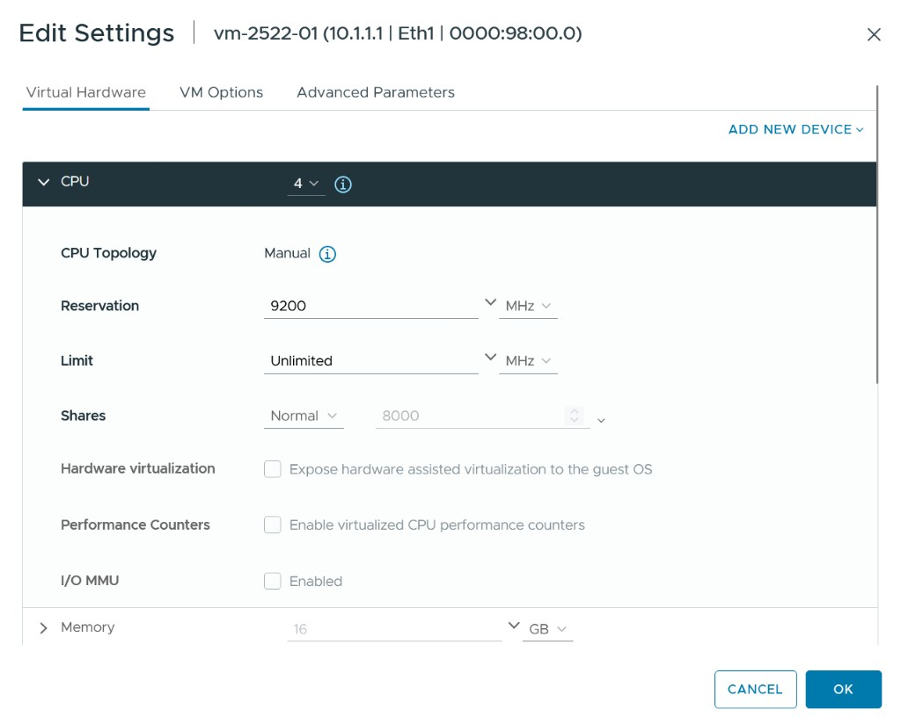
</div>

vSphere 编辑页显示 CPU 预留量（Reservation）为 `9200 MHz`，限制（Limit）为 `Unlimited`。这里按 4 个虚拟 CPU（vCPU）乘以 2300 MHz 标称基频计算。

<div style="background:#f8fafc;border:1px solid #cbd5e1;border-radius:12px;padding:10px;max-width:820px;margin:14px auto;">
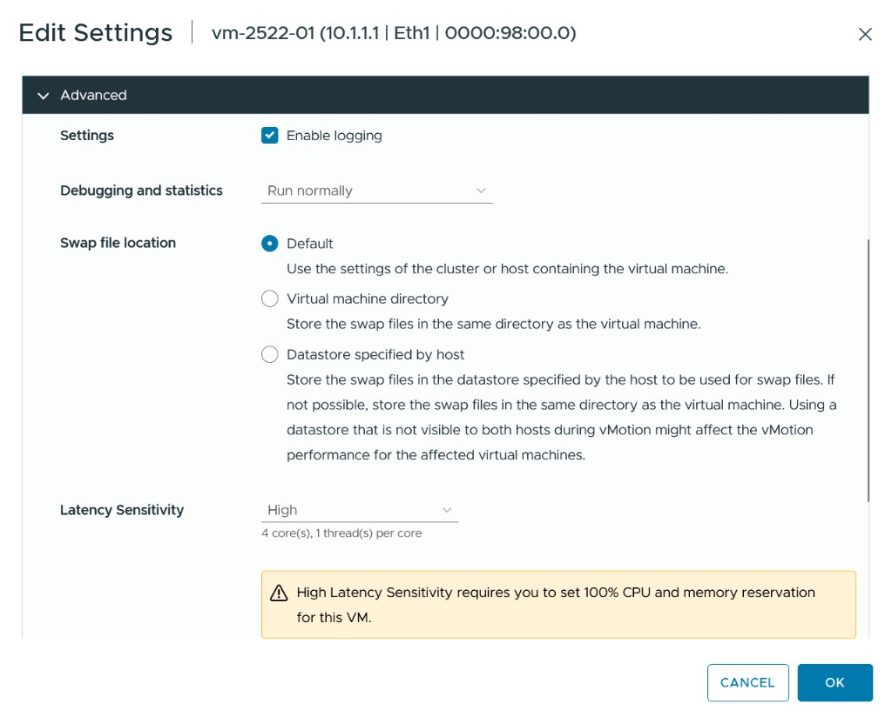
</div>

延迟敏感度（Latency Sensitivity）设为 `High`。界面的黄色提示要求完整预留 CPU 和内存资源。

<div style="background:#f8fafc;border:1px solid #cbd5e1;border-radius:12px;padding:10px;max-width:820px;margin:14px auto;">
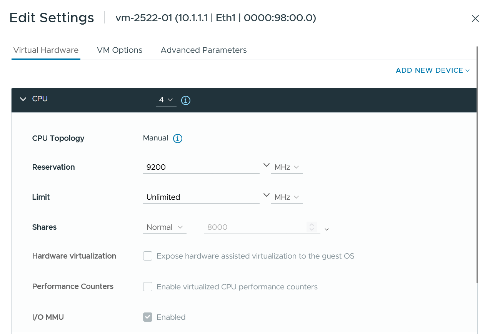
</div>

CPU 设置中的 `I/O MMU` 设为 `Enabled`，向虚拟机提供设备访问内存的地址转换与隔离功能。它像设备的领料范围：网卡只能访问系统允许的内存区域。`.1 Exchange` 与 `.2 Trader` 使用相同设置。

`Hardware virtualization` 和 `Performance Counters` 是另外两个开关，本课保持关闭。

| vSphere 项 | 本实验值 | 核对要点 |
| --- | --- | --- |
| CPU | `4 vCPU` | 测量期间保持 vCPU 数量稳定 |
| Reservation | `9200 MHz = 4 × 2300 MHz` | 按标称基频乘以 vCPU 数量填写 |
| Limit / Shares | `Unlimited / Normal` | CPU 使用量不设上限 |
| Memory | `16 GB` 且 100% 预留 | 完整预留内存，避免宿主机回收虚拟机内存或把它换出到磁盘 |
| Latency Sensitivity | `High` | 开机提示资源不足时，先解决资源问题再测量 |
| Scheduling Affinity | 留空 | 保持为空，不手工指定宿主机 CPU 列表 |
| I/O MMU | `Enabled` | 这是虚拟机可见的设置，宿主机直通设备的配置另行管理 |
| Hardware virtualization | 关闭 | 与 I/O MMU 分别设置 |

这些设置分别管两层：ESXi 根据 `High` 和资源预留为虚拟 CPU 安排物理执行资源；后续用 `taskset` 命令把线程固定到指定的虚拟 CPU。`I/O MMU` 还需要虚拟机内核配合，第 05 章使用时再核验。

测量期间保持资源设置稳定，避免虚拟机迁移和快照任务。若条件发生变化，应在测量记录里写明；后续比较要在一致条件下进行。

## 外部参考资料

| 资料 | 本章用途 |
| --- | --- |
| [systemd.net-naming-scheme(7)](https://www.freedesktop.org/software/systemd/man/latest/systemd.net-naming-scheme.html) | `ens33` / `ens64np0` 这类可预测网卡名怎么拼出来 |
| [sysfs(5)](https://man7.org/linux/man-pages/man5/sysfs.5.html) | `/sys`、`/sys/class/net` 怎样展示设备信息 |
| [readlink(1)](https://man7.org/linux/man-pages/man1/readlink.1.html) | `-f` 沿着符号链接走到真实路径 |
| [lspci(8)](https://man7.org/linux/man-pages/man8/lspci.8.html) | 按 PCI 地址列出设备类别与数字 ID |
| [Linux PCI sysfs](https://docs.kernel.org/PCI/sysfs-pci.html) | PCI 设备功能与 sysfs 目录的对应关系 |
| [Linux 接口状态](https://docs.kernel.org/networking/operstates.html) | 接口启用与实际链路状态的区别 |
| [Linux ethtool netlink](https://docs.kernel.org/networking/ethtool-netlink.html) | 驱动信息与链路状态查询 |
| [Linux networking scaling](https://docs.kernel.org/networking/scaling.html) | 后续接收队列、RSS 与 CPU 分工的参考 |
| [tcpdump man page](https://www.tcpdump.org/manpages/tcpdump.1.html) | 接收端 pcap 与 BPF 过滤 |
| [Linux NAPI](https://docs.kernel.org/networking/napi.html) | 设备用中断通知主机，再调度 NAPI poll 处理已在内存里的收包事件 |
| [Linux packet socket `packet(7)`](https://man7.org/linux/man-pages/man7/packet.7.html) | 报文套接字如何在二层观察原始报文 |
| [Arista 7150S family paper](https://www.arista.com/assets/data/pdf/Whitepapers/Arista_7150S_Family_WP.pdf) | 交换平台、cut-through 与 PTP 定位 |
| [Configure the Virtual Machine Latency Sensitivity](https://techdocs.broadcom.com/us/en/vmware-cis/vsphere/vsphere/9-0/configure-the-virtual-machine-latency-sensitivity.html) | High 要求 CPU 预留与 100% 内存预留 |
| [Performance Tuning for Latency-Sensitive Workloads](https://www.vmware.com/docs/perf-latency-tuning-vsphere8) | Reservation 通常按基频 × vCPU 填写 |
