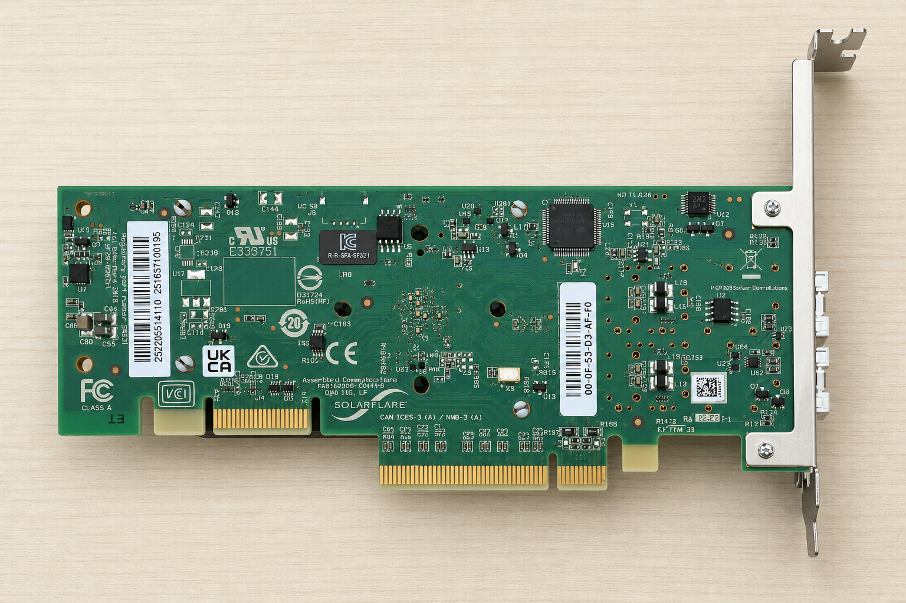
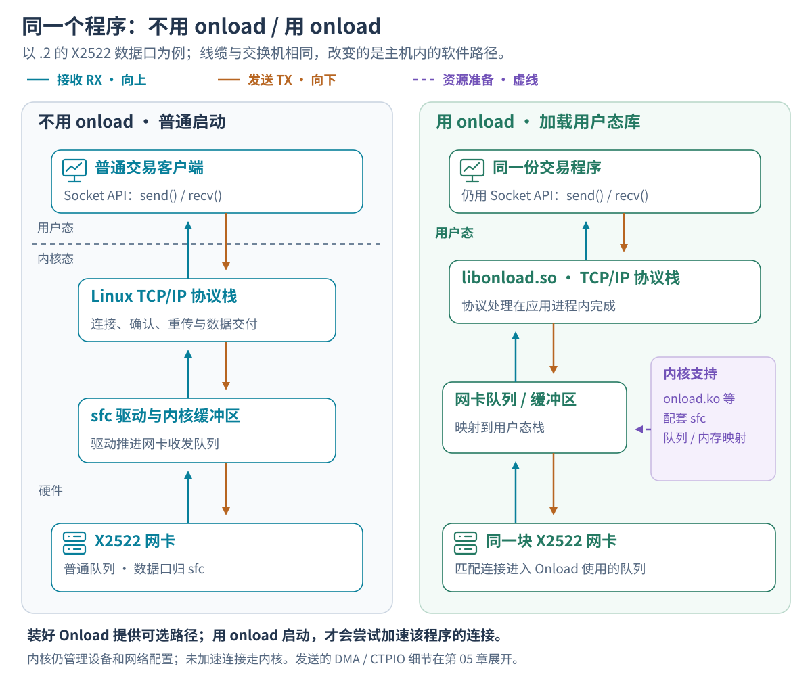
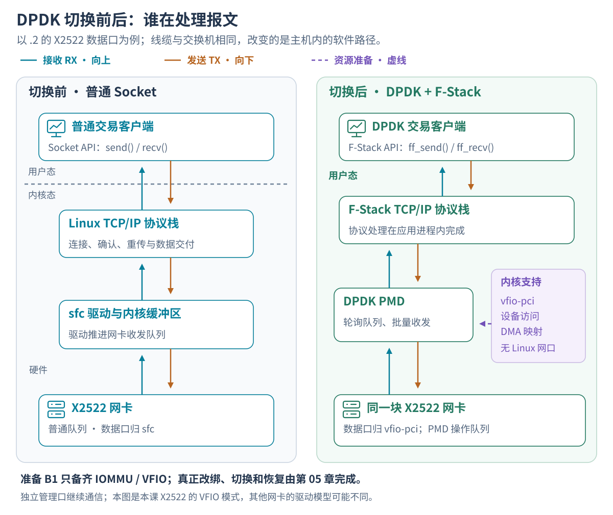
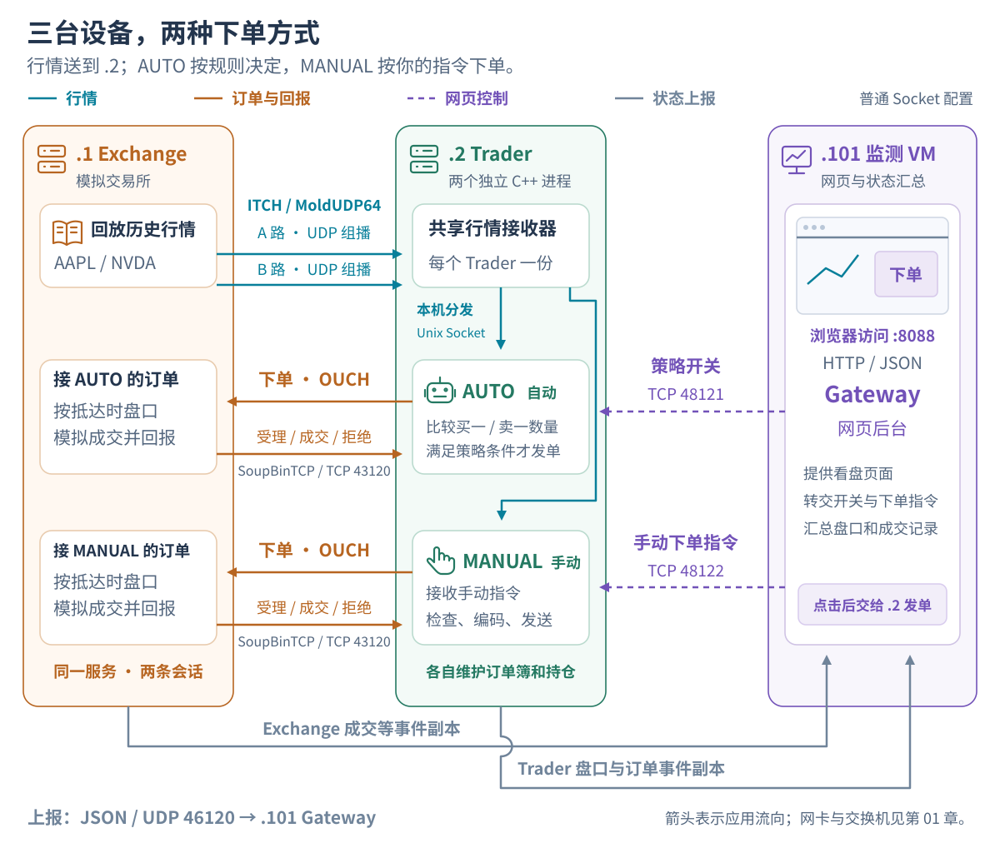
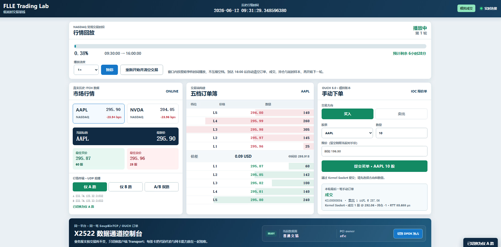
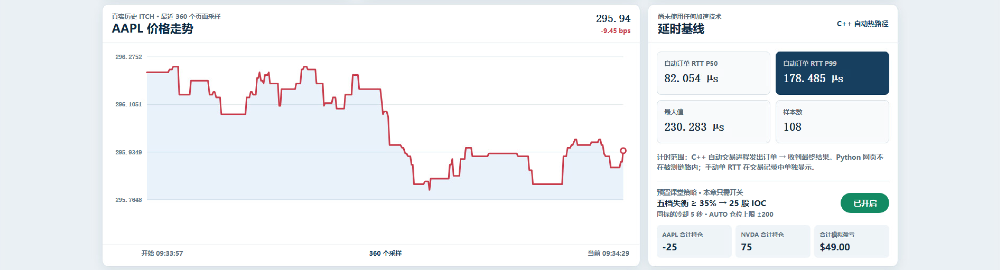
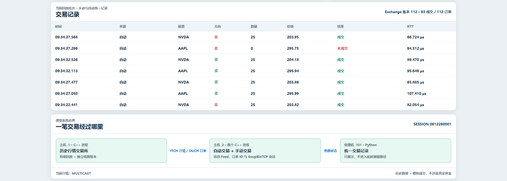
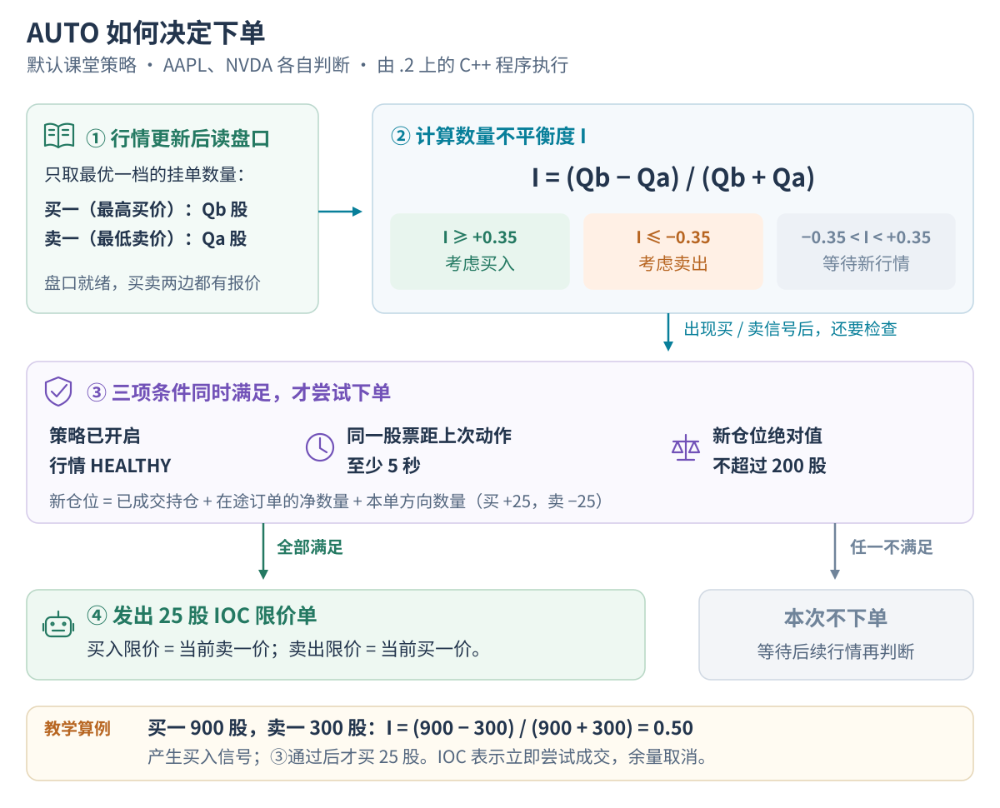
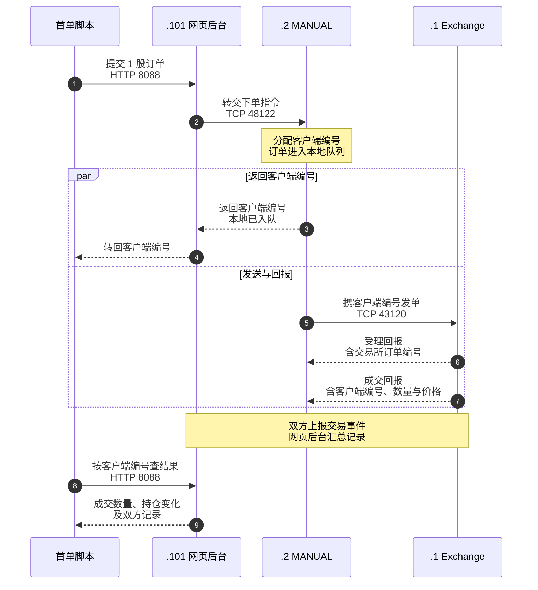

# 第 02 章：一次部署完整交易平台——从环境交接到第一笔交易

## 先搭起交易系统，再谈低延迟优化

第 01 章已经确认硬件环境、网卡归属与基础通信。本章在这个环境上搭起交易系统：让历史行情持续回放，让订单和成交回报通过实际的网络连接传送，再完成一笔模拟交易。

有了能正常交易的系统，后面才能沿着同一条业务路径讲解和比较低延迟优化技术。本章先把运行环境和交易程序备齐，后续沿用这套应用，逐步切换配置、观察流量并测量延迟。

## 本章导航

| 阶段 | 要完成的任务 | 对应步骤 |
| --- | --- | --- |
| [准备基础环境](#runtime-dependencies) | 看懂 Onload、DPDK / F-Stack；备齐软件并启用 IOMMU/VFIO | 准备 A、B1、B2 |
| [启动系统与组播](#multicast-start) | 配置交换机组播，恢复交易系统，让客户端加组，再确认成员与收包 | 准备 C、运行 ①、①A～①C |
| [核对首笔成交](#first-trade) | 认识买一、卖一与 [AUTO 策略图](#auto-strategy)，完成并核对一笔手工交易 | 运行 ② |

<a id="runtime-dependencies"></a>

## 准备 A：安装运行依赖

<div style="border:2px solid #4f46e5;background:#eef2ff;padding:10px 12px;border-radius:8px;margin:14px 0;"><div style="font-weight:900;color:#312e81;margin-bottom:4px;">导航卡 · 准备基础环境</div><div style="font-weight:700;color:#312e81;margin-bottom:8px;">范畴：工具准备　本步知识：理解 Onload 并备齐运行环境　位置：全章第 1 / 9 项 · 本组第 1 / 3 项</div><span style="display:inline-block;margin:3px;padding:4px 10px;border-radius:6px;background:#15803d;color:#fff;font-weight:800;">准备 A：安装运行依赖</span><span style="display:inline-block;margin:3px;padding:4px 10px;border-radius:6px;background:#f8fafc;border:1px solid #a5b4fc;color:#312e81;font-weight:800;">准备 B1：启用 IOMMU</span><span style="display:inline-block;margin:3px;padding:4px 10px;border-radius:6px;background:#f8fafc;border:1px solid #a5b4fc;color:#312e81;font-weight:800;">准备 B2：安装 DPDK / F-Stack</span></div>

### OpenOnload：让现有 Socket 程序走用户态协议栈

第 01 章已确认系统自带的 `sfc` 驱动可以正常通信。本步备齐 Onload，让后续交易程序可以选择用户态收发路径。

#### 背景：为什么把网络处理移到用户态

**Onload 是在 Linux 用户态运行的 TCP/IP 协议栈；OpenOnload 是它的开源发行形式，本课后文简称 Onload。** 协议栈负责连接、报文封装、确认与重传等网络处理；“用户态”表示这些工作可以在应用进程所在的执行环境中完成。应用继续使用标准 Socket 接口，例如 `send()` 和 `recv()`。[上游项目说明](https://github.com/Xilinx-CNS/onload)

它源自 Solarflare 的网络加速方案。**小包到达网卡，不等于应用已经拿到数据。** 普通收包还要经过驱动、内核协议栈，再通过 `recv()` 交给应用；线程若在阻塞等待，还需要唤醒和调度。行情和订单往往很短，这些软件开销可能占据明显比例，并带来延迟波动。[AMD：网络处理的开销](https://docs.amd.com/r/en-US/ug1586-onload-user/How-Onload-Increases-Performance)

对于受支持的 TCP/UDP 通信，Onload 把主要协议处理放进应用进程，让它直接使用分配给自己的网卡队列，减少收发时的系统调用和跨层交接。这里的“受支持”指网卡、接口和 Socket 用法符合 Onload 的加速条件。协议处理仍由主机 CPU 完成，应用继续使用 Socket 接口。**目标是缩短软件收发路径，让程序更快读到行情、更快发出订单。**[AMD：与普通网络路径对比](https://docs.amd.com/r/en-US/ug1586-onload-user/Contrasting-with-Conventional-Networking)

Solarflare 在 2019 年归入 Xilinx，Xilinx 又于 2022 年被 AMD 收购，因此资料中会看到这三个名字。今天既有 OpenOnload，也有提供更完整产品验证和商业支持的 EnterpriseOnload。[Xilinx 收购记录](https://www.sec.gov/Archives/edgar/data/743988/000074398819000038/xlnx0928201910q.htm)、[AMD 收购公告](https://www.amd.com/en/newsroom/press-releases/2022-2-14-amd-completes-acquisition-of-xilinx.html)、[发行形式](https://www.amd.com/en/support/downloads/solarflare-downloads.html/ethernet-adapters/solarflare/8000-series.html)

#### 哪些网卡能用，本课的 X2522 属于哪一类

本课 `.1` 与 `.2` 共用同一块 Solarflare XtremeScale X2522 双口卡。

<div style="background:#f8fafc;border:1px solid #cbd5e1;border-radius:12px;padding:10px;max-width:547px;margin:14px auto;">

<div style="color:#334155;font-weight:700;margin:10px 10px 0;">照片是元件面：PCIe 金手指插入主机；挡板侧的口 0、口 1 分别接到 Arista Et1、Et2。</div>
</div>

这些是**不同时代的网卡产品**，下表按代际从早到晚排列。SFN8000、X2、X3 是网卡系列，`v9.0.2` 则是本课使用的 Onload 软件版本。[Solarflare 产品资料](https://docs.amd.com/api/khub/documents/5atCqDtt7f1PkTGTDiod1w/content)、[Alveo X3 产品资料](https://www.amd.com/content/dam/amd/en/documents/products/accelerators/alveo/x3/2656036-alveo-x3-product-brief.pdf)

| 网卡系列 | 型号例子 | 产品代际与本课选择 |
| --- | --- | --- |
| Solarflare SFN8000 | SFN8042、SFN8522、SFN8542 等 | 较早一代的 Solarflare 网卡 |
| Solarflare X2 | **X2522**、X2541、X2542 | SFN8000 之后的 XtremeScale 系列；**本课使用 X2522 Plus** |
| Alveo X3 | X3522 | X2 之后的 Alveo 系列，产品代际更新 |

**本课 Onload `v9.0.2` 的支持列表包含表中这些型号。** 选择软件时，还要按具体网卡核对 Linux 内核、配套驱动和固件要求。[固定版本源码](https://github.com/Xilinx-CNS/onload/tree/v9.0.2)、[AMD 支持平台说明](https://docs.amd.com/r/en-US/ug1586-onload-user/Supported-Network-Adapters)

#### 授权方案：本课使用带授权的 X2522 Plus

OpenOnload 软件本身按开源许可证提供；这里的**网卡授权**指启用网卡功能的激活许可。以本课的 X2522 为例，可以这样理解：[软件许可证](https://docs.amd.com/r/en-US/ug1586-onload-user/Onload-LICENSE-Files)

| 方案 | 提供什么 |
| --- | --- |
| 基础版（Base） | 基础联网功能；满足厂商的软件与固件要求时，也可使用 Onload 加速功能，增强功能另行授权 |
| 单项功能授权 | 按需要增加 TCPDirect、精确时间/PTP 等功能；TCPDirect 需同时具备相应的 Onload 授权 |
| **Plus 版** | 将 Onload、TCPDirect、超低延迟和精确时间/PTP 等功能组合提供 |

厂商的 [X2522 型号表](https://docs.amd.com/r/en-US/ug1664-amd-solarflare-x2522-25g-quick-start/AMD-Solarflare-Adapters-Covered-by-this-Guide?contentId=BekxaDHCYDSLsjcPfu2dIA)列出基础版与 Plus 的区别；Onload 加速功能的适用条件见[XCN20007](https://docs.amd.com/v/u/en-US/XCN20007)，单项 TCPDirect 的要求见[激活说明 §3.5.2](https://docs.amd.com/api/khub/documents/wZFl_G52K9zsCX9vbVq~IA/content)。

**已用 `sfkey` 查询本课网卡，返回 `Installed keys Plus`，确认是带授权的 X2522 Plus 版。** 准备 A 会再次查询并打印当前结果；从[功能清单](#x2522-license-check)可以核对 Onload、TCPDirect 与低延迟功能。

#### 1. 要装什么：补齐 Onload 用户态运行环境

**有网卡驱动，Linux 就能正常联网；要让交易程序通过 Onload 加速，还要安装它的用户态协议栈和启动工具。** 这套软件来自 [AMD 的 OpenOnload 上游仓库](https://github.com/Xilinx-CNS/onload)。安装时会一并准备配套内核模块（包括网卡驱动），让用户态程序可以使用网卡资源。[AMD 驱动说明](https://docs.amd.com/r/en-US/ug1586-onload-user/The-sfc-Driver)

#### 2. 下载：克隆本课固定版本

本课使用 `v9.0.2`，对应提交的短编号是 `9f330e7`；安装输出中的版本号采用这个提交编号。下载后进入源码目录，后面的编译、安装命令都从这里执行。

<div style="border-left:6px solid #7e22ce;background:#f3e8ff;padding:12px 16px;border-radius:8px;margin:14px 0;"><span style="display:inline-block;padding:3px 12px;border-radius:6px;background:#7e22ce;color:#fff;font-weight:800;">仅供展示 · 下载源码</span> <span style="font-weight:700;color:#581c87;">下面说明手动获取和安装的流程；课堂已备好源码，实际操作使用准备 A 的绿色入口。</span></div>

```text
git clone --branch v9.0.2 --depth 1 https://github.com/Xilinx-CNS/onload.git
cd onload
```

#### 3. 编译与安装：在源码目录执行

目标 Linux 主机需要先备齐编译工具、开发依赖，以及与当前内核匹配的头文件。课程准备脚本会处理这些依赖，具体版本可查[依赖清单](artifacts/course-packages-jammy-amd64.json)的 `onload-build` 组。

<div style="border-left:6px solid #7e22ce;background:#f3e8ff;padding:12px 16px;border-radius:8px;margin:14px 0;"><span style="display:inline-block;padding:3px 12px;border-radius:6px;background:#7e22ce;color:#fff;font-weight:800;">仅供展示 · 编译、安装、加载</span> <span style="font-weight:700;color:#581c87;">在装有 X2522 的目标 Linux 主机上，从刚才的 onload 目录执行。重载会短暂中断数据口，管理连接应使用独立管理口。</span></div>

```text
./scripts/onload_build
sudo ./scripts/onload_install --nobuild
sudo onload_tool reload
```

三条命令依次**编译、安装已有构建结果、加载配套内核模块**。`--nobuild` 表示前一步已完成编译，安装时直接使用它的结果。[固定版本构建脚本](https://github.com/Xilinx-CNS/onload/blob/v9.0.2/scripts/onload_build)、[安装脚本](https://github.com/Xilinx-CNS/onload/blob/v9.0.2/scripts/onload_install)

**课堂执行下面一个准备脚本即可。** 它安装并检查 Onload，自动准备授权查询工具 `sfkey`，最后分段打印 Plus 授权和功能清单；已经装好的工具会先核对并复用。

<div style="border-left:6px solid #15803d;background:#dcfce7;padding:12px 16px;border-radius:8px;margin:14px 0;"><span style="display:inline-block;padding:3px 12px;border-radius:6px;background:#15803d;color:#fff;font-weight:800;">需要运行 · 准备 A</span> <span style="font-weight:700;color:#14532d;">在管理机 .111 的仓库根目录以 root 执行。首次安装约需 4 分钟；已经安装过会先检查现有依赖。</span></div>

```bash
cd /qyt-fll && bash assets/02-trading-baseline/00a-runtime-prep.sh
```

#### 4. 检查 Onload 安装与网卡授权

<a id="x2522-license-check"></a>

<div style="border-left:6px solid #7e22ce;background:#f3e8ff;padding:12px 16px;border-radius:8px;margin:14px 0;"><span style="display:inline-block;padding:3px 12px;border-radius:6px;background:#7e22ce;color:#fff;font-weight:800;">仅供展示 · 一号机 .1 实际输出</span> <span style="font-weight:700;color:#581c87;">实测结果；分段说明按当前脚本整理，设备标识已脱敏。</span></div>

```text
===== 查 Onload 版本 =====
[版本说明] Onload 与 Kernel module 都应为 9f330e7，说明用户态库与已加载模块匹配。
$ onload --version
Onload 9f330e7
Copyright (c) 2002-2026 Advanced Micro Devices, Inc.
Built: Sep 15 2026 13:05:57 (release)
Build profile header: <ci/internal/transport_config_opt_extra.h>
Kernel module: 9f330e7

===== 查字符设备 =====
[设备说明] 两个入口都应存在，且权限字段以 c 开头，表示配套内核模块已加载。
$ ls -l /dev/onload /dev/sfc_char
crw-rw-rw- 1 root root 237, 0 Sep 15 13:06 /dev/onload
crw-rw-rw- 1 root root 238, 0 Sep 15 13:06 /dev/sfc_char

===== 查网卡驱动 =====
[驱动说明] 结果应指向 /sys/bus/pci/drivers/sfc，说明本步仍由 sfc 管理数据口。
$ readlink -f /sys/bus/pci/devices/0000:03:00.0/driver
/sys/bus/pci/drivers/sfc

===== 查数据口地址 =====
[地址说明] ens64np0 应有 20.1.1.1/24，确认加载驱动后课程地址正常。
$ ip -4 -o addr show dev ens64np0
4: ens64np0    inet 20.1.1.1/24 brd 20.1.1.255 scope global ens64np0\       valid_lft forever preferred_lft forever

===== 查 sfkey 工具 =====
[工具说明] sfkey 来自 sfutils；版本应为 v8.3.3.1000，后面用它读取本卡授权。
$ sfkey --version
sfkey firmware update utility: v8.3.3.1000
Copyright 2002-2023 Advanced Micro Devices, Inc.

===== 查 Plus 授权 =====
[授权说明] Installed keys 后出现 Plus，表示卡上已有 Plus 授权。查询不更新试用授权。
$ sfkey --adapter=ens64np0 --report --noevaluationupdate
ens64np0: [REDACTED_ADAPTER_ID]
  Product name		Solarflare XtremeScale X2522-25G Adapter
  Serial number		[REDACTED_SERIAL]
  Installed keys	Plus


===== 查已启用功能 =====
[清单说明] 下面是网卡实际返回的功能；$ 前缀表示出厂随卡功能。
$ sfkey --adapter=ens64np0 --inventory --keys --noevaluationupdate
ens64np0: [REDACTED_ADAPTER_ID], $Onload, $Precision Time, $TCP Direct, $Low Latency, $SolarCapture Tap, $Plus

[功能名称怎么读]
  Onload           普通 Socket 程序的用户态网络加速
  TCP Direct       专用 API 的用户态 TCP/UDP 协议栈
  Low Latency      网卡低延迟功能
  Precision Time   精确时间与 PTP 功能
  SolarCapture Tap 抓包相关功能
  Plus             组合授权名称
```

#### 5. 得到哪些工具：后续怎样用

| 工具 | 用途与本课用法 |
| --- | --- |
| **`onload`** | 用 `onload 程序 参数` 启动普通 Socket 程序；后面用它启动交易客户端，选择用户态收发路径 |
| **`onload_stackdump`** | 查看运行中的 Onload 栈和连接；第 05 章用它确认客户端实际使用了加速连接 |
| `onload_tool` | 加载、重载或卸载配套内核模块；本课由准备脚本处理，需要管理驱动时使用 |

接下来沿着第一个工具，看同一份交易程序加上 `onload` 前缀后，收发路径怎样变化。

#### 用 onload 启动程序，怎样改变收发路径

`onload` 通过 Linux 的 `LD_PRELOAD` 机制优先加载用户态库，让受支持的 Socket 调用进入 Onload 协议栈。普通动态链接应用通常无需改源码或重新编译；未加速的连接仍由内核处理。[AMD 透明加速说明](https://docs.amd.com/r/en-US/ug1586-onload-user/Onload-Transparency)

| 状态 | 程序怎样运行 | 受支持的 TCP/UDP 连接怎样收发 |
| --- | --- | --- |
| 没装 OpenOnload | 普通方式启动 | 通过系统原有的驱动和 Linux 网络栈 |
| 已装，仍普通启动 | 直接启动原程序 | 仍通过 Linux 网络栈；安装提供了可选的加速能力 |
| 已装，通过 `onload` 启动 | `onload 程序 参数` | 共享库接管受支持连接，在用户态处理协议；未加速连接仍走内核 |

所以“切到 Onload”主要是**选择程序的启动方式与运行库**。在本课平台上，普通 Socket 与 Onload 客户端分别运行，网页选中哪条路径，就把订单交给哪个客户端。网卡仍由配套 `sfc` 驱动管理；这与后面 DPDK 改绑网卡驱动是两个不同动作。

<div style="border-left:6px solid #7e22ce;background:#f3e8ff;padding:12px 16px;border-radius:8px;margin:14px 0;"><span style="display:inline-block;padding:3px 12px;border-radius:6px;background:#7e22ce;color:#fff;font-weight:800;">关键图 · 同一个 Socket 程序，两条收发路径</span> <span style="font-weight:700;color:#581c87;">从底部网卡沿蓝线向上读一次接收过程。左侧由内核处理协议；右侧在应用进程内处理协议。虚线只表示资源准备，内核仍参与管理。</span></div>

<div style="background:#f8fafc;border:1px solid #cbd5e1;border-radius:12px;padding:10px;max-width:820px;margin:14px auto;">

</div>

**普通接收：** 网卡把报文写入主机内存，`sfc` 驱动与内核网络栈推进处理；内核完成 TCP/UDP 处理，再在应用调用 `recv()` 时交付数据。普通发送则由 `send()` 进入内核协议栈，再交给驱动和网卡。

**Onload 接收：** 驱动预先给用户态栈准备网卡队列、缓冲区和访问映射；硬件把匹配连接的报文送入这些队列，Onload 在用户态处理 TCP/UDP，再交给应用。发送时由用户态栈组好报文，经队列交给网卡；X2522 还支持 CTPIO 这种由 CPU 经 PCIe 写向网卡的发送方式，第 05 章再验证实际使用情况。[AMD 工作原理](https://docs.amd.com/r/en-US/ug1586-onload-user/How-Onload-Increases-Performance?contentId=44ukDClNjqpGBAXG3sLWOw)

这就是本课所说的 **kernel bypass（绕过内核常规数据路径）**。TCP 的确认、重传等工作仍由主机 CPU 执行；内核仍负责设备资源、网络配置和必要的回退处理。第 05 章再检查具体连接并比较耗时。

<div style="border-left:6px solid #0891b2;background:#cffafe;padding:12px 16px;border-radius:8px;margin:14px 0;"><span style="display:inline-block;padding:3px 12px;border-radius:6px;background:#0891b2;color:#fff;font-weight:800;">关键现象</span> <span style="font-weight:700;color:#164e63;">准备脚本的版本与数据口检查通过后，继续准备网卡隔离。后续用 onload 启动客户端，再检查它的加速连接。</span></div>

## 准备 B1：启用 IOMMU

<div style="border:2px solid #4f46e5;background:#eef2ff;padding:10px 12px;border-radius:8px;margin:14px 0;"><div style="font-weight:900;color:#312e81;margin-bottom:4px;">导航卡 · 准备基础环境</div><div style="font-weight:700;color:#312e81;margin-bottom:8px;">范畴：工具准备　本步知识：理解 DPDK 收发并准备 IOMMU　位置：全章第 2 / 9 项 · 本组第 2 / 3 项</div><span style="display:inline-block;margin:3px;padding:4px 10px;border-radius:6px;background:#f8fafc;border:1px solid #a5b4fc;color:#312e81;font-weight:800;">准备 A：安装运行依赖</span><span style="display:inline-block;margin:3px;padding:4px 10px;border-radius:6px;background:#15803d;color:#fff;font-weight:800;">准备 B1：启用 IOMMU</span><span style="display:inline-block;margin:3px;padding:4px 10px;border-radius:6px;background:#f8fafc;border:1px solid #a5b4fc;color:#312e81;font-weight:800;">准备 B2：安装 DPDK / F-Stack</span></div>

### DPDK 负责收发报文，F-Stack 负责 TCP/IP

**DPDK 是让应用在用户态直接处理网卡队列的软件开发套件。** 它通过 PMD（轮询模式驱动）主动取包、成批发包，减少逐包进入 Linux 网络栈和等待唤醒的开销；持续轮询也会占用 CPU。[DPDK PMD 说明](https://doc.dpdk.org/guides-21.11/prog_guide/poll_mode_drv.html)

**Onload 自带 TCP/UDP 协议栈；DPDK 本身能收发报文，但不自带完整 TCP/IP 协议栈。** 本课要建立 TCP 连接下单，因此接入 F-Stack 的用户态 TCP/IP 栈。F-Stack 处理连接、确认与重传，DPDK 负责底层收发；二者一起编进交易客户端。[F-Stack 项目](https://github.com/F-Stack/f-stack)

**VFIO 是 Linux 的通用设备访问框架，`vfio-pci` 是其中用于 PCI 设备的内核驱动。** 本课通过它让用户态程序访问网卡；DPDK 的 `net_sfc_efx` PMD 是用户态网卡驱动，负责操作收发队列。**实际搬运报文由网卡的 DMA（直接内存访问）完成。**[Linux VFIO 文档](https://www.kernel.org/doc/html/v5.15/driver-api/vfio.html)

<div style="border-left:6px solid #7e22ce;background:#f3e8ff;padding:12px 16px;border-radius:8px;margin:14px 0;"><span style="display:inline-block;padding:3px 12px;border-radius:6px;background:#7e22ce;color:#fff;font-weight:800;">关键图 · 普通 Socket 与本课 DPDK 路径</span> <span style="font-weight:700;color:#581c87;">左边由 sfc 和 Linux 网络栈收发；右边把 Trader 数据口交给 vfio-pci，由 DPDK PMD 操作队列，F-Stack 负责 TCP/IP。图中只画 .2 的变化。</span></div>

<div style="background:#f8fafc;border:1px solid #cbd5e1;border-radius:12px;padding:10px;max-width:820px;margin:14px auto;">

</div>

第 05 章切换时，才把 `.2` 数据口从 `sfc` 交给 `vfio-pci`；本节先准备软件和隔离条件。

### 查自己的网卡，再查 DPDK 支持名单

**网卡信息用命令查，DPDK 支持情况看对应版本的官方文档。** 在装有网卡的主机上执行 `lspci -nnk -s 0000:03:00.0`；下面是 Trader `.2` 的实际查询：

<div style="border-left:6px solid #7e22ce;background:#f3e8ff;padding:12px 16px;border-radius:8px;margin:14px 0;"><span style="display:inline-block;padding:3px 12px;border-radius:6px;background:#7e22ce;color:#fff;font-weight:800;">仅供展示 · 网卡型号查询</span> <span style="font-weight:700;color:#581c87;">-s 选择本课数据口的 PCI 地址，-nn 显示数字 ID，-k 显示驱动；换自己的机器时替换 PCI 地址。</span></div>

```text
===== 查网卡型号与 PCI ID =====
[读法] Subsystem 一行是 X2522 板卡型号；第一行是 SFC9250 控制器。
$ lspci -nnk -s 0000:03:00.0
03:00.0 Ethernet controller [0200]: Solarflare Communications XtremeScale SFC9250 10/25/40/50/100G Ethernet Controller [1924:0b03] (rev 01)
	DeviceName: pciPassthru0
	Subsystem: Solarflare Communications XtremeScale X2522-25G Network Adapter [1924:8028]
	Kernel driver in use: sfc
	Kernel modules: sfc
```

上面驱动还是 `sfc`，所以现在 `ip link`、`ifconfig` 都能看到 `ens64np1`，地址也是用 Linux 的 `ip addr` 配成 `20.1.1.2/24`。

这块数据口改绑到 `vfio-pci` 之后，不再归内核网络栈管：`ip link` 和 `ifconfig` 都列不出这个口。PCI 设备还在，同一条 `lspci` 仍能查到，只是驱动变成 `vfio-pci`。管理口没被改绑，系统里照旧可见。[DPDK 21.11 Linux Drivers](https://doc.dpdk.org/guides-21.11/linux_gsg/linux_drivers.html)

这时数据面地址写在 F-Stack 配置的 `[port0]`，由 `ff_init()` 装到用户态协议栈。线上看仍是 `20.1.1.2`，对端仍是 `20.1.1.1`。[F-Stack config.ini](https://github.com/F-Stack/f-stack/blob/dev/config.ini)

<div style="border-left:6px solid #7e22ce;background:#f3e8ff;padding:12px 16px;border-radius:8px;margin:14px 0;"><span style="display:inline-block;padding:3px 12px;border-radius:6px;background:#7e22ce;color:#fff;font-weight:800;">仅供展示</span> <span style="font-weight:700;color:#581c87;">F-Stack 用配置文件给数据口写地址，不再使用 <code>ip addr</code>。</span></div>

```ini
[port0]
addr=20.1.1.2
netmask=255.255.255.0
broadcast=20.1.1.255
```

交回 `sfc` 后，网口重新出现，脚本再用 `ip addr replace 20.1.1.2/24 dev ens64np1` 把同一地址还给 Linux。本节只准备软件和 IOMMU，真正改绑在后续数据面切换时进行。

**查支持名单：** 打开 [DPDK 21.11.9 网卡驱动目录](https://doc.dpdk.org/guides-21.11/nics/index.html)，进入 **Solarflare libefx-based Poll Mode Driver → Supported NICs（§49.6）**，搜索 `X2522`。该节原文列出：

> Solarflare X2522 Dual Port SFP28 10/25GbE Adapter

这就是 X2522 被该版本 `net_sfc_efx` PMD 支持的依据。[支持名单原文](https://doc.dpdk.org/guides-21.11/nics/sfc_efx.html#supported-nics)

### 为什么本课要启用 IOMMU

网卡通过 **DMA** 搬运报文，例如把收到的帧写入程序预先准备的接收缓冲区。DPDK 让用户态程序控制网卡队列，因此本课启用 IOMMU，限制网卡可以读写哪些内存，防止错误的 DMA 地址破坏其他数据。

**IOMMU（输入输出内存管理单元）负责设备 DMA 地址转换与访问保护。** DPDK 通过 VFIO 请求缓冲区的 DMA 映射，由内核建立映射；网卡随后使用 DMA 地址读写内存，IOMMU 转换地址并检查权限，没有合法映射的访问会被阻止。DMA 本身不依赖 IOMMU，本课需要它来保护内存。[Linux VFIO 说明](https://www.kernel.org/doc/html/v5.15/driver-api/vfio.html)

### 启用 IOMMU 启动参数

IOMMU 通过内核启动参数启用。B1 在 `.1/.2` 的 `/etc/default/grub` 中设置下面这一项，执行 `update-grub` 更新启动配置，再按需重启主机。

<div style="border-left:6px solid #7e22ce;background:#f3e8ff;padding:12px 16px;border-radius:8px;margin:14px 0;"><span style="display:inline-block;padding:3px 12px;border-radius:6px;background:#7e22ce;color:#fff;font-weight:800;">仅供展示 · 脚本设置的启动参数</span> <span style="font-weight:700;color:#581c87;">intel_iommu=on 开启 Intel IOMMU；这一行由 B1 自动设置，无需手工修改。</span></div>

```text
GRUB_CMDLINE_LINUX="intel_iommu=on iommu=pt"
```

重启后，脚本读取 `/proc/cmdline` 确认参数生效，并用 `modprobe vfio-pci` 加载后续 DPDK 所需的设备访问支持。**已配置好时只检查，不重复重启。**

<div style="border-left:6px solid #15803d;background:#dcfce7;padding:12px 16px;border-radius:8px;margin:14px 0;"><span style="display:inline-block;padding:3px 12px;border-radius:6px;background:#15803d;color:#fff;font-weight:800;">需要运行 · 准备 B1</span> <span style="font-weight:700;color:#14532d;">在 .111 仓库根目录以 root 执行。需要重启的主机，SSH 会暂时断开，脚本会等待它恢复。</span></div>

```bash
cd /qyt-fll && bash assets/02-trading-baseline/00b-iommu-prep.sh
```

<div style="border-left:6px solid #7e22ce;background:#f3e8ff;padding:12px 16px;border-radius:8px;margin:14px 0;"><span style="display:inline-block;padding:3px 12px;border-radius:6px;background:#7e22ce;color:#fff;font-weight:800;">仅供展示 · 一号机关键输出</span> <span style="font-weight:700;color:#581c87;">Exchange .1 的实测结果；说明文字与当前脚本一致，modprobe 成功时没有输出。</span></div>

```text
===== 查当前启动参数 =====
[生效检查] 当前启动参数应同时包含 intel_iommu=on 和 iommu=pt。
$ cat /proc/cmdline
BOOT_IMAGE=/vmlinuz-5.15.0-164-generic root=/dev/mapper/ubuntu--vg-ubuntu--lv ro intel_iommu=on iommu=pt

===== 加载 VFIO 支持 =====
加载模块后核对安全模式；本步不把网卡交给 VFIO。
$ modprobe vfio-pci

===== 查是否允许绕过 IOMMU =====
[参数说明] 这个开关决定：是否允许 VFIO 绕过 IOMMU？
[模式检查] N = No：不允许绕过。脚本要求 N，否则停止。
$ cat /sys/module/vfio/parameters/enable_unsafe_noiommu_mode
N
```

脚本成功结束后，执行 B2 安装 DPDK / F-Stack 软件。

## 准备 B2：安装 DPDK / F-Stack 软件

<div style="border:2px solid #4f46e5;background:#eef2ff;padding:10px 12px;border-radius:8px;margin:14px 0;"><div style="font-weight:900;color:#312e81;margin-bottom:4px;">导航卡 · 准备基础环境</div><div style="font-weight:700;color:#312e81;margin-bottom:8px;">范畴：工具准备　本步知识：安装并核对 DPDK / F-Stack 软件　位置：全章第 3 / 9 项 · 本组第 3 / 3 项</div><span style="display:inline-block;margin:3px;padding:4px 10px;border-radius:6px;background:#f8fafc;border:1px solid #a5b4fc;color:#312e81;font-weight:800;">准备 A：安装运行依赖</span><span style="display:inline-block;margin:3px;padding:4px 10px;border-radius:6px;background:#f8fafc;border:1px solid #a5b4fc;color:#312e81;font-weight:800;">准备 B1：启用 IOMMU</span><span style="display:inline-block;margin:3px;padding:4px 10px;border-radius:6px;background:#15803d;color:#fff;font-weight:800;">准备 B2：安装 DPDK / F-Stack</span></div>

本课把已编译的 DPDK、F-Stack 与交易客户端一起准备到 `.1/.2`。**下面先说明源码怎样取得、怎样编译；课堂实际安装使用本节末尾的 B2 脚本。** 运行 ① 只使用准备好的软件恢复交易系统。

### 1. 准备编译环境

若自己从源码构建，在一台 Ubuntu 22.04 构建机上操作，本课构建机是 `.101`。以下命令按顺序在同一个终端执行。Git 下载源码；GCC/Make 编译 C/C++；**Meson 生成 DPDK 的编译任务，Ninja 执行这些任务**。这两个命令来自下面安装的软件包。[DPDK 构建依赖](https://doc.dpdk.org/guides-21.11/linux_gsg/sys_reqs.html)

<div style="border-left:6px solid #7e22ce;background:#f3e8ff;padding:12px 16px;border-radius:8px;margin:14px 0;"><span style="display:inline-block;padding:3px 12px;border-radius:6px;background:#7e22ce;color:#fff;font-weight:800;">仅供展示 · 准备构建机</span> <span style="font-weight:700;color:#581c87;">Ubuntu 22.04 上的源码构建步骤；本课已备好软件，课堂直接执行下方 B2 入口。</span></div>

```text
sudo apt-get update
sudo apt-get install -y git build-essential meson ninja-build pkg-config \
  python3-pyelftools libnuma-dev libssl-dev gawk
mkdir -p ~/flle-dpdk-build
cd ~/flle-dpdk-build
```

### 2. 下载、编译并安装 DPDK

从 [DPDK 官方稳定分支仓库](https://dpdk.org/git/dpdk-stable)取得 `v21.11.9`，进入源码目录，再依次配置、编译、安装。`--prefix` 指定安装位置。

<div style="border-left:6px solid #7e22ce;background:#f3e8ff;padding:12px 16px;border-radius:8px;margin:14px 0;"><span style="display:inline-block;padding:3px 12px;border-radius:6px;background:#7e22ce;color:#fff;font-weight:800;">仅供展示 · 构建 DPDK</span> <span style="font-weight:700;color:#581c87;">继续在刚才的构建目录操作；meson setup 只生成编译任务，ninja 才开始编译。</span></div>

```text
git clone --branch v21.11.9 --depth 1 https://dpdk.org/git/dpdk-stable dpdk-21.11.9
cd dpdk-21.11.9
meson setup build --prefix=/opt/flle/dpdk-21.11.9 --libdir=lib \
  -Ddefault_library=static -Dtests=false
ninja -C build -j4
sudo ninja -C build install
cd ..
```

安装后，DPDK 的库和开发接口安装到 `/opt/flle/dpdk-21.11.9`，供 F-Stack 编译时使用。[DPDK 构建说明](https://doc.dpdk.org/guides-21.11/linux_gsg/build_dpdk.html)

### 3. 下载、编译并安装 F-Stack

从 [F-Stack 仓库](https://github.com/F-Stack/f-stack)获取源码，切到本课固定提交，应用已备好的 21.11 兼容补丁。`PKG_CONFIG_PATH` 告诉构建工具去哪里找刚安装的 DPDK。

<div style="border-left:6px solid #7e22ce;background:#f3e8ff;padding:12px 16px;border-radius:8px;margin:14px 0;"><span style="display:inline-block;padding:3px 12px;border-radius:6px;background:#7e22ce;color:#fff;font-weight:800;">仅供展示 · 构建 F-Stack</span> <span style="font-weight:700;color:#581c87;">继续在同一终端操作；兼容补丁取自本课仓库，路径已写全。</span></div>

```text
git clone https://github.com/F-Stack/f-stack.git
cd f-stack
git checkout 0abb713721a6a0ba95768acde052dbd3d2fdf3fe
git apply /qyt-fll/apps/flle-trading-lab/third_party/fstack/dpdk-21.11-compat.patch
export PKG_CONFIG_PATH=/opt/flle/dpdk-21.11.9/lib/pkgconfig
make -C lib -j1 CONF_CFLAGS=-Wno-error=array-bounds
sudo install -d /opt/flle/f-stack/lib /opt/flle/f-stack/include /opt/flle/f-stack/bin
sudo env PKG_CONFIG_PATH="$PKG_CONFIG_PATH" make -C lib install \
  PREFIX=/opt/flle/f-stack F-STACK_CONF=/opt/flle/f-stack/f-stack.conf
```

F-Stack 安装到 `/opt/flle/f-stack`，提供供应用链接的 TCP/IP 库。**开发本课客户端时使用的 `ff_*` 是 F-Stack API，内部再通过 DPDK 收发报文。**

- `ff_init()`：读取配置，初始化 DPDK 和用户态 TCP/IP 栈。
- `ff_socket()` / `ff_connect()`：创建 Socket，向 Exchange 建立 TCP 订单连接。
- `ff_send()` / `ff_recv()`：发送订单、接收回报。
- `ff_run()`：运行收发循环，持续处理网络并调用应用的处理函数。

把库编进本课客户端，使用项目已有的构建目标：

<div style="border-left:6px solid #7e22ce;background:#f3e8ff;padding:12px 16px;border-radius:8px;margin:14px 0;"><span style="display:inline-block;padding:3px 12px;border-radius:6px;background:#7e22ce;color:#fff;font-weight:800;">仅供展示 · 编译交易客户端</span> <span style="font-weight:700;color:#581c87;">接上一步的 f-stack 源码目录；此处只生成程序，不启动交易或接管网卡。</span></div>

```text
make -C /qyt-fll/apps/flle-trading-lab dpdk \
  FSTACK_TREE="$PWD" BUILD="$PWD/flle-client-build"
```

### 4. 安装本课准备好的软件

**课堂执行 B2 脚本即可。** 本课固定软件包使用 DPDK 21.11.9 和上述 F-Stack 提交；其中 DPDK 采用 Ubuntu 已编译的同版本库。B2 从管理机缓存安装完整软件，并核对版本、链接依赖与 IOMMU 状态，已经安装过就核对复用。源码编译步骤用于说明软件的来源与构建方法。

<div style="border-left:6px solid #15803d;background:#dcfce7;padding:12px 16px;border-radius:8px;margin:14px 0;"><span style="display:inline-block;padding:3px 12px;border-radius:6px;background:#15803d;color:#fff;font-weight:800;">需要运行 · 准备 B2</span> <span style="font-weight:700;color:#14532d;">完成 B1 后，在管理机 .111 的仓库根目录以 root 执行。安装软件并检查，不启动交易客户端。</span></div>

```bash
cd /qyt-fll && bash assets/02-trading-baseline/00b-dpdk-software-prep.sh
```

<div style="border-left:6px solid #7e22ce;background:#f3e8ff;padding:12px 16px;border-radius:8px;margin:14px 0;"><span style="display:inline-block;padding:3px 12px;border-radius:6px;background:#7e22ce;color:#fff;font-weight:800;">仅供展示 · 一号机软件检查</span> <span style="font-weight:700;color:#581c87;">Exchange .1 的 B2 输出节选；只保留版本、文件与链接检查，略去安装过程和长路径命令。</span></div>

```text
===== 查已安装软件的版本 =====
[版本说明] 以下读取安装包的构建记录。
DPDK: 21.11.9
F-Stack: 0abb713721a6a0ba95768acde052dbd3d2fdf3fe

===== 查运行程序文件 =====
[文件说明] flle-trader-dpdk 是已编入 DPDK/F-Stack 的交易客户端；dpdk-devbind.py 用于后续切换网卡驱动。
$ ls -lh bin/flle-trader-dpdk bin/dpdk-devbind.py
-rwxr-xr-x 1 root root 29K Jan  1  1970 bin/dpdk-devbind.py
-rwxr-xr-x 1 root root 36M Jan  1  1970 bin/flle-trader-dpdk
$ test -x bin/flle-trader-dpdk && test -x bin/dpdk-devbind.py
[文件检查] 两个程序均存在且可执行。

===== 查客户端已包含两套库 =====
[链接说明] ff_init 来自 F-Stack；rte_eal_init 来自 DPDK。以下读取程序符号，不启动程序。
ff_init
rte_eal_init

[PMD说明] 客户端中也包含 X2522 对应的 net_sfc_efx 驱动。
net_sfc_efx
```

<a id="multicast-start"></a>

## 准备 C：配置交换机组播

<div style="border:2px solid #4f46e5;background:#eef2ff;padding:10px 12px;border-radius:8px;margin:14px 0;"><div style="font-weight:900;color:#312e81;margin-bottom:4px;">导航卡 · 启动系统与组播</div><div style="font-weight:700;color:#312e81;margin-bottom:8px;">范畴：分步实验　本步知识：启用 VLAN20 的组播侦听和查询器　位置：全章第 4 / 9 项 · 本组第 1 / 5 项</div><span style="display:inline-block;margin:3px;padding:4px 10px;border-radius:6px;background:#15803d;color:#fff;font-weight:800;">准备 C：配置交换机组播</span><span style="display:inline-block;margin:3px;padding:4px 10px;border-radius:6px;background:#f8fafc;border:1px solid #a5b4fc;color:#312e81;font-weight:800;">运行 ①：恢复并启动交易系统</span><span style="display:inline-block;margin:3px;padding:4px 10px;border-radius:6px;background:#f8fafc;border:1px solid #a5b4fc;color:#312e81;font-weight:800;">运行 ①A：让客户端加入组播组</span><span style="display:inline-block;margin:3px;padding:4px 10px;border-radius:6px;background:#f8fafc;border:1px solid #a5b4fc;color:#312e81;font-weight:800;">运行 ①B：查看交换机成员表</span><span style="display:inline-block;margin:3px;padding:4px 10px;border-radius:6px;background:#f8fafc;border:1px solid #a5b4fc;color:#312e81;font-weight:800;">运行 ①C：确认组播行情到达</span></div>

本步完成 VLAN20 的组播配置：启用侦听、设置并开启查询器，然后查看转发状态、查询器和成员表。在 `.111` 执行下方入口，脚本会通过 SSH 将列出的全部 EOS 命令发送到交换机 `10.1.1.253`。[Arista 命令说明](https://www.arista.com/en/um-eos/eos-igmp-and-igmp-snooping)

<div style="border-left:6px solid #15803d;background:#dcfce7;padding:12px 16px;border-radius:8px;margin:14px 0;"><span style="display:inline-block;padding:3px 12px;border-radius:6px;background:#15803d;color:#fff;font-weight:800;">需要运行 · 准备 C</span> <span style="font-weight:700;color:#14532d;">在管理机 .111，以 root 执行；第 01 章的 Et1/Et2、VLAN20 和交换机管理连接应已准备好。本步启用 VLAN20 的组播侦听与查询器，完成后核对输出。</span></div>

```bash
cd /qyt-fll && bash assets/02-trading-baseline/00c-igmp-configure.sh
```

<div style="border-left:6px solid #7e22ce;background:#f3e8ff;padding:12px 16px;border-radius:8px;margin:14px 0;"><span style="display:inline-block;padding:3px 12px;border-radius:6px;background:#7e22ce;color:#fff;font-weight:800;">仅供展示 · 交换机实际命令</span> <span style="font-weight:700;color:#581c87;">以下是脚本依次发给交换机的 EOS 命令，与命令计划逐行一致；由上面的 Bash 自动执行，无需再手工输入一遍。</span></div>

```text
configure terminal
ip igmp snooping
ip igmp snooping vlan 20
ip igmp snooping vlan 20 querier address 20.1.1.254
ip igmp snooping vlan 20 querier
end
show ip igmp snooping
show igmp snooping querier
show ip igmp snooping groups
```

前六条完成配置：`configure terminal` / `end` 负责进入和退出配置模式，中间四条依次开启全局侦听、开启 VLAN20 侦听、设置查询源地址、启用 VLAN20 查询器。第 7～9 条查询配置效果。

执行工具会给查询追加 `| no-more` 关闭分页；输出中带这个后缀的一行是交换机对同一次查询的回显。

<div style="border-left:6px solid #7e22ce;background:#f3e8ff;padding:12px 16px;border-radius:8px;margin:14px 0;"><span style="display:inline-block;padding:3px 12px;border-radius:6px;background:#7e22ce;color:#fff;font-weight:800;">仅供展示 · 三条查询结果</span> <span style="font-weight:700;color:#581c87;">准备 C 脚本打印的第 7～9 条；说明文字与当前脚本一致，查询读数保留原文。</span></div>

```text
===== 第 7 条命令：查 VLAN20 的组播转发方式 =====
[转发] 对: Enabled、pruning True、Flooding False  证: 按成员端口转发
$ show ip igmp snooping
Vlan 20 :
IGMP snooping                  : Enabled
IGMP snooping pruning active   : True
Flooding traffic to VLAN       : False
===== 第 8 条命令：查谁发成员查询 =====
[查询器] 对: VLAN20 / 20.1.1.254 / Switch  证: 交换机持续询问成员
$ show igmp snooping querier
20    20.1.1.254       v2       Switch
===== 第 9 条命令：查当前组播成员表 =====
按 VLAN、Group、Port-List 读出组与端口；平台尚未启动时，目标行情组可能没有成员。
$ show ip igmp snooping groups
show ip igmp snooping groups | no-more
[成员说明] 当前回执未见 VLAN20 的 233.74.125.32 与 233.74.125.33 成员；平台启动并成功加组后，在运行 ①B 核对动态成员 Et2。
```

VLAN20 已按成员端口转发，查询器是 20.1.1.254 / Switch。此时尚未看到 A、B 行情组成员，加组后到运行 ①B 再核对。

## 运行 ①：恢复并启动交易系统

<div style="border:2px solid #4f46e5;background:#eef2ff;padding:10px 12px;border-radius:8px;margin:14px 0;"><div style="font-weight:900;color:#312e81;margin-bottom:4px;">导航卡 · 启动系统与组播</div><div style="font-weight:700;color:#312e81;margin-bottom:8px;">范畴：工具准备　本步知识：启动交易所、交易客户端和网页　位置：全章第 5 / 9 项 · 本组第 2 / 5 项</div><span style="display:inline-block;margin:3px;padding:4px 10px;border-radius:6px;background:#f8fafc;border:1px solid #a5b4fc;color:#312e81;font-weight:800;">准备 C：配置交换机组播</span><span style="display:inline-block;margin:3px;padding:4px 10px;border-radius:6px;background:#15803d;color:#fff;font-weight:800;">运行 ①：恢复并启动交易系统</span><span style="display:inline-block;margin:3px;padding:4px 10px;border-radius:6px;background:#f8fafc;border:1px solid #a5b4fc;color:#312e81;font-weight:800;">运行 ①A：让客户端加入组播组</span><span style="display:inline-block;margin:3px;padding:4px 10px;border-radius:6px;background:#f8fafc;border:1px solid #a5b4fc;color:#312e81;font-weight:800;">运行 ①B：查看交换机成员表</span><span style="display:inline-block;margin:3px;padding:4px 10px;border-radius:6px;background:#f8fafc;border:1px solid #a5b4fc;color:#312e81;font-weight:800;">运行 ①C：确认组播行情到达</span></div>

Onload、DPDK / F-Stack 软件及 IOMMU 已在准备 A、B1、B2 就绪。本步复用两台机器上准备好的固定运行软件，由 `.101` 构建本章的 Exchange、行情接收器与原生客户端，恢复交易与网页服务。

本步使用 `.111` 保留的行情、配置与前面准备好的软件，恢复 `.1/.2/.101` 上的交易系统，**同时备好后续四路径测试客户端和 Arista 官方 LANZ 读取工具**。第五章切换客户端，第六章启用打标与 LANZ 采集，沿用这里准备的软件。启动时先准备行情接收器与交易客户端，再由 Exchange 发布行情；最后检查文件摘要与进程在线状态。已正常部署时会核对并复用。

本步默认启用开机恢复，已有平台重刷也会补齐。以后启动 `.1/.2/.101`，`.2` 会等待其它主机就绪，恢复上次课程配置和行情；TRANSPORT 回到 SFC，回放从开盘重新开始，无需再刷上线脚本。

<div style="border-left:6px solid #15803d;background:#dcfce7;padding:12px 16px;border-radius:8px;margin:14px 0;"><span style="display:inline-block;padding:3px 12px;border-radius:6px;background:#15803d;color:#fff;font-weight:800;">需要运行 · 运行 ①</span> <span style="font-weight:700;color:#14532d;">在管理机 .111 的 /qyt-fll 目录以 root 执行。第 01 章及准备 A、B1、B2、C 应已完成；本步复用已准备的软件并恢复交易平台。</span></div>

```bash
cd /qyt-fll && bash assets/02-trading-baseline/01-restore-trading-lab.sh
```

若已运行旧版“单播／组播／双路”平台，在上述命令末尾加 `--upgrade-ab`。脚本会停止旧会话、保留原记录，再从开盘启动新版；无需重装前面的依赖。部署后刷新网页。

<div style="border-left:6px solid #7e22ce;background:#f3e8ff;padding:12px 16px;border-radius:8px;margin:14px 0;"><span style="display:inline-block;padding:3px 12px;border-radius:6px;background:#7e22ce;color:#fff;font-weight:800;">仅供展示 · 启动结果</span> <span style="font-weight:700;color:#581c87;">新版平台的启动结果节选。后面的主机加组、交换机成员和双路收包均已在这轮平台核对；首单部分保留此前成交示例。</span></div>

```text
exchange=ONLINE pid=11363
trader-auto=ONLINE pid=49688
trader-manual=ONLINE pid=49694
gateway=ONLINE pid=14130
deployed_sha256=PASS exchange,trader_auto,trader_manual,source,replay,manifest,opening_book_checkpoint
restore_verdict=TRADING_LAB_READY
market_network=UDP_MULTICAST_AB A=233.74.125.32:31032 B=233.74.125.33:31033
[进程说明] exchange 是 .1 交易所；trader-auto / trader-manual 是 .2 自动与手动客户端；gateway 是 .101 网页后台。
[在线说明] ONLINE 表示对应进程在线；pid 是该主机上的进程编号，每次启动可能不同，不是端口号。
[文件说明] deployed_sha256=PASS 表示所列部署文件摘要核验通过；进程在线与文件一致需要一起看。
[就绪说明] restore_verdict=TRADING_LAB_READY 表示部署核验通过，不代表已经完成首笔成交或延迟测试。
```

<a id="trading-system-overview"></a>

### 系统上线后，看清三台设备怎样配合

`.1` 上的 Exchange 是模拟交易所，负责发布行情、接收订单并返回结果。`.2` 上有两个独立运行的 Trader（交易客户端）：AUTO 根据买卖报价上的挂单数量自动决定是否下单，MANUAL 接收你的手工指令。监测 VM `.101` 的 Gateway（网页后台）提供看盘、下单和策略开关；实际向 Exchange 发单的是 `.2` 上的 Trader。

<div style="border-left:6px solid #7e22ce;background:#f3e8ff;padding:12px 16px;border-radius:8px;margin:14px 0;"><span style="display:inline-block;padding:3px 12px;border-radius:6px;background:#7e22ce;color:#fff;font-weight:800;">关键图 · 三台设备，两种下单方式</span> <span style="font-weight:700;color:#581c87;">先沿蓝线看行情到哪里，再沿橙线看谁下单、谁返回结果。紫色虚线把网页操作交给对应的 Trader；灰线把状态副本送回网页后台。图示为本章普通 Socket 配置的主要业务流。</span></div>

<div style="background:#f8fafc;border:1px solid #cbd5e1;border-radius:12px;padding:10px;max-width:820px;margin:14px auto;">

</div>

**行情先到两个交易客户端。** Exchange 提供 A、B 两路 UDP 组播，默认只发 A 路。`.2` 的 `flle-feed-receiver` 同时加入两个组，用普通 UDP 套接字（Socket）接收行情，再经 Unix Socket 给 AUTO 和 MANUAL 各送一份完整消息。Unix Socket 是同一台主机内的进程通信接口，不需要额外的 IP 或 TCP/UDP 端口；两个 Trader 各自维护订单簿，各用独立连接向 Exchange 下单并接收回报。

**网页把手工指令交给 MANUAL。** 浏览器访问 `.101:8088`，看到 `.2` 上报的买卖报价和挂单数量，这些信息合称盘口。你选择股票、方向、数量与限价后点击下单，Gateway 经控制连接把请求交给 `.2` 的 MANUAL，再由 MANUAL 向 Exchange 发单。运行 ② 会用调用相同接口的首单脚本，沿一笔订单的时序核对结果。

**AUTO 在 `.2` 根据行情自行判断。** 网页上的策略开关控制它是否继续按规则下单，关闭网页不会停止自动交易。先认清它的位置；到运行 ② 看懂买一、卖一后，再看 [AUTO 自动下单策略图](#auto-strategy)。

完整的流量方向、协议与端口统一查阅[第 01 章的流量总图](01-financial-low-latency-architecture.md#appendix-flows)。本节大图只展开三台运行设备的业务关系；Gateway 还会定期查询各进程状态。

### 打开网页，先把系统看懂

在 Windows Server 2019 浏览器打开 `http://10.1.1.101:8088/`。

**FeedGuardian 是本课的行情完整性保护机制，按行情序号检查消息是否连续。** `HEALTHY` 表示当前正常，`GAP` 表示存在行情缺口；交易闸 `trading_gate=OPEN` 表示允许下单。发现缺口或等待重新同步时，交易闸会关闭，避免用不完整盘口继续下单。

先分清网页上行情与成交的来源，再按三张截图认清各区的用途。截图用于说明界面，报价和交易记录属于截图时的回放；第一张为 A/B 新版网页，行情按钮为「仅 A 路」「仅 B 路」「A/B 双路」。

| 网页看到什么 | 来自哪里 |
| --- | --- |
| AAPL / NVDA 行情 | Nasdaq 官方公开的 `2026-06-12` 历史样例，保留消息原字节和原始时间 |
| 买卖报价随时间变化 | 回放当天 `09:30–16:00` 的事件；1 倍速播放需 6 小时 30 分，可在网页调整倍速 |
| 今天提交的订单与成交 | Exchange 按当前回放盘口模拟成交，记入独立账本；历史行情保持原样 |

部署会先用 09:30 前的事件准备好开盘订单簿，再从常规交易时段开始显示。

<div style="background:#f8fafc;border:1px solid #cbd5e1;border-radius:12px;padding:10px;max-width:820px;margin:14px auto;">

</div>

顶栏显示历史行情播到了什么时间；回放条显示进度、剩余播放时间和倍速。左下是两只股票的最新价格，中间是五档买卖报价，右下是 MANUAL 手工下单入口。默认的 IOC 表示立即尝试成交、未成交部分取消，运行 ② 会用一笔订单说明它。

价格旁的 bps 表示基点，1 bps = 0.01%。例如 `+3.04 bps` 表示价格在图示窗口内上涨约 `0.0304%`；这里衡量的是价格变化。

<div style="background:#f8fafc;border:1px solid #cbd5e1;border-radius:12px;padding:10px;max-width:820px;margin:14px auto;">

</div>

左图显示最近 360 个页面采样的价格走势。右图的“延时基线”统计 AUTO 从发出订单到收到最终结果的往返时间（RTT）；手工单的 RTT 在交易记录里。两者都由 C++ 客户端计时，网页负责展示。

策略区显示 AUTO 的开关、持仓与模拟盈亏。本章先观察状态，性能比较从第 04 章开始。

<div style="background:#f8fafc;border:1px solid #cbd5e1;border-radius:12px;padding:10px;max-width:820px;margin:14px auto;">

</div>

交易记录把自动单和手工单放在同一张表，用来源列区分。`.1` 的 Exchange 和 `.2` 的 Trader 各自记录成交，`.101` 网页后台汇总展示。

网页中的收发路径选择，后续用于比较同一套业务程序的不同实现。Socket、Onload、TCPDirect 默认在线；DPDK 需要独占数据口，由网页切换时启动。切回普通交易会恢复行情接收器。具体切换与计时留到第 05 章。

回放到 16:00，或点击“重新开始并清空交易”时，会开始新一轮回放，清空上一轮订单、成交、持仓、模拟盈亏和网页历史。手动重新开始前，先确认这些模拟记录可以清空。现在先保持系统运行，确认主机加组、交换机成员与实际收包，再下首笔手工单。

## 运行 ①A：让客户端加入组播组

<div style="border:2px solid #4f46e5;background:#eef2ff;padding:10px 12px;border-radius:8px;margin:14px 0;"><div style="font-weight:900;color:#312e81;margin-bottom:4px;">导航卡 · 启动系统与组播</div><div style="font-weight:700;color:#312e81;margin-bottom:8px;">范畴：分步实验　本步知识：用真正的行情接收器订阅组播组　位置：全章第 6 / 9 项 · 本组第 3 / 5 项</div><span style="display:inline-block;margin:3px;padding:4px 10px;border-radius:6px;background:#f8fafc;border:1px solid #a5b4fc;color:#312e81;font-weight:800;">准备 C：配置交换机组播</span><span style="display:inline-block;margin:3px;padding:4px 10px;border-radius:6px;background:#f8fafc;border:1px solid #a5b4fc;color:#312e81;font-weight:800;">运行 ①：恢复并启动交易系统</span><span style="display:inline-block;margin:3px;padding:4px 10px;border-radius:6px;background:#15803d;color:#fff;font-weight:800;">运行 ①A：让客户端加入组播组</span><span style="display:inline-block;margin:3px;padding:4px 10px;border-radius:6px;background:#f8fafc;border:1px solid #a5b4fc;color:#312e81;font-weight:800;">运行 ①B：查看交换机成员表</span><span style="display:inline-block;margin:3px;padding:4px 10px;border-radius:6px;background:#f8fafc;border:1px solid #a5b4fc;color:#312e81;font-weight:800;">运行 ①C：确认组播行情到达</span></div>

**在 `.2` 上，直接启动行情接收程序就能申请接收组播。** A 路为 `233.74.125.32:31032`，B 路为 `233.74.125.33:31033`；同一个接收器分别申请两组。

<div style="border-left:6px solid #7e22ce;background:#f3e8ff;padding:12px 16px;border-radius:8px;margin:14px 0;"><span style="display:inline-block;padding:3px 12px;border-radius:6px;background:#7e22ce;color:#fff;font-weight:800;">仅供展示 · 接收器原生命令</span> <span style="font-weight:700;color:#581c87;">下方是新版接收器的关键参数，程序路径用省略号表示；运行 ①A 会打印当次完整命令。接收器已由运行 ① 启动，无需再开第二份。</span></div>

```text
…/flle-feed-receiver --data-ip 20.1.1.2 \
  --multicast-group 233.74.125.32 --multicast-port 31032 \
  --multicast-group-b 233.74.125.33 --multicast-port-b 31033 \
  --multicast-source 20.1.1.1 --multicast-receiver 1 --socket …/feed.sock
```

`--data-ip` 选择 `.2` 的数据口；两对 group/port 参数分别指定 A、B 的组地址和 UDP 端口。`--multicast-receiver 1` 同时启用两组订阅，其余缓冲区参数沿用预置值。

程序读到 `--multicast-receiver 1` 后，调用 `setsockopt(..., IP_ADD_SOURCE_MEMBERSHIP, ...)`，分别把两个组地址、本机接口与来源 `20.1.1.1` 交给 Linux，只接收 Exchange 的组播报文。Linux 发送 IGMP 成员报告，交换机据此学习接收端口。**加组由接收程序完成，`ip maddr show dev ens64np1` 用来查看结果。** [Linux 加组接口](https://man7.org/linux/man-pages/man2/IP_ADD_SOURCE_MEMBERSHIP.2const.html)

运行 ① 已启动接收器。本步脚本用控制器的 `direct` 配置保留内部单播输入并开启 A/B 两组订阅；已有相同配置时复用进程。上面的原生命令展示的是该配置对应的接收器参数。先确认主机加组，再到运行 ①B 看交换机成员、运行 ①C 看实际收包。

<div style="border-left:6px solid #15803d;background:#dcfce7;padding:12px 16px;border-radius:8px;margin:14px 0;"><span style="display:inline-block;padding:3px 12px;border-radius:6px;background:#15803d;color:#fff;font-weight:800;">需要运行 · 运行 ①A</span> <span style="font-weight:700;color:#14532d;">在管理机 .111，以 root 执行；平台已启动且网卡由 sfc 管理。已订阅时复用接收器；配置不同会重启它，使两个客户端因断连保持停单。若发生重启，须使用运行 ① 介绍的“重新开始并清空交易”重新同步，确认行情 HEALTHY、交易闸 OPEN 后再继续。命令失败时先检查报错，暂停后续下单。</span></div>

```bash
cd /qyt-fll && bash assets/02-trading-baseline/01a-join-multicast.sh
```

<div style="border-left:6px solid #7e22ce;background:#f3e8ff;padding:12px 16px;border-radius:8px;margin:14px 0;"><span style="display:inline-block;padding:3px 12px;border-radius:6px;background:#7e22ce;color:#fff;font-weight:800;">仅供展示 · 实测结果</span> <span style="font-weight:700;color:#581c87;">本次现场查询已看到 A、B 两组。下面只保留 IPv4 成员行，两组各有一个订阅。</span></div>

```text
===== 查 Trader 数据口加入了哪些组 =====
[成员] 对: inet 233.74.125.32 与 inet 233.74.125.33，各有一个订阅  证: 加组发生在 ens64np1
$ ssh -o BatchMode=yes -o StrictHostKeyChecking=yes root@10.1.1.2 ip maddr show dev ens64np1
	inet  233.74.125.33
	inet  233.74.125.32
	inet  224.0.0.1
```

<div style="border-left:6px solid #0891b2;background:#cffafe;padding:12px 16px;border-radius:8px;margin:14px 0;"><span style="display:inline-block;padding:3px 12px;border-radius:6px;background:#0891b2;color:#fff;font-weight:800;">关键现象</span> <span style="font-weight:700;color:#164e63;">请在 inet 行分别找到 233.74.125.32 和 233.74.125.33。每组各有一个订阅时通常不显示 users 字段；若某组显示 users 2，说明同一接口还有其他订阅者，应先查清来源。224.0.0.1 是本链路所有 IPv4 组播主机的组。</span></div>

①A 还会读取 `/proc/net/mcfilter`，按接口编号找出 `ens64np1` 的记录，并把十六进制地址转成 IP。核对两组的来源均为 `20.1.1.1`，`INC` 大于 0、`EXC` 为 0；这是主机的源过滤记录，交换机是否学到成员继续看下一步。

## 运行 ①B：查看交换机成员表

<div style="border:2px solid #4f46e5;background:#eef2ff;padding:10px 12px;border-radius:8px;margin:14px 0;"><div style="font-weight:900;color:#312e81;margin-bottom:4px;">导航卡 · 启动系统与组播</div><div style="font-weight:700;color:#312e81;margin-bottom:8px;">范畴：现场只读　本步知识：确认行情组的接收端口是 Et2　位置：全章第 7 / 9 项 · 本组第 4 / 5 项</div><span style="display:inline-block;margin:3px;padding:4px 10px;border-radius:6px;background:#f8fafc;border:1px solid #a5b4fc;color:#312e81;font-weight:800;">准备 C：配置交换机组播</span><span style="display:inline-block;margin:3px;padding:4px 10px;border-radius:6px;background:#f8fafc;border:1px solid #a5b4fc;color:#312e81;font-weight:800;">运行 ①：恢复并启动交易系统</span><span style="display:inline-block;margin:3px;padding:4px 10px;border-radius:6px;background:#f8fafc;border:1px solid #a5b4fc;color:#312e81;font-weight:800;">运行 ①A：让客户端加入组播组</span><span style="display:inline-block;margin:3px;padding:4px 10px;border-radius:6px;background:#15803d;color:#fff;font-weight:800;">运行 ①B：查看交换机成员表</span><span style="display:inline-block;margin:3px;padding:4px 10px;border-radius:6px;background:#f8fafc;border:1px solid #a5b4fc;color:#312e81;font-weight:800;">运行 ①C：确认组播行情到达</span></div>

主机已加入组，再去交换机上找这份报告：A 组 `233.74.125.32` 和 B 组 `233.74.125.33` 都应出现在 VLAN20，类型为 `Dynamic`，成员端口为 Et2。Et2 接的是 Trader 的 X2522 数据口。准备 C 的配置对整个 VLAN20 生效；两组成员由主机的 IGMP 报告动态学到，无需为 B 组另写一套交换机配置。

脚本分别查看转发方式、查询器和组成员表，每项都会打印查询命令与关键行。如果刚加组时尚未学到 Et2，等成员报告或查询响应到达后再执行本步，确认后才继续。

成员关系按主机端口维护。切换 Exchange 的仅 A、仅 B 或 A/B 发送模式时，接收器仍保留两组订阅，因此没有发送行情的那一路也可以有成员表项。

<div style="border-left:6px solid #15803d;background:#dcfce7;padding:12px 16px;border-radius:8px;margin:14px 0;"><span style="display:inline-block;padding:3px 12px;border-radius:6px;background:#15803d;color:#fff;font-weight:800;">需要运行 · 运行 ①B</span> <span style="font-weight:700;color:#14532d;">在管理机 .111，以 root 执行；先完成 ①A。本步只查询交换机状态，不改配置；从输出判断是否学到 Et2。</span></div>

```bash
cd /qyt-fll && bash assets/02-trading-baseline/01b-inspect-multicast.sh
```

<div style="border-left:6px solid #7e22ce;background:#f3e8ff;padding:12px 16px;border-radius:8px;margin:14px 0;"><span style="display:inline-block;padding:3px 12px;border-radius:6px;background:#7e22ce;color:#fff;font-weight:800;">仅供展示 · 实测结果</span> <span style="font-weight:700;color:#581c87;">本次交换机查询已确认两组都在 VLAN20，均为动态成员，接收端口均为 Et2。</span></div>

```text
===== 查行情组的成员端口 =====
[成员] 对: VLAN20 / 233.74.125.32 与 233.74.125.33 / Dynamic / Et2  证: 接收者在 Trader 数据口
$ show ip igmp snooping groups
20    233.74.125.32    Dynamic  -                      Et2
20    233.74.125.33    Dynamic  -                      Et2
```

| 字段 | 怎样理解 |
| --- | --- |
| `Vlan` / `Group` | 分别找 VLAN20 中 A、B 两个组地址，把网络范围和行情组对上 |
| `Type: Dynamic` | 这项成员关系是从主机报告中动态学到的 |
| `Port-List: Et2` | 组成员在 Et2 后面，对应 Trader 的数据口；管理口走另一张网络 |

先看交换机准备从哪些端口复制，再到 ①C 看报文是否真正抵达。

<div style="border-left:6px solid #0891b2;background:#cffafe;padding:12px 16px;border-radius:8px;margin:14px 0;"><span style="display:inline-block;padding:3px 12px;border-radius:6px;background:#0891b2;color:#fff;font-weight:800;">关键现象</span> <span style="font-weight:700;color:#164e63;">两个行情组的动态成员端口都应只有 Et2，且 pruning 为 True、Flooding 为 False。只有 Enabled 而没有后两项，仍不能确认按成员转发。</span></div>

## 运行 ①C：确认组播行情到达

<div style="border:2px solid #4f46e5;background:#eef2ff;padding:10px 12px;border-radius:8px;margin:14px 0;"><div style="font-weight:900;color:#312e81;margin-bottom:4px;">导航卡 · 启动系统与组播</div><div style="font-weight:700;color:#312e81;margin-bottom:8px;">范畴：分步实验　本步知识：在 Trader 数据口看到实际行情　位置：全章第 8 / 9 项 · 本组第 5 / 5 项</div><span style="display:inline-block;margin:3px;padding:4px 10px;border-radius:6px;background:#f8fafc;border:1px solid #a5b4fc;color:#312e81;font-weight:800;">准备 C：配置交换机组播</span><span style="display:inline-block;margin:3px;padding:4px 10px;border-radius:6px;background:#f8fafc;border:1px solid #a5b4fc;color:#312e81;font-weight:800;">运行 ①：恢复并启动交易系统</span><span style="display:inline-block;margin:3px;padding:4px 10px;border-radius:6px;background:#f8fafc;border:1px solid #a5b4fc;color:#312e81;font-weight:800;">运行 ①A：让客户端加入组播组</span><span style="display:inline-block;margin:3px;padding:4px 10px;border-radius:6px;background:#f8fafc;border:1px solid #a5b4fc;color:#312e81;font-weight:800;">运行 ①B：查看交换机成员表</span><span style="display:inline-block;margin:3px;padding:4px 10px;border-radius:6px;background:#15803d;color:#fff;font-weight:800;">运行 ①C：确认组播行情到达</span></div>

成员表说明交换机准备往哪里送，还要确认真实报文到了接收口。本步先确认当前行情完整性为 `HEALTHY`，再临时把 Exchange 切为 A/B 双路，在 `.2 ens64np1` 用同一条命令同时抓 A、B，共十包，再检查应用接收状态；结束时恢复原来的行情模式。

即使网口不断收到后续包，已有的行情缺口也不一定补齐。若执行前已有 `GAP`，本步会打印状态并停止，不切换模式。

实际路径是 `20.1.1.1 → Et1 → Arista → Et2 → .2 ens64np1`，两路目的地址分别为 `233.74.125.32:31032` 与 `233.74.125.33:31033`。把这次收包与上一张成员表合起来，确认本地组播已可用。第 03 章再比较三种传输模式的报文与去重行为。

<div style="border-left:6px solid #15803d;background:#dcfce7;padding:12px 16px;border-radius:8px;margin:14px 0;"><span style="display:inline-block;padding:3px 12px;border-radius:6px;background:#15803d;color:#fff;font-weight:800;">需要运行 · 运行 ①C</span> <span style="font-weight:700;color:#14532d;">在管理机 .111，以 root 执行；先确认主机与交换机成员一致、当前行情为 HEALTHY。本步临时切换 DUAL，同一窗口抓十包并确认两组都有包，然后恢复原模式。失败时打印详情并尝试恢复；若退出码为 125，先在网页检查行情模式，暂停后续下单。</span></div>

```bash
cd /qyt-fll && bash assets/02-trading-baseline/01c-check-multicast-feed.sh
```

<div style="border-left:6px solid #7e22ce;background:#f3e8ff;padding:12px 16px;border-radius:8px;margin:14px 0;"><span style="display:inline-block;padding:3px 12px;border-radius:6px;background:#7e22ce;color:#fff;font-weight:800;">仅供展示 · 同时抓两路的命令</span> <span style="font-weight:700;color:#581c87;">运行 ①C 先切到 A/B 双路，再在 .2 执行下列命令；不需要另开两个抓包窗口。</span></div>

```text
timeout 12 tcpdump -p -i ens64np1 -nn -c 10 \
  'udp and src host 20.1.1.1 and ((dst host 233.74.125.32 and dst port 31032) or (dst host 233.74.125.33 and dst port 31033))'
```

`or` 同时选中两个组地址和各自的端口；`-c 10` 表示两路合计抓十包。脚本分别统计 A、B，要求两路都有包，不要求各占一半。

<div style="border-left:6px solid #7e22ce;background:#f3e8ff;padding:12px 16px;border-radius:8px;margin:14px 0;"><span style="display:inline-block;padding:3px 12px;border-radius:6px;background:#7e22ce;color:#fff;font-weight:800;">仅供展示 · 实测结果</span> <span style="font-weight:700;color:#581c87;">以下节选用户实测：两路各保留一条报文，省略其余八条及统计命令；保留包数、行情状态和恢复结果。</span></div>

```text
17:58:35.256959 IP 20.1.1.1.37505 > 233.74.125.32.31032: UDP, length 58
17:58:35.256959 IP 20.1.1.1.37505 > 233.74.125.33.31033: UDP, length 58
…（其余八条报文省略）
===== 核对两路都收到 =====
A 路=5 包，B 路=5 包，共 10 包
===== 查应用接收状态 =====
market_mode=DUAL integrity=HEALTHY next_expected=1716790
===== 恢复检查前的行情模式 =====
market_mode=MULTICAST_A
```

<div style="border-left:6px solid #0891b2;background:#cffafe;padding:12px 16px;border-radius:8px;margin:14px 0;"><span style="display:inline-block;padding:3px 12px;border-radius:6px;background:#0891b2;color:#fff;font-weight:800;">关键现象</span> <span style="font-weight:700;color:#164e63;">十包中应同时出现 A、B 两个目的组地址，应用 integrity 为 HEALTHY。脚本恢复原行情模式后，再运行首单实验；报文或成员检查失败时先处理对应问题。</span></div>

<a id="first-trade"></a>

## 运行 ②：完成第一笔模拟交易

<div style="border:2px solid #4f46e5;background:#eef2ff;padding:10px 12px;border-radius:8px;margin:14px 0;"><div style="font-weight:900;color:#312e81;margin-bottom:4px;">导航卡 · 核对首笔成交</div><div style="font-weight:700;color:#312e81;margin-bottom:8px;">范畴：分步实验　本步知识：核对一笔订单的成交、持仓变化和记录　位置：全章第 9 / 9 项 · 本组第 1 / 1 项</div><span style="display:inline-block;margin:3px;padding:4px 10px;border-radius:6px;background:#15803d;color:#fff;font-weight:800;">运行 ②：完成第一笔模拟交易</span></div>

行情和组播检查已经通过。现在先看懂盘口和 AUTO 的规则，再通过 MANUAL 提交一笔手工单，按订单编号核对成交数量、持仓变化和双方记录。

### 先认出盘口上的买一和卖一

订单簿把卖方报价从低到高排、买方报价从高到低排。**“一”表示各自这一侧排在第一位的最优报价：买一是最高买价，卖一是最低卖价。** 每档的数量表示这个价位上等待成交的股数；“买一 900 股、卖一 300 股”比较的是两个最优价位上的数量。下面是一份 AAPL 价格示例：

| 位置 | 价格 | 叫什么 | 谁在这里成交 |
| --- | --- | --- | --- |
| 卖方 L2 | `296.30` | | |
| 卖方 L1 | `296.29` | **Best Ask**（最低卖价） | 买入先看这里是否有满足条件的卖单 |
| 中间 | `0.05` | 价差（Spread） | 两个最优价之间的距离 |
| 买方 L1 | `296.24` | **Best Bid**（最高买价） | 卖出先看这里是否有满足条件的买单 |
| 买方 L2 | `296.23` | | |

一句话记法：**买入看卖方最低价，卖出看买方最高价。** 这个价叫「对手价」，因为它来自愿意跟你做成这笔交易的那一边。

<a id="auto-strategy"></a>

### 顺着盘口看 AUTO 怎样自动下单

AUTO 每次处理相关行情、更新订单簿后，分别为 AAPL 和 NVDA 判断：买一数量占优到阈值就考虑买入，卖一数量占优到阈值就考虑卖出。

它发的是带限价的 IOC 单：**限价**给买单设最高可接受价格、给卖单设最低可接受价格；**IOC**（Immediate-Or-Cancel，立即成交或取消）要求立即尝试成交，未成交部分取消。下图把信号、限制条件与最终发单连在一起。

<div style="border-left:6px solid #7e22ce;background:#f3e8ff;padding:12px 16px;border-radius:8px;margin:14px 0;"><span style="display:inline-block;padding:3px 12px;border-radius:6px;background:#7e22ce;color:#fff;font-weight:800;">关键图 · AUTO 的默认策略</span> <span style="font-weight:700;color:#581c87;">数量差先产生买卖信号，开关、行情健康、动作间隔和仓位检查再决定是否发单。下方数字是教学算例；0.35、25 股、200 股、5 秒是程序的默认参数。</span></div>

<div style="background:#f8fafc;border:1px solid #cbd5e1;border-radius:12px;padding:10px;max-width:820px;margin:14px auto;">

</div>

**按图算一遍：** 买一有 900 股、卖一有 300 股，差值占总量的比例是 `(900 − 300) / (900 + 300) = 0.50`，达到买入阈值 `0.35`。若其他条件通过，AUTO 以当前卖一价为限价，提交买入 25 股的 IOC 单。若产生卖出信号，则以当前买一价作为最低可接受价格。报价在传输途中仍可能变化，产生信号不等于一定成交。

**5 秒是同一股票两次策略动作的最短间隔，计的是程序实际经过的时间。** 它限制发单频率；每次仍由行情更新触发检查，并非每隔 5 秒必下一单。仓位检查还把已发出、尚未拿到最终结果的订单算进去。例如已有 190 股、没有在途单时，再买 25 股会达到 215 股，超过默认上限，本次就不发单。

这是用来产生可观察交易流量的课堂规则；买卖一档的数量优势不保证后续价格走势或盈利。网页展示五档报价，**AUTO 的这个信号只比较买一数量与卖一数量**。默认值与控制入口可在[Trader 源码](apps/flle-trading-lab/src/trader.cpp)的 `maybe_trade` 和 `STRATEGY` 分支核对。

### 手工下单：限价与 IOC

**限价是你能接受的价格边界：买单限制最高价，卖单限制最低价。** 下面假设下单前后报价不变，且对手方数量足够：

| 方向 | 当前对手价 | 你填写的限价 | 成交价 | 限价的含义 |
| --- | --- | --- | --- | --- |
| 买入 AAPL | 卖一 `296.29` | `301.29` | `296.29` | 最高接受 `301.29`，可以更低价买到 |
| 卖出 AAPL | 买一 `296.24` | `291.24` | `296.24` | 最低接受 `291.24`，可以更高价卖出 |

从看盘到订单抵达，报价可能变化。本课首单脚本把限价设得较宽，方便完成交易；实际成交仍按订单到达时满足限价的对手报价确定。放宽限价会扩大可接受的价格范围，不能保证按提交前看到的报价成交。

**IOC 表示立即尝试成交，未成交部分取消。** 这次脚本只下 1 股：能立即成交就返回成交结果，否则取消，不挂在订单簿上等待。

### 发出一笔手工单，再按编号核对结果

在网页选择股票和买卖方向，填写数量与限价后提交；限价留空时，以当前对手价作为限价。再按订单号查看成交回执，避免与 AUTO 同时产生的订单混淆。

下面的首单脚本使用同一个下单接口，自动完成一笔 1 股交易并检查结果；时序图以脚本为例，网页下单也经过同一条 MANUAL 订单链路。

<div style="border-left:6px solid #7e22ce;background:#f3e8ff;padding:12px 16px;border-radius:8px;margin:14px 0;"><span style="display:inline-block;padding:3px 12px;border-radius:6px;background:#7e22ce;color:#fff;font-weight:800;">关键图</span> <span style="font-weight:700;color:#581c87;">从提交订单读到成交回报：.101 把指令交给 .2，由 .2 向 .1 发单，再按订单号查询结果。</span></div>



拿到订单号表示请求已进入 MANUAL 的队列，是否成交仍以 Exchange 的回报为准。

**现在执行这一次下单。** 首单脚本先确认平台正常，再完成图中的请求与结果核对。

<div style="border-left:6px solid #15803d;background:#dcfce7;padding:12px 16px;border-radius:8px;margin:14px 0;"><span style="display:inline-block;padding:3px 12px;border-radius:6px;background:#15803d;color:#fff;font-weight:800;">需要运行 · 运行 ②</span> <span style="font-weight:700;color:#14532d;">在管理机 .111 以 root 执行；平台应保持在线，①A～①C 的组播检查已通过。本步提交 AAPL 1 股模拟订单，并核对成交与记录。</span></div>

```bash
cd /qyt-fll && bash assets/02-trading-baseline/02-first-trade.sh
```

<div style="border-left:6px solid #7e22ce;background:#f3e8ff;padding:12px 16px;border-radius:8px;margin:14px 0;"><span style="display:inline-block;padding:3px 12px;border-radius:6px;background:#7e22ce;color:#fff;font-weight:800;">仅供展示</span> <span style="font-weight:700;color:#581c87;">此前平台执行首单脚本的成交示例；当时已有正持仓，因此卖出 1 股。编号、方向、价格和 RTT 以各次实际结果为准。</span></div>

```text
===== ① 查下单前的平台状态 =====
核对当前配置与进程；通过后才发送订单。
$ bash apps/flle-trading-lab/scripts/transport_labctl.sh verify 20260915T073229Z-02-trading-platform
[平台] 对: exchange / trader-auto / trader-manual / gateway 均为 ONLINE，部署摘要 PASS  证: 当前可以下单
exchange=ONLINE pid=7103
trader-auto=ONLINE pid=55417
trader-manual=ONLINE pid=55423
gateway=ONLINE pid=10227
deployed_sha256=PASS exchange,trader_auto,trader_manual,source,replay,manifest,opening_book_checkpoint
restore_verdict=TRADING_LAB_READY
[平台说明] pid 是该主机上的进程编号，每次启动可能不同，不是端口号。完整 JSON 留在 verify 日志。

===== ② 完成一笔手动纸面交易 =====
$ python3 apps/flle-trading-lab/tests/first_trade.py --base-url http://10.1.1.101:8088/
[本单] 对: 成交 1 股、持仓变化一致、两端都有记录  证: 下单到成交的链路通了
[行情] 历史样本继续回放，没有为了下单而暂停。
source=NASDAQ_PUBLIC_ITCH_SAMPLE  date=2026-06-12  replay=PLAYING
market_clock=09:45:40.897880598 -> 09:45:40.993436891
source_advance_ns=95556293
[行情说明] source_advance_ns 是回放源时钟往前走了多少纳秒，不是本机耗时，也不是订单 RTT。
[编号] order_id=2100000003
[编号说明] 这是客户端编号 client_order_id（OUCH UserRefNum），由 MANUAL 分配。交易所另有 order_reference，在受理回报里。
[订单] origin=MANUAL_GUI  symbol=AAPL  side=SELL  quantity=1  attempts=1
[订单说明] 已有正持仓就卖 1 股，否则买 1 股。BUY 成交后本单 +1，SELL 成交后本单 -1。attempts 是读盘重试次数，最多 3 次。
[价格] 限价 287.37（整数 2873700 ÷ 10000）
[价格] 成交价 292.36（整数 2923600 ÷ 10000）
[价格说明] 程序用整数存价格。买单限价是最高可接受价，卖单限价是最低可接受价；成交价是订单到达时满足限价的对手价。
[结果] result=ORDER_EXECUTED  filled=1  position_delta=-1  manual_position=29
[结果说明] 按本单编号核对成交 1 股和本单持仓变化。账户合计还可能被 AUTO 同时改动，不要只看总持仓差。
[记录] history=CLIENT_AND_EXCHANGE  strategy_unchanged=true
[记录说明] CLIENT_AND_EXCHANGE 表示客户端与交易所都有这一笔。strategy_unchanged=true 表示 AUTO 开关保持原值。
[往返] order_rtt_ns=131201
[往返说明] 这是本单发出到最终回报的往返时间。一次功能验收读数，不是本章性能结论。
verdict=FIRST_TRADE_PASS
[结论] 网页「本轮最后一笔手动订单」应能看到同一客户端编号、成交价和持仓变化。
```

### 后续测量中，AUTO 如何陪跑

**到第 04 章测量性能时，AUTO 还会接收脚本额外安排的陪跑单。** 原策略继续运行；测量脚本另以约 10 单/秒提交 1 股、买卖交替的受控订单，并按这些订单的编号单独统计。受控单经过同一个 AUTO 进程的订单队列和交易连接，使用专门的测量入口，原策略的信号阈值与 5 秒间隔只约束策略单。AUTO 保持基准配置，为 MANUAL 的配置比较提供环境参照；具体采样与有效性检查见[第 04 章](04-low-latency-software-design.md#auto-为什么要固定陪跑)。

## 本章小结

运行环境已经备齐，组播订阅与行情收包已验证，首笔模拟交易也完成了成交、持仓变化和双方记录的核对。后续各章在这套交易系统上观察真实流量、测量延迟并比较优化效果。

## 继续学习与可选清理

进入[第 03 章](03-live-trading-traffic-and-protocols.md)时保持平台在线，接着抓取行情与订单报文。

### 可选清理

需要结束实验、停止平台时，再执行下面的清理命令。

<div style="border-left:6px solid #dc2626;background:#fee2e2;padding:12px 16px;border-radius:8px;margin:14px 0;"><span style="display:inline-block;padding:3px 12px;border-radius:6px;background:#dc2626;color:#fff;font-weight:800;">可选清理</span> <span style="font-weight:700;color:#7f1d1d;">停止当前平台的交易程序和网页服务，保留历史行情和实验记录。继续第 03 章时跳过此步。</span></div>

```bash
cd /qyt-fll
source reports/run-state/02-trading-baseline.env
bash apps/flle-trading-lab/scripts/transport_labctl.sh stop "$RUN_ID"
```

## 理解检查

1. 系统已经能用 sfc 联网，为什么还要安装 OpenOnload？它改变了哪段收发路径？
2. OpenOnload 的开源许可与 X2522 的 Plus 授权各管什么？用什么命令查看网卡授权与功能清单？
3. 网页上的“历史行情”与“模拟成交”分别说明哪一层真实、哪一层模拟？
4. 本课为何使用较宽的 IOC 限价？它能保证按提交前看到的价格成交吗？
5. 自动订单可能并行成交时，为什么要判断本单的 `position_delta`，而不能只比较账户总持仓前后差？
6. 本课为什么要在使用 DPDK 前启用 IOMMU？B1、B2 分别准备什么？
7. 成员表里已经有 Et2，为什么还要看实际行情包？
8. 买一有 900 股、卖一有 300 股时，AUTO 产生什么信号？为什么还不能断言它会发单？

## 参考答案

1. 系统自带 sfc 支持普通联网；Onload 安装用户态 TCP/IP 库与配套内核模块（含 sfc 驱动）。用 onload 启动后，受支持连接的主要协议处理转到用户态，应用继续使用 Socket 接口。
2. 开源许可规定软件使用与分发条件；Plus 是网卡功能的授权集合。本课查询确认是带授权的 Plus 版；用 sfkey 的 --report 查看 Installed keys，用 --inventory --keys 查看功能清单。已有输出为 Installed keys Plus，并列出 Onload、TCP Direct、Low Latency、Precision Time 和 SolarCapture Tap。
3. 行情消息和源时间来自 Nasdaq 官方历史样例；今天提交的订单不会改写历史市场，只在独立内存账本里模拟成交。
4. 行情、AUTO 与 MANUAL 同时在线，读取报价到订单抵达之间盘口可能变化；放宽限价是提高买入上限或降低卖出下限，并不保证任何条件下都能成交，因此脚本采用有上限的重读与重试。
5. 自动单可能在同一时间改变账户总持仓；`position_delta` 绑定唯一订单 ID，只描述本单造成的 `+1/-1`，因此不会把别的订单误算进验收结果。
6. IOMMU 限制网卡 DMA 可读写的内存，阻止越界访问；B1 启用 IOMMU 并加载 VFIO 支持，B2 安装 DPDK/F-Stack 软件。
7. 成员表给出复制目标；实际抓包才能看到报文是否抵达 Trader 数据口。应用的 HEALTHY 状态又回答另一层问题：应用当前是否保持正常接收。
8. 不平衡度为 `0.50`，达到默认买入阈值 `0.35`；还要策略开启、行情健康、同一股票距上次动作至少 5 秒，且计入在途订单和本单后的仓位绝对值不超过 200 股。通过后才尝试按当前卖一价买入 25 股 IOC。

<a id="trading-protocols"></a>

## 延伸阅读：本课采用哪些交易协议

流量、协议与端口统一看[第 01 章流量总图](01-financial-low-latency-architecture.md#appendix-flows)，ITCH、MoldUDP64、OUCH 与 SoupBinTCP 的报文字段和课堂实现范围见[第 03 章](03-live-trading-traffic-and-protocols.md)。行情接收器保留网络接收时间戳，订单簿处理时间包含本机分发开销；第 04 章再说明测量边界。

<a id="nasdaq-multicast"></a>

## 延伸阅读：Nasdaq 真实组播地址与传播过程

本课组播地址的官方接入案例、IGMP 与跨路由器传播机制，集中在[组播补充资料](assets/02-trading-baseline/NETWORK-REFERENCE.md)。课堂先完成 ①A～①C 的加组、成员和收包检查。

## 预置工具说明

以下预置脚本超过 50 行，正文以一行命令调用。行数按当前完整脚本统计，职责与重复执行行为如下：

| 入口 | 行数 | 任务与重复执行 |
| --- | ---: | --- |
| [00a-runtime-prep.sh](assets/02-trading-baseline/00a-runtime-prep.sh) | 110 | 从管理机分发固定依赖，安装并检查运行库；已安装的先检查，必要时才更新 |
| [00b-iommu-prep.sh](assets/02-trading-baseline/00b-iommu-prep.sh) | 58 | 检查启动参数；参数未生效时配置并重启对应主机 |
| [00b-dpdk-software-prep.sh](assets/02-trading-baseline/00b-dpdk-software-prep.sh) | 124 | 安装固定 DPDK / F-Stack 运行包，检查版本、程序文件和链接结果；已有软件核验后复用 |
| [01-restore-trading-lab.sh](assets/02-trading-baseline/01-restore-trading-lab.sh) | 125 | 使用管理机保存的材料部署平台并启用开机恢复；已有正常平台复核复用，中断部署先清理自身残留 |
| `apps/flle-trading-lab/scripts/prepare-posix-qos.sh` | 117 | 上线时准备路径测试客户端，已有普通交易保持；支持只读核验与失败回退 |
| [01c-check-multicast-feed.sh](assets/02-trading-baseline/01c-check-multicast-feed.sh) | 53 | 临时开启 A/B 双路，同窗抓十包并检查两组到包与行情健康；结束时恢复原模式，可重复运行 |

这些工具以已有课程环境和管理机文件为输入，输出安装或部署状态。返回 0 表示本次动作完成；失败返回非 0 并停止，终端给出失败命令和完整输出的位置。完成后仍按各卡的原始读数判断，不用退出码代替技术结论。

## 外部参考资料

| 资料 | 本章用途 |
| --- | --- |
| [Linux 5.15 VFIO 文档](https://www.kernel.org/doc/html/v5.15/driver-api/vfio.html) | 设备访问、DMA 映射与内存保护 |
| [DPDK 21.11 Linux 驱动说明](https://doc.dpdk.org/guides-21.11/linux_gsg/linux_drivers.html) | VFIO 绑定、IOMMU 前提与不同驱动模型 |
| [Nasdaq TotalView-ITCH 5.0](https://www.nasdaqtrader.com/content/technicalsupport/specifications/dataproducts/NQTVITCHSpecification_5.0.pdf) | 历史行情消息与字段定义 |
| [Nasdaq MoldUDP64](https://www.nasdaqtrader.com/content/technicalsupport/specifications/dataproducts/moldudp64.pdf) | 行情分发的会话容器 |
| [Nasdaq OUCH 5.0](https://www.nasdaqtrader.com/content/technicalsupport/specifications/TradingProducts/OUCH5.0.pdf) | 订单进入与响应消息格式 |
| [Nasdaq SoupBinTCP](https://www.nasdaqtrader.com/content/technicalsupport/specifications/dataproducts/soupbintcp.pdf) | 订单连接的登录与消息分帧 |
| [Nasdaq ITCH 数据入口](https://emi.nasdaq.com/ITCH/) | 官方公开历史样例入口 |
| [Nasdaq INET Nordic 生产接入表 v4.0，2025-09-09](https://www.nasdaq.com/docs/2025/09/09/Connectivity-Guideline-INET-PROD-20250909-v4.0.pdf) | Direct Connect A/B 路的行情源、组、目的端口、RP 与重请求端点 |
| [Nasdaq INET Nordic NLS 组播说明 v1.0，2016-10-28](https://www.nasdaq.com/docs/inet_itch_nls_multicast_1.pdf) | 第 7～8 页的主机加入与 IGMP 机制；历史地址由 v4.0 接入表接管 |
| [RFC 2365：管理域范围组播](https://www.rfc-editor.org/rfc/rfc2365.html) / [RFC 4607：SSM](https://www.rfc-editor.org/rfc/rfc4607.html) | 区分 239/8 与标准 SSM 的 232/8 |
| [RFC 7761：PIM-SM](https://www.rfc-editor.org/rfc/rfc7761.html) | RP、共享树、源树和逐跳分发机制 |
| [Arista：IGMP 与 IGMP Snooping](https://www.arista.com/en/um-eos/eos-igmp-and-igmp-snooping) | 成员学习与 Querier 的职责；本机 EOS 命令与效果需实机核验 |
