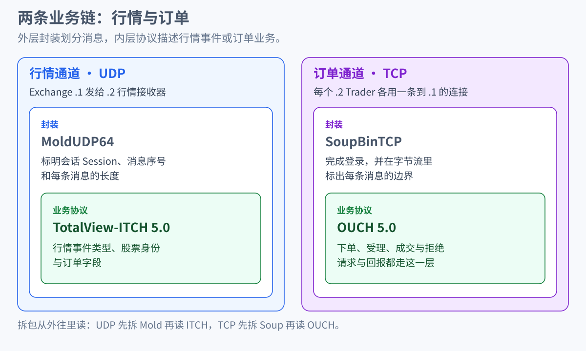
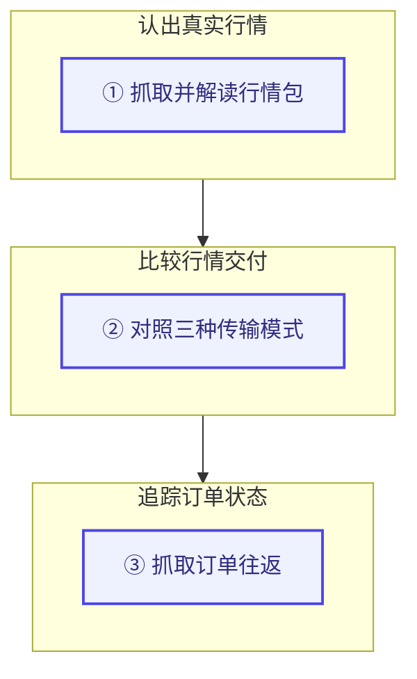
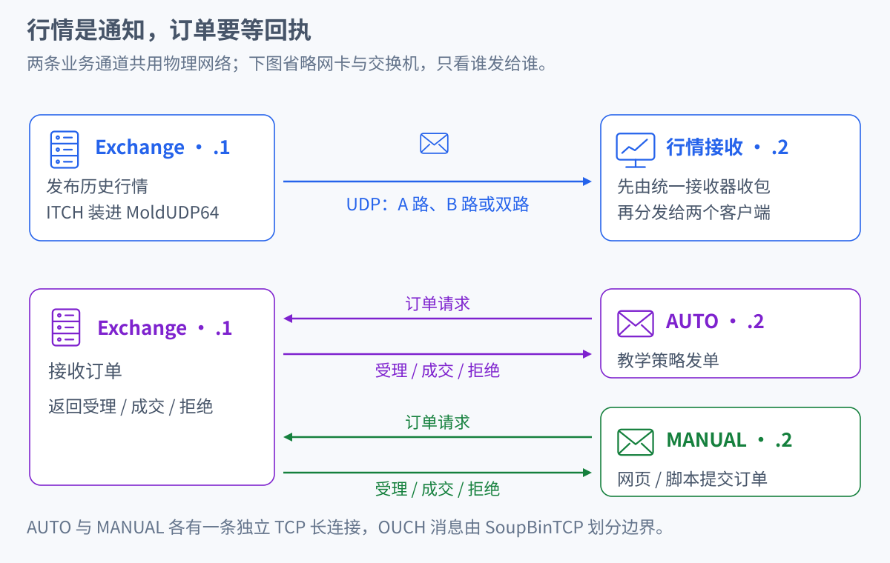
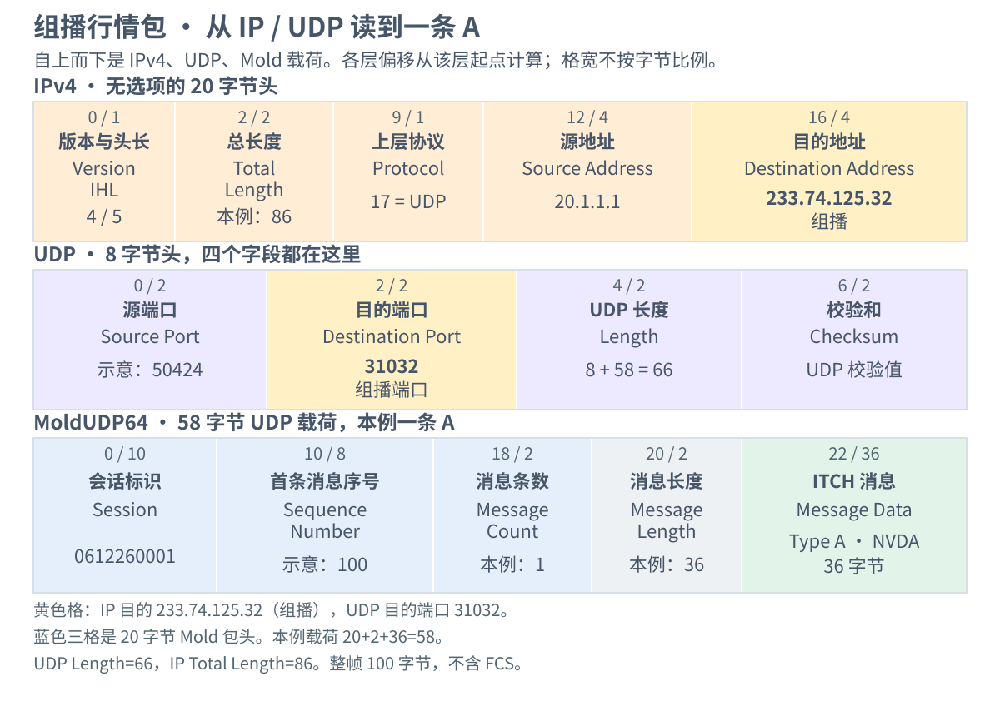
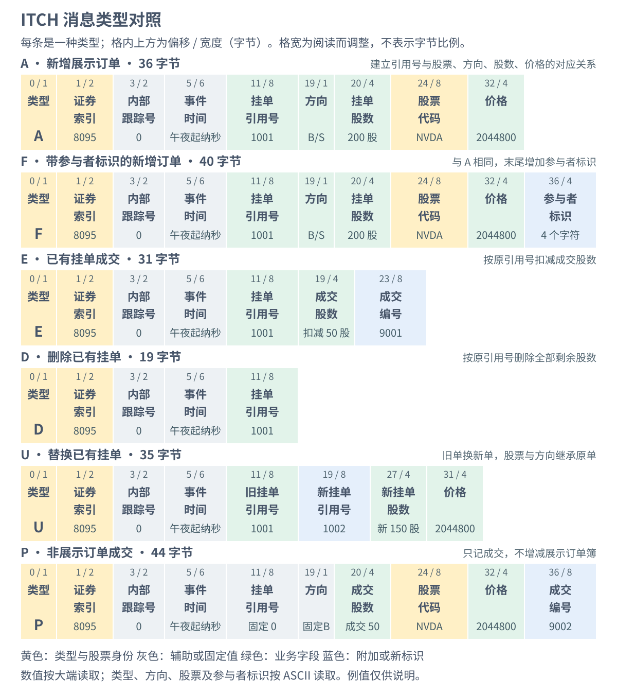
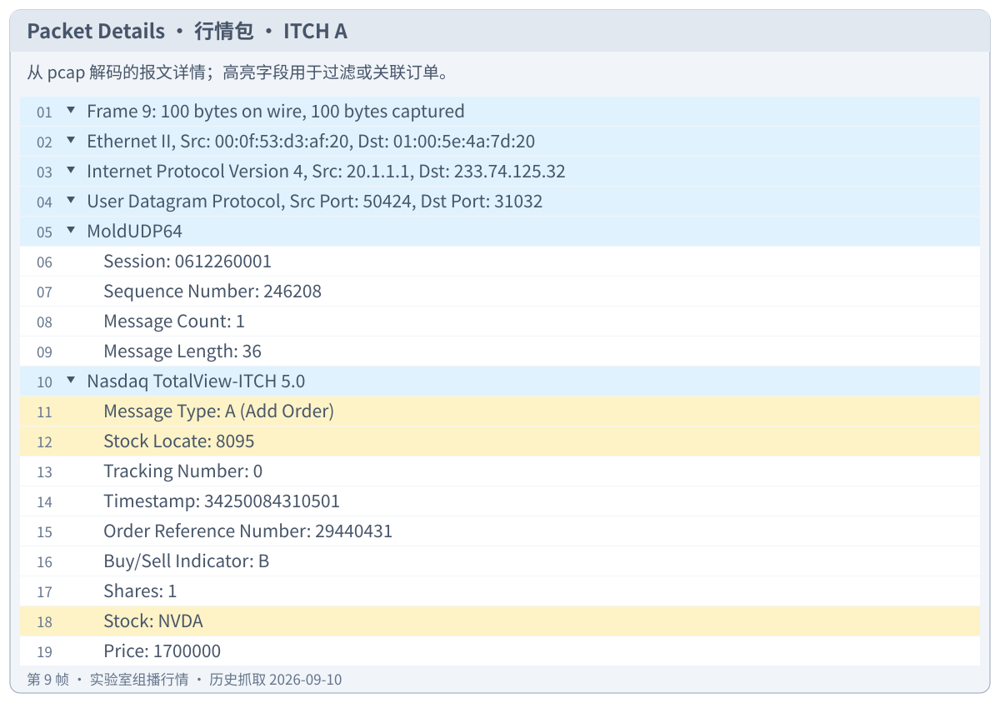
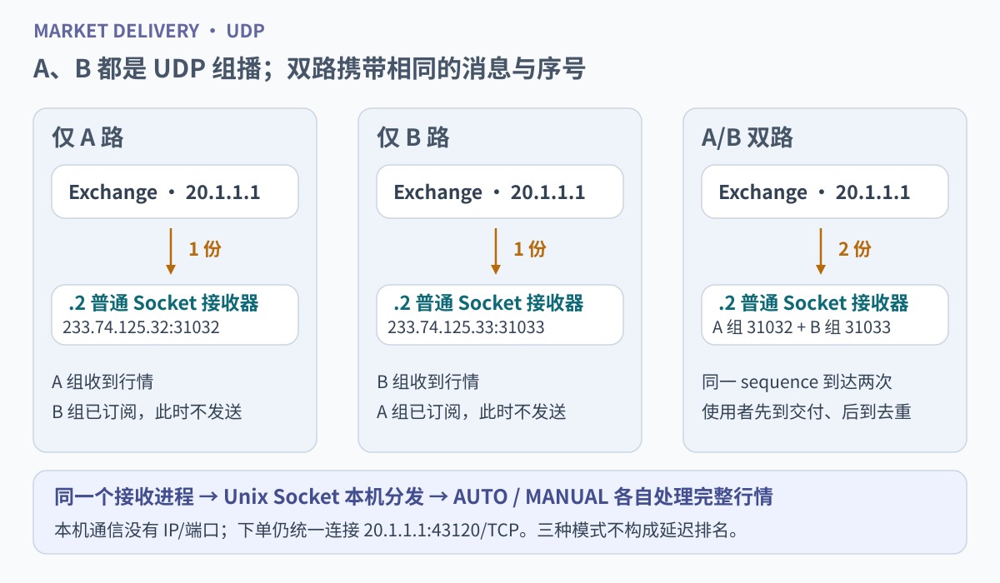
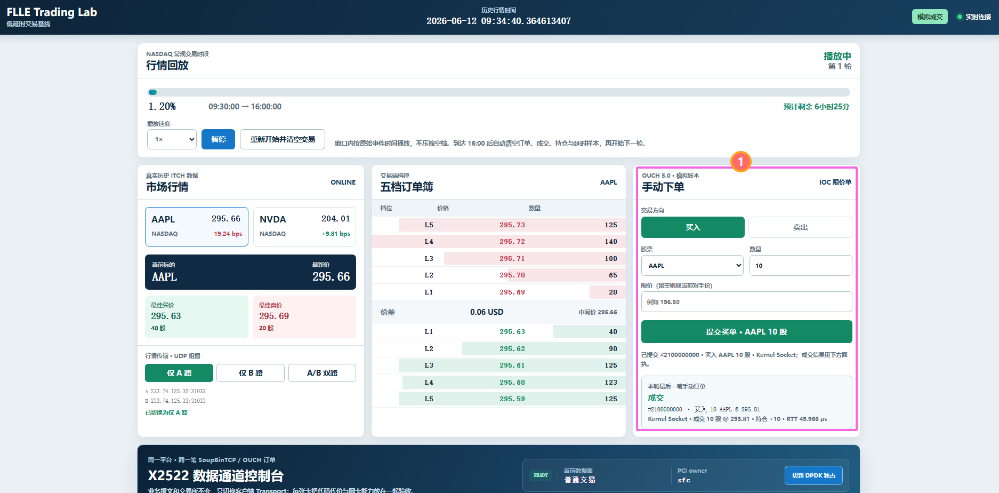
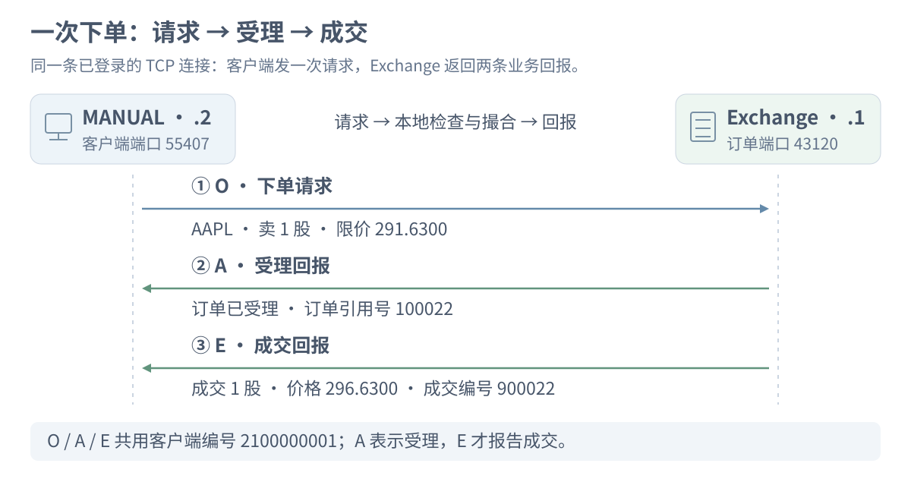
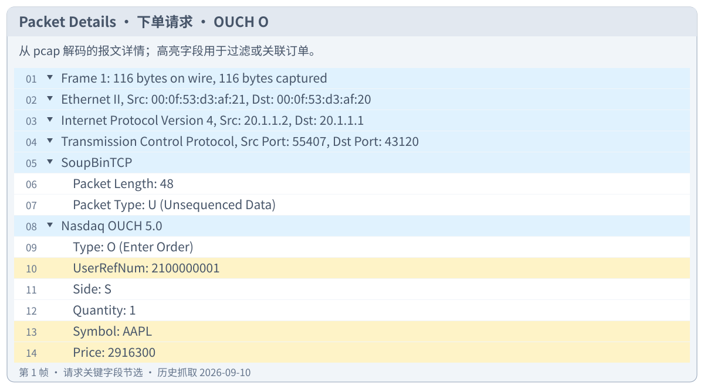

# 第 03 章：读懂交易报文——字段、交付方式与一次订单往返

## 打开行情包与订单回执

为后续按字段过滤流量，本章先拆一包行情，再比较仅 A 路、仅 B 路与 A/B 双路组播，最后下一笔模拟订单，看请求和回报。

本课有两条业务链：**UDP 传行情，TCP 传订单与回报。** 行情用 MoldUDP64 封装 ITCH，订单用 SoupBinTCP 封装 OUCH；这四个名称来自 Nasdaq 的公开协议。

<div style="border-left:6px solid #7e22ce;background:#f3e8ff;padding:12px 16px;border-radius:8px;margin:14px 0;"><span style="display:inline-block;padding:3px 12px;border-radius:6px;background:#7e22ce;color:#fff;font-weight:800;">关键图</span> <span style="font-weight:700;color:#581c87;">左侧是 UDP 行情，右侧是 TCP 订单：外层划分消息，内层描述业务。</span></div>

<div style="background:#f8fafc;border:1px solid #cbd5e1;border-radius:12px;padding:10px;max-width:820px;margin:14px auto;">

</div>

拆包从外往里读。UDP 数据报先看 Mold 怎样划出每条 ITCH；TCP 字节流先看 Soup 怎样划出每条 OUCH。

行情字段来自 Nasdaq 2026-06-12 的 AAPL/NVDA 历史 ITCH；课程按 MoldUDP64 重新封装，并生成会话号和序号。订单走实验室网线，成交记入本课模拟账本。

## 本章学习目标

1. 认出包的层次和字段位置，为后续匹配、过滤做准备。
2. 比较三种行情发送模式，理解 A/B 冗余通道与消息去重。
3. 从一笔订单的请求与回报中，看清交换了什么、怎样确认成交。

## 本章导航

<div style="border-left:6px solid #7e22ce;background:#f3e8ff;padding:12px 16px;border-radius:8px;margin:14px 0;"><span style="display:inline-block;padding:3px 12px;border-radius:6px;background:#7e22ce;color:#fff;font-weight:800;">本章导航</span> <span style="font-weight:700;color:#581c87;">本章分成 3 部分，共 3 个导航项；沿用第 02 章的在线平台，按下图顺序完成。</span></div>



## 任务地图

| 导航项 | 所属部分 | 这一项回答什么 |
| --- | --- | --- |
| 运行 ①：抓取并解读真实行情包 | 认出真实行情 | 从 pcap 读出 MoldUDP64 与 ITCH 字段 |
| 运行 ②：对照三种行情传输模式 | 比较行情交付 | 用端点与消息序号判断副本和去重 |
| 运行 ③：下一单，看请求与回报 | 追踪订单状态 | 用 UserRefNum 关联 OUCH 请求与回报 |

## 运行 ①：抓取并解读真实行情包

<div style="border:2px solid #4f46e5;background:#eef2ff;padding:10px 12px;border-radius:8px;margin:14px 0;"><div style="font-weight:900;color:#312e81;margin-bottom:4px;">导航卡 · 认出真实行情</div><div style="font-weight:700;color:#312e81;margin-bottom:8px;">范畴：分步实验　本步知识：从 pcap 读出 MoldUDP64 与 ITCH 字段　位置：全章第 1 / 3 项 · 本组第 1 / 1 项</div><span style="display:inline-block;margin:3px;padding:4px 10px;border-radius:6px;background:#15803d;color:#fff;font-weight:800;">运行 ①：抓取并解读真实行情包</span></div>

网页五档是计算结果。本步在 .2 的 ens64np1 抓 200 个组播 UDP 包，还原其中一条新增订单行情。

### 先分清两条业务路径

<div style="border-left:6px solid #7e22ce;background:#f3e8ff;padding:12px 16px;border-radius:8px;margin:14px 0;"><span style="display:inline-block;padding:3px 12px;border-radius:6px;background:#7e22ce;color:#fff;font-weight:800;">关键图</span> <span style="font-weight:700;color:#581c87;">第 02 章已经上线的 AUTO 与 MANUAL 共用 .2 上的行情接收器，订单各走自己的 TCP 连接。本步看上半条行情路径。</span></div>

<div style="background:#f8fafc;border:1px solid #cbd5e1;border-radius:12px;padding:10px;max-width:820px;margin:14px auto;">

</div>

### 一包行情怎样逐层拆开

先按 IP 地址和 UDP 端口找到行情，再读 Mold 与 ITCH。**载荷（payload）** 是包头后的内容；这里 UDP 载荷包含 Mold 包头、消息长度和 ITCH 消息。

图中的 **偏移（offset）** 从该层起点计算，宽度表示占用字节数。数值按 **大端（big-endian）** 编码，即高位字节在前；字母和空格用 ASCII 编码。

#### Mold：先找到每条消息的边界

<div style="border-left:6px solid #7e22ce;background:#f3e8ff;padding:12px 16px;border-radius:8px;margin:14px 0;"><span style="display:inline-block;padding:3px 12px;border-radius:6px;background:#7e22ce;color:#fff;font-weight:800;">关键图 · Mold 封装</span> <span style="font-weight:700;color:#581c87;">上两行是 IPv4、UDP 头，分别看组播地址与端口。下行是 UDP 载荷：蓝色三格为 Mold 头，随后是消息长度和一条 A。</span></div>

<div style="background:#f8fafc;border:1px solid #cbd5e1;border-radius:12px;padding:10px;max-width:820px;margin:14px auto;">

</div>

**Session 属于行情流，Sequence Number 在这个 Session 内按消息递增。** TotalView-ITCH 的行情流包含多只股票，共用该流的编号。[Nasdaq 行情通道表](https://www.nasdaqtrader.com/Trader.aspx?id=FeedMIPs)

| 字段 | 含义 | 假设例子 |
| --- | --- | --- |
| Session | 当前行情流的会话标识 | `SESSION001` |
| Sequence Number | 当前会话内，本包第一条消息的序号；新消息跨包递增 | `100` |
| Message Count | 本普通数据包的消息总条数 | `3`，对应序号 100、101、102；下一包新消息从 103 开始 |
| Message Length | 紧随其后的单条消息有多少字节，不含长度字段自身的 2 字节 | A 消息为 `36` 字节 |

本课每包只装一条 ITCH；更多会话规则见[配套说明](assets/03-live-traffic/READING-NOTES.md#session-与回放)。

### 六种 ITCH 类型放在一起比较

每条左侧四格构成共同的 11 字节消息头：类型、证券索引、内部跟踪号和事件时间。所有偏移从 ITCH 起点重新计算。[ITCH 字段规范](https://www.nasdaqtrader.com/content/technicalsupport/specifications/dataproducts/NQTVITCHSpecification_5.0.pdf)

<div style="border-left:6px solid #7e22ce;background:#f3e8ff;padding:12px 16px;border-radius:8px;margin:14px 0;"><span style="display:inline-block;padding:3px 12px;border-radius:6px;background:#7e22ce;color:#fff;font-weight:800;">关键图 · ITCH 类型对照 · 跨章共用图</span> <span style="font-weight:700;color:#581c87;">每条横条是一种 ITCH 消息；黄色标出类型与股票身份。先看 A，再对照下表认识其余类型。</span></div>

<div style="background:#f8fafc;border:1px solid #cbd5e1;border-radius:12px;padding:10px;max-width:820px;margin:14px auto;">

</div>

图中数值是教学示例，字段含义见下表。[ITCH 字段与价格编码规范](https://www.nasdaqtrader.com/content/technicalsupport/specifications/dataproducts/NQTVITCHSpecification_5.0.pdf)

| 字段 | 图中示例或读法 | 含义 |
| --- | --- | --- |
| Message Type（消息类型） | A、F、E、D、U、P | 决定这条消息描述哪一种事件 |
| Stock Locate（证券索引） | `8095` | 本课数据中对应 NVDA；从证券目录 R 读取，当日不变 |
| Tracking Number（内部跟踪号） | `0` | 供 Nasdaq 内部跟踪使用；具体规则未公开 |
| Timestamp（事件时间） | 从午夜起累计的纳秒数 | 表示消息中的事件时间 |
| Order Reference Number（挂单引用号） | `1001` | 后续成交、删除或替换消息凭它找到原挂单 |
| Buy/Sell Indicator（方向） | B / S | 买 / 卖；P 消息的 B 是协议固定值 |
| Shares / Executed Shares（股数 / 成交股数） | `200` / `50` | 挂单数量 / 本次成交数量；U 的 Shares 表示替换后的数量 |
| Stock（股票代码） | `NVDA` | 固定 8 字节，NVDA 后补 4 个空格 |
| Price（价格） | `2044800` | 整数隐含四位小数：`2044800 ÷ 10000 = 204.4800` |
| Attribution（参与者标识） | 4 个字符 | F 消息标明与该挂单关联的市场参与者 |
| Original / New Order Reference Number（旧 / 新挂单引用号） | `1001` / `1002` | U 消息用新挂单替换旧挂单 |
| Match Number（成交编号） | E：`9001`；P：`9002` | 标识对应的市场成交 |

| 类型 | 表示什么 | 接收后怎样理解 |
| --- | --- | --- |
| A | 新增展示挂单 | 记录股票、方向、数量、价格和挂单引用号 |
| F | 带参与者标识的新增挂单 | 在 A 的信息之外，多一个参与者标识 |
| E | 挂单成交 | 从原挂单扣减本次成交股数 |
| D | 删除挂单 | 删除原挂单的全部剩余数量 |
| U | 替换挂单 | 以新引用号、数量和价格替换原挂单 |
| P | 非展示成交 | 计入成交统计，不改变展示订单簿 |

<div style="border-left:6px solid #7e22ce;background:#f3e8ff;padding:12px 16px;border-radius:8px;margin:14px 0;">
<span style="display:inline-block;padding:3px 12px;border-radius:6px;background:#7e22ce;color:#fff;font-weight:800;">概念速记 · A 与 F：挂单是否带机构署名</span>
<p style="margin:10px 0;color:#581c87;">两者都是交易所发布的“新增展示挂单”行情。</p>
<p style="margin:10px 0;color:#581c87;"><strong>A：不公开机构署名。</strong>告诉你新增挂单的股票、方向、数量和价格。</p>
<p style="margin:10px 0;color:#581c87;"><strong>F：公开机构署名。</strong>在 A 的信息之外，多带一个 4 字符的机构代码（MPID）。</p>
<p style="margin:10px 0 0;color:#581c87;">F 的典型场景是做市商（持续挂出买卖报价的机构）公开署名报价，让市场知道是谁在报价。<a href="https://listingcenter.nasdaq.com/rulebook/nasdaq/rules/nasdaq-equity-2">Nasdaq 署名报价规则</a></p>
</div>

**后续过滤主要看 A 行的 Type、Stock Locate、Stock**，相对 ITCH 起点的偏移分别为 0、1、24。先按 IP/UDP 找到行情流，再按这三个字段选择消息。

本课用 Mold 序号检查连续性，发现缺口后暂停下单；恢复方法见[配套说明](assets/03-live-traffic/README.md#消息处理与课程恢复细节)。

### 抓取、解码与读结果

入口在 .111 执行：切到仅 A 路，在 .2 抓 200 包并取回解码。抓到的包写入 **pcap**（packet capture，抓包文件），后面解码都读这一份；REMOTE 是本次远端文件路径。

<div style="border-left:6px solid #7e22ce;background:#f3e8ff;padding:12px 16px;border-radius:8px;margin:14px 0;"><span style="display:inline-block;padding:3px 12px;border-radius:6px;background:#7e22ce;color:#fff;font-weight:800;">仅供展示 · 原始抓包命令</span> <span style="font-weight:700;color:#581c87;">在 .2 执行。-i 选接口，-nn 不把地址和端口改写成名称，-s 0 保存完整包，-c 200 收够即停，-w 写入文件；timeout 8 限制最多等待 8 秒。</span></div>

```text
timeout 8 tcpdump -i ens64np1 -nn -s 0 -c 200 -w "$REMOTE" \
  'udp dst port 31032 and dst host 233.74.125.32'
```

只抓发往 233.74.125.32:31032 的 UDP。

下面 42 行与入口 [01-capture-live-market.sh](assets/03-live-traffic/01-capture-live-market.sh) 逐字一致。

<div style="border-left:6px solid #15803d;background:#dcfce7;padding:12px 16px;border-radius:8px;margin:14px 0;"><span style="display:inline-block;padding:3px 12px;border-radius:6px;background:#15803d;color:#fff;font-weight:800;">需要运行 · 运行 ①</span> <span style="font-weight:700;color:#14532d;">在管理机 .111 仓库根目录以 root 执行。切到仅 A 路，在 .2 抓 200 包并取回；终端展示捕获统计、序号和 A 消息字段。</span></div>

```bash
#!/usr/bin/env bash
set -euo pipefail
REPO_ROOT=/qyt-fll; cd "$REPO_ROOT"
TOOLS="$REPO_ROOT/assets/03-live-traffic"
LABCTL="$REPO_ROOT/apps/flle-trading-lab/scripts/transport_labctl.sh"
source "$REPO_ROOT/reports/run-state/02-trading-baseline.env"
BASE_RUN_ID="$RUN_ID"; API="${WEB_URL%/}"
CHAPTER_RUN_ID="$(date -u +%Y%m%dT%H%M%SZ)-03-live-market"
OUT="$REPO_ROOT/reports/course-runs/$CHAPTER_RUN_ID"; mkdir -p "$OUT/raw"
REMOTE="/var/tmp/$CHAPTER_RUN_ID-market.pcap"
{
  python3 "$TOOLS/classroom-output.py" verify market "$LABCTL" "$BASE_RUN_ID"
  bash "$LABCTL" verify "$BASE_RUN_ID" >"$OUT/raw/verify.txt" 2>&1 || { rc=$?; tail -n 20 "$OUT/raw/verify.txt"; exit "$rc"; }
  ORIGINAL_MODE="$(curl -fsS --max-time 10 "$API/api/state" | python3 -c 'import json,sys;print(json.load(sys.stdin)["market_mode"])')"
  set_mode() {
    case "$1" in UNICAST|MULTICAST|MULTICAST_A|MULTICAST_B|DUAL) ;; *) echo 'Invalid market mode' >&2; return 2;; esac
    python3 "$TOOLS/classroom-output.py" mode market "$API" "$1"
    curl -fsS --max-time 10 -X POST -H 'Content-Type: application/json' -d "{\"market_mode\":\"$1\"}" "$API/api/market" >"$OUT/raw/set-$1.json" || return $?
    printf '回读确认：$ curl -fsS --max-time 10 %q\n' "$API/api/state"
    for _ in {1..30}; do
      curl -fsS --max-time 10 "$API/api/state" >"$OUT/raw/mode-state.json" || return $?
      if python3 -c 'import json,sys;sys.exit(json.load(open(sys.argv[1]))["market_mode"] != sys.argv[2])' "$OUT/raw/mode-state.json" "$1"; then printf 'market_mode=%s\n' "$1"; return 0; fi
      sleep 0.1
    done; echo "Market mode readback did not become $1" >&2; return 1
  }
  restore_market_mode() { printf '===== 恢复检查前的行情模式 =====\n'
    set_mode "$ORIGINAL_MODE" || { echo '行情模式恢复失败，退出码125；暂停后续下单并检查网页状态。' >&2; return 125; }
  }
  cleanup_capture() { ssh -o BatchMode=yes -o StrictHostKeyChecking=yes -o ConnectTimeout=5 root@10.1.1.2 "rm -f /var/tmp/$CHAPTER_RUN_ID-*.pcap"; }
  trap 'rc=$?; trap - EXIT; restore_market_mode || rc=125; cleanup_capture || true; exit "$rc"' EXIT
  set_mode MULTICAST_A
  python3 "$TOOLS/classroom-output.py" capture market "$REMOTE"
  ssh root@10.1.1.2 "rm -f '$REMOTE'; timeout 8 tcpdump -i ens64np1 -nn -s 0 -c 200 -w '$REMOTE' 'udp dst port 31032 and dst host 233.74.125.32'" 2>&1 | tee "$OUT/raw/tcpdump.txt"
  scp "root@10.1.1.2:$REMOTE" "$OUT/raw/live-market.pcap" >/dev/null
  python3 "$TOOLS/classroom-output.py" decode market "$OUT"
  python3 "$TOOLS/inspect_market_pcap.py" "$OUT/raw/live-market.pcap" | tee "$OUT/raw/decoded.txt" | python3 "$TOOLS/classroom-output.py" annotate market
  restore_market_mode; trap - EXIT; cleanup_capture
  printf 'CHAPTER_RUN_ID=%s\nBASE_RUN_ID=%s\nCAPTURE_HOST=10.1.1.2\nCAPTURE_INTERFACE=ens64np1\nORIGINAL_MODE=%s\n' "$CHAPTER_RUN_ID" "$BASE_RUN_ID" "$ORIGINAL_MODE" >"$OUT/run.env"
  sha256sum "$TOOLS/01-capture-live-market.sh" "$TOOLS/classroom-output.py" "$TOOLS/pcap_tools.py" "$TOOLS/inspect_market_pcap.py" "$OUT"/raw/* "$OUT/run.env" >"$OUT/SHA256SUMS"
  sha256sum -c "$OUT/SHA256SUMS" >/dev/null
} 2>&1 | tee "$OUT/classroom.txt"
sha256sum "$OUT/classroom.txt" "$OUT/SHA256SUMS" >"$OUT/CLASSROOM_SHA256SUMS"
```

<div style="border-left:6px solid #7e22ce;background:#f3e8ff;padding:12px 16px;border-radius:8px;margin:14px 0;"><span style="display:inline-block;padding:3px 12px;border-radius:6px;background:#7e22ce;color:#fff;font-weight:800;">仅供展示 · 行情输出</span> <span style="font-weight:700;color:#581c87;">历史 A 路抓包节选：先看抓到 200 包，再看目的组播地址，最后看第一条 A 的类型、Locate、股票和价格。源端口、序号和价格下次会变，读法相同。</span></div>

```text
200 packets captured
0 packets dropped by kernel
IP 20.1.1.1.44557 > 233.74.125.32.31032: UDP, length 58
path=20.1.1.1:44557->233.74.125.32:31032 session=0612260001
sequence=3907992..3908191 message_count=1..1 itch_types=A:89,D:88,E:1,P:2,U:20
    Message Type: A (Add Order)
    Stock Locate: 8095
    Stock: NVDA
    Price: 2063500
```

这份窗口有 **200 个包，每包一条 ITCH**。`itch_types` 是解码器的类型统计：89 条 A（新增挂单）、88 条 D（删除）、1 条 E（成交）、2 条 P（非展示成交）、20 条 U（替换），合计 200 条消息。

<div style="border-left:6px solid #7e22ce;background:#f3e8ff;padding:12px 16px;border-radius:8px;margin:14px 0;"><span style="display:inline-block;padding:3px 12px;border-radius:6px;background:#7e22ce;color:#fff;font-weight:800;">抓包解码树 · 行情</span> <span style="font-weight:700;color:#581c87;">按 Ethernet → IP → UDP → Mold → ITCH 展开一条 A；黄色是后续过滤要看的三个字段。图中序号和价格来自较早样例，读法与上面第一条 A 相同。</span></div>

<div style="background:#f8fafc;border:1px solid #cbd5e1;border-radius:12px;padding:10px;max-width:820px;margin:14px auto;">

</div>

**按 Wireshark 报文详情的方式读：Ethernet → IP → UDP → Mold → ITCH。** 表内数字对应上面第一条 A。

| 字段 | 实测例子 | 学员读什么 |
| --- | --- | --- |
| IP / UDP 目的端点 | 233.74.125.32:31032 | 包到达组播端点 |
| Session / Sequence Number | 0612260001 / 3907992 | 这条行情属于哪个会话、排到哪条 |
| Message Count / Message Length | 1 / 36 | 包内一条 ITCH，消息长 36 字节 |
| Message Type / Stock Locate / Stock | A / 8095 / NVDA | NVDA 的新增挂单；后续过滤匹配这三项 |
| Buy/Sell Indicator / Shares / Price | S / 100 / 2063500 | 卖侧挂 100 股，价格 206.3500 |

该 A 消息的 UDP 载荷是 `20 + 2 + 36 = 58` 字节，依次为 Mold 头、长度字段和 ITCH 消息。

<div style="border-left:6px solid #0891b2;background:#cffafe;padding:12px 16px;border-radius:8px;margin:14px 0;"><span style="display:inline-block;padding:3px 12px;border-radius:6px;background:#0891b2;color:#fff;font-weight:800;">关键现象</span> <span style="font-weight:700;color:#164e63;">目的 IP/端口确定行情流，高亮的 Type、Stock Locate、Stock 确定要过滤的消息。</span></div>

**下一线索：** 同一行情从两个端点到达时，应用怎样只更新一次盘口？

## 运行 ②：对照三种行情传输模式

<div style="border:2px solid #4f46e5;background:#eef2ff;padding:10px 12px;border-radius:8px;margin:14px 0;"><div style="font-weight:900;color:#312e81;margin-bottom:4px;">导航卡 · 比较行情交付</div><div style="font-weight:700;color:#312e81;margin-bottom:8px;">范畴：分步实验　本步知识：用端点与消息序号判断副本和去重　位置：全章第 2 / 3 项 · 本组第 1 / 1 项</div><span style="display:inline-block;margin:3px;padding:4px 10px;border-radius:6px;background:#15803d;color:#fff;font-weight:800;">运行 ②：对照三种行情传输模式</span></div>

**A、B 是两个 UDP 组播通道。** 仅 A 或仅 B 时，Exchange 发一份；DUAL 时，把同一条行情向两组各发一份。UDP 本身也支持单播，但单播不属于本章的 A/B 两路。

### 发送模式决定网络上有几份

<div style="border-left:6px solid #7e22ce;background:#f3e8ff;padding:12px 16px;border-radius:8px;margin:14px 0;"><span style="display:inline-block;padding:3px 12px;border-radius:6px;background:#7e22ce;color:#fff;font-weight:800;">关键图</span> <span style="font-weight:700;color:#581c87;">仅 A 或仅 B 时源端发一份；DUAL 向两个组播端点各发一份。</span></div>

<div style="background:#f8fafc;border:1px solid #cbd5e1;border-radius:12px;padding:10px;max-width:820px;margin:14px auto;">

</div>

| 发送模式 | 协议与目的端点 | 一条行情有几份 |
| --- | --- | --- |
| MULTICAST_A（仅 A 路） | UDP → 233.74.125.32:31032 | 1 份，发往 A 组 |
| MULTICAST_B（仅 B 路） | UDP → 233.74.125.33:31033 | 1 份，发往 B 组 |
| DUAL（A/B 双路） | UDP → 上述两个端点 | 2 份，共用 Session 与 Sequence |

接收器通过 **Unix Socket（同机进程通信通道）** 分发给 AUTO/MANUAL，客户端按会话和序号去重。实验只切换**发送模式**。脚本在各窗口前后核对 Session 与回放轮次；跨过换轮或重新开始就停止比较、恢复原模式，并提示重新运行。

新版接收器通过 `IP_ADD_SOURCE_MEMBERSHIP` 为两组指定来源 `20.1.1.1`，其他源地址的组播报文不会进入本机分发通道。[Linux 指定来源加组接口](https://man7.org/linux/man-pages/man2/IP_ADD_SOURCE_MEMBERSHIP.2const.html)

### 交易所的 A/B 怎样部署

**A/B 表示两路冗余行情通道。** 同一行情通过两路提供，接收端可以利用另一路弥补单路丢包；同时接收时，对重复消息只处理一次。[Nasdaq 冗余组播说明，第 2 页](https://www.nasdaq.com/docs/inet_itch_nls_multicast_1.pdf)

具体看 [Nasdaq 官方地址表](https://www.nasdaqtrader.com/Trader.aspx?id=FeedMIPs) 的 **TotalView–ITCH 5.0 → New York Metro Area → Standard Network**。下面两路都用 MoldUDP64 / UDP 组播，组播地址不同：

| 官方通道 | 目的组播地址 | UDP 端口 |
| --- | --- | --- |
| A | `233.54.12.111` | `26477` |
| B | `233.49.196.111` | `26477` |

国内也有相同安排：上期所《第二代行情发布平台网络接入指引》规定，增量行情 A/B 两路都采用 UDP 组播，用户同时接收、择优选收；TCP 另用于行情查询。其第 9 页图 2 中，大厦中心 A/B 的组地址范围分别为 `239.1.*.*`、`239.2.*.*`。这是该版指引中的部署示例。[上期所指引 §2.1～2.2、图 2](https://www.shfe.com.cn/upload/20190220/1550653772182.pdf)

这些实例说明了 A/B 冗余行情的部署方式；“双路”本身只表示两条通道，具体协议与地址仍由相应接入规范规定。

**本课采用两个组播组演示 A/B 接收与去重。** 前表中的地址是课程配置，B 地址由本课选定，并非照搬 Nasdaq 官方 B 地址。两组共用服务器、网卡和交换机，因此能演示逻辑冗余，不能证明物理故障隔离。本课行情 TTL 为 1，只在本地 VLAN 转发，没有部署跨路由组播。

Nasdaq Nordic 也提供 TCP 单播行情服务；这是另一种行情交付服务，不是上述 A/B 中的一路。[官方服务说明](https://view.news.eu.nasdaq.com/view?id=b5eeb3d208d3b282925c86f44ad96adb6&lang=en&src=notices)

### 对照时看哪些证据

沿用第 02 章组播配置，每种模式抓 120 包，对照目的端点和包数；DUAL 的 120 包由两路合计。

<div style="border-left:6px solid #7e22ce;background:#f3e8ff;padding:12px 16px;border-radius:8px;margin:14px 0;"><span style="display:inline-block;padding:3px 12px;border-radius:6px;background:#7e22ce;color:#fff;font-weight:800;">仅供展示 · 三种模式共用的抓包命令</span> <span style="font-weight:700;color:#581c87;">在 .2 执行，remote 是当前模式对应的临时文件。捕获 Exchange 发来的 UDP，解析时核对目的端点是否为 A、B 两个组播组；意外单播也会被检查到。</span></div>

```text
timeout 8 tcpdump -i ens64np1 -nn -s 0 -c 120 -w "$remote" \
  'udp and src host 20.1.1.1'
```

执行下面的文件入口；脚本负责三个抓包窗口、会话核对和模式恢复。

<div style="border-left:6px solid #15803d;background:#dcfce7;padding:12px 16px;border-radius:8px;margin:14px 0;"><span style="display:inline-block;padding:3px 12px;border-radius:6px;background:#15803d;color:#fff;font-weight:800;">需要运行 · 运行 ②</span> <span style="font-weight:700;color:#14532d;">在 .111 仓库根目录以 root 执行。依次切仅 A、仅 B 和 A/B 双路，每种模式抓 120 包；对照终端里的目的地址和包数。</span></div>

```bash
cd /qyt-fll && bash assets/03-live-traffic/02-compare-market-transports.sh
```

<div style="border-left:6px solid #7e22ce;background:#f3e8ff;padding:12px 16px;border-radius:8px;margin:14px 0;"><span style="display:inline-block;padding:3px 12px;border-radius:6px;background:#7e22ce;color:#fff;font-weight:800;">仅供展示 · 三种模式实测结果</span> <span style="font-weight:700;color:#581c87;">节选双路窗口的两条 tcpdump 原文、解析器统计和最后的模式回读。仅 A、仅 B 各收到 120 包；双路两组合计 120 包，结束后恢复仅 A 路。</span></div>

```text
IP 20.1.1.1.37505 > 233.74.125.32.31032: UDP, length 41
IP 20.1.1.1.37505 > 233.74.125.33.31033: UDP, length 41

mode=MULTICAST_A captured=120 multicast_a=120 multicast_b=0
mode=MULTICAST_B captured=120 multicast_a=0 multicast_b=120
mode=DUAL captured=120 multicast_a=60 multicast_b=60
membership_a=1 membership_b=1 dual_sequence_overlap=60 duplicate_delta=1177 pending=0 gaps=0

===== 恢复检查前的行情模式 =====
market_mode=MULTICAST_A
```

| 字段 | 实测例子 | 学员读什么 |
| --- | --- | --- |
| dual_sequence_overlap | 60 | 双路抓包中有 60 个重合序号，解析器确认对应消息内容一致 |
| duplicate_delta | 1177 | 应用在前后两次采样之间识别的重复消息数；采样期间持续收包，所以不等于抓包中的 60 对 |
| pending / gaps | 0 / 0 | 没有等待前序的消息，本轮尚未记录缺口 |

<div style="border-left:6px solid #0891b2;background:#cffafe;padding:12px 16px;border-radius:8px;margin:14px 0;"><span style="display:inline-block;padding:3px 12px;border-radius:6px;background:#0891b2;color:#fff;font-weight:800;">关键现象</span> <span style="font-weight:700;color:#164e63;">DUAL 中，A、B 两个组播端点都有包；同一消息的两个副本按会话和序号去重，只更新一次盘口。</span></div>

双路也有成本：Exchange 多发一份，接收器也向每个客户端分发两份，再由客户端去重。因此网络与本机队列的流量约翻倍；发送与订单处理共用一把锁，可能增加订单等待和 RTT 波动。双路不保证更低延迟，第 04 章统一只发 A 路做性能比较。

**下一线索：** 再沿订单 TCP 连接，抓一笔请求与回报。

## 运行 ③：下一单，看请求与回报

<div style="border:2px solid #4f46e5;background:#eef2ff;padding:10px 12px;border-radius:8px;margin:14px 0;"><div style="font-weight:900;color:#312e81;margin-bottom:4px;">导航卡 · 追踪订单状态</div><div style="font-weight:700;color:#312e81;margin-bottom:8px;">范畴：分步实验　本步知识：用 UserRefNum 关联 OUCH 请求与回报　位置：全章第 3 / 3 项 · 本组第 1 / 1 项</div><span style="display:inline-block;margin:3px;padding:4px 10px;border-radius:6px;background:#15803d;color:#fff;font-weight:800;">运行 ③：下一单，看请求与回报</span></div>

本步通过 MANUAL 下一股模拟订单，查看受理和成交回报。首次下单时会建立 TCP 连接并登录，后续订单复用该连接。

<div style="border-left:6px solid #7e22ce;background:#f3e8ff;padding:12px 16px;border-radius:8px;margin:14px 0;"><span style="display:inline-block;padding:3px 12px;border-radius:6px;background:#7e22ce;color:#fff;font-weight:800;">图形化入口 · 手动下单</span> <span style="font-weight:700;color:#581c87;">网页右侧①“手动下单”面板也能直接提交委托。下面的脚本会自动下一股，运行脚本时不用再点网页下单。</span></div>

<div style="background:#f8fafc;border:1px solid #cbd5e1;border-radius:12px;padding:10px;max-width:820px;margin:14px auto;">

</div>

### 订单怎样封装：Soup 包头与 OUCH 消息

TCP 提供连续字节流，接收端先用 Soup 包头划出完整消息，再读里面的 OUCH。线上顺序如下：[SoupBinTCP 规范 §2.2.3、§2.3.2](https://www.nasdaqtrader.com/content/technicalsupport/specifications/dataproducts/soupbintcp.pdf)

| 顺序 | 内容 | 怎样读 |
| --- | --- | --- |
| 1 | Packet Length，2 字节 | 后面还有多少字节，包含 Packet Type 与 Message，不含自身 |
| 2 | Packet Type，1 字节 | 本步请求用 `U`，回报用 `S` |
| 3 | Message，长度由前面的字段确定 | 一条 OUCH 业务消息：下单请求 `O`、受理回报 `A` 或成交回报 `E` |

下单请求 **O** 里包含客户端编号 **UserRefNum**、买卖方向 **Side**、数量 **Quantity**、股票 **Symbol**、限价 **Price** 和有效方式 **Time In Force** 等字段。本课不带可选附加字段的 O 为 47 字节，所以 Soup 的 Packet Length 为 `1 + 47 = 48`，连同长度字段共 50 字节；后面的解码树会看到这个 48。[OUCH 5.0 下单格式 §2.1](https://www.nasdaqtrader.com/content/technicalsupport/specifications/TradingProducts/OUCH5.0.pdf)

一条消息可能跨多个 TCP 包，多条消息也可能放在同一个 TCP 包里；拆消息要读 Soup 长度，不能把 TCP 包数当成订单数。

### 一次请求，怎样收到成交回报

客户端发送 **O（下单请求）**，模拟 Exchange 检查并按本地订单簿撮合；满足成交条件时依次返回 **A（受理）**、**E（成交）**，无需客户端在 A 后再确认。

<div style="border-left:6px solid #7e22ce;background:#f3e8ff;padding:12px 16px;border-radius:8px;margin:14px 0;"><span style="display:inline-block;padding:3px 12px;border-radius:6px;background:#7e22ce;color:#fff;font-weight:800;">关键图 · 一笔订单的消息与编号</span> <span style="font-weight:700;color:#581c87;">沿同一条 TCP 连接，看 O 怎样下单、A 怎样确认受理、E 怎样报告成交。</span></div>

<div style="background:#f8fafc;border:1px solid #cbd5e1;border-radius:12px;padding:10px;max-width:820px;margin:14px auto;">

</div>

图中历史样例的三条业务消息恰好各占一个 TCP 包，TCP ACK 另计；若抓到首次建立连接的过程，还会看到建连与登录报文。[完整包数与封装说明](assets/03-live-traffic/READING-NOTES.md#tcp-中怎样划分业务消息)

### 下一股订单，读三条消息

在 .111 执行入口，先在 .2 抓取 TCP 43120，再提交一股模拟订单并取回解码。检查程序最多尝试三次，确认成交后停止；AUTO 与行情回放继续运行。

<div style="border-left:6px solid #dc2626;background:#fee2e2;padding:12px 16px;border-radius:8px;margin:14px 0;"><span style="display:inline-block;padding:3px 12px;border-radius:6px;background:#dc2626;color:#fff;font-weight:800;">下单影响与失败检查</span> <span style="font-weight:700;color:#7f1d1d;">本步新增模拟委托，成交后持仓改变一股；AUTO 继续交易，抓包期间勿另下 MANUAL 单。解码失败时先按 order_id 查网页订单和成交，不要立即重跑补抓。删除 pcap 不会撤销成交，本步不清空账本。</span></div>

下面 36 行与文件入口 [03-capture-live-order.sh](assets/03-live-traffic/03-capture-live-order.sh) 逐字一致。

<div style="border-left:6px solid #15803d;background:#dcfce7;padding:12px 16px;border-radius:8px;margin:14px 0;"><span style="display:inline-block;padding:3px 12px;border-radius:6px;background:#15803d;color:#fff;font-weight:800;">需要运行 · 运行 ③</span> <span style="font-weight:700;color:#14532d;">在 .111 仓库根目录以 root 执行。先确认行情 HEALTHY、回放推进且交易闸门开放；抓取 MANUAL 的一股 IOC（立即成交、剩余取消）请求与回报。终端将 O/A/E 分为三块，逐条打印发送方向、关键字段和含义。</span></div>

```bash
#!/usr/bin/env bash
set -euo pipefail
cd /qyt-fll
REPO_ROOT=/qyt-fll
SELF="$REPO_ROOT/assets/03-live-traffic/03-capture-live-order.sh"
TOOLS="$REPO_ROOT/assets/03-live-traffic"
TRADE_TEST="$REPO_ROOT/apps/flle-trading-lab/tests/first_trade.py"
source "$REPO_ROOT/reports/run-state/02-trading-baseline.env"
BASE_RUN_ID="$RUN_ID"; API="${WEB_URL%/}"
CHAPTER_RUN_ID="$(date -u +%Y%m%dT%H%M%SZ)-03-live-order"
OUT="$REPO_ROOT/reports/course-runs/$CHAPTER_RUN_ID"; mkdir -p "$OUT/raw"
{
  REMOTE="/var/tmp/$CHAPTER_RUN_ID-order.pcap"
  cleanup() { rc=$?; trap - EXIT; test -z "${CAPTURE_PID:-}" || wait "$CAPTURE_PID" || true; ssh root@10.1.1.2 "rm -f '$REMOTE'" || true; exit "$rc"; }
  trap cleanup EXIT
  python3 "$TOOLS/classroom-output.py" capture order "$REMOTE"
  ssh root@10.1.1.2 "rm -f '$REMOTE'; timeout -s INT 4 tcpdump -i ens64np1 -nn -s 0 -U -w '$REMOTE' 'tcp port 43120'" >"$OUT/raw/tcpdump.txt" 2>&1 &
  CAPTURE_PID=$!
  sleep 0.5
  python3 "$TOOLS/classroom-output.py" trade order "$TRADE_TEST" "$API"
  python3 "$TRADE_TEST" --base-url "$API" >"$OUT/raw/first-trade.txt" 2>&1 || { rc=$?; tail -n 20 "$OUT/raw/first-trade.txt"; exit "$rc"; }
  python3 "$TOOLS/classroom-output.py" sessions order "$RUN_DIR"
  ssh root@10.1.1.2 "printf 'auto_pid='; cat '$RUN_DIR/trader-auto.pid'; printf 'manual_pid='; cat '$RUN_DIR/trader-manual.pid'; ss -ntpH state established '( dport = :43120 )'" >"$OUT/raw/sessions.txt"
  cat "$OUT/raw/sessions.txt"
  RC=0; wait "$CAPTURE_PID" || RC=$?
  python3 "$TOOLS/classroom-output.py" capture-result order "$OUT"
  [ "$RC" -eq 0 ] || [ "$RC" -eq 124 ]
  scp "root@10.1.1.2:$REMOTE" "$OUT/raw/live-order.pcap" >/dev/null
  python3 "$TOOLS/classroom-output.py" decode order "$OUT"
  python3 "$TOOLS/inspect_order_pcap.py" "$OUT/raw/live-order.pcap" "$OUT/raw/sessions.txt" --first-trade "$OUT/raw/first-trade.txt" | tee "$OUT/raw/decoded.txt" | python3 "$TOOLS/classroom-output.py" annotate order
  printf 'CHAPTER_RUN_ID=%s\nBASE_RUN_ID=%s\nWEB_URL=%s\n' "$CHAPTER_RUN_ID" "$BASE_RUN_ID" "$WEB_URL" >"$OUT/run.env"
  sha256sum "$SELF" "$TOOLS/classroom-output.py" "$TOOLS/pcap_tools.py" "$TOOLS/inspect_order_pcap.py" "$TRADE_TEST" \
    "$OUT/raw/"*-native.txt "$OUT/raw/live-order.pcap" "$OUT/raw/tcpdump.txt" "$OUT/raw/sessions.txt" "$OUT/raw/first-trade.txt" "$OUT/raw/decoded.txt" "$OUT/run.env" >"$OUT/SHA256SUMS"
  sha256sum -c "$OUT/SHA256SUMS" >/dev/null
} 2>&1 | tee "$OUT/classroom.txt"
sha256sum "$OUT/classroom.txt" "$OUT/SHA256SUMS" >"$OUT/CLASSROOM_SHA256SUMS"
```

<div style="border-left:6px solid #7e22ce;background:#f3e8ff;padding:12px 16px;border-radius:8px;margin:14px 0;"><span style="display:inline-block;padding:3px 12px;border-radius:6px;background:#7e22ce;color:#fff;font-weight:800;">抓包解码树 · 下单请求</span> <span style="font-weight:700;color:#581c87;">按 Wireshark 报文详情样式展开第 1 帧：先看 TCP 端点，再看高亮的订单字段。</span></div>

<div style="background:#f8fafc;border:1px solid #cbd5e1;border-radius:12px;padding:10px;max-width:820px;margin:14px auto;">

</div>

<div style="border-left:6px solid #7e22ce;background:#f3e8ff;padding:12px 16px;border-radius:8px;margin:14px 0;"><span style="display:inline-block;padding:3px 12px;border-radius:6px;background:#7e22ce;color:#fff;font-weight:800;">仅供展示 · 订单输出</span> <span style="font-weight:700;color:#581c87;">用当前显示工具重新解码历史 pcap 得到以下三块输出；编号和价格以实际运行结果为准。</span></div>

```text
① O · 下单请求｜MANUAL → Exchange
  客户端编号 UserRefNum：2100000001
  股票 Symbol：AAPL  方向 Side：卖出  数量 Quantity：1 股
  限价 Price：291.6300
  含义：申请按上述股票、方向、数量和限价下单。

② A · 受理回报｜Exchange → MANUAL
  客户端编号 UserRefNum：2100000001
  订单引用号 Order Reference Number：100022
  含义：订单已受理；这条回报还不能证明成交。

③ E · 成交回报｜Exchange → MANUAL
  客户端编号 UserRefNum：2100000001
  成交数量 Quantity：1 股  成交价格 Price：296.6300
  成交编号 Match Number：900022
  含义：这些股数已按上述价格成交。
```

| 字段 | 实测例子 | 学员读什么 |
| --- | --- | --- |
| O/A/E：UserRefNum | 均为 2100000001 | 三条消息属于同一笔订单 |
| A：Order Reference Number | 100022 | Exchange 为已受理订单分配的引用号 |
| E：Quantity / Price / Match Number | 1 / 296.6300 / 900022 | 成交股数、实际价格和这次成交的编号 |

本例卖单限价比最优买价低 5.00，成交时按最优买价撮合，所以卖价高于限价。

<div style="border-left:6px solid #0891b2;background:#cffafe;padding:12px 16px;border-radius:8px;margin:14px 0;"><span style="display:inline-block;padding:3px 12px;border-radius:6px;background:#0891b2;color:#fff;font-weight:800;">关键现象</span> <span style="font-weight:700;color:#164e63;">核对三条消息的客户端编号一致，再从 E 读成交股数与价格；A 只表示受理。</span></div>

**下一线索：** 已经能从报文认出请求和回报，接下来要看订单在发出之前，是否已经在程序内部等了一段时间。

## 最终验收

用本次运行的结果核对，无需再次下单：

| 验收层 | 原始输出字段 | 学员判断标准 |
| --- | --- | --- |
| 行情 | 目的端点、Session、Sequence、Type、Stock | 能读出消息去向、顺序及对应股票 |
| 交付模式 | A/B 目的端点、multicast_a / multicast_b | 仅 A、仅 B 各到对应组；DUAL 两组都有同序号消息 |
| 订单 | O/A/E 的 user_ref、E 的 filled | 编号一致，E 确认成交 1 股 |
| 交接 | 发送模式回到运行前 | ①②结束后模式与开始时相同 |

**清理与恢复：** 脚本把发送模式改回去；.2 的临时抓包文件删除，.111 的证据保留。随后进入[第 04 章的软件交接实验](04-low-latency-software-design.md)：先学会读时间和样本，再比较线程交接怎样影响订单耗时。

**验证范围：** 运行 ② 已实测三种发送模式、双路副本与去重，并恢复原模式。运行 ① 保留历史 A 路报文解码，运行 ③ 保留历史订单报文读法，均不作为新版平台的验收结果。短窗口结果不代表长期稳定性或生产系统兼容性。

## 理解检查

1. 后续按股票过滤，需要看 A 消息的哪三个字段？
2. DUAL 抓到两份相同序号的消息，订单簿应更新几次？
3. 怎样确认请求、受理和成交属于同一笔订单？
4. 本课 A/B 是不是一路 UDP、一路 TCP？两组能否证明物理线路已隔离？

## 参考答案

1. Type、Stock Locate、Stock；分别从 ITCH 偏移 0、1、24 开始。
2. 同一 Session 内按序号去重，只更新一次。
3. 核对 O/A/E 的 UserRefNum 一致，再看 E 的成交数量和价格；A 只表示受理。
4. A、B 都是 UDP 组播，目的组地址不同。两组共用实验服务器、网卡与交换机，只演示接收与去重；物理故障隔离需要独立的实际路径。

## 本地配套资产

| 入口 | 行数 | 任务与重复执行 |
| --- | --- | --- |
| [01-capture-live-market.sh](assets/03-live-traffic/01-capture-live-market.sh) | 42 | 运行①完整入口；临时切组播、抓包、回读恢复。重复执行另取一个窗口 |
| [02-compare-market-transports.sh](assets/03-live-traffic/02-compare-market-transports.sh) | 56 | 三模式抓包、同一会话核对与失败恢复；通过文件入口执行 |
| [03-capture-live-order.sh](assets/03-live-traffic/03-capture-live-order.sh) | 36 | 运行③完整入口；抓取并关联本次成交。重复执行会再提交一笔模拟订单 |
| [classroom-output.py](assets/03-live-traffic/classroom-output.py) | 170 | 打印说明、回读已有 pcap，将订单 O/A/E 分块解释；不切模式、不现场抓包、不下单 |
| [pcap_tools.py](assets/03-live-traffic/pcap_tools.py) | 139 | 只读 pcap、网络层与短窗口 TCP 字节流，供三个解析器使用 |
| [inspect_market_pcap.py](assets/03-live-traffic/inspect_market_pcap.py) | 124 | 只读行情 pcap，解码 Mold/ITCH 并打印详情；可重复解码 |
| [inspect_transport_pcaps.py](assets/03-live-traffic/inspect_transport_pcaps.py) | 76 | 只读三份 pcap 与计数参数，对照端点、序号和去重；可重复解码 |
| [inspect_order_pcap.py](assets/03-live-traffic/inspect_order_pcap.py) | 166 | 只读订单 pcap、连接及成交记录，关联本单 O/A/E；可重复解码 |

## 外部参考资料

| 资料 | 用途 |
| --- | --- |
| [Nasdaq TotalView-ITCH 5.0](https://www.nasdaqtrader.com/content/technicalsupport/specifications/dataproducts/NQTVITCHSpecification_5.0.pdf) | 新增、执行、删除、替换与非展示成交的字段及语义 |
| [Nasdaq UDP 行情地址表](https://www.nasdaqtrader.com/Trader.aspx?id=FeedMIPs) | 查看 TotalView-ITCH 的 A/B 通道、组播地址与 UDP 端口 |
| [上期所第二代行情平台接入指引](https://www.shfe.com.cn/upload/20190220/1550653772182.pdf) | 国内 A/B 双路 UDP 组播与独立 TCP 查询服务的官方实例 |
| [Nasdaq MoldUDP64](https://www.nasdaqtrader.com/content/technicalsupport/specifications/dataproducts/moldudp64.pdf) | 消息序号、消息列表、心跳、会话结束与补包请求 |
| [Nasdaq OUCH 5.0](https://www.nasdaqtrader.com/content/technicalsupport/specifications/TradingProducts/OUCH5.0.pdf) | 请求、受理、成交与编号规则 |
| [Nasdaq SoupBinTCP](https://www.nasdaqtrader.com/content/technicalsupport/specifications/dataproducts/soupbintcp.pdf) | 长度前缀、业务消息与登录流程 |
| [Nasdaq ITCH 数据入口](https://emi.nasdaq.com/ITCH/) | 本课公开历史数据来源 |
