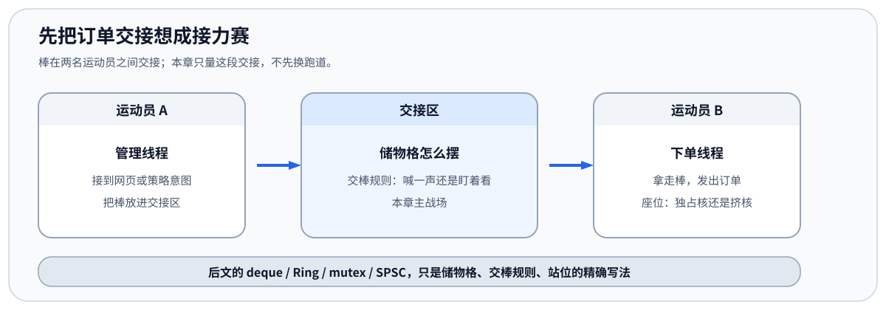
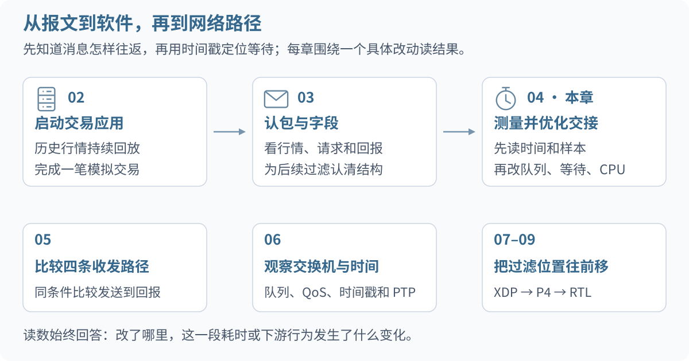
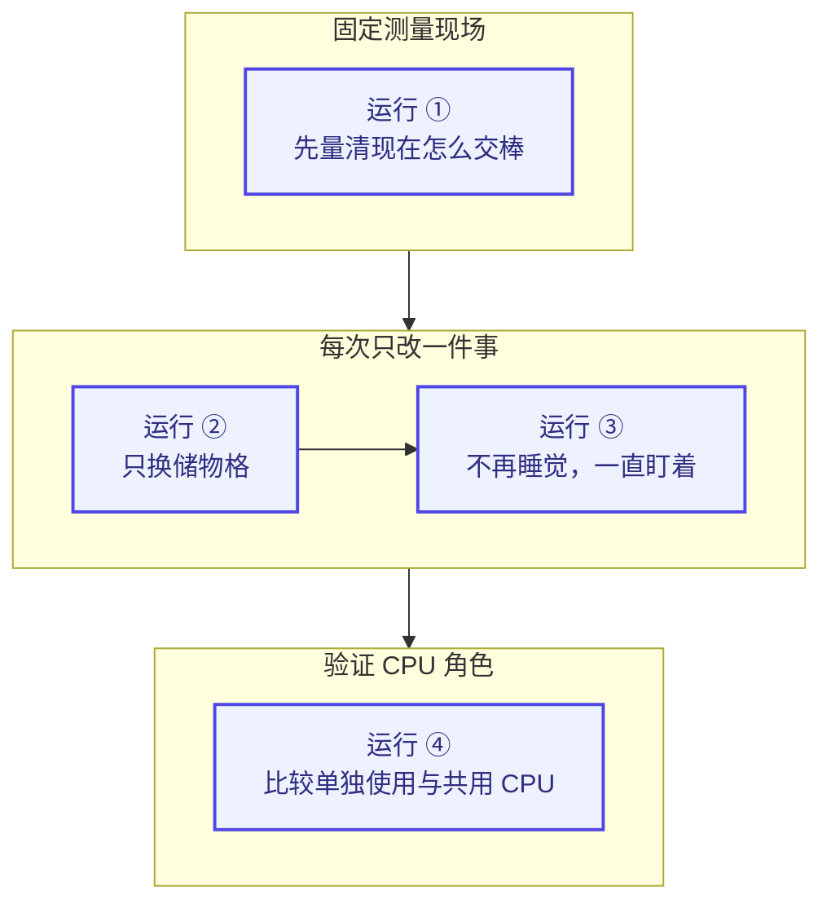
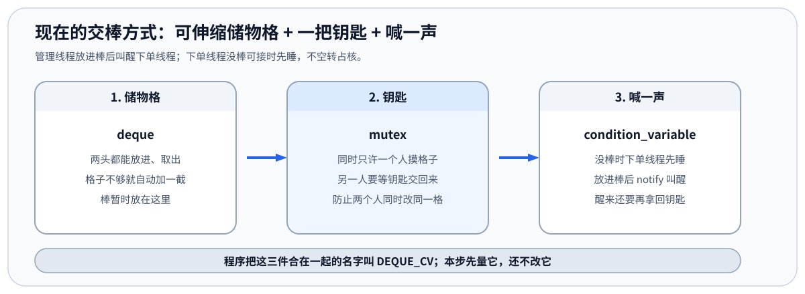
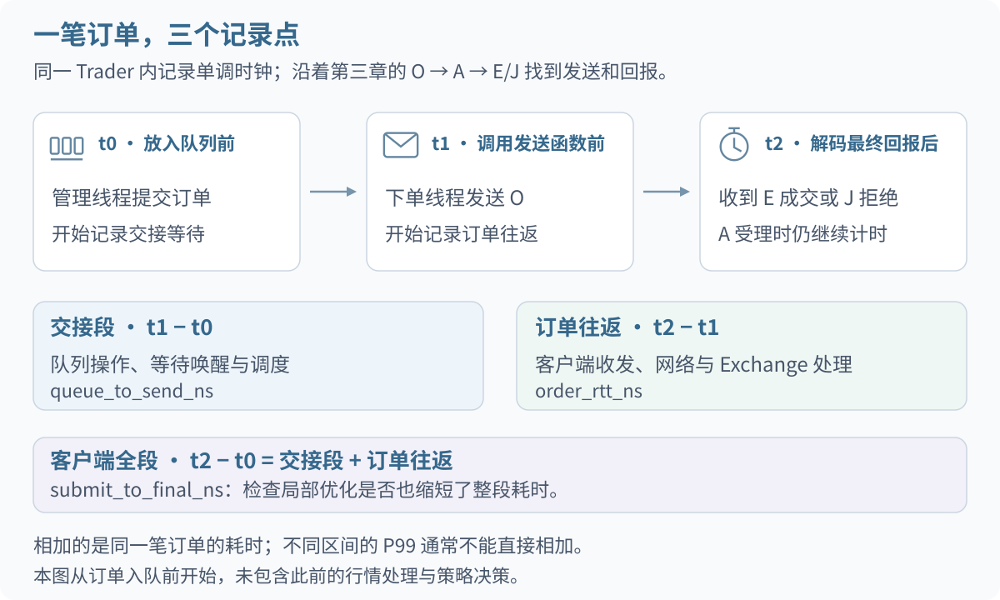
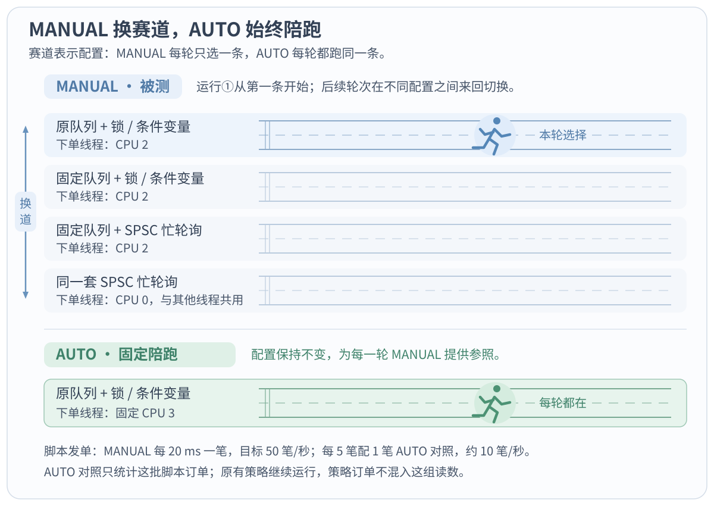
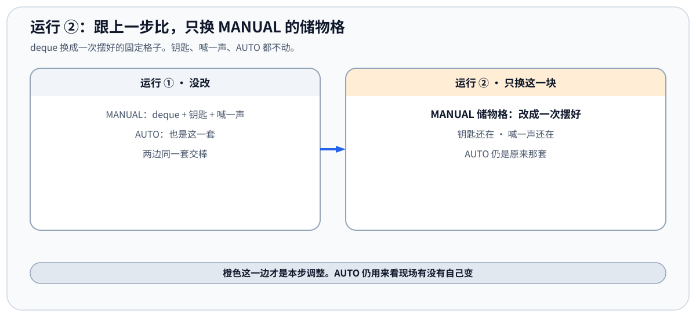
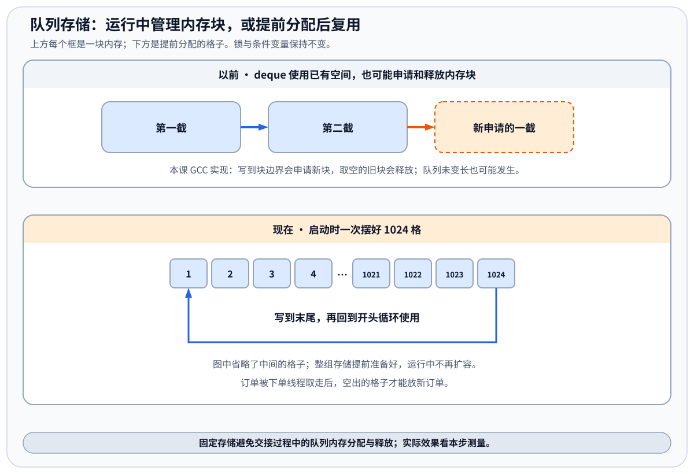
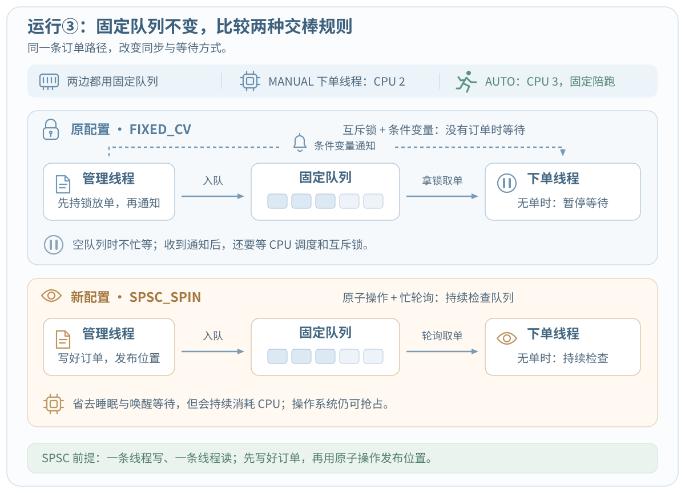
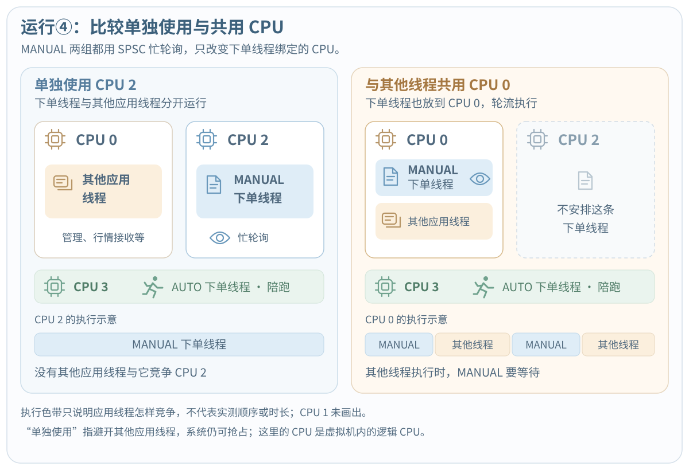

# 第 04 章：C++ 软件热路径——队列、忙轮询与 CPU 隔离

## 订单先在 C++ 里交一次棒

第 03 章已经看清订单 O 怎样发出，以及 A、E 回报怎样返回。现在把观察点往发送之前移：订单在 `.2` 的同一个 C++ 进程里，要先从管理线程交给下单线程。这段等待发生在程序内部，需要用代码中的时间戳来测量。

把这段交接想成接力赛：订单是接力棒，两条线程是两名运动员，中间是交接区。本章比较三件事：订单暂存在哪里、两条线程怎样交接、下单线程在哪个 CPU 上运行。重点看交接段耗时，同时检查整笔订单是否也变快。

<div style="background:#f8fafc;border:1px solid #cbd5e1;border-radius:12px;padding:10px;max-width:820px;margin:14px auto;">

</div>

| 先记住的说法 | 后文才会写全的名字 | 它管什么 |
|---|---|---|
| 接力棒 | 订单 / OUCH Enter Order | 被交接的那份工作 |
| 交接区里的储物格 | 队列：`deque` 或固定 Ring | 棒暂时放哪、格子会不会临时扩缩 |
| 交棒规则 | 锁与等待，或 SPSC + 忙轮询 | 是等待通知，还是持续检查交接区 |
| 下单线程在哪运行 | CPU 亲和性 | 单独使用 CPU，还是与其他应用线程共用 |

本章沿用 MANUAL 和 AUTO 两个交易进程：MANUAL 是被测对象，AUTO 固定陪跑。测量单由脚本自动提交，无需在网页上手动下单。每步自动固定为仅 A 路组播、关闭 B 路，结束或失败时恢复原行情模式；这样比较队列时，行情副本数量保持一致。

<div style="border-left:6px solid #7e22ce;background:#f3e8ff;padding:12px 16px;border-radius:8px;margin:14px 0;"><span style="display:inline-block;padding:3px 12px;border-radius:6px;background:#7e22ce;color:#fff;font-weight:800;">运行前提</span> <span style="font-weight:700;color:#581c87;">先分清服务器给虚拟机预留 CPU，以及虚拟机内给线程绑定 CPU。</span></div>

1. **物理服务器先把 CPU 预留给这台虚拟机。** 课程快照已配置，第 01 章说明其检查口径。
2. **虚拟机内，由本章脚本设置线程的 CPU 位置。** MANUAL 下单线程用 CPU 2，AUTO 用 CPU 3；无需提前手工绑定。

<div style="border-left:6px solid #7e22ce;background:#f3e8ff;padding:12px 16px;border-radius:8px;margin:14px 0;"><span style="display:inline-block;padding:3px 12px;border-radius:6px;background:#7e22ce;color:#fff;font-weight:800;">关键图</span> <span style="font-weight:700;color:#581c87;">下面这张图说明整门课在哪一层动手。本章动的是最右上角那一格，后面几章再往更底层走。</span></div>

<div style="background:#f8fafc;border:1px solid #cbd5e1;border-radius:12px;padding:10px;max-width:820px;margin:14px auto;">

</div>

## 本章学习目标

完成本章后，你应能：

- 把一笔订单分成交接段、发出到回执两段，并核对合起来的客户端总耗时。
- 分清「换储物格」「改交棒规则」「改 CPU 分配」三件事，不把它们混成一句「换个队列就一定更快」。
- 用 AUTO 对照和多轮样本判断这一批样本能不能用来比较。

## 本章导航

<div style="border-left:6px solid #7e22ce;background:#f3e8ff;padding:12px 16px;border-radius:8px;margin:14px 0;"><span style="display:inline-block;padding:3px 12px;border-radius:6px;background:#7e22ce;color:#fff;font-weight:800;">本章导航</span> <span style="font-weight:700;color:#581c87;">本章分成 3 部分，共 4 个导航项；先用总图看完整路线，再在每节导航卡里查看全章与本组位置。先固定测量现场，再逐次只改一件事，最后单独验证 CPU 角色。</span></div>



固定顺序就是：**固定测量现场 → 每次只改一件事 → 验证 CPU 角色**。

## 任务地图

四个导航项各自只回答一个问题：

| 导航项 | 所属部分 | 这一项回答什么 |
| --- | --- | --- |
| 运行 ①：先量清现在怎么交棒 | 固定测量现场 | 先量清当前交棒方式 |
| 运行 ②：只换储物格 | 每次只改一件事 | 只替换储物格并保持其它条件不变 |
| 运行 ③：不再睡觉，一直盯着 | 每次只改一件事 | 只改变交棒规则并观察交接段 |
| 运行 ④：比较单独使用与共用 CPU | 验证 CPU 角色 | 只改变下单线程所在 CPU 并复核效果 |

## 运行 ①：先量清现在怎么交棒

本步先测当前交接段的耗时，并确认重复测量的结果是否稳定。先看两条线程怎样交接，再看从哪里开始计时、怎样采样。

<div style="border:2px solid #4f46e5;background:#eef2ff;padding:10px 12px;border-radius:8px;margin:14px 0;"><div style="font-weight:900;color:#312e81;margin-bottom:4px;">导航卡 · 固定测量现场</div><div style="font-weight:700;color:#312e81;margin-bottom:8px;">范畴：受控配置比较　本步知识：先量清当前交棒方式　位置：全章第 1 / 4 项 · 本组第 1 / 1 项</div><span style="display:inline-block;margin:3px;padding:4px 10px;border-radius:6px;background:#15803d;color:#fff;font-weight:800;">运行 ①：先量清现在怎么交棒</span></div>

### 本步理论：队列、互斥锁与条件变量

当前交接使用三个 C++ 标准库组件。先读名称和参考说明，再看它们怎样配合。

<div style="border-left:6px solid #7e22ce;background:#f3e8ff;padding:12px 16px;border-radius:8px;margin:14px 0;"><span style="display:inline-block;padding:3px 12px;border-radius:6px;background:#7e22ce;color:#fff;font-weight:800;">仅供展示 · C++ 参考说明</span> <span style="font-weight:700;color:#581c87;">英文为 cppreference 原文节选，右侧逐项直译；点名称可查看完整说明。</span></div>

| 名称 | 英文原文节选 | 中文直译 |
|---|---|---|
| [`deque`：双端队列](https://en.cppreference.com/w/cpp/container/deque) | “indexed sequence container”；“The storage of a deque is automatically expanded and contracted as needed.” | 可按下标访问的序列容器；deque 的存储空间会按需自动扩展和收缩。 |
| [`mutex`：互斥锁](https://en.cppreference.com/w/cpp/thread/mutex) | “protect shared data from being simultaneously accessed by multiple threads” | 保护共享数据，防止多个线程同时访问。 |
| [`condition_variable`：条件变量](https://en.cppreference.com/w/cpp/thread/condition_variable) | `wait`：“atomically releases the mutex and suspends thread execution”；`notify_one`：“notifies one waiting thread” | 等待：以不可分割的操作释放互斥锁并暂停线程执行；通知：通知一个正在等待的线程。 |

CV 是 condition variable 的缩写。本课取单时等待的条件是“队列里有订单”。

对应前面的比喻，deque 是存放订单的“储物格”，mutex 是访问格子前要拿到的“钥匙”；“睡着、叫醒”说的是线程暂停等待、收到通知后恢复执行。

这三件合在一起，程序叫 `DEQUE_CV`。`MANUAL` 和 `AUTO` 默认都用这一套，本步保持不变。

<div style="border-left:6px solid #7e22ce;background:#f3e8ff;padding:12px 16px;border-radius:8px;margin:14px 0;"><span style="display:inline-block;padding:3px 12px;border-radius:6px;background:#7e22ce;color:#fff;font-weight:800;">仅供展示</span> <span style="font-weight:700;color:#581c87;">当前交棒方式：队列存订单，互斥锁保护访问，条件变量协调等待与通知。</span></div>

<div style="background:#f8fafc;border:1px solid #cbd5e1;border-radius:12px;padding:10px;max-width:820px;margin:14px auto;">

</div>

队列为空时，两个线程按下面的顺序配合。看队列必须持锁；睡着等通知时锁已经放下。中间这一下由 `wait_for()` 完成。

1. 下单线程先持锁检查队列。没有订单，就调用 `wait_for()`：它先释放锁，再让本线程暂停，等待上限为本课设置的 20 毫秒。
2. 管理线程拿到同一把锁，放入订单，再调用同一个条件变量的 `notify_one()` 通知等待线程，随后释放锁。
3. `wait_for()` 返回时，下单线程已经重新持有锁。它再检查队列：有订单就取走处理；仍为空就再等下一轮。

条件变量的等待和通知由标准库借助操作系统实现。“叫醒”不保证线程立即执行，还要等 CPU 和锁；这正是本章要测量的交接等待。[本课实现](apps/flle-trading-lab/src/order_queue.hpp)、[C++ 条件变量规范](https://eel.is/c++draft/thread.condition.condvar)

<div style="border-left:6px solid #7e22ce;background:#f3e8ff;padding:12px 16px;border-radius:8px;margin:14px 0;"><span style="display:inline-block;padding:3px 12px;border-radius:6px;background:#7e22ce;color:#fff;font-weight:800;">仅供展示 · C++ 源码节选</span> <span style="font-weight:700;color:#581c87;">管理线程放入一笔订单：加锁、入队、通知。以下代码供阅读，无需单独运行。</span></div>

```cpp
std::lock_guard<std::mutex> lock(mutex_);
deque_.push_back(std::move(value));
condition_.notify_one();
return true;
```

`value` 是这笔订单，`push_back()` 把它放到队尾。`lock_guard` 取得互斥锁，离开这段代码时自动释放；`notify_one()` 发出通知，下单线程仍须重新拿到锁才能取单。

脚本每隔 20 毫秒向 MANUAL 交一笔测量单。`wait_for()` 的 20 毫秒是队列空着时最多睡多久。

### 读数前，先分清时间单位

纳秒、微秒、毫秒都在表示耗时。从小到大是 ns → μs → ms → s，每向右一级，数值除以 1000。[国际计量局：单位词头](https://www.bipm.org/en/measurement-units/si-prefixes)

| 单位 | 换算 | 后面怎样读 |
| --- | --- | --- |
| 纳秒 `ns` | `1000 ns = 1 μs` | 原始计时字段的后缀，如 `queue_to_send_ns` |
| 微秒 `μs`（命令常写 `us`） | `1000 μs = 1 ms` | 终端用它显示较短的订单耗时 |
| 毫秒 `ms` | `1000 ms = 1 s` | 本章两笔测量单的目标间隔：20 ms |

例如 `14932 ns = 14.932 μs = 0.014932 ms`，只是单位不同。20 ms 是安排下一笔订单的间隔；每笔订单本身花了多久，要看它的时间戳差值。

<a id="measurement-basics"></a>

### 一笔订单在哪三个位置计时

C++ 程序通过 `CLOCK_MONOTONIC` 读取单调时钟：它只往前走，两次读数相减就是中间过了多久。

每笔测量订单记录三个点：t0 在放入队列前，t1 在调用发送函数前，t2 在收到并解码最终 E（成交）或 J（拒绝）后。A 只表示受理，计时继续。

<div style="border-left:6px solid #7e22ce;background:#f3e8ff;padding:12px 16px;border-radius:8px;margin:14px 0;"><span style="display:inline-block;padding:3px 12px;border-radius:6px;background:#7e22ce;color:#fff;font-weight:800;">仅供展示</span> <span style="font-weight:700;color:#581c87;">三个点划出交接段、往返与整段耗时；同一笔订单的交接段耗时加上往返耗时，就是整段耗时。</span></div>

<div style="background:#f8fafc;border:1px solid #cbd5e1;border-radius:12px;padding:10px;max-width:820px;margin:14px auto;">

</div>

| 测量区间 | 公式 | 本章用途 |
|---|---|---|
| 交接段 | `queue_to_send = t1 - t0` | 本章重点比较的耗时 |
| 发出去到回执 | `order_rtt = t2 - t1` | 客户端收发、网络往返和 Exchange 处理 |
| 整段客户端路径 | `submit_to_final = t2 - t0` | 看交接变快后，整段是否也缩短 |

“交棒”指两条线程传递订单的过程，“交接段”是测量这个过程的计时区间，包含队列操作、等待唤醒、调度和发送前准备。终端把“交接段耗时”简写为“交棒”。

### 为什么正式测量前要预热

连接、内存和程序执行路径刚开始工作时，耗时可能与持续运行不同。预热是先跑一批固定数量的订单，让程序进入测量状态。

<div style="border-left:6px solid #7e22ce;background:#f3e8ff;padding:12px 16px;border-radius:8px;margin:14px 0;"><span style="display:inline-block;padding:3px 12px;border-radius:6px;background:#7e22ce;color:#fff;font-weight:800;">仅供展示</span> <span style="font-weight:700;color:#581c87;">这张图只回答：一次测量从左到右先做什么。</span></div>

<div style="background:#f8fafc;border:1px solid #cbd5e1;border-radius:12px;padding:10px;max-width:820px;margin:14px auto;">

</div>

本步先整体热身 1000 笔，再用同一套交棒配置连做 8 轮。每轮先预热 40 笔，不计入统计；随后记录 400 笔正式样本，8 轮合计 3200 笔。[测量脚本](apps/flle-trading-lab/tests/software_measurement.py)

### 一批样本怎样得到 P50、P99

一笔订单的一段耗时，就是一个样本。把同一区间的耗时从小到大排列，P50 看中间位置，P99 看接近末端的位置；少数慢订单所在的尾部，称为尾延迟。

| 统计量 | 以一轮的 400 笔正式样本为例 | 说明什么 |
| --- | --- | --- |
| P50（中位数） | 排序后第 200 个 | 一半样本不超过的耗时 |
| P99 | 第 396 个 | 99% 样本不超过的耗时 |
| max（最大值） | 第 400 个 | 这 400 笔里最慢的一笔 |

比较配置时，要用相同区间、相同统计量，例如交接段 P99 对交接段 P99。各段的 P99 可能来自不同订单，不能像单笔耗时那样直接相加或相减。

### AUTO 为什么要固定陪跑

<div style="border-left:6px solid #7e22ce;background:#f3e8ff;padding:12px 16px;border-radius:8px;margin:14px 0;"><span style="display:inline-block;padding:3px 12px;border-radius:6px;background:#7e22ce;color:#fff;font-weight:800;">关键图 · 被测与陪跑</span> <span style="font-weight:700;color:#581c87;">MANUAL 每轮选择一种配置，轮次之间切换比较；AUTO 始终固定陪跑，为每一轮提供环境参照。</span></div>

<div style="background:#f8fafc;border:1px solid #cbd5e1;border-radius:12px;padding:10px;max-width:820px;margin:14px auto;">

</div>

本章比较的是 MANUAL 换配置前后的耗时。AUTO 始终用原配置陪跑，帮助判断这次测量的环境是否稳定。

脚本会自动检查：如果 AUTO 波动太大，或重复测量不稳定，就把结果标为“不能用”。先看输出“这一轮能不能用”：能用，再比较 MANUAL 的交接段和整段耗时；不能用，本批不作快慢结论。[详细检查规则](assets/04-live-software/README.md#样本有效性检查)

### 理论落到实验

本步保持 MANUAL 的 `DEQUE_CV` 和下单线程 CPU 2 不变，AUTO 在 CPU 3 陪跑。用同一套配置连测 8 轮，先确认基线是否稳定，再进入后续的两套配置比较。

实验标识沿用原编号：本章新生成的 `RUN_ID` 仍以 `-05-deque-cv` 等名称结尾，状态文件也保留 `05-`；它们对应本章实验，按当前目录继续即可。

<div style="border-left:6px solid #15803d;background:#dcfce7;padding:12px 16px;border-radius:8px;margin:14px 0;"><span style="display:inline-block;padding:3px 12px;border-radius:6px;background:#15803d;color:#fff;font-weight:800;">需要运行 · 运行 ①</span> <span style="font-weight:700;color:#14532d;">在【持久管理机】以 root 运行。第 02 章交易程序保持在线，第 03 章已恢复原行情模式；本步直接读取第 02 章的运行态。先热身 1000 笔，再连跑 8 轮（每轮预热 40、计入 400），量当前交接段耗时，大约 2 分钟。先确认输出“这一轮能不能用”，再读耗时。</span></div>

```bash
#!/usr/bin/env bash
set -euo pipefail
cd /qyt-fll
REPO_ROOT=/qyt-fll
SELF="$REPO_ROOT/assets/04-live-software/01-measure-deque-cv.sh"
HELPER="$REPO_ROOT/apps/flle-trading-lab/tests/software_measurement.py"
source "$REPO_ROOT/reports/run-state/02-trading-baseline.env"
APP_RUN_ID="$RUN_ID"
RUN_ID="$(date -u +%Y%m%dT%H%M%SZ)-05-deque-cv"
OUT="$REPO_ROOT/reports/course-runs/$RUN_ID"
mkdir -p "$OUT/raw"
printf 'RUN_ID=%s\nAPP_RUN_ID=%s\nPROFILE=DEQUE_CV_REPEAT8_ISOLATED_AUTO_SENTINEL_V14\n' "$RUN_ID" "$APP_RUN_ID" >"$OUT/run.env"
# ~~~~~8 轮 DEQUE_CV/dedicated，AUTO 当环境哨兵~~~~~
python3 "$HELPER" --profiles DEQUE_CV:dedicated --repeat 8 --control-port 48121 --treatment-cpu 2 --control-cpu 3 --housekeeping-cpus 0-1 --precondition-samples 1000 --warmup 40 \
  --samples 400 --interval-us 20000 --control-every 5 --stability-limit-pct 20 \
  --environment-equivalence-pct 40 --direction-consistency-pct 87.5 --single-profile-spread-limit 1.5 \
  --bootstrap-resamples 4000 --bootstrap-seed 20260828 --output "$OUT/raw/software.csv" \
  2>&1 | tee "$OUT/raw/result.txt"
# ~~~~~封 SHA，把 DEQUE 摘要交给下一张卡~~~~~
sha256sum "$SELF" "$HELPER" "$OUT/raw/software.csv" \
  "$OUT/raw/software.market.json" "$OUT/raw/software.summary.json" "$OUT/raw/result.txt" "$OUT/run.env" >"$OUT/SHA256SUMS"
printf 'DEQUE_RUN_ID=%s\nDEQUE_SUMMARY=%s\n' "$RUN_ID" "$OUT/raw/software.summary.json" >reports/run-state/05-deque-cv.env
printf '本轮证据目录：%s\n' "$OUT"
```

<div style="border-left:6px solid #7e22ce;background:#f3e8ff;padding:12px 16px;border-radius:8px;margin:14px 0;"><span style="display:inline-block;padding:3px 12px;border-radius:6px;background:#7e22ce;color:#fff;font-weight:800;">仅供展示 · 输出解读</span> <span style="font-weight:700;color:#581c87;">历史 RUN `20260830T053740Z-05-deque-cv`，按当前显示函数格式化。先看「能不能用」，再比较 MANUAL 和 AUTO 各段的 p99。</span></div>

```text
~~~~~~~~~~~~~~~~~~~~~测量摘要~~~~~~~~~~~~~~~~~~~~~
这一轮能不能用：能用
AUTO 有没有自己乱跳：8/8 轮都稳
8 轮交棒最快 12873 ns（12.9 µs），最慢 15174 ns（15.2 µs）；最慢是最快的 1.18 倍（门限 1.50）
格子有没有装满丢掉：没有
先热身 1000 笔，每轮预热 40、计入 400，共 8 轮

原来的格子（独占座位）
  同一把尺子，都是 p99
  MANUAL 计入 3200 笔
    交棒：14830 ns（14.8 µs）
    发出去到回执：62563 ns（62.6 µs）
    整段：73884 ns（73.9 µs）
  AUTO 计入 640 笔
    交棒：15765 ns（15.8 µs）
    发出去到回执：67860 ns（67.9 µs）
    整段：78859 ns（78.9 µs）
    往返中位：49572 ns（49.6 µs）（只看稳不稳）

MANUAL 独占座位时坐 CPU 2
AUTO 一直坐 CPU 3
行情还在播，AUTO 策略没关
```

| 看哪一行 | 本轮 | 它表示什么 |
|---|---|---|
| 这一轮能不能用 | 能用 | 8 轮都能当基线 |
| AUTO 有没有自己乱跳 | 8/8 轮都稳 | 现场没有自己变乱 |
| 8 轮交棒最快 / 最慢 | 最快一轮 12.9 µs，最慢一轮 15.2 µs，差 1.18 倍 | 这 8 次里最慢不到最快的 1.50 倍，同一套比得住 |
| 交棒 p99 | MANUAL 14.8 µs / AUTO 15.8 µs | MANUAL 是后续被调整的一方，AUTO 保持基准配置 |
| 发出去到回执 p99 | MANUAL 62.6 µs / AUTO 67.9 µs | 观察交接之后的订单往返耗时 |
| 往返中位 | 49.6 µs | 只看 AUTO 稳不稳，不跟 p99 比快慢 |

<div style="border-left:6px solid #0891b2;background:#cffafe;padding:12px 16px;border-radius:8px;margin:14px 0;"><span style="display:inline-block;padding:3px 12px;border-radius:6px;background:#0891b2;color:#fff;font-weight:800;">关键现象</span> <span style="font-weight:700;color:#164e63;">本节展示的历史样例基线有效，`14.8 µs` 是该批的观察值。重刷若显示“不能用”，本批不作性能基线；命令正常结束不等于样本有效。若脚本非零退出或恢复失败，则先排障再继续。</span></div>

后面每张卡都会重新交替采集自己的两组样本，并重新检查环境；它们不拿本卡的历史数字作对照。因此可以继续讲下一种机制，但快慢结论只能使用该卡自己通过检查的样本。

## 运行 ②：只换储物格

本步只问：队列改成提前分配、循环复用，交接段会不会更快？

<div style="border:2px solid #4f46e5;background:#eef2ff;padding:10px 12px;border-radius:8px;margin:14px 0;"><div style="font-weight:900;color:#312e81;margin-bottom:4px;">导航卡 · 每次只改一件事</div><div style="font-weight:700;color:#312e81;margin-bottom:8px;">范畴：受控配置比较　本步知识：只替换储物格并保持其它条件不变　位置：全章第 2 / 4 项 · 本组第 1 / 2 项</div><span style="display:inline-block;margin:3px;padding:4px 10px;border-radius:6px;background:#15803d;color:#fff;font-weight:800;">运行 ②：只换储物格</span><span style="display:inline-block;margin:3px;padding:4px 10px;border-radius:6px;background:#f8fafc;border:1px solid #a5b4fc;color:#312e81;font-weight:800;">运行 ③：不再睡觉，一直盯着</span></div>

### 本步理论：运行中管理内存块，还是提前分配

本步只改 MANUAL 的队列存储，互斥锁、条件变量和 AUTO 配置都保持不变。

`deque` 入队总是写到当前块的队尾。块里还有位置就直接写；写满一块，本课的 GCC 实现再申请下一块。队头取空一块，就把那一块还回去。不是每笔都向系统要内存，头尾跨过块边界时才会分配或释放。[GCC 实现](https://github.com/gcc-mirror/gcc/blob/releases/gcc-11.4.0/libstdc%2B%2B-v3/include/bits/deque.tcc)

`FIXED_CV` 启动时一次排好固定格子。入队写到 `fixed_head_`，下标加一，到末尾绕回开头。刚取走的那一格不会马上再写，写指针继续往前；绕回来并且这格已经空着，才能放新单。满了就拒单。锁和通知与原来相同。

<div style="border-left:6px solid #7e22ce;background:#f3e8ff;padding:12px 16px;border-radius:8px;margin:14px 0;"><span style="display:inline-block;padding:3px 12px;border-radius:6px;background:#7e22ce;color:#fff;font-weight:800;">仅供展示</span> <span style="font-weight:700;color:#581c87;">这张图只回答：运行 ② 跟上一步比，改了哪一块。</span></div>

<div style="background:#f8fafc;border:1px solid #cbd5e1;border-radius:12px;padding:10px;max-width:820px;margin:14px auto;">

</div>

<div style="border-left:6px solid #7e22ce;background:#f3e8ff;padding:12px 16px;border-radius:8px;margin:14px 0;"><span style="display:inline-block;padding:3px 12px;border-radius:6px;background:#7e22ce;color:#fff;font-weight:800;">仅供展示</span> <span style="font-weight:700;color:#581c87;">这张图比较：运行中管理内存块，还是提前分配后直接复用。</span></div>

<div style="background:#f8fafc;border:1px solid #cbd5e1;border-radius:12px;padding:10px;max-width:820px;margin:14px auto;">

</div>

锁与唤醒保持不变。本步在约 50 笔/秒的固定负载下，测量两种存储方式的交接段耗时。

| 比较项 | 以前 `DEQUE_CV` | 现在 `FIXED_CV` |
|---|---|---|
| 存储空间怎样管理 | 分块管理，按需申请和释放 | 启动时分配好，之后循环复用 |
| 交接时是否申请或释放存储空间 | 可能，即使队列没有变长 | 不需要，直接复用固定空间 |

<div style="border-left:6px solid #7e22ce;background:#f3e8ff;padding:12px 16px;border-radius:8px;margin:14px 0;"><span style="display:inline-block;padding:3px 12px;border-radius:6px;background:#7e22ce;color:#fff;font-weight:800;">仅供展示 · C++ 源码节选</span> <span style="font-weight:700;color:#581c87;">固定队列分两处看：创建时分配空间，入队时写入已有位置。</span></div>

队列创建时，一次分配 `Slots` 个订单位置。`T` 表示订单对象的类型，`slots_` 管理这块数组空间。

```cpp
std::unique_ptr<T[]> slots_{new T[Slots]};
```

管理线程入队时，执行下面几行：[固定队列实现](apps/flle-trading-lab/src/order_queue.hpp)

```cpp
std::lock_guard<std::mutex> lock(mutex_);
if (fixed_size_ == capacity()) return false;
slots_[fixed_head_] = std::move(value);
fixed_head_ = (fixed_head_ + 1) % Slots;
++fixed_size_;
condition_.notify_one();
return true;
```

`fixed_head_` 指向下一次写入的位置，`fixed_size_` 记录队列里的订单数，`capacity()` 给出可用容量。先检查队列是否已满，再写订单并向前移动位置；`% Slots` 让位置到数组末尾后绕回开头。

这一段没有申请新的队列空间，互斥锁和通知仍与原来相同。已占用的位置，要等对应订单从队列移除后才能复用。

### 理论落到实验

要比的是 **MANUAL 的两套格子**，不是手工对自动。

- **原来的格子**：运行 ① 那套，按需申请和释放内存块。
- **固定格子**：本步要换上的那套，提前分配、循环复用。

每套各跑 8 轮，一共 16 轮。AUTO 每轮都跟着，用的还是原来那套，只看现场稳不稳。

如果先测完一套配置再测另一套，后半程的环境变化就可能被误当成配置差异。交替运行让两套都分布在前半程和后半程，减少先后顺序的影响。

每个编号就是一轮，整轮使用同一套配置：先预热 40 笔，不计入统计；再统计 400 笔正式样本。

| 轮次 | 1 | 2 | 3 | 4 | 5 | 6 | 7 | 8 |
|---|---|---|---|---|---|---|---|---|
| MANUAL 用哪套 | 原来的 | 固定 | 固定 | 原来的 | 固定 | 原来的 | 原来的 | 固定 |

| 轮次 | 9 | 10 | 11 | 12 | 13 | 14 | 15 | 16 |
|---|---|---|---|---|---|---|---|---|
| MANUAL 用哪套 | 原来的 | 固定 | 固定 | 原来的 | 固定 | 原来的 | 原来的 | 固定 |

程序里把这两套配置叫 profile，绿卡写成 `DEQUE_CV` 和 `FIXED_CV`。

终端先列两套的实际耗时，再直接给结论：哪套更快，或暂时分不出谁更快。本批检查未通过时，只保留读数，不作快慢结论。

<div style="border-left:6px solid #15803d;background:#dcfce7;padding:12px 16px;border-radius:8px;margin:14px 0;"><span style="display:inline-block;padding:3px 12px;border-radius:6px;background:#15803d;color:#fff;font-weight:800;">需要运行 · 运行 ②</span> <span style="font-weight:700;color:#14532d;">在【持久管理机】以 root 运行；前置是运行 ① 已写出 `05-deque-cv.env`；通常约 4～5 分钟；原来的格子和固定格子穿插着各跑 8 轮；预期这一轮能用，再看换队列是否缩短交接段耗时。</span></div>

```bash
#!/usr/bin/env bash
set -euo pipefail
cd /qyt-fll
REPO_ROOT=/qyt-fll
SELF="$REPO_ROOT/assets/04-live-software/02-measure-fixed-cv.sh"
HELPER="$REPO_ROOT/apps/flle-trading-lab/tests/software_measurement.py"
source "$REPO_ROOT/reports/run-state/02-trading-baseline.env"
APP_RUN_ID="$RUN_ID"
# ~~~~~读取运行 ① 的 DEQUE 摘要~~~~~
source "$REPO_ROOT/reports/run-state/05-deque-cv.env"
RUN_ID="$(date -u +%Y%m%dT%H%M%SZ)-05-fixed-cv"
OUT="$REPO_ROOT/reports/course-runs/$RUN_ID"
mkdir -p "$OUT/raw"
printf 'RUN_ID=%s\nAPP_RUN_ID=%s\nBASELINE_RUN_ID=%s\nPROFILE=DEQUE_FIXED_ABBA_ISOLATED_AUTO_SENTINEL_V14\n' "$RUN_ID" "$APP_RUN_ID" "$DEQUE_RUN_ID" >"$OUT/run.env"
# ~~~~~DEQUE↔FIXED 配平，只换储存~~~~~
python3 "$HELPER" --profiles DEQUE_CV:dedicated,FIXED_CV:dedicated --repeat 8 --control-port 48121 --treatment-cpu 2 --control-cpu 3 --housekeeping-cpus 0-1 --precondition-samples 1000 --warmup 40 \
  --samples 400 --interval-us 20000 --control-every 5 --stability-limit-pct 20 \
  --environment-equivalence-pct 40 --direction-consistency-pct 87.5 --single-profile-spread-limit 1.5 \
  --bootstrap-resamples 4000 --bootstrap-seed 20260828 --output "$OUT/raw/software.csv" \
  2>&1 | tee "$OUT/raw/result.txt"
# ~~~~~封 SHA~~~~~
sha256sum "$SELF" "$HELPER" "$OUT/raw/software.csv" \
  "$OUT/raw/software.market.json" "$OUT/raw/software.summary.json" "$OUT/raw/result.txt" "$OUT/run.env" >"$OUT/SHA256SUMS"
printf 'FIXED_RUN_ID=%s\nFIXED_SUMMARY=%s\n' "$RUN_ID" "$OUT/raw/software.summary.json" >reports/run-state/05-fixed-cv.env
printf '本轮证据目录：%s\n' "$OUT"
```

<div style="border-left:6px solid #7e22ce;background:#f3e8ff;padding:12px 16px;border-radius:8px;margin:14px 0;"><span style="display:inline-block;padding:3px 12px;border-radius:6px;background:#7e22ce;color:#fff;font-weight:800;">仅供展示 · 输出解读</span> <span style="font-weight:700;color:#581c87;">历史 RUN `20260830T072217Z-05-fixed-cv`，按当前显示函数格式化。这是一次有效样例；2026-09-08 复刷本步曾因 AUTO 环境对照未通过而判无效，重刷时先看当次「能不能用」。</span></div>

```text
~~~~~~~~~~~~~~~~~~~~~测量摘要~~~~~~~~~~~~~~~~~~~~~
这一轮能不能用：能用
AUTO 有没有自己乱跳：16/16 轮都稳
格子有没有装满丢掉：没有
先热身 1000 笔，每轮预热 40、计入 400，共 16 轮

原来的格子（独占座位）
  同一把尺子，都是 p99
  MANUAL 计入 3200 笔
    交棒：15772 ns（15.8 µs）
    发出去到回执：60309 ns（60.3 µs）
    整段：72379 ns（72.4 µs）
  AUTO 计入 640 笔
    交棒：16674 ns（16.7 µs）
    发出去到回执：72076 ns（72.1 µs）
    整段：87385 ns（87.4 µs）
    往返中位：51996 ns（52.0 µs）（只看稳不稳）

固定格子（独占座位）
  同一把尺子，都是 p99
  MANUAL 计入 3200 笔
    交棒：15040 ns（15.0 µs）
    发出去到回执：60200 ns（60.2 µs）
    整段：72704 ns（72.7 µs）
  AUTO 计入 640 笔
    交棒：16555 ns（16.6 µs）
    发出去到回执：73067 ns（73.1 µs）
    整段：86901 ns（86.9 µs）
    往返中位：52230 ns（52.2 µs）（只看稳不稳）

交棒谁更快
  原来的格子（独占座位） 对比 固定格子（独占座位）
  样本读数：固定格子（独占座位） 的 p99 少 732 ns（0.7 µs）
  结论：暂时分不出谁更快

整段谁更快
  原来的格子（独占座位） 对比 固定格子（独占座位）
  样本读数：原来的格子（独占座位） 的 p99 少 325 ns（0.3 µs）
  结论：暂时分不出谁更快

AUTO 两边现场差多少
  差了 234 ns（0.2 µs）
  AUTO 对照检查：通过

MANUAL 独占座位时坐 CPU 2
AUTO 一直坐 CPU 3
行情还在播，AUTO 策略没关
本轮证据目录：/qyt-fll/reports/course-runs/20260830T072217Z-05-fixed-cv
```

这批样本里，固定队列的交接段 P99 少了约 0.7 µs，但还不足以认定它更快。读数有高低，不代表已经测出了稳定差异；以输出里的「结论」一行为准。

MANUAL 判断的是“哪套更快”，AUTO 检查的是“环境变化是否仍允许比较”，两者不是同一门槛。[判定规则见样本有效性检查](assets/04-live-software/README.md#样本有效性检查)。

| 看哪一行 | 本轮 | 它表示什么 |
|---|---|---|
| 这一轮能不能用 | 能用 | 本批通过检查，可以比较 |
| 交棒谁更快 | 暂时分不出谁更快 | 两套读数接近，尚未测出稳定差异 |
| 整段谁更快 | 暂时分不出谁更快 | 整段也没有测出稳定差异 |
| AUTO 对照检查 | 通过 | AUTO 的变化在允许范围内 |

<div style="border-left:6px solid #0891b2;background:#cffafe;padding:12px 16px;border-radius:8px;margin:14px 0;"><span style="display:inline-block;padding:3px 12px;border-radius:6px;background:#0891b2;color:#fff;font-weight:800;">关键现象</span> <span style="font-weight:700;color:#164e63;">本轮暂时分不出谁更快。下一步保留固定队列，比较两种同步与等待方式。</span></div>

本轮没有测出稳定差异。是否值得换固定队列，还要在目标负载下比较；这组耗时本身不能证明内存分配发生了多少次。

## 运行 ③：不再睡觉，一直盯着

运行②已经换成固定队列。本步把 MANUAL 的“互斥锁 + 条件变量”整体换成“SPSC 原子操作 + 忙轮询”，AUTO 保持原配置。因此测到的是整套交棒规则换掉之后的结果。

<div style="border:2px solid #4f46e5;background:#eef2ff;padding:10px 12px;border-radius:8px;margin:14px 0;"><div style="font-weight:900;color:#312e81;margin-bottom:4px;">导航卡 · 每次只改一件事</div><div style="font-weight:700;color:#312e81;margin-bottom:8px;">范畴：受控配置比较　本步知识：只改变交棒规则并观察交接段　位置：全章第 3 / 4 项 · 本组第 2 / 2 项</div><span style="display:inline-block;margin:3px;padding:4px 10px;border-radius:6px;background:#f8fafc;border:1px solid #a5b4fc;color:#312e81;font-weight:800;">运行 ②：只换储物格</span><span style="display:inline-block;margin:3px;padding:4px 10px;border-radius:6px;background:#15803d;color:#fff;font-weight:800;">运行 ③：不再睡觉，一直盯着</span></div>

### 本步理论：接棒者一直盯着交接区

<div style="border-left:6px solid #7e22ce;background:#f3e8ff;padding:12px 16px;border-radius:8px;margin:14px 0;"><span style="display:inline-block;padding:3px 12px;border-radius:6px;background:#7e22ce;color:#fff;font-weight:800;">仅供展示</span> <span style="font-weight:700;color:#581c87;">上方用互斥锁与条件变量，下方改为 SPSC 忙轮询；固定队列与 CPU 安排相同。</span></div>

<div style="background:#f8fafc;border:1px solid #cbd5e1;border-radius:12px;padding:10px;max-width:820px;margin:14px auto;">

</div>

SPSC 是“单生产者、单消费者”：本课由一条管理线程放单，一条下单线程取单。入队和取单不用互斥锁，通过原子操作同步读写位置；队列为空时，下单线程持续检查，这就是忙轮询。

<div style="border-left:6px solid #7e22ce;background:#f3e8ff;padding:12px 16px;border-radius:8px;margin:14px 0;"><span style="display:inline-block;padding:3px 12px;border-radius:6px;background:#7e22ce;color:#fff;font-weight:800;">仅供展示 · C++ 源码节选</span> <span style="font-weight:700;color:#581c87;">沿图从左到右读：管理线程发布订单，下单线程检查是否有单。</span></div>

管理线程先检查有没有空位，再写订单，最后更新写入位置：

```cpp
const auto head = spsc_head_.load(std::memory_order_relaxed);
const auto next = (head + 1) % Slots;
if (next == spsc_tail_.load(std::memory_order_acquire)) return false;
slots_[head] = std::move(value);
spsc_head_.store(next, std::memory_order_release);
return true;
```

`head` 是写入位置，`tail` 是读取位置；写入将追上尚未释放的位置时，返回 `false` 表示队列已满。关键是最后两步的顺序：先写好订单，再用 `release` 发布新位置。

下单线程检查两个位置：相同表示没有订单，否则读取当前位置的订单。[SPSC 实现](apps/flle-trading-lab/src/order_queue.hpp)

```cpp
const auto tail = spsc_tail_.load(std::memory_order_relaxed);
if (tail == spsc_head_.load(std::memory_order_acquire)) {
  for (int count = 0; count < 64 && !stop.load(std::memory_order_relaxed);
       ++count)
    _mm_pause();
  return false;
}
value = slots_[tail];
return true;
```

`acquire` 与发布方的 `release` 配合，保证看到新位置时，也能读到此前写好的订单。`relaxed` 用于读取本线程维护的位置，不承担这次跨线程的订单发布。

完成该笔订单处理后，下单线程调用 `pop()`，用 `release` 前移读取位置 `tail`，把已用的位置交还给写入方；仅仅读出订单时还不会释放。

没有订单时，`_mm_pause()` 给 CPU 一个短暂的自旋提示，不是让线程睡眠；函数返回后，[下单线程的外层循环](apps/flle-trading-lab/src/trader.cpp)会立即再检查队列。忙轮询省去等待通知的过程，但会持续消耗 CPU，操作系统仍可抢占线程。

MANUAL 下单线程仍在 CPU 2，AUTO 仍在 CPU 3。这里绑定的是虚拟机中的 CPU，不等于独占一颗物理核；运行 ④ 再比较多个线程共用 CPU 的影响。

### 理论落到实验

比较 MANUAL 的两套同步与等待方式，队列存储都已固定。锁和唤醒机制一起变化，不能把全部收益单独归给忙轮询。

- **睡着叫醒**：固定队列 + 互斥锁 + 条件变量。
- **一直盯着**：固定队列 + SPSC 原子操作 + 忙轮询。

每套各跑 8 轮，一共 16 轮。AUTO 每轮都跟着，用的还是原来那套，只看现场稳不稳。

交替顺序与运行②相同。每轮仍先预热 40 笔，再统计 400 笔正式样本，完整 16 轮如下。

| 轮次 | 1 | 2 | 3 | 4 | 5 | 6 | 7 | 8 |
|---|---|---|---|---|---|---|---|---|
| MANUAL 用哪套 | 睡着叫醒 | 盯着看 | 盯着看 | 睡着叫醒 | 盯着看 | 睡着叫醒 | 睡着叫醒 | 盯着看 |

| 轮次 | 9 | 10 | 11 | 12 | 13 | 14 | 15 | 16 |
|---|---|---|---|---|---|---|---|---|
| MANUAL 用哪套 | 睡着叫醒 | 盯着看 | 盯着看 | 睡着叫醒 | 盯着看 | 睡着叫醒 | 睡着叫醒 | 盯着看 |

程序里把这两套叫 profile，绿卡写成 `FIXED_CV` 和 `SPSC_SPIN`。

<div style="border-left:6px solid #15803d;background:#dcfce7;padding:12px 16px;border-radius:8px;margin:14px 0;"><span style="display:inline-block;padding:3px 12px;border-radius:6px;background:#15803d;color:#fff;font-weight:800;">需要运行 · 运行 ③</span> <span style="font-weight:700;color:#14532d;">在【持久管理机】以 root 运行；前置是运行 ② 已写出 `05-fixed-cv.env`；通常约 4～5 分钟；盯着看时 CPU 2 会一直忙；预期这一轮能用，再看盯着看是不是更快。</span></div>

```bash
#!/usr/bin/env bash
set -euo pipefail
cd /qyt-fll
REPO_ROOT=/qyt-fll
SELF="$REPO_ROOT/assets/04-live-software/03-measure-spsc-spin.sh"
HELPER="$REPO_ROOT/apps/flle-trading-lab/tests/software_measurement.py"
source "$REPO_ROOT/reports/run-state/02-trading-baseline.env"
APP_RUN_ID="$RUN_ID"
# ~~~~~读取运行 ② 的 FIXED 摘要~~~~~
source "$REPO_ROOT/reports/run-state/05-fixed-cv.env"
RUN_ID="$(date -u +%Y%m%dT%H%M%SZ)-05-spsc-spin"
OUT="$REPO_ROOT/reports/course-runs/$RUN_ID"
mkdir -p "$OUT/raw"
printf 'RUN_ID=%s\nAPP_RUN_ID=%s\nPREVIOUS_RUN_ID=%s\nPROFILE=FIXED_SPSC_ABBA_BUSY_SPIN_ISOLATED_AUTO_SENTINEL_V14\n' "$RUN_ID" "$APP_RUN_ID" "$FIXED_RUN_ID" >"$OUT/run.env"
# ~~~~~FIXED↔SPSC 配平，只换同步~~~~~
python3 "$HELPER" --profiles FIXED_CV:dedicated,SPSC_SPIN:dedicated --repeat 8 --control-port 48121 --treatment-cpu 2 --control-cpu 3 --housekeeping-cpus 0-1 --precondition-samples 1000 --warmup 40 \
  --samples 400 --interval-us 20000 --control-every 5 --stability-limit-pct 20 \
  --environment-equivalence-pct 40 --direction-consistency-pct 87.5 --single-profile-spread-limit 1.5 \
  --bootstrap-resamples 4000 --bootstrap-seed 20260828 --output "$OUT/raw/software.csv" \
  2>&1 | tee "$OUT/raw/result.txt"
# ~~~~~封 SHA~~~~~
sha256sum "$SELF" "$HELPER" "$OUT/raw/software.csv" \
  "$OUT/raw/software.market.json" "$OUT/raw/software.summary.json" "$OUT/raw/result.txt" "$OUT/run.env" >"$OUT/SHA256SUMS"
printf 'SPSC_RUN_ID=%s\nSPSC_SUMMARY=%s\n' "$RUN_ID" "$OUT/raw/software.summary.json" >reports/run-state/05-spsc-spin.env
printf '本轮证据目录：%s\n' "$OUT"
```

<div style="border-left:6px solid #7e22ce;background:#f3e8ff;padding:12px 16px;border-radius:8px;margin:14px 0;"><span style="display:inline-block;padding:3px 12px;border-radius:6px;background:#7e22ce;color:#fff;font-weight:800;">仅供展示 · 输出解读</span> <span style="font-weight:700;color:#581c87;">历史 RUN `20260830T074845Z-05-spsc-spin`，按当前显示函数格式化。先看「能不能用」，再分开看交接段和整段各快多少。</span></div>

```text
~~~~~~~~~~~~~~~~~~~~~测量摘要~~~~~~~~~~~~~~~~~~~~~
这一轮能不能用：能用
AUTO 有没有自己乱跳：16/16 轮都稳
格子有没有装满丢掉：没有
先热身 1000 笔，每轮预热 40、计入 400，共 16 轮

固定格子（独占座位）
  同一把尺子，都是 p99
  MANUAL 计入 3200 笔
    交棒：14932 ns（14.9 µs）
    发出去到回执：59048 ns（59.0 µs）
    整段：71436 ns（71.4 µs）
  AUTO 计入 640 笔
    交棒：16473 ns（16.5 µs）
    发出去到回执：72994 ns（73.0 µs）
    整段：84826 ns（84.8 µs）
    往返中位：49473 ns（49.5 µs）（只看稳不稳）

盯着看（独占座位）
  同一把尺子，都是 p99
  MANUAL 计入 3200 笔
    交棒：2451 ns（2.5 µs）
    发出去到回执：58781 ns（58.8 µs）
    整段：60687 ns（60.7 µs）
  AUTO 计入 640 笔
    交棒：16273 ns（16.3 µs）
    发出去到回执：71019 ns（71.0 µs）
    整段：84027 ns（84.0 µs）
    往返中位：47884 ns（47.9 µs）（只看稳不稳）

交棒谁更快
  固定格子（独占座位） 对比 盯着看（独占座位）
  样本读数：盯着看（独占座位） 的 p99 少 12481 ns（12.5 µs）
  结论：盯着看（独占座位） 更快

整段谁更快
  固定格子（独占座位） 对比 盯着看（独占座位）
  样本读数：盯着看（独占座位） 的 p99 少 10749 ns（10.7 µs）
  结论：盯着看（独占座位） 更快

AUTO 两边现场差多少
  差了 1589 ns（1.6 µs）
  AUTO 对照检查：通过

相邻快慢方向：8/8 对都是同一边更快
MANUAL 独占座位时坐 CPU 2
AUTO 一直坐 CPU 3
行情还在播，AUTO 策略没关
本轮证据目录：/qyt-fll/reports/course-runs/20260830T074845Z-05-spsc-spin
```

| 看哪一行 | 本轮 | 它表示什么 |
|---|---|---|
| 交棒谁更快 | 盯着看更快 12.5 µs | 14.9 µs → 2.5 µs，重复比较也支持这个结果 |
| 整段谁更快 | 盯着看更快 10.7 µs | 整段也快了；发出去到回执几乎没动 |
| AUTO 交棒 p99 | 16.5 µs / 16.3 µs | 同一把尺子；AUTO 还是原来那套 |
| 相邻快慢方向 | 8/8 对 | 每对都是盯着看更快 |
| AUTO 对照检查 | 通过 | AUTO 的变化在允许范围内 |

作为资源开销的参考，另一轮独立采样 `20260828T235221Z-05-busy-spin-cpu-cost` 中，下单线程的 CPU 使用率约为 `90.1%`，接近持续用满一颗逻辑 CPU。这台虚拟机只有 4 颗逻辑 CPU，本节约 12.5 µs 的交接段改善，要连同这项资源成本一起考虑。[历史复测记录](assets/04-live-software/README.md#历史复测记录)

<div style="border-left:6px solid #0891b2;background:#cffafe;padding:12px 16px;border-radius:8px;margin:14px 0;"><span style="display:inline-block;padding:3px 12px;border-radius:6px;background:#0891b2;color:#fff;font-weight:800;">关键现象</span> <span style="font-weight:700;color:#164e63;">本轮忙轮询更快：交接段 14.9 µs → 2.5 µs，整段少了 10.7 µs，但会持续消耗 CPU。下一步看它与其他线程共用 CPU 时，交接段耗时会怎样变化。</span></div>

## 运行 ④：比较单独使用与共用 CPU

交棒仍用 SPSC 忙轮询。本步比较 MANUAL 下单线程单独使用 CPU 2，还是与其他应用线程共用 CPU 0。

<div style="border:2px solid #4f46e5;background:#eef2ff;padding:10px 12px;border-radius:8px;margin:14px 0;"><div style="font-weight:900;color:#312e81;margin-bottom:4px;">导航卡 · 验证 CPU 角色</div><div style="font-weight:700;color:#312e81;margin-bottom:8px;">范畴：受控配置比较　本步知识：只改变下单线程所在 CPU 并复核效果　位置：全章第 4 / 4 项 · 本组第 1 / 1 项</div><span style="display:inline-block;margin:3px;padding:4px 10px;border-radius:6px;background:#15803d;color:#fff;font-weight:800;">运行 ④：比较单独使用与共用 CPU</span></div>

### 本步理论：共用 CPU 时，线程要轮流执行

本步先把 MANUAL 和 AUTO 的其他应用线程从 CPU 0–1 集中到 CPU 0，两种配置都保持这一安排。AUTO 下单线程始终在 CPU 3 陪跑。

<div style="border-left:6px solid #7e22ce;background:#f3e8ff;padding:12px 16px;border-radius:8px;margin:14px 0;"><span style="display:inline-block;padding:3px 12px;border-radius:6px;background:#7e22ce;color:#fff;font-weight:800;">仅供展示</span> <span style="font-weight:700;color:#581c87;">左边把下单线程与其他应用线程分开；右边让它们共用 CPU 0。底部色带示意谁在执行。</span></div>

<div style="background:#f8fafc;border:1px solid #cbd5e1;border-radius:12px;padding:10px;max-width:820px;margin:14px auto;">

</div>

单独使用 CPU 2 时，下单线程不与其他应用线程争用同一个 CPU。共用 CPU 0 时，其他线程执行期间，下单线程就要等待，这可能拉长交接段耗时。

这里的“独占”只指应用线程分开安排；操作系统仍可抢占这条线程，也不代表独占一颗物理核。

<div style="border-left:6px solid #7e22ce;background:#f3e8ff;padding:12px 16px;border-radius:8px;margin:14px 0;"><span style="display:inline-block;padding:3px 12px;border-radius:6px;background:#7e22ce;color:#fff;font-weight:800;">仅供展示 · C++ 源码节选</span> <span style="font-weight:700;color:#581c87;">程序启动线程时，怎样把它绑定到指定 CPU。</span></div>

```cpp
cpu_set_t affinity;
CPU_ZERO(&affinity);
CPU_SET(cpu, &affinity);
if (::sched_setaffinity(0, sizeof(affinity), &affinity) != 0)
  throw std::runtime_error("sched_setaffinity CPU " +
                           std::to_string(cpu) + ": " +
                           std::string(std::strerror(errno)));
```

`CPU_ZERO` 清空允许使用的 CPU 集合，`CPU_SET` 只加入指定编号；`sched_setaffinity` 的第一个参数为 0，表示设置当前线程，失败则报错。下单线程启动时调用这段[绑定函数](apps/flle-trading-lab/src/common.hpp)。

本步比较时，线程已经在运行，[测量脚本](apps/flle-trading-lab/tests/software_measurement.py)用 `taskset -pc` 修改指定下单线程的同一项设置，在 CPU 2 与 CPU 0 之间切换；队列代码保持不变。

### 理论落到实验

两组使用相同的忙轮询代码，比较下单线程绑定到 CPU 2 与 CPU 0 的耗时。

每套各跑 8 轮，一共 16 轮。AUTO 每轮都跟着，仍坐 CPU 3，只看现场稳不稳。

交替顺序与运行②相同。每轮仍先预热 40 笔，再统计 400 笔正式样本，完整 16 轮如下。

| 轮次 | 1 | 2 | 3 | 4 | 5 | 6 | 7 | 8 |
|---|---|---|---|---|---|---|---|---|
| MANUAL 绑定 | CPU 2 | CPU 0 | CPU 0 | CPU 2 | CPU 0 | CPU 2 | CPU 2 | CPU 0 |

| 轮次 | 9 | 10 | 11 | 12 | 13 | 14 | 15 | 16 |
|---|---|---|---|---|---|---|---|---|
| MANUAL 绑定 | CPU 2 | CPU 0 | CPU 0 | CPU 2 | CPU 0 | CPU 2 | CPU 2 | CPU 0 |

程序里把这两套叫 profile，绿卡写成 `SPSC_SPIN:dedicated` 和 `SPSC_SPIN:shared`。

<div style="border-left:6px solid #15803d;background:#dcfce7;padding:12px 16px;border-radius:8px;margin:14px 0;"><span style="display:inline-block;padding:3px 12px;border-radius:6px;background:#15803d;color:#fff;font-weight:800;">需要运行 · 运行 ④</span> <span style="font-weight:700;color:#14532d;">在【持久管理机】以 root 运行；前置是运行 ③ 已写出 `05-spsc-spin.env`；通常约 4～5 分钟；成功或失败都会恢复 SPSC 忙轮询和 CPU 2；预期这一轮能用，再比较两种 CPU 分配。</span></div>

```bash
#!/usr/bin/env bash
set -euo pipefail
cd /qyt-fll
REPO_ROOT=/qyt-fll
SELF="$REPO_ROOT/assets/04-live-software/04-measure-spsc-shared-cpu.sh"
HELPER="$REPO_ROOT/apps/flle-trading-lab/tests/software_measurement.py"
RESTORE="$REPO_ROOT/apps/flle-trading-lab/tests/restore_software_profile.py"
source "$REPO_ROOT/reports/run-state/02-trading-baseline.env"
APP_RUN_ID="$RUN_ID"
# ~~~~~读取运行 ③ 的 SPSC 摘要；退出时恢复 CPU 角色~~~~~
source "$REPO_ROOT/reports/run-state/05-spsc-spin.env"
RUN_ID="$(date -u +%Y%m%dT%H%M%SZ)-05-spsc-shared-cpu"
OUT="$REPO_ROOT/reports/course-runs/$RUN_ID"
mkdir -p "$OUT/raw"
restore_profile() { python3 "$RESTORE" >"$OUT/raw/restore.txt"; }
trap restore_profile EXIT
printf 'RUN_ID=%s\nAPP_RUN_ID=%s\nPREVIOUS_RUN_ID=%s\nPROFILE=SPSC_DEDICATED_SHARED_ABBA_AUTO_SENTINEL_V14\n' "$RUN_ID" "$APP_RUN_ID" "$SPSC_RUN_ID" >"$OUT/run.env"
# ~~~~~SPSC 隔离核 ↔ 共享核配平~~~~~
python3 "$HELPER" --profiles SPSC_SPIN:dedicated,SPSC_SPIN:shared --repeat 8 --control-port 48121 --treatment-cpu 2 --control-cpu 3 --shared-cpu 0 --housekeeping-cpus 0 --precondition-samples 1000 --warmup 40 \
  --samples 400 --interval-us 20000 --control-every 5 --stability-limit-pct 20 \
  --environment-equivalence-pct 40 --direction-consistency-pct 87.5 --single-profile-spread-limit 1.5 \
  --bootstrap-resamples 4000 --bootstrap-seed 20260828 --output "$OUT/raw/software.csv" \
  2>&1 | tee "$OUT/raw/result.txt"
restore_profile
trap - EXIT
# ~~~~~封 SHA~~~~~
sha256sum "$SELF" "$HELPER" "$RESTORE" "$OUT/raw/software.csv" \
  "$OUT/raw/software.market.json" "$OUT/raw/software.summary.json" "$OUT/raw/result.txt" "$OUT/raw/restore.txt" "$OUT/run.env" >"$OUT/SHA256SUMS"
printf 'SOFTWARE_RUN_ID=%s\nSOFTWARE_PROFILE=SPSC_DEDICATED_SHARED_ABBA_AUTO_SENTINEL_V14\nSOFTWARE_SUMMARY=%s\n' "$RUN_ID" "$OUT/raw/software.summary.json" >reports/run-state/05-software-current.env
printf '本轮证据目录：%s\n' "$OUT"
```

<div style="border-left:6px solid #7e22ce;background:#f3e8ff;padding:12px 16px;border-radius:8px;margin:14px 0;"><span style="display:inline-block;padding:3px 12px;border-radius:6px;background:#7e22ce;color:#fff;font-weight:800;">仅供展示 · 输出解读</span> <span style="font-weight:700;color:#581c87;">历史 RUN `20260830T075912Z-05-spsc-shared-cpu`，按当前显示函数格式化。「独占座位」对应单独用 CPU 2，「挤在杂活核」对应共用 CPU 0；先看本批能不能用，再比较耗时。</span></div>

```text
~~~~~~~~~~~~~~~~~~~~~测量摘要~~~~~~~~~~~~~~~~~~~~~
这一轮能不能用：能用
AUTO 有没有自己乱跳：16/16 轮都稳
格子有没有装满丢掉：没有
先热身 1000 笔，每轮预热 40、计入 400，共 16 轮

盯着看（独占座位）
  同一把尺子，都是 p99
  MANUAL 计入 3200 笔
    交棒：2089 ns（2.1 µs）
    发出去到回执：58173 ns（58.2 µs）
    整段：59562 ns（59.6 µs）
  AUTO 计入 640 笔
    交棒：15871 ns（15.9 µs）
    发出去到回执：72307 ns（72.3 µs）
    整段：82944 ns（82.9 µs）
    往返中位：51720 ns（51.7 µs）（只看稳不稳）

盯着看（挤在杂活核）
  同一把尺子，都是 p99
  MANUAL 计入 3200 笔
    交棒：46115 ns（46.1 µs）
    发出去到回执：63307 ns（63.3 µs）
    整段：101659 ns（101.7 µs）
  AUTO 计入 640 笔
    交棒：17230 ns（17.2 µs）
    发出去到回执：76490 ns（76.5 µs）
    整段：88913 ns（88.9 µs）
    往返中位：54935 ns（54.9 µs）（只看稳不稳）

交棒谁更快
  盯着看（独占座位） 对比 盯着看（挤在杂活核）
  样本读数：盯着看（独占座位） 的 p99 少 44026 ns（44.0 µs）
  结论：盯着看（独占座位） 更快

整段谁更快
  盯着看（独占座位） 对比 盯着看（挤在杂活核）
  样本读数：盯着看（独占座位） 的 p99 少 42097 ns（42.1 µs）
  结论：盯着看（独占座位） 更快

AUTO 两边现场差多少
  差了 3215 ns（3.2 µs）
  AUTO 对照检查：通过

相邻快慢方向：8/8 对都是同一边更快
MANUAL 独占座位时坐 CPU 2
MANUAL 挤杂活核时坐 CPU 0
AUTO 一直坐 CPU 3
行情还在播，AUTO 策略没关
本轮证据目录：/qyt-fll/reports/course-runs/20260830T075912Z-05-spsc-shared-cpu
```

| 看哪一行 | 本轮 | 它表示什么 |
|---|---|---|
| 交棒谁更快 | 单独用 CPU 2 更快 44.0 µs | 共用 CPU 0 后，交接段从 2.1 µs 增至 46.1 µs |
| 整段谁更快 | 单独用 CPU 2 更快 42.1 µs | 共用 CPU 时，整段也变慢 |
| 相邻快慢方向 | 8/8 对 | 每对都是单独用 CPU 2 更快 |
| AUTO 对照检查 | 通过 | AUTO 的变化在允许范围内 |
| MANUAL 绑定 | CPU 2 / CPU 0 | 下单线程分别绑定到指定 CPU |

<div style="border-left:6px solid #0891b2;background:#cffafe;padding:12px 16px;border-radius:8px;margin:14px 0;"><span style="display:inline-block;padding:3px 12px;border-radius:6px;background:#0891b2;color:#fff;font-weight:800;">关键现象</span> <span style="font-weight:700;color:#164e63;">本轮共用 CPU 后，交接段从 2.1 µs 增至 46.1 µs，整段也慢了约 42 µs。即使使用忙轮询，与其他线程共用 CPU 也会带来等待。</span></div>

## 最终验收与证据边界

下表汇总前文注明 RUN 的历史有效样例；这些数据采自双组播调整之前，新版固定 A 路的性能结果须重新采样。重刷时仍以当次有效性判断为准，不能直接套用表中的结论。

| 验收层 | 原始证据 | 本章结论 |
|---|---|---|
| 现场稳不稳 | 正式前 3 次复测跨 RUN 最大/最小 `1.14×`；正式 RUN 8/8 都稳 | 同一套交棒自己先比得住，才能当尺子 |
| 只换储物格 | `072217Z` 交接段 `15772 → 15040 ns`，相差约 0.7 µs | 这个下单速度下暂时分不出谁更快 |
| 只改交棒规则 | `074845Z` 交接段 `14932 → 2451 ns`，8/8 对均支持盯着看更快 | 睡着叫醒改成一直盯着，交接段明显下降 |
| 整段还剩多少 | 同一轮整段差 `10749 ns` | 交接段省下来的时间，整段还留得住 |
| CPU 分配的影响 | `075912Z` 交接段 `2089 → 46115 ns`，差 `44026 ns`，8/8 同向 | 同一套忙轮询，共用 CPU 0 的这组明显更慢 |
| 正确性 | 全部 `result=E`、`queue_full_drops=0/0` | 不是用丢单换延时 |

本章四张执行卡各自保存 CSV、摘要和证据清单。先看当次结果是否有效，再读交接段和整段的变化。

## 清理、恢复与交接

| 目标 | 操作 | 结果 |
|---|---|---|
| 继续软件实验 | 保持 `SPSC_SPIN`，MANUAL order=CPU2，AUTO order=CPU3，其余线程=CPU0–1 | 本章验证过的低延时软件配置 |
| 核验已部署平台 | 重跑第 02 章运行 ① | 已部署时只验在线状态，保留队列配置与纸面账本，不会重新部署或清零 |
| 保存证据 | 保留每个 RUN 的 CSV、summary、run.env 与 SHA256SUMS | 可从原始样本复算 |
| 下一章 | 保持当前交棒方式与 CPU 分配 | 第 05 章只问订单怎样走出这台机器 |

订单已经交到下单线程手里。本章优化的是发送前的等待；[第 05 章](05-openonload-tcpdirect-dpdk-kernel-bypass.md)继续沿同一笔订单向外看，比较 Socket、OpenOnload、TCPDirect 与 DPDK/F-Stack 的收发路径。计时仍从发送到最终回报，新的实验会重新固定负载和样本。

2026-09-08 快照复刷的四组操作均完成，章末线程配置已恢复；运行①、③、④的批次有效，运行②因 AUTO 环境对照差异被判无效。正文表格保留注明 RUN 的历史有效样例，不能用它们代替当次判断。本轮数值与原始证据见[复刷报告](refs/FLLE_Snapshot_Replay_And_Polish_2026-09-08.md)，历史调优过程见[教师说明](TEACHER-FLOW-NOTES.md#第-04-章)。

## 理解检查

1. 为什么要先用同一套交棒连跑 8 轮，才开始比两套？
2. `FIXED_CV` 和以前的格子差在哪？
3. 「一直盯着」为什么消耗 CPU？它能阻止操作系统抢占吗？
4. 为什么用旁边的 AUTO 看现场稳不稳，比看 MANUAL 自己的往返时间更靠得住？
5. 为什么交接段从 14.9 µs 降到 2.5 µs，不能写成整条交易链也快了同样倍数？
6. 为什么 ESXi 上已经预留了 CPU，虚拟机里面还要给线程分配 CPU？
7. 为什么运行 ② 那句「暂时分不出谁更快」不算一次失败的实验？

参考答案：

1. 运行 ① 先用同一套连跑 8 轮看稳不稳；运行 ② 再把两套配置穿插着各跑 8 轮，减少环境随时间变化对比较的影响。
2. 本课的 deque 利用已有空间，写到块边界时申请新块，旧块取空后释放；固定队列提前分配、循环复用。锁和条件变量保持不变。
3. 线程反复检查交接区，不主动睡眠，因此持续消耗 CPU；操作系统仍可以抢占。专门安排 CPU 是为了减少竞争，不是取消调度。[Linux 调度说明](https://man7.org/linux/man-pages/man7/sched.7.html)
4. MANUAL 正是被改动的那一方，它的数字会跟着改动一起变；AUTO 是另一个进程、另一条连接，保持原配置，为共同环境变化提供参照，但不能发现所有干扰。
5. 交接段少了 12.5 µs，整段只快了 10.7 µs，发出去到回执那一段几乎没动。局部的倍数不能直接搬到全程。
6. 预留解决的是虚拟机有没有 CPU 资源可用；线程绑定决定哪些应用线程单独使用 CPU，哪些共用同一个 CPU。
7. 有效的实验也可能测不出稳定差异，这本身就是结果；本例还不足以认定换存储更快。

## 本地配套资产

| 路径 | 用途 |
|---|---|
| `apps/flle-trading-lab/src/order_queue.hpp` | 三种真实 C++ 队列实现 |
| `apps/flle-trading-lab/tests/software_measurement.py` | 发单、安排比较轮次、统计样本并检查结果 |
| `apps/flle-trading-lab/tests/restore_software_profile.py` | 运行 ④ 成功或失败后，恢复交棒方式与 CPU 分配 |

## 外部参考资料

| 官方入口 | 本章用途 |
|---|---|
| [国际计量局：单位词头](https://www.bipm.org/en/measurement-units/si-prefixes) | 纳秒、微秒、毫秒与秒的换算 |
| [C++ working draft · Atomic order and consistency](https://eel.is/c++draft/atomics.order) | release/acquire 的语言规则 |
| [Linux man-pages · sched_setaffinity(2)](https://man7.org/linux/man-pages/man2/sched_setaffinity.2.html) | 线程 CPU affinity 的系统调用边界 |
| [Linux kernel · Scaling in the Linux Networking Stack](https://docs.kernel.org/networking/scaling.html) | 收包分流与中断落在哪颗 CPU 的背景资料 |
