# 第 05 章：同一笔订单，四种收发实现

第 04 章把订单交给下单线程。本章沿一笔订单的往返顺序，重点看：**线程调用哪个发送函数，TCP 由谁处理，报文怎样进入网卡发送队列并发往 Exchange；Exchange 返回回报后，网卡怎样接收，程序怎样读取、解析回报并继续处理。** 我们依次使用 <strong style="color:#1769c2;">Kernel Socket</strong>、<strong style="color:#078576;">Onload</strong>、<strong style="color:#8055b4;">TCPDirect</strong>、<strong style="color:#b56a12;">DPDK + F-Stack</strong> 完成交易，再用同一套条件比较耗时。

第 02 章已经备好运行库、驱动和 IOMMU。本章沿用这些环境，重点读收发代码和执行流程；安装与授权见[第二章](02-host-native-trading-system-baseline.md#runtime-dependencies)。对端仍是 `.1` 的模拟 Exchange，`.2` 运行被测客户端，`.101` 提供网页控制台，课堂命令从管理机 `.111` 执行。订单和回报仍使用 TCP / SoupBinTCP / OUCH；协议关系见[第三章](03-live-trading-traffic-and-protocols.md)。

## 本章要弄清楚什么

- 同一笔订单，四种实现分别调用什么接口，代码在哪一层执行。
- 没有数据或暂时不能发送时，线程怎样等待、轮询或继续处理事件。
- 用户态协议栈怎样使用网卡队列，以及这种写法的收益和代价。
- 分别测量发送前、订单往返和整体耗时，用实际结果比较四种实现。

## 本章导航

| 顺序 | 本步完成什么 |
|---|---|
| 准备 A：找到代码与程序 | 对上源码、已部署程序和本章入口 |
| 准备 B：切换测试配置 | 停止 AUTO，固定队列与 CPU，启动测试客户端 |
| 运行 ①：Kernel Socket | 看标准 Socket 怎样进入内核，完成一笔订单 |
| 运行 ②：Onload | 看同一份代码怎样使用用户态栈，完成一笔订单 |
| 运行 ③：TCPDirect | 看显式 ZF 调用与事件循环，完成一笔订单 |
| 运行 ④：DPDK + F-Stack | 看线程交接、用户态 TCP 与 PMD，完成一笔订单 |
| 运行 ⑤：统一比较 | 预热、重复采样，比较三段耗时 |
| 实验收尾：恢复控制台 | 网卡交回 sfc，保留可用网页 |

<div style="border-left:6px solid #7e22ce;background:#f3e8ff;padding:12px 16px;border-radius:8px;margin:14px 0;"><strong style="color:#581c87;">仅供展示 · 关键图</strong>　先看各路用什么接口、由谁处理 TCP、网卡归谁管理；具体调用在各节展开。</div>

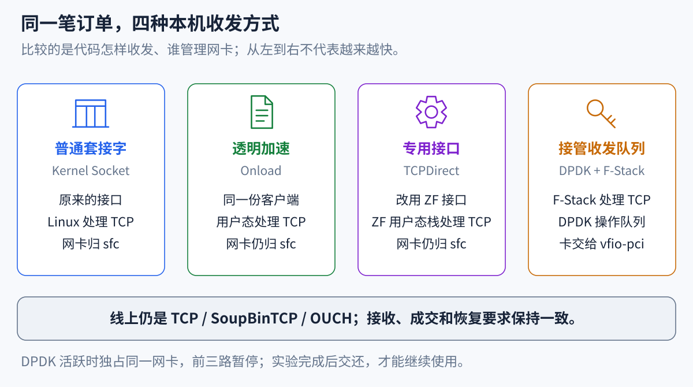

## 准备 A：找到代码与程序

<div style="border:2px solid #4f46e5;background:#eef2ff;padding:10px 12px;border-radius:8px;margin:14px 0;"><strong>导航卡 · 准备测试</strong><p>本步知识：对上源码与实际运行的程序　位置：全章第 1 / 8 项 · 本组第 1 / 2 项</p><span style="display:inline-block;margin:3px;padding:4px 10px;border-radius:6px;background:#15803d;color:white;">准备 A：找到代码与程序</span><span style="display:inline-block;margin:3px;padding:4px 10px;border-radius:6px;background:#f8fafc;color:#312e81;">准备 B：切换测试配置</span></div>

<div style="border-left:6px solid #7e22ce;background:#f3e8ff;padding:12px 16px;border-radius:8px;margin:14px 0;"><strong style="color:#581c87;">仅供展示 · 代码与程序的位置</strong>　先看源码在哪里，再沿两条分支看编译和部署。第二章备齐程序，本章启用测试客户端。</div>

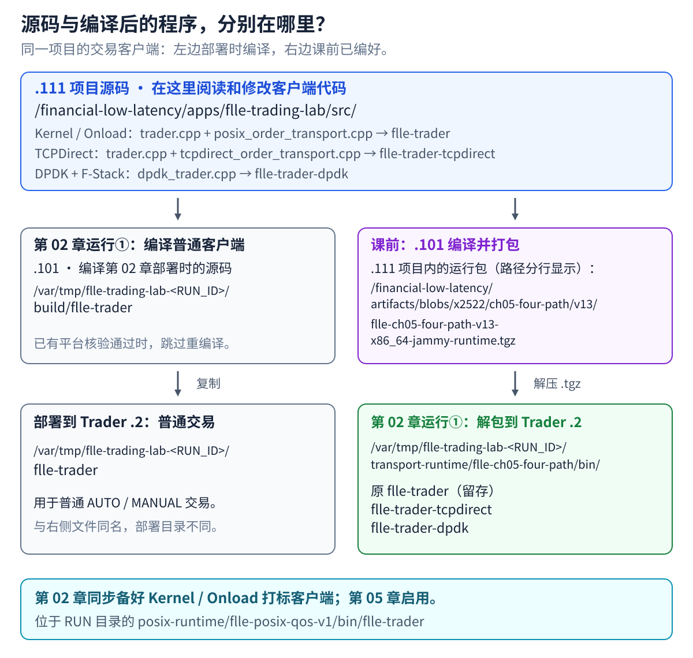

本步核对运行包、行情文件和测试条件。**测试程序已在第二章上线时备好，准备 B 只切换运行配置。**

<div style="border-left:6px solid #15803d;background:#dcfce7;padding:12px 16px;border-radius:8px;margin:14px 0;"><strong style="color:#14532d;">需要运行 · 准备 A</strong>　在 .111 执行；全部检查通过后继续准备 B。</div>

```bash
cd /qyt-fll
bash assets/05-kernel-bypass/02-four-path-preflight.sh
```

<div style="border-left:6px solid #7e22ce;background:#f3e8ff;padding:12px 16px;border-radius:8px;margin:14px 0;"><strong style="color:#581c87;">仅供展示 · 输出摘录</strong>　以下保留原有检查读数；第一项说明按更新后的脚本整理，完整记录由脚本保存。</div>

```text
准备 A：检查程序、行情与比较条件
[1/6] 运行包完整：PASS  # 封存包与 Socket / Onload 更新包均通过校验。
[2/6] 源码与程序对应：PASS  # 包内程序有对应的源码和编译记录。
[3/6] 行情可用：PASS  # AAPL,NVDA 的行情文件已就绪。
[4/6] 编译工具可用：PASS  # 10.1.1.101 有 g++-11，恢复普通客户端时可用。
[5/6] 收包配置符合要求：PASS  # Exchange .1 已固定到队列 1 / CPU 2。
[6/6] 比较条件已核对：PASS  # 四路统一要求 DEQUE_CV，由准备 B 启用。
```

## 准备 B：切换测试配置

<div style="border:2px solid #4f46e5;background:#eef2ff;padding:10px 12px;border-radius:8px;margin:14px 0;"><strong>导航卡 · 准备测试</strong><p>本步知识：让订单输入与客户端工作量可控　位置：全章第 2 / 8 项 · 本组第 2 / 2 项</p><span style="display:inline-block;margin:3px;padding:4px 10px;border-radius:6px;background:#f8fafc;color:#312e81;">准备 A：找到代码与程序</span><span style="display:inline-block;margin:3px;padding:4px 10px;border-radius:6px;background:#15803d;color:white;">准备 B：切换测试配置</span></div>

本章比较收发实现，先固定客户端承担的工作：

1. **停止会自动下单的 AUTO。** 测试订单由网页或脚本明确触发；SFC 就绪后改拉只建簿、不下单的 Guardian，网页五档继续更新。
2. **测试客户端不再解析 ITCH。** 四路比较客户端不自己加组、不更新盘口；共用接收器在 SFC 就绪后重新加入组播，把行情交给 Guardian 建簿。Exchange 仍回放并发布行情。
3. **固定订单队列和 CPU。** 四路使用 `DEQUE_CV`（deque、互斥锁与条件变量），按相同约定安排线程；后面会单独看各实现仍包含哪些执行步骤。

前三路启动后可以待命，每个采样窗口只向一种路径发测试订单。DPDK 使用这块网卡时，前三路暂停；交还后恢复。本步只切换配置，不下单。**客户端默认 DSCP 0；第六章才通过脚本启用打标，四路径比较仍使用默认值。**

<div style="border-left:6px solid #15803d;background:#dcfce7;padding:12px 16px;border-radius:8px;margin:14px 0;"><strong style="color:#14532d;">需要运行 · 准备 B</strong>　沿用第二章的平台，从 .111 启用已准备的测试客户端；核对 Exchange 和网页进程保持。</div>

```bash
cd /qyt-fll
bash assets/05-kernel-bypass/03-four-path-lab-ready.sh
```

<div style="border-left:6px solid #7e22ce;background:#f3e8ff;padding:12px 16px;border-radius:8px;margin:14px 0;"><strong style="color:#581c87;">仅供展示 · 实测输出摘录</strong>　节选终端结果的第 2～7 部分，保留原有分段和说明。</div>

```text
# 2. 切换结果
result=READY
# 前三路测试客户端已就绪。

# 3. 当前配置
profile=TRANSPORT
# 已停掉普通 AUTO / MANUAL，换上路径测试客户端。

# 4. 四路客户端
clients=Kernel Socket, Onload, TCPDirect ONLINE; DPDK WAITING
# 前三路在线；DPDK 等运行 ④ 再独占网卡。

# 5. 订单队列
queue_mode=DEQUE_CV
# 四路都用第 04 章的 deque + 互斥锁 + 条件变量。

# 6. Exchange 与网页
exchange_and_gui=UNCHANGED
# 进程身份和文件清单与切换前一致。

# 7. 订单打标
order_dscp=0
# Socket / Onload 默认不打标；第 06 章才临时设为 DSCP 46。

# 可以进入运行 ① 下单。
```

## 运行 ①：Kernel Socket 下单

<div style="border:2px solid #4f46e5;background:#eef2ff;padding:10px 12px;border-radius:8px;margin:14px 0;"><strong>导航卡 · 四种收发实现</strong><p>本步知识：从封装函数一路看到内核和网卡队列　位置：全章第 3 / 8 项 · 本组第 1 / 4 项</p><span style="display:inline-block;margin:3px;padding:4px 10px;border-radius:6px;background:#15803d;color:white;">运行 ①：Kernel Socket</span><span style="display:inline-block;margin:3px;padding:4px 10px;border-radius:6px;background:#f8fafc;color:#312e81;">运行 ②：Onload</span><span style="display:inline-block;margin:3px;padding:4px 10px;border-radius:6px;background:#f8fafc;color:#312e81;">运行 ③：TCPDirect</span><span style="display:inline-block;margin:3px;padding:4px 10px;border-radius:6px;background:#f8fafc;color:#312e81;">运行 ④：DPDK + F-Stack</span></div>

**代码核心：用 `socket` / `connect` 建连，用 `send` / `recv` 收发，TCP 由 Linux 内核处理。** 订单线程取单后按需建连，后续复用连接；`sfc` 驱动管理网卡队列。

<div style="border-left:6px solid #7e22ce;background:#f3e8ff;padding:12px 16px;border-radius:8px;margin:14px 0;"><strong style="color:#581c87;">仅供展示 · 关键图</strong>　蓝色从左向右看发送，绿色从右向左看回报；下方看没有数据时线程怎样继续。</div>

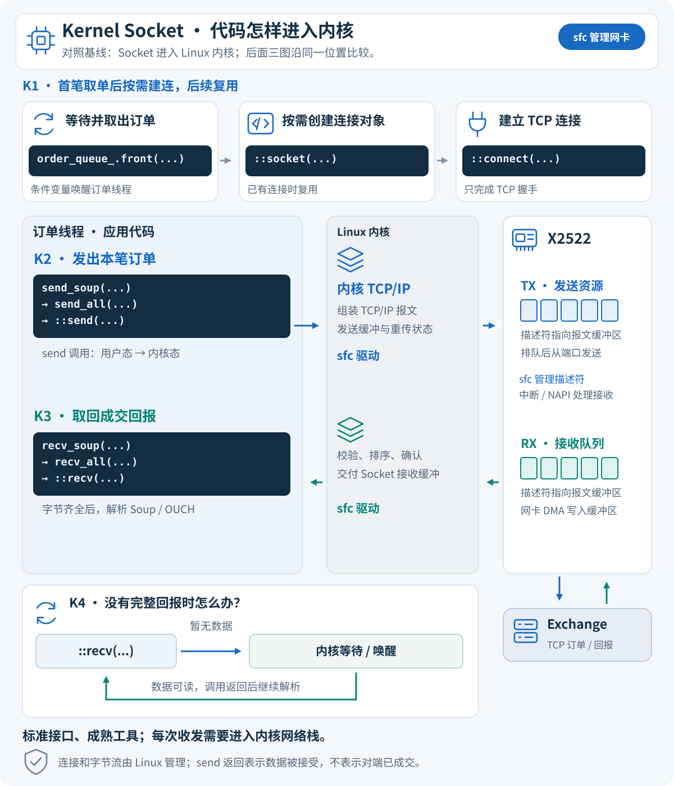

### 内核怎样把数据交给网卡

**发送时**，内核处理 TCP/IP，驱动准备发送描述符，告诉网卡待发送缓冲区在哪里。**接收时**，网卡把报文 DMA 到接收缓冲区，驱动和内核处理后把数据交给 Socket。订单线程此时正停在 `recv()` 上；数据到了，`recv()` 返回，线程继续解析回报。图中的队列格子表示描述符，不是一条格子就等于一笔订单。

Kernel Socket 的优点是接口通用、工具成熟。

<div class="source-location" style="border-left:6px solid #0284c7;background:#f0f9ff;padding:12px 16px;border-radius:8px;margin:14px 0;">
<strong style="color:#075985;">源码位置 · Kernel Socket</strong>
<p style="margin:8px 0;">用途：标准 Socket 建连、订单取队和收发。以下为匹配本章测试程序的源码阅读副本，路径均相对于项目根目录。</p>
<pre style="margin:0;padding:10px 12px;background:#fff;border:1px solid #bae6fd;border-radius:6px;white-space:pre-wrap;overflow-wrap:anywhere;"><code>assets/05-kernel-bypass/source-reading/trader.cpp
assets/05-kernel-bypass/source-reading/posix_order_transport.cpp
assets/05-kernel-bypass/source-reading/common.hpp
assets/05-kernel-bypass/source-reading/nasdaq_protocol.hpp
assets/05-kernel-bypass/source-reading/order_queue.hpp</code></pre>
</div>

### 按图读代码

图中五个动作合并为四组关键原码；不同文件的片段按调用关系排列，完整文件位置见上方源码卡。

<div style="border-left:6px solid #7e22ce;background:#f3e8ff;padding:12px 16px;border-radius:8px;margin:14px 0;"><strong style="color:#581c87;">仅供展示 · K1 · 等待订单</strong>　<strong style="color:#075985;">摘自 trader.cpp</strong> 的订单循环；省略空闲时的控制指令处理。</div>

```cpp
      WorkOrder work;
      if (!order_queue_.front(work, g_stop)) {
        // ……省略空闲时处理打标控制指令……
        continue;
      }
```

`front` 等待并取出队首订单；本章使用条件变量等待。首笔取单后按需建连，后续复用连接。

<div style="border-left:6px solid #7e22ce;background:#f3e8ff;padding:12px 16px;border-radius:8px;margin:14px 0;"><strong style="color:#581c87;">仅供展示 · K1 · 创建 Socket 与建立连接</strong>　<strong style="color:#075985;">摘自 posix_order_transport.cpp</strong>；省略函数头、地址结构与 Socket 选项配置。</div>

```cpp
    fd_ = ::socket(AF_INET, SOCK_STREAM, 0);
    if (fd_ < 0) return false;

    // ……省略地址结构与 Socket 选项配置……

    if (::inet_pton(AF_INET, local_ip.c_str(), &local.sin_addr) != 1 ||
        ::inet_pton(AF_INET, remote_ip.c_str(), &remote.sin_addr) != 1 ||
        ::bind(fd_, reinterpret_cast<sockaddr *>(&local), sizeof(local)) < 0 ||
        ::connect(fd_, reinterpret_cast<sockaddr *>(&remote), sizeof(remote)) < 0) {
      close();
      return false;
    }
```

`socket` 创建 TCP Socket，`bind` 选定本机数据口地址，`connect` 向 Exchange 建立连接；成功后再完成 Soup 登录。

<div style="border-left:6px solid #7e22ce;background:#f3e8ff;padding:12px 16px;border-radius:8px;margin:14px 0;"><strong style="color:#581c87;">仅供展示 · K2 · 发送订单</strong>　<strong style="color:#075985;">依次摘自 trader.cpp、nasdaq_protocol.hpp、common.hpp</strong>；对应 send_soup → send_all → send。</div>

```cpp
// trader.cpp：发出订单消息
    if (!nasdaq::send_soup(transport, 'U', encoded.data(), encoded.size()))
      return false;

// nasdaq_protocol.hpp：已加好长度与消息类型，交给收发对象
  return stream.send_all(packet.data(), packet.size());

// common.hpp：send_all 循环中的实际发送
    const auto sent = ::send(fd, cursor, length, MSG_NOSIGNAL);
```

`send_soup` 加上消息边界，`send_all` 循环调用 `send` 提交全部字节；成交仍需等待回报。

<div style="border-left:6px solid #7e22ce;background:#f3e8ff;padding:12px 16px;border-radius:8px;margin:14px 0;"><strong style="color:#581c87;">仅供展示 · K3 / K4 · 接收回报</strong>　<strong style="color:#075985;">依次摘自 trader.cpp、nasdaq_protocol.hpp、common.hpp</strong>；对应 recv_soup → recv_all → recv。</div>

```cpp
// trader.cpp：接收一条回报
      if (!nasdaq::recv_soup(transport, type, payload)) return false;

// nasdaq_protocol.hpp：已读长度前缀，按该长度读取消息体
  if (!stream.recv_all(body.data(), body.size())) return false;

// common.hpp：recv_all 循环中的实际接收
    const auto received = ::recv(fd, cursor, length, 0);
```

`recv_soup` 按消息长度读取，`recv_all` 循环收齐字节。阻塞式 `recv` 暂时无数据时等待，收到数据后继续；回报交给 OUCH 解码。

<div style="border-left:6px solid #15803d;background:#dcfce7;padding:12px 16px;border-radius:8px;margin:14px 0;"><strong style="color:#14532d;">需要运行 · 运行 ①</strong>　发送一笔 AAPL 1 股可成交订单，检查内核连接与成交回报。</div>

```bash
cd /qyt-fll
bash assets/05-kernel-bypass/04-socket-real-order.sh
```

<div style="border-left:6px solid #7e22ce;background:#f3e8ff;padding:12px 16px;border-radius:8px;margin:14px 0;"><strong style="color:#581c87;">仅供展示 · 实测结果</strong>　按当前脚本格式整理已有实测记录，订单编号与延迟读数保持原值。</div>

```text
===== 运行 ① · Kernel Socket 单笔验证 =====
[1/3 成交结果]
result=ORDER_EXECUTED  # Exchange 已确认成交
client_order_id=2102000000  # 按此编号查询本笔订单

[2/3 实际收发路径]
engine=KERNEL_SOCKET  # Linux 内核 Socket 收发

[3/3 订单往返耗时]
order_rtt_ns=53871  # 53.871 µs（微秒）
计时范围：调用发送前 → 最终成交回报解码完成；1000 ns = 1 µs。

[结论] 本笔成交与实际路径检查通过。
scope=单笔路径验证；四路快慢看运行 ⑤ 的批量比较
```

## 运行 ②：Onload 下单

<div style="border:2px solid #4f46e5;background:#eef2ff;padding:10px 12px;border-radius:8px;margin:14px 0;"><strong>导航卡 · 四种收发实现</strong><p>本步知识：同一份代码如何改走用户态协议栈　位置：全章第 4 / 8 项 · 本组第 2 / 4 项</p><span style="display:inline-block;margin:3px;padding:4px 10px;border-radius:6px;background:#f8fafc;color:#312e81;">运行 ①：Kernel Socket</span><span style="display:inline-block;margin:3px;padding:4px 10px;border-radius:6px;background:#15803d;color:white;">运行 ②：Onload</span><span style="display:inline-block;margin:3px;padding:4px 10px;border-radius:6px;background:#f8fafc;color:#312e81;">运行 ③：TCPDirect</span><span style="display:inline-block;margin:3px;padding:4px 10px;border-radius:6px;background:#f8fafc;color:#312e81;">运行 ④：DPDK + F-Stack</span></div>

**本节的 Socket 收发代码与 Kernel Socket 完全相同，使用同一个 `flle-trader`，无需改写或重新编译。重点是启动时加上 `onload`，让受支持的连接进入 Onload 用户态栈。**

<div style="border-left:6px solid #7e22ce;background:#f3e8ff;padding:12px 16px;border-radius:8px;margin:14px 0;"><strong style="color:#581c87;">仅供展示 · 关键图</strong>　应用调用 send 和 recv，Onload 库处理 TCP 并使用网卡收发资源。</div>

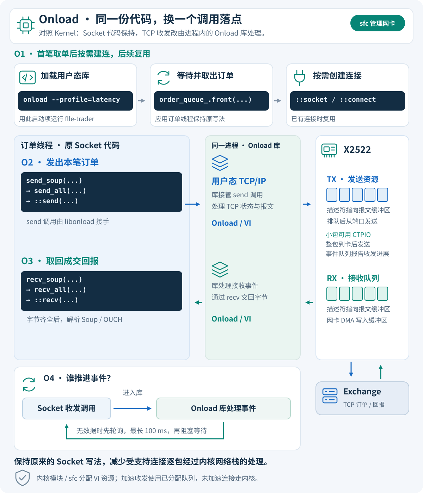

### 普通启动与 Onload 启动：程序前面加什么

两路在 Trader `.2` 上的启动形式如下。`posix_root` 是脚本核验后的 Socket／Onload 程序目录，两路使用同一个可执行文件。

<div style="border-left:6px solid #7e22ce;background:#f3e8ff;padding:12px 16px;border-radius:8px;margin:14px 0;"><strong style="color:#581c87;">仅供展示 · 两种启动方式</strong>　同一个可执行文件，下面只展示启动前缀；… 表示其余客户端参数。准备 B 已执行完整命令。</div>

```text
# 普通启动：标准 Socket 调用进入 Linux 内核
taskset -c 2,3 "$posix_root/bin/flle-trader" …

# Onload 启动：同一程序加载 Onload 用户态库
taskset -c 2,3 onload --profile=latency "$posix_root/bin/flle-trader" …
```

**Kernel Socket 与 Onload 使用相同的 CPU 亲和性设置。** `taskset` 是 Linux 的系统工具，来自 util-linux 工具集，用于查看或设置程序允许在哪些 CPU 上运行。`-c 2,3` 指定 `.2` 虚拟机中 Linux 识别的逻辑 CPU 2、3。

本课程序再通过启动参数，把两个线程分别固定到指定 CPU：

- **CPU 2：订单线程**，从队列取单，向 Exchange 发送订单并接收回报，对应 `--order-cpu 2`。
- **CPU 3：管理线程**，接收控制指令、响应状态查询，对应 `--management-cpu 3`。

这样把管理工作与订单收发分开，减少彼此的调度干扰。**指定运行位置不等于独占 CPU**：`taskset` 不会阻止其他程序使用 CPU 2、3，其他 CPU 也照常工作。

普通启动时，标准 Socket 库把 `socket`、`send`、`recv` 等调用交给内核。加上 **`onload`** 后，启动器利用 Linux 的 **`LD_PRELOAD`** 机制，在程序启动时优先加载 Onload 共享库。受支持的 Socket 调用由这套用户态库处理 TCP 与收发，不受支持的连接仍交给内核。业务代码继续使用原来的接口。[AMD 透明加速说明](https://docs.amd.com/r/en-US/ug1586-onload-user/Onload-Transparency)

### `--profile=latency`：选择怎样运行这套用户态栈

**profile 是一组预先整理好的 Onload 运行参数；`latency` 是随软件提供的低延迟配置。** `onload` 负责加载加速库，`--profile=latency` 负责给库设置参数；省略这个选项，仍可使用 Onload 的默认配置启动。

本课关注其中的 **`EF_POLL_USEC=100000`，即最长轮询 100 ms**：阻塞式收发暂时不能继续时，Onload 先持续检查网络事件；一旦条件满足就立即继续，只有轮询到上限仍无进展才进入阻塞。这减少了睡眠和唤醒的开销，代价是轮询期间占用 CPU。它是等待策略的上限，不是每笔订单固定等待 100 ms。[AMD 配置说明](https://docs.amd.com/r/en-US/ug1586-onload-user/Using-Onload-Tuning-Profiles)

### 本课怎样切到 Onload

**加速库在进程启动时加载。** 原来直接运行的程序，需要改用 `onload` 重新启动；本课准备 B 已经分别启动普通客户端和 Onload 客户端。运行 ② 把订单交给已启动的 Onload 客户端，并检查目标连接为 `Onloaded(Valid)`，确认订单实际走了加速路径。

### VI 与 CTPIO：代码怎样使用网卡资源

应用已经把字节交给 Onload，库接下来需要一条能够使用网卡的通道。**VI（Virtual Interface，虚拟接口）就是分配给这套用户态栈的一组收发资源**：发送队列、接收队列和事件队列等。可以把它理解为实体网卡上供这套栈使用的收发窗口；`sfc` 与配套内核模块负责分配和映射，Onload 库使用这些资源。[AMD VI / VNIC 说明](https://docs.amd.com/r/en-US/ug1586-onload-user/Virtual-Network-Interface-VNIC)

**CTPIO（Cut Through Programmed I/O）由 CPU 经 PCIe 把报文推给网卡，减少小包发送时等待网卡 DMA 取包的延迟；代价是 CPU 要承担数据搬运。** 下图对比这两种搬运方式。[AMD CTPIO 说明](https://docs.amd.com/r/en-US/ug1586-onload-user/CTPIO)

<div style="border-left:6px solid #7e22ce;background:#f3e8ff;padding:12px 16px;border-radius:8px;margin:14px 0;"><strong style="color:#581c87;">仅供展示 · VI 资源与两种发送方式</strong>　上方看应用、Onload 与 VI 的关系；中间对比谁搬运报文；下方回到本课代码。</div>

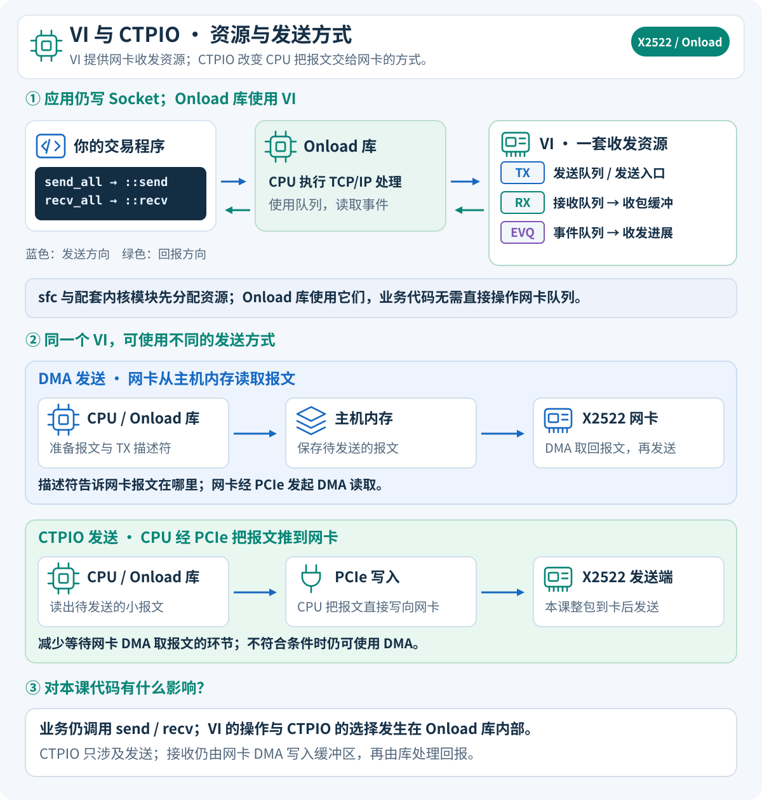

**这次测量中，Onload 的发送几乎都用了 CTPIO。** 四个测量窗口共完成发送 4404 个报文，其中 4396 个使用 CTPIO，占 **99.8%**。这是目标 Onload 栈的报文计数，不是订单数。

- **普通 DMA 发送**：CPU 准备好报文，网卡经 PCIe 从主机内存取走，再发到网络。
- **CTPIO 发送**：CPU 读取主机内存中已准备的报文，经 PCIe 推给网卡；本课整包到卡后再发到网络。[AMD 发送方式说明](https://docs.amd.com/r/en-US/ug1586-onload-user/CTPIO-Modes)
- **接收**：网卡把收到的报文 DMA 到主机内存，协议栈处理后交给程序。

**由 Onload 自动选择，应用继续调用 `send`。** 本课 X2522 上，要满足 CTPIO 已启用且资源可用、帧长在限制内、VI 发送队列为空；否则库使用其他发送方式。因此，99.8% 是本次测量结果，不代表任何负载下都走 CTPIO。[AMD 使用条件](https://docs.amd.com/r/en-US/ug1586-onload-user/EF_CTPIO)

本课 Kernel Socket 的 X2522 内核发送路径不使用 CTPIO。

<div style="border-left:6px solid #15803d;background:#dcfce7;padding:12px 16px;border-radius:8px;margin:14px 0;"><strong style="color:#14532d;">需要运行 · 运行 ②</strong>　下一笔订单，同时检查目标连接为 Onloaded(Valid) 及实际发送记录。</div>

```bash
cd /qyt-fll
bash assets/05-kernel-bypass/05-onload-real-order.sh
```

<div style="border-left:6px solid #7e22ce;background:#f3e8ff;padding:12px 16px;border-radius:8px;margin:14px 0;"><strong style="color:#581c87;">仅供展示 · 实测结果</strong>　按当前脚本格式整理已有实测记录，订单编号与延迟读数保持原值。</div>

```text
===== 运行 ② · Onload 单笔验证 =====
[1/3 成交结果]
result=ORDER_EXECUTED  # Exchange 已确认成交
client_order_id=2502000000  # 按此编号查询本笔订单

[2/3 实际收发路径]
engine=ONLOAD_USER_STACK  # Onload 用户态 TCP 栈收发

[3/3 订单往返耗时]
order_rtt_ns=36595  # 36.595 µs（微秒）
计时范围：调用发送前 → 最终成交回报解码完成；1000 ns = 1 µs。

[结论] 本笔成交与实际路径检查通过。
scope=单笔路径验证；四路快慢看运行 ⑤ 的批量比较
```

## 运行 ③：TCPDirect 下单

<div style="border:2px solid #4f46e5;background:#eef2ff;padding:10px 12px;border-radius:8px;margin:14px 0;"><strong>导航卡 · 四种收发实现</strong><p>本步知识：显式调用 ZF 并主动推进事件　位置：全章第 5 / 8 项 · 本组第 3 / 4 项</p><span style="display:inline-block;margin:3px;padding:4px 10px;border-radius:6px;background:#f8fafc;color:#312e81;">运行 ①：Kernel Socket</span><span style="display:inline-block;margin:3px;padding:4px 10px;border-radius:6px;background:#f8fafc;color:#312e81;">运行 ②：Onload</span><span style="display:inline-block;margin:3px;padding:4px 10px;border-radius:6px;background:#15803d;color:white;">运行 ③：TCPDirect</span><span style="display:inline-block;margin:3px;padding:4px 10px;border-radius:6px;background:#f8fafc;color:#312e81;">运行 ④：DPDK + F-Stack</span></div>

**代码核心：用 ZF 接口收发，并反复调用 `zf_reactor_perform` 处理网络事件。** TCPDirect 的 ZF 库自带用户态 TCP/IP 栈，在交易程序进程中由主机 CPU 执行。连接对象称为 zocket，事件处理入口称为 reactor；接收时从栈借用缓冲区，用完后归还。[AMD TCPDirect 说明](https://docs.amd.com/api/khub/documents/wZFl_G52K9zsCX9vbVq~IA/content)

<div style="border-left:6px solid #7e22ce;background:#f3e8ff;padding:12px 16px;border-radius:8px;margin:14px 0;"><strong style="color:#581c87;">仅供展示 · 关键图</strong>　重点看 Z4 的循环：发送或接收暂时不能继续时，应用处理事件，再回来尝试。</div>

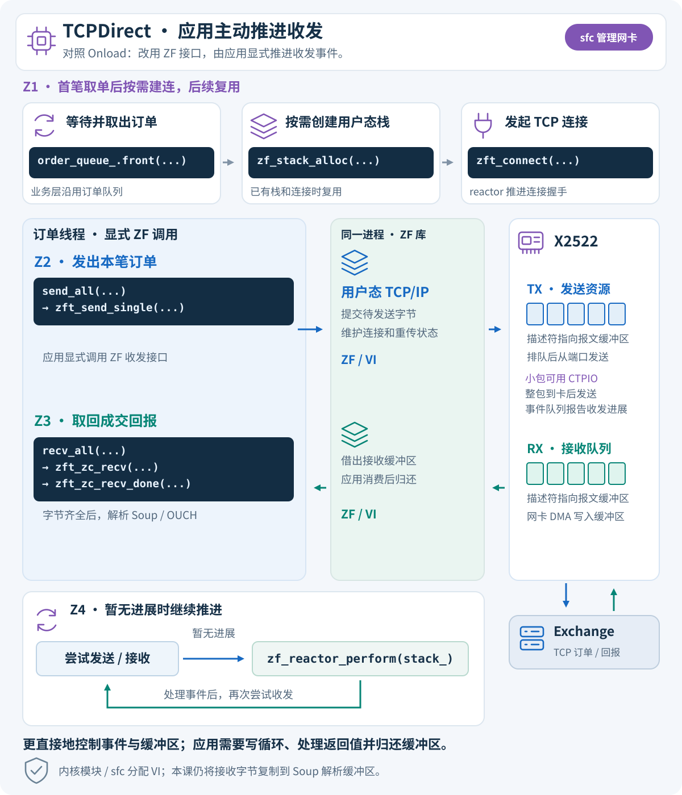

<div class="source-location" style="border-left:6px solid #0284c7;background:#f0f9ff;padding:12px 16px;border-radius:8px;margin:14px 0;">
<strong style="color:#075985;">源码位置 · TCPDirect</strong>
<p style="margin:8px 0;">用途：创建 ZF 栈、建立连接、处理发送与接收事件。下列源码阅读副本路径相对于项目根目录。</p>
<pre style="margin:0;padding:10px 12px;background:#fff;border:1px solid #bae6fd;border-radius:6px;white-space:pre-wrap;overflow-wrap:anywhere;"><code>assets/05-kernel-bypass/source-reading/tcpdirect_order_transport.cpp</code></pre>
</div>

### 代码怎样主动推进连接和收发

| 图中位置 | 关键调用 | 执行含义 |
|---|---|---|
| Z1 | `zf_stack_alloc`、`zft_connect` | 分配用户态栈，发起 TCP 连接；握手期间持续推进 reactor |
| Z2 | `zft_send_single` | 尝试提交字节；只接受了一部分就继续处理剩余部分 |
| Z3 | `zft_zc_recv`、`zft_zc_recv_done` | 取得栈借出的接收缓冲区，用完后归还；部分消费使用对应的归还接口 |
| Z4 | `zf_reactor_perform` | 处理网络事件，使连接、接收和待完成发送继续前进 |

<div style="border-left:6px solid #7e22ce;background:#f3e8ff;padding:12px 16px;border-radius:8px;margin:14px 0;"><strong style="color:#581c87;">仅供展示 · Z2 / Z4 · 原始发送循环</strong>　<strong style="color:#075985;">摘自 tcpdirect_order_transport.cpp</strong>。zft_send_single 提交字节；暂时不能发送时，调用 zf_reactor_perform 处理事件后重试。</div>

```cpp
  bool send_all(const void *data, std::size_t length) override {
    auto *cursor = static_cast<const std::uint8_t *>(data);
    std::size_t sent = 0;
    while (zocket_ && sent < length) {
      const auto result = zft_send_single(zocket_, cursor + sent,
                                          length - sent, 0);
      if (result > 0) {
        sent += static_cast<std::size_t>(result);
        continue;
      }
      if (result != -EAGAIN && result != -ENOMEM) return false;
      zf_reactor_perform(stack_);
    }
    return sent == length;
  }
```

`sent` 记录已经提交的字节；暂时缺少发送空间或资源时，`zf_reactor_perform` 推进网络事件，然后回到循环。真正错误仍返回失败。

<div style="border-left:6px solid #7e22ce;background:#f3e8ff;padding:12px 16px;border-radius:8px;margin:14px 0;"><strong style="color:#581c87;">仅供展示 · Z3 · 取得与归还接收缓冲区</strong>　<strong style="color:#075985;">摘自 tcpdirect_order_transport.cpp</strong> 的 recv_all()；省略号之间是复制已收字节的处理。</div>

```cpp
      message.msg.iovcnt = static_cast<int>(std::size(message.iov));
      zft_zc_recv(zocket_, &message.msg, 0);
      if (message.msg.iovcnt == 0) {
        if (zf_reactor_perform(stack_) < 0) return false;
        continue;
      }

// ……省略中间的字节统计与复制代码……

      const int status = consume == available
                             ? zft_zc_recv_done(zocket_, &message.msg)
                             : zft_zc_recv_done_some(zocket_, &message.msg,
                                                     consume);
      received += consume;
      if (status <= 0 && received < length) return false;
```

`send_all` / `recv_all` 保留业务层接口，内部换成 ZF 调用：暂时无进展时推进 reactor 后重试，真正错误才退出。[ZF 栈与事件接口](https://github.com/Xilinx-CNS/tcpdirect/blob/master/src/include/zf/zf_stack.h)

### 更直接的控制，也需要应用管理进展

程序能直接决定何时推进网络事件、何时读取和释放缓冲区，减少通用 Socket 路径的间接处理。持续轮询也会占用 CPU，需要为事件循环安排执行资源。

**本课 TCPDirect 也使用 CTPIO，由 CPU 经 PCIe 把报文推给网卡，减少网卡 DMA 取包的等待。** 接收回报仍由网卡 DMA 写入内存；客户端使用接收缓冲区后，还会复制到 Soup 解析缓冲区，因此整个业务流程并非端到端零拷贝。

<div style="border-left:6px solid #15803d;background:#dcfce7;padding:12px 16px;border-radius:8px;margin:14px 0;"><strong style="color:#14532d;">需要运行 · 运行 ③</strong>　下一笔订单，核对 ZF 连接、发送队列计数与成交。</div>

```bash
cd /qyt-fll
bash assets/05-kernel-bypass/06-tcpdirect-real-order.sh
```

<div style="border-left:6px solid #7e22ce;background:#f3e8ff;padding:12px 16px;border-radius:8px;margin:14px 0;"><strong style="color:#581c87;">仅供展示 · 实测结果</strong>　按当前脚本格式整理已有实测记录，订单编号与延迟读数保持原值。</div>

```text
===== 运行 ③ · TCPDirect 单笔验证 =====
[1/3 成交结果]
result=ORDER_EXECUTED  # Exchange 已确认成交
client_order_id=2902000000  # 按此编号查询本笔订单

[2/3 实际收发路径]
engine=ZF_REACTOR_POLL  # TCPDirect 的 ZF 事件循环处理收发

[3/3 订单往返耗时]
order_rtt_ns=36783  # 36.783 µs（微秒）
计时范围：调用发送前 → 最终成交回报解码完成；1000 ns = 1 µs。

[结论] 本笔成交与实际路径检查通过。
scope=单笔路径验证；四路快慢看运行 ⑤ 的批量比较
```

## 运行 ④：DPDK + F-Stack 下单

<div style="border:2px solid #4f46e5;background:#eef2ff;padding:10px 12px;border-radius:8px;margin:14px 0;"><strong>导航卡 · 四种收发实现</strong><p>本步知识：看清线程交接、用户态 TCP 与 PMD 的分工　位置：全章第 6 / 8 项 · 本组第 4 / 4 项</p><span style="display:inline-block;margin:3px;padding:4px 10px;border-radius:6px;background:#f8fafc;color:#312e81;">运行 ①：Kernel Socket</span><span style="display:inline-block;margin:3px;padding:4px 10px;border-radius:6px;background:#f8fafc;color:#312e81;">运行 ②：Onload</span><span style="display:inline-block;margin:3px;padding:4px 10px;border-radius:6px;background:#f8fafc;color:#312e81;">运行 ③：TCPDirect</span><span style="display:inline-block;margin:3px;padding:4px 10px;border-radius:6px;background:#15803d;color:white;">运行 ④：DPDK + F-Stack</span></div>

**代码核心：在 `ff_run` 反复调用的业务函数中，用 `ff_send` / `ff_recv` 收发。** F-Stack 处理 TCP，DPDK 的 `net_sfc_efx` PMD 驱动 X2522 网卡队列；本课通过线程交接，把订单交给轮询线程执行。

### 先把网卡交给这套程序

第 02 章已启用 IOMMU。本步把 `.2` 的 X2522 从 `sfc` 交给 `vfio-pci`：VFIO 提供设备访问与 DMA 映射接口，IOMMU 限定设备可以读写的内存。下面的图只回顾已有条件与此次接管的关系。

<div style="border-left:6px solid #7e22ce;background:#f3e8ff;padding:12px 16px;border-radius:8px;margin:14px 0;"><strong style="color:#581c87;">仅供展示 · 关键图</strong>　上半部分已在第二章完成；本步重点看下半部分设备接管后的访问范围。</div>

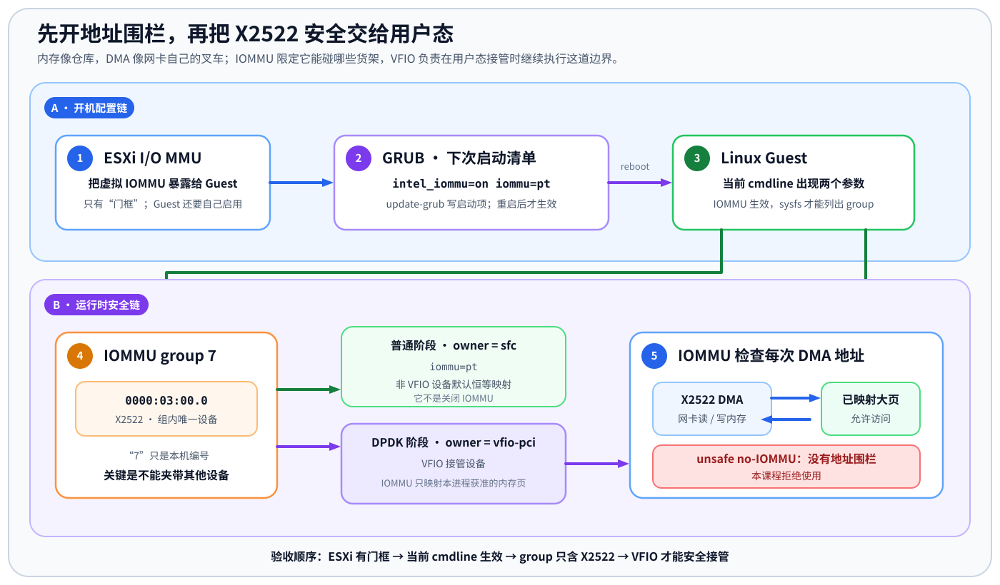

切换时前三路客户端暂停，数据口离开 Linux 普通网口管理，F-Stack 使用配置中的数据地址。管理连接仍走独立的管理网口。绑定、启动和恢复时间不计入订单 RTT。

### 订单怎样进入轮询线程，再到网卡

<div style="border-left:6px solid #7e22ce;background:#f3e8ff;padding:12px 16px;border-radius:8px;margin:14px 0;"><strong style="color:#581c87;">仅供展示 · 关键图</strong>　先看 D4 的交接，再看 D2 / D3 的收发；ff_run 在轮询线程中持续推进网络与业务回调。</div>

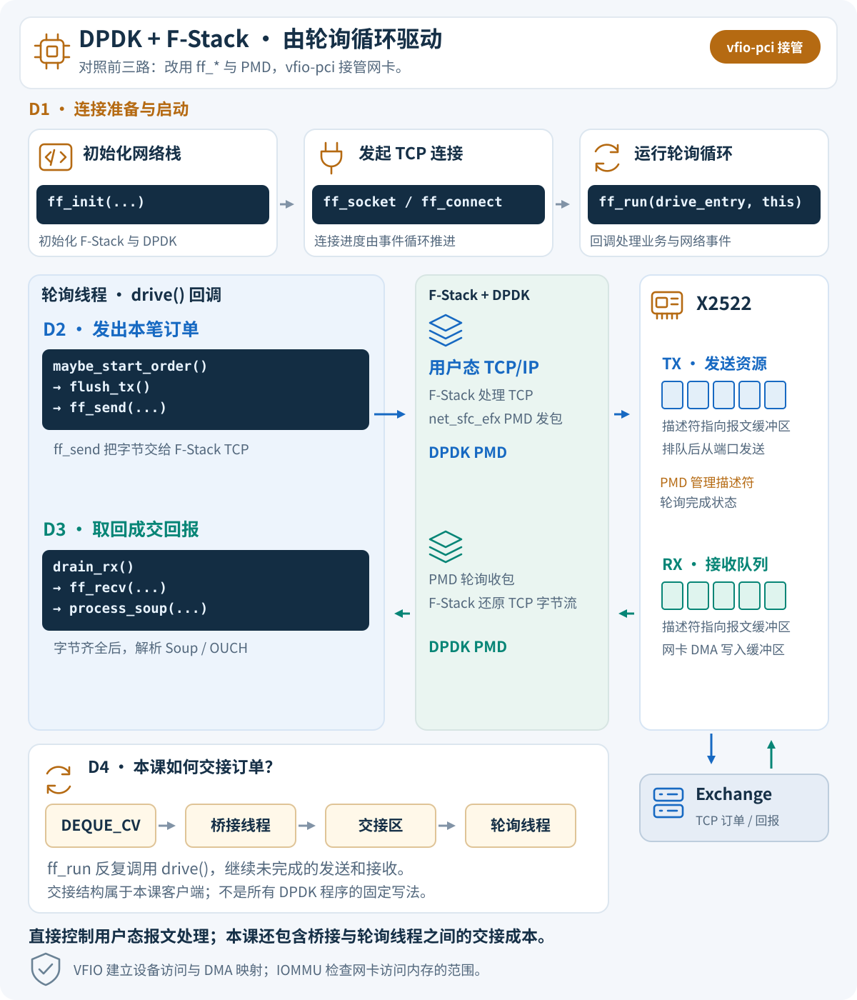

<div class="source-location" style="border-left:6px solid #0284c7;background:#f0f9ff;padding:12px 16px;border-radius:8px;margin:14px 0;">
<strong style="color:#075985;">源码位置 · DPDK + F-Stack</strong>
<p style="margin:8px 0;">用途：初始化 F-Stack、交接订单，并在轮询回调中收发。下列源码阅读副本路径相对于项目根目录。</p>
<pre style="margin:0;padding:10px 12px;background:#fff;border:1px solid #bae6fd;border-radius:6px;white-space:pre-wrap;overflow-wrap:anywhere;"><code>assets/05-kernel-bypass/source-reading/dpdk_trader.cpp</code></pre>
</div>

| 图中位置 | 关键代码 | 工作过程 |
|---|---|---|
| D1 | `ff_init`、`ff_socket`、`ff_connect`、`ff_run` | 初始化栈和设备资源，创建连接，进入持续执行的事件循环 |
| D2 | `maybe_start_order`、`flush_tx`、`ff_send` | 从交接区取得订单，准备字节，推进未完成的发送 |
| D3 | `drain_rx`、`ff_recv`、`process_soup` | 读取可用字节，积累完整消息，再解析回报 |
| D4 | `bridge_loop` 与交接区 | 桥接线程从 `DEQUE_CV` 取单；轮询线程接手实际网络操作 |

`ff_run` 驱动 F-Stack 的处理循环，反复调用本课 `drive_entry → drive()`；在这个执行上下文里，客户端检查连接、收取回报、取得订单并推进发送。

<div style="border-left:6px solid #7e22ce;background:#f3e8ff;padding:12px 16px;border-radius:8px;margin:14px 0;"><strong style="color:#581c87;">仅供展示 · D2 / D3 · 回调中安排收发</strong>　<strong style="color:#075985;">摘自 dpdk_trader.cpp</strong> 的 drive() 尾部；ff_run 会反复调用这个函数。</div>

```cpp
    if (session_state_ != SessionState::Connecting) drain_rx();
    maybe_start_order();
    flush_tx();
    return 0;
```

<div style="border-left:6px solid #7e22ce;background:#f3e8ff;padding:12px 16px;border-radius:8px;margin:14px 0;"><strong style="color:#581c87;">仅供展示 · D2 · 原始发送函数</strong>　<strong style="color:#075985;">摘自 dpdk_trader.cpp</strong> 的 flush_tx()。遇到 EAGAIN 就返回，把执行机会交回外层轮询循环。</div>

```cpp
  void flush_tx() {
    if (tx_buffer_.empty()) return;
    while (tx_offset_ < tx_buffer_.size()) {
      const auto sent = ff_send(order_fd_, tx_buffer_.data() + tx_offset_,
                                tx_buffer_.size() - tx_offset_, 0);
      if (sent > 0) {
        tx_offset_ += static_cast<std::size_t>(sent);
        continue;
      }
      if (sent < 0 && errno == EAGAIN) return;
      fail("SOUP_SEND");
      return;
    }
    tx_buffer_.clear();
    tx_offset_ = 0;
  }
```

`tx_offset_` 记录已经发送的位置。`ff_send` 暂时不能发送时，函数返回 `ff_run` 的外层循环，下次回调从这个位置继续；接收也保留尚未凑成完整消息的字节。这样轮询线程不会为了等待一笔订单而停止处理网络事件。[F-Stack 接口](https://github.com/F-Stack/f-stack/blob/dev/lib/ff_api.h)

### PMD 怎样控制网卡队列

**PMD（Poll Mode Driver，轮询模式驱动）是在主机 CPU 上运行的用户态网卡驱动。F-Stack 负责 TCP，PMD 负责操作网卡队列。** 本课使用支持 X2522 的 `net_sfc_efx`。[DPDK PMD 说明](https://doc.dpdk.org/guides-21.11/prog_guide/poll_mode_drv.html)

<div style="border-left:6px solid #7e22ce;background:#f3e8ff;padding:12px 16px;border-radius:8px;margin:14px 0;"><strong style="color:#581c87;">仅供展示 · PMD 的收发分工</strong>　上排看发送，下排看接收；箭头表示处理先后，报文由网卡 DMA 搬运。</div>

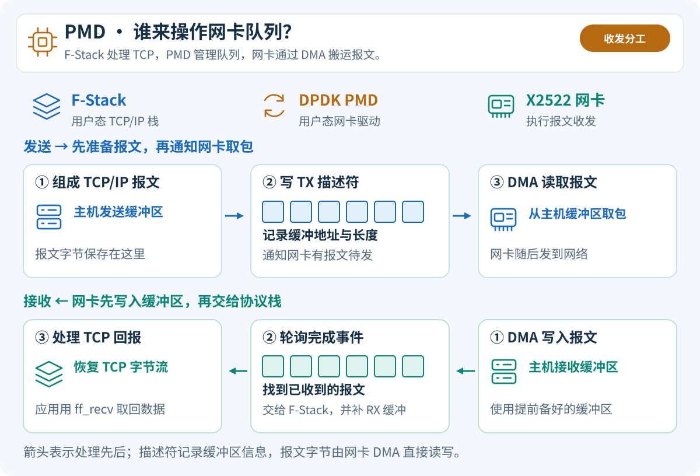

发送时，PMD 把缓冲区地址和长度等信息写进 **TX 描述符**，通知网卡取包；接收时，先备好 **RX 缓冲区**，网卡写入报文后，PMD 轮询完成事件，把收到的报文交给 F-Stack，并补充可用缓冲区。

**本课 DPDK + F-Stack 的发送路径不使用 CTPIO：PMD 提交描述符，网卡通过 DMA 从主机内存取包。** PMD 是管理队列的驱动，实际搬运报文的是网卡。[本课版本的 PMD 发送实现](https://github.com/DPDK/dpdk-stable/blob/v21.11.9/drivers/net/sfc/sfc_ef10_tx.c)

<div style="border-left:6px solid #dc2626;background:#fee2e2;padding:12px 16px;border-radius:8px;margin:14px 0;"><strong style="color:#7f1d1d;">切换与恢复</strong>　脚本自动切到 DPDK、下一笔订单，再交回 sfc；异常也先恢复，恢复未完成以 125 退出并停止后续操作。</div>

<div style="border-left:6px solid #15803d;background:#dcfce7;padding:12px 16px;border-radius:8px;margin:14px 0;"><strong style="color:#14532d;">需要运行 · 运行 ④</strong>　使用 F-Stack / DPDK 完成交易，检查实际 PMD 与最终 SFC 恢复状态。</div>

```bash
cd /qyt-fll
bash assets/05-kernel-bypass/07-dpdk-real-order.sh
```

<div style="border-left:6px solid #7e22ce;background:#f3e8ff;padding:12px 16px;border-radius:8px;margin:14px 0;"><strong style="color:#581c87;">仅供展示 · 实测结果</strong>　按当前脚本格式整理已有实测记录，订单编号与延迟读数保持原值。</div>

```text
===== 运行 ④ · DPDK + F-Stack 单笔验证 =====
[1/3 成交结果]
result=ORDER_EXECUTED  # Exchange 已确认成交
client_order_id=3900000000  # 按此编号查询本笔订单

[2/3 实际收发路径]
engine=FSTACK_POLL  # F-Stack 处理 TCP，DPDK 轮询网卡收发

[3/3 订单往返耗时]
order_rtt_ns=105083  # 105.083 µs（微秒）
计时范围：调用发送前 → 最终成交回报解码完成；1000 ns = 1 µs。

[结论] 本笔成交与实际路径检查通过。
scope=单笔路径验证；四路快慢看运行 ⑤ 的批量比较
restored=SFC/READY/sfc  # 网卡已交还 sfc，前三路恢复可用
```

## 统一测试前：三段时间分别回答什么

前面四次单笔操作主要确认成交和实际路径。现在集中看计时边界：客户端记录入队、发送起点和最终回报处理完成三个时刻。

<div style="border-left:6px solid #7e22ce;background:#f3e8ff;padding:12px 16px;border-radius:8px;margin:14px 0;"><strong style="color:#581c87;">仅供展示 · 关键图</strong>　发送起点由客户端代码记录，不是网卡硬件发包时间戳。</div>

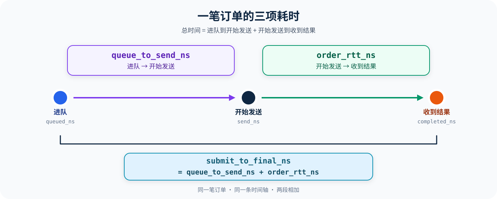

| 指标 | 范围 | 用来回答什么 |
|---|---|---|
| `queue_to_send_ns` | 入队 → 进入发送逻辑 | 排队、唤醒、准备和线程交接花了多久 |
| `order_rtt_ns` | 发送起点 → 最终回报解码完成 | 本机收发、网络和 Exchange 处理的往返耗时 |
| `submit_to_final_ns` | 入队 → 最终回报解码完成 | 一笔订单从客户端入队开始的整体耗时 |

三项都有实际采集。对同一笔订单，前两段相加等于整体；统计时三段分别计算，不能把两个 P50 相减当成另一段的 P50。连接准备不属于订单 RTT；正式测试先完成连接和预热。原始值存为 ns，课堂表显示 µs，1000 ns = 1 µs。

## 运行 ⑤：统一比较四条路径

<div style="border:2px solid #4f46e5;background:#eef2ff;padding:10px 12px;border-radius:8px;margin:14px 0;"><strong>导航卡 · 统一测试与恢复</strong><p>本步知识：相同条件采样，分别比较往返与发送前成本　位置：全章第 7 / 8 项 · 本组第 1 / 2 项</p><span style="display:inline-block;margin:3px;padding:4px 10px;border-radius:6px;background:#15803d;color:white;">运行 ⑤：统一比较</span><span style="display:inline-block;margin:3px;padding:4px 10px;border-radius:6px;background:#f8fafc;color:#312e81;">实验收尾：恢复控制台</span></div>

固定订单、应用队列、CPU、对端和采样方式。每轮让四条路径各测一次，并轮换先后顺序；共四轮、16 个测试单元，每单元先预热 100 笔，再采集 1000 笔正式订单。**准备 B 已关闭客户端行情处理；这里在采样窗口内进一步暂停 Exchange 的行情回放，只向当前路径提交测试单，窗口结束后恢复回放。**

下面保留更新前 v13 的实测数值；新客户端的比较结果以重新运行的输出为准。

<div style="border-left:6px solid #7e22ce;background:#f3e8ff;padding:12px 16px;border-radius:8px;margin:14px 0;"><strong style="color:#581c87;">仅供展示 · 关键图</strong>　既核对样本和成交总数，也核对每个测试单元的真实路径。</div>

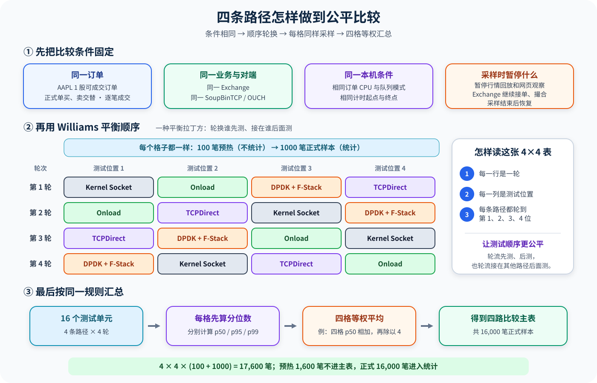

把发送前、订单往返与整体耗时放在同一张表，每种路径只占一行。先对每个测试单元求分位数，再将同一路径四个单元的对应统计量取平均。方法入口：[平衡顺序](https://www.jstatsoft.org/article/view/v029c01)、[第四章测量基础](04-low-latency-software-design.md#measurement-basics)。

<div style="border-left:6px solid #dc2626;background:#fee2e2;padding:12px 16px;border-radius:8px;margin:14px 0;"><strong style="color:#7f1d1d;">切换与恢复</strong>　测试会自动切换网卡归属；发生错误时先恢复 SFC。恢复失败以 125 退出，停止后续测量。</div>

<div style="border-left:6px solid #15803d;background:#dcfce7;padding:12px 16px;border-radius:8px;margin:14px 0;"><strong style="color:#14532d;">需要运行 · 运行 ⑤</strong>　执行四轮模拟交易采样，包含逐路切换与取证；样本、路径与总账全部通过后打印比较表。</div>

```bash
cd /qyt-fll
bash assets/05-kernel-bypass/08-four-path-compare.sh
```

<div style="border-left:6px solid #7e22ce;background:#f3e8ff;padding:12px 16px;border-radius:8px;margin:14px 0;"><strong style="color:#581c87;">仅供展示 · v13 实测 · 输出摘录</strong>　以下保留检查结果与判断所需读数；完整记录由脚本保存。</div>

```text
===== 运行 ⑤ · 四条路径正式比较 =====
# 1. 样本检查：预热单不计入延迟统计，正式样本无重复订单。
warmup_executed=1600  # 预热成交笔数
measured_executed=16000  # 正式成交笔数，四路各 4000 笔
path_checks=16/16  # 每个测试单元均通过实际路径检查
exchange_executed_delta=17600  # Exchange 新增成交数与全部提交订单数相等

# 2. 延迟总表：单位为 µs（微秒），1 µs = 1000 ns；数值越小，耗时越短。
# 每个测试单元先求 P50 / P95 / P99，再将同一路径四个测试单元的对应值取平均。
路径             |       发送前        |        订单往返 / RTT         |    整体【重点】
                 |     queue→send      |          send→final           |     queue→final
                 |       P50       P99 |       P50       P95       P99 |       P50       P99
-----------------+---------------------+-------------------------------+--------------------
Kernel Socket    |     8.143    15.998 |    30.990    47.681    53.117 |    39.462    63.496
Onload           |     8.528    15.346 |    20.543    24.355    27.943 |    29.125    39.808
TCPDirect        |     7.956    16.106 |    20.051    23.830    25.994 |    28.402    38.551
DPDK + F-Stack   |     5.260    25.673 |    24.178    30.240    31.828 |    29.561    52.076

# 3. 怎么读：先看整体，再找时间花在哪里。
# 先看右侧“整体”：入队 → 最终回报；P50 看通常速度，P99 看少数慢单的尾部耗时。
# 再看中间“订单往返”：发送起点 → 最终回报；包含本机收发、网络和 Exchange 处理。
# 最后看左侧“发送前”：入队 → 发送起点；包括排队、唤醒、准备和线程交接。
# 各段分位数独立计算，不能把两段 P50 或 P99 相加当成整体。
```

**本轮三种用户态方案的整体 P50 接近，但尾部表现不同。** 整体 P50 为 28.402～29.561 µs，最大相差约 4%，均比 Kernel Socket 缩短约 25%～28%。整体 P99 则是 Onload 39.808 µs、TCPDirect 38.551 µs、DPDK 52.076 µs：DPDK 比 TCPDirect 高约 35%，但仍低于 Kernel Socket 的 63.496 µs。

## 实验收尾：恢复网页控制台

<div style="border:2px solid #4f46e5;background:#eef2ff;padding:10px 12px;border-radius:8px;margin:14px 0;"><strong>导航卡 · 统一测试与恢复</strong><p>本步知识：确认网卡归还与平台可用　位置：全章第 8 / 8 项 · 本组第 2 / 2 项</p><span style="display:inline-block;margin:3px;padding:4px 10px;border-radius:6px;background:#f8fafc;color:#312e81;">运行 ⑤：统一比较</span><span style="display:inline-block;margin:3px;padding:4px 10px;border-radius:6px;background:#15803d;color:white;">实验收尾：恢复控制台</span></div>

<div style="border-left:6px solid #15803d;background:#dcfce7;padding:12px 16px;border-radius:8px;margin:14px 0;"><strong style="color:#14532d;">需要运行 · 实验收尾</strong>　恢复 SFC 模式，保留前三路客户端与网页，DPDK 回到 WAITING。</div>

```bash
cd /qyt-fll
bash assets/05-kernel-bypass/09-four-path-handoff.sh
```

<div style="border-left:6px solid #7e22ce;background:#f3e8ff;padding:12px 16px;border-radius:8px;margin:14px 0;"><strong style="color:#581c87;">仅供展示 · 输出摘录</strong>　以下保留检查结果与判断所需读数；完整记录由脚本保存。</div>

```text
===== 第 05 章 · 收尾检查 =====
data_plane=SFC/READY/sfc  # X2522 由 sfc 驱动管理
clients=Kernel Socket, Onload, TCPDirect ONLINE  # 前三路在线
dpdk=WAITING  # 等待切到 DPDK 模式，属于正常状态
web=http://10.1.1.101:8088/ HTTP 200
data_link=ping 3/3  # 发出 3 个探测包，收到 3 个回复
result=READY
next=第 06 章
```

## 从实现和结果回到选型

| 方式 | 主要优势 | 需要承担的工作 |
|---|---|---|
| Kernel Socket | 通用、成熟、工具完整 | 操作系统与普通网络路径调优 |
| Onload | 受支持程序可保留 Socket 代码 | 核对硬件、运行配置与实际加速连接 |
| TCPDirect | 显式控制事件和缓冲区 | 修改收发层，持续推进事件并处理资源归还 |
| DPDK + F-Stack | 直接控制用户态报文处理与网卡队列 | 接入用户态协议栈、轮询和设备恢复流程 |

**Onload 保留原来的 Socket 代码，整体 P50 与 P99 都接近 TCPDirect。** 对本课这套程序而言，它以较少的代码改造取得了明显的延迟改善；另外两种实现则提供更多直接控制收发过程的能力。

### 为什么本课 DPDK 没有最快

**本课 DPDK + F-Stack 的 RTT P50 为 24.178 µs，比 Kernel Socket 的 30.990 µs 低，但高于 Onload 的 20.543 µs 和 TCPDirect 的 20.051 µs。** 这比较的是四套完整实现，不能直接推导出 DPDK 技术本身更慢。

- **网卡支持没问题，发送优化却未必相同。** `net_sfc_efx` 支持 X2522，本课日志也确认 DPDK 使用了网卡的低延迟固件。但这不等于复用了 Onload、TCPDirect 的 CTPIO 发送路径；还要看 PMD 的实现和配置。[DPDK 驱动配置](https://doc.dpdk.org/guides-21.11/nics/sfc_efx.html#runtime-configuration)
- **软件组合也影响结果。** 本课 DPDK 路径包含 F-Stack 协议处理、轮询回调、缓冲区处理和线程交接；这些环节都有优化空间。DPDK 提供直接操作网卡的能力，最终延迟仍取决于协议栈和程序怎样组织收发。[DPDK 设计原则](https://doc.dpdk.org/guides-21.11/prog_guide/poll_mode_drv.html#design-principles)
- **线程交接要看发送前耗时。** 本课在轮询线程取得订单后才记录 RTT 起点。DPDK 的发送前 P50 最低，P99 却最高，说明这一段的尾部值得排查；不能把 RTT 的差距直接归到前面的交接上。

**两方面都值得检查，但目前没有逐项开关对比，不能断言差距主要来自 CTPIO，或来自某段代码。** 后续优化应分别检查发送方式、协议栈与轮询配置、线程交接，再用相同订单重测。现有结果用于评价本课实现，尚不能代表 DPDK 的最低延迟。

<a id="broker-sdk-access"></a>

券商 SDK 的适配要看其接口和可修改范围：已有 Socket 程序可评估 Onload，TCPDirect 则需要显式接入 ZF。真实接入范围和国内案例放在[配套资料](refs/FLLE_Chapter06_Broker_SDK_2026-09-11.md)。

<a id="x2522-的-plus-授权与实际使用"></a>

本课 X2522 Plus 的授权查询已在[第二章](02-host-native-trading-system-baseline.md#x2522-license-check)完成；本章用连接、队列和 PMD 的真实记录确认相应功能得到使用。授权依据与采集来源见[第二章配套记录](assets/02-trading-baseline/TEACHER-NOTES.md)。

## 理解检查

1. `send_all` 是 Linux 系统调用吗？为什么要循环调用 `send`？
2. 为什么 `send` 返回之后还不能显示“成交”？
3. Onload 与 Kernel Socket 的代码相同，内部路径为什么不同？
4. TCPDirect 暂时没有可接收数据时，应用要做什么？
5. 为什么 `zft_zc_recv` 的缓冲区用完还要归还？
6. `ff_send` 属于 DPDK 还是 F-Stack？PMD 负责哪一层？
7. 为什么还要测 `queue_to_send_ns`？能用两个 P50 相减得到它吗？
8. 为什么一次单笔 RTT 不能给四种技术排出固定名次？

参考答案：

1. 它是项目封装；一次 `send` 可能没有接受全部字节，需要继续提交剩余部分。
2. 数据提交成功不等于对端完成处理；必须读取并解析对应订单的最终回报。
3. Onload 启动时加载库，受支持调用进入用户态 TCP 栈和所分配的网卡资源。
4. 调用 reactor 推进网络事件，再尝试接收；真正错误需要单独处理。
5. 应用借用了栈的资源，归还后才能继续用于后续收包；本课随后仍有业务解析拷贝。
6. 属于 F-Stack；它处理 TCP，DPDK PMD 操作网卡队列和报文缓冲。
7. 它能看到排队、准备和交接成本；各段的分位数必须分别统计，不能相减推算。
8. 单笔受即时状态影响；批量结果也只对应本课设备、配置和具体实现。

## 配套代码与运行入口

| 入口 | 用途 |
|---|---|
| `assets/05-kernel-bypass/CODE-MAP.json` | 核对完整代码来源与摘要 |
| `assets/05-kernel-bypass/README.md` | 预置长脚本、恢复条件、完整记录和可复现构建 |
| `assets/05-kernel-bypass/build-code-visuals.py` | 维护者重建代码路径、VI/CTPIO、PMD 图和完整源码阅读页 |

下列预置工具负责部署核对、模式恢复与完整采样，行数按本版代码统计：

| 工具 | 行数 | 职责 |
|---|---:|---|
| [准备 A](assets/05-kernel-bypass/02-four-path-preflight.sh) | 81 | 核对程序、源码、行情与测量条件 |
| [准备 B](assets/05-kernel-bypass/03-four-path-lab-ready.sh) | 157 | 切换测试客户端，核对服务器与网页保持 |
| `apps/flle-trading-lab/scripts/prepare-posix-qos.sh` | 117 | 第二章准备客户端；准备 B 仅核对是否已就绪 |
| [DPDK 单笔入口](assets/05-kernel-bypass/07-dpdk-real-order.sh) | 58 | 接管设备、核对成交并恢复 |
| [路径控制器](apps/flle-trading-lab/scripts/transport_labctl.sh) | 3629 | 进程、驱动与路径证据管理 |
| [测量脚本](apps/flle-trading-lab/scripts/measure_four_transports.py) | 2244 | 固定顺序预热、采样、封存原始数据 |
| [独立分析器](apps/flle-trading-lab/scripts/analyze_four_transport_raw.py) | 2216 | 核对原始样本、实际路径与成交总账，再计算统计 |

入口读取 `reports/run-state/02-trading-baseline.env`，结果保存到 `reports/course-runs/$RUN_ID/`，包括原始日志、逐笔数据和 SHA 清单。核对不通过就停止；成功返回 0，恢复失败返回 125。单笔与比较操作重复执行会新增模拟订单，旧比较记录会归档。完整恢复和验证方法见上表的运行说明。

准备与运行入口沿用现有文件名，导航名称以本章为准。进入[第六章](06-arista-cut-through-ptp-time.md)后，再沿订单报文观察交换机队列与时间戳。
