# 第 06 章：在线交易系统中的 Arista QoS、LANZ 与 PTP

## 交换机怎样影响延迟

第 05 章已经比较了订单怎样走出主机。本章继续使用在线交易系统，分析交换机这一段的延迟：时间花在哪里，怎样减少订单的排队等待，最后怎样把报文经过的时间测出来。

本课使用 Arista DCS-7150S-24-F 交换机，下文简称 7150。Cut-through（直通转发）决定何时开始发送；QoS（Quality of Service，服务质量）控制分类与队列调度；LANZ（Latency Analyzer，延迟分析功能）记录出口队列事件。

PTP（Precision Time Protocol，精确时间协议）用于设备之间的时钟同步。交换机和网卡各自记录到达时刻，只有先让两个时钟保持同步，时间戳的差值才有意义。

本章分三部分：先讲清链路的五项耗时，再通过 QoS 与 LANZ 实验配置、调整并观察出口队列，最后用 PTP 对时和时间戳测量延迟。订单与行情沿用课程系统；为了稳定制造排队，QoS / LANZ 实验另加受控背景流量。各实验结束后撤销临时配置，交易系统保持在线。

| 官方入口 | 用途 |
| --- | --- |
| [Arista EOS QoS](https://www.arista.com/en/um-eos/eos-quality-of-service) | 查订单分类、队列映射与调度 |
| [Arista EOS LANZ](https://www.arista.com/en/um-eos/eos-latency-analyzer-lanz) | 查队列事件与阈值单位 |
| [IEEE 1588-2019](https://standards.ieee.org/ieee/1588/6825/) | 查 PTP 对时标准 |
| [Arista 时间戳说明](https://www.arista.com/assets/data/pdf/Whitepapers/Overview_Arista_Timestamps.pdf) | 查帧时间戳与配套时间信息 |

### 本课平台：为什么选用 Arista 7150

<div style="border:2px solid #7e22ce;background:#faf5ff;padding:14px 16px;border-radius:10px;margin:16px 0;">
<div style="font-weight:900;color:#581c87;margin-bottom:10px;">实体交换平台 · Arista DCS-7150S-24-F</div>
<div style="display:grid;grid-template-columns:repeat(auto-fit,minmax(280px,1fr));gap:12px;">
<figure style="margin:0;">
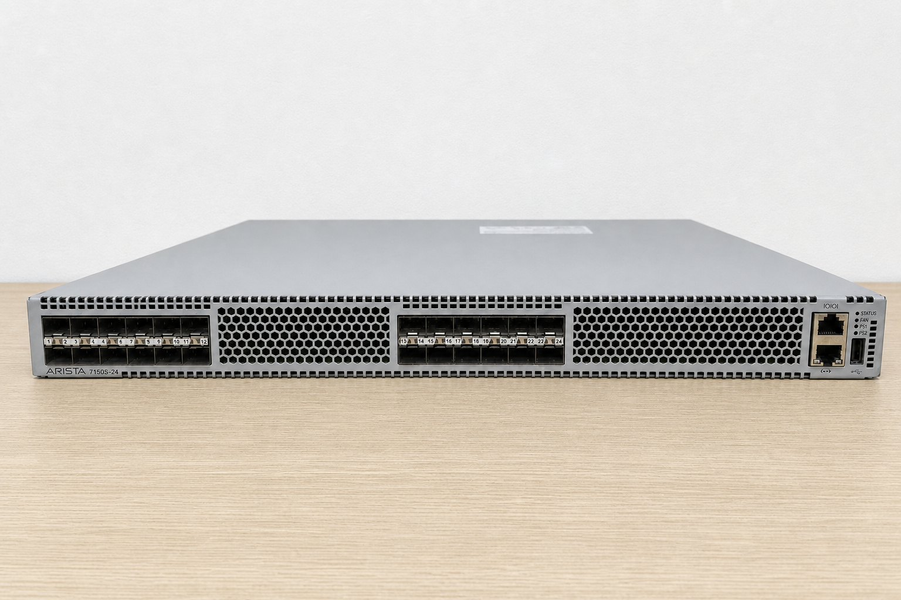
<figcaption style="color:#581c87;font-weight:700;margin-top:8px;">正面：Et1 接 <code>.1 Exchange</code>，Et2 接 <code>.2 Trader</code>。</figcaption>
</figure>
<figure style="margin:0;">
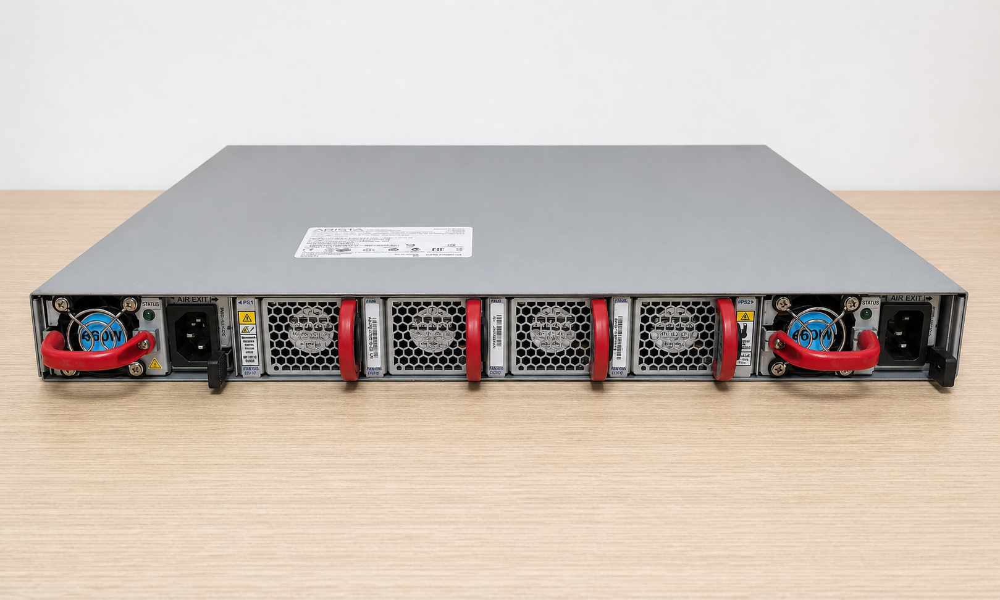
<figcaption style="color:#581c87;font-weight:700;margin-top:8px;">反面：双电源与四个风扇，同一台设备的供电和散热面。</figcaption>
</figure>
</div>
</div>

Arista 7150 是面向金融交易等延迟敏感场景、专门针对低时延优化的经典交换机系列，早在 [2012 年就已发布](https://www.arista.com/en/company/news/press-release/495-pr-20120919-01)。本课这台 7150S-24 提供 24 个 1/10G SFP+ 端口，主要能力见 [7150 官方数据表](https://www.arista.com/assets/data/pdf/Datasheets/7150S_Datasheet.pdf)。

| 主要特点 | 7150 有什么值得关注 |
| --- | --- |
| 低时延转发 | 采用 Cut-through；7150S-24 的厂商口到口延迟规格低至 350 ns（0.35 µs）。设计强调不同帧长、二层与三层转发下保持相近的低时延。 |
| 队列调度与拥塞监测 | 每端口最多 8 个 QoS 队列，支持严格优先级调度；LANZ 能以微秒级粒度记录短时拥塞，帮助发现平均端口利用率中不明显的突发排队。 |
| 对时与报文时间戳 | 支持 PTP 对时，也能为报文添加硬件时间戳。对齐时钟后，可以配对同一帧在两处的时间戳，计算这一段的延迟。 |

### 本章学习目标

1. 区分<span style="color:#075985;font-weight:800;">序列化</span>、<span style="color:#5b21b6;font-weight:800;">信号编解码与纠错</span>、<span style="color:#166534;font-weight:800;">介质传播</span>、<span style="color:#9a3412;font-weight:800;">固定转发</span>与<span style="color:#9f1239;font-weight:800;">出口排队</span>五项耗时；解释 Cut-through 和帧长的影响，并明确固定条件下<span style="color:#9f1239;font-weight:800;">出口排队</span>是延迟的主要变动项。
2. 看懂订单从 DSCP 标记到<span style="color:#3730a3;font-weight:800;">出口队列的映射和调度</span>。比较订单进入不同队列后的延迟，再用 LANZ 查看<span style="color:#0f766e;font-weight:800;">出口队列的拥塞事件</span>。
3. 明确计时起止点，用 <span style="color:#b45309;font-weight:800;">PTP</span> 同步交换机与网卡硬件时钟（PHC，<span style="color:#b45309;font-weight:800;">PTP</span> Hardware Clock），再将同一帧在交换机入口和网卡接收处的时间戳相减，计算这一段的延迟。

<div style="border-left:6px solid #7e22ce;background:#f3e8ff;padding:12px 16px;border-radius:8px;margin:14px 0;"><span style="display:inline-block;padding:3px 12px;border-radius:6px;background:#7e22ce;color:#fff;font-weight:800;">仅供展示 · 关键图</span> <span style="font-weight:700;color:#581c87;">三部分依次回答：时间花在哪里，怎样调整出口队列，怎样测量延迟。</span></div>

<div style="background:#f8fafc;border:1px solid #cbd5e1;border-radius:12px;padding:10px;max-width:820px;margin:14px auto;">
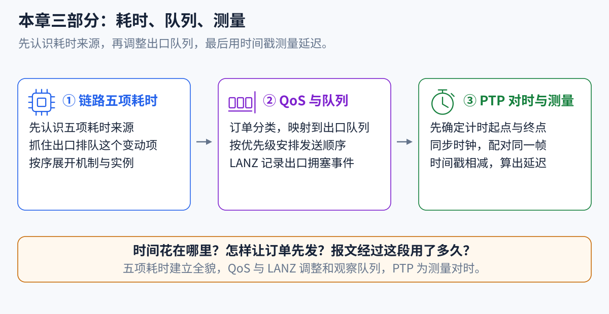
</div>

## 本章导航

<div style="border-left:6px solid #7e22ce;background:#f3e8ff;padding:12px 16px;border-radius:8px;margin:14px 0;"><span style="display:inline-block;padding:3px 12px;border-radius:6px;background:#7e22ce;color:#fff;font-weight:800;">仅供展示 · 本章导航</span> <span style="font-weight:700;color:#581c87;">三个技术部分，加上全章验收，共 4 组、14 个导航项：第一部分 6 项，第二部分 3 项，第三部分 4 项，验收 1 项。各节导航卡显示所属部分、全章位置与组内位置，绿色标签标出当前小节。</span></div>

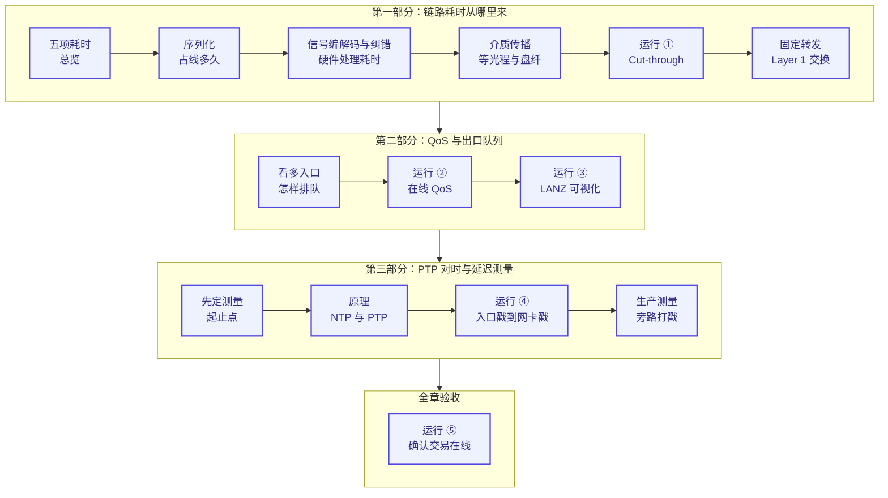

### 任务地图

| 导航项 | 所属部分 | 这一项回答什么 |
| --- | --- | --- |
| 把一条链路拆成五项耗时 | 第一部分：链路耗时从哪里来 | 分清五项耗时，抓住排队变化 |
| 序列化：算一帧占线多久 | 第一部分：链路耗时从哪里来 | 计算一帧在 10G 上最少占出口多久 |
| 信号编解码与纠错 | 第一部分：链路耗时从哪里来 | 理解编解码和纠错处理需要时间 |
| 介质传播：等光程与盘纤 | 第一部分：链路耗时从哪里来 | 解释光程怎样决定传播时间，以及盘纤为何用于等光程 |
| 运行 ①：确认 Cut-through | 第一部分：链路耗时从哪里来 | 确认当前是 cut-through，Et1/Et2 是 10G |
| 固定转发：Layer 1 交换的位置 | 第一部分：链路耗时从哪里来 | 比较包交换与物理层交换的处理和适用位置 |
| 看多入口怎样排队 | 第二部分：QoS 与出口队列 | 解释多入口汇聚为什么产生短时排队 |
| 运行 ②：在线 QoS | 第二部分：QoS 与出口队列 | 让真实订单命中指定优先级队列 |
| 运行 ③：LANZ 可视化 | 第二部分：QoS 与出口队列 | 把 LANZ 队列事件推到 8088 |
| 先把交换机延迟的起止点说清 | 第三部分：PTP 对时与延迟测量 | 确认计时起止点和比较条件，正确解读 350 ns |
| 原理：NTP 与 PTP | 第三部分：PTP 对时与延迟测量 | 两只钟怎样建立可比较的时间关系 |
| 运行 ④：入口戳到网卡戳 | 第三部分：PTP 对时与延迟测量 | 时间戳在哪里打，以及怎样配对相减 |
| 生产测量：旁路打戳与统一对时 | 第三部分：PTP 对时与延迟测量 | 区分生产环境中取副本、打戳与对时的设备职责 |
| 运行 ⑤：确认交易系统在线 | 全章验收 | 用真实订单确认端到端业务仍然可用 |

## 第一部分：链路耗时从哪里来

一条链路的时间花在五处。帧长、线速、路径与配置固定后，前四项相对固定，延迟的主要变化来自<span style="color:#9f1239;font-weight:800;">出口排队</span>。因此，先分清五项耗时，再用 QoS 控制排队、用 LANZ 观察队列，最后测出这段路径的时延。

### 把一条链路拆成五项耗时

<div style="border:2px solid #4f46e5;background:#eef2ff;padding:10px 12px;border-radius:8px;margin:14px 0;"><div style="font-weight:900;color:#312e81;margin-bottom:4px;">导航卡 · 第一部分：链路耗时从哪里来</div><div style="font-weight:700;color:#312e81;margin-bottom:8px;">范畴：图解总览　本步知识：分清五项耗时，抓住排队变化　位置：全章第 1 / 14 项 · 本组第 1 / 6 项</div><span style="display:inline-block;margin:3px;padding:4px 10px;border-radius:6px;background:#15803d;color:#fff;font-weight:800;">把一条链路拆成五项耗时</span><span style="display:inline-block;margin:3px;padding:4px 10px;border-radius:6px;background:#f8fafc;border:1px solid #a5b4fc;color:#312e81;font-weight:800;">序列化：算一帧占线多久</span><span style="display:inline-block;margin:3px;padding:4px 10px;border-radius:6px;background:#f8fafc;border:1px solid #a5b4fc;color:#312e81;font-weight:800;">信号编解码与纠错</span><span style="display:inline-block;margin:3px;padding:4px 10px;border-radius:6px;background:#f8fafc;border:1px solid #a5b4fc;color:#312e81;font-weight:800;">介质传播：等光程与盘纤</span><span style="display:inline-block;margin:3px;padding:4px 10px;border-radius:6px;background:#f8fafc;border:1px solid #a5b4fc;color:#312e81;font-weight:800;">运行 ①：确认 Cut-through</span><span style="display:inline-block;margin:3px;padding:4px 10px;border-radius:6px;background:#f8fafc;border:1px solid #a5b4fc;color:#312e81;font-weight:800;">固定转发：Layer 1 交换的位置</span></div>

<div style="border-left:6px solid #7e22ce;background:#f3e8ff;padding:12px 16px;border-radius:8px;margin:14px 0;"><span style="display:inline-block;padding:3px 12px;border-radius:6px;background:#7e22ce;color:#fff;font-weight:800;">仅供展示 · 关键图</span> <span style="font-weight:700;color:#581c87;">五项耗时分别从哪里产生，下方对应哪些优化手段。</span></div>

<div style="background:#f8fafc;border:1px solid #cbd5e1;border-radius:12px;padding:10px;max-width:820px;margin:14px auto;">
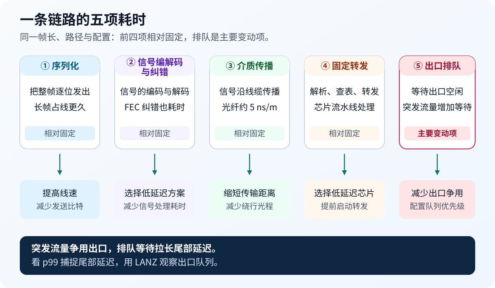
</div>

下面按图中的编号区分这五项：

| 耗时 | 由什么决定 | 上述固定条件下 | 后文在哪里展开 |
| --- | --- | --- | --- |
| ① <span style="color:#075985;font-weight:800;">序列化</span> | 把整帧逐位发出；由帧长和线速决定 | 相对固定 | [序列化：算一帧占线多久](#latency-serialization) |
| ② <span style="color:#5b21b6;font-weight:800;">信号编解码与纠错</span> | 收发电路的编解码耗时；启用纠错还会增加处理时间 | 相对固定 | [信号编解码与纠错](#latency-phy) |
| ③ <span style="color:#166534;font-weight:800;">介质传播</span> | 信号沿介质传输；由介质与实际路径长度决定 | 相对固定 | [介质传播：等光程与盘纤](#latency-propagation) |
| ④ <span style="color:#9a3412;font-weight:800;">固定转发</span> | 芯片解析、查表与转发；由硬件和转发方式决定 | 相对固定 | [Cut-through 与 Layer 1 交换](#latency-forwarding) |
| ⑤ <span style="color:#9f1239;font-weight:800;">出口排队</span> | 等待出口可用；由同时争用出口的流量决定 | 主要变动项 | [第二部分：QoS 与出口队列](#egress-queues) |

这五项按耗时来源区分。收发与编解码可以流水重叠，不能把五栏当作严格串行的五步直接相加。

先看第①项：以 10G 出口为例，一帧从开始发送到全部发完，需要多久？

<a id="latency-serialization"></a>

### 序列化：算一帧占线多久

<div style="border:2px solid #4f46e5;background:#eef2ff;padding:10px 12px;border-radius:8px;margin:14px 0;"><div style="font-weight:900;color:#312e81;margin-bottom:4px;">导航卡 · 第一部分：链路耗时从哪里来</div><div style="font-weight:700;color:#312e81;margin-bottom:8px;">范畴：纸面换算　本步知识：计算一帧在 10G 上最少占出口多久　位置：全章第 2 / 14 项 · 本组第 2 / 6 项</div><span style="display:inline-block;margin:3px;padding:4px 10px;border-radius:6px;background:#f8fafc;border:1px solid #a5b4fc;color:#312e81;font-weight:800;">把一条链路拆成五项耗时</span><span style="display:inline-block;margin:3px;padding:4px 10px;border-radius:6px;background:#15803d;color:#fff;font-weight:800;">序列化：算一帧占线多久</span><span style="display:inline-block;margin:3px;padding:4px 10px;border-radius:6px;background:#f8fafc;border:1px solid #a5b4fc;color:#312e81;font-weight:800;">信号编解码与纠错</span><span style="display:inline-block;margin:3px;padding:4px 10px;border-radius:6px;background:#f8fafc;border:1px solid #a5b4fc;color:#312e81;font-weight:800;">介质传播：等光程与盘纤</span><span style="display:inline-block;margin:3px;padding:4px 10px;border-radius:6px;background:#f8fafc;border:1px solid #a5b4fc;color:#312e81;font-weight:800;">运行 ①：确认 Cut-through</span><span style="display:inline-block;margin:3px;padding:4px 10px;border-radius:6px;background:#f8fafc;border:1px solid #a5b4fc;color:#312e81;font-weight:800;">固定转发：Layer 1 交换的位置</span></div>

只看交换机的一个出口：从发出一帧的第一个 bit，到发出最后一个 bit，需要一段时间，这就是**序列化时延（serialization delay）**。出口每秒能发送的比特数有限，**线速不变时，帧长翻倍，发完这帧的时间也翻倍。**

入口和出口是两条独立链路。即使帧内容不变，出口仍要用自己的发送电路把这些比特发出去。这里计算的是整帧的发送时间，不是重新修改或生成一帧的时间。

`序列化时间 = 帧字节数 × 8 ÷ 线速`

线速指端口当前工作的以太网传输速率（本课是 10 Gbit/s，即每秒发送 100 亿 bit）。下面只计算帧本身从这个出口发完所需的时间：

| 帧长（含帧尾校验） | 10G 出口的序列化时间 |
| --- | --- |
| 64 字节 | 51.2 ns |
| 1518 字节 | 1214.4 ns，约 1.21 µs |

后面 TRex 构造的 1514 字节不含帧尾 FCS；网卡补上 4 字节 FCS 后，就是这里的 1518 字节。

**帧长和线速一旦确定，这段发送时间就是省不掉的物理限制。** Cut-through 能让出口更早开始发送，但同一帧在相同线速下，从第一个 bit 发到最后一个 bit 仍需这么久。要缩短这段时间，就要<span style="color:#dc2626;font-weight:700;">减少发送的比特数</span>，或<span style="color:#dc2626;font-weight:700;">提高线速</span>。

比特在链路上发送时，收发电路还要完成信号编解码。下一项看这些电路的处理耗时。

<a id="latency-phy"></a>

### 信号编解码与纠错

<div style="border:2px solid #4f46e5;background:#eef2ff;padding:10px 12px;border-radius:8px;margin:14px 0;"><div style="font-weight:900;color:#312e81;margin-bottom:4px;">导航卡 · 第一部分：链路耗时从哪里来</div><div style="font-weight:700;color:#312e81;margin-bottom:8px;">范畴：机制讲解　本步知识：理解编解码和纠错处理需要时间　位置：全章第 3 / 14 项 · 本组第 3 / 6 项</div><span style="display:inline-block;margin:3px;padding:4px 10px;border-radius:6px;background:#f8fafc;border:1px solid #a5b4fc;color:#312e81;font-weight:800;">把一条链路拆成五项耗时</span><span style="display:inline-block;margin:3px;padding:4px 10px;border-radius:6px;background:#f8fafc;border:1px solid #a5b4fc;color:#312e81;font-weight:800;">序列化：算一帧占线多久</span><span style="display:inline-block;margin:3px;padding:4px 10px;border-radius:6px;background:#15803d;color:#fff;font-weight:800;">信号编解码与纠错</span><span style="display:inline-block;margin:3px;padding:4px 10px;border-radius:6px;background:#f8fafc;border:1px solid #a5b4fc;color:#312e81;font-weight:800;">介质传播：等光程与盘纤</span><span style="display:inline-block;margin:3px;padding:4px 10px;border-radius:6px;background:#f8fafc;border:1px solid #a5b4fc;color:#312e81;font-weight:800;">运行 ①：确认 Cut-through</span><span style="display:inline-block;margin:3px;padding:4px 10px;border-radius:6px;background:#f8fafc;border:1px solid #a5b4fc;color:#312e81;font-weight:800;">固定转发：Layer 1 交换的位置</span></div>

收发电路负责信号的编码与解码；启用 FEC（Forward Error Correction，前向纠错）后，还要完成纠错编码与解码。**这些电路处理都需要时间。**

FEC 用于修复一定范围内的传输错误；帧尾的 [FCS（Frame Check Sequence，帧校验序列）](https://www.cisco.com/c/en/us/support/docs/ios-nx-os-software/nx-os-software/217554-understand-cyclic-redundancy-check-crc.html)用于检错，不负责修复错误。

常见的 **25G/100G 短距光链路需要启用 FEC**，以满足误码率要求；纠错也会增加延迟。[Arista E 系列光模块](https://www.arista.com/assets/data/pdf/Datasheets/E-Series-Optical-Transceivers-Q%26A.pdf)通过增强光学性能，使链路两端使用配套模块时，在规定距离内无需启用 FEC 就能满足误码率要求，从而省去纠错延迟。厂商给出的节省上限为每条链路 250 ns。

FEC 由这一跳两端的端口 PHY 执行，光模块不会自动关闭它。两端都换上配套 E 系列之后，还要在各自端口上关掉纠错编码。

<div style="border-left:6px solid #7e22ce;background:#f3e8ff;padding:12px 16px;border-radius:8px;margin:14px 0;"><span style="display:inline-block;padding:3px 12px;border-radius:6px;background:#7e22ce;color:#fff;font-weight:800;">仅供展示 · 关闭交换机 FEC</span> <span style="font-weight:700;color:#581c87;">接口下关闭纠错编码；适用于支持 FEC 的 25G/100G 口，两端模式必须一致。本课 7150 的 Et1/Et2 是 10G DAC，没有这档 FEC，不能在本课交换机上执行。</span></div>

```text
configure terminal
interface Ethernet1
   no error-correction encoding
end
show interfaces Ethernet1 error-correction
```

`no error-correction encoding` 关闭该口的 FEC。重新打开时按链路写成 `error-correction encoding reed-solomon` 或 `error-correction encoding fire-code`。对端若是主机，用 `ethtool --set-fec <口> encoding off`。

除了收发电路的处理时间，信号沿光纤或铜缆传播也需要时间。这段介质传播时间由介质和实际路径长度决定。

<a id="latency-propagation"></a>

### 介质传播：等光程与盘纤

<div style="border:2px solid #4f46e5;background:#eef2ff;padding:10px 12px;border-radius:8px;margin:14px 0;"><div style="font-weight:900;color:#312e81;margin-bottom:4px;">导航卡 · 第一部分：链路耗时从哪里来</div><div style="font-weight:700;color:#312e81;margin-bottom:8px;">范畴：机制讲解　本步知识：解释光程怎样决定传播时间，以及盘纤为何用于等光程　位置：全章第 4 / 14 项 · 本组第 4 / 6 项</div><span style="display:inline-block;margin:3px;padding:4px 10px;border-radius:6px;background:#f8fafc;border:1px solid #a5b4fc;color:#312e81;font-weight:800;">把一条链路拆成五项耗时</span><span style="display:inline-block;margin:3px;padding:4px 10px;border-radius:6px;background:#f8fafc;border:1px solid #a5b4fc;color:#312e81;font-weight:800;">序列化：算一帧占线多久</span><span style="display:inline-block;margin:3px;padding:4px 10px;border-radius:6px;background:#f8fafc;border:1px solid #a5b4fc;color:#312e81;font-weight:800;">信号编解码与纠错</span><span style="display:inline-block;margin:3px;padding:4px 10px;border-radius:6px;background:#15803d;color:#fff;font-weight:800;">介质传播：等光程与盘纤</span><span style="display:inline-block;margin:3px;padding:4px 10px;border-radius:6px;background:#f8fafc;border:1px solid #a5b4fc;color:#312e81;font-weight:800;">运行 ①：确认 Cut-through</span><span style="display:inline-block;margin:3px;padding:4px 10px;border-radius:6px;background:#f8fafc;border:1px solid #a5b4fc;color:#312e81;font-weight:800;">固定转发：Layer 1 交换的位置</span></div>

光程决定介质传播时间。光纤单程传播延迟约 `5 ns/m`；几十米光程就是几百纳秒，与 7150 的端口间转发延迟规格同量级。缩短光程，就能直接减少这部分延迟。

共址机房用等光程消除近端机柜的物理优势：把各客户路径补到约定长度，近端因此多盘一卷光纤。

CME 曾公开说明共址客户到平台之间使用等长光纤；Cboe 当前的连接手册也写明，用相同的光程长度、盘纤和 OBR（Optical Backscatter Reflectometer，光背向散射反射计）测试来做延迟均衡。**所以近端机柜里那卷看似浪费的盘纤，实际上是通过控制总光程，让不同机柜获得接近的传播时延。**

<div style="border-left:6px solid #7e22ce;background:#f3e8ff;padding:12px 16px;border-radius:8px;margin:14px 0;"><span style="display:inline-block;padding:3px 12px;border-radius:6px;background:#7e22ce;color:#fff;font-weight:800;">仅供展示 · 关键图</span> <span style="font-weight:700;color:#581c87;">近端路径用受控盘纤补足光程，让不同机柜到交易所网关的总光程落在同一容差内。</span></div>

<div style="background:#f8fafc;border:1px solid #cbd5e1;border-radius:12px;padding:10px;max-width:820px;margin:14px auto;">
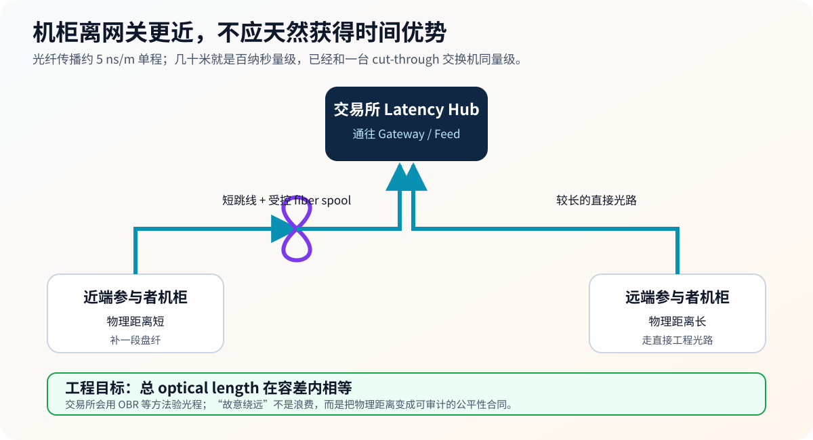
</div>

网络工程师应该会问三件事：约定的是物理长度还是实测时延；光路用什么设备验收；变更跳线、模块或机柜位置后是否重新验光程。

报文进入交换机后，Cut-through 怎样减少开始转发前的等待时间？

<a id="latency-forwarding"></a>

### 运行 ①：确认 Cut-through

<div style="border:2px solid #4f46e5;background:#eef2ff;padding:10px 12px;border-radius:8px;margin:14px 0;"><div style="font-weight:900;color:#312e81;margin-bottom:4px;">导航卡 · 第一部分：链路耗时从哪里来</div><div style="font-weight:700;color:#312e81;margin-bottom:8px;">范畴：现场只读　本步知识：确认当前是 cut-through，Et1/Et2 是 10G　位置：全章第 5 / 14 项 · 本组第 5 / 6 项</div><span style="display:inline-block;margin:3px;padding:4px 10px;border-radius:6px;background:#f8fafc;border:1px solid #a5b4fc;color:#312e81;font-weight:800;">把一条链路拆成五项耗时</span><span style="display:inline-block;margin:3px;padding:4px 10px;border-radius:6px;background:#f8fafc;border:1px solid #a5b4fc;color:#312e81;font-weight:800;">序列化：算一帧占线多久</span><span style="display:inline-block;margin:3px;padding:4px 10px;border-radius:6px;background:#f8fafc;border:1px solid #a5b4fc;color:#312e81;font-weight:800;">信号编解码与纠错</span><span style="display:inline-block;margin:3px;padding:4px 10px;border-radius:6px;background:#f8fafc;border:1px solid #a5b4fc;color:#312e81;font-weight:800;">介质传播：等光程与盘纤</span><span style="display:inline-block;margin:3px;padding:4px 10px;border-radius:6px;background:#15803d;color:#fff;font-weight:800;">运行 ①：确认 Cut-through</span><span style="display:inline-block;margin:3px;padding:4px 10px;border-radius:6px;background:#f8fafc;border:1px solid #a5b4fc;color:#312e81;font-weight:800;">固定转发：Layer 1 交换的位置</span></div>

**本节展开前面的第④项“固定转发”**：交换机解析帧、查表并作出转发决定所需的时间。Cut-through 通过提前开始发送减少等待。本步只读核对 7150 的转发模式和 Et1 / Et2 的 10G 线速；VLAN 与 MAC 地址转发表（FDB，Forwarding Database）用于确认课程路径。

#### 本步理论：Cut-through 只把“开始发”提前

7150 的转发由专用集成电路（ASIC，Application-Specific Integrated Circuit）完成，本机使用 FM6000 系列转发芯片。帧从 Et1 进入芯片后，芯片一旦读到足以作出转发决定的帧头，就启动 Et2 发送。此时帧尾可能还在进入 Et1，帧头已从 Et2 发出。

cut-through 减少的是开始转发前“等整帧收完”的时间；端口线速不变，出口忙时仍要排队。

<div style="border-left:6px solid #7e22ce;background:#f3e8ff;padding:12px 16px;border-radius:8px;margin:14px 0;"><span style="display:inline-block;padding:3px 12px;border-radius:6px;background:#7e22ce;color:#fff;font-weight:800;">仅供展示 · 关键图</span> <span style="font-weight:700;color:#581c87;">从 Et1 接收、解析帧头、查转发表，到 Et2 排队和发送。绿色虚线标出 LANZ 观察出口队列的位置。</span></div>

<div style="background:#f8fafc;border:1px solid #cbd5e1;border-radius:12px;padding:10px;max-width:820px;margin:14px auto;">
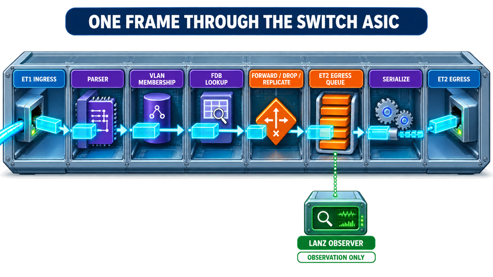
</div>

store-and-forward（存储转发）先收完整帧、检查帧尾的 FCS，再转发。Cut-through 在校验前就开始发送，**已经发出的部分无法撤回，坏帧也会有一部分进入下游**。

<div style="border-left:6px solid #7e22ce;background:#f3e8ff;padding:12px 16px;border-radius:8px;margin:14px 0;"><span style="display:inline-block;padding:3px 12px;border-radius:6px;background:#7e22ce;color:#fff;font-weight:800;">仅供展示 · 关键图</span> <span style="font-weight:700;color:#581c87;">同一帧长、同一线速；只比较出口从哪一刻开始发送。</span></div>

<div style="background:#f8fafc;border:1px solid #cbd5e1;border-radius:12px;padding:10px;max-width:820px;margin:14px auto;">
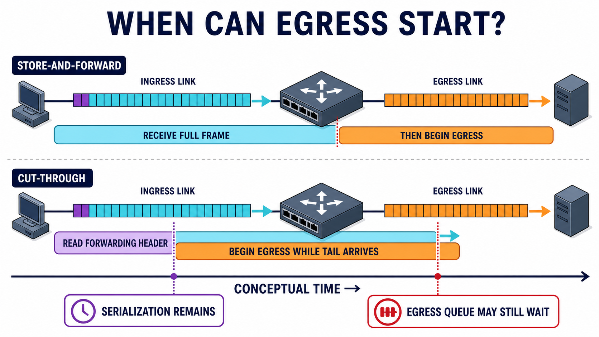
</div>

7150 的 **350 ns 是端口到端口的延迟规格，不是五项耗时中的某个单项**；计时起止点与比较条件集中在[第三部分](#latency-measurement-boundaries)说明。

#### Cut-through 的四个边界

Cut-through 提前发送的收益受出口状态和进出线速限制，坏帧则体现了提前发送的代价：

| 场景 | 对延迟和转发的影响 | 原因 |
| --- | --- | --- |
| 出口空闲、进出同速 | 省去等待整帧收完的时间 | 读到转发决定就能立刻启动出口 |
| 出口正被别的流量占用 | 仍需等出口空闲 | 队列在转发决定之后，与转发模式无关 |
| 进出速率不同 | 还要处理接收和发送的速率差 | 10G 进、1G 出会积压数据；1G 进、10G 出要先积累足够数据，保证出口连续发送 |
| 帧本身是坏帧 | 提前发送也会把坏帧的一部分送入下游 | FCS 在帧尾，校验前已经发出的部分无法撤回 |

<div style="background:#f8fafc;border:1px solid #cbd5e1;border-radius:12px;padding:10px;max-width:820px;margin:14px auto;">
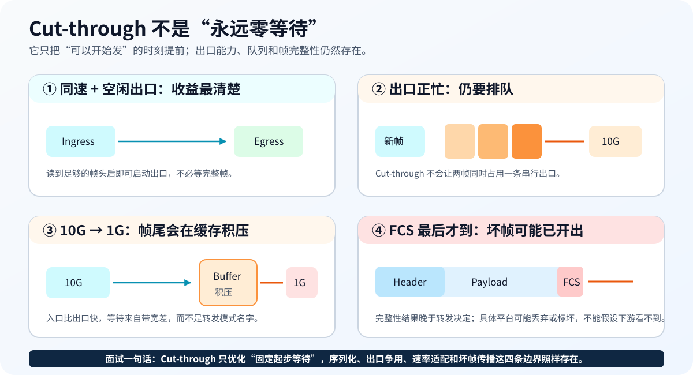
</div>

#### 只读核对转发模式与链路

理论落到实验：绿色卡只读 EOS。主要判断是 `Current switching mode: cut through` 与 Et1/Et2 10G；VLAN/FDB 只作为“确实是这条链路”的辅助信息。

<div style="border-left:6px solid #15803d;background:#dcfce7;padding:12px 16px;border-radius:8px;margin:14px 0;"><span style="display:inline-block;padding:3px 12px;border-radius:6px;background:#15803d;color:#fff;font-weight:800;">需要运行 · 运行 ①</span> <span style="font-weight:700;color:#14532d;">在 .111 管理机的 <code>/qyt-fll/</code> 项目根目录以 root 运行；前置是第 01 章准备 B/C 已恢复公钥和 VLAN20；只读八条 show；预期 Et1/Et2 为 connected / VLAN 20 / 10G，mode 为 cut through。</span></div>

```bash
bash assets/06-arista-time/01-arista-fabric-inventory.sh
```

<div style="border-left:6px solid #7e22ce;background:#f3e8ff;padding:12px 16px;border-radius:8px;margin:14px 0;"><span style="display:inline-block;padding:3px 12px;border-radius:6px;background:#7e22ce;color:#fff;font-weight:800;">仅供展示 · 交换机查询</span> <span style="font-weight:700;color:#581c87;">脚本在 7150 上执行以下八条只读命令。</span></div>

```text
show version
show interfaces Ethernet1 status
show interfaces Ethernet2 status
show interfaces Ethernet1 counters
show interfaces Ethernet2 counters
show vlan id 20
show mac address-table dynamic vlan 20
show switch forwarding-mode
```

<div style="border-left:6px solid #7e22ce;background:#f3e8ff;padding:12px 16px;border-radius:8px;margin:14px 0;"><span style="display:inline-block;padding:3px 12px;border-radius:6px;background:#7e22ce;color:#fff;font-weight:800;">仅供展示 · 实测输出摘录</span> <span style="font-weight:700;color:#581c87;">以下节选已有实测输出，依次核对 Et1、Et2、VLAN、MAC 表和转发模式。完整记录见配套资产说明。</span></div>

```text
fll-arista / verify
===== 查Et1状态 =====
[Et1] 对: connected / VLAN 20 / full / 10G / 10GBASE-CR  证: Exchange 侧入口在课程链路上
$ show interfaces Ethernet1 status
Port       Name   Status       Vlan     Duplex Speed  Type         Flags Encapsulation
Et1               connected    20       full   10G    10GBASE-CR


===== 查Et2状态 =====
[Et2] 对: connected / VLAN 20 / full / 10G / 10GBASE-CR  证: Trader 侧出口同速 10G
$ show interfaces Ethernet2 status
Port       Name   Status       Vlan     Duplex Speed  Type         Flags Encapsulation
Et2               connected    20       full   10G    10GBASE-CR


===== 查VLAN20成员 =====
[VLAN20] 对: active，成员含 Cpu, Et1, Et2；工具口接入后列出  证: 实验走的是课程 VLAN20
$ show vlan id 20
VLAN  Name                             Status    Ports
----- -------------------------------- --------- -------------------------------
20    fll                              active    Cpu, Et1, Et2


===== 查VLAN20动态FDB =====
[FDB] 对: 000f.53d3.af20 在 Et1，000f.53d3.af21 在 Et2  证: 两端 MAC 学在正确的口
$ show mac address-table dynamic vlan 20
          Mac Address Table
------------------------------------------------------------------

Vlan    Mac Address       Type        Ports      Moves   Last Move
----    -----------       ----        -----      -----   ---------
  20    000f.53d3.af20    DYNAMIC     Et1        1       0:42:51 ago
  20    000f.53d3.af21    DYNAMIC     Et2        1       0:01:10 ago
Total Mac Addresses for this criterion: 2

          Multicast Mac Address Table
------------------------------------------------------------------

Vlan    Mac Address       Type        Ports
----    -----------       ----        -----
Total Mac Addresses for this criterion: 0

===== 查转发模式 =====
[mode] 对: Current switching mode: cut through  证: 当前按 cut-through 工作，不是逐包时延
$ show switch forwarding-mode
Current switching mode:    cut through
Available switching modes: cut through, store and forward
```

| 字段 | 实测例子 | 学员读什么 |
| --- | --- | --- |
| Current switching mode | `cut through` | 本步主结论：当前按 cut-through 工作；不是逐包时延 |
| Et1 / Et2 状态 | `connected / full / 10G / 10GBASE-CR` | 两侧线速一致，后面的序列化时间按 10GbE 计算 |
| 路径辅助信息 | VLAN20 成员与两条动态 FDB | 只确认实验确实经过 Et1→Et2，不展开基础 VLAN 教学 |

<div style="border-left:6px solid #7e22ce;background:#f3e8ff;padding:12px 16px;border-radius:8px;margin:14px 0;color:#581c87;">
<div style="font-weight:800;margin-bottom:8px;">仅供展示 · 切换转发模式</div>
<p style="margin:0 0 8px;">执行 <code>configure terminal</code> 进入全局配置模式，在下面两条命令中选择一条。该设置作用于整台交换机。</p>
<table style="width:100%;border-collapse:collapse;">
<tr><th style="text-align:left;padding:6px;">切换为</th><th style="text-align:left;padding:6px;">在 (config)# 下执行</th></tr>
<tr><td style="padding:6px;">直通转发</td><td style="padding:6px;"><code>switch forwarding-mode cut-through</code></td></tr>
<tr><td style="padding:6px;">存储转发</td><td style="padding:6px;"><code>switch forwarding-mode store-and-forward</code></td></tr>
</table>
<p style="margin:8px 0 0;">切换后执行 <code>show switch forwarding-mode</code> 查看当前模式；切回本课的直通转发配置时，使用第一条命令。</p>
<p style="margin:8px 0 0;font-size:14px;">命令说明：<a href="https://www.arista.com/en/um-eos/eos-data-transfer">Arista EOS · Data Transfer</a>。</p>
</div>

<div style="border-left:6px solid #0891b2;background:#cffafe;padding:12px 16px;border-radius:8px;margin:14px 0;"><span style="display:inline-block;padding:3px 12px;border-radius:6px;background:#0891b2;color:#fff;font-weight:800;">关键现象</span> <span style="font-weight:700;color:#164e63;">先看 <code>Current switching mode: cut through</code>，再看 Et1/Et2 都是 10G。VLAN/FDB 只负责防止认错路径；端口 notconnect 或 MAC 学错口时停下。</span></div>

Cut-through 提前开始发送；Layer 1 交换则直接连接物理端口，进一步省去包解析和查表。下面比较它们适用的场景。

### 固定转发：Layer 1 交换的位置

<div style="border:2px solid #4f46e5;background:#eef2ff;padding:10px 12px;border-radius:8px;margin:14px 0;"><div style="font-weight:900;color:#312e81;margin-bottom:4px;">导航卡 · 第一部分：链路耗时从哪里来</div><div style="font-weight:700;color:#312e81;margin-bottom:8px;">范畴：机制讲解　本步知识：比较包交换与物理层交换的处理和适用位置　位置：全章第 6 / 14 项 · 本组第 6 / 6 项</div><span style="display:inline-block;margin:3px;padding:4px 10px;border-radius:6px;background:#f8fafc;border:1px solid #a5b4fc;color:#312e81;font-weight:800;">把一条链路拆成五项耗时</span><span style="display:inline-block;margin:3px;padding:4px 10px;border-radius:6px;background:#f8fafc;border:1px solid #a5b4fc;color:#312e81;font-weight:800;">序列化：算一帧占线多久</span><span style="display:inline-block;margin:3px;padding:4px 10px;border-radius:6px;background:#f8fafc;border:1px solid #a5b4fc;color:#312e81;font-weight:800;">信号编解码与纠错</span><span style="display:inline-block;margin:3px;padding:4px 10px;border-radius:6px;background:#f8fafc;border:1px solid #a5b4fc;color:#312e81;font-weight:800;">介质传播：等光程与盘纤</span><span style="display:inline-block;margin:3px;padding:4px 10px;border-radius:6px;background:#f8fafc;border:1px solid #a5b4fc;color:#312e81;font-weight:800;">运行 ①：确认 Cut-through</span><span style="display:inline-block;margin:3px;padding:4px 10px;border-radius:6px;background:#15803d;color:#fff;font-weight:800;">固定转发：Layer 1 交换的位置</span></div>

本课 7150 按报文转发；生产中也会用 Layer 1 设备连接固定的物理路径。它能**把一路行情信号复制到多台策略机，并远程调整端口连接**。

<div style="background:#f8fafc;border:1px solid #cbd5e1;border-radius:12px;padding:10px;max-width:820px;margin:14px auto;">
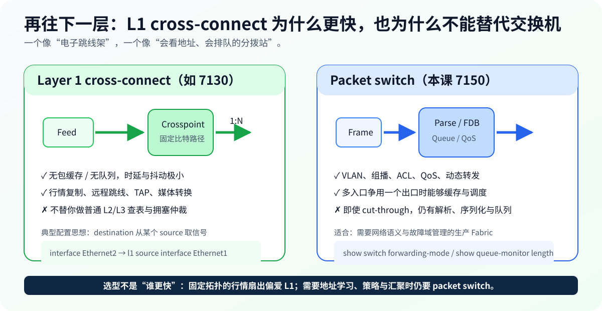
</div>

Layer 1 cross-connect（物理层交叉连接）按配置连接输入与输出，原样转送比特。[Arista 7130 Connect](https://www.arista.com/en/products/7130-connect)明确支持 **1:N 信号复制**，也叫扇出（fan-out）：例如将 Et1 收到的一路行情，同时送到 Et2、Et3、Et4，供三台策略机接收。设备还提供信号再生和远程端口配置。

**这里复制的是整路信号，输出端口由配置决定。** L1 转发不根据报文的目的 MAC/IP 地址或组播成员关系选择出口。即使入口承载的是 IP 组播行情，L1 也只是原样复制；按组播组选择接收端口，是 L2/L3 包交换的功能。

这条固定的比特路径省去了包解析、转发表查找和普通出口排队。7130 Connect 的端口到端口规格最低约 `4 ns`；这是 7130 规格值，不是本课 7150 的实测数据。

| 场景 | 更像 L1 cross-connect | 更像 Packet switch |
| --- | --- | --- |
| 一路行情固定复制到 N 台策略机 | ✓ 按端口配置复制整路信号、极低抖动 | 按组播转发表复制报文；出口争用时排队 |
| 需要 VLAN / ACL / 组播路由 / QoS | 不合适 | ✓ 使用 7150 一类 L2/L3 ASIC |
| 多个入口同时汇聚到一个出口 | **不应采用纯 L1：无法按报文安排发送顺序** | ✓ 通过仲裁、缓存和队列安排发送 |
| 远程跳线、流量复制点（TAP，Test Access Point）、信号再生 | ✓ 核心用途 | 通常不是首选 |

<div style="border-left:6px solid #7e22ce;background:#f3e8ff;padding:12px 16px;border-radius:8px;margin:14px 0;"><span style="display:inline-block;padding:3px 12px;border-radius:6px;background:#7e22ce;color:#fff;font-weight:800;">仅供展示 · 7130 配置示例</span> <span style="font-weight:700;color:#581c87;">以下命令将 Et1 的输入信号同时复制到 Et2、Et3、Et4；适用于运行 EOS 的 7130，不能在本课 7150 上执行。</span></div>

示例接线：Et1 接行情源，Et2、Et3、Et4 分别接三台策略机；四个端口均使用 10G。

```text
! 7130：三个出口使用同一个入口，实现 1:3 信号复制
configure terminal
interface Ethernet2
   l1 source interface Ethernet1
interface Ethernet3
   l1 source interface Ethernet1
interface Ethernet4
   l1 source interface Ethernet1
end
show l1 source interface Ethernet2-4
show l1 path interface Ethernet1,2,3,4
show l1 matrix interface Ethernet1,2,3,4
```

`l1 source interface Ethernet1` 写在各个**输出端口**下，表示该端口发送 Et1 收到的信号。核对时，Et2、Et3、Et4 的 `Source Interface` 都应为 `Ethernet1`，这就是一对三复制。命令语义见 [Arista EOS L1 配置说明](https://www.arista.com/en/um-eos/eos-configuring-layer-1-on-the-7130-platform)。

L1 用固定的物理连接省去包解析和查表，缩短固定转发耗时。需要动态地址、策略、汇聚和拥塞处理时，使用包交换机。

序列化、信号编解码与纠错、介质传播和固定转发都有明确的耗时来源。固定相关条件后，出口排队就是延迟的主要变动项：多路流量争用同一个出口时，订单要等多久，怎样让它先发？

<a id="egress-queues"></a>

## 第二部分：QoS 与出口队列

这一部分关注出口争用：先看多入口汇聚怎样产生排队，再用 QoS 调整订单的发送优先级，最后用 LANZ 观察队列事件。

### 看多入口怎样排队：为什么平均不忙仍会拥塞

<div style="border:2px solid #4f46e5;background:#eef2ff;padding:10px 12px;border-radius:8px;margin:14px 0;"><div style="font-weight:900;color:#312e81;margin-bottom:4px;">导航卡 · 第二部分：QoS 与出口队列</div><div style="font-weight:700;color:#312e81;margin-bottom:8px;">范畴：纸面模型　本步知识：解释多入口汇聚为什么产生短时排队　位置：全章第 7 / 14 项 · 本组第 1 / 3 项</div><span style="display:inline-block;margin:3px;padding:4px 10px;border-radius:6px;background:#15803d;color:#fff;font-weight:800;">看多入口怎样排队</span><span style="display:inline-block;margin:3px;padding:4px 10px;border-radius:6px;background:#f8fafc;border:1px solid #a5b4fc;color:#312e81;font-weight:800;">运行 ②：在线 QoS</span><span style="display:inline-block;margin:3px;padding:4px 10px;border-radius:6px;background:#f8fafc;border:1px solid #a5b4fc;color:#312e81;font-weight:800;">运行 ③：LANZ 可视化</span></div>

**Fan-in（多入口汇聚）是多路流量共用一个出口。出口一次只能发送一帧；新帧需要发送时，出口如果正在发送其他帧，它就要等待。** 这段等待就是出口排队延迟。

<div style="border-left:6px solid #7e22ce;background:#f3e8ff;padding:12px 16px;border-radius:8px;margin:14px 0;"><span style="display:inline-block;padding:3px 12px;border-radius:6px;background:#7e22ce;color:#fff;font-weight:800;">仅供展示 · 关键图</span> <span style="font-weight:700;color:#581c87;">两帧争用同一出口：A 正在发送时，B 留在缓冲区等待。</span></div>

<div style="background:#f8fafc;border:1px solid #cbd5e1;border-radius:12px;padding:10px;max-width:820px;margin:14px auto;">
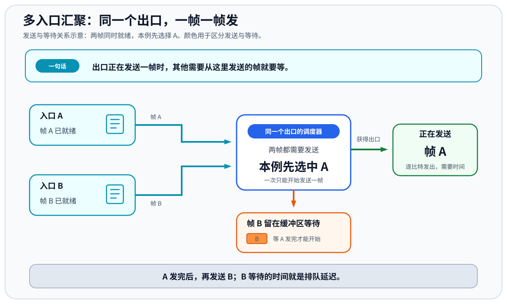
</div>

例如，两个入口的帧 A、B 同时就绪，而出口刚好空闲：调度器选中 A 先发，B 就留在缓冲区等待；A 发完后，B 才能开始发送。**即使两帧很快都发完了，B 也已经经历了排队。**

不必精确同时到达才会排队：B 在 A 尚未发完时就绪，也要等。反过来，如果 B 就绪时出口已经空闲，就能开始发送，没有这段争用等待。

流量在很短的时间内集中到达，形成 microburst（微突发），会使更多帧积压等待。

**判断订单延迟，不能只看平均利用率：即使一分钟平均利用率很低，个别订单仍可能遇到短时排队，延迟明显增加。**

7150 的多个端口共用一个[报文缓冲池](https://www.arista.com/assets/data/pdf/Datasheets/7150S_Datasheet.pdf#page=2)。**缓冲区决定能暂存多少等待的报文，出口线速决定发送有多快。**

**交换机默认就有队列与调度规则；配置 QoS，是为了让订单等重要流量获得优先服务。** 报文先按类别进入不同队列，调度器再决定下一帧从哪个队列取。[Arista QoS 调度说明](https://www.arista.com/en/um-eos/eos-quality-of-service)

本课的严格优先级调度要等当前帧发完，才能选择下一帧，不能中断已经开始的发送。QoS 能调整等待次序，但不能提高出口线速，也不能保证所有流量都不排队。

| 工具 | 它真正做什么 | 低延迟使用边界 |
| --- | --- | --- |
| strict priority（严格优先级） | 先服务高优先级队列，队列发空后才服务低优先级队列 | 高优先级队列一直有报文等待发送，低优先级队列就得不到服务（饥饿） |
| WRR（Weighted Round Robin，加权轮转） | 参与轮转的队列按权重分配发送份额；权重越高，份额越大 | 低权重队列分得少，但仍有发送机会 |
| LANZ | 记录出口队列的瞬时长度和事件 | 提供拥塞记录；队列的发送顺序仍由调度算法决定 |

### 运行 ②：在线 QoS

<div style="border:2px solid #4f46e5;background:#eef2ff;padding:10px 12px;border-radius:8px;margin:14px 0;"><div style="font-weight:900;color:#312e81;margin-bottom:4px;">导航卡 · 第二部分：QoS 与出口队列</div><div style="font-weight:700;color:#312e81;margin-bottom:8px;">范畴：分步实验　本步知识：让真实订单命中指定优先级队列　位置：全章第 8 / 14 项 · 本组第 2 / 3 项</div><span style="display:inline-block;margin:3px;padding:4px 10px;border-radius:6px;background:#f8fafc;border:1px solid #a5b4fc;color:#312e81;font-weight:800;">看多入口怎样排队</span><span style="display:inline-block;margin:3px;padding:4px 10px;border-radius:6px;background:#15803d;color:#fff;font-weight:800;">运行 ②：在线 QoS</span><span style="display:inline-block;margin:3px;padding:4px 10px;border-radius:6px;background:#f8fafc;border:1px solid #a5b4fc;color:#312e81;font-weight:800;">运行 ③：LANZ 可视化</span></div>

**输出来源：** 运行 ②、④ 保留 iptables 打标和单播行情实验的历史节选；当前脚本已改为应用打标与 A/B 组播，新版整轮实测待顺刷补齐。运行 ③ 使用官方 LANZ 客户端的实测结果。

#### 出口忙时，怎样让订单先走

共享出口发生拥塞时，本课把订单标记为 **DSCP 46（EF，加速转发）**，让它进入严格优先级 Q5；背景流量留在 Q1。DSCP 46 是 [EF 的推荐码点](https://www.rfc-editor.org/rfc/rfc3246.html)，具体进入哪个队列由交换机映射决定。

第 05 章的四种下单路径，可以在不同位置完成打标或分类：

| 下单路径 | 打标或分类方式 |
| --- | --- |
| Kernel Socket | 订单线程用 `setsockopt(IP_TOS)` 设置 DSCP，Linux 内核写入 IP 头。 |
| Onload | 沿用相同的 `setsockopt(IP_TOS)` 调用，由 Onload 用户态栈写入 IP 头。 |
| TCPDirect | 由交换机按订单连接的五元组分类，设置内部 TC。 |
| DPDK + F-Stack | 在用户态协议栈生成 IP 头时写 DSCP，或由交换机按五元组分类到 TC。 |

**本实验默认使用第五章的 Kernel Socket 订单连接。脚本向 `.2` 的客户端发控制指令，订单线程调用 `setsockopt(IP_TOS)`，把 DSCP 从 0 改为 46，再回读确认；结束或中途失败时恢复原值，交易进程保持在线。** 同一套控制也支持 Onload，避免依赖加速路径绕过的内核打标规则。[Onload 说明](https://docs.amd.com/r/en-US/ug1586-onload-user/onload_iptables)

第二章上线时已从 `.111` 备好编译后的客户端，第五章准备 B 启用；本步只调整 DSCP 与交换机配置。脚本先检查连接；尚未建连时自动完成两笔预热单，再核验实际收发路径，预热不计入 QoS 对比。入口 Et2 信任 DSCP，出口 Et1 调度队列；用于生产时，应限制可信打标入口和严格优先级流量的总速率。

#### 默认 CoS／DSCP 映射：订单怎样进入队列

<div style="border-left:6px solid #7e22ce;background:#f3e8ff;padding:12px 16px;border-radius:8px;margin:14px 0;"><span style="display:inline-block;padding:3px 12px;border-radius:6px;background:#7e22ce;color:#fff;font-weight:800;">仅供展示 · 关键图</span> <span style="font-weight:700;color:#581c87;">本课无标签订单帧：原来使用端口默认 CoS 0，进入 Q1；改读订单 DSCP 46 后，进入 Q5。</span></div>

<div style="background:#f8fafc;border:1px solid #cbd5e1;border-radius:12px;padding:10px;max-width:820px;margin:14px auto;">
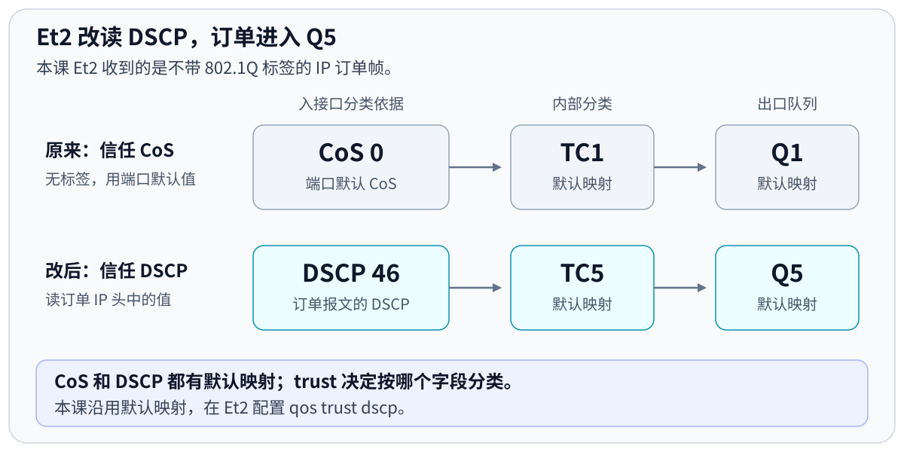
</div>

交换机按入口信任模式选择 CoS 或 DSCP，映射到内部流量类别 **TC（Traffic Class）**，再选择发送队列 **TX queue**。7150 的[默认映射](https://www.arista.com/en/um-eos/eos-quality-of-service)如下；TC 与队列编号一一对应。

**CoS → TC：**

| CoS | 0 | 1 | 2 | 3 | 4 | 5 | 6 | 7 |
| --- | --- | --- | --- | --- | --- | --- | --- | --- |
| TC | 1 | 0 | 2 | 3 | 4 | 5 | 6 | 7 |

Et2 原来信任 CoS：有 VLAN 标签时读 PCP（优先级码点），无标签时用端口默认 CoS。本课订单帧无标签，使用 `Default COS: 0`，进入 `TC1 → Q1`。

**DSCP → TC：**

<div style="border-left:6px solid #7e22ce;background:#f3e8ff;padding:12px 16px;border-radius:8px;margin:14px 0;"><span style="display:inline-block;padding:3px 12px;border-radius:6px;background:#7e22ce;color:#fff;font-weight:800;">仅供展示 · 关键图</span> <span style="font-weight:700;color:#581c87;">DSCP 默认映射：0～7 进入 TC1，40～47 进入 TC5；橙色行包含订单使用的 46。</span></div>

<div style="background:#f8fafc;border:1px solid #cbd5e1;border-radius:12px;padding:10px;max-width:820px;margin:14px auto;">
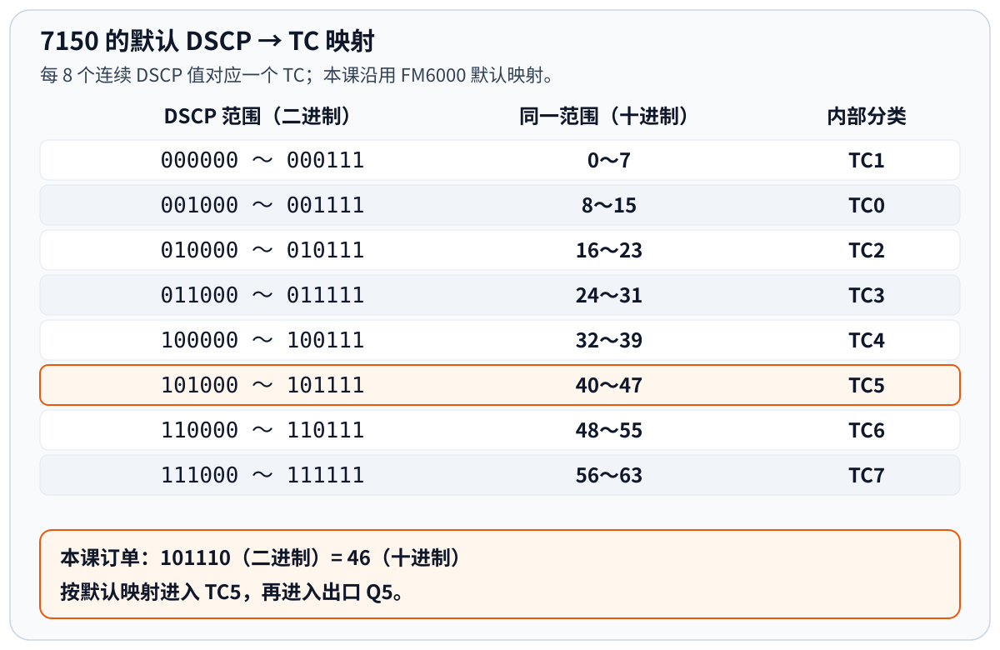
</div>

配置 `qos trust dscp` 后，Et2 改读 DSCP：未标记订单的 DSCP 0 进入 `TC1 → Q1`；标记为 46 的订单进入 `TC5 → Q5`。这里沿用 FM6000 默认映射，无需另写映射命令。

#### 7150 上的调度配置

<div style="border-left:6px solid #7e22ce;background:#f3e8ff;padding:12px 16px;border-radius:8px;margin:14px 0;"><span style="display:inline-block;padding:3px 12px;border-radius:6px;background:#7e22ce;color:#fff;font-weight:800;">仅供展示 · 关键图</span> <span style="font-weight:700;color:#581c87;">青色是订单方向：Et2 读 DSCP，芯片映到 TC5 / Q5，Et1 按 strict 出队。灰色虚线是回程 Execution，本课不打标。</span></div>

<div style="background:#f8fafc;border:1px solid #cbd5e1;border-radius:12px;padding:10px;max-width:820px;margin:14px auto;">
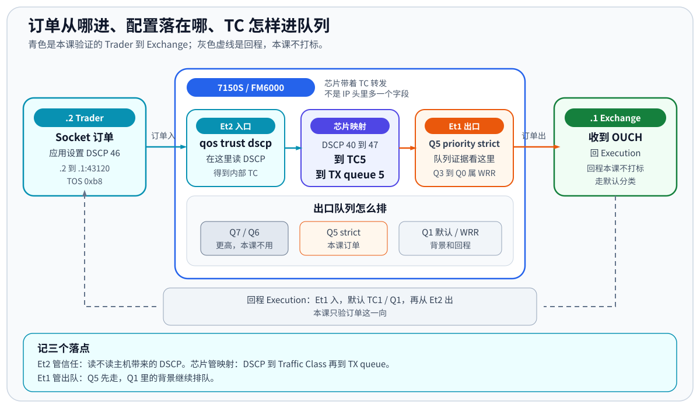
</div>

入口的 `qos trust dscp` 负责分类，出口的 `priority strict` 负责发送顺序。本实验只标记 Trader → Exchange 的订单连接，回程保持默认分类。

<div style="border-left:6px solid #7e22ce;background:#f3e8ff;padding:12px 16px;border-radius:8px;margin:14px 0;"><span style="display:inline-block;padding:3px 12px;border-radius:6px;background:#7e22ce;color:#fff;font-weight:800;">仅供展示</span> <span style="font-weight:700;color:#581c87;">以下为脚本下发给 7150 的队列调度配置，无需另行手动输入。</span></div>

```text
configure terminal
interface Ethernet2
   qos trust dscp
interface Ethernet1
   tx-queue 5
      priority strict
   exit
   tx-queue 3
      no priority
      bandwidth percent 40
   exit
   tx-queue 2
      bandwidth percent 30
   exit
   tx-queue 1
      bandwidth percent 20
   exit
   tx-queue 0
      bandwidth percent 10
end
```

<div style="border-left:6px solid #0891b2;background:#cffafe;padding:12px 16px;border-radius:8px;margin:14px 0;color:#164e63;">
<div style="font-weight:800;margin-bottom:10px;">配置说明 · 默认调度与 no priority 的作用范围</div>
<p style="margin:8px 0;"><strong>默认：Q0～Q7 全部采用严格优先级。</strong>有报文等待发送时，按 <strong>Q7 ＞ Q6 ＞ Q5 ＞ Q4 ＞ Q3 ＞ Q2 ＞ Q1 ＞ Q0</strong> 的优先顺序服务。CoS 0 默认进入 Q1，Q1 只比 Q0 优先；严格优先级是调度方式，不代表该队列优先级最高。</p>
<p style="margin:8px 0;"><strong>在 Q3 配置 <code>no priority</code>，会同时把 Q3、Q2、Q1、Q0 改为轮转调度。</strong>这是 FM6000 的命令规则，因此 Q2～Q0 无需重复配置。Q4～Q7 保持严格优先级。</p>
<p style="margin:8px 0;"><strong><code>bandwidth percent</code> 设置轮转权重：</strong>Q3、Q2、Q1、Q0 按 40∶30∶20∶10 分享轮转队列可用的带宽，形成 WRR。本实验用 Q5 承载标记订单、Q1 承载背景流量。</p>
<p style="margin:8px 0 0;"><a href="https://www.arista.com/en/um-eos/eos-quality-of-service" style="color:#155e75;">依据：Arista EOS QoS 手册 · priority (FM6000) 与 Configuring Queue Priority</a></p>
</div>

#### 在线共享出口里比较 Q1 与 strict Q5

单笔订单不足以稳定堵住 10G 出口，因此用 `.11` 上的 Cisco TRex v3.08 打背景流：从 Et11 / Et12 各发 `500,000 pps`、1514 字节 MoldUDP64/ITCH，持续 15 秒，共同争用 Et1。测试 MAC `02:00:00:07:00:01` 被静态指向 Et1，帧真正占用出口队列；`.1` 网卡在硬件中丢弃非本机 MAC，不交给 Exchange 进程。

TRex 是流量发生器。`.11` 先启动官方服务端 `./t-rex-64 -i --stl --no-key`，再由官方 [STL Python API](https://trex-tgn.cisco.com/trex/doc/cp_stl_docs/) 组 `STLStream` 并 `start`。工具本身的更完整讲解，见此前录像：https://www.bilibili.com/video/BV1aX2aBFEdw。运行 ③ 仍用同一套 API，只是改成固定 4096 帧的突发和更低的 pps。

<div style="border-left:6px solid #7e22ce;background:#f3e8ff;padding:12px 16px;border-radius:8px;margin:14px 0;"><span style="display:inline-block;padding:3px 12px;border-radius:6px;background:#7e22ce;color:#fff;font-weight:800;">仅供展示 · 关键图</span> <span style="font-weight:700;color:#581c87;">A 组订单和背景流量都进入 Q1；B 组订单进入严格优先级 Q5，背景仍留在 Q1。两组共用同一个 Et1 出口。</span></div>

<div style="background:#f8fafc;border:1px solid #cbd5e1;border-radius:12px;padding:10px;max-width:820px;margin:14px auto;">
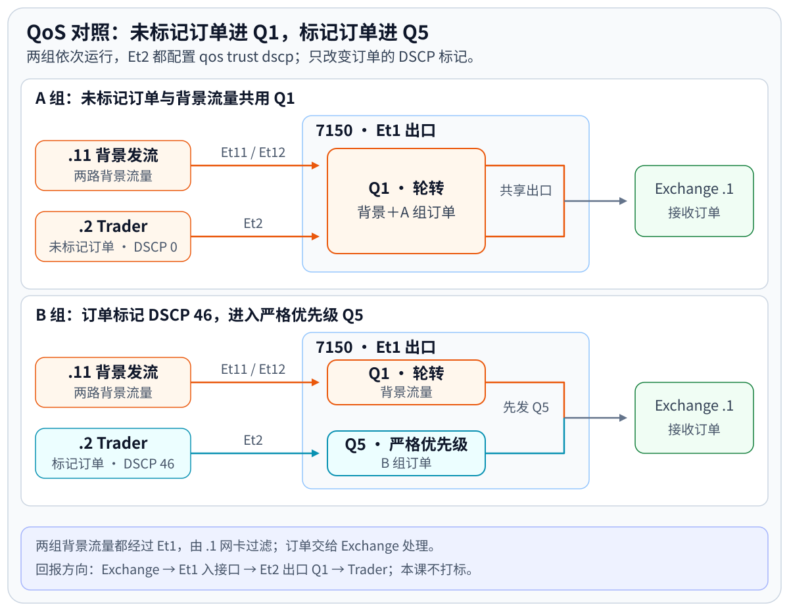
</div>

<div style="border-left:6px solid #15803d;background:#dcfce7;padding:12px 16px;border-radius:8px;margin:14px 0;"><span style="display:inline-block;padding:3px 12px;border-radius:6px;background:#15803d;color:#fff;font-weight:800;">需要运行 · 运行 ②</span> <span style="font-weight:700;color:#14532d;">在 .111 管理机的 <code>/qyt-fll/</code> 项目根目录以 root 运行；第 05 章 GUI 和 Socket 长连接保持在线。临时设置订单 DSCP、TRex、QoS、LANZ 和静态 MAC，结束后恢复。预期两组各 120 笔成交，B 组 Q5 <code>+240</code> 帧（订单 + ACK），p99 明显低于 A 组。</span></div>

```bash
bash assets/06-arista-time/11-qos-real-order-contention-live.sh
```

<div style="border-left:6px solid #7e22ce;background:#f3e8ff;padding:12px 16px;border-radius:8px;margin:14px 0;"><span style="display:inline-block;padding:3px 12px;border-radius:6px;background:#7e22ce;color:#fff;font-weight:800;">仅供展示</span> <span style="font-weight:700;color:#581c87;">关键代码 1 / 3：交换机临时配置。测试 MAC 静态指到 Et1，Et2 信任 DSCP，Et1 的 Q5 设成 strict。</span></div>

```bash
switch_config switch-qos-active \
  'configure terminal' \
  'queue-monitor length' \
  'mac address-table static 0200.0007.0001 vlan 20 interface Ethernet1' \
  'interface Ethernet2' 'qos trust dscp' \
  'interface Ethernet1' \
  'queue-monitor length thresholds 64 32' \
  'tx-queue 5' 'priority strict' 'exit' \
  'tx-queue 3' 'no priority' 'bandwidth percent 40' 'exit' \
  'tx-queue 2' 'bandwidth percent 30' 'exit' \
  'tx-queue 1' 'bandwidth percent 20' 'exit' \
  'tx-queue 0' 'bandwidth percent 10' 'exit' \
  'end'
# ... 见脚本全文
```

<div style="border-left:6px solid #7e22ce;background:#f3e8ff;padding:12px 16px;border-radius:8px;margin:14px 0;"><span style="display:inline-block;padding:3px 12px;border-radius:6px;background:#7e22ce;color:#fff;font-weight:800;">仅供展示</span> <span style="font-weight:700;color:#581c87;">发流关键代码：<code>trex_qos_contention_client.py</code> 用官方 TRex STL 打 Et1 的连续背景流。每口 500,000 pps、1514B、持续 15 秒。</span></div>

```python
from trex.stl.api import (  # noqa: E402
    Ether,
    IP,
    Raw,
    STLClient,
    STLPktBuilder,
    STLStream,
    STLTXCont,
    STLTXSingleBurst,
    UDP,
)

# TRex port 0/1 对应 .11 的 Et11 / Et12
PORTS = (0, 1)
SOURCE_MACS = {0: "00:0a:f7:f8:48:a0", 1: "00:0a:f7:f8:48:a1"}
# 课堂参数：dst_mac=02:00:00:07:00:01（静态指到 Et1），每口 500000 pps，连续 15 秒，1514B

    client = STLClient(
        server="127.0.0.1",
        username="flle-qos",
        verbose_level="error",
        sync_timeout=5,
        async_timeout=5,
    )
        # 连上本机已经起来的 ./t-rex-64 -i --stl --no-key
        client.connect()
        client.acquire(ports=list(PORTS), force=True)

def run_load(client, args):
    # 省略：校验 pps、duration、帧长 1514；确认两口 link 都是 UP
    for port in PORTS:
        client.add_streams(
            STLStream(
                name=f"flle-qos-load-{args.stage}-p{port}",
                # packet()：1514B MoldUDP64/ITCH，目的 MAC 指向 Et1
                packet=packet(
                    SOURCE_MACS[port], args.dst_mac, args.run_id, args.stage, args.packet_size
                ),
                # STLTXCont：连续发，直到 start() 的 duration 结束
                mode=STLTXCont(pps=args.pps),
            ),
            ports=[port],
        )
    before = client.get_stats(ports=list(PORTS))
    started_utc = utc_now()
    started_ns = time.perf_counter_ns()
    # 两口同时 start；课堂 duration=15
    client.start(ports=list(PORTS), duration=args.duration, force=True)
    # 省略：写 ready 文件，通知管理机背景流已经在跑
    client.wait_on_traffic(ports=list(PORTS), timeout=args.duration + 30, rx_delay_ms=0)
```

`STLClient` 连上本机 TRex 后，两个入口各挂一条连续流。A、B 两组背景相同，只改订单是否进 Q5。

<div style="border-left:6px solid #7e22ce;background:#f3e8ff;padding:12px 16px;border-radius:8px;margin:14px 0;"><strong style="color:#581c87;">仅供展示 · 关键代码 2 / 3：用 setsockopt 设置订单连接的 DSCP</strong>　<strong style="color:#075985;">摘自 posix_order_transport.cpp</strong>；省略原值读取与错误处理。Socket 与 Onload 共用这段代码。</div>

```cpp
const int tos = (dscp << 2) | (before & 3);
::setsockopt(fd_, IPPROTO_IP, IP_TOS, &tos, sizeof(tos));
```

**`setsockopt` 设置订单 Socket 的 IP TOS，后续发送的报文随之带上 DSCP 标记。** 本实验把 `dscp` 设为 46；`before` 是原有 TOS，低两位 ECN 保留。ECN 为 0 时，得到 `TOS 0xb8`。完整源码位于项目根目录下 `assets/05-kernel-bypass/source-reading/posix_order_transport.cpp`。

<div style="border-left:6px solid #7e22ce;background:#f3e8ff;padding:12px 16px;border-radius:8px;margin:14px 0;"><span style="display:inline-block;padding:3px 12px;border-radius:6px;background:#7e22ce;color:#fff;font-weight:800;">仅供展示</span> <span style="font-weight:700;color:#581c87;">关键代码 3 / 3：向 <code>.101:8088</code> 真下 120 笔 AAPL。奇数卖、偶数买，净持仓不变。</span></div>

```bash
  # 课堂 count=120：60 次「先卖 1 股，再买回 1 股」
  for index in $(seq 1 "$count"); do
    if (( index % 2 == 1 )); then
      side=SELL
      limit=1                 # 卖价压到最低，穿过买一立刻成交
    else
      side=BUY
      limit=999999999999      # 买价拉到最高，穿过卖一立刻买回
    fi
    payload="{\"symbol\":\"AAPL\",\"side\":\"$side\",\"quantity\":1,\"limit_price_x10000\":$limit,\"transport\":\"$QOS_TRANSPORT\"}"
    # API=http://10.1.1.101:8088；由已在线的 Socket 客户端把真单送进交易所
    if response="$(curl -sS --fail-with-body --connect-timeout 5 --max-time 10 \
      -X POST -H 'Content-Type: application/json' -d "$payload" "$API/api/order")"; then
      :
    else
      # 省略：记下组号、笔号和接口返回后退出
    fi
    oid="$(python3 -c 'import json,sys; print(json.load(sys.stdin)["client_order_id"])' <<<"$response")"
    # 省略：每 20 笔查询 /api/state，确认这批都是 ORDER_EXECUTED，并记下 RTT
```

奇数笔卖出 1 股 AAPL，偶数笔立刻买回；卖价极低、买价极高，保证穿过簿面成交，而不是挂在队列里等。120 笔全部成交后，持仓回到实验前的值。这些真单和 TRex 背景流一起争用 Et1，用来比较进 Q1 与进 Q5 的订单 RTT。章末也用方向相反的两笔订单验收。

<div style="border-left:6px solid #7e22ce;background:#f3e8ff;padding:12px 16px;border-radius:8px;margin:14px 0;"><span style="display:inline-block;padding:3px 12px;border-radius:6px;background:#7e22ce;color:#fff;font-weight:800;">仅供展示 · 历史实测（节选）</span> <span style="font-weight:700;color:#581c87;">看订单命中的队列，再比较两组 p99。</span></div>

```text
===== QoS 结果：Q1 与严格优先级 Q5 =====

对比项                 | A 组：未标记，进 Q1       | B 组：DSCP 46，进 Q5
-----------------------+---------------------------+--------------------------
背景发包（帧）         | 15,000,000                | 15,000,000
成交订单（笔）         | 120                       | 120
订单 RTT p50（µs）     | 2,199.762                 | 108.227
订单 RTT p99（µs）     | 2,269.697                 | 206.489

===== 队列核对 =====
Et1 计数增量           | A 组                      | B 组
-----------------------+---------------------------+--------------------------
Q1 发包（P1）          | +12,193,251               | +12,192,759
Q5 发包（P5）          | +0                        | +240
LANZ 事件              | +1                        | +1

恢复检查：配置已恢复，恢复后 2 笔订单成交，AAPL 净持仓不变。

===== 延迟差异 =====
p99：Q5 比 Q1 低 2,063.208 µs（90.90%）。
p99 比值：Q1 / Q5 = 10.99 倍。
```

这组历史结果中，Q5 订单的 **p99 降低了 90.90%**。A 组 Q5 没有发包，B 组 Q5 新增 **240 帧**，与接收端抓包一致，且 DSCP 均为 46。

本次抓包的 240 帧包含 **120 帧订单 + 120 帧纯 TCP ACK**，方向都是 Trader → Exchange；ACK 用来确认收到的回报。

两组 LANZ 各记录 1 次拥塞，说明出口仍有争用。下一节用 LANZ 进一步观察队列长度和拥塞持续时间。

### 运行 ③：LANZ 可视化

<div style="border:2px solid #4f46e5;background:#eef2ff;padding:10px 12px;border-radius:8px;margin:14px 0;"><div style="font-weight:900;color:#312e81;margin-bottom:4px;">导航卡 · 第二部分：QoS 与出口队列</div><div style="font-weight:700;color:#312e81;margin-bottom:8px;">范畴：分步实验　本步知识：把 LANZ 队列事件推到 8088　位置：全章第 9 / 14 项 · 本组第 3 / 3 项</div><span style="display:inline-block;margin:3px;padding:4px 10px;border-radius:6px;background:#f8fafc;border:1px solid #a5b4fc;color:#312e81;font-weight:800;">看多入口怎样排队</span><span style="display:inline-block;margin:3px;padding:4px 10px;border-radius:6px;background:#f8fafc;border:1px solid #a5b4fc;color:#312e81;font-weight:800;">运行 ②：在线 QoS</span><span style="display:inline-block;margin:3px;padding:4px 10px;border-radius:6px;background:#15803d;color:#fff;font-weight:800;">运行 ③：LANZ 可视化</span></div>

上一实验已经让真实订单进入不同队列。现在专门观察排队：出口队列变长时，LANZ 会记下事件，并把记录送到网页。

下面做 10k / 25k 两组对照：固定端口、帧长、包数和阈值，只改每个入口的发包速率（pps，packets per second）。观察提高速率后 Et2 队列的变化。

<div style="border-left:6px solid #0891b2;background:#cffafe;padding:12px 16px;border-radius:8px;margin:14px 0;"><span style="display:inline-block;padding:3px 12px;border-radius:6px;background:#0891b2;color:#fff;font-weight:800;">容易混淆</span> <span style="font-weight:700;color:#164e63;">本节输出里的 <code>TC</code> 一律指 Traffic Class（交换机内部流量类别），不是队列字段本身。本机默认把 <code>TC1 → TX queue 1</code>；若改过映射，两边编号可以不同。</span></div>

#### 本步理论：LANZ 记的是一次队列事件

LANZ 像一个带高低水位线的液位计：队列超过高水位时记 `S`（开始）；事件持续且队列仍高于低水位时，按间隔记 `U`（更新）；跌破低水位时记 `E`（结束）。短事件可能只有 S 和 E。

<div style="border-left:6px solid #7e22ce;background:#f3e8ff;padding:12px 16px;border-radius:8px;margin:14px 0;"><span style="display:inline-block;padding:3px 12px;border-radius:6px;background:#7e22ce;color:#fff;font-weight:800;">仅供展示 · 关键图</span> <span style="font-weight:700;color:#581c87;">队列超过高水位开始记录，跌破低水位后结束。</span></div>

<div style="background:#f8fafc;border:1px solid #cbd5e1;border-radius:12px;padding:10px;max-width:820px;margin:14px auto;">
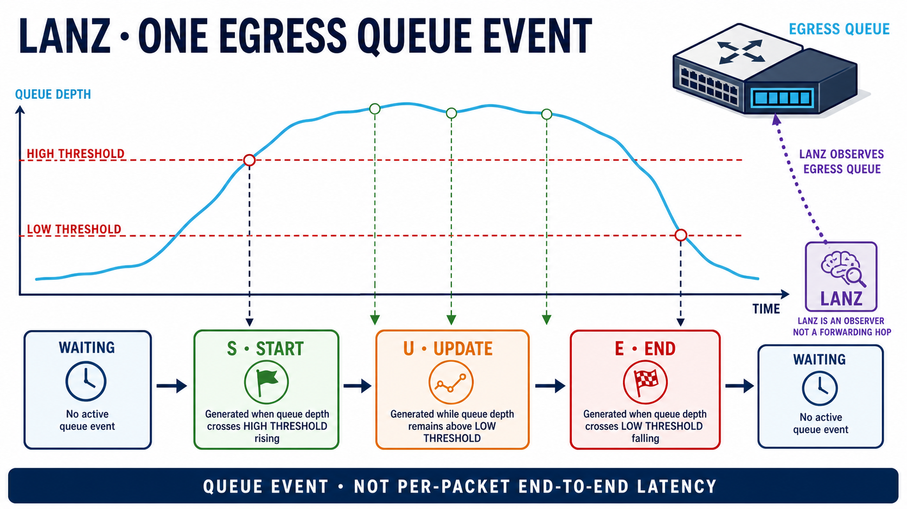
</div>

| 记录 | 含义 | 这一步要看的字段 |
| --- | --- | --- |
| `S` | 队列涨过高水位，事件开始 | 接口、Traffic Class、起始队列长度 |
| `U` | 事件还在持续 | 更新后的队列长度 |
| `E` | 队列回落，事件结束 | 持续时长和整个事件里的最大队列长度 |

本课 7150 的出口队列按[缓冲段](https://www.arista.com/en/um-eos/eos-latency-analyzer-lanz)计量，每段 480 字节。Et2 的高水位设为 **64 段**，低水位设为 **32 段**；64 是触发阈值，不是缓冲区总容量。

此前实验固定其他条件，只提高每个入口的发包速率：**每秒 1 万包时无事件；每秒 2.5 万包时出现拥塞事件**。这是该次配置下的观察结果，触发条件始终是队列超过高水位。

<div style="border-left:6px solid #7e22ce;background:#f3e8ff;padding:12px 16px;border-radius:8px;margin:14px 0;"><span style="display:inline-block;padding:3px 12px;border-radius:6px;background:#7e22ce;color:#fff;font-weight:800;">仅供展示 · 关键图</span> <span style="font-weight:700;color:#581c87;"><a href="reports/course-runs/20260903T060803Z-07-lanz-live-ab/raw/switch-dual-25k-4096-post.txt">历史实验示例</a>：提高入口发包速率后，LANZ 记录到出口拥塞。</span></div>

<div style="background:#f8fafc;border:1px solid #cbd5e1;border-radius:12px;padding:10px;max-width:820px;margin:14px auto;">
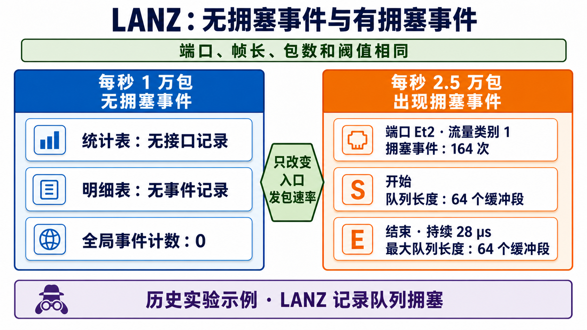
</div>

运行 ③ 用 `.11` 的 Et11+Et12 和隔离测试 MAC `02:00:00:07:00:02`，把 Et2 队列打过阈值。发包仍是运行 ② 那套 TRex STL，只是改成每口 4096 帧的 `STLTXSingleBurst`，并比较 10k 与 25k。课程生成的 MoldUDP64/ITCH 只负责制造排队；在线真单确认业务仍可用。运行 ② 已经用真单对过 Et1 的 LANZ 变化。

事件从交换机走到网页，只走管理口这一条路：

<div style="border-left:6px solid #7e22ce;background:#f3e8ff;padding:12px 16px;border-radius:8px;margin:14px 0;"><span style="display:inline-block;padding:3px 12px;border-radius:6px;background:#7e22ce;color:#fff;font-weight:800;">仅供展示 · 关键图</span> <span style="font-weight:700;color:#581c87;">交换机向 .101 推送事件；浏览器通过 8088 取网页、8089 取 JSON。</span></div>

<div style="background:#f8fafc;border:1px solid #cbd5e1;border-radius:12px;padding:10px;max-width:820px;margin:14px auto;">
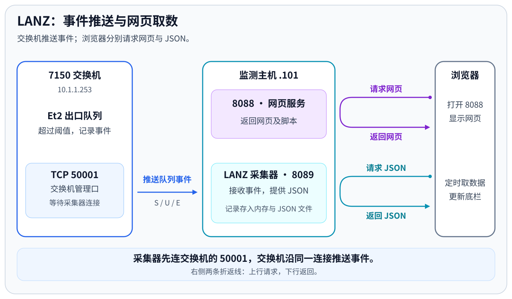
</div>

**`.101` 上的采集器主动连接交换机 `10.1.1.253:50001`，交换机沿同一条 TCP 连接推送事件**。采集器调用官方客户端库读取事件后，将记录保存在内存并写入 JSON 文件；本课没有使用数据库。

浏览器打开 **8088 网页**，页面中的 JavaScript 每 500ms 向 **`.101:8089/api/lanz`** 请求 JSON，再更新底栏。

#### 7150 上的 LANZ 配置

<div style="border-left:6px solid #7e22ce;background:#f3e8ff;padding:12px 16px;border-radius:8px;margin:14px 0;"><span style="display:inline-block;padding:3px 12px;border-radius:6px;background:#7e22ce;color:#fff;font-weight:800;">仅供展示 · 交换机配置</span> <span style="font-weight:700;color:#581c87;">以下 EOS 配置由实验脚本自动下发到 7150。</span></div>

```text
configure terminal
queue-monitor length
mac address-table static 0200.0007.0002 vlan 20 interface Ethernet2
interface Ethernet2
   queue-monitor length thresholds 64 32
end
configure terminal
queue-monitor streaming
   no shutdown
end
```

| 配置命令 | 作用 |
| --- | --- |
| `queue-monitor length` | 启用出口队列长度监测，记录拥塞事件。 |
| `queue-monitor length thresholds 64 32` | 将 Et2 的高、低水位分别设为 64、32 个缓冲段，每段 480 字节。 |
| `queue-monitor streaming` → `no shutdown` | 开启事件流服务，采集器连接交换机 TCP 50001 后接收事件。 |
| `mac address-table static … interface Ethernet2` | 将测试 MAC 固定到 VLAN 20 的 Et2 出口，让测试流量在这里排队。 |

#### 使用 Arista 官方 LANZ 客户端

**本课使用 Arista 官方 `goarista/lanz` 库接收、重连和解码。** 它把交换机发来的数据转换成 `LanzRecord` 对象，程序直接读取解码后的字段。[官方项目](https://github.com/aristanetworks/goarista/tree/master/lanz)、[官方客户端源码](https://github.com/aristanetworks/goarista/blob/master/lanz/client.go)

**1. 从哪里下载，怎样安装。** 这是 Go 客户端库，需要在 Go 程序中调用；本课固定的官方版本未附带独立的 LANZ 命令行工具。本课用一个很小的读取程序调用它，再把结果打印出来。管理机准备好 [Go 编译环境](https://go.dev/doc/install) 后，在项目的读取程序目录执行：

<div style="border-left:6px solid #7e22ce;background:#f3e8ff;padding:12px 16px;border-radius:8px;margin:14px 0;"><span style="display:inline-block;padding:3px 12px;border-radius:6px;background:#7e22ce;color:#fff;font-weight:800;">仅供展示 · 下载与编译</span> <span style="font-weight:700;color:#581c87;">课前在 .111 准备；本课固定 Go 1.24.13 和下列官方库版本。第二章上线时已将编译产物部署到 .101，运行 ③ 直接启用。</span></div>

```bash
cd /qyt-fll/assets/06-arista-time/lanz-reader
go get github.com/aristanetworks/goarista/lanz@v0.0.0-20251201112602-a373d7c9f0d9
CGO_ENABLED=0 go build -mod=mod -o /tmp/flle-lanz-reader .
```

`go get` 下载官方库及其依赖；`go build` 将本课读取程序与这些库编译成一个可执行文件。`.101` 直接运行这个文件，无需再安装 Go。源码相对于项目根目录的位置是 `assets/06-arista-time/lanz-reader/main.go`。

**2. 怎样连接交换机、读出事件。** 交换机开启前面的 `queue-monitor streaming` 后，读取工具主动连接 `10.1.1.253:50001`。下面从 `.111` 演示独立读取；运行 ③ 内部则在 `.101` 自动启动同一工具。

<div style="border-left:6px solid #7e22ce;background:#f3e8ff;padding:12px 16px;border-radius:8px;margin:14px 0;"><span style="display:inline-block;padding:3px 12px;border-radius:6px;background:#7e22ce;color:#fff;font-weight:800;">仅供展示 · 连接与读取</span> <span style="font-weight:700;color:#581c87;">使用已编译的工具，收到两条拥塞记录后退出。没有事件时会等待；Ctrl+C 结束本次读取。</span></div>

```bash
cd /qyt-fll
artifacts/blobs/arista/lanz-reader-v1/flle-lanz-reader-linux-amd64 \
  -addr 10.1.1.253:50001 -count 2
```

**真正接收和解码的是官方库，`main.go` 是本课调用它的程序。** `lanz.New` 指定交换机地址；`client.Run` 持续接收并解码，把完整的 `LanzRecord` 对象送入 `events` 通道。上面的命令显示中文摘要；要看官方对象本身，可在接收循环里直接打印整条记录。[官方连接选项](https://github.com/aristanetworks/goarista/blob/master/lanz/option.go)

**`LanzRecord` 已经包含在前面下载的 Arista 模块中。** 官方先用 `lanz.proto` 定义记录结构，再生成 `lanz.pb.go`，其中就有 Go 类型 `LanzRecord`；我们直接使用，无需自己定义结构或运行生成工具。`go get` 下载模块及依赖，代码中的 `import` 再指定要使用哪些包。[官方记录类型](https://pkg.go.dev/github.com/aristanetworks/goarista/lanz/proto#LanzRecord)

<div style="border-left:6px solid #7e22ce;background:#f3e8ff;padding:12px 16px;border-radius:8px;margin:14px 0;"><span style="display:inline-block;padding:3px 12px;border-radius:6px;background:#7e22ce;color:#fff;font-weight:800;">仅供展示 · 完整的最小读取程序</span> <span style="font-weight:700;color:#581c87;">这个独立示例持续读取并打印官方记录对象；保留字段与数值，不挑选或改名。它用于说明库的调用，不替换现有网页采集程序。</span></div>

```go
package main

import (
    "fmt" // Go 标准库：输出到终端

    "github.com/aristanetworks/goarista/lanz"          // 官方 LANZ 客户端
    pb "github.com/aristanetworks/goarista/lanz/proto" // 官方记录类型，取别名 pb
    "google.golang.org/protobuf/encoding/prototext"   // Protobuf 文本打印器
)

func main() {
    client := lanz.New(lanz.WithAddr("10.1.1.253:50001"))
    defer client.Stop()

    events := make(chan *pb.LanzRecord) // 用通道接收官方库解码后的记录
    go client.Run(events)              // 在后台连接、接收并解码

    for record := range events {
        fmt.Print(prototext.Format(record))
    }
}
```

`lanz` 和 `lanz/proto` 是 **同一个 Arista 模块中的两个包**；`pb` 只是给后者取的短名，所以 `pb.LanzRecord` 就是“这个包里的记录类型”。`prototext` 来自一并下载的 Google Protobuf 依赖，负责把记录对象打印成下面的文本。[Protobuf 打印器](https://pkg.go.dev/google.golang.org/protobuf/encoding/prototext#Format)

**数据结构分两层：外层 `LanzRecord` 是一条记录，内部可包含 `configRecord`（配置）、`congestionRecord`（拥塞）、`errorRecord`（错误）或 `globalBufferUsageRecord`（全局缓冲区使用情况）。** 本实验主要读取 `congestionRecord`。[官方结构定义](https://github.com/aristanetworks/goarista/blob/master/lanz/proto/lanz.proto)

<div style="border-left:6px solid #7e22ce;background:#f3e8ff;padding:12px 16px;border-radius:8px;margin:14px 0;"><strong style="color:#581c87;">仅供展示 · 官方测试数据的完整对象</strong>　下面使用 Arista 的 <code>client_test.go / TestSuccessPath</code> 中一条拥塞记录，经 Protobuf 打印器输出；是官方测试数据，不是本课 7150 的现场读数。</div>

```text
congestionRecord:  {
  timestamp:  146591697107546
  intfName:  "Cpu"
  switchId:  2048
  portId:  4096
  queueSize:  30000
}
```

`timestamp` 是交换机记录的事件时刻。本课 7150 / EOS 4.23.16M-2GB 实际以 **10 µs 为一个刻度**，网页先乘 10 换成微秒，再显示 UTC 日期与时间，`intfName` 是接口名，`switchId / portId` 是设备内部芯片与端口标识，`queueSize` 是队列长度（缓冲段数）。记录还可带 `entryType`（`START / UPDATE / END` 等）和 `trafficClass`（TC）；上面这条官方测试记录未提供这两个可选字段，因此不会补成默认值显示。**这是官方解码对象的文本表示，线上传输的仍是二进制 Protobuf。**

**3. 怎样交给网页。** 同一读取工具加 `-json` 后逐条输出 JSON，`.101` 的网页采集器保留最近 80 条事件，通过 `8089/api/lanz` 给现有 8088 页面显示。网页只消费已解码结果。

#### 运行实验并接收事件

<div style="border-left:6px solid #15803d;background:#dcfce7;padding:12px 16px;border-radius:8px;margin:14px 0;"><span style="display:inline-block;padding:3px 12px;border-radius:6px;background:#15803d;color:#fff;font-weight:800;">需要运行 · 运行 ③</span> <span style="font-weight:700;color:#14532d;">在 .111 管理机的 <code>/qyt-fll/</code> 项目根目录以 root 运行；保持当前交易 RUN 与 8088 页面在线。脚本借 <code>.11</code> 打 10k / 25k，并临时打开 LANZ length + streaming。预期：8088 的 LANZ 面板在 10k 时无事件，25k 时出现 Et2 的 S/E。网页直接逐条显示采集器保留的最近 80 条记录，每行列出自己的类型、接口、TC、队列长度和 UTC 时刻；终端打印累计次数与最近两条记录节选。结束后撤销 LANZ 和测试 MAC 配置，8088 恢复实验前的网页资产；<code>.101:8089</code> 接收器保留事件 JSON，面板标明当前未连接、正在显示历史记录。</span></div>

```bash
bash assets/06-arista-time/04b-lanz-stream-ab.sh
```

<div style="border-left:6px solid #7e22ce;background:#f3e8ff;padding:12px 16px;border-radius:8px;margin:14px 0;"><span style="display:inline-block;padding:3px 12px;border-radius:6px;background:#7e22ce;color:#fff;font-weight:800;">仅供展示 · 实测节选</span> <span style="font-weight:700;color:#581c87;">核对累计次数与最新事件；三个 show 命令由脚本自动执行。</span></div>

```text
===== LANZ 接收器 =====
每入口 10k pps / Et2 TC1：累计开始 0 次，更新 0 条，累计结束 0 次。
每入口 25k pps / Et2 TC1：累计开始 163 次，更新 0 条，累计结束 163 次。
采集器保留最近 80 条 Et2 记录（上限 80 条）；网页逐条展示保留记录；下方终端仅节选最近一次完整拥塞。
采集器连接：已连接交换机 TCP 50001。
最近一次完整事件：Ethernet2 / TC1
  S 开始：2026-09-17 00:07:12.929610 UTC；队列长度 64 段。
  E 结束：2026-09-17 00:07:12.929640 UTC；本次最大队列长度 64 段。
  每段 480 B；时刻粒度 10 µs，持续时间读取下方 EOS duration。

===== 交换机查询结果（恢复配置前） =====
$ show queue-monitor length statistics
Interface      Traffic Class  Count
-----------------------------------------------------------------
Et2             1               163

最近两条记录节选（最近一次拥塞的 E/S；完整累计次数见上表）：
$ show queue-monitor length Ethernet 2
S-Start, U-Update, E-End, TC-Traffic Class
Segment size for S, U and E congestion records is 480 bytes
* Max queue length during period of congestion
--------------------------------------------------------------------------------
Type    Time                   Intf    Congestion     Queue       Time of Max
                               (TC)    duration       length      Queue length
                                       (usecs)        (segments)  relative to
                                                                  congestion
                                                                  start
                                                                  (usecs)
--------------------------------------------------------------------------------
 E   0:00:04.91205 ago         Et2(1)    29            64*         0
 S   0:00:04.91208 ago         Et2(1)    N/A           64          N/A

$ show queue-monitor streaming clients
Number of clients connected : 1
--------------------------------
::ffff:10.1.1.101:52928

恢复检查：交换机配置和发流网卡已恢复，采集器保留事件记录。
逐条核对：交换机与接收器累计均为 163 次；最近 80 条记录一致。
```

- **163 次与 80 条：** 交换机累计 163 次拥塞，接收器累计收到 163 条 S 和 163 条 E；明细仅保留最近 80 条。网页直接列出保留的全部记录，最新在上；80、84、86 等队列长度分别属于各行记录。终端这里只节选最新的 S/E 两行，完整交换机查询包含 326 条记录。
- **队列长度与流量类别：** `TC1` 是流量类别，本机映射到 Q1；`Queue length` 表示缓冲段数，每段 480 B。结束行的 `64*` 是本次拥塞的**最大队列长度**；队列跌破低水位 32 段时事件结束。
- **事件时刻与持续时间：** 网页显示交换机 UTC 时刻，最新的 E 在上、S 在下。流式时刻以 10 µs 为一个刻度；交换机 `duration` 独立记录本次持续 **29 µs**，不能用两行时刻相减替代它。
- **采集器连接：** 实验中 `Number of clients connected : 1` 确认采集器已连接；结束后 streaming 关闭，网页保留本轮历史记录。

队列记录已经能说明哪里发生过拥塞。要进一步测出一条行情经过某段路径花了多久，先要明确计时起止点，再让记录时刻的设备使用同步的时钟。

## 第三部分：PTP 对时与延迟测量

这一部分把延迟测量完整串起来：先确定从哪里开始计时、到哪里结束，再用 PTP 同步交换机与网卡时钟，最后在运行 ④ 中抓取并配对同一帧的时间戳。

<a id="latency-measurement-boundaries"></a>

### 先把交换机延迟的起止点说清

<div style="border:2px solid #4f46e5;background:#eef2ff;padding:10px 12px;border-radius:8px;margin:14px 0;"><div style="font-weight:900;color:#312e81;margin-bottom:4px;">导航卡 · 第三部分：PTP 对时与延迟测量</div><div style="font-weight:700;color:#312e81;margin-bottom:8px;">范畴：测量原理　本步知识：确认计时起止点和比较条件，正确解读 350 ns　位置：全章第 10 / 14 项 · 本组第 1 / 4 项</div><span style="display:inline-block;margin:3px;padding:4px 10px;border-radius:6px;background:#15803d;color:#fff;font-weight:800;">先把交换机延迟的起止点说清</span><span style="display:inline-block;margin:3px;padding:4px 10px;border-radius:6px;background:#f8fafc;border:1px solid #a5b4fc;color:#312e81;font-weight:800;">原理：NTP 与 PTP</span><span style="display:inline-block;margin:3px;padding:4px 10px;border-radius:6px;background:#f8fafc;border:1px solid #a5b4fc;color:#312e81;font-weight:800;">运行 ④：入口戳到网卡戳</span><span style="display:inline-block;margin:3px;padding:4px 10px;border-radius:6px;background:#f8fafc;border:1px solid #a5b4fc;color:#312e81;font-weight:800;">生产测量：旁路打戳与统一对时</span></div>

用 7150 的 350 ns 规格说明测量前要确认哪些条件：[Arista 7150S 产品规格书第 6 页](https://www.arista.com/assets/data/pdf/Datasheets/7150S_Datasheet.pdf#page=6)列出 7150S-24 的 SFP+ 端口延迟为 `350 ns`，第 1 页用“低至 350 ns”概括该系列的低延迟能力。这是端口到端口的延迟指标。

要读这个数字，先弄清计时从哪里开始、到哪里结束。[RFC 8238](https://www.rfc-editor.org/rfc/rfc8238.html) 把交换机延迟定义成四种：FIFO、FILO、LILO、LIFO。起点选输入的首 bit 或尾 bit，终点选输出的首 bit 或尾 bit，两两组合就是这四种。做数据中心设备横向比较时用 FILO；研究 cut-through 多快开始出帧时，同时看 FIFO。

<div style="border-left:6px solid #7e22ce;background:#f3e8ff;padding:12px 16px;border-radius:8px;margin:14px 0;"><span style="display:inline-block;padding:3px 12px;border-radius:6px;background:#7e22ce;color:#fff;font-weight:800;">仅供展示 · 关键图</span> <span style="font-weight:700;color:#581c87;">FIFO、FILO、LILO、LIFO 是四种测量交换机延迟的方法；图里重点看 FIFO 与 FILO。</span></div>

<div style="background:#f8fafc;border:1px solid #cbd5e1;border-radius:12px;padding:10px;max-width:820px;margin:14px auto;">
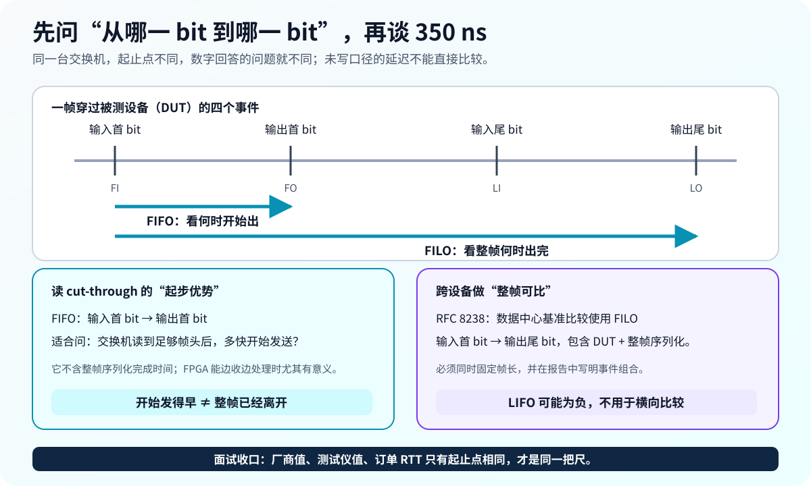
</div>

| 方法 | 全称 | 起点 → 终点 | 最适合回答什么 |
| --- | --- | --- | --- |
| FIFO | First In First Out | 输入首 bit → 输出首 bit | cut-through 多快开始转发 |
| FILO | First In Last Out | 输入首 bit → 输出尾 bit | 整帧穿过被测设备（DUT，Device Under Test）的共同比较口径；包含序列化 |
| LILO | Last In Last Out | 输入尾 bit → 输出尾 bit | 帧尾在设备内的推进关系 |
| LIFO | Last In First Out | 输入尾 bit → 输出首 bit | 对 cut-through 可能出现负值，RFC 8238 禁止拿它做设备横比 |

规格书[第 2 页的帧长—延迟关系图](https://www.arista.com/assets/data/pdf/Datasheets/7150S_Datasheet.pdf#page=2)以帧长为横轴、延迟（ns）为纵轴，展示 10G 下六种帧长的结果。7150S-24 对应的蓝线在 `350 ns` 附近小幅起伏，整体接近水平：帧从 64B 增大到 9216B，图示转发延迟仍然接近。同页文字也说明，设备采用 cut-through，并在不同帧长下保持相同的低延迟特征。

| 规格书列出的条件 | 内容 |
| --- | --- |
| 帧长 | 第 2 页列出 64、128、256、512、1518、9216B 六种帧长 |
| 线速 | 第 2 页图题为 10G，与本课 Et1 / Et2 的线速相同 |
| 端口对 | 第 2 页说明任意端口之间均具有低延迟特征；第 6 页 SFP+ 延迟为：24 口型号 350 ns，52/64 口型号 380 ns |

规格书给出了帧长、线速和端口对，**没有公布计时起止点、测试负载和统计口径。因此，350 ns 是选型参考，不能当作可直接复现的测量结果，也不能拆进五项耗时相加。** 延迟数字只有在测量条件与统计口径一致时才可直接比较。

确定起止点后，还要保证记录这两个时刻的钟可以比较。下面先看 NTP 与 PTP 分别同步什么，再把 PTP 用到交换机和网卡之间。

### 原理：NTP 与 PTP

<div style="border:2px solid #4f46e5;background:#eef2ff;padding:10px 12px;border-radius:8px;margin:14px 0;"><div style="font-weight:900;color:#312e81;margin-bottom:4px;">导航卡 · 第三部分：PTP 对时与延迟测量</div><div style="font-weight:700;color:#312e81;margin-bottom:8px;">范畴：机制讲解　本步知识：两只钟怎样建立可比较的时间关系　位置：全章第 11 / 14 项 · 本组第 2 / 4 项</div><span style="display:inline-block;margin:3px;padding:4px 10px;border-radius:6px;background:#f8fafc;border:1px solid #a5b4fc;color:#312e81;font-weight:800;">先把交换机延迟的起止点说清</span><span style="display:inline-block;margin:3px;padding:4px 10px;border-radius:6px;background:#15803d;color:#fff;font-weight:800;">原理：NTP 与 PTP</span><span style="display:inline-block;margin:3px;padding:4px 10px;border-radius:6px;background:#f8fafc;border:1px solid #a5b4fc;color:#312e81;font-weight:800;">运行 ④：入口戳到网卡戳</span><span style="display:inline-block;margin:3px;padding:4px 10px;border-radius:6px;background:#f8fafc;border:1px solid #a5b4fc;color:#312e81;font-weight:800;">生产测量：旁路打戳与统一对时</span></div>

NTP（网络时间协议）通常用于同步主机系统时钟；PTP（精确时间协议，IEEE 1588）通过交换对时报文校准设备时钟，可配合硬件时间戳提高精度。本课用 PTP 让 <code>.2</code> 的 X2522 网卡时钟（PHC）跟随 7150，才能比较两端记录的时间。

#### PTP 怎样同步

7150 是 Master（时间源），<code>.2</code> 是 Slave（跟随端）。本课采用 **UDP/IPv4 组播**，两端 PTP 域号均为 0。PTP 也支持直接以太网承载（L2）；传输方式由配置选择。

<div style="border-left:6px solid #7e22ce;background:#f3e8ff;padding:12px 16px;border-radius:8px;margin:14px 0;"><span style="display:inline-block;padding:3px 12px;border-radius:6px;background:#7e22ce;color:#fff;font-weight:800;">仅供展示</span> <span style="font-weight:700;color:#581c87;">先发现时间源，再交换同步与延迟报文。</span></div>

<div style="background:#f8fafc;border:1px solid #cbd5e1;border-radius:12px;padding:10px;max-width:820px;margin:14px auto;">
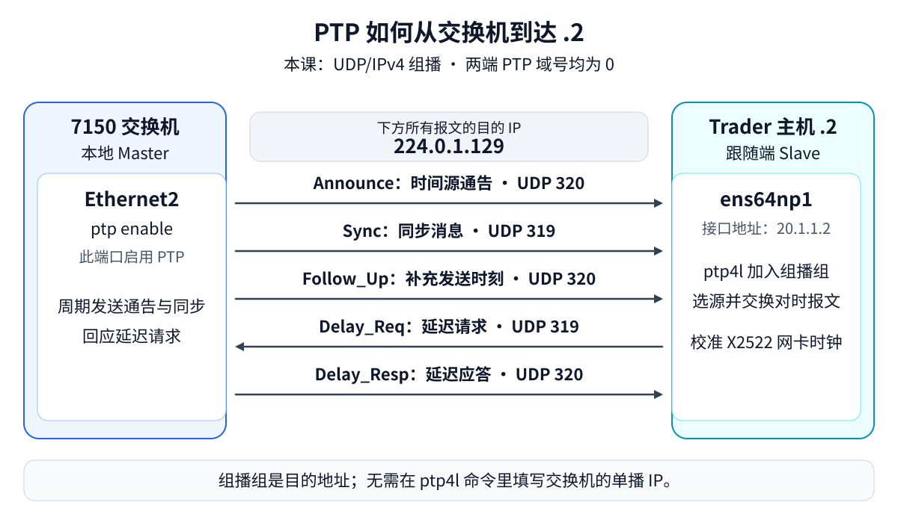
</div>

目的组播地址是 **<code>224.0.1.129</code>**；**UDP 319** 用于 Sync、Delay_Req 这类要打精确时刻的事件报文，**UDP 320** 用于 Announce、Follow_Up、Delay_Resp 这类把数字说清楚的一般报文。[协议说明](https://www.arista.com/assets/data/pdf/Whitepapers/ME-PTP-White-Paper.pdf)

把 7150 看成裁判，<code>.2</code> 看成学员。要对齐两只表，既要听到“现在几点”，也要知道声音在路上走了多久。下面四个时刻取自 [IEEE 1588 工作组](https://sagroups.ieee.org/1588/news/ieee-1588-2019-evolves-to-better-serve-its-wide-variety-of-applications/) 的算法示例，用来看怎么算；本课现场数字见运行 ④。

图里左右是两只表：裁判读自己的数，学员读自己的数。同一行是一次对话。黄色框标出纸条到达后，学员本子上已经拥有的数。

<div style="border-left:6px solid #7e22ce;background:#f3e8ff;padding:12px 16px;border-radius:8px;margin:14px 0;"><span style="display:inline-block;padding:3px 12px;border-radius:6px;background:#7e22ce;color:#fff;font-weight:800;">仅供展示 · 关键图</span> <span style="font-weight:700;color:#581c87;">Follow_Up 虚线到达时，右边标出已有 t2 和 t1；Delay_Resp 虚线到达时，右边标出已有 t3 和 t4。底栏再用公式计算。</span></div>

<div style="background:#f8fafc;border:1px solid #cbd5e1;border-radius:12px;padding:10px;max-width:820px;margin:14px auto;">
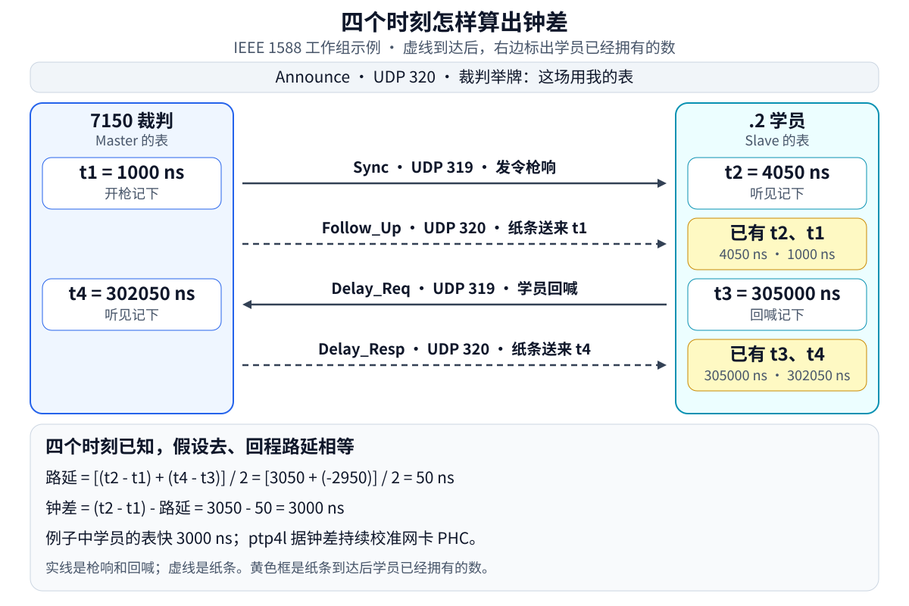
</div>

按图从上往下读：

1. **Announce（UDP 320）**：裁判举牌，“这场用我的表。”
2. **Sync（UDP 319）**：发令枪响。左边记下 **t1 = 1000 ns**，右边记下 **t2 = 4050 ns**。
3. **Follow_Up（UDP 320）**：虚线把 t1 送到学员。右边黄色框标出 **已有 t2、t1**。
4. **Delay_Req（UDP 319）**：学员回喊。右边记下 **t3 = 305000 ns**，左边记下 **t4 = 302050 ns**。
5. **Delay_Resp（UDP 320）**：虚线把 t4 送到学员。右边黄色框标出 **已有 t3、t4**。

四个时刻都记下后，**按去、回程传播时间相等的前提**，用底栏公式计算：

`路延 = [(t2 − t1) + (t4 − t3)] ÷ 2 = [3050 + (−2950)] ÷ 2 = 50 ns`

`钟差 = (t2 − t1) − 路延 = 3050 − 50 = 3000 ns`

例子里，学员的表比裁判快 3000 ns。实际运行时，`ptp4l` 根据反复测得的钟差调整网卡 PHC，持续校准；去、回程不对称会给钟差估计带来误差。[校时与路径补偿](https://linuxptp.nwtime.org/documentation/ptp4l/)

| 报文 | 谁发给谁 | UDP | 带上或记下的时刻 |
| --- | --- | --- | --- |
| Announce | 7150 → 组播 | 320 | 举牌：这场用我的表。 |
| Sync | 7150 → 组播 | 319 | 发令枪响。裁判记下 t1，学员记下 t2。 |
| Follow_Up | 7150 → 组播 | 320 | 纸条写着 t1，送给学员。 |
| Delay_Req | `.2` → 组播 | 319 | 学员回喊，自己记下 t3。 |
| Delay_Resp | 7150 → `.2` | 320 | 纸条写着裁判听见的 t4。 |

对应本实验，**7150 是 Master（主时钟），`.2` 上 X2522 的 PHC 是 Slave 侧被校准的网卡时钟**，由 `ptp4l` 持续对齐。

<div style="border-left:6px solid #7e22ce;background:#f3e8ff;padding:12px 16px;border-radius:8px;margin:14px 0;"><span style="display:inline-block;padding:3px 12px;border-radius:6px;background:#7e22ce;color:#fff;font-weight:800;">仅供展示</span> <span style="font-weight:700;color:#581c87;">7150：启用 PTP，让 Et2 收发对时报文。</span></div>

~~~text
configure terminal
ptp mode boundary
interface Ethernet2
   ptp enable
end
~~~

<code>boundary</code> 启用边界时钟模式并参与[主时钟选择](https://www.arista.com/en/um-eos/eos-setting-the-ptp-mode)。本课没有上游 PTP 时间源，7150 作为本地 Master，从 Et2 周期发送通告和同步报文；这里比较两端时间差，不据此证明 UTC 同步精度。

<div style="border-left:6px solid #7e22ce;background:#f3e8ff;padding:12px 16px;border-radius:8px;margin:14px 0;"><span style="display:inline-block;padding:3px 12px;border-radius:6px;background:#7e22ce;color:#fff;font-weight:800;">仅供展示</span> <span style="font-weight:700;color:#581c87;"><code>.2</code>：<code>ptp-switch-slave.cfg</code> 的关键配置。</span></div>

~~~ini
[global]
# ... 见脚本全文
domainNumber                0
# ... 见脚本全文
slaveOnly                   1
network_transport           UDPv4
delay_mechanism             E2E
time_stamping               hardware
# ... 见脚本全文
~~~

域号 0 与交换机一致；<code>UDPv4</code> 选择 IPv4 传输，<code>slaveOnly</code> 限定跟随端，<code>E2E</code> 用请求/应答估计路径时延，<code>hardware</code> 使用网卡硬件时间戳。

<div style="border-left:6px solid #7e22ce;background:#f3e8ff;padding:12px 16px;border-radius:8px;margin:14px 0;"><span style="display:inline-block;padding:3px 12px;border-radius:6px;background:#7e22ce;color:#fff;font-weight:800;">仅供展示</span> <span style="font-weight:700;color:#581c87;"><code>.2</code>：从 <code>ens64np1</code> 跟随交换机校时。</span></div>

~~~bash
ptp4l -f ptp-switch-slave.cfg -i ens64np1 -s -m -q
~~~

<code>-f</code> 读配置，<code>-i</code> 选网口，<code>-s</code> 限定跟随端，<code>-m/-q</code> 控制日志。[选项说明](https://linuxptp.nwtime.org/documentation/ptp4l/)

<code>ptp4l</code> 在该接口加入组播组，监听 UDP 319/320 并完成对时交互，命令里无需填写交换机的单播 IP。脚本看到日志进入 <code>SLAVE</code> 后才开始抓包。

### 运行 ④：入口戳到网卡戳

<div style="border:2px solid #4f46e5;background:#eef2ff;padding:10px 12px;border-radius:8px;margin:14px 0;"><div style="font-weight:900;color:#312e81;margin-bottom:4px;">导航卡 · 第三部分：PTP 对时与延迟测量</div><div style="font-weight:700;color:#312e81;margin-bottom:8px;">范畴：分步实验　本步知识：时间戳在哪里打，以及怎样配对相减　位置：全章第 12 / 14 项 · 本组第 3 / 4 项</div><span style="display:inline-block;margin:3px;padding:4px 10px;border-radius:6px;background:#f8fafc;border:1px solid #a5b4fc;color:#312e81;font-weight:800;">先把交换机延迟的起止点说清</span><span style="display:inline-block;margin:3px;padding:4px 10px;border-radius:6px;background:#f8fafc;border:1px solid #a5b4fc;color:#312e81;font-weight:800;">原理：NTP 与 PTP</span><span style="display:inline-block;margin:3px;padding:4px 10px;border-radius:6px;background:#15803d;color:#fff;font-weight:800;">运行 ④：入口戳到网卡戳</span><span style="display:inline-block;margin:3px;padding:4px 10px;border-radius:6px;background:#f8fafc;border:1px solid #a5b4fc;color:#312e81;font-weight:800;">生产测量：旁路打戳与统一对时</span></div>

#### 用原帧和 SPAN 副本取得两个时刻

原帧从 Et2 送给 <code>.2</code>，由网卡记录接收时刻 **<code>T_rx</code>**。原帧不带交换机入口戳，因此用 SPAN（端口镜像）复制 Et1 的入向帧，给副本追加入口短戳，再从 Et11 送到 <code>.11</code> 保存。

副本末尾只有 **4 字节循环计数值**，需要交换机另外发送 **Keyframe**，提供“完整时间 + 计数器读数”作为基准，才能还原入口时刻 **<code>T_in</code>**。[时间戳机制](https://www.arista.com/assets/data/pdf/Whitepapers/Overview_Arista_Timestamps.pdf)

<div style="border-left:6px solid #7e22ce;background:#f3e8ff;padding:12px 16px;border-radius:8px;margin:14px 0;"><span style="display:inline-block;padding:3px 12px;border-radius:6px;background:#7e22ce;color:#fff;font-weight:800;">仅供展示</span> <span style="font-weight:700;color:#581c87;">原帧提供网卡 RX 时间；副本与 Keyframe 一起还原交换机入口时间。</span></div>

<div style="background:#f8fafc;border:1px solid #cbd5e1;border-radius:12px;padding:10px;max-width:820px;margin:14px auto;">
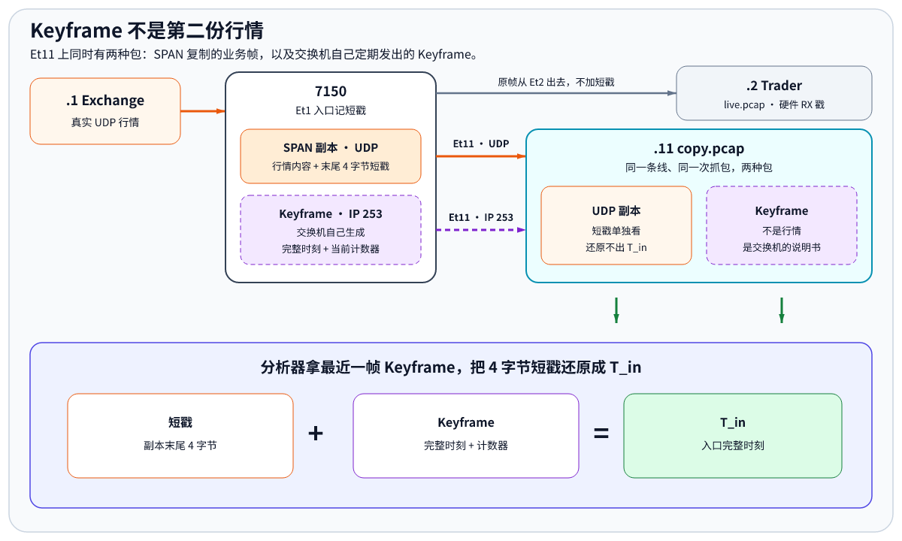
</div>

<div style="border-left:6px solid #7e22ce;background:#f3e8ff;padding:12px 16px;border-radius:8px;margin:14px 0;"><span style="display:inline-block;padding:3px 12px;border-radius:6px;background:#7e22ce;color:#fff;font-weight:800;">仅供展示</span> <span style="font-weight:700;color:#581c87;">7150：镜像 Et1 入向帧，并给 Et11 的副本追加短戳。</span></div>

~~~text
configure terminal
monitor session FLLETS source Ethernet1 rx
monitor session FLLETS destination Ethernet11
interface Ethernet11
   mac timestamp before-fcs
end
~~~

<code>rx</code> 选择入向流量；<code>before-fcs</code> 给副本追加 4 字节并重算 FCS，记录的是原帧最后一个字节到达 Et1 的时刻。业务原帧保持原样。

<div style="border-left:6px solid #7e22ce;background:#f3e8ff;padding:12px 16px;border-radius:8px;margin:14px 0;"><span style="display:inline-block;padding:3px 12px;border-radius:6px;background:#7e22ce;color:#fff;font-weight:800;">仅供展示</span> <span style="font-weight:700;color:#581c87;">7150：让 Keyframe 从 Et11 发到 <code>.11</code>。</span></div>

~~~text
configure terminal
platform fm6000 keyframe FLLETS interface Ethernet11 21.1.1.11 000a.f7f8.48a0
platform fm6000 keyframe FLLETS source ip 20.1.1.254
platform fm6000 keyframe FLLETS fields skew
end
~~~

第一行指定出口及 <code>.11</code> 的目的 IP/MAC；第二行指定源 IP，第三行附带时钟偏差信息。Keyframe 使用 **IP 协议号 253**，与带戳副本一起进入 <code>.11</code>。

#### 两边抓包，再交给管理机分析

<div style="border-left:6px solid #7e22ce;background:#f3e8ff;padding:12px 16px;border-radius:8px;margin:14px 0;"><span style="display:inline-block;padding:3px 12px;border-radius:6px;background:#7e22ce;color:#fff;font-weight:800;">仅供展示</span> <span style="font-weight:700;color:#581c87;"><code>.2</code> 抓原帧和硬件 RX 戳；<code>.11</code> 抓副本及 Keyframe。</span></div>

~~~bash
# .2 的远端 Bash：$1 是本次目录，$2 是从 Exchange socket 读取的源端口
# 临时加入 A/B 两组，再执行带硬件时间戳选项的 tcpdump
/usr/bin/python3 "$1/capture_market.py" "$1/live.pcap" "$2" \
  >"$1/tcpdump.log" 2>&1 &
echo $! >"$1/tcpdump.pid"

# .11 的远端 Bash：$1 是本次目录；自身时钟不是测量终点
/usr/bin/tcpdump -i ens64f0np0 -nn --time-stamp-precision=nano -s 0 \
  -w "$1/copy.pcap" 'udp or ip proto 253' \
  >"$1/tcpdump.log" 2>&1 &
echo $! >"$1/tcpdump.pid"
~~~

第五章已停止普通行情接收器，本步在 `.2` 临时加入 A/B 两组，只接收 Exchange 的行情；抓包退出后释放订阅。**沿用 Exchange 当前的行情模式，不切换 A/B。**

`capture_market.py` 随后执行 `tcpdump -i ens64np1 -j adapter_unsynced --time-stamp-precision=nano`，取网卡 PHC 的硬件 RX 时间戳，按纳秒保存；<code>.11</code> 的 <code>udp or ip proto 253</code> 同时抓到 UDP 副本与 Keyframe。

抓包结束后，总脚本把两份 pcap 收回 <code>.111</code> 管理机，自动配对并计算时间差。

#### 两份抓包怎样认出同一帧

**同一条流里的 UDP 源端口、目的端口通常不变，靠端口无法区分前后两个包。**[UDP 头本身也没有消息序号](https://www.rfc-editor.org/rfc/rfc768.html)。但本课 UDP 里面装的是 [MoldUDP64 行情](https://www.nasdaqtrader.com/content/technicalsupport/specifications/dataproducts/moldudp64.pdf)，内容包含**会话号、行情消息序号和行情数据**。例如同一会话的第 1001、1002 条行情，端口相同，包里的消息序号已经不同。

本课先筛出要测的行情流，再用 **IP ID + UDP 目的端口 + 完整 UDP 载荷** 查找对应副本。载荷就是 UDP 携带的内容，上述会话号、消息序号和行情数据都在其中；分析器逐字节比较这整段内容。

<div style="border-left:6px solid #7e22ce;background:#f3e8ff;padding:12px 16px;border-radius:8px;margin:14px 0;"><span style="display:inline-block;padding:3px 12px;border-radius:6px;background:#7e22ce;color:#fff;font-weight:800;">仅供展示 · 配对示意</span> <span style="font-weight:700;color:#581c87;">端口相同，仍可用报文标识和完整载荷认出同一帧。</span></div>

<div style="background:#f8fafc;border:1px solid #cbd5e1;border-radius:12px;padding:10px;max-width:820px;margin:14px auto;">
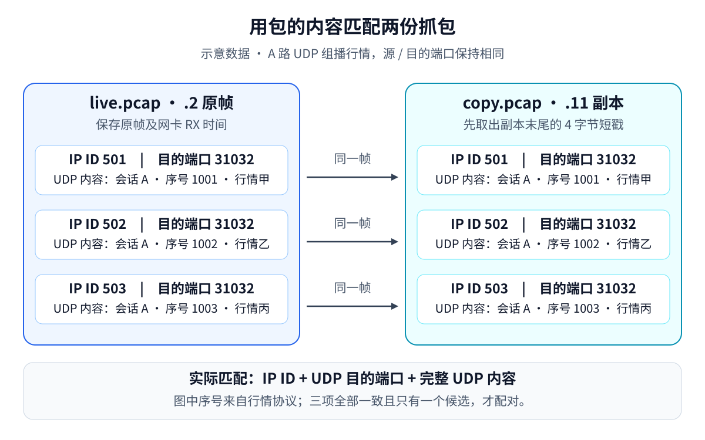
</div>

副本多出的 **4 字节入口短戳先取出保存**，剩下的载荷才能与原帧比较。IP ID 是 IPv4 头里的报文标识，[可能重复](https://www.rfc-editor.org/rfc/rfc6864.html)，所以也要结合端口和载荷；三项完全相同且只有一个候选时才配对，找不到或匹配不唯一就单独计数。

找到同一帧后，用副本短戳和 Keyframe 还原 **<code>T_in</code>**，取原帧在 <code>.2</code> 网卡上的接收时间 **<code>T_rx</code>**，计算 **<code>T_rx − T_in</code>**。Keyframe 负责还原时间，包的内容负责配对。

#### 运行总脚本，查看结果

<div style="border-left:6px solid #15803d;background:#dcfce7;padding:12px 16px;border-radius:8px;margin:14px 0;"><span style="display:inline-block;padding:3px 12px;border-radius:6px;background:#15803d;color:#fff;font-weight:800;">需要运行 · 运行 ④</span> <span style="font-weight:700;color:#14532d;">在 .111 管理机的 <code>/qyt-fll/</code> 项目根目录以 root 运行；保持第 05 章交易 GUI 在线。脚本会配置 PTP、镜像、打戳、Keyframe 和临时 VLAN，退出时一并撤销。预期 <code>.2</code> 进入 SLAVE，配对率 100%。</span></div>

~~~bash
bash assets/06-arista-time/12-stamped-span-live.sh
~~~

<div style="border-left:6px solid #7e22ce;background:#f3e8ff;padding:12px 16px;border-radius:8px;margin:14px 0;"><span style="display:inline-block;padding:3px 12px;border-radius:6px;background:#7e22ce;color:#fff;font-weight:800;">仅供展示 · 历史实测（单播行情，节选）</span> <span style="font-weight:700;color:#581c87;">先确认 PTP 锁定，再看报文配对和时间差。</span></div>

```text
===== PTP 对时 =====
跟随状态：.2 已进入 SLAVE。
ptp4l 最后估计的时钟偏差：91 ns。

===== 同帧配对 =====
有效时间窗内配对：3,705 / 3,705 帧（100.00%）
未找到副本：0 帧；匹配不唯一：0 帧。
用于还原入口时间的 Keyframe：8 帧。

===== 时间差：网卡 RX 时间 − 交换机入口时间 =====
统计项     | 时间差（µs）
-----------+-------------
最小值     |        3.328
p50        |        7.168
p99        |       11.776
最大值     |       12.032
负值样本：0 帧。

配对与时间差检查：通过。

恢复检查：PTP、SPAN、Keyframe 和临时网络配置已恢复，交易系统保持在线。
```

**3,705 帧全部找到唯一副本**，没有负值样本；从 Et1 入口到网卡 RX 的时间差，**p50 为 7.168 µs，p99 为 11.776 µs**。此前一次复跑配对 6,313 帧，p50 同为 7.168 µs，p99 为 11.264 µs。

这段时间差包含交换机转发、链路传输及剩余对时误差。上面的 91 ns 是 ptp4l 最后一次估计的时钟偏差，不是整次测量的误差上限。

### 生产测量：旁路打戳与统一对时

<div style="border:2px solid #4f46e5;background:#eef2ff;padding:10px 12px;border-radius:8px;margin:14px 0;"><div style="font-weight:900;color:#312e81;margin-bottom:4px;">导航卡 · 第三部分：PTP 对时与延迟测量</div><div style="font-weight:700;color:#312e81;margin-bottom:8px;">范畴：扩展设计　本步知识：区分生产环境中取副本、打戳与对时的设备职责　位置：全章第 13 / 14 项 · 本组第 4 / 4 项</div><span style="display:inline-block;margin:3px;padding:4px 10px;border-radius:6px;background:#f8fafc;border:1px solid #a5b4fc;color:#312e81;font-weight:800;">先把交换机延迟的起止点说清</span><span style="display:inline-block;margin:3px;padding:4px 10px;border-radius:6px;background:#f8fafc;border:1px solid #a5b4fc;color:#312e81;font-weight:800;">原理：NTP 与 PTP</span><span style="display:inline-block;margin:3px;padding:4px 10px;border-radius:6px;background:#f8fafc;border:1px solid #a5b4fc;color:#312e81;font-weight:800;">运行 ④：入口戳到网卡戳</span><span style="display:inline-block;margin:3px;padding:4px 10px;border-radius:6px;background:#15803d;color:#fff;font-weight:800;">生产测量：旁路打戳与统一对时</span></div>

生产部署把多个采集点的副本集中起来，统一配对和分析。

#### 官方方案：DMF 多点采集与分析

<div style="border-left:6px solid #7e22ce;background:#f3e8ff;padding:12px 16px;border-radius:8px;margin:14px 0;"><span style="display:inline-block;padding:3px 12px;border-radius:6px;background:#7e22ce;color:#fff;font-weight:800;">仅供展示 · 官方方案</span> <span style="font-weight:700;color:#581c87;">入口打戳，Service Node 配对计算，Analytics Node 展示结果。</span></div>

<div style="background:#f8fafc;border:1px solid #cbd5e1;border-radius:12px;padding:10px;max-width:820px;margin:14px auto;">
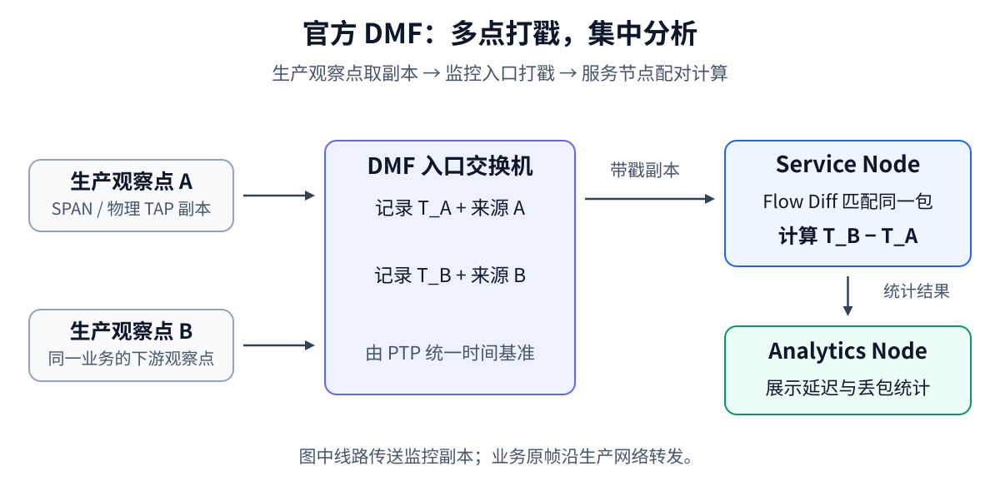
</div>

**DMF（DANZ Monitoring Fabric）是 Arista 的监控网络方案**。多个生产观察点通过 SPAN 或物理 TAP 提供副本，[监控入口交换机记录时间](https://www.arista.com/ug-dmf/dmf-advanced-policy-configuration)，DMF 策略把选中的副本送到 [Service Node](https://www.arista.com/en/ug-dmf/dmf-dmf-service-node-appliance)。它的 Flow Diff 功能匹配同一包在不同观察点的副本，计算时间差并统计丢包，结果交给 Analytics Node 展示。

**7280R3** 可将 **48 位时间戳写入源 MAC**，与 7150 的尾部短戳 + Keyframe 格式不同。[打戳平台与格式](https://www.arista.com/en/ug-dmf/dmf-advanced-policy-configuration)

Flow Diff 的延迟与丢包分析支持 **7280R3 / 7800R3**。[分析平台](https://www.arista.com/en/ug-dmf/dmf-dmf-service-node-appliance)

#### 朋友的方案：专职 7150 把 TAP 流量送到 TOOL

<div style="border-left:6px solid #7e22ce;background:#f3e8ff;padding:12px 16px;border-radius:8px;margin:14px 0;"><span style="display:inline-block;padding:3px 12px;border-radius:6px;background:#7e22ce;color:#fff;font-weight:800;">仅供展示 · 部署设计</span> <span style="font-weight:700;color:#581c87;">多个生产采集点，经专职 7150 汇聚到同一台分析服务器；本课未实测该部署。</span></div>

<div style="background:#f8fafc;border:1px solid #cbd5e1;border-radius:12px;padding:10px;max-width:820px;margin:14px auto;">
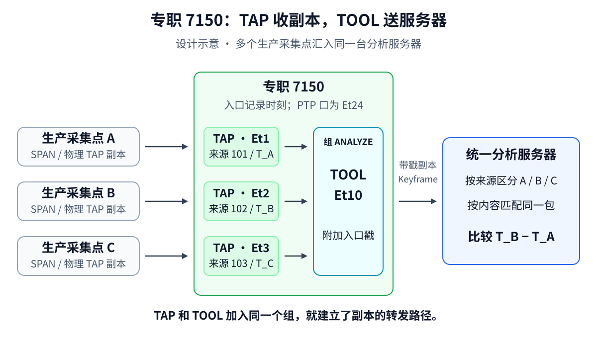
</div>

**SPAN 在生产交换机上复制流量；TAP 和 TOOL 是专职汇聚交换机的两种端口角色：TAP 收副本，TOOL 向分析服务器发副本。**[同一个组把两者连起来](https://www.arista.com/en/um-eos/eos-test-access-point-aggregation)。物理 TAP 则是链路上的分流设备，也能给 TAP 口提供副本。

<div style="border-left:6px solid #7e22ce;background:#f3e8ff;padding:12px 16px;border-radius:8px;margin:14px 0;"><span style="display:inline-block;padding:3px 12px;border-radius:6px;background:#7e22ce;color:#fff;font-weight:800;">仅供展示 · 关键配置</span> <span style="font-weight:700;color:#581c87;">用于另一台专职 7150，Et24 已配置为上游 PTP 跟随口。exclusive 会停止普通交换，不能在本课承担交易转发的 7150 上执行。</span></div>

~~~text
configure terminal
tap aggregation
   mode exclusive
   mode exclusive no-errdisable ethernet 24
exit
interface Ethernet1-3
   switchport mode tap
   switchport tap default group ANALYZE

interface Ethernet1
   switchport tap identity 101
interface Ethernet2
   switchport tap identity 102
interface Ethernet3
   switchport tap identity 103

interface Ethernet10
   switchport mode tool
   switchport tool group set ANALYZE
   switchport tool identity dot1q
   mac timestamp before-fcs
end

show tap aggregation groups
~~~

| 关键命令 | 起什么作用 |
| --- | --- |
| `switchport mode tap` | Et1～Et3 接收各生产采集点的副本 |
| `switchport mode tool` | Et10 把副本送给分析服务器 |
| 两端的 `ANALYZE` 组配置 | 两边属于同一个组，将 Et1～Et3 的流量汇到 Et10 |
| 两端的 `identity` 配置 | 给副本加外层 VLAN 来源标签，服务器能分清采集点 |
| `mac timestamp before-fcs` | 在 TOOL 出口附加短戳，记录的时刻是副本到达 TAP 入口时 |

`show tap aggregation groups` 核对组内端口。Et24 跟随上游 PTP 时间源；TAP 模式下，上游需静态向该口发送 PTP 组播。Keyframe 从 Et10 发往分析服务器。

分析软件解析来源标签、短戳和 Keyframe，按报文内容配对，再计算 **B 点入口时间 − A 点入口时间**。同台 7150 的两个入口[共用计数器](https://www.arista.com/assets/data/pdf/Whitepapers/Overview_Arista_Timestamps.pdf)，**相对间隔无需跨设备对时**；短戳仍需处理回绕，换算精度受计数频率影响。PTP 用于建立 UTC 参考或跨设备比较。

两份副本从生产采集点到 7150 的传输时间也在差值里；测生产路径延迟时，要校准这两条采集线路的时延差。

## 全章验收

### 运行 ⑤：确认交易系统在线

<div style="border:2px solid #4f46e5;background:#eef2ff;padding:10px 12px;border-radius:8px;margin:14px 0;"><div style="font-weight:900;color:#312e81;margin-bottom:4px;">导航卡 · 全章验收</div><div style="font-weight:700;color:#312e81;margin-bottom:8px;">范畴：全章回收　本步知识：用真实订单确认端到端业务仍然可用　位置：全章第 14 / 14 项 · 本组第 1 / 1 项</div><span style="display:inline-block;margin:3px;padding:4px 10px;border-radius:6px;background:#15803d;color:#fff;font-weight:800;">运行 ⑤：确认交易系统在线</span></div>

QoS、LANZ 和 PTP 三项实验在结束时撤销各自的临时配置。章末脚本补齐 SFC 行情接收与建簿，确认五档持续更新，再用两笔净持仓不变的真实订单确认业务可用。行情需要重新同步时，回放会从开盘重来。

<div style="border-left:6px solid #15803d;background:#dcfce7;padding:12px 16px;border-radius:8px;margin:14px 0;"><span style="display:inline-block;padding:3px 12px;border-radius:6px;background:#15803d;color:#fff;font-weight:800;">需要运行 · 运行 ⑤</span> <span style="font-weight:700;color:#14532d;">在 .111 管理机的 <code>/qyt-fll/</code> 项目根目录以 root 执行。三项主实验结束后必做，确认整体状态；切换过 DPDK 或停止过交易时，它同时完成恢复验收。如果进程、驱动与控制器状态不一致，脚本会停止并提示检查，避免在未完整恢复的环境中继续。预期两笔净持仓不变的真实订单成交，三路 ONLINE，数据链 ping 通。</span></div>

```bash
bash assets/06-arista-time/13-trading-online-final.sh
```

<div style="border-left:6px solid #7e22ce;background:#f3e8ff;padding:12px 16px;border-radius:8px;margin:14px 0;"><span style="display:inline-block;padding:3px 12px;border-radius:6px;background:#7e22ce;color:#fff;font-weight:800;">仅供展示 · 章末验收输出</span> <span style="font-weight:700;color:#581c87;">以下节选已有实测记录，核对驱动、客户端、网页、数据链路和两笔订单；来源及校验信息保存在配套资产说明。</span></div>

```text
result=PASS
data_plane=SFC/READY/sfc
clients=Socket, Onload, TCPDirect ONLINE; DPDK WAITING
web=http://10.1.1.101:8088/ HTTP 200
data_link=ping 3/3
real_orders=2/2 ORDER_EXECUTED via Socket/SoupBinTCP/OUCH; rtt_ns=124384/67517
position_AAPL=200->200 unchanged
evidence=reports/course-runs/20260903T100854Z-07-trading-online-final
```

| 运行后必须看到 | 合格值 | 它回答什么 |
| --- | --- | --- |
| 数据面 | `SFC / READY / sfc` | X2522 当前处于常用驱动和控制器管理下 |
| 客户端 | Socket、Onload、TCPDirect `ONLINE`；DPDK `WAITING` | 第 05 章准备好的多路径控制台仍可继续使用 |
| 交易页面 | `http://10.1.1.101:8088/` HTTP 200 | GUI 可用，不只是底层 ping 通 |
| 行情与五档 | 接收器、建簿程序在线，`HEALTHY / OPEN`；连续采样中接收计数和两只股票的建簿序号前进 | 回放确实到达客户端，五档不是旧快照 |
| 数据链 | `.2 → .1` ping `3/3` | 20.1.1.0/24 物理交易链路可用 |
| 真实订单 | `2/2 ORDER_EXECUTED`、两个 `order_rtt_ns>0`，AAPL 持仓前后相同 | Exchange、Trader、Socket 长连接、风控和业务状态共同在线 |

<div style="border-left:6px solid #0891b2;background:#cffafe;padding:12px 16px;border-radius:8px;margin:14px 0;"><span style="display:inline-block;padding:3px 12px;border-radius:6px;background:#0891b2;color:#fff;font-weight:800;">验收结论</span> <span style="font-weight:700;color:#164e63;">六项全部通过，才算章末完成：实验配置已撤销，行情持续更新，交易可用。下一章直接从这个正常环境开始。</span></div>

下一章从“观察报文”转向“主动过滤”：在接收主机的驱动入口放一个小程序，只丢一条指定行情，再看接收端能否发现缺口并停止下单。

### 理解检查

1. 固定帧长、路径与配置时，五项耗时中哪一项是延迟的主要变动项？
2. 1518 字节的帧在 10G 出口发完需要多久？Cut-through 能省掉这段序列化时间吗？
3. 近端机柜为什么还要盘纤？如果只缩短自己的光程，会改变哪一项耗时？
4. cut-through 已开启，为什么仍可能慢？
5. 给 Q5 配 strict 后，订单会自动进入 Q5 吗？
6. LANZ 的 S / E 与订单 p99 是一个读数吗？
7. 为什么 .11 的抓包时间不参与本课减法？
8. 配对率 100% 为什么还不能宣布绝对时延准确？
9. 实验结束，除了撤销交换机临时配置，还要看什么？

#### 参考答案

1. 出口排队。前四项在这些条件下相对固定；突发流量争用出口，会拉长排队等待和尾部延迟。
2. 1518 × 8 ÷ 10 Gbit/s = 1214.4 ns，约 1.21 µs。Cut-through 能提前开始发送，不能缩短同一帧在相同线速下的序列化时间。
3. 盘纤把近端路径补到约定光程，减少机柜位置带来的传播时延差异。缩短光程会减少介质传播时间，改变等光程条件。
4. 它提前开始转发；出口争用产生的排队仍然存在。
5. 不会；还要打标、入口信任、DSCP→TC 和 TC→队列映射。
6. 前者是一场队列事件的开始与结束，后者是一批订单耗时的尾部分位数。
7. .11 只收副本；实际相减的是交换机入口戳与 .2 网卡硬件接收戳。
8. 配对正确只证明找到了同一帧，剩余对时误差、校准和路径误差仍会影响差值。
9. 交易页面、原数据路径和客户端正常，两笔验证订单成交且净持仓不变。

## 配套资料

### 本地配套资产

下表路径均相对于 .111 管理机项目中的 `assets/06-arista-time/`，完整目录为 `/qyt-fll/assets/06-arista-time/`。

#### 课程主线脚本

| 路径 | 用途 |
| --- | --- |
| `01-arista-fabric-inventory.sh` | 运行 ①：只读检查交换机和课程链路 |
| `11-qos-real-order-contention-live.sh` | 运行 ②：真订单与双入口背景流争用 Et1，比较 Q1 / Q5、LANZ 和 p99 |
| `04b-lanz-stream-ab.sh` / `lanz-reader/` / `lanz_stream_collector.py` | 运行 ③：官方客户端库读取 LANZ 事件，采集器提供 `.101:8089` JSON 与 8088 展示 |
| `12-stamped-span-live.sh` | 运行 ④：交易在线，PTP 对表后配对真行情入口戳与 `.2` PHC RX |
| `13-trading-online-final.sh` | 运行 ⑤：统一验收；需要时交还 DPDK 网卡，并以两笔真实订单确认业务在线 |
| `live-support/` / `LIVE-SUPPORT-SHA256SUMS` | 主线脚本依赖的程序、配置与校验清单 |

#### 备用与历史证据

以下用于排障、进阶实验或复核旧结果，无需在顺刷时逐项执行。

| 路径 | 用途 |
| --- | --- |
| `02-serialization-time.sh` | 按含 FCS 的 64/1518 字节换算发送时间，与正文一致 |
| `04-lanz-live-ab.sh` | 历史停机 LANZ `show` A/B 审计备用 |
| `04-lanz-verified-evidence.sh` / `lanz-native-20260820.txt` | 无维护窗时的 LANZ 历史证据备用 |
| `05-hardware-timestamp-capability.sh` | 排障备用：只读 `show ptp` 与 `.2 ethtool -T` |
| `05b-linuxptp-tooling-prep.sh` | 排障备用：准备 LinuxPTP 工具 |
| `06-phc-readonly.sh` | 排障备用：单独读取 PHC 与同步状态 |
| `07-ptp-message-state.sh` / `ptp_message_model.py` | 进阶参考：展开 PTP 四类消息 |
| `09-ptp-tc-live-ab.sh` | 进阶维护窗：停交易后做 TC OFF / ON 精确对照；章末执行业务恢复验收 |
| `10-qos-real-order-live.sh` | 运行 ② 快速版：无争用验证 Socket 真单 DSCP46→TC5→strict Q5 |
| `11-oneway-latency-live.sh` / `live-support/oneway/` | 历史旁支：同卡两端硬件戳对照；因 `.1/.2` 共享 X2522 时基，不作为运行 ④ PTP 证据 |
| `08-ptp-tc-verified-evidence.sh` / `ptp-tc-native-20260820.txt` | 无维护窗时的旧 PTP 证据备用 |
| `09-ptp-tc-pcap-ab.sh` / `ptp-*-client-20260721.pcap` / `PTP-AB-SHA256SUMS` | 无维护窗时的固定 pcap A/B 备用 |

### 外部参考资料

| 官方入口 | 本章用途 |
| --- | --- |
| [IEEE 1588](https://standards.ieee.org/ieee/1588/6825/) | PTP 标准入口 |
| [RFC 5905](https://www.rfc-editor.org/rfc/rfc5905) | NTP：主机问远端服务器对时 |
| [Linux timestamping](https://docs.kernel.org/networking/timestamping.html) | socket / HW timestamp 接口 |
| [libpcap timestamp types](https://man7.org/linux/man-pages/man7/pcap-tstamp.7.html) | `adapter` / `adapter_unsynced` 的语义与抓包时间戳边界 |
| [linuxptp ptp4l](https://linuxptp.nwtime.org/documentation/ptp4l/) | BMCA、E2E 与 hardware timestamp |
| [linuxptp phc_ctl](https://linuxptp.nwtime.org/documentation/phc_ctl/) | PHC 只读入口 |
| [RFC 8238](https://www.rfc-editor.org/rfc/rfc8238.html) | FIFO / FILO / LILO / LIFO 的精确定义与设备比较口径 |
| [Arista 7150S family paper](https://www.arista.com/assets/data/pdf/Whitepapers/Arista_7150S_Family_WP.pdf) | 平台背景；现场仍以 EOS 为准 |
| [Arista 7150S Data Sheet](https://www.arista.com/assets/data/pdf/Datasheets/7150S_Datasheet.pdf) | 7150S-24 SFP+ `from 350 ns`、QoS 队列、strict priority / WRR 与 Precision Timing |
| [Arista E-Series Optics Q&amp;A](https://www.arista.com/assets/data/pdf/Datasheets/E-Series-Optical-Transceivers-Q%26A.pdf) | 光模块（不是交换机）；25G / 100G FEC 延迟示例；FEC 由主机执行；只作选型量级，不冒充当前 10G 链路实测 |
| [Arista AVD ethernet-interfaces](https://github.com/aristanetworks/avd/blob/devel/python-avd/pyavd/_eos_cli_config_gen/j2templates/eos/ethernet-interfaces.j2) | EOS 关闭 FEC：接口下 `no error-correction encoding`；打开为 `reed-solomon` / `fire-code` |
| [Linux ethtool](https://www.man7.org/linux/man-pages/man8/ethtool.8.html) | 主机网卡关闭 FEC：`ethtool --set-fec <口> encoding off` |
| [Cisco CRC 与 FCS 说明](https://www.cisco.com/c/en/us/support/docs/ios-nx-os-software/nx-os-software/217554-understand-cyclic-redundancy-check-crc.html) | FCS 保存帧校验值，用于检错；与 FEC 纠错区分 |
| [Cisco：报文网络中的延迟](https://www.cisco.com/c/en/us/support/docs/voice/voice-quality/5125-delay-details.html) | 序列化时延是把报文全部发上链路所需的时间，由报文长度和链路速率决定 |
| [Arista EOS Quality of Service](https://www.arista.com/en/um-eos/eos-quality-of-service) | FM6000 Table 12～17：trust 来源、默认 DSCP 40～47→TC5、TC→Q 1:1、strict / WRR |
| [TRex Stateless Python API](https://trex-tgn.cisco.com/trex/doc/cp_stl_docs/) | QoS / LANZ 背景流：`STLStream`、`STLTXCont`、`STLTXSingleBurst` |
| https://www.bilibili.com/video/BV1aX2aBFEdw | 本课此前讲解 TRex 的录像 |
| [RFC 2474 · DS field](https://www.rfc-editor.org/rfc/rfc2474.html#section-3) / [RFC 3168 · ECN](https://www.rfc-editor.org/rfc/rfc3168.html#section-5) | 从抓包 TOS 字节读取 DSCP 标记 |
| [RFC 3246 · Expedited Forwarding](https://www.rfc-editor.org/rfc/rfc3246.html) | EF 推荐码点 46、低时延目标与 priority queue 的流量约束边界 |
| [Linux IP socket](https://man7.org/linux/man-pages/man7/ip.7.html) | IP 层 Socket 选项；本课使用 IP_TOS 设置与回读订单 DSCP |
| [Arista 7130 Layer 1](https://www.arista.com/en/products/7130-layer-1-network-switches-quick-look) / [L1 配置](https://www.arista.com/en/um-eos/eos-configuring-layer-1-on-the-7130-platform) | L1 cross-connect 的延迟定位、`l1 source` 与 show 命令 |
| [Arista LANZ](https://www.arista.com/en/um-eos/eos-latency-analyzer-lanz) | 队列事件字段 |
| [CME Co-Location](https://www.cmegroup.com/media-room/press-releases/2011/10/10/cme_co-location_servicestolaunchjanuary29.html) / [Cboe Connectivity Manual](https://www.cboe.com/document/tech-spec/document/technical-specifications/cboe-titanium-cboe-futures-exchange-connectivity-manual) | 等长光纤、公平接入与光程测量案例 |
| [Arista Port Mirroring](https://www.arista.com/en/um-eos/eos-data-transfer) | 生产交换模式下的 mirror source / destination |
| [Arista TAP Aggregation](https://www.arista.com/en/um-eos/eos-test-access-point-aggregation) | tap / tool、group、时间戳与 exclusive 模式 |
| [Arista EOS User Manual](https://www.arista.com/en/assets/data/pdf/user-manual/um-books/EOS-User-Manual.pdf) | `mac timestamp` 的 Ethernet egress 接口语义、before-fcs 与恢复命令 |
| [Arista Advanced Monitoring](https://solutions.arista.com/hubfs/Arista/Datasheets/Arista_Enabling_Advanced_Monitoring_TechBulletin_0213.pdf) | 带戳副本、Keyframe 与分析工具的职责 |
| [Arista DMF PTP Timestamping](https://www.arista.com/ug-dmf/dmf-advanced-policy-configuration) | 监控入口交换机通过PTP对时、按策略给副本打戳 |
| [Arista DMF Service Node](https://www.arista.com/en/ug-dmf/dmf-dmf-service-node-appliance) | 多 TAP / SPAN 观察点的 PTP 打戳、有限窗口匹配、延时 / 丢包与 IPFIX 输出 |
| [Arista DANZ Monitoring Fabric](https://www.arista.com/en/products/danz-monitoring-fabric/media) | Service / Analytics / Recorder 的实时与历史监控产品边界 |
| [ARISTA-TAPAGG-MIB](https://www.arista.com/assets/data/docs/MIBS/ARISTA-TAPAGG-MIB.txt) | 整机 tapagg 为独占模式 |
| [Overview of Arista Ethernet Capture Timestamps](https://www.arista.com/assets/data/pdf/Whitepapers/Overview_Arista_Timestamps.pdf) | 7150 入向计时、31-bit counter、Keyframe 与 mirror / TAP 场景 |
