# 第 07 章：eBPF/XDP——在真实交易路径上提前处理

## eBPF 与 XDP 是什么

<strong style="color:#7e22ce;">eBPF 可以理解成 Linux 内核的“瑞士军刀”</strong>：同一套技术，可以用来**观察系统、实施安全检查、处理网络流量**。 本章先认识这套技术的能力与特点，再通过 XDP 收包案例看它怎样工作。

内核掌握着进程、内存和网络等系统活动，是观察与处理这些事件的重要位置。但直接修改内核需要兼顾整个系统的稳定性，开发与部署成本较高。[eBPF](https://ebpf.io/what-is-ebpf/) 提供了一种扩展方式：把**经过验证的小程序加载到指定入口，在事件发生时执行**，<strong style="color:#7e22ce;">无需为这段逻辑修改内核源码或编写传统内核模块</strong>。

<div style="border-left:6px solid #7e22ce;background:#f3e8ff;padding:12px 16px;border-radius:8px;margin:14px 0;"><span style="display:inline-block;padding:3px 12px;border-radius:6px;background:#7e22ce;color:#fff;font-weight:800;">关键图 · eBPF 能做什么</span> <span style="font-weight:700;color:#581c87;">先看顶部三类用途，再看中间的应用与开发工具，最后看底部的内核运行支撑。</span></div>

<figure style="max-width:800px;margin:16px auto;padding:10px;background:#f8fafc;border:1px solid #cbd5e1;border-radius:12px;">
<a href="images/course-visuals/07-diagrams/07-ebpf-capabilities-overview.png">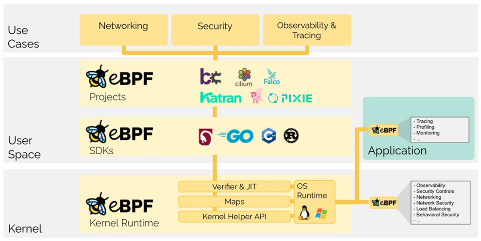</a>
<figcaption style="margin-top:8px;color:#475569;">图 7-1｜eBPF 的用途与支撑层次。使用用户提供的原图，技术背景见 <a href="https://ebpf.io/what-is-ebpf/">eBPF 官方介绍</a>。</figcaption>
</figure>

图顶端的三类用途是：**网络**（过滤、转发、负载均衡）、**安全**（监测异常行为、执行访问控制）、**可观测性与追踪**（记录事件、测量时延、定位性能问题）。中间是用户态应用与 SDK（开发工具包），底部是内核运行环境。**应用通过工具装载程序、配置规则和读取结果**，**内核负责验证并执行程序**；后面再逐一介绍图中的验证器、即时编译器和数据表。

先记住三个特点：

- **可编程：** 用程序定义观察指标和处理规则，挂到相应事件入口执行。
- **受约束：** 装载时由内核验证器检查内存访问等安全条件，程序按允许的接口工作。
- **就近处理：** 在事件发生处获取信息或作出判断，减少把数据交给用户态后再处理的需要。

[XDP（eXpress Data Path）](https://docs.cilium.io/en/latest/reference-guides/bpf/progtypes/#xdp) 是 **eBPF 用于网络收包的一种入口**。程序可以在这里读取报文，决定**放行、丢弃或重定向**；本课使用驱动中的 XDP，<strong style="color:#7e22ce;">在报文进入常规协议栈之前处理</strong>。

**下面用“一次定向丢包”演示这套能力。** 程序识别 NVDA 行情，在授权后只丢一包，再观察接收端如何发现缺口、暂停下单并恢复。借这个小案例，走通源码、编译、挂载、规则控制与结果观察；章末再看 eBPF 在时延测量、防攻击和负载均衡中的应用。

## 一张图看懂本章实验环境

<div style="border-left:6px solid #7e22ce;background:#f3e8ff;padding:12px 16px;border-radius:8px;margin:14px 0;"><span style="display:inline-block;padding:3px 12px;border-radius:6px;background:#7e22ce;color:#fff;font-weight:800;">关键图</span> <span style="font-weight:700;color:#581c87;">行情到达 <code>.2</code> 网卡后，由驱动中的 XDP 判断：PASS 交给协议栈，DROP 就地丢弃。</span></div>

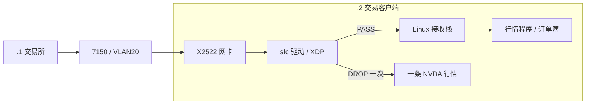

沿用第 06 章交还的交易平台：行情经 `.1 → 7150 → .2`，XDP 挂在 `.2 ens64np1` 的 sfc 驱动收包入口。终端命令均在跳板机仓库根目录执行。

## 本章导航

<div style="border-left:6px solid #7e22ce;background:#f3e8ff;padding:12px 16px;border-radius:8px;margin:14px 0;"><span style="display:inline-block;padding:3px 12px;border-radius:6px;background:#7e22ce;color:#fff;font-weight:800;">本章导航</span> <span style="font-weight:700;color:#581c87;">本章分 4 部分、7 个导航项；总图看顺序，表格看每一步解决什么问题。</span></div>

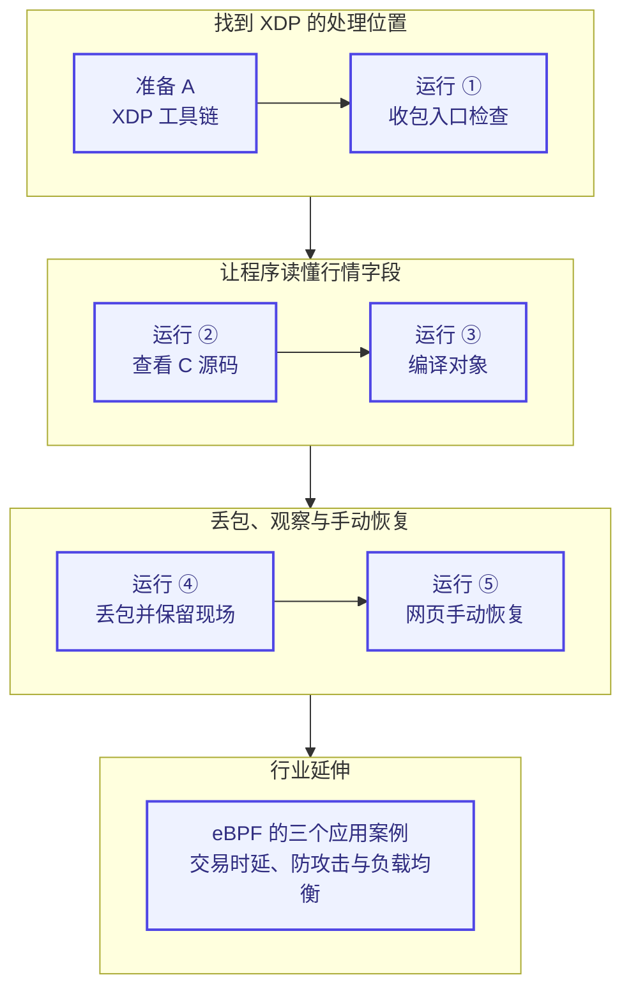

## 任务地图

| 导航项 | 所属部分 | 这一项回答什么 |
| --- | --- | --- |
| 准备 A：XDP 工具链 | 找到 XDP 的处理位置 | 编译器、装载器与查看工具各做什么 |
| 运行 ①：收包入口检查 | 找到 XDP 的处理位置 | 核对网卡身份、驱动和程序挂载 |
| 运行 ②：查看 C 源码 | 让程序读懂行情字段 | 对照 C 源码，理解边界检查与丢包条件 |
| 运行 ③：编译对象 | 让程序读懂行情字段 | 把 C 源码编成可装载的 BPF 文件 |
| 运行 ④：丢一包，保留网页报错 | 丢包、观察与手动恢复 | 丢一个 NVDA 报文，保留缺口供网页观察 |
| 运行 ⑤：网页手动恢复行情 | 丢包、观察与手动恢复 | 点击重新开始，确认行情与交易恢复 |
| 行业延伸：eBPF 的三个应用案例 | 行业延伸 | 看交易时延测量、Cloudflare 挡攻击、Meta 分配流量 |

## 找到 XDP 的处理位置

先看程序怎样装入内核、收包时在哪执行，再准备工具并确认实验口。

### 准备 A：XDP 工具链

<div style="border:2px solid #4f46e5;background:#eef2ff;padding:10px 12px;border-radius:8px;margin:14px 0;"><div style="font-weight:900;color:#312e81;margin-bottom:4px;">导航卡 · 找到 XDP 的处理位置</div><div style="font-weight:700;color:#312e81;margin-bottom:8px;">范畴：工具准备　本步知识：编译器、装载器与查看工具各做什么　位置：全章第 1 / 7 项 · 本组第 1 / 2 项</div><span style="display:inline-block;margin:3px;padding:4px 10px;border-radius:6px;background:#15803d;color:#fff;font-weight:800;">准备 A：XDP 工具链</span><span style="display:inline-block;margin:3px;padding:4px 10px;border-radius:6px;background:#f8fafc;border:1px solid #a5b4fc;color:#312e81;font-weight:800;">运行 ①：收包入口检查</span></div>

#### 程序怎样装载和收包

<div style="border-left:6px solid #7e22ce;background:#f3e8ff;padding:12px 16px;border-radius:8px;margin:14px 0;"><span style="display:inline-block;padding:3px 12px;border-radius:6px;background:#7e22ce;color:#fff;font-weight:800;">关键图</span> <span style="font-weight:700;color:#581c87;">上半图是装载过程，下半图是收包过程；先看 C 源码怎样进入内核。</span></div>

<div style="background:#f8fafc;border:1px solid #cbd5e1;border-radius:12px;padding:10px;max-width:820px;margin:14px auto;">
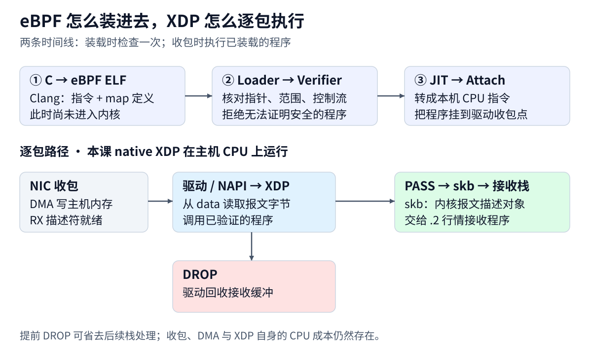
</div>

上半图从源码到程序装载，下半图说明挂载后怎样处理报文。**Verifier 和 JIT 都是 Linux 内核的组成部分**；本步安装的是配合它们工作的用户态工具。

| 装载图中的名称 | 含义与作用 |
| --- | --- |
| **C 源码 → BPF 对象** | `.c` 定义处理逻辑；编译生成的 `.o` 使用 ELF 文件格式，保存 BPF 指令和数据描述 |
| **Loader（装载器）** | 读取对象文件，向内核提交程序并挂到接口；本课用 `ip` 配合 libbpf 完成 |
| **Verifier（验证器）** | 内核在装载时检查程序的内存访问等安全条件 |
| **JIT（即时编译器）** | 内核把 BPF 指令转换为主机 CPU 机器码 |

下半图中的 DMA、NAPI 和 skb，在运行①对照具体收包位置说明。

#### 准备哪些工具，怎样安装

运行 ③ 要编译过滤程序，运行 ④ 要挂载程序、设置丢包额度并读回结果，因此先在交易客户端 `.2` 上准备以下工具。

| 工具与官方源码 | 是什么、为什么要准备 | Ubuntu 安装包 |
| --- | --- | --- |
| **[Clang](https://github.com/llvm/llvm-project)** | C 编译器：把过滤源码编成 BPF `.o` 对象文件 | `clang` |
| **[LLVM](https://github.com/llvm/llvm-project/tree/main/llvm)** | 编译基础设施：供 Clang 生成 BPF 指令，并提供 `llvm-objdump` 检查编译产物 | `llvm` |
| **[libbpf](https://github.com/libbpf/libbpf)** | BPF 开发库：编译时提供头文件；挂载时供 `ip` 装载程序 | `libbpf-dev` |
| **[bpftool](https://github.com/libbpf/bpftool)** | BPF 管理工具：查程序和 map（共享数据表），设置丢包额度、读回丢包记录 | `linux-tools-5.15.0-164-generic` |
| **[iproute2](https://github.com/iproute2/iproute2)**（源码镜像） | 网络工具集：用其中的 `ip` 检查接口，挂载、卸载 XDP 程序 | `iproute2` |

安装使用 **Ubuntu 已编译好的 `.deb` 包及依赖**。联网 Ubuntu 22.04 / amd64 可用 [APT](https://ubuntu.com/server/docs/how-to/software/package-management/) 安装：先更新包目录，再安装工具。

<div style="border-left:6px solid #7e22ce;background:#f3e8ff;padding:12px 16px;border-radius:8px;margin:14px 0;"><span style="display:inline-block;padding:3px 12px;border-radius:6px;background:#7e22ce;color:#fff;font-weight:800;">仅供展示 · Ubuntu 联网安装方法</span> <span style="font-weight:700;color:#581c87;">说明在目标机上如何安装这些工具；课堂实际执行下方绿色卡片，从 <code>.111</code> 缓存安装固定版本。</span></div>

```bash
# 联网 Ubuntu 22.04 / amd64 的安装示例；本课无需另行执行
sudo apt-get update
sudo apt-get install clang llvm libbpf-dev iproute2 \
  linux-tools-common "linux-tools-$(uname -r)"
```

`uname -r` 读取当前内核版本，本课为 `5.15.0-164-generic`。安装 `linux-tools-5.15.0-164-generic` 时，APT 会自动把包含 `bpftool` 的配套软件包一起装好。

**课堂执行下方绿色卡片，从 `.111` 缓存离线安装。** `install-offline-packages.py 10.1.1.2 xdp` 按[离线包清单](artifacts/course-packages-jammy-amd64.json)校验缓存和目标环境，把缺少的包传到 `.2`，由 APT 从本地文件安装；`xdp` 是这组工具包的名称。已有相同版本则复用，`iproute2` 沿用第一章；缓存不齐即停止，安装过程无需公网下载。

<div style="border-left:6px solid #15803d;background:#dcfce7;padding:12px 16px;border-radius:8px;margin:14px 0;"><span style="display:inline-block;padding:3px 12px;border-radius:6px;background:#15803d;color:#fff;font-weight:800;">需要运行 · 准备 A</span> <span style="font-weight:700;color:#14532d;">在跳板机执行；前置为第 06 章交还 <code>SFC/READY/sfc</code>、<code>.2</code> SSH 可用。缺少的工具从 <code>.111</code> 离线缓存安装，已有工具复用；完成后检查版本。失败时按退出码和日志排查。</span></div>

```bash
bash assets/07-xdp/00-xdp-toolchain-prep.sh
```

<div style="border-left:6px solid #7e22ce;background:#f3e8ff;padding:12px 16px;border-radius:8px;margin:14px 0;"><span style="display:inline-block;padding:3px 12px;border-radius:6px;background:#7e22ce;color:#fff;font-weight:800;">仅供展示 · 输出解读</span> <span style="font-weight:700;color:#581c87;">依次读取 clang、bpftool、iproute2 与 libbpf 版本；这里只证明工具入口。</span></div>

以下摘录离线安装后的版本检查；已有相同版本时，脚本会跳过安装。

```text
$ clang --version
Ubuntu clang version 14.0.0-1ubuntu1.1
Target: x86_64-pc-linux-gnu
$ bpftool version
/usr/lib/linux-tools/5.15.0-164-generic/bpftool v5.15.193
$ ip -V
ip utility, iproute2-5.15.0, libbpf 0.5.0
```

这三条命令确认编译器、BPF 查看工具，以及 `ip` 的 libbpf 支持版本。运行③会进一步验证 LLVM 工具和开发头文件能否完成编译。

### 运行 ①：收包入口检查

<div style="border:2px solid #4f46e5;background:#eef2ff;padding:10px 12px;border-radius:8px;margin:14px 0;"><div style="font-weight:900;color:#312e81;margin-bottom:4px;">导航卡 · 找到 XDP 的处理位置</div><div style="font-weight:700;color:#312e81;margin-bottom:8px;">范畴：现场只读　本步知识：核对网卡身份、驱动和程序挂载　位置：全章第 2 / 7 项 · 本组第 2 / 2 项</div><span style="display:inline-block;margin:3px;padding:4px 10px;border-radius:6px;background:#f8fafc;border:1px solid #a5b4fc;color:#312e81;font-weight:800;">准备 A：XDP 工具链</span><span style="display:inline-block;margin:3px;padding:4px 10px;border-radius:6px;background:#15803d;color:#fff;font-weight:800;">运行 ①：收包入口检查</span></div>

<div style="border-left:6px solid #7e22ce;background:#f3e8ff;padding:12px 16px;border-radius:8px;margin:14px 0;"><span style="display:inline-block;padding:3px 12px;border-radius:6px;background:#7e22ce;color:#fff;font-weight:800;">关键图</span> <span style="font-weight:700;color:#581c87;">Hook 是事件触发入口。挂载就是把程序接到这个入口，事件经过时才执行。图中的标记对应可挂接程序的位置，本课选择网卡收包入口。</span></div>

<div style="background:#f8fafc;border:1px solid #cbd5e1;border-radius:12px;padding:10px;max-width:820px;margin:14px auto;">
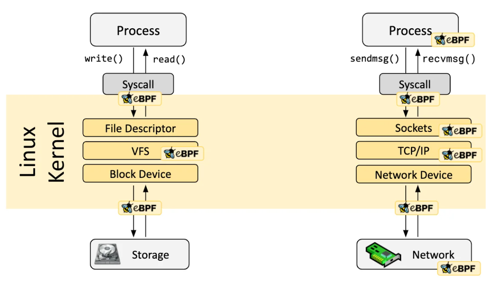
</div>

先看普通收包：网卡通过 [DMA](https://docs.kernel.org/core-api/dma-api-howto.html) 把报文写入内存，驱动在 NAPI 轮询处理中取包，为交给协议栈的包建立 `skb`。可以把内存看成仓库、报文看成包裹，`skb` 就是记录位置和长度的“管理单”。

<div style="border-left:6px solid #7e22ce;background:#f3e8ff;padding:12px 16px;border-radius:8px;margin:14px 0;"><span style="display:inline-block;padding:3px 12px;border-radius:6px;background:#7e22ce;color:#fff;font-weight:800;">关键图</span> <span style="font-weight:700;color:#581c87;">最上面是未挂载时的普通收包；再看加了 XDP 后多在哪一步，绿色框是本课选择。</span></div>

<div style="background:#f8fafc;border:1px solid #cbd5e1;border-radius:12px;padding:10px;max-width:820px;margin:14px auto;">
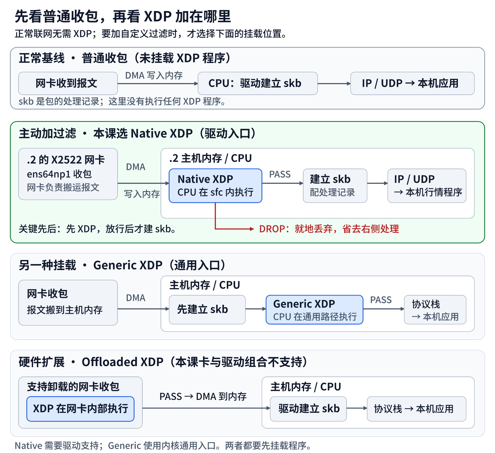
</div>

**Native 在建立 [`skb`](https://docs.kernel.org/networking/skbuff.html) 前执行，需要驱动支持；Generic 在建立 skb 后执行，使用内核通用入口。** 两者都由主机 CPU 执行。

<div style="border-left:6px solid #7e22ce;background:#f3e8ff;padding:14px 18px;border-radius:10px;margin:16px 0;">
<span style="display:inline-block;padding:3px 12px;border-radius:6px;background:#7e22ce;color:#fff;font-weight:800;">产品示例 · 支持 Offloaded XDP 的网卡</span>
<p style="color:#581c87;font-weight:800;margin:10px 0;">Netronome Agilio CX 2×25GbE SmartNIC</p>
<a href="images/course-visuals/07-diagrams/07-netronome-agilio-cx-2x25gbe.jpg">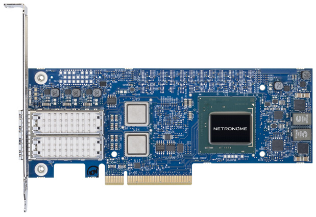</a>
<p><strong>厂商：Netronome。</strong>这款双口 25GbE 智能网卡采用可编程 NFP 网络处理器，配合 <code>nfp</code> 驱动与支持 BPF 卸载的固件，能够运行 <strong>Offloaded XDP：把受支持的 XDP 程序交给网卡执行</strong>。与前面的 Native 模式相比，执行位置从主机 CPU 移到了网卡。</p>
<p>硬件卸载仍受固件支持的指令、数据表和程序能力限制；具体程序需通过卸载验证。本卡用于认识第三种模式，本课实验继续使用 X2522 的 Native XDP。</p>
<p style="font-size:13px;color:#6b21a8;margin-bottom:0;">图片与型号：<a href="https://netronome.com/pb_agilio_cx_2x25gbe-3-24/">厂商产品资料</a>；能力依据：<a href="https://github.com/Netronome/bpf-samples">厂商 XDP 卸载示例</a>；配套：<a href="https://help.netronome.com/support/solutions/articles/36000050009-agilio-ebpf-2-0-6-extended-berkeley-packet-filter">BPF 固件与使用指南</a>。</p>
</div>

**本课 `.2` 的 X2522 由 `sfc 6.1.0.1009` 内核驱动管理，实跑采用 Native XDP。** 该驱动来自已安装的 OpenOnload 软件包；XDP 执行在它的收包入口，Onload 用户态加速库另负责应用的 Socket 加速。

运行 ④ 用 `xdpdrv` 选择 Native，结束后卸载。**普通 `tcpdump` 看不到 Native 已丢弃的包**，因此要核对 XDP 的丢包记录与接收端的序号缺口。

本步核对 `.2` 数据口 `ens64np1 / 20.1.1.2 / sfc`；BDF（PCI 地址）`0000:03:00.0` 和 MAC 尾号 `af:21` 用于确认设备。本步确认网卡上还没有 XDP 程序。

用准备 A 讲过的 **`ip` 查接口和地址、`bpftool net show` 查挂载**；驱动仍用第一章的 `ethtool` 查询。只要接口上已有 XDP 程序，脚本就会停止。

<div style="border-left:6px solid #15803d;background:#dcfce7;padding:12px 16px;border-radius:8px;margin:14px 0;"><span style="display:inline-block;padding:3px 12px;border-radius:6px;background:#15803d;color:#fff;font-weight:800;">需要运行 · 运行 ①</span> <span style="font-weight:700;color:#14532d;">准备 A 完成后，在跳板机执行，只读检查 <code>.2</code> 接收口，预计不足 1 分钟。应为 <code>ens64np1 / 03:00.0 / sfc / UP / 20.1.1.2</code>，没有已挂载的 XDP。</span></div>

```bash
bash assets/07-xdp/01-xdp-hook-readiness.sh
```

<div style="border-left:6px solid #7e22ce;background:#f3e8ff;padding:12px 16px;border-radius:8px;margin:14px 0;"><span style="display:inline-block;padding:3px 12px;border-radius:6px;background:#7e22ce;color:#fff;font-weight:800;">仅供展示 · 输出解读</span> <span style="font-weight:700;color:#581c87;">接口和驱动用于认口；XDP 看挂载列表是否为空。</span></div>

下面摘录一次收包入口检查的关键输出；本次接口状态以你的终端为准。

```text
===== 查接收口状态与地址 =====
[ens64np1] 对: UP / 原 MAC / 20.1.1.2  证: 接收口身份与地址保持前章状态
$ ip -brief link show dev ens64np1
ens64np1         UP             00:0f:53:d3:af:21 <BROADCAST,MULTICAST,UP,LOWER_UP>
$ ip -brief addr show dev ens64np1
ens64np1         UP             20.1.1.2/24 fe80::20f:53ff:fed3:af21/64

===== 查接收口驱动 =====
[ens64np1] 对: sfc / 0000:03:00.0  证: X2522 仍由前章驱动管理
$ ethtool -i ens64np1
driver: sfc
version: 6.1.0.1009
bus-info: 0000:03:00.0

===== 查 XDP 挂载 =====
[ens64np1] 对: xdp: 段没有程序条目  证: 该接口没有已挂载的 XDP 程序
$ bpftool net show dev ens64np1
xdp:

tc:

flow_dissector:
```

`xdp:` 下没有程序条目，表示该接口没有 XDP 挂载。

<div style="border-left:6px solid #0891b2;background:#cffafe;padding:12px 16px;border-radius:8px;margin:14px 0;"><span style="display:inline-block;padding:3px 12px;border-radius:6px;background:#0891b2;color:#fff;font-weight:800;">关键现象</span> <span style="font-weight:700;color:#164e63;">接口一直保持 sfc、UP 和原 IP；运行 ④ 只增加 XDP 挂载，结束时卸掉本次程序，不重绑驱动或关闭数据口。</span></div>

## 让程序读懂行情字段

目标是 Exchange 发出的 `20.1.1.1 → 233.74.125.32:31032` 行情。本节沿用第 03 章的报文字段，决定整包放行还是丢弃。

### 运行 ②：查看 C 源码

<div style="border:2px solid #4f46e5;background:#eef2ff;padding:10px 12px;border-radius:8px;margin:14px 0;"><div style="font-weight:900;color:#312e81;margin-bottom:4px;">导航卡 · 让程序读懂行情字段</div>
<div style="font-weight:700;color:#312e81;margin-bottom:8px;">范畴：源码展示　本步知识：对照 C 源码，理解边界检查与丢包条件　位置：全章第 3 / 7 项 · 本组第 1 / 2 项</div><span style="display:inline-block;margin:3px;padding:4px 10px;border-radius:6px;background:#15803d;color:#fff;font-weight:800;">运行 ②：查看 C 源码</span><span style="display:inline-block;margin:3px;padding:4px 10px;border-radius:6px;background:#f8fafc;border:1px solid #a5b4fc;color:#312e81;font-weight:800;">运行 ③：编译对象</span></div>

本步用 `nl -ba` 带行号查看 C 源码，理解程序怎样检查和过滤报文。后面运行③编译，运行④装载并挂到网卡。

<div style="border-left:6px solid #7e22ce;background:#f3e8ff;padding:12px 16px;border-radius:8px;margin:14px 0;"><span style="display:inline-block;padding:3px 12px;border-radius:6px;background:#7e22ce;color:#fff;font-weight:800;">仅供展示 · 源码到内核的操作流程</span> <span style="font-weight:700;color:#581c87;">绿色卡片标出当前步骤，卡片下方是对应的核心命令。</span></div>

<div style="background:#f8fafc;border:1px solid #cbd5e1;border-radius:12px;padding:10px;max-width:820px;margin:14px auto;">
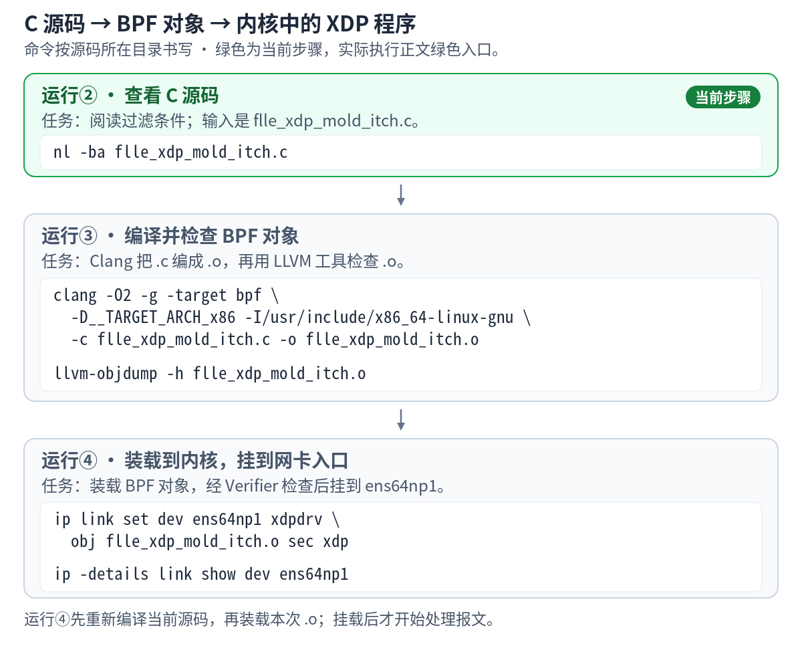
</div>

**Verifier 检查内存访问等程序安全条件；匹配哪只股票，由课程程序决定。** [内核说明](https://docs.kernel.org/bpf/verifier.html)

<div style="border-left:6px solid #7e22ce;background:#f3e8ff;padding:12px 16px;border-radius:8px;margin:14px 0;"><span style="display:inline-block;padding:3px 12px;border-radius:6px;background:#7e22ce;color:#fff;font-weight:800;">关键图</span> <span style="font-weight:700;color:#581c87;">上半图看程序能否安全加载；下半图看报文是否完整、是否匹配目标、是否允许丢包。</span></div>

<div style="background:#f8fafc;border:1px solid #cbd5e1;border-radius:12px;padding:10px;max-width:820px;margin:14px auto;">
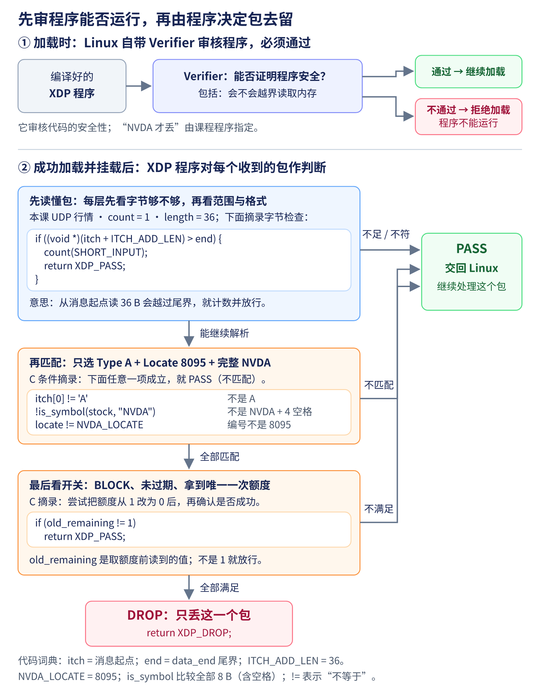
</div>

<div style="border-left:6px solid #15803d;background:#dcfce7;padding:12px 16px;border-radius:8px;margin:14px 0;"><span style="display:inline-block;padding:3px 12px;border-radius:6px;background:#15803d;color:#fff;font-weight:800;">需要运行 · 运行 ②</span> <span style="font-weight:700;color:#14532d;">在跳板机运行，需仓库写权限。显示本章使用的 C 源码；下文依次对照读取边界、匹配字段和丢包策略。</span></div>

```bash
bash assets/07-xdp/03-xdp-parser-bounds.sh
```

<div style="border-left:6px solid #7e22ce;background:#f3e8ff;padding:12px 16px;border-radius:8px;margin:14px 0;"><span style="display:inline-block;padding:3px 12px;border-radius:6px;background:#7e22ce;color:#fff;font-weight:800;">仅供展示 · 输出解读</span> <span style="font-weight:700;color:#581c87;">先看读取字段前的长度与边界检查，再读下文的过滤条件。</span></div>

源码输出节选：

```text
跳板机 / source-review
===== 查带行号的访问边界 =====
[Parser] 对: 先证明 data_end 边界，再读取字段  证: 可以定位每次解引用前的检查
$ nl -ba assets/07-xdp/flle_xdp_mold_itch.c
   140	    if (message_length != ITCH_ADD_LEN) {
   141	        count(OTHER_ITCH);
   142	        return XDP_PASS;
   143	    }
   144	    if ((void *)(itch + ITCH_ADD_LEN) > end) {
   145	        count(SHORT_INPUT);
   146	        return XDP_PASS;
   147	    }
```

本课只用 PASS 和 DROP：命中丢包条件才 DROP，其余交回 Linux 继续处理。无法按本课格式解析的包也放行，这叫 **fail-open**；后续仍由协议栈检查。

<a id="xdp-wire-fields"></a>

<div style="border-left:6px solid #7e22ce;background:#f3e8ff;padding:12px 16px;border-radius:8px;margin:14px 0;"><span style="display:inline-block;padding:3px 12px;border-radius:6px;background:#7e22ce;color:#fff;font-weight:800;">关键图 · 过滤字段 · 共用类型对照图</span> <span style="font-weight:700;color:#581c87;">与第 03 章使用同一份图，本章看最上面的 A 行。类型、证券索引、股票代码三个黄色字段参与匹配；其他类型用来对照布局，是否丢包仍由本章规则决定。</span></div>

<div style="background:#f8fafc;border:1px solid #cbd5e1;border-radius:12px;padding:10px;max-width:820px;margin:14px auto;">
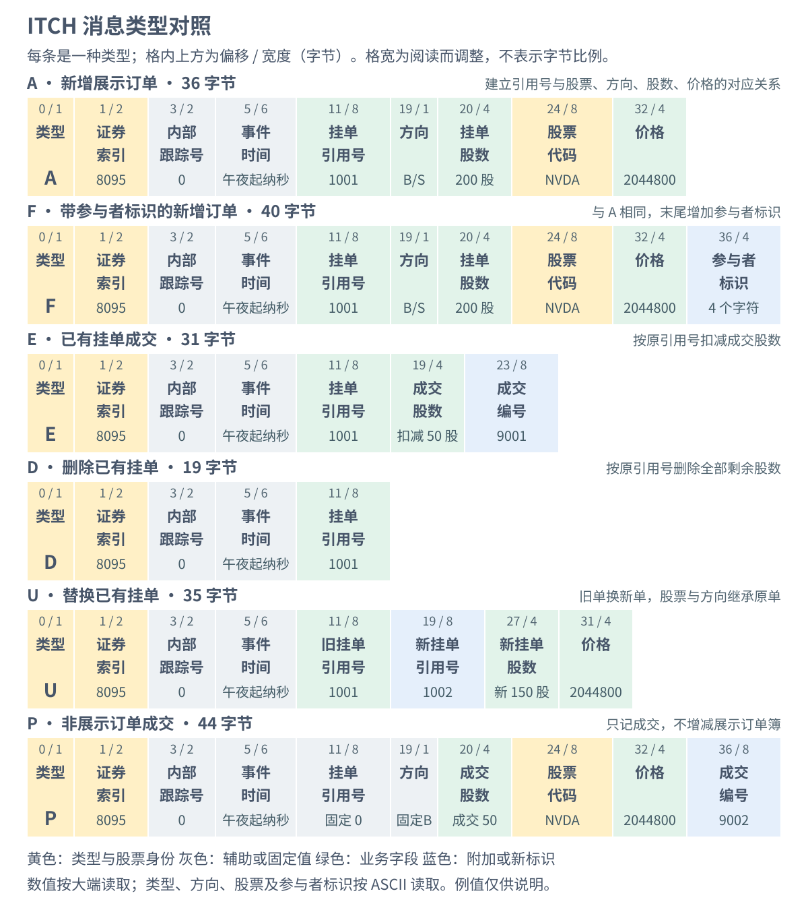
</div>

目标消息为 ITCH Type A（Add Order，新增订单行情），来自交易所，表示市场上的新增订单。它与客户端提交的下单请求方向不同。匹配字段的偏移均从 **ITCH 起点**计算：

| 匹配字段 | ITCH 偏移 / 宽度（字节） | 本课目标 |
| --- | --- | --- |
| Message Type | 0 / 1 | 字符 `A`，新增展示订单行情，不是 OUCH 的受理回报 |
| Stock Locate | 1 / 2 | 大端整数 `8095`，本课历史数据中 NVDA 的当天编号 |
| Stock | 24 / 8 | ASCII 字符 `NVDA` 加 4 个空格，即 `0x4e56444120202020` |

Locate 是股票在当天行情中的编号。本课数据中 `37 ↔ AAPL`、`8095 ↔ NVDA`；换个交易日，编号可能不同。Type A 长 36 字节；其他类型的布局不同，不能套用 A 的偏移。[ITCH 字段规范](https://www.nasdaqtrader.com/content/technicalsupport/specifications/dataproducts/NQTVITCHSpecification_5.0.pdf)

协议允许一包多条；本课 XDP 规则只解析 `count=1` 的目标布局，其他情况放行。因此本实验丢 1 个报文，对应缺失 1 条 ITCH 消息。[MoldUDP64 规范](https://nasdaqtrader.com/content/technicalsupport/specifications/dataproducts/moldudp64.pdf)

本章 C 程序使用的 [BPF map](https://docs.kernel.org/bpf/maps.html)，是放在内核内存里的共享数据表，用来保存当前状态：**能不能丢包、还能丢几个、已经丢了什么。**

<div style="border-left:6px solid #7e22ce;background:#f3e8ff;padding:12px 16px;border-radius:8px;margin:14px 0;"><span style="display:inline-block;padding:3px 12px;border-radius:6px;background:#7e22ce;color:#fff;font-weight:800;">关键图</span> <span style="font-weight:700;color:#581c87;">控制程序写入设置，XDP 读取设置并记录结果。</span></div>

<div style="background:#f8fafc;border:1px solid #cbd5e1;border-radius:12px;padding:10px;max-width:820px;margin:14px auto;">
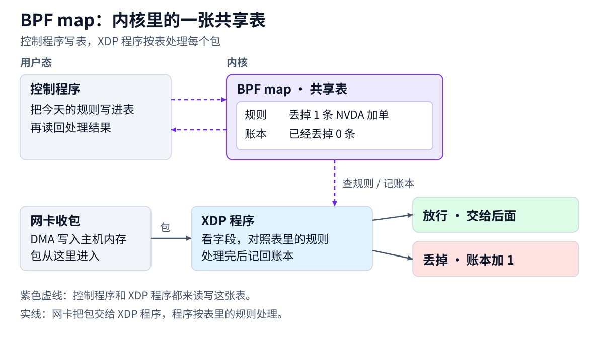
</div>

源码中三张 map 的名字和用途如下：

| 源码中的名字 | 这张表存什么 |
| --- | --- |
| `counters` | 各类报文的处理次数 |
| `policy` | 丢包开关、剩余额度和有效期；XDP 据此决定是否执行丢包 |
| `drop_audit` | 被丢行情的序号和丢包数，供后面与接收端的缺口对账 |

**三个字段全部匹配，且策略为 BLOCK、额度为 1、未过期，才 DROP 一包。** 其余 PASS；价格、数量和买卖方向不参与筛选。

按下面的报文条件对照预期动作；**实际过滤由运行 ④ 验证。**

| 报文条件 | 怎样理解 | 预期动作 |
| --- | --- | --- |
| A + 任意 Locate + `AAPL    `，长度 36 | 苹果新增订单；读到 AAPL 股票代码后放行。 | PASS |
| A + Locate 8095 + `NVDA    `，长度 36 | 英伟达新增订单；假定上述开关与额度有效。 | DROP |
| F + Locate 8095 + `NVDA    `，长度 40 | 声明长度 40，不是 A 的 36 字节，先在长度检查处放行。 | PASS |
| D，长度 19 | 删除订单；E/U 等其它类型也放行。 | PASS |
| A + Locate 8095 + `NVDA    `，长度 20 | 声明长度不是 36，按非目标格式放行。 | PASS |

多个 CPU 共用一次额度，代码保证只有一个能成功扣减并丢包。

再对照 XDP 的其他出口，区分放行、丢弃和转发：

<div style="border-left:6px solid #7e22ce;background:#f3e8ff;padding:12px 16px;border-radius:8px;margin:14px 0;"><span style="display:inline-block;padding:3px 12px;border-radius:6px;background:#7e22ce;color:#fff;font-weight:800;">关键图</span> <span style="font-weight:700;color:#581c87;">图中列出 PASS、DROP、TX、REDIRECT 四种业务出口；另有 XDP_ABORTED 错误动作，本课不主动使用。</span></div>

<div style="background:#f8fafc;border:1px solid #cbd5e1;border-radius:12px;padding:10px;max-width:820px;margin:14px auto;">
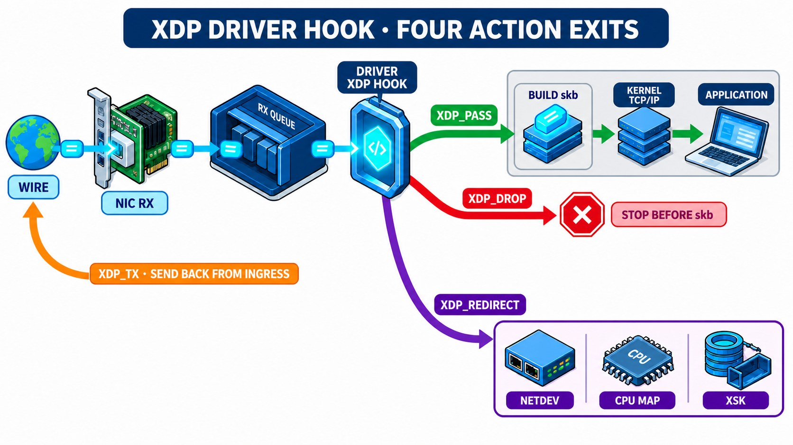
</div>

| 动作 | 用一句话理解 |
| --- | --- |
| `XDP_PASS` | 放行，继续交给本机 Linux 协议栈处理。 |
| `XDP_DROP` | 就地丢弃，结束这个包的接收。 |
| `XDP_TX` | 从**收到包的同一接口发出去**；不会自动生成回复。 |
| `XDP_REDIRECT` | 交给**程序指定的目标**：可以从本机另一网卡发出，也可以交给另一 CPU 或 AF_XDP 用户态收包程序。 |
| `XDP_ABORTED` | 异常终止：丢包，并触发内核 XDP 异常跟踪事件，供排错。 |

### 运行 ③：编译对象

<div style="border:2px solid #4f46e5;background:#eef2ff;padding:10px 12px;border-radius:8px;margin:14px 0;"><div style="font-weight:900;color:#312e81;margin-bottom:4px;">导航卡 · 让程序读懂行情字段</div><div style="font-weight:700;color:#312e81;margin-bottom:8px;">范畴：工具准备　本步知识：把 C 源码编成可装载的 BPF 文件　位置：全章第 4 / 7 项 · 本组第 2 / 2 项</div><span style="display:inline-block;margin:3px;padding:4px 10px;border-radius:6px;background:#f8fafc;border:1px solid #a5b4fc;color:#312e81;font-weight:800;">运行 ②：查看 C 源码</span><span style="display:inline-block;margin:3px;padding:4px 10px;border-radius:6px;background:#15803d;color:#fff;font-weight:800;">运行 ③：编译对象</span></div>

**本步实际编译运行②查看的 `flle_xdp_mold_itch.c`，生成 BPF 对象文件 `flle_xdp_mold_itch.o`，再检查这个文件。** 使用的是准备 A 的 Clang、libbpf 开发头文件和 LLVM 工具。本步验证编译产物；运行④会从同一份源码重新生成并挂载本次对象，不依赖本步留下的 `.o`。

<div style="border-left:6px solid #7e22ce;background:#f3e8ff;padding:12px 16px;border-radius:8px;margin:14px 0;"><span style="display:inline-block;padding:3px 12px;border-radius:6px;background:#7e22ce;color:#fff;font-weight:800;">仅供展示 · 源码到内核的操作流程</span> <span style="font-weight:700;color:#581c87;">绿色卡片标出当前步骤，卡片下方是对应的核心命令。</span></div>

<div style="background:#f8fafc;border:1px solid #cbd5e1;border-radius:12px;padding:10px;max-width:820px;margin:14px auto;">
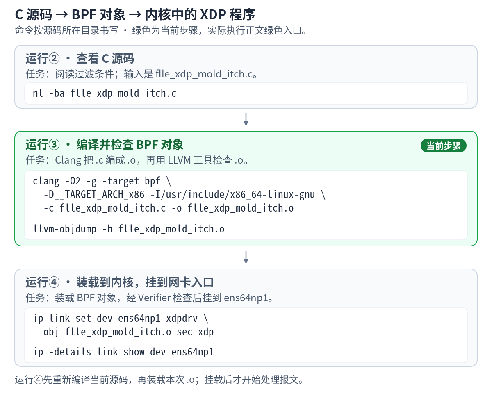
</div>

#### 先把 C 源码编成 BPF 对象

Clang 读取 `.c` 及其引用的头文件，生成 BPF 指令，写入 `.o`。本课的 `.o` 是 ELF 格式的对象文件，供装载工具读取；`.o` 是常用后缀，真正决定文件内容的是编译参数。

<div style="border-left:6px solid #7e22ce;background:#f3e8ff;padding:12px 16px;border-radius:8px;margin:14px 0;"><span style="display:inline-block;padding:3px 12px;border-radius:6px;background:#7e22ce;color:#fff;font-weight:800;">仅供展示 · 编译命令</span> <span style="font-weight:700;color:#581c87;">绿色脚本在 .2 的源码目录执行以下核心编译操作；图与此处均省略了仅用于统一调试路径的 <code>-fdebug-prefix-map</code> 选项。</span></div>

```bash
clang -O2 -g -target bpf \
  -D__TARGET_ARCH_x86 -I/usr/include/x86_64-linux-gnu \
  -c flle_xdp_mold_itch.c -o flle_xdp_mold_itch.o
```

| 参数 | 作用 |
| --- | --- |
| `-target bpf` | 生成 BPF 指令；以后装载到内核执行 |
| `-O2` | 启用编译优化 |
| `-g` | 保留调试和类型信息；本课对象包含 BTF 类型描述 |
| `-D__TARGET_ARCH_x86` | 定义 x86 架构宏，供头文件使用；生成的指令仍由 `-target bpf` 决定 |
| `-I/usr/include/x86_64-linux-gnu` | 增加系统头文件的搜索目录 |
| `-c …c -o …o` | 指定输入源码，只编译成对象，并指定输出文件名 |

参数含义见 [Clang 命令说明](https://clang.llvm.org/docs/CommandGuide/clang.html)；`-g` 生成 BTF 的方式见[内核文档](https://docs.kernel.org/bpf/btf.html)。Clang 编译成功时通常不打印信息，生成的 `.o` 就是这一步的结果。

#### 再检查生成的对象

此时才使用 `llvm-objdump`，输入正是前一步生成的 `.o`。`-h` 列出文件内部各个分区（section，下面称“段”），用来确认程序指令和所需数据描述已经写入对象。

<div style="border-left:6px solid #7e22ce;background:#f3e8ff;padding:12px 16px;border-radius:8px;margin:14px 0;"><span style="display:inline-block;padding:3px 12px;border-radius:6px;background:#7e22ce;color:#fff;font-weight:800;">仅供展示 · 检查对象</span> <span style="font-weight:700;color:#581c87;">使用准备 A 的 LLVM 工具，查看编译产物。</span></div>

```bash
llvm-objdump -h flle_xdp_mold_itch.o
```

<div style="border-left:6px solid #15803d;background:#dcfce7;padding:12px 16px;border-radius:8px;margin:14px 0;"><span style="display:inline-block;padding:3px 12px;border-radius:6px;background:#15803d;color:#fff;font-weight:800;">需要运行 · 运行 ③</span> <span style="font-weight:700;color:#14532d;">准备 A 完成、运行②看过源码后，在跳板机执行；需 <code>.2</code> SSH 可用。脚本编译并检查 BPF 对象，挂载留到运行④。</span></div>

```bash
bash assets/07-xdp/04-xdp-build.sh
```

<div style="border-left:6px solid #7e22ce;background:#f3e8ff;padding:12px 16px;border-radius:8px;margin:14px 0;"><span style="display:inline-block;padding:3px 12px;border-radius:6px;background:#7e22ce;color:#fff;font-weight:800;">仅供展示 · 输出解读</span> <span style="font-weight:700;color:#581c87;">核对文件格式为 elf64-bpf，并包含 xdp、.maps 和 .BTF 段。</span></div>

输出只看文件格式和三个关键分区：

```text
$ llvm-objdump -h flle_xdp_mold_itch.o
flle_xdp_mold_itch.o:	file format elf64-bpf
Idx Name                   Size     VMA              Type
  3 xdp                    00000980 0000000000000000 TEXT
  5 .maps                  00000060 0000000000000000 DATA
 16 .BTF                   0000050d 0000000000000000
```

`elf64-bpf` 表明生成了 BPF 对象。表中展示的是文件的**分区目录**：`Idx` 中的 `3、5、16` 是编号；`Size` 是十六进制字节数，例如 `00000980` 表示 2432 字节，并非展开显示的指令内容。

| 分区 | 装着什么、后面怎么用 |
| --- | --- |
| `xdp` | **编译后的 BPF 指令**：挂载后负责解析报文、判断放行或丢弃；`TEXT` 表示代码段 |
| `.maps` | **三张共享表的定义**：装载时创建计数表 `counters`、策略表 `policy` 和丢包记录表 `drop_audit`；这里还没有运行时的计数和记录 |
| `.BTF` | **数据类型说明**：记录结构体字段等信息，供装载工具和内核识别程序使用的数据结构 |

## 丢包、观察与手动恢复

### 运行 ④：丢一包，保留网页报错

<div style="border:2px solid #4f46e5;background:#eef2ff;padding:10px 12px;border-radius:8px;margin:14px 0;"><div style="font-weight:900;color:#312e81;margin-bottom:4px;">导航卡 · 丢包、观察与手动恢复</div><div style="font-weight:700;color:#312e81;margin-bottom:8px;">范畴：在线实验　本步知识：丢一个 NVDA 报文，保留缺口供网页观察　位置：全章第 5 / 7 项 · 本组第 1 / 2 项</div><span style="display:inline-block;margin:3px;padding:4px 10px;border-radius:6px;background:#15803d;color:#fff;font-weight:800;">运行 ④：丢一包，保留网页报错</span><span style="display:inline-block;margin:3px;padding:4px 10px;border-radius:6px;background:#f8fafc;border:1px solid #a5b4fc;color:#312e81;font-weight:800;">运行 ⑤：网页手动恢复行情</span></div>

本步挂载 XDP 后先全部放行，切到组播 A 并重新开始行情回放；确认新会话正常后，再丢掉一个匹配的 NVDA 报文。**随后暂停回放，核对丢包序号与接收端缺口，再卸载本次 XDP，保留现场供观察。**

实验自动选择**组播 A**（`233.74.125.32:31032`）。只发这一条路径，才能直接观察丢包产生的缺口；若同时发 B，同序号副本可能补回被丢的消息。

<div style="border-left:6px solid #7e22ce;background:#f3e8ff;padding:12px 16px;border-radius:8px;margin:14px 0;"><span style="display:inline-block;padding:3px 12px;border-radius:6px;background:#7e22ce;color:#fff;font-weight:800;">仅供展示 · 源码到内核的操作流程</span> <span style="font-weight:700;color:#581c87;">绿色卡片标出当前步骤，卡片下方是对应的核心命令。</span></div>

<div style="background:#f8fafc;border:1px solid #cbd5e1;border-radius:12px;padding:10px;max-width:820px;margin:14px auto;">
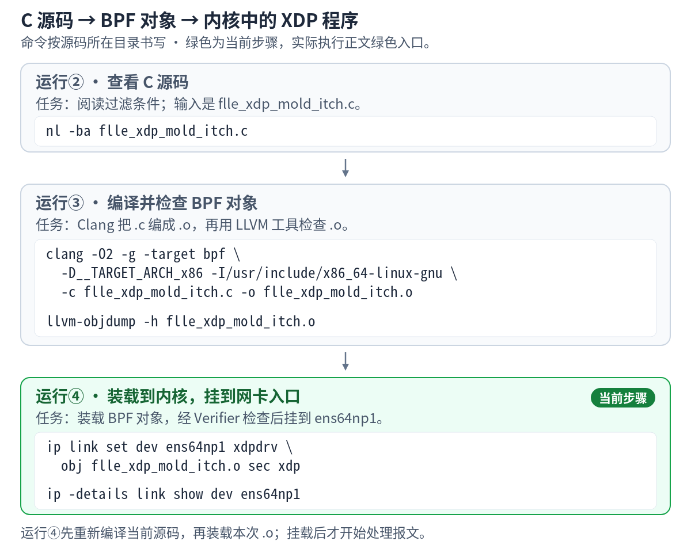
</div>

#### 把 BPF 对象装入内核，并挂到接口

脚本先按运行③的方法重新编译当前源码，再用准备 A 介绍的 `ip` 配合 libbpf 读取 `.o`、创建 map 并向内核提交程序。Verifier 检查通过后，程序挂到 `ens64np1` 的 Native XDP 入口；以后该接口收包时，驱动就会调用它。装载和挂接的分工见 [libbpf 说明](https://docs.kernel.org/bpf/libbpf/libbpf_overview.html)。

<div style="border-left:6px solid #7e22ce;background:#f3e8ff;padding:12px 16px;border-radius:8px;margin:14px 0;"><span style="display:inline-block;padding:3px 12px;border-radius:6px;background:#7e22ce;color:#fff;font-weight:800;">仅供展示 · 装载、挂载与检查</span> <span style="font-weight:700;color:#581c87;">下列核心命令由绿色脚本在 .2 自动执行，此处用于理解操作。</span></div>

```bash
ip link set dev ens64np1 xdpdrv \
  obj flle_xdp_mold_itch.o sec xdp
ip -details link show dev ens64np1
```

| 命令部分 | 作用 |
| --- | --- |
| `dev ens64np1` | 选择本课交易客户端的数据口 |
| `xdpdrv` | 挂到驱动的 Native XDP 收包入口 |
| `obj flle_xdp_mold_itch.o` | 读取本次编译生成的 BPF 对象文件 |
| `sec xdp` | 选择对象里名为 `xdp` 的程序段，与运行③的检查结果对应 |
| `ip -details link show …` | 查看接口上的 `prog/xdp` 和程序 ID，确认程序已挂载 |

挂载后，`set-xdp-policy.py` 内部调用准备 A 的 `bpftool map update`，先设置 `allow`、额度为 0。新行情会话达到 `HEALTHY / OPEN` 后，再用下面的命令开放一次丢包额度：

<div style="border-left:6px solid #7e22ce;background:#f3e8ff;padding:12px 16px;border-radius:8px;margin:14px 0;"><span style="display:inline-block;padding:3px 12px;border-radius:6px;background:#7e22ce;color:#fff;font-weight:800;">仅供展示 · 开放一次丢包额度</span> <span style="font-weight:700;color:#581c87;">命令由绿色脚本在 .2 自动执行；PROG_ID 指向本次挂载的程序。</span></div>

```bash
python3 set-xdp-policy.py block 1 5 "$PROG_ID"
```

`block` 打开丢包开关，`1` 是剩余额度，`5` 是从设置策略起计算的有效秒数；程序在有效期内最多丢一个匹配报文。

缺口出现后，脚本暂停行情回放，避免自动循环到新 Session 后清掉现场；再用 `bpftool` 读回丢包计数和序号，与接收端缺口核对，最后卸载本次 XDP。卸载 XDP 后，已经丢掉的报文不会补回来，订单簿仍保持暂停。

**丢包授权有效期为 5 秒：这段时间内只允许丢一个符合条件的包，超时未命中就取消授权。若已经丢包并触发行情缺口，订单簿要等下一步手动恢复行情后才继续更新。**


<div style="border-left:6px solid #15803d;background:#dcfce7;padding:12px 16px;border-radius:8px;margin:14px 0;"><span style="display:inline-block;padding:3px 12px;border-radius:6px;background:#15803d;color:#fff;font-weight:800;">需要运行 · 运行 ④</span> <span style="font-weight:700;color:#14532d;">按本章顺序完成准备 A、运行①～③后，在跳板机执行。脚本重新编译、挂载，重播行情后丢一包，再暂停回放并保留缺口；结束后去看网页，观察期间保持暂停后的现场和实验配置。网页手动恢复后，可以再次执行同一入口；脚本会先核对行情和接收口是否正常。</span></div>

```bash
bash assets/07-xdp/05-xdp-inline-live.sh
```

<div style="border-left:6px solid #7e22ce;background:#f3e8ff;padding:12px 16px;border-radius:8px;margin:14px 0;"><span style="display:inline-block;padding:3px 12px;border-radius:6px;background:#7e22ce;color:#fff;font-weight:800;">仅供展示 · 输出解读</span> <span style="font-weight:700;color:#581c87;">依次看挂载与策略、正常行情、丢包后缺口、序号对账和最终状态。</span></div>

下面按执行顺序摘录同一次运行的关键输出。

**1. 程序已经挂载，初始策略全部放行。**

```text
$ ip -details link show dev ens64np1
3: ens64np1: <BROADCAST,MULTICAST,UP,LOWER_UP> mtu 1500 xdp qdisc mq state UP mode DEFAULT group default qlen 1000
    prog/xdp id 40 tag 8c60d945e15524ab jited
$ python3 set-xdp-policy.py allow 0 5 "$PROG_ID"
policy_id=7 mode=allow remaining=0 ttl_seconds=0
```

`prog/xdp id 40` 表示接口已挂上这次程序，`jited` 表示已生成供 CPU 执行的机器指令。策略是 `allow`，丢包额度 `remaining=0`：先让行情正常通过。

**2. 确认丢包前行情正常。**

```text
行情关键字段：
会话            0612260007
发送方式        组播 A（MULTICAST_A）
接收程序        ONLINE
行情状态        正常（HEALTHY）
交易闸门        开放（OPEN）
下一条期望      113
```

此时 A 路行情能穿过已挂载的 XDP，交易闸门开放。接收程序在线，本轮只建簿、不自动下单；行情是否连续要看 `HEALTHY` 和序号。`113` 是这次检查时接收端等待的下一条序号，行情仍在继续播放。

**3. 开放一次丢包额度后，接收端发现缺口。**

```text
行情关键字段：
会话            0612260007
发送方式        组播 A（MULTICAST_A）
接收程序        ONLINE
行情状态        有缺口（GAP）
交易闸门        暂停下单（INHIBITED_FEED_GAP）
序号对照        已交付 646 → 期望 647 → 最早待处理 648
缺失消息        1 条；等待补齐后处理的消息 1 条
```

会话仍是 `0612260007`，接收程序仍在线，但已交付 646 后，647 没到，648 已收到并等待处理。因此缺失 1 条、待处理 1 条，行情变为 `GAP`，交易闸门随之暂停下单。这里是刚发现缺口时的读数；暂停回放前，后续收到的消息还会增加待处理条数。

**4. 核对实际丢掉的包是否就是这条缺失消息。**

```text
实际丢包        1 包
被丢序号        647
接收端缺失序号  647（已核对一致）
股票编号        8095（NVDA）
```

XDP 计数确认只丢了 **1 包**，丢包记录中的序号与接收端期望序号同为 **647**，股票编号也命中 NVDA。两侧记录对上了同一条消息。

**5. XDP 已卸载，缺口现场保留供网页观察。**

脚本在交易客户端 `.2` 上核对接口与程序 ID，确认仍是本次挂载的程序后，执行下面的卸载命令：

<div style="border-left:6px solid #7e22ce;background:#f3e8ff;padding:12px 16px;border-radius:8px;margin:14px 0;"><span style="display:inline-block;padding:3px 12px;border-radius:6px;background:#7e22ce;color:#fff;font-weight:800;">仅供展示 · 脚本中的卸载命令</span> <span style="font-weight:700;color:#581c87;">运行④已自动执行；这里解释命令，不需要再手动运行。</span></div>

```bash
ip link set dev ens64np1 xdpdrv off
```

`dev ens64np1` 指定接口，**`xdpdrv off` 解除该接口的 Native XDP 挂载**。这一步只移除过滤程序，不重放行情，也不会补回已经丢失的报文。完成后输出：

```text
owned_xdp=detached
现场状态：行情有缺口，交易闸门暂停下单，回放已暂停。
result=GAP_HELD
本次 XDP 已卸载，行情缺口保留；丢包后未重放或重启服务。
```

`detached` 表示本次程序已经卸载；`GAP_HELD` 表示脚本完成了“保留缺口”的任务。打开[交易网页](http://10.1.1.101:8088/)，应看到 FEED GAP、冻结的订单簿和禁用的下单按钮；观察后按运行⑤恢复行情。

<div style="border-left:6px solid #7e22ce;background:#f3e8ff;padding:12px 16px;border-radius:8px;margin:14px 0;"><span style="display:inline-block;padding:3px 12px;border-radius:6px;background:#7e22ce;color:#fff;font-weight:800;">历史截图 · 缺口保留</span> <span style="font-weight:700;color:#581c87;">另一轮实验的红条等待序号 626；每轮序号不同，观察重点相同：订单簿灰显，回放暂停，交易停止。点击图片可查看原图。</span></div>

<div style="background:#f8fafc;border:1px solid #cbd5e1;border-radius:12px;padding:10px;max-width:820px;margin:14px auto;">
<a href="images/course-visuals/07-diagrams/07-xdp-feed-gap-held-20260914.png">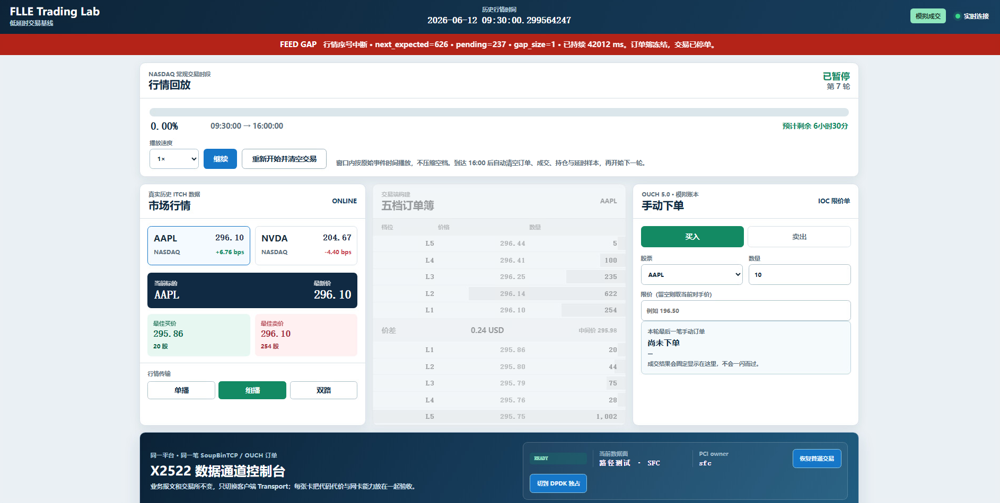</a>
</div>

**应用发现行情缺口后，主动暂停下单。** XDP 只丢了行情报文，没有拦截下单请求。每次实验的缺失序号可能不同，以当次输出为准。

若脚本报错，按终端记录和[维护说明](assets/07-xdp/TEACHER-LIVE-NOTES.md)检查本次挂载与状态。

### 运行 ⑤：网页手动恢复行情

<div style="border:2px solid #4f46e5;background:#eef2ff;padding:10px 12px;border-radius:8px;margin:14px 0;"><div style="font-weight:900;color:#312e81;margin-bottom:4px;">导航卡 · 丢包、观察与手动恢复</div><div style="font-weight:700;color:#312e81;margin-bottom:8px;">范畴：在线实验　本步知识：点击重新开始，确认行情与交易恢复　位置：全章第 6 / 7 项 · 本组第 2 / 2 项</div><span style="display:inline-block;margin:3px;padding:4px 10px;border-radius:6px;background:#f8fafc;border:1px solid #a5b4fc;color:#312e81;font-weight:800;">运行 ④：丢一包，保留网页报错</span><span style="display:inline-block;margin:3px;padding:4px 10px;border-radius:6px;background:#15803d;color:#fff;font-weight:800;">运行 ⑤：网页手动恢复行情</span></div>

<div style="border-left:6px solid #15803d;background:#dcfce7;padding:12px 16px;border-radius:8px;margin:14px 0;"><span style="display:inline-block;padding:3px 12px;border-radius:6px;background:#15803d;color:#fff;font-weight:800;">需要运行 · 运行 ⑤</span> <span style="font-weight:700;color:#14532d;">看完报错后，在 <a href="http://10.1.1.101:8088/">交易网页</a>的行情回放区，手动点击“重新开始并清空交易”。它会从新行情会话重新回放、重建订单簿，并清空本轮模拟交易。</span></div>

**点击“重新开始并清空交易”，不要点“继续”**：“继续”只接着播放，无法补回已经丢掉的消息。

<div style="border-left:6px solid #7e22ce;background:#f3e8ff;padding:12px 16px;border-radius:8px;margin:14px 0;"><span style="display:inline-block;padding:3px 12px;border-radius:6px;background:#7e22ce;color:#fff;font-weight:800;">实跑截图 · 手动恢复后</span> <span style="font-weight:700;color:#581c87;">用户点击图中标出的按钮后，FEED GAP 红条消失，回放进入第 8 轮并显示“播放中”，订单簿恢复正常显示。</span></div>

<div style="background:#f8fafc;border:1px solid #cbd5e1;border-radius:12px;padding:10px;max-width:820px;margin:14px auto;">
<a href="images/course-visuals/07-diagrams/07-xdp-feed-restored-20260914.png">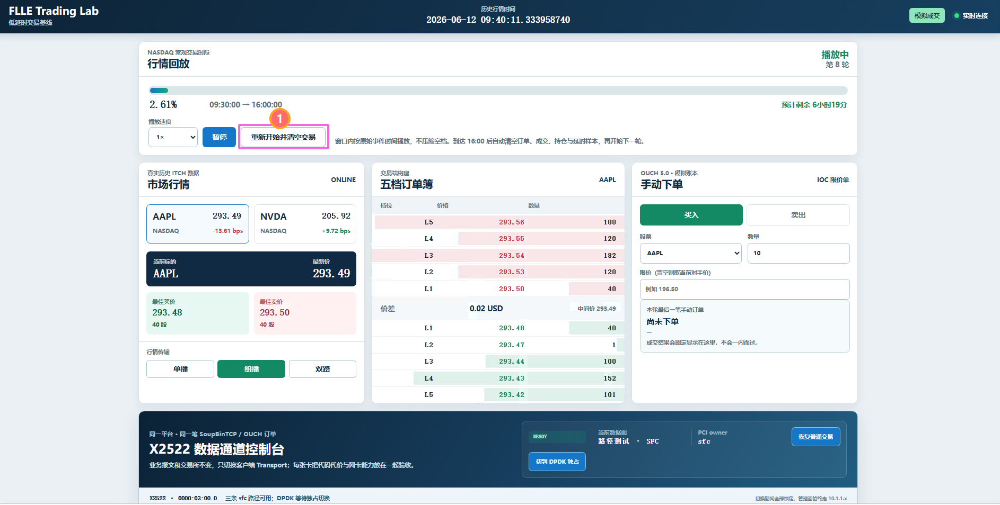</a>
</div>

本步以行情恢复为验收：FEED GAP 消失、订单簿恢复更新、回放继续，行情状态回到 `HEALTHY`、交易闸门回到 `OPEN`。

**要再测一遍，直接重复运行 ④。** 脚本会确认网页已恢复到新的正常行情会话，再开始下一次丢包；上次缺口仍在时，会提示先完成网页恢复。

## 行业延伸：eBPF 的三个应用案例

<div style="border:2px solid #4f46e5;background:#eef2ff;padding:10px 12px;border-radius:8px;margin:14px 0;"><div style="font-weight:900;color:#312e81;margin-bottom:4px;">导航卡 · 行业延伸</div><div style="font-weight:700;color:#312e81;margin-bottom:8px;">范畴：行业旁支　本步知识：交易时延测量、攻击过滤与流量分配　位置：全章第 7 / 7 项 · 本组第 1 / 1 项</div><span style="display:inline-block;margin:3px;padding:4px 10px;border-radius:6px;background:#15803d;color:#fff;font-weight:800;">行业延伸：eBPF 的三个应用案例</span></div>

**测交易时延、提前挡攻击、给访问连接选后端。** 三个案例放在同一张图里，先看最上面的交易场景。

<div style="border-left:6px solid #7e22ce;background:#f3e8ff;padding:12px 16px;border-radius:8px;margin:14px 0;"><span style="display:inline-block;padding:3px 12px;border-radius:6px;background:#7e22ce;color:#fff;font-weight:800;">关键图 · 三个应用案例</span> <span style="font-weight:700;color:#581c87;">上：EPAM/Deltix 测交易响应时延；中：Cloudflare 挡攻击；下：Meta 分配流量。点击图片查看 SVG。</span></div>

<div style="background:#f8fafc;border:1px solid #cbd5e1;border-radius:12px;padding:10px;max-width:820px;margin:14px auto;">
<a href="images/course-visuals/07-diagrams/07-xdp-real-world-cases.svg">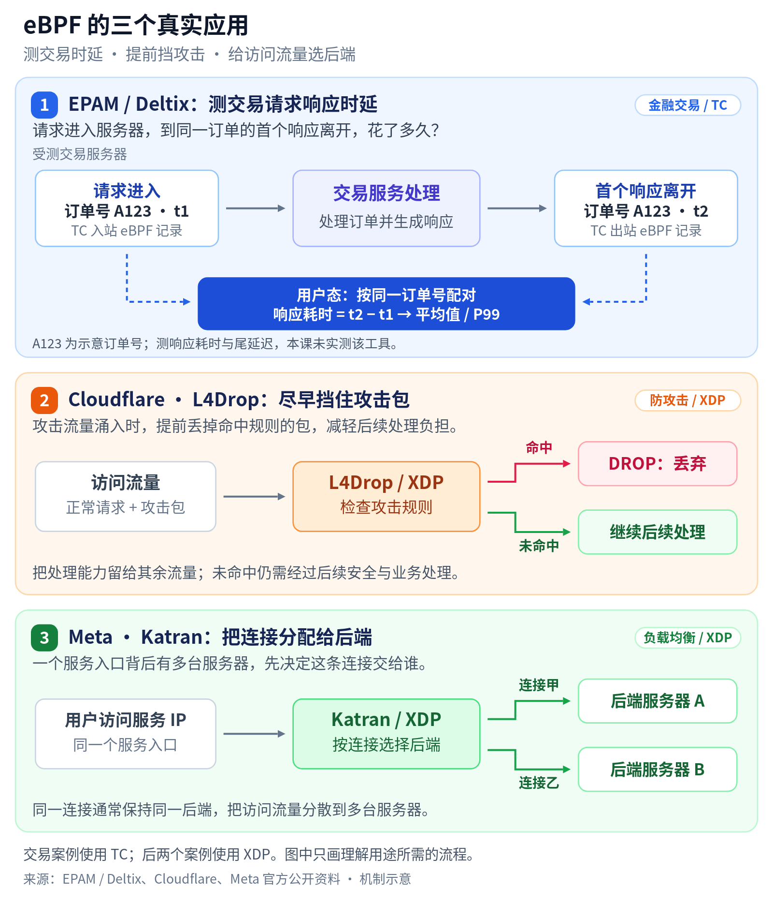</a>
</div>

第一例的 FIX 是订单与回报协议，TC 是 Linux 网络收发路径中的处理入口；测量的是请求到**首个响应**的耗时，不是最终成交时间。后两个案例使用 XDP 的丢弃和转发动作。

来源：[EPAM 开源工具](https://github.com/epam/ebpf-fix-latency-tool)及 [Deltix 官方入口](https://ember.deltixlab.com/docs/tools/latency-tool/)、[Cloudflare L4Drop](https://blog.cloudflare.com/l4drop-xdp-ebpf-based-ddos-mitigations/)及[边缘防护流程](https://blog.cloudflare.com/deep-dive-cloudflare-autonomous-edge-ddos-protection/)、[Meta Katran](https://engineering.fb.com/2018/05/22/open-source/open-sourcing-katran-a-scalable-network-load-balancer/)。图为机制示意，本课未实测这些系统的性能；AF_XDP 用户态收包接口另见[补充图](images/course-visuals/07-diagrams/07-af-xdp-explained.png)。

## 理解检查

1. 本课 XDP 在哪执行，在建立 skb 之前还是之后？
2. 为什么先检查字节，再匹配股票？
3. 同样是 NVDA，Type F 会被本课规则丢弃吗？
4. 多 CPU 怎样保证只丢一次？
5. 怎样证明规则生效？
6. 为什么 XDP 已卸载，网页仍有缺口报错？
7. 真实世界用来做什么？

### 参考答案

1. 在 `.2` 驱动收包入口，由主机 CPU 执行；位于建立 skb 之前，PASS 后继续交给协议栈。
2. 先保证读取不越界，才能比较 Type、Locate、Stock。
3. 不会。标准 Type F 长 40 字节，本程序要求 36 字节，因此在长度检查处就放行。
4. 所有 CPU 共用一次额度，只有一个能成功扣减并丢包。
5. 先确认放行健康，再核对丢包数为 1、两侧序号一致，并在网页观察 GAP 与交易闸门关闭。
6. 卸载不会补回旧包；故障保留供观察，在网页点击“重新开始并清空交易”后，从新 Session 重建订单簿。
7. EPAM/Deltix 的工具用 eBPF 测量 FIX 请求到首个响应的时延；Cloudflare 用 XDP 提前过滤攻击包；Meta Katran 用 XDP 把访问连接分配给后端。

## 清理、回滚与交接

完成运行⑤后，以 `HEALTHY / OPEN` 和正常更新的订单簿结束本章；接口保持 `sfc / UP / 20.1.1.2`，本次 XDP 已卸载。下一章把同一条规则写成 FPGA 电路，先用 Vivado 完成 U250 工程的仿真与构建，再了解交换机适配；教师的跨章状态核对见[维护说明](assets/07-xdp/TEACHER-LIVE-NOTES.md)。

## 本地配套资产

以下路径均相对于 `assets/07-xdp/`。

| 文件 | 用途 |
| --- | --- |
| `00-xdp-toolchain-prep.sh` | 从 `.111` 安装 Clang/LLVM/libbpf 开发包/Linux tools，检查 clang、bpftool、ip 版本 |
| `01-xdp-hook-readiness.sh` | `.2` 的 BDF、driver、IP 与 hook 基线 |
| `03-xdp-parser-bounds.sh` | 打印 C 源码，查看检查和过滤规则；不执行过滤 |
| `04-xdp-build.sh` | 编译 C 源码并检查 BPF ELF |
| `flle_xdp_mold_itch.c` | 现役 MoldUDP64/ITCH XDP 程序 |
| `05-xdp-inline-live.sh` | 丢一包、核对缺口并保留网页故障现场 |
| `06-restart-trading-service.sh` | 异常排障时的备用完整重启；正常重复实验无需执行 |
| `live-support/run-xdp-receiver-live.sh` | `.2` 原生 XDP、丢包取证、暂停回放与卸载本次程序 |
| `live-support/xdp-run-state.sh`、`live-support/wait-held-state.py` | 保存实验身份，核对缺口保留及再次运行前的恢复状态 |
| `live-support/xdp-session.py` | 按接口/program ID 管理本次挂载、map 和远端看门狗 |
| `live-support/set-xdp-policy.py` | 清审计后把 `policy` map 写成 allow / block |

教师恢复与[历史资产清单](assets/07-xdp/TEACHER-LIVE-NOTES.md#retired-assets)见 `TEACHER-LIVE-NOTES.md`。本地回归为 `test-toolchain-repeat.py`、`live-support/test_xdp_session.py` 和 `live-support/test_drop_restart.py`，使用工具替身，不连接设备。

## 外部参考资料

| 资料 | 用途 |
| --- | --- |
| [Clang](https://clang.llvm.org/) | C 语言编译器；本课用它把 XDP 源码编成 BPF 指令 |
| [LLVM/Clang 源码](https://github.com/llvm/llvm-project) | 编译器与 `llvm-objdump` 的上游仓库 |
| [libbpf 源码](https://github.com/libbpf/libbpf)与[装载流程](https://docs.kernel.org/bpf/libbpf/libbpf_overview.html) | BPF 开发头文件、对象装载与 map 操作 |
| [bpftool 源码](https://github.com/libbpf/bpftool) | BPF 程序和 map 的查看、管理工具 |
| [iproute2 源码镜像](https://github.com/iproute2/iproute2) | `ip` 命令及 XDP 装载、接口挂接入口 |
| [Ubuntu 软件包管理](https://ubuntu.com/server/docs/how-to/software/package-management/) | APT 更新目录、安装软件包与依赖 |
| [Linux BPF program types](https://docs.kernel.org/bpf/libbpf/program_types.html) | BPF 程序类型与装载入口 |
| [Linux BPF verifier](https://docs.kernel.org/bpf/verifier.html) | 寄存器、控制流与直接报文访问边界 |
| [Linux BPF maps](https://docs.kernel.org/bpf/maps.html) | map 类型与用户态共享状态 |
| [Linux struct sk_buff](https://docs.kernel.org/networking/skbuff.html) | skb 如何记录报文信息并关联数据缓冲区 |
| [Cilium：XDP 执行模式](https://docs.cilium.io/en/latest/reference-guides/bpf/progtypes/#xdp) | Native、Generic 与 Offloaded XDP 的执行位置 |
| [Linux XDP Redirect](https://docs.kernel.org/bpf/redirect.html) | 把包交给指定网卡、CPU 或 AF_XDP 接收目标 |
| [ip link：XDP 挂载模式](https://man7.org/linux/man-pages/man8/ip-link.8.html) | `xdp` 的回退行为与 `xdpdrv` 的强制 Native 语义 |
| [OpenOnload 9f330e7：sfc XDP 实现](https://github.com/Xilinx-CNS/onload/blob/9f330e7058f6062596f2a7316952c67963a0aac3/src/driver/linux_net/drivers/net/ethernet/sfc/xdp.c) | 本课驱动的 Native 执行路径与无硬件卸载入口边界 |
| [AMD X2522 产品规格](https://www.amd.com/en/products/ethernet-adapters/x2522.html) | 网卡预设硬件卸载功能；不能据此推断 XDP 程序卸载 |
| [xdp-tools：XDP 层抓包](https://github.com/xdp-project/xdp-tools/tree/main/xdp-dump) | XDP 入口／出口抓包与普通抓包的观察范围 |
| [EPAM：eBPF FIX Latency Tool](https://github.com/epam/ebpf-fix-latency-tool) | TC 入站/出站提取订单标识与时间戳，配对测量请求响应时延 |
| [Deltix：FIX Latency Tool](https://ember.deltixlab.com/docs/tools/latency-tool/) | 页首提供 eBPF 工具入口；下方主体介绍原有 libpcap 工具 |
| [Cloudflare L4Drop（2018）](https://blog.cloudflare.com/l4drop-xdp-ebpf-based-ddos-mitigations/) | 将攻击规则编译为 eBPF，在 XDP 入口提前丢包 |
| [Cloudflare 边缘防护流程（2021）](https://blog.cloudflare.com/deep-dive-cloudflare-autonomous-edge-ddos-protection/) | 检测、L4Drop、后续负载均衡与安全/代理处理的关系 |
| [Meta Katran（2018）](https://engineering.fb.com/2018/05/22/open-source/open-sourcing-katran-a-scalable-network-load-balancer/) | 选择后端并用 XDP 转发，减轻四层负载均衡处理开销 |
| [Linux AF_XDP](https://docs.kernel.org/networking/af_xdp.html) | 应用接收完整报文的接口，以及复制/零拷贝模式 |
| [xdp-project/xdp-tutorial](https://github.com/xdp-project/xdp-tutorial) | XDP parser、action 与 map 的练习入口 |
| [Nasdaq TotalView-ITCH 5.0](https://www.nasdaqtrader.com/content/technicalsupport/specifications/dataproducts/NQTVITCHSpecification_5.0.pdf) | 消息类型、Stock Locate 与 Type A 字段布局 |
| [Nasdaq MoldUDP64 Specification](https://nasdaqtrader.com/content/technicalsupport/specifications/dataproducts/moldudp64.pdf) | MoldUDP64 原始字段合同 |
