# 第 08 章：FPGA——在网卡与交换机中构建处理电路

第七章介绍 eBPF/XDP 怎样通过程序扩展网络处理能力。本章认识另一种方式：**利用 FPGA（现场可编程门阵列），在网卡和交换机中构建可定制的报文处理电路。** 重点是理解 FPGA 能做什么、它与主机运行程序有什么不同，以及一份设计怎样变成设备中的电路。

先把上一章的 **Native XDP** 与本章的 **FPGA 报文处理电路** 放在一起比较：

| 比较点 | eBPF / Native XDP | FPGA |
| --- | --- | --- |
| 谁处理报文 | **主机 CPU 执行程序**，在驱动收包入口处理 | **专用电路处理**，无需主机 CPU 逐包执行；CPU 仍可负责配置和管理 |
| 开发与修改 | **相对简单**：编写、编译、加载程序 | **相对复杂**：设计电路，还要综合、布局布线和时序检查 |
| 延迟（Latency） | 提前处理可省去后续协议栈工作；仍受 CPU 负载、缓存与访存影响 | 可定制短路径与并行流水线；延迟由电路级数、时钟、缓存与接口共同决定 |
| 处理方式 | CPU 执行指令，可利用多核并行 | 多个电路单元同时工作，持续处理数据流 |
| 适用侧重 | 快速实现和调整过滤、统计等网络策略 | 定制数据通路、并行处理与精细控制处理时序 |

我们先认识芯片与开发工具，再以 **Alveo U250 网卡**为例，用 Vivado 走过代码接入、仿真、综合、布局布线和 `.bit` 配置文件生成，并查看电路连接与摆放。随后介绍板卡装载，以及 **Arista FPGA 交换机**的厂商工程、应用打包和设备操作，最后通过公开案例了解行业应用。

**“识别 NVDA 行情，授权后只丢一个匹配包”是贯穿操作的简单演示。** 借这个案例观察代码如何接入报文路径、如何验证逻辑、如何生成配置并装载到设备；U250 与交换机分别使用适配各自平台的课程代码。

## 本章导航

<div style="border-left:6px solid #7e22ce;background:#f3e8ff;padding:12px 16px;border-radius:8px;margin:14px 0;"><span style="display:inline-block;padding:3px 12px;border-radius:6px;background:#7e22ce;color:#fff;font-weight:800;">本章导航</span> <span style="font-weight:700;color:#581c87;">本章分成 6 部分，共 19 个导航项；先用总图看完整路线，再在每节导航卡里查看全章与本组位置。</span></div>

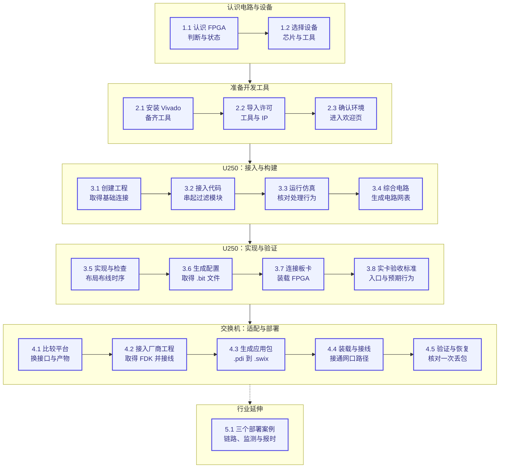

固定顺序就是：**认识电路与设备 → 准备开发工具 → U250：接入与构建 → U250：实现与验证 → 交换机：适配与部署 → 行业延伸。**

| 导航项 | 所属部分 | 这一项回答什么 |
| --- | --- | --- |
| [1.1 认识 FPGA](#step-1-1) | 认识电路与设备 | 理解判断、状态、存储和连接怎样组成电路 |
| [1.2 选择设备](#step-1-2) | 认识电路与设备 | 分清芯片、Vivado、板卡和交换机的角色 |
| [2.1 安装 Vivado](#step-2-1) | 准备开发工具 | 备齐工具、器件支持和线缆驱动 |
| [2.2 导入许可](#step-2-2) | 准备开发工具 | 申请并导入工具与 IP 所需许可 |
| [2.3 确认环境](#step-2-3) | 准备开发工具 | 核对许可并进入 Vivado 欢迎界面 |
| [3.1 创建工程](#step-3-1) | U250：接入与构建 | 用官方材料建立 U250 基础工程 |
| [3.2 接入代码](#step-3-2) | U250：接入与构建 | 看懂模块职责并接入收包路径 |
| [3.3 运行仿真](#step-3-3) | U250：接入与构建 | 用测试台核对过滤与控制行为 |
| [3.4 综合电路](#step-3-4) | U250：接入与构建 | 把完整工程转换成电路网表 |
| [3.5 实现与检查](#step-3-5) | U250：实现与验证 | 完成布局布线并核对时序与规则 |
| [3.6 生成配置](#step-3-6) | U250：实现与验证 | 生成并找到 U250 的 .bit 文件 |
| [3.7 连接板卡](#step-3-7) | U250：实现与验证 | 通过 USB-JTAG 将配置装入 FPGA |
| [3.8 实卡验收标准](#step-3-8) | U250：实现与验证 | 明确实卡入口与报文验收标准 |
| [4.1 比较平台](#step-4-1) | 交换机：适配与部署 | 分清两类设备的接口与产物差异 |
| [4.2 接入厂商工程](#step-4-2) | 交换机：适配与部署 | 取得厂商工程并了解课程文件分工 |
| [4.3 生成应用包](#step-4-3) | 交换机：适配与部署 | 用 Vivado 和厂商工具生成镜像与安装包 |
| [4.4 装载与接线](#step-4-4) | 交换机：适配与部署 | 安装应用、装载镜像并接通网口路径 |
| [4.5 验证与恢复](#step-4-5) | 交换机：适配与部署 | 核对交换机出口行为并恢复测试连接 |
| [5.1 三个部署案例](#step-5-1) | 行业延伸 | 同类 FPGA 平台解决过哪些实际问题 |

## 1 认识电路与设备

<a id="step-1-1"></a>

### 1.1 认识 FPGA

<div style="border:2px solid #4f46e5;background:#eef2ff;padding:10px 12px;border-radius:8px;margin:14px 0;">
<div style="font-weight:900;color:#312e81;margin-bottom:4px;">导航卡 · 认识电路与设备</div>
<div style="font-weight:700;color:#312e81;margin-bottom:8px;">范畴：机制讲解　本步知识：理解判断、状态、存储和连接怎样组成电路　<span style="display:inline-block;white-space:nowrap;">位置：全章第 1 / 19 项 · 本组第 1 / 2 项</span></div>
<span style="display:inline-block;margin:3px;padding:4px 10px;border-radius:6px;background:#15803d;color:#fff;font-weight:800;"><a href="#step-1-1" style="color:inherit;text-decoration:none;">1.1 认识 FPGA</a></span>
<span style="display:inline-block;margin:3px;padding:4px 10px;border-radius:6px;background:#f8fafc;border:1px solid #a5b4fc;color:#312e81;font-weight:800;"><a href="#step-1-2" style="color:inherit;text-decoration:none;">1.2 选择设备</a></span>
</div>

**FPGA 可以想成一盒电子积木。** 芯片里有做判断、保存状态、存数据的单元，以及连接这些单元的线路。我们写的代码描述这些单元怎样合作；工具生成配置文件，再把配置装入芯片。

<div style="border-left:6px solid #7e22ce;background:#f3e8ff;padding:12px 16px;border-radius:8px;margin:14px 0;"><span style="display:inline-block;padding:3px 12px;border-radius:6px;background:#7e22ce;color:#fff;font-weight:800;">关键图 · 电子积木</span> <span style="font-weight:700;color:#581c87;">先认出四类资源：判断、记状态、存数据、连接。</span></div>

<div style="max-width:820px;margin:14px auto;padding:10px;background:#f8fafc;border:1px solid #cbd5e1;border-radius:12px;">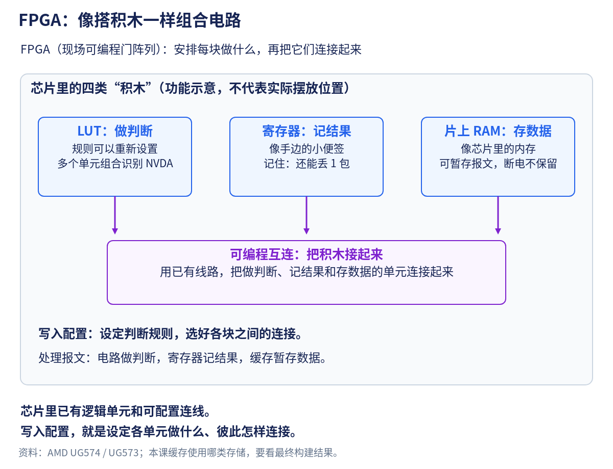</div>

| 积木 | 实际资源 | 本例用途 |
| --- | --- | --- |
| 小判断器 | LUT（查找表） | 比较报文字段、识别目标股票 |
| 小便签 | 寄存器 | 保存一次额度、计数和处理状态 |
| 数据仓库 | 片上存储资源 | 暂存报文，等待判决 |
| 连接线 | 可编程互连 | 连接接收、判断和发送逻辑 |

**SystemVerilog 是编写源码的语言，`.sv` 是源码文件后缀**，就像 C 语言常用 `.c` 文件保存源码。不过，这里用 SystemVerilog 描述电路的行为与连接。

可以把 `.sv` 源码想成电路的“搭建说明”：写清各部分做什么、怎样连接。**Vivado 根据这份说明选用芯片资源、安排连接**，最终生成配置文件。实际用了多少逻辑和存储资源，要看工具生成的报告。[AMD UltraScale 架构 LUT 说明（UG574）](https://docs.amd.com/r/en-US/ug574-ultrascale-clb/Look-Up-Table)

<a id="step-1-2"></a>

### 1.2 选择设备

<div style="border:2px solid #4f46e5;background:#eef2ff;padding:10px 12px;border-radius:8px;margin:14px 0;">
<div style="font-weight:900;color:#312e81;margin-bottom:4px;">导航卡 · 认识电路与设备</div>
<div style="font-weight:700;color:#312e81;margin-bottom:8px;">范畴：机制讲解　本步知识：分清芯片、Vivado、板卡和交换机的角色　<span style="display:inline-block;white-space:nowrap;">位置：全章第 2 / 19 项 · 本组第 2 / 2 项</span></div>
<span style="display:inline-block;margin:3px;padding:4px 10px;border-radius:6px;background:#f8fafc;border:1px solid #a5b4fc;color:#312e81;font-weight:800;"><a href="#step-1-1" style="color:inherit;text-decoration:none;">1.1 认识 FPGA</a></span>
<span style="display:inline-block;margin:3px;padding:4px 10px;border-radius:6px;background:#15803d;color:#fff;font-weight:800;"><a href="#step-1-2" style="color:inherit;text-decoration:none;">1.2 选择设备</a></span>
</div>

**Xilinx（赛灵思）** 是专注于 FPGA 和自适应计算的半导体公司，本章使用的 **Vivado 开发工具、Alveo 板卡和 Versal 芯片系列都源自 Xilinx 的产品体系**。**AMD 于 2022 年 2 月完成对 Xilinx 的收购**，这些产品如今归属 AMD，因此资料和工程中会同时看到 AMD 与 Xilinx 两种名称。[AMD 收购公告](https://www.amd.com/zh-cn/newsroom/press-releases/2022-02-14-amd.html)

本章选择 AMD/Xilinx 的芯片与开发工具体系：**Vivado 是开发工具，Alveo U250 是 AMD 的板卡，Arista 7135V 是使用 AMD Versal 芯片的交换机。** 两条路线都要构建电路，设备、配套工程和装载方法不同。[AMD U250 器件说明](https://docs.amd.com/r/en-US/ug1301-getting-started-guide-alveo-accelerator-cards/Card-Features)、[Arista 7135V](https://www.arista.com/en/products/7135v-series)

Alveo U250 是一块独立买来的 PCIe 加速卡，像显卡一样插进主机。先看这块卡的产品外观：全高挡板、金属散热外壳，上面印着 AMD ALVEO U250。挡板是卡出厂就带的金属面板，USB-JTAG 和两个网口都在这块板上；卡插进哪台主机，这些口就跟到哪台主机的后窗。

主机要有 **PCIe Gen3 x16** 槽，并空出相邻两个槽位（全高、双宽）。卡还要接 **8-pin PCIe AUX** 电源，官方额定功耗 **215 W**。[UG1301 安装板卡](https://docs.amd.com/r/en-US/ug1301-getting-started-guide-alveo-accelerator-cards/Installing-the-Card)、[DS962 产品规格](https://docs.amd.com/r/en-US/ds962-u200-u250/Alveo-Product-Details)

<figure style="max-width:760px;margin:16px auto;padding:10px;background:#f8fafc;border:1px solid #cbd5e1;border-radius:12px;">
<a href="images/course-visuals/08-diagrams/08-alveo-u250-card.png">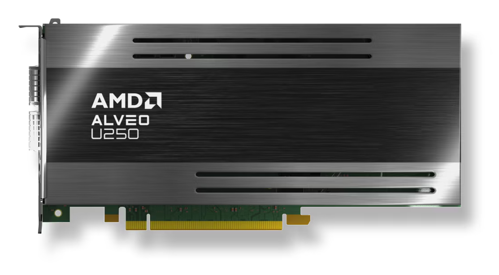</a>
<figcaption style="margin-top:8px;color:#475569;">图 1-1｜Alveo U250 的顶面外观。挡板是卡自己带的；USB-JTAG 口在挡板上，3.7 再看接头。</figcaption>
</figure>

<div style="border-left:6px solid #7e22ce;background:#f3e8ff;padding:12px 16px;border-radius:8px;margin:14px 0;"><span style="display:inline-block;padding:3px 12px;border-radius:6px;background:#7e22ce;color:#fff;font-weight:800;">关键图 · 谁提供什么</span> <span style="font-weight:700;color:#581c87;">上面看芯片与设备，下面看 Vivado 怎样把工程变成配置文件。</span></div>

<div style="background:#f8fafc;border:1px solid #cbd5e1;border-radius:12px;padding:10px;max-width:820px;margin:14px auto;">
<a href="images/course-visuals/08-diagrams/08-chip-tool-device-map.svg">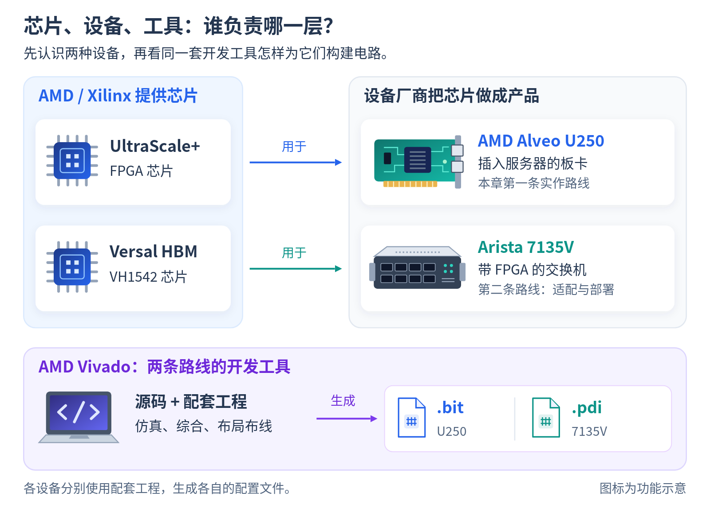</a>
</div>

从图中两条横线看，U250 板卡和 7135V 交换机都使用 AMD 的芯片，设备分别由 AMD 与 Arista 提供。下方的 Vivado 负责构建设计：选择哪种设备，就使用哪种设备的配套工程，生成对应的配置文件。

<div style="border-left:6px solid #7e22ce;background:#f3e8ff;padding:12px 16px;border-radius:8px;margin:14px 0;"><span style="display:inline-block;padding:3px 12px;border-radius:6px;background:#7e22ce;color:#fff;font-weight:800;">工程与配置文件</span> <span style="font-weight:700;color:#581c87;">U250 使用 OpenNIC 工程，生成 <code>.bit</code>；7135V 使用厂商提供的 BVL 配套工程，生成 <code>.pdi</code>。</span></div>

## 2 准备开发工具

<a id="step-2-1"></a>

### 2.1 安装 Vivado

<div style="border:2px solid #4f46e5;background:#eef2ff;padding:10px 12px;border-radius:8px;margin:14px 0;">
<div style="font-weight:900;color:#312e81;margin-bottom:4px;">导航卡 · 准备开发工具</div>
<div style="font-weight:700;color:#312e81;margin-bottom:8px;">范畴：工具准备　本步知识：备齐工具、器件支持和线缆驱动　<span style="display:inline-block;white-space:nowrap;">位置：全章第 3 / 19 项 · 本组第 1 / 3 项</span></div>
<span style="display:inline-block;margin:3px;padding:4px 10px;border-radius:6px;background:#15803d;color:#fff;font-weight:800;"><a href="#step-2-1" style="color:inherit;text-decoration:none;">2.1 安装 Vivado</a></span>
<span style="display:inline-block;margin:3px;padding:4px 10px;border-radius:6px;background:#f8fafc;border:1px solid #a5b4fc;color:#312e81;font-weight:800;"><a href="#step-2-2" style="color:inherit;text-decoration:none;">2.2 导入许可</a></span>
<span style="display:inline-block;margin:3px;padding:4px 10px;border-radius:6px;background:#f8fafc;border:1px solid #a5b4fc;color:#312e81;font-weight:800;"><a href="#step-2-3" style="color:inherit;text-decoration:none;">2.3 确认环境</a></span>
</div>

<div style="border-left:6px solid #15803d;background:#dcfce7;padding:12px 16px;border-radius:8px;margin:14px 0;"><span style="display:inline-block;padding:3px 12px;border-radius:6px;background:#15803d;color:#fff;font-weight:800;">动手操作 · 2.1</span> <span style="font-weight:700;color:#14532d;">在 Windows 开发电脑运行 AMD 安装器；安装 Vivado、Alveo 器件支持与线缆驱动。下载和安装需要较长时间。</span></div>

本章使用 Windows 上的 **Vivado 2026.1**。打开 AMD 官方下载页，登录账号。地址如下：

`https://www.amd.com/en/support/downloads/adaptive-socs-and-fpgas/development-tools/2026-1.html`

<figure style="max-width:760px;margin:16px auto;padding:10px;background:#f8fafc;border:1px solid #cbd5e1;border-radius:12px;">
<a href="images/course-visuals/08-vivado-install/00-amd-2026-1-download-page.png">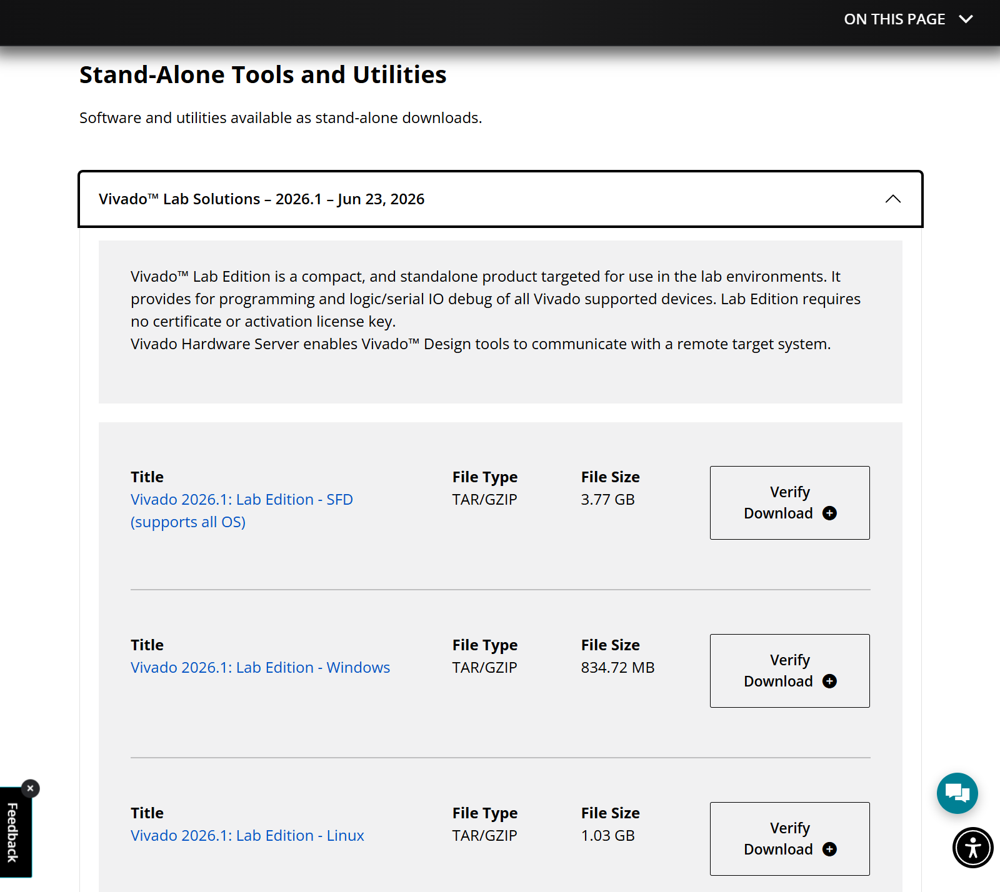</a>
<figcaption style="margin-top:8px;color:#475569;">图 2-1｜AMD 2026.1 官方下载页上的 Stand-Alone / Vivado Lab Edition 分区；本课在同一页下载完整 Vivado。</figcaption>
</figure>

同一页里有多组工具。图中这一组是实验室编程和调试用的 **Vivado Lab Edition**，Windows 包大约 835 MB，不能做本章的仿真、综合和实现。请在同一页面找到完整 **Vivado** Windows 安装器，下载后启动。安装器进入 **Select Product to Install** 页面后，选择 **Vivado**，点击 **Next**。

<figure style="max-width:760px;margin:16px auto;padding:10px;background:#f8fafc;border:1px solid #cbd5e1;border-radius:12px;">
<a href="images/course-visuals/08-vivado-install/01-select-vivado.png">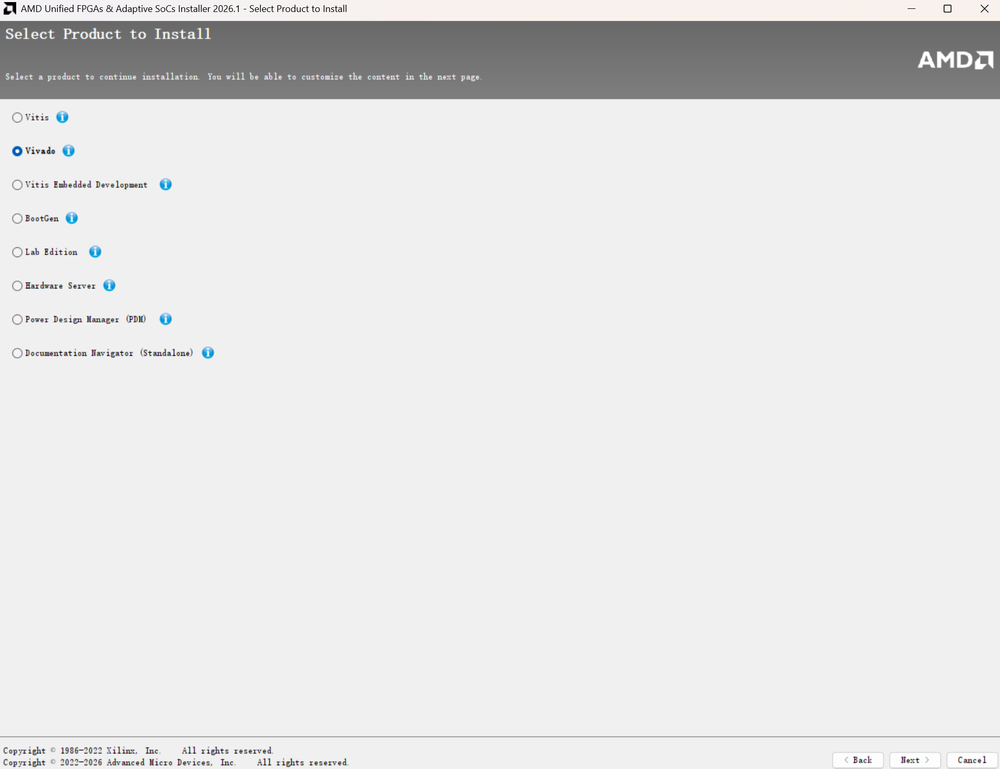</a>
<figcaption style="margin-top:8px;color:#475569;">图 2-2｜选择本章用于仿真、综合与实现的 Vivado。</figcaption>
</figure>

进入组件选择页，保留 Vivado，在 **Devices** 下勾选 **Install devices for Alveo and edge acceleration platforms**，准备 U250 所需的器件支持。下方保留 **Install Cable Drivers** 与 **Acquire or Manage a License Key**。

<figure style="max-width:760px;margin:16px auto;padding:10px;background:#f8fafc;border:1px solid #cbd5e1;border-radius:12px;">
<a href="images/course-visuals/08-vivado-install/02-select-alveo-components.png">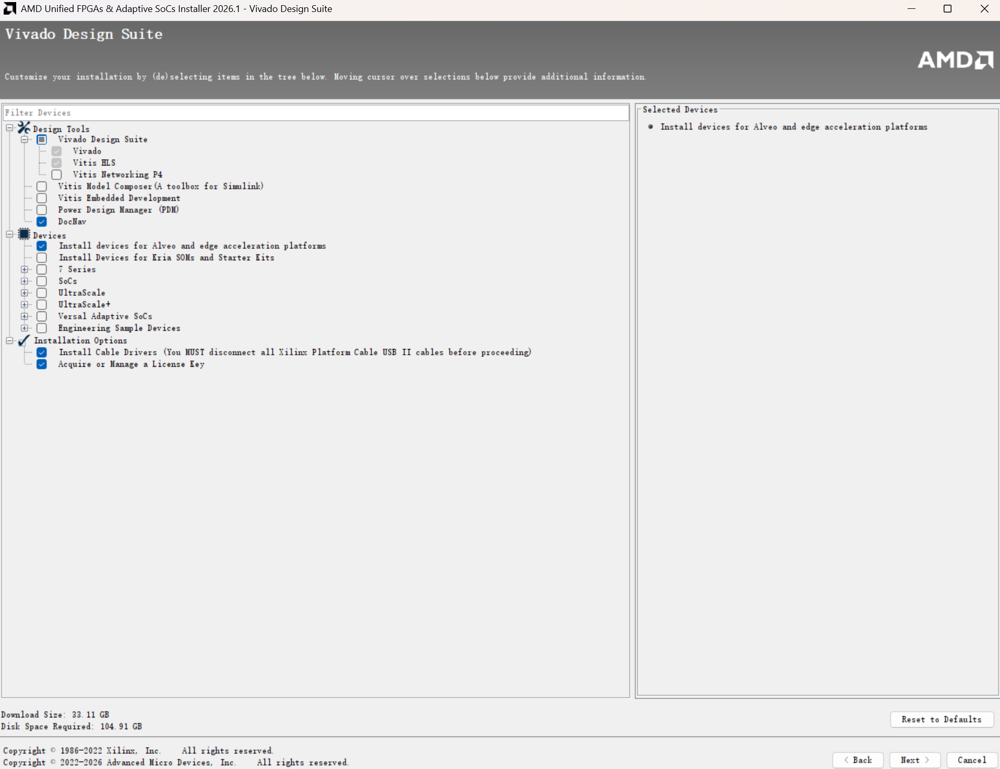</a>
<figcaption style="margin-top:8px;color:#475569;">图 2-3｜本例的组件选择。下方同时显示下载量和磁盘空间需求。</figcaption>
</figure>

| 本步选项 | 在后续流程中的用途 |
| --- | --- |
| Vivado | 仿真、综合、布局布线与生成配置文件 |
| Alveo 器件支持 | 让工具具备本例板卡所用器件的支持数据 |
| Install Cable Drivers | 为后续通过调试线缆连接真实板卡准备驱动 |
| Acquire or Manage a License Key | 安装后进入许可管理流程 |

本次所选组件显示下载量 **33.11 GB**、磁盘空间需求 **104.91 GB**；实际数值随版本与勾选内容变化，按自己安装器的提示准备空间。继续按向导确认许可协议、安装目录和摘要，开始下载与安装。

<figure style="max-width:760px;margin:16px auto;padding:10px;background:#f8fafc;border:1px solid #cbd5e1;border-radius:12px;">
<a href="images/course-visuals/08-vivado-install/03-download-install-progress.png">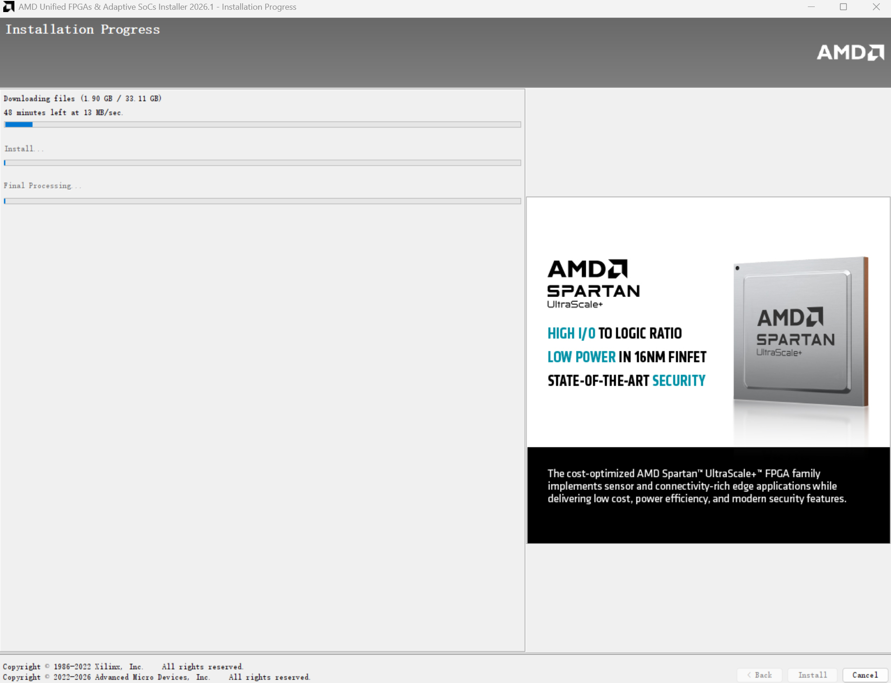</a>
<figcaption style="margin-top:8px;color:#475569;">图 2-4｜等待下载、安装和最终处理完成；剩余时间是安装器估计值。</figcaption>
</figure>

工具安装与器件支持完成后，还需要让本机识别适用的许可证。板卡的网口、PCIe 和时钟连接则由第 3 部分取得的基础工程提供。

<a id="step-2-2"></a>

### 2.2 导入许可

<div style="border:2px solid #4f46e5;background:#eef2ff;padding:10px 12px;border-radius:8px;margin:14px 0;">
<div style="font-weight:900;color:#312e81;margin-bottom:4px;">导航卡 · 准备开发工具</div>
<div style="font-weight:700;color:#312e81;margin-bottom:8px;">范畴：工具准备　本步知识：申请并导入工具与 IP 所需许可　<span style="display:inline-block;white-space:nowrap;">位置：全章第 4 / 19 项 · 本组第 2 / 3 项</span></div>
<span style="display:inline-block;margin:3px;padding:4px 10px;border-radius:6px;background:#f8fafc;border:1px solid #a5b4fc;color:#312e81;font-weight:800;"><a href="#step-2-1" style="color:inherit;text-decoration:none;">2.1 安装 Vivado</a></span>
<span style="display:inline-block;margin:3px;padding:4px 10px;border-radius:6px;background:#15803d;color:#fff;font-weight:800;"><a href="#step-2-2" style="color:inherit;text-decoration:none;">2.2 导入许可</a></span>
<span style="display:inline-block;margin:3px;padding:4px 10px;border-radius:6px;background:#f8fafc;border:1px solid #a5b4fc;color:#312e81;font-weight:800;"><a href="#step-2-3" style="color:inherit;text-decoration:none;">2.3 确认环境</a></span>
</div>

<div style="border-left:6px solid #15803d;background:#dcfce7;padding:12px 16px;border-radius:8px;margin:14px 0;"><span style="display:inline-block;padding:3px 12px;border-radius:6px;background:#15803d;color:#fff;font-weight:800;">动手操作 · 2.2</span> <span style="font-weight:700;color:#14532d;">在 AMD 许可网页申请本机许可，再用 Vivado License Manager 导入。</span></div>

本例使用 **Vivado Alveo Edition License**。打开 AMD Product Licensing，登录并完成页面要求的账户信息确认。地址如下：

`https://account.amd.com/en/forms/license/license-form.html`

<figure style="max-width:760px;margin:16px auto;padding:10px;background:#f8fafc;border:1px solid #cbd5e1;border-radius:12px;">
<a href="images/course-visuals/08-vivado-install/05-select-alveo-license.png">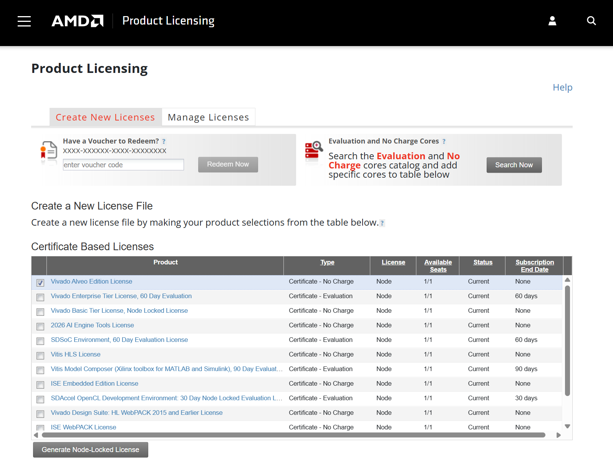</a>
<figcaption style="margin-top:8px;color:#475569;">图 2-5｜登录后的 AMD Product Licensing 页。本例在 Create New Licenses 勾选 Vivado Alveo Edition License，再点列表下方 Generate Node-Locked License。</figcaption>
</figure>

在 **Create New Licenses** 的产品列表中选择该项。这里的 Node-Locked 表示许可绑定到指定开发电脑。[AMD 许可生成说明](https://docs.amd.com/r/en-US/ug973-vivado-release-notes-install-license/Create-and-Generate-a-License-Key-File)

截图中该账户的 Alveo 项目显示 **No Charge**。实际可选项目以自己的账户授权为准；Alveo 许可的适用范围也不能直接扩展到交换机所用器件。

短期学习也可以选择同一列表的 **Vivado Enterprise Tier License, 60 Day Evaluation**。AMD 说明它在 60 天评估期内开放全部器件及工具功能，包括生成配置文件；本组实录使用的是上图所选的 Alveo 许可。[AMD工具许可说明](https://www.amd.com/en/products/software/adaptive-socs-and-fpgas/licensing-faq.html)

在生成窗口中核对产品，在 **Host ID** 选择安装 Vivado 的这台电脑，再按向导点击 **Next** 并完成确认。Host ID 是用于绑定许可的机器标识；应使用自己的值。需要查看本机信息时，打开 **Vivado License Manager → View Host Information**。

<figure style="max-width:760px;margin:16px auto;padding:10px;background:#f8fafc;border:1px solid #cbd5e1;border-radius:12px;">
<a href="images/course-visuals/08-vivado-install/06-bind-license-host.png">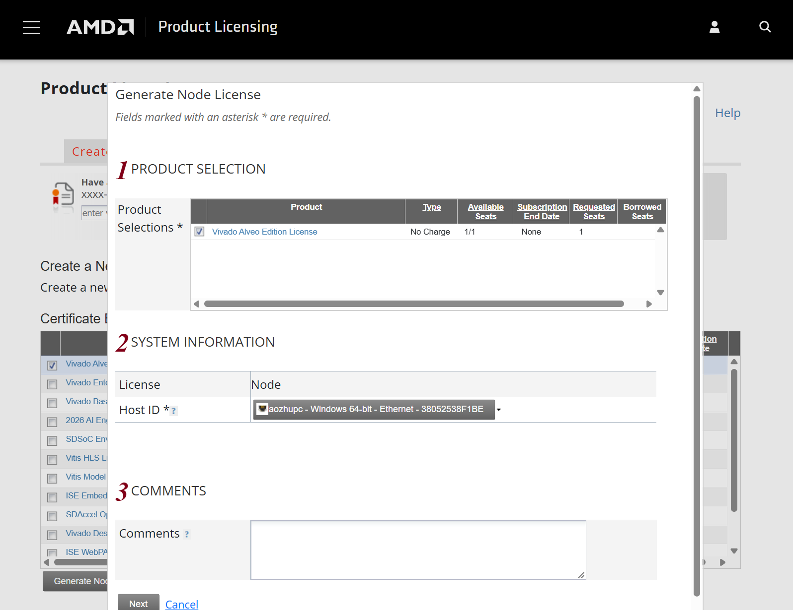</a>
<figcaption style="margin-top:8px;color:#475569;">图 2-6｜把许可绑定到实际运行 Vivado 的开发电脑，图中机器信息仅为本次示例。</figcaption>
</figure>

生成后进入 **Manage Licenses**，选中记录，核对下方产品为 **Vivado Alveo Edition License**，点击左下角的下载图标保存 `.lic` 文件。该文件也可能通过许可通知邮件取得。

<figure style="max-width:760px;margin:16px auto;padding:10px;background:#f8fafc;border:1px solid #cbd5e1;border-radius:12px;">
<a href="images/course-visuals/08-vivado-install/07-download-generated-license.png">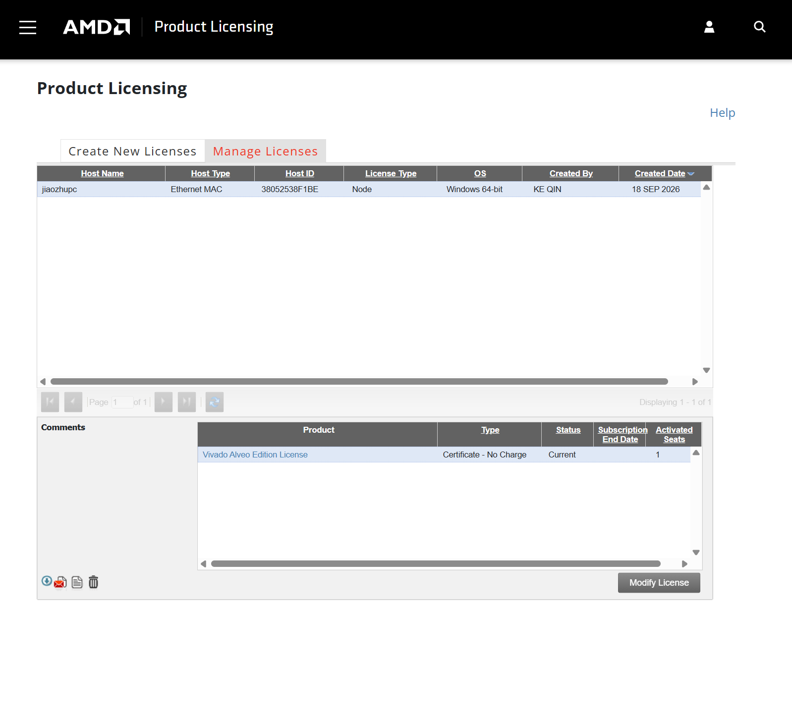</a>
<figcaption style="margin-top:8px;color:#475569;">图 2-7｜从网页下载生成的许可文件。</figcaption>
</figure>

Alveo 工具许可已下载，接下来准备 OpenNIC 网口模块的许可。IP（可复用电路模块）是厂商提供的电路功能块：工具许可决定 Vivado 可用的功能和器件，IP 许可决定相应功能块的使用权限。本例使用 CMAC（UltraScale+ 100G 以太网子系统），下面搜索并申请它的免费 IP 许可，随后将两类许可统一导入本机。[CMAC官方产品页](https://www.amd.com/en/products/adaptive-socs-and-fpgas/intellectual-property/cmac_usplus.html)、[CMAC许可说明](https://docs.amd.com/r/en-US/pg203-cmac-usplus/Licensing-and-Ordering)

<div style="border-left:6px solid #15803d;background:#dcfce7;padding:12px 16px;border-radius:8px;margin:14px 0;"><span style="display:inline-block;padding:3px 12px;border-radius:6px;background:#15803d;color:#fff;font-weight:800;">动手操作 · 网口 IP 许可</span> <span style="font-weight:700;color:#14532d;">在许可网页添加 UltraScale+ 100G Ethernet 项目，生成许可文件，再导入同一台开发电脑。</span></div>

回到 **Product Licensing → Create New Licenses**，在 **Evaluation and No Charge Cores** 区域点击 **Search Now**。搜索 `100G Ethernet`，勾选 **UltraScale+ Integrated 100G Ethernet No Charge License**，点击 **Add**。本例 U250 使用带“+”的 UltraScale+ 项目。

<figure style="max-width:760px;margin:16px auto;padding:10px;background:#f8fafc;border:1px solid #cbd5e1;border-radius:12px;">
<a href="images/course-visuals/08-vivado-install/11-search-cmac-license.png">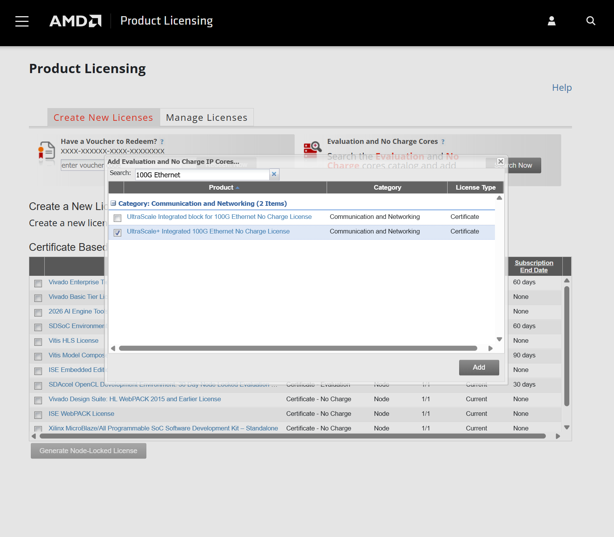</a>
<figcaption style="margin-top:8px;color:#475569;">图 2-8｜选择 UltraScale+ 的100G 以太网 IP 许可，点击 Add 加入产品列表。</figcaption>
</figure>

返回产品列表，确认该许可已勾选，点击 **Generate Node-Locked License**。接下来仍按前面的方法选择本机 **Host ID**，完成生成并下载 `.lic` 文件。

<figure style="max-width:760px;margin:16px auto;padding:10px;background:#f8fafc;border:1px solid #cbd5e1;border-radius:12px;">
<a href="images/course-visuals/08-vivado-install/12-generate-cmac-license.png">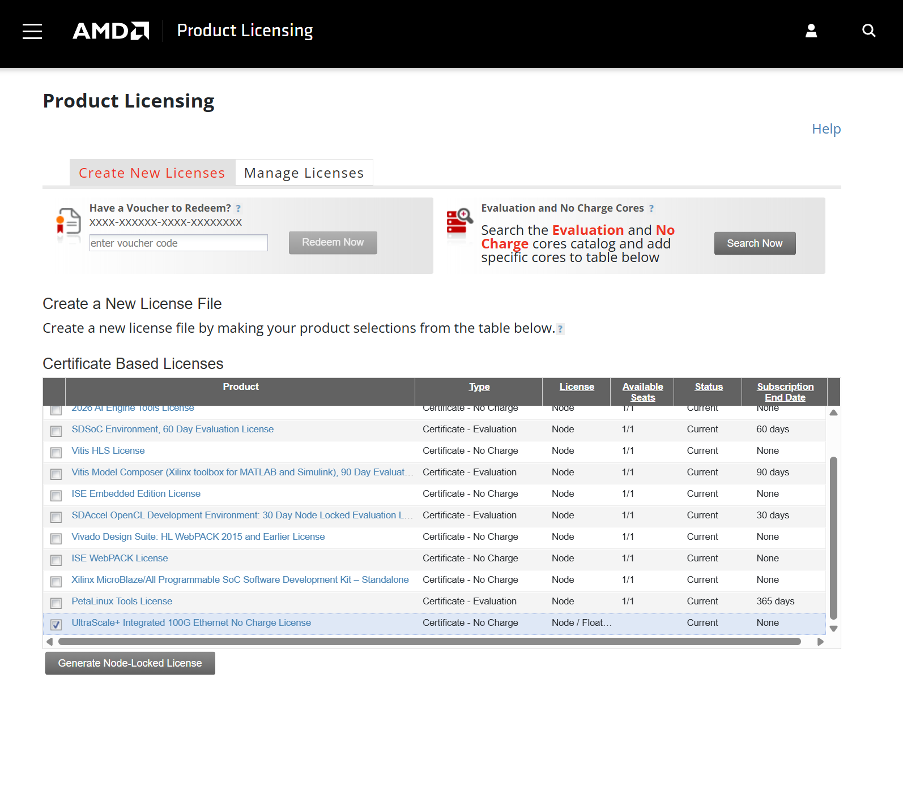</a>
<figcaption style="margin-top:8px;color:#475569;">图 2-9｜为所选网口 IP 生成本机许可。</figcaption>
</figure>

回到 **Vivado License Manager**，选择 **Load License → Copy License…**，依次打开前面取得的工具许可和 CMAC IP 许可 `.lic` 文件。工具会将它们放入本机许可搜索位置。[AMD 本机许可导入说明](https://docs.amd.com/r/en-US/ug973-vivado-release-notes-install-license/Install-Certificate-Based-Node-Locked-License-Key-File)

<figure style="max-width:760px;margin:16px auto;padding:10px;background:#f8fafc;border:1px solid #cbd5e1;border-radius:12px;">
<a href="images/course-visuals/08-vivado-install/08-load-license-file.png">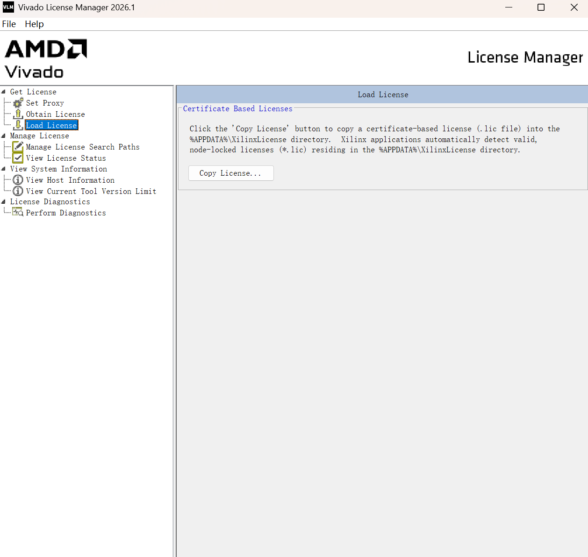</a>
<figcaption style="margin-top:8px;color:#475569;">图 2-10｜通过同一个 Copy License 入口，依次导入工具许可和网口 IP 许可。</figcaption>
</figure>

两类许可导入后，统一检查最终状态。

<a id="step-2-3"></a>

### 2.3 确认环境

<div style="border:2px solid #4f46e5;background:#eef2ff;padding:10px 12px;border-radius:8px;margin:14px 0;">
<div style="font-weight:900;color:#312e81;margin-bottom:4px;">导航卡 · 准备开发工具</div>
<div style="font-weight:700;color:#312e81;margin-bottom:8px;">范畴：工具准备　本步知识：核对许可并进入 Vivado 欢迎界面　<span style="display:inline-block;white-space:nowrap;">位置：全章第 5 / 19 项 · 本组第 3 / 3 项</span></div>
<span style="display:inline-block;margin:3px;padding:4px 10px;border-radius:6px;background:#f8fafc;border:1px solid #a5b4fc;color:#312e81;font-weight:800;"><a href="#step-2-1" style="color:inherit;text-decoration:none;">2.1 安装 Vivado</a></span>
<span style="display:inline-block;margin:3px;padding:4px 10px;border-radius:6px;background:#f8fafc;border:1px solid #a5b4fc;color:#312e81;font-weight:800;"><a href="#step-2-2" style="color:inherit;text-decoration:none;">2.2 导入许可</a></span>
<span style="display:inline-block;margin:3px;padding:4px 10px;border-radius:6px;background:#15803d;color:#fff;font-weight:800;"><a href="#step-2-3" style="color:inherit;text-decoration:none;">2.3 确认环境</a></span>
</div>

<div style="border-left:6px solid #15803d;background:#dcfce7;padding:12px 16px;border-radius:8px;margin:14px 0;"><span style="display:inline-block;padding:3px 12px;border-radius:6px;background:#15803d;color:#fff;font-weight:800;">动手操作 · 2.3</span> <span style="font-weight:700;color:#14532d;">打开许可状态页核对产品、有效期和版本，再启动 Vivado。</span></div>

在 License Manager 左侧选择 **View License Status**，点击 **Refresh** 刷新。最终状态如下：顶部为 **Loaded License Tiers: ALVEO**，列表同时包含工具许可和 **`cmac_usplus`** 网口 IP 许可。

<figure style="max-width:760px;margin:16px auto;padding:10px;background:#f8fafc;border:1px solid #cbd5e1;border-radius:12px;">
<a href="images/course-visuals/08-vivado-install/13-confirm-cmac-license.png">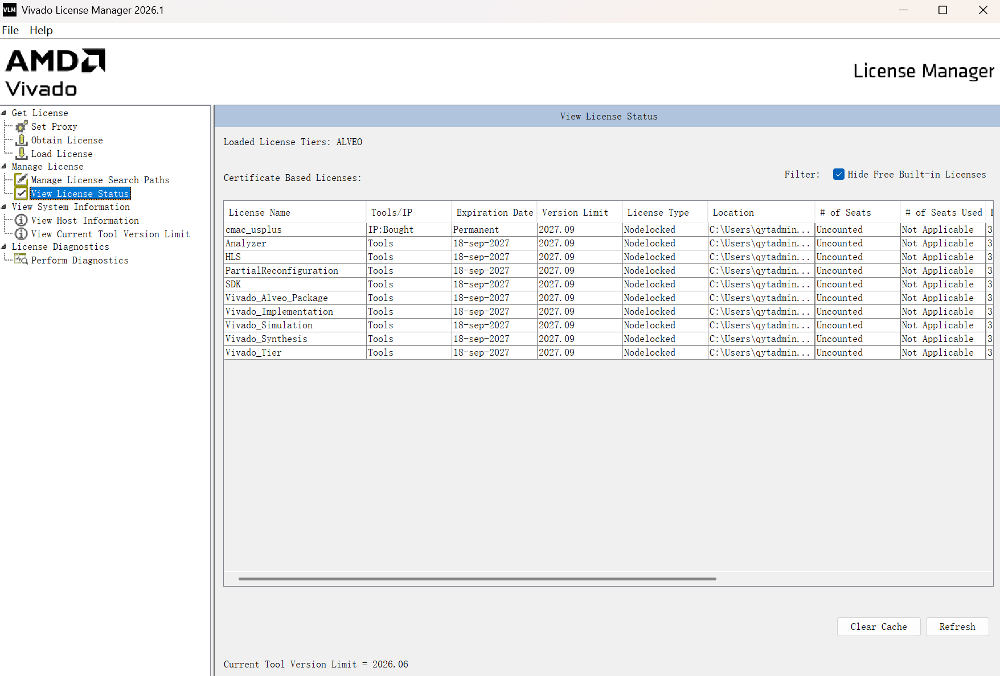</a>
<figcaption style="margin-top:8px;color:#475569;">图 2-11｜核对完整许可状态：ALVEO 已加载，cmac_usplus 也已出现在列表中。</figcaption>
</figure>

| 查看位置 | 本例读数 | 怎样理解 |
| --- | --- | --- |
| Loaded License Tiers | `ALVEO` | 本机已识别 Alveo 工具许可 |
| License Name | `cmac_usplus` | 本机已识别 UltraScale+ 100G 网口 IP 许可 |
| cmac_usplus / Expiration Date | `Permanent` | 这份 IP 许可的到期列显示为永久 |
| cmac_usplus / Version Limit | `2027.09` | 同时核对许可支持的版本上限 |
| 工具条目 / Expiration Date | `18-sep-2027` | 工具许可有自己的到期日期 |

这些读数来自本机此次许可；实际操作按自己的产品、有效期和版本上限核对。工具许可与 IP 许可分别列示，最后一张状态页将两者一起确认。

启动 Vivado，确认标题栏为 **Vivado 2026.1**，能够进入下面的欢迎界面。

<figure style="max-width:760px;margin:16px auto;padding:10px;background:#f8fafc;border:1px solid #cbd5e1;border-radius:12px;">
<a href="images/course-visuals/08-vivado-install/10-vivado-start-page.png">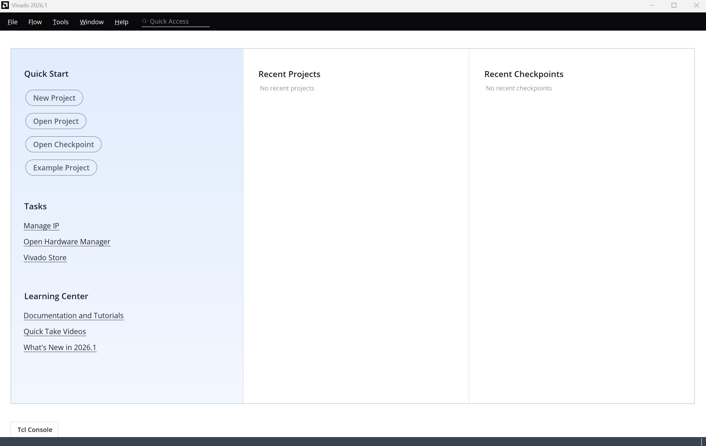</a>
<figcaption style="margin-top:8px;color:#475569;">图 2-12｜开发工具已能启动，接下来准备 U250 基础工程。</figcaption>
</figure>

到这里，安装与许可准备完成。下一步取得 U250 的 OpenNIC 基础工程，再把过滤代码接入其中。

<div style="border-left:6px solid #0891b2;background:#cffafe;padding:12px 16px;border-radius:8px;margin:14px 0;"><span style="display:inline-block;padding:3px 12px;border-radius:6px;background:#0891b2;color:#fff;font-weight:800;">继续条件</span> <span style="font-weight:700;color:#164e63;">本机识别适用许可，Vivado 能进入欢迎界面；现在开始创建 U250 工程。</span></div>

## 3 U250：从基础工程到配置与验证

<a id="step-3-1"></a>

### 3.1 创建工程

<div style="border:2px solid #4f46e5;background:#eef2ff;padding:10px 12px;border-radius:8px;margin:14px 0;">
<div style="font-weight:900;color:#312e81;margin-bottom:4px;">导航卡 · U250：接入与构建</div>
<div style="font-weight:700;color:#312e81;margin-bottom:8px;">范畴：工具准备　本步知识：用官方材料建立 U250 基础工程　<span style="display:inline-block;white-space:nowrap;">位置：全章第 6 / 19 项 · 本组第 1 / 4 项</span></div>
<span style="display:inline-block;margin:3px;padding:4px 10px;border-radius:6px;background:#15803d;color:#fff;font-weight:800;"><a href="#step-3-1" style="color:inherit;text-decoration:none;">3.1 创建工程</a></span>
<span style="display:inline-block;margin:3px;padding:4px 10px;border-radius:6px;background:#f8fafc;border:1px solid #a5b4fc;color:#312e81;font-weight:800;"><a href="#step-3-2" style="color:inherit;text-decoration:none;">3.2 接入代码</a></span>
<span style="display:inline-block;margin:3px;padding:4px 10px;border-radius:6px;background:#f8fafc;border:1px solid #a5b4fc;color:#312e81;font-weight:800;"><a href="#step-3-3" style="color:inherit;text-decoration:none;">3.3 运行仿真</a></span>
<span style="display:inline-block;margin:3px;padding:4px 10px;border-radius:6px;background:#f8fafc;border:1px solid #a5b4fc;color:#312e81;font-weight:800;"><a href="#step-3-4" style="color:inherit;text-decoration:none;">3.4 综合电路</a></span>
</div>

<div style="border-left:6px solid #15803d;background:#dcfce7;padding:12px 16px;border-radius:8px;margin:14px 0;"><span style="display:inline-block;padding:3px 12px;border-radius:6px;background:#15803d;color:#fff;font-weight:800;">动手操作 · 3.1</span> <span style="font-weight:700;color:#14532d;">在开发电脑准备官方源码，调用随包提供的工程脚本；得到 U250 的 Vivado 工程，后续步骤在图形界面中逐项进行。</span></div>

**OpenNIC Shell 是 Xilinx 官方提供的 FPGA 网卡基础工程，支持 Alveo U250**，包含网口、PCIe 和用户逻辑接口，方便接入我们的处理电路。[官方工程说明](https://github.com/Xilinx/open-nic-shell/blob/940907fc99fc8d73dbea0028b3a23095a660a42a/README.md)

直接使用下方地址下载本课固定版本的 ZIP，随后解压并创建工程。

<div style="border-left:6px solid #7e22ce;background:#f3e8ff;padding:12px 16px;border-radius:8px;margin:14px 0;"><span style="display:inline-block;padding:3px 12px;border-radius:6px;background:#7e22ce;color:#fff;font-weight:800;">仅供展示</span> <span style="font-weight:700;color:#581c87;">本课使用的官方 ZIP 地址；复制到浏览器下载，不要改提交编号。</span></div>

```text
https://github.com/Xilinx/open-nic-shell/archive/940907fc99fc8d73dbea0028b3a23095a660a42a.zip
```

地址中的长串字符是 **Git 提交 ID**，可在仓库的 **Commits（提交历史）** 中找到。本课固定用这一版源码。

解压后，打开 `open-nic-shell-<提交编号>` 文件夹，把里面的全部内容复制到 **`C:\QYT-FPGA`**。确认能找到 **`C:\QYT-FPGA\script\build.tcl`** 即可。创建工程时，用 `-board au250` 选择 U250。

<figure style="max-width:760px;margin:16px auto;padding:10px;background:#f8fafc;border:1px solid #cbd5e1;border-radius:12px;">
<a href="images/course-visuals/08-u250-walkthrough/01-extract-opennic.png">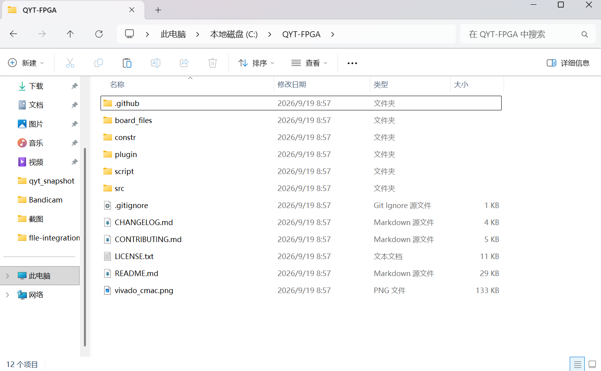</a>
<figcaption style="margin-top:8px;color:#475569;">图 3-1｜原始源码放到新目录；板卡定义、约束、插件和脚本都在这一层。</figcaption>
</figure>

这个源码包提供生成工程的材料，通过随包的官方 `script/build.tcl` 创建 `.xpr` 工程。这里先准备原始基础工程，课程过滤代码在下一步由我们亲手加入。[官方工程脚本](https://github.com/Xilinx/open-nic-shell/blob/940907fc99fc8d73dbea0028b3a23095a660a42a/script/build.tcl)

启动 Vivado；如果已有工程打开，先用 **File → Close Project** 回到欢迎界面。点击 **Window → Tcl Console**，展开下方控制台。

<figure style="max-width:760px;margin:16px auto;padding:10px;background:#f8fafc;border:1px solid #cbd5e1;border-radius:12px;">
<a href="images/course-visuals/08-u250-walkthrough/02-open-tcl-console.png">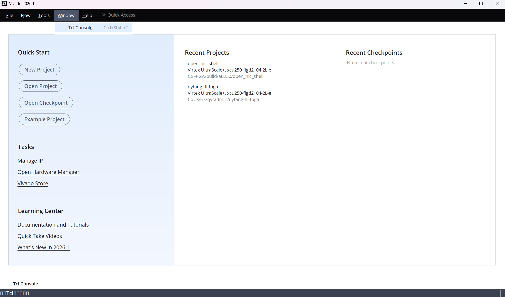</a>
<figcaption style="margin-top:8px;color:#475569;">图 3-2｜从 Window 菜单打开 Tcl Console。</figcaption>
</figure>

在控制台 **最底部的输入栏** 输入以下三行。这里的 Tcl 是 Vivado 接收操作指令的语言；这三行只设置官方脚本使用的目录与参数。

<div style="border-left:6px solid #15803d;background:#dcfce7;padding:12px 16px;border-radius:8px;margin:14px 0;"><span style="display:inline-block;padding:3px 12px;border-radius:6px;background:#15803d;color:#fff;font-weight:800;">动手操作 · 3.1 · 设置工程参数</span> <span style="font-weight:700;color:#14532d;">在 Windows 开发电脑的 Vivado Tcl Console 输入；源码已解压到 C:/QYT-FPGA。本步只设置 U250 工程参数，随后从菜单运行官方脚本。</span></div>

```tcl
cd C:/QYT-FPGA/script
set argv {-board au250 -synth_ip 0 -impl 0}
set argc [llength $argv]
```

<div style="border-left:6px solid #7e22ce;background:#f3e8ff;padding:12px 16px;border-radius:8px;margin:14px 0;"><span style="display:inline-block;padding:3px 12px;border-radius:6px;background:#7e22ce;color:#fff;font-weight:800;">输出解读 · 工程参数</span> <span style="font-weight:700;color:#581c87;">cd 进入脚本目录，board 选择 U250；synth_ip 0 与 impl 0 保留手动运行阶段。最后返回 6，表示参数列表共有六项。</span></div>

<figure style="max-width:760px;margin:16px auto;padding:10px;background:#f8fafc;border:1px solid #cbd5e1;border-radius:12px;">
<a href="images/course-visuals/08-u250-walkthrough/03-enter-project-parameters.png">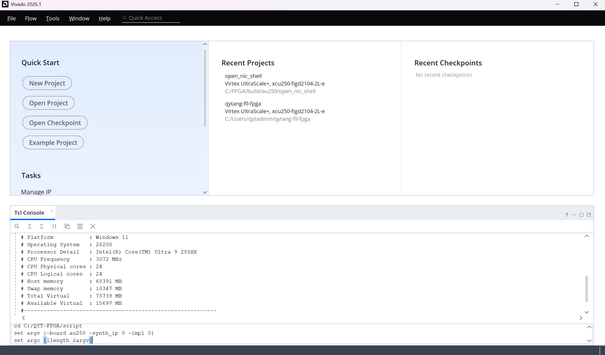</a>
<figcaption style="margin-top:8px;color:#475569;">图 3-3｜三行参数输入在底部输入栏，上方大区域用于显示日志。</figcaption>
</figure>

日志中应出现刚才的三行指令。参数设置好后，从菜单运行随包的官方工程脚本。

<figure style="max-width:760px;margin:16px auto;padding:10px;background:#f8fafc;border:1px solid #cbd5e1;border-radius:12px;">
<a href="images/course-visuals/08-u250-walkthrough/04-confirm-project-parameters.png">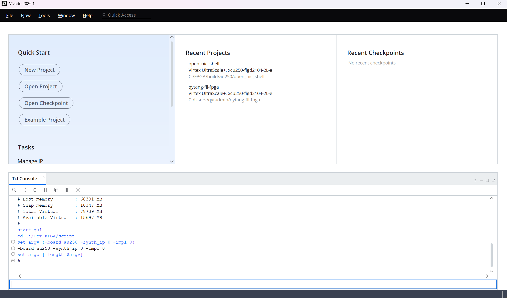</a>
<figcaption style="margin-top:8px;color:#475569;">图 3-4｜参数设置已执行，最后一行返回 6。</figcaption>
</figure>

点击 **Tools → Run Tcl Script…**，在文件选择窗口中打开 **`C:\QYT-FPGA\script\build.tcl`**，等待官方脚本准备 IP 与工程。这个 `build.tcl` 来自下载的 OpenNIC，使用前面设置的参数只准备基础工程；仿真、综合、实现和配置生成仍由后面的 GUI 操作逐步启动。

<figure style="max-width:760px;margin:16px auto;padding:10px;background:#f8fafc;border:1px solid #cbd5e1;border-radius:12px;">
<a href="images/course-visuals/08-u250-walkthrough/05-run-official-project-script.png">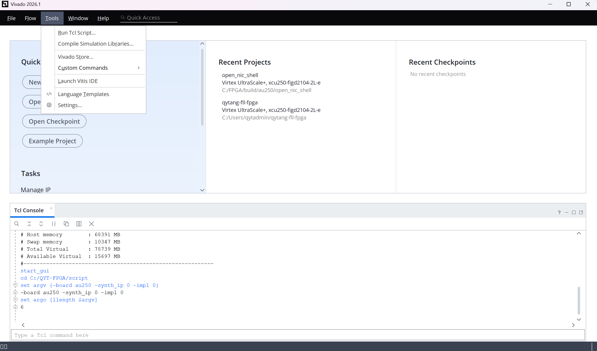</a>
<figcaption style="margin-top:8px;color:#475569;">图 3-5｜调用随官方源码提供的工程脚本。</figcaption>
</figure>

<div style="border-left:6px solid #7e22ce;background:#f3e8ff;padding:12px 16px;border-radius:8px;margin:14px 0;"><span style="display:inline-block;padding:3px 12px;border-radius:6px;background:#7e22ce;color:#fff;font-weight:800;">输出解读 · 工程摘要</span> <span style="font-weight:700;color:#581c87;">Project Summary 确认器件与顶层，Design Runs 显示后续构建步骤的状态。</span></div>

完成后进入 **Project Manager**，在 **Project Summary** 核对以下信息：

- Project location：`C:/QYT-FPGA/build/au250/open_nic_shell`。
- Project part：Alveo U250，器件 `xcu250-figd2104-2L-e`。
- Top module name：`open_nic_shell`。
- 底部 Design Runs：`synth_1`、`impl_1` 均为 **Not started**。

<figure style="max-width:760px;margin:16px auto;padding:10px;background:#f8fafc;border:1px solid #cbd5e1;border-radius:12px;">
<a href="images/course-visuals/08-u250-walkthrough/06-base-project-ready.png">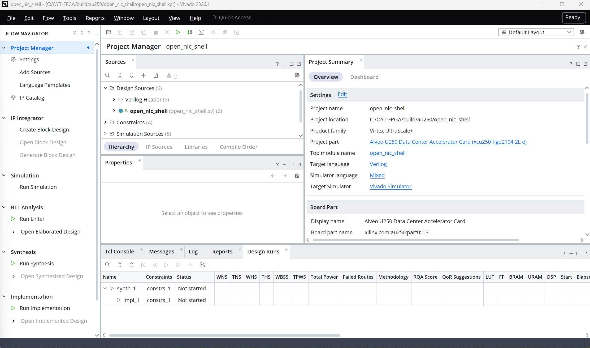</a>
<figcaption style="margin-top:8px;color:#475569;">图 3-6｜基础工程已打开，设计顶层和U250器件正确，综合与实现留待后续启动。</figcaption>
</figure>

生成的工程入口是 `C:\QYT-FPGA\build\au250\open_nic_shell\open_nic_shell.xpr`。以后重新打开这次工程就选择它。下一步把行情过滤模块接入这个工程。

<a id="vivado-blocks-map"></a>

**先看这张 Vivado 操作地图：我们要搭一台“乐高分拣机”。** `.sv` 代码描述它怎样判断和动作，Vivado 负责把描述变成 FPGA 能采用的电路配置。FPGA 里的逻辑、存储和连线资源已经存在；“搭乐高”在这里对应选择、配置和连接这些资源。

<div style="border-left:6px solid #7e22ce;background:#f3e8ff;padding:12px 16px;border-radius:8px;margin:14px 0;"><span style="display:inline-block;padding:3px 12px;border-radius:6px;background:#7e22ce;color:#fff;font-weight:800;">操作导航 · 搭乐高分拣机</span> <span style="font-weight:700;color:#581c87;">每行从左到右，依次向下。先在电脑里规划和检查，再让真实板卡按方案工作。</span></div>

<figure style="max-width:800px;margin:16px auto;padding:10px;background:#f8fafc;border:1px solid #cbd5e1;border-radius:12px;">
<a href="images/course-visuals/08-diagrams/08-vivado-building-blocks.svg">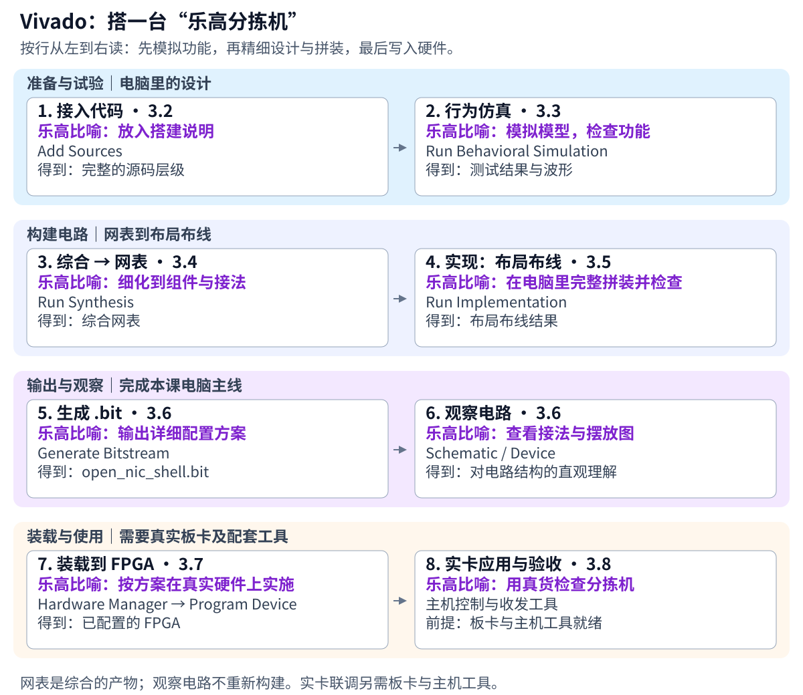</a>
</figure>

| 步骤与入口 | 像搭乐高时做什么 | 实际做什么、得到什么 |
| --- | --- | --- |
| ① [接入代码](#step-3-2) · Add Sources | 放入分拣机的搭建说明 | 导入模块并接好层级，让主工程用上过滤代码。 |
| ② [行为仿真](#step-3-3) · Run Behavioral Simulation / Run All | 模拟按说明搭出的模型，检查功能是否符合目标 | 测试台给模型输入、检查输出，用样例查找逻辑问题；得到 PASS 与波形。通过表示本例测试用例满足预期。 |
| ③ [综合](#step-3-4) · Run Synthesis | 细化到组件级：选哪些零件、每个怎么接 | 把完整工程的源码变成 Netlist（网表），即电路单元及连接关系的清单。 |
| ④ [实现](#step-3-5) · Run Implementation | 在电脑里完整拼装，落实位置和连线，再检查 | 在芯片资源中布局、布线，并核对信号能否按规定时间到达；得到实现结果和时序报告。 |
| ⑤ [生成配置](#step-3-6) · Generate Bitstream | 输出包含具体配置细节的最终方案 | 把上一步已经确定的电路配置细节编码成 U250 的 `.bit` 文件，供硬件装载使用。 |
| ⑥ [观察电路](#step-3-6) · Schematic / Device | 看接法图和底板摆放图 | Schematic 看电路连接，Device 看资源位置与布线；这是查看已有结果。 |
| ⑦ [装载板卡](#step-3-7) · Program Device | 按方案在真实底板上实施 | 把 `.bit` 装入已连接的 FPGA，让现有硬件资源组成所需电路。 |
| ⑧ [实卡应用与验收](#step-3-8) · 主机控制与收发工具 | 用真实货物检查分拣机 | 配置规则、发送真实报文、检查放行与丢弃。本章列出验收标准，实际联调需要配套主机工具。 |

**代码是搭建说明，仿真先检查模型功能；综合把设计细化到组件和接法，网表就是这份组件级设计。实现再在电脑里完整拼装，生成 `.bit` 则把拼装结果输出为详细配置方案。** 这里说的“应用到设备”，对应后面的装载与实际使用。Vivado 的 **Implementation** 则叫“实现”，完成时仍是电脑中的设计结果。[AMD 实现流程说明](https://docs.amd.com/r/en-US/ug904-vivado-implementation/Vivado-Implementation-Sub-Processes)

<a id="step-3-2"></a>

### 3.2 接入代码

<div style="border:2px solid #4f46e5;background:#eef2ff;padding:10px 12px;border-radius:8px;margin:14px 0;">
<div style="font-weight:900;color:#312e81;margin-bottom:4px;">导航卡 · U250：接入与构建</div>
<div style="font-weight:700;color:#312e81;margin-bottom:8px;">范畴：源码展示　本步知识：看懂模块职责并接入收包路径　<span style="display:inline-block;white-space:nowrap;">位置：全章第 7 / 19 项 · 本组第 2 / 4 项</span></div>
<div style="margin:8px 0;padding:8px 12px;background:#fff;border-radius:6px;color:#312e81;line-height:1.7;"><strong>乐高导航 · ① 放入搭建说明</strong><br>源码描述分拣机应当怎样工作。把模块加入工程并接好层级后，就可以模拟这个设计。 <a href="#vivado-blocks-map" style="color:#4338ca;">回看操作地图</a></div>
<span style="display:inline-block;margin:3px;padding:4px 10px;border-radius:6px;background:#f8fafc;border:1px solid #a5b4fc;color:#312e81;font-weight:800;"><a href="#step-3-1" style="color:inherit;text-decoration:none;">3.1 创建工程</a></span>
<span style="display:inline-block;margin:3px;padding:4px 10px;border-radius:6px;background:#15803d;color:#fff;font-weight:800;"><a href="#step-3-2" style="color:inherit;text-decoration:none;">3.2 接入代码</a></span>
<span style="display:inline-block;margin:3px;padding:4px 10px;border-radius:6px;background:#f8fafc;border:1px solid #a5b4fc;color:#312e81;font-weight:800;"><a href="#step-3-3" style="color:inherit;text-decoration:none;">3.3 运行仿真</a></span>
<span style="display:inline-block;margin:3px;padding:4px 10px;border-radius:6px;background:#f8fafc;border:1px solid #a5b4fc;color:#312e81;font-weight:800;"><a href="#step-3-4" style="color:inherit;text-decoration:none;">3.4 综合电路</a></span>
<div style="margin-top:8px;padding-top:8px;border-top:1px solid #c7d2fe;color:#312e81;font-size:14px;line-height:1.7;"><strong>本节展开：</strong><a href="#step-3-2-1" style="color:#312e81;">3.2.1 先看代码结构：谁接收，谁判断，谁控制</a> → <a href="#step-3-2-2" style="color:#312e81;">3.2.2 案例一：从协议格式认到 NVDA 行情</a> → <a href="#step-3-2-3" style="color:#312e81;">3.2.3 案例二：为什么授权一次，只丢一个包</a> → <a href="#step-3-2-4" style="color:#312e81;">3.2.4 加入三个模块，再接入原有收包路径</a></div>
</div>

基础工程已经接好芯片与外部接口。我们的工作是在其接收方向插入过滤逻辑，让网口收到的数据包在送给主机之前经过判断。

<div style="border-left:6px solid #7e22ce;background:#f3e8ff;padding:12px 16px;border-radius:8px;margin:14px 0;"><span style="display:inline-block;padding:3px 12px;border-radius:6px;background:#7e22ce;color:#fff;font-weight:800;">关键图 · 数据与控制</span> <span style="font-weight:700;color:#581c87;">数据经过过滤器再到主机；主机发出的管理命令经控制寄存器改变额度。</span></div>

<figure style="max-width:820px;margin:16px auto;padding:10px;background:#f8fafc;border:1px solid #cbd5e1;border-radius:12px;">
<a href="images/course-visuals/08-diagrams/08-u250-data-control.svg">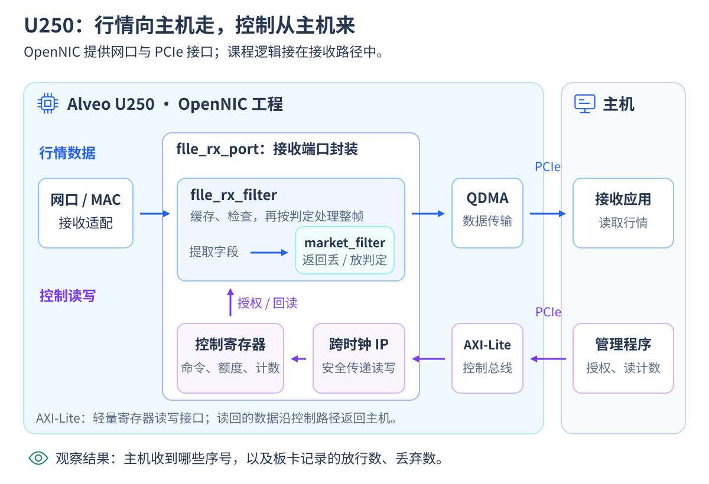</a>
</figure>

QDMA 是通过 PCIe 搬运数据的功能模块，负责把通过过滤的报文交给主机。控制侧使用 AXI-Lite，一种读写控制寄存器的片内总线；跨时钟模块负责在管理侧与报文处理侧的不同节拍之间可靠传递事务。

本例沿用课程 A 路 UDP 行情，每包携带一条 36 字节 ITCH Type A（新增订单消息）。Locate 是行情中的股票内部编号，本例目标为8095，股票字段为 `NVDA` 加四个空格。匹配这些字段且有额度时，才丢弃这一包；其他报文继续通过。

这五份源码都在本课程项目的同一个目录：`assets/09-verilator/u250-course-files/`。在编辑器中从项目根目录依次展开这些文件夹，就能找到下列文件。

<div style="border-left:6px solid #7e22ce;background:#f3e8ff;padding:12px 16px;border-radius:8px;margin:14px 0;"><span style="display:inline-block;padding:3px 12px;border-radius:6px;background:#7e22ce;color:#fff;font-weight:800;">仅供展示 · 源码位置</span> <span style="font-weight:700;color:#581c87;">路径从课程项目根目录开始；下面五份文件统一从这里取得。</span></div>

```text
assets/09-verilator/u250-course-files/
├── market_filter.sv
├── flle_rx_filter.sv
├── flle_rx_port.sv
├── p2p_250mhz.sv
└── flle_rx_control_tb.sv
```

后续 Windows 操作使用的 `C:\QYT-FPGA\flle-src`，是将这组文件复制到实验电脑后的准备目录。下面先看每份文件的作用，再按后续步骤加入 Vivado。

| 文件 | 本章中的职责 |
| --- | --- |
| [market_filter.sv](assets/09-verilator/u250-course-files/market_filter.sv) | 对提取出的行情消息作判断，管理一次额度 |
| [flle_rx_filter.sv](assets/09-verilator/u250-course-files/flle_rx_filter.sv) | 暂存报文前部、检查封装、提取消息，执行整包放行或丢弃 |
| [flle_rx_port.sv](assets/09-verilator/u250-course-files/flle_rx_port.sv) | 接入控制寄存器与跨时钟模块 |
| [p2p_250mhz.sv](assets/09-verilator/u250-course-files/p2p_250mhz.sv) | 在基础工程中连接本课接收模块，随后加入课程修改版 |
| [flle_rx_control_tb.sv](assets/09-verilator/u250-course-files/flle_rx_control_tb.sv) | 仿真时产生输入并检查结果，测试台不进入板上业务电路 |

<a id="step-3-2-1"></a>

#### 3.2.1 先看代码结构：谁接收，谁判断，谁控制

把它想成自动分拣机：报文是信封，协议检查先确认信封格式，行情比较再辨认收件对象，一次额度决定这次是否扣下。接收适配器负责拿稳报文和执行结果，核心负责判断，控制寄存器像管理面板。

下面先看课程模块的分工；完成 3.2.4 的添加与接线后，再用 Vivado 层次图核对连接。

| 关键模块 | 对应源码或官方 IP | 主要作用 |
| --- | --- | --- |
| `p2p_250mhz` | `p2p_250mhz.sv` | 接线入口：把 OpenNIC 接收方向连接到本课过滤端口。 |
| `flle_rx_port` | `flle_rx_port.sv` | 接入控制与数据接口，连接跨时钟、控制寄存器和接收过滤模块。 |
| AMD 跨时钟 IP | `axi_lite_clock_converter` | 在管理时钟与报文处理时钟之间可靠传递寄存器读写事务。 |
| `flle_rx_regs` | 定义在 `flle_rx_port.sv` 中 | 保存过滤配置、接收额度命令，并提供状态读数。 |
| `flle_rx_filter` | `flle_rx_filter.sv` | 检查协议、暂存报文前部、提取行情，执行整包放行或丢弃。 |
| `market_filter` | `market_filter.sv` | 比较行情字段，管理和消耗一次丢弃额度。 |

这些模块组成板上的过滤电路，测试台负责在仿真中产生输入并检查结果。下面用两个案例看懂关键判断，再把现成源码加入工程。

<a id="step-3-2-2"></a>

#### 3.2.2 案例一：从协议格式认到 NVDA 行情

先检查信封格式，再看收件对象。`flle_rx_filter.sv` 的 `profile_ok` 检查 IPv4/UDP 封装、行情通道、长度与校验字段；符合本例格式后，才将 36 字节 ITCH 消息提取为 `s_itch`。其他格式的帧原样通过，不消耗额度。

<div style="border-left:6px solid #7e22ce;background:#f3e8ff;padding:12px 16px;border-radius:8px;margin:14px 0;"><span style="display:inline-block;padding:3px 12px;border-radius:6px;background:#7e22ce;color:#fff;font-weight:800;">关键代码 · market_filter.sv</span> <span style="font-weight:700;color:#581c87;">认出目标：从这份判断核心取出消息类型、股票编号和股票代码，同时确认本次输入有效且尚有额度。源码：<a href="assets/09-verilator/u250-course-files/market_filter.sv">market_filter.sv</a></span></div>

```systemverilog
assign in_type = s_itch[287:280];
assign in_locate = s_itch[279:264];
assign in_stock = s_itch[95:32];
/* A configuration write owns the cycle; do not acknowledge packet input. */
assign s_ready = !cfg_load_valid;
assign hit = s_valid && s_ready && in_type == 8'h41 &&
             in_locate == cfg_locate && in_stock == cfg_stock &&
             remaining_drops != 32'd0;
```

前三行取类型、股票编号和股票代码；`8'h41` 是字符 A。`s_ready = !cfg_load_valid` 表示更新额度的这一拍先不接收消息；一拍就是一个时钟周期。`&&` 要求条件同时成立，`hit` 表示“本拍接收到目标消息，且有额度可以丢弃”。

<div style="border-left:6px solid #7e22ce;background:#f3e8ff;padding:12px 16px;border-radius:8px;margin:14px 0;"><span style="display:inline-block;padding:3px 12px;border-radius:6px;background:#7e22ce;color:#fff;font-weight:800;">关键图 · 从整帧找到行情字段</span> <span style="font-weight:700;color:#581c87;">以整帧起点计数，ITCH 消息位于字节 64—99；提取这 36 字节后，再按核心的位段比较字段。</span></div>

<figure style="max-width:820px;margin:16px auto;padding:10px;background:#f8fafc;border:1px solid #cbd5e1;border-radius:12px;">
<a href="images/course-visuals/08-diagrams/08-u250-fields.svg">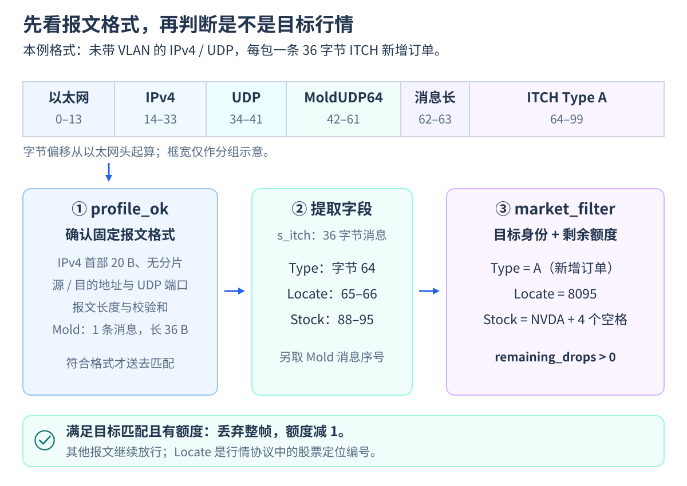</a>
</figure>

<a id="step-3-2-3"></a>

#### 3.2.3 案例二：为什么授权一次，只丢一个包

额度像一张只能使用一次的扣留凭证。[flle_rx_port.sv](assets/09-verilator/u250-course-files/flle_rx_port.sv) 把一次授权写成 1；[market_filter.sv](assets/09-verilator/u250-course-files/market_filter.sv) 在真正丢弃后把它减成 0，后面的目标包就会通过。

<div style="border-left:6px solid #7e22ce;background:#f3e8ff;padding:12px 16px;border-radius:8px;margin:14px 0;"><span style="display:inline-block;padding:3px 12px;border-radius:6px;background:#7e22ce;color:#fff;font-weight:800;">关键代码 · market_filter.sv</span> <span style="font-weight:700;color:#581c87;">消耗一次额度：写入额度，命中后减 1，并把丢弃计数加 1。</span></div>

```systemverilog
if (cfg_load_valid)
    remaining_drops <= cfg_load_drops;
else if (s_valid && s_ready) begin
    m_mold_seq <= s_mold_seq;
    if (hit) begin
        remaining_drops <= remaining_drops - 32'd1;
        drop_count <= drop_count + 32'd1;
        drop_valid <= 1'b1;
    end else begin
        pass_count <= pass_count + 32'd1;
        m_valid <= 1'b1;
    end
end
```

收到配置就更新 `remaining_drops`；收到行情且 `hit` 成立，额度减 1、丢弃计数加 1。复位后额度是 0，默认放行。本例端口模块还配置了约 5 秒的额度有效期，到期后未用额度自动清零。

授权后再依次来一包非目标和两包 NVDA：第一包通过并保留额度，第二包被丢掉，第三包通过。

整帧去留由 [flle_rx_filter.sv](assets/09-verilator/u250-course-files/flle_rx_filter.sv) 执行：核心给出放行或丢弃后，它送出整帧或跳过，并记下被丢序号。判决完成前先拿住帧头，避免半包已经发出。第 4 部分另用交换机课程模块 `frame_filter.sv` 演示整帧缓存，两套源码分别接入各自平台。

[flle_rx_port.sv](assets/09-verilator/u250-course-files/flle_rx_port.sv) 提供“授权一次 / 撤销”的寄存器，并回读剩余额度、计数和序号。命令在两包之间生效。

<a id="step-3-2-4"></a>

#### 3.2.4 加入三个模块，再接入原有收包路径

<div style="border-left:6px solid #15803d;background:#dcfce7;padding:12px 16px;border-radius:8px;margin:14px 0;"><span style="display:inline-block;padding:3px 12px;border-radius:6px;background:#15803d;color:#fff;font-weight:800;">动手操作 · 3.2</span> <span style="font-weight:700;color:#14532d;">在同一个 U250 工程中加入三个过滤模块，再接入课程版 p2p 接线文件；全部文件从 flle-src 目录取得。</span></div>

将[课程源码目录](assets/09-verilator/u250-course-files/README.md)完整放到 **`C:\QYT-FPGA\flle-src`**。上表五份 `.sv` 都从这一个目录取得；先加入三个设计模块，然后更换一份接线文件，最后加入测试台。

在菜单点击 **File → Add Sources…**，也可以点击左侧同名入口。

<figure style="max-width:760px;margin:16px auto;padding:10px;background:#f8fafc;border:1px solid #cbd5e1;border-radius:12px;">
<a href="images/course-visuals/08-u250-walkthrough/07-open-add-sources.png">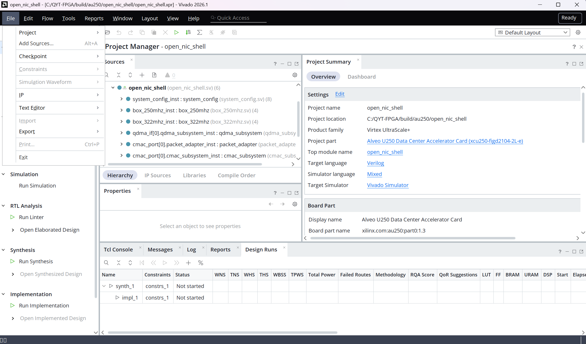</a>
<figcaption style="margin-top:8px;color:#475569;">图 3-7｜进入 Add Sources，准备加入课程设计源码。</figcaption>
</figure>

选择 **Add or create design sources**，点击 **Next**。Design Sources 是将来参与生成板上电路的源码。

<figure style="max-width:760px;margin:16px auto;padding:10px;background:#f8fafc;border:1px solid #cbd5e1;border-radius:12px;">
<a href="images/course-visuals/08-u250-walkthrough/08-select-design-sources.png"></a>
<figcaption style="margin-top:8px;color:#475569;">图 3-8｜这一步选择设计源码，测试台稍后单独加入。</figcaption>
</figure>

点击 **Add Files**，进入 `C:\QYT-FPGA\flle-src`，按住 Ctrl 选中 **`flle_rx_filter.sv`、`flle_rx_port.sv`、`market_filter.sv`**，点 **OK** 返回列表。核对三行文件名和来源目录，按图保留 **Copy sources into project** 的勾选，点击 **Finish**。

<figure style="max-width:760px;margin:16px auto;padding:10px;background:#f8fafc;border:1px solid #cbd5e1;border-radius:12px;">
<a href="images/course-visuals/08-u250-walkthrough/09-import-three-design-files.png">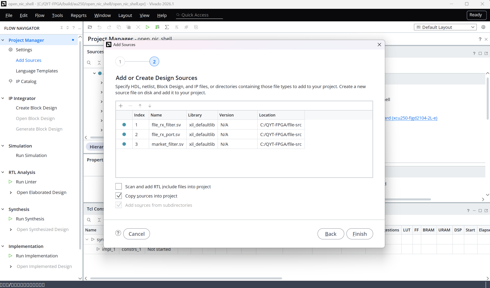</a>
<figcaption style="margin-top:8px;color:#475569;">图 3-9｜一次加入三个设计模块；本次勾选了 Copy sources into project。</figcaption>
</figure>

勾选 Copy 后，Vivado 会把源文件复制进工程，后续构建使用这份副本。本例后面的编辑器因此显示 `open_nic_shell.srcs/sources_1/imports/flle-src/market_filter.sv`。编辑器路径指向本次构建使用的副本。[AMD 工程副本说明](https://docs.amd.com/r/2022.2-English/ug895-vivado-system-level-design-entry/Updating-Local-Source-Files)

完成导入后展开 `flle_rx_port`，可以看到控制模块、过滤适配器和 `core : market_filter`。此时它与 `open_nic_shell` 并列，说明模块已被读入，接下来还要建立主工程到它的连接。

<figure style="max-width:760px;margin:16px auto;padding:10px;background:#f8fafc;border:1px solid #cbd5e1;border-radius:12px;">
<a href="images/course-visuals/08-u250-walkthrough/10-filter-hierarchy-before-wiring.png">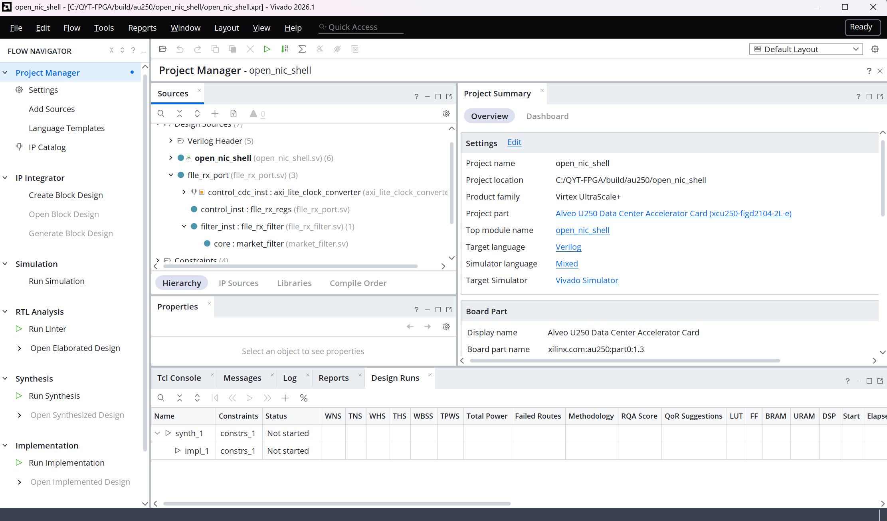</a>
<figcaption style="margin-top:8px;color:#475569;">图 3-10｜模块内部层次已识别；下一步通过p2p接线文件把它接到主工程。</figcaption>
</figure>

展开 **`open_nic_shell → box_250mhz_inst → p2p_250mhz_inst`**。这里的 `p2p_250mhz.sv` 就是接线文件。**我们要把工程里的原版换成课程版：文件名相同，里面的接线已经改好。** 刚才加入的过滤模块，要通过这一步才会接入主工程。

| 接线版本 | 网口收到报文后走哪里 |
| --- | --- |
| 原版 | 网口接收侧 → 普通流水级 → QDMA → 主机 |
| 课程版 | 网口接收侧 → 本课过滤模块 → QDMA → 主机 |

关键改动就在下面：两端仍接原来的网口与 QDMA，中间从 `axi_stream_pipeline` 换成 `flle_rx_port`。后者内部再连接 `flle_rx_filter` 和 `market_filter`，报文就会经过我们的判断逻辑。本课使用 `NUM_QDMA = 1` 分支，以下摘录只展示关键接线，省略其他端口。

<div style="border-left:6px solid #7e22ce;background:#f3e8ff;padding:12px 16px;border-radius:8px;margin:14px 0;"><span style="display:inline-block;padding:3px 12px;border-radius:6px;background:#7e22ce;color:#fff;font-weight:800;">关键代码 · 修改前</span> <span style="font-weight:700;color:#581c87;">原版通过普通流水级传递接收数据。<a href="https://github.com/Xilinx/open-nic-shell/blob/940907fc99fc8d73dbea0028b3a23095a660a42a/plugin/p2p/p2p_250mhz.sv">固定版本官方源码</a></span></div>

```systemverilog
axi_stream_pipeline rx_ppl_inst (
  // ... 省略其他端口
  .s_axis_tdata  (s_axis_adap_rx_250mhz_tdata[`getvec(512, i)]),
  // ...
  .m_axis_tdata  (m_axis_qdma_c2h_tdata[`getvec(512, i)]),
  // ... 省略握手、时钟与复位等端口
);
```

<div style="border-left:6px solid #7e22ce;background:#f3e8ff;padding:12px 16px;border-radius:8px;margin:14px 0;"><span style="display:inline-block;padding:3px 12px;border-radius:6px;background:#7e22ce;color:#fff;font-weight:800;">关键代码 · 修改后</span> <span style="font-weight:700;color:#581c87;">课程版将同一组收发数据接到过滤端口，并接入控制寄存器总线。<a href="assets/09-verilator/u250-course-files/p2p_250mhz.sv">课程版源码</a></span></div>

```systemverilog
flle_rx_port rx_filter_inst (
  .s_axil_awvalid(s_axil_awvalid[2*i]),
  .s_axil_awaddr(s_axil_awaddr[32*(2*i)+:32]),
  // ... 省略其余控制总线端口
  .s_axis_tdata  (s_axis_adap_rx_250mhz_tdata[`getvec(512, i)]),
  // ...
  .m_axis_tdata  (m_axis_qdma_c2h_tdata[`getvec(512, i)]),
  // ... 省略握手、时钟与复位等端口
);
```

`s_axis_tdata` 是过滤模块的数据入口，`m_axis_tdata` 是出口；`s_axil_*` 接控制命令，用来设置规则和丢弃额度。完整文件同时接好数据握手、时钟与复位。**报文经过过滤器后，满足规则且有额度的包被丢弃，其余继续送给主机。** 这些修改已包含在课程文件里，下面直接在界面中换入即可。

右键原来的 **`p2p_250mhz_inst : p2p_250mhz`**，选择 **Remove File from Project…**，让工程不再使用原版接线文件；保留磁盘上的官方原件。随后加入课程版同名文件，就完成了工程中的替换。

<figure style="max-width:760px;margin:16px auto;padding:10px;background:#f8fafc;border:1px solid #cbd5e1;border-radius:12px;">
<a href="images/course-visuals/08-u250-walkthrough/11-remove-original-p2p-reference.png">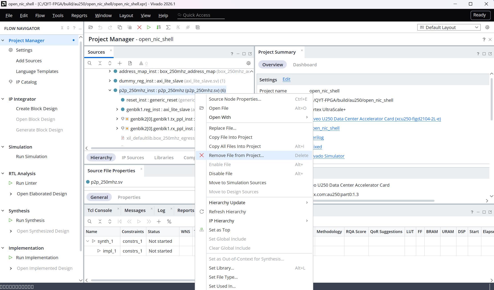</a>
<figcaption style="margin-top:8px;color:#475569;">图 3-11｜这里只更换原p2p接线文件的引用。</figcaption>
</figure>

再次打开 **Add Sources**，选择 **Add or create design sources → Next → Add Files**。

<figure style="max-width:760px;margin:16px auto;padding:10px;background:#f8fafc;border:1px solid #cbd5e1;border-radius:12px;">
<a href="images/course-visuals/08-u250-walkthrough/12-add-course-p2p-source.png">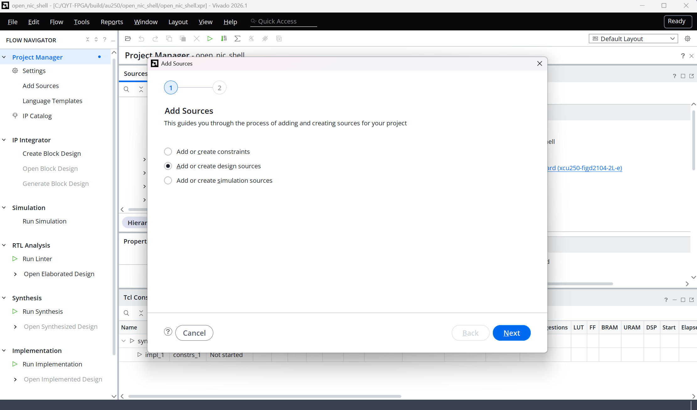</a>
<figcaption style="margin-top:8px;color:#475569;">图 3-12｜通过同一个设计源码入口加入课程版接线文件。</figcaption>
</figure>

选中 **`C:\QYT-FPGA\flle-src\p2p_250mhz.sv`**。这次按图 **不勾选 Copy sources into project**，直接引用这个文件，再点击 **Finish**。工程中应只保留一份 `p2p_250mhz` 模块定义。

<figure style="max-width:760px;margin:16px auto;padding:10px;background:#f8fafc;border:1px solid #cbd5e1;border-radius:12px;">
<a href="images/course-visuals/08-u250-walkthrough/13-reference-course-p2p.png">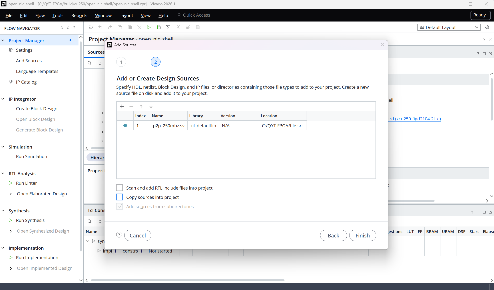</a>
<figcaption style="margin-top:8px;color:#475569;">图 3-13｜课程p2p来自同一个flle-src目录，采用直接引用。</figcaption>
</figure>

双击层次中的 `p2p_250mhz_inst`，编辑器上方显示的路径应为 **`C:/QYT-FPGA/flle-src/p2p_250mhz.sv`**，开头能看到课程接收分支与控制寄存器的说明。

<figure style="max-width:760px;margin:16px auto;padding:10px;background:#f8fafc;border:1px solid #cbd5e1;border-radius:12px;">
<a href="images/course-visuals/08-u250-walkthrough/14-check-course-p2p-path.png">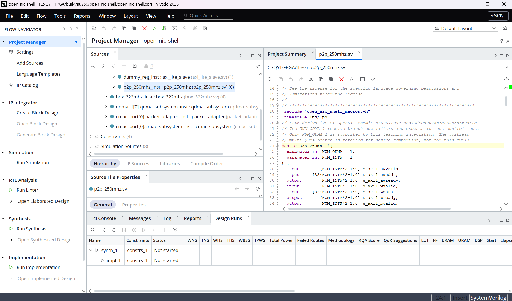</a>
<figcaption style="margin-top:8px;color:#475569;">图 3-14｜确认工程打开的是刚加入的课程p2p文件。</figcaption>
</figure>

继续展开这个实例，检查接线关系：

<div style="border-left:6px solid #7e22ce;background:#f3e8ff;padding:12px 16px;border-radius:8px;margin:14px 0;"><span style="display:inline-block;padding:3px 12px;border-radius:6px;background:#7e22ce;color:#fff;font-weight:800;">仅供展示 · 层次核对</span> <span style="font-weight:700;color:#581c87;">在 Vivado Sources 中按图展开；沿橙色框找到过滤模块，确认它们位于 open_nic_shell 之下。点击图片可查看未标注原图。</span></div>

<figure style="max-width:390px;margin:16px auto;padding:10px;background:#f8fafc;border:1px solid #cbd5e1;border-radius:12px;">
<a href="images/course-visuals/08-u250-walkthrough/32-course-module-hierarchy.png">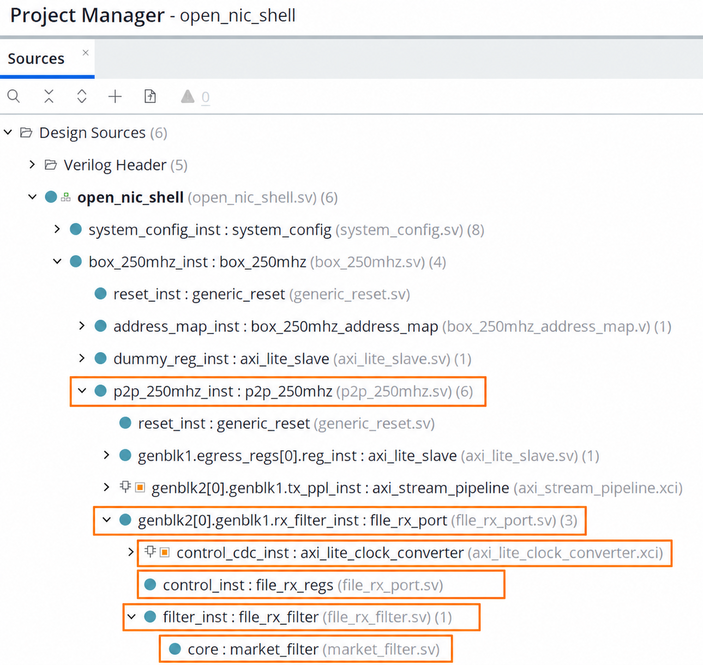</a>
<figcaption style="margin-top:8px;color:#475569;">图 3-14a｜接线完成后的层次核对：过滤模块已接入主工程，设计顶层仍为 open_nic_shell。</figcaption>
</figure>

中间的 `genblk` 名称由工具产生，重点是过滤器已位于主工程的接收路径之下。设计顶层仍保持 **`open_nic_shell`**。接好以后，就可以给这些模块添加仿真输入。

<div style="border-left:6px solid #0891b2;background:#cffafe;padding:12px 16px;border-radius:8px;margin:14px 0;"><span style="display:inline-block;padding:3px 12px;border-radius:6px;background:#0891b2;color:#fff;font-weight:800;">继续条件</span> <span style="font-weight:700;color:#164e63;">层次中能沿 p2p_250mhz 找到 flle_rx_port → flle_rx_filter → market_filter；设计顶层为 open_nic_shell。</span></div>

<a id="step-3-3"></a>

### 3.3 运行仿真

<div style="border:2px solid #4f46e5;background:#eef2ff;padding:10px 12px;border-radius:8px;margin:14px 0;">
<div style="font-weight:900;color:#312e81;margin-bottom:4px;">导航卡 · U250：接入与构建</div>
<div style="font-weight:700;color:#312e81;margin-bottom:8px;">范畴：分步实验　本步知识：用测试台核对过滤与控制行为　<span style="display:inline-block;white-space:nowrap;">位置：全章第 8 / 19 项 · 本组第 3 / 4 项</span></div>
<div style="margin:8px 0;padding:8px 12px;background:#fff;border-radius:6px;color:#312e81;line-height:1.7;"><strong>乐高导航 · ② 模拟模型，检查功能</strong><br>按搭建说明模拟模型，用测试输入检查它是否按目标工作、是否存在逻辑问题。本例通过表示这些测试用例符合预期。 <a href="#vivado-blocks-map" style="color:#4338ca;">回看操作地图</a></div>
<span style="display:inline-block;margin:3px;padding:4px 10px;border-radius:6px;background:#f8fafc;border:1px solid #a5b4fc;color:#312e81;font-weight:800;"><a href="#step-3-1" style="color:inherit;text-decoration:none;">3.1 创建工程</a></span>
<span style="display:inline-block;margin:3px;padding:4px 10px;border-radius:6px;background:#f8fafc;border:1px solid #a5b4fc;color:#312e81;font-weight:800;"><a href="#step-3-2" style="color:inherit;text-decoration:none;">3.2 接入代码</a></span>
<span style="display:inline-block;margin:3px;padding:4px 10px;border-radius:6px;background:#15803d;color:#fff;font-weight:800;"><a href="#step-3-3" style="color:inherit;text-decoration:none;">3.3 运行仿真</a></span>
<span style="display:inline-block;margin:3px;padding:4px 10px;border-radius:6px;background:#f8fafc;border:1px solid #a5b4fc;color:#312e81;font-weight:800;"><a href="#step-3-4" style="color:inherit;text-decoration:none;">3.4 综合电路</a></span>
</div>

仿真是在电脑里运行电路模型。测试台制造输入并检查输出，不进入板上业务电路。

<div style="border-left:6px solid #15803d;background:#dcfce7;padding:12px 16px;border-radius:8px;margin:14px 0;"><span style="display:inline-block;padding:3px 12px;border-radius:6px;background:#15803d;color:#fff;font-weight:800;">动手操作 · 3.3</span> <span style="font-weight:700;color:#14532d;">在 Simulation Sources 加入测试台，设为仿真顶层并运行；设计顶层继续使用 open_nic_shell。</span></div>

点击 **Add Sources**，这次选择 **Add or create simulation sources → Next**。

<figure style="max-width:760px;margin:16px auto;padding:10px;background:#f8fafc;border:1px solid #cbd5e1;border-radius:12px;">
<a href="images/course-visuals/08-u250-walkthrough/15-select-simulation-sources-cropped.png">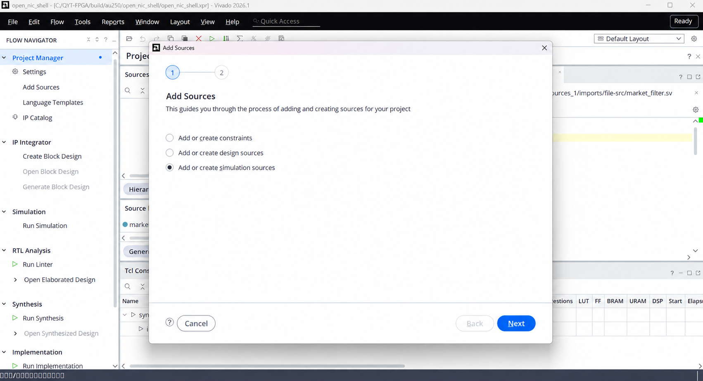</a>
<figcaption style="margin-top:8px;color:#475569;">图 3-15｜为工程加入仿真专用的测试台。</figcaption>
</figure>

在 **Add Files** 中选择 **`C:\QYT-FPGA\flle-src\flle_rx_control_tb.sv`**。仿真集合保持 `sim_1`，不勾选 **Copy sources into project**，保留 **Include all design sources for simulation**，点击 **Finish**。最后这个选项让测试台可以使用工程中已经加入的设计模块。

这份测试台用 `write_reg` 发命令、`packet` 送报文、`expect_reg` 核对寄存器。下面这一段就是 3.2.3 的考法：授权一次，丢掉一包，额度归零。

<div style="border-left:6px solid #7e22ce;background:#f3e8ff;padding:12px 16px;border-radius:8px;margin:14px 0;"><span style="display:inline-block;padding:3px 12px;border-radius:6px;background:#7e22ce;color:#fff;font-weight:800;">关键代码 · flle_rx_control_tb.sv</span> <span style="font-weight:700;color:#581c87;">授权后额度为 1；目标包被丢后额度回到 0。</span></div>

```systemverilog
        write_reg(8,1,0,0); expect_reg(16,1);
        packet(64'h123456789abcdef0,1,1); expect_reg(24,1); expect_reg(16,0);
        expect_reg(28,32'h9abcdef0); passed("address_before_data_arm_and_drop_once");
```

`write_reg(8,1)` 写入授权；`packet(...,1,1)` 送一包 NVDA 并预期丢弃；`expect_reg(16,0)` 核对额度回到 0。发现不符就停止，全部用例通过才打印 PASS。

<figure style="max-width:760px;margin:16px auto;padding:10px;background:#f8fafc;border:1px solid #cbd5e1;border-radius:12px;">
<a href="images/course-visuals/08-u250-walkthrough/16-add-control-testbench.png">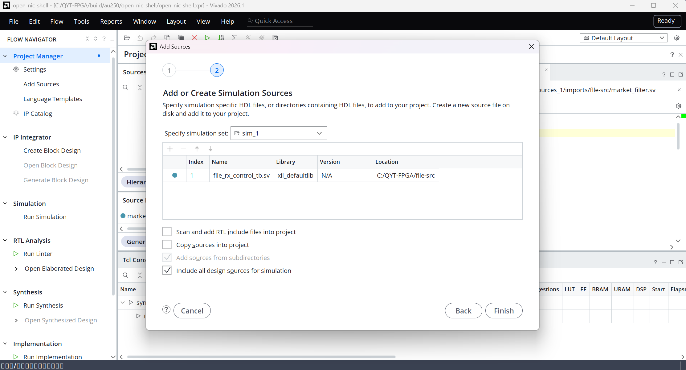</a>
<figcaption style="margin-top:8px;color:#475569;">图 3-16｜测试台直接引用flle-src文件，并包含现有设计源。</figcaption>
</figure>

展开 **Simulation Sources → sim_1**，右键 **`flle_rx_port_tb`**，点击 **Set as Top**。它和文件名不同，因为它是同一文件末尾定义的仿真入口。

<div style="border-left:6px solid #7e22ce;background:#f3e8ff;padding:12px 16px;border-radius:8px;margin:14px 0;"><span style="display:inline-block;padding:3px 12px;border-radius:6px;background:#7e22ce;color:#fff;font-weight:800;">关键代码 · flle_rx_control_tb.sv</span> <span style="font-weight:700;color:#581c87;">本工程选用的仿真顶层；<code>USE_VENDOR_CDC(1)</code> 使用 AMD 跨时钟模型。</span></div>

```systemverilog
module flle_rx_port_tb;
    flle_rx_control_tb #(.USE_VENDOR_CDC(1)) test_inst();
endmodule
```

<figure style="max-width:760px;margin:16px auto;padding:10px;background:#f8fafc;border:1px solid #cbd5e1;border-radius:12px;">
<a href="images/course-visuals/08-u250-walkthrough/17-set-simulation-top.png">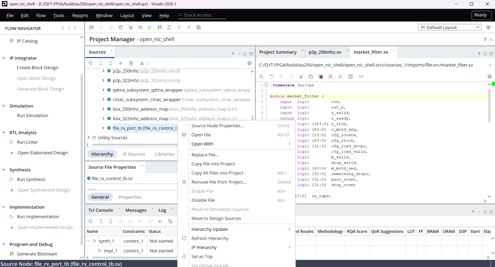</a>
<figcaption style="margin-top:8px;color:#475569;">图 3-17｜将flle_rx_port_tb设置为仿真顶层。</figcaption>
</figure>

确认 `flle_rx_port_tb` 以粗体显示，点击左侧 **Run Simulation → Run Behavioral Simulation**。设计顶层 `open_nic_shell` 与这个仿真顶层各有用途，设置仿真入口不需要更换设计顶层。

<figure style="max-width:760px;margin:16px auto;padding:10px;background:#f8fafc;border:1px solid #cbd5e1;border-radius:12px;">
<a href="images/course-visuals/08-u250-walkthrough/18-run-behavioral-simulation.png">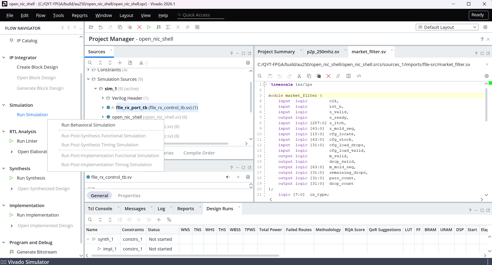</a>
<figcaption style="margin-top:8px;color:#475569;">图 3-18｜从Run Simulation启动行为仿真。</figcaption>
</figure>

**Run Behavioral Simulation 是启动仿真，先跑一段；Run All 是继续运行，让本例测试台跑到结束。**

仿真界面打开后，这次日志先显示运行了 **1000 ns**，右下角为 **Sim Time: 1 us**。点击顶部 **Run → Run All**，继续完成剩余用例。

<figure style="max-width:760px;margin:16px auto;padding:10px;background:#f8fafc;border:1px solid #cbd5e1;border-radius:12px;">
<a href="images/course-visuals/08-u250-walkthrough/19-run-all-simulation.png">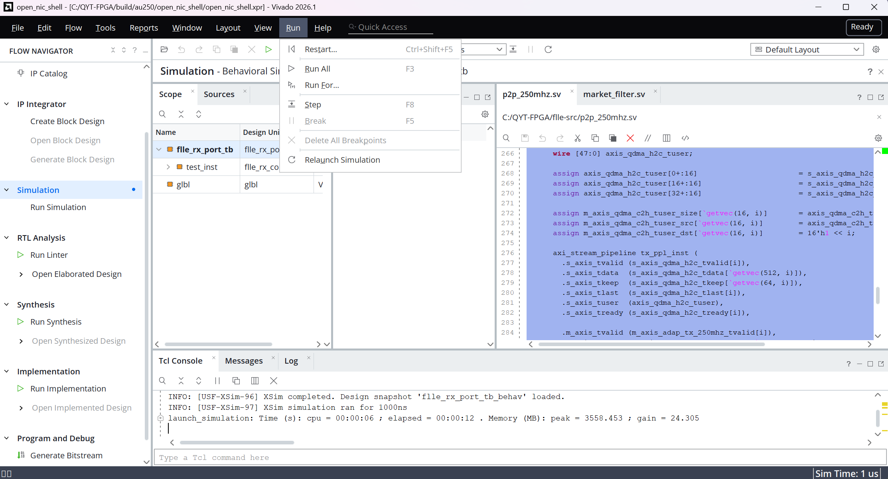</a>
<figcaption style="margin-top:8px;color:#475569;">图 3-19｜Run All继续执行剩余测试，让测试台执行到全部用例结束。</figcaption>
</figure>

<div style="border-left:6px solid #7e22ce;background:#f3e8ff;padding:12px 16px;border-radius:8px;margin:14px 0;"><span style="display:inline-block;padding:3px 12px;border-radius:6px;background:#7e22ce;color:#fff;font-weight:800;">输出解读 · 仿真结果</span> <span style="font-weight:700;color:#581c87;">在 Tcl Console 中查看 PASS、用例数和正常结束位置。</span></div>

```text
U250_RX_CONTROL_SIMULATION=PASS cases=11 vendor_cdc=1 hardware=NOT_RUN
```

<figure style="max-width:760px;margin:16px auto;padding:10px;background:#f8fafc;border:1px solid #cbd5e1;border-radius:12px;">
<a href="images/course-visuals/08-u250-walkthrough/20-simulation-pass.png">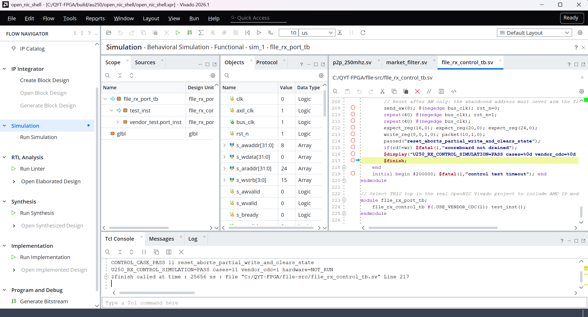</a>
<figcaption style="margin-top:8px;color:#475569;">图 3-20｜11项联合仿真通过，测试台在25656 ns调用$finish正常结束。</figcaption>
</figure>

`cases=11` 表示本测试台的11项检查完成；`vendor_cdc=1` 表示使用了工程中的 AMD 跨时钟 IP 模型；`hardware=NOT_RUN` 表示尚未在真实板卡上验证。`$finish` 是测试台主动结束仿真的语句，结合上面的 PASS 行判断本阶段通过。

<div style="border-left:6px solid #0891b2;background:#cffafe;padding:12px 16px;border-radius:8px;margin:14px 0;"><span style="display:inline-block;padding:3px 12px;border-radius:6px;background:#0891b2;color:#fff;font-weight:800;">继续条件</span> <span style="font-weight:700;color:#164e63;">本例11项检查通过并正常结束。它验证过滤器、控制寄存器与跨时钟模型的配合，下一步对完整工程综合。</span></div>

<a id="step-3-4"></a>

### 3.4 综合电路

<div style="border:2px solid #4f46e5;background:#eef2ff;padding:10px 12px;border-radius:8px;margin:14px 0;">
<div style="font-weight:900;color:#312e81;margin-bottom:4px;">导航卡 · U250：接入与构建</div>
<div style="font-weight:700;color:#312e81;margin-bottom:8px;">范畴：离线编译　本步知识：把完整工程转换成电路网表　<span style="display:inline-block;white-space:nowrap;">位置：全章第 9 / 19 项 · 本组第 4 / 4 项</span></div>
<div style="margin:8px 0;padding:8px 12px;background:#fff;border-radius:6px;color:#312e81;line-height:1.7;"><strong>乐高导航 · ③ 细化到组件与接法</strong><br>选择具体电路组件，确定每个组件如何连接，形成组件级设计——网表。此时还未安排实际位置和布线路径。 <a href="#vivado-blocks-map" style="color:#4338ca;">回看操作地图</a></div>
<span style="display:inline-block;margin:3px;padding:4px 10px;border-radius:6px;background:#f8fafc;border:1px solid #a5b4fc;color:#312e81;font-weight:800;"><a href="#step-3-1" style="color:inherit;text-decoration:none;">3.1 创建工程</a></span>
<span style="display:inline-block;margin:3px;padding:4px 10px;border-radius:6px;background:#f8fafc;border:1px solid #a5b4fc;color:#312e81;font-weight:800;"><a href="#step-3-2" style="color:inherit;text-decoration:none;">3.2 接入代码</a></span>
<span style="display:inline-block;margin:3px;padding:4px 10px;border-radius:6px;background:#f8fafc;border:1px solid #a5b4fc;color:#312e81;font-weight:800;"><a href="#step-3-3" style="color:inherit;text-decoration:none;">3.3 运行仿真</a></span>
<span style="display:inline-block;margin:3px;padding:4px 10px;border-radius:6px;background:#15803d;color:#fff;font-weight:800;"><a href="#step-3-4" style="color:inherit;text-decoration:none;">3.4 综合电路</a></span>
</div>

Synthesis（综合，常简称 SYN）决定需要哪些逻辑单元及其连接，生成 Netlist（网表，电路单元及连接关系的清单）。它相当于把搭建说明细化到组件级：用哪些乐高零件、每个零件怎样连接。下一步再在电脑里把这份精细设计完整拼起来。

<div style="border-left:6px solid #15803d;background:#dcfce7;padding:12px 16px;border-radius:8px;margin:14px 0;"><span style="display:inline-block;padding:3px 12px;border-radius:6px;background:#15803d;color:#fff;font-weight:800;">动手操作 · 3.4</span> <span style="font-weight:700;color:#14532d;">关闭仿真，在 Project Manager 对完整 open_nic_shell 工程运行综合；等待生成电路网表。</span></div>

关闭仿真返回 Project Manager，点击左侧 **Run Synthesis**。在 **Launch Runs** 窗口保持默认目录，选择 **Launch runs on local host**。本次 **Number of jobs** 为 `12`，它控制并行任务数，读者按电脑资源选择。点击 **OK** 启动综合。

<figure style="max-width:760px;margin:16px auto;padding:10px;background:#f8fafc;border:1px solid #cbd5e1;border-radius:12px;">
<a href="images/course-visuals/08-u250-walkthrough/21-launch-synthesis.png">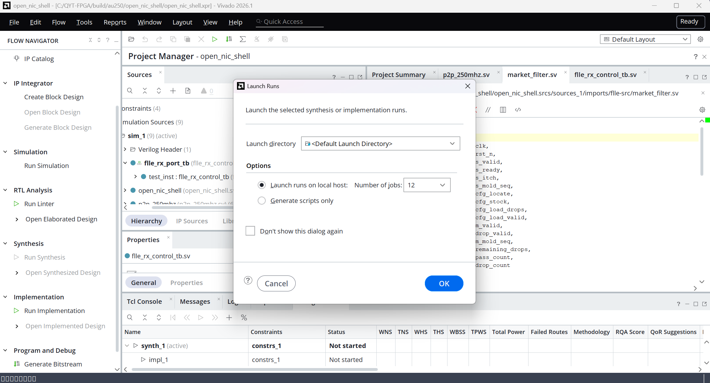</a>
<figcaption style="margin-top:8px;color:#475569;">图 3-21｜确认在本机启动综合；这张图是启动窗口，尚不是完成结果。</figcaption>
</figure>

<div style="border-left:6px solid #7e22ce;background:#f3e8ff;padding:12px 16px;border-radius:8px;margin:14px 0;"><span style="display:inline-block;padding:3px 12px;border-radius:6px;background:#7e22ce;color:#fff;font-weight:800;">输出解读 · 综合完成</span> <span style="font-weight:700;color:#581c87;">弹窗显示 Synthesis successfully completed，Design Runs 中 synth_1 显示 synth_design Complete!。</span></div>

<figure style="max-width:760px;margin:16px auto;padding:10px;background:#f8fafc;border:1px solid #cbd5e1;border-radius:12px;">
<a href="images/course-visuals/08-u250-walkthrough/22-synthesis-complete.png">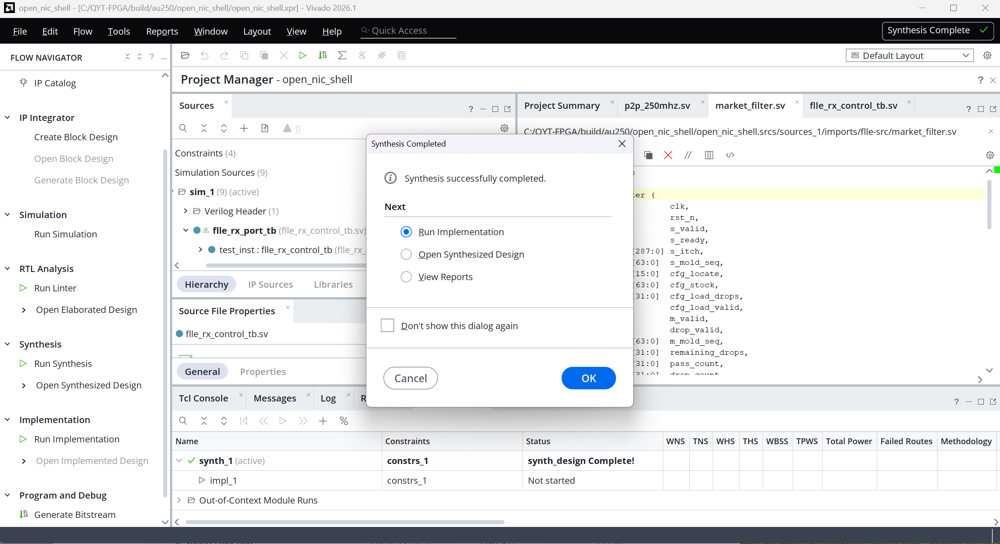</a>
<figcaption style="margin-top:8px;color:#475569;">图 3-22｜综合完成；弹窗中的 Run Implementation 进入下一步。</figcaption>
</figure>

如需观察电路结构，可选择 **Open Synthesized Design** 查看综合网表，或在 **Reports** 中查看资源使用报告。主线选择 **Run Implementation → OK**，继续安排芯片上的实际位置和连接。

<div style="border-left:6px solid #0891b2;background:#cffafe;padding:12px 16px;border-radius:8px;margin:14px 0;"><span style="display:inline-block;padding:3px 12px;border-radius:6px;background:#0891b2;color:#fff;font-weight:800;">继续条件</span> <span style="font-weight:700;color:#164e63;">完整工程综合完成，得到电路网表；目标时钟要求在下一步的实现报告中核对。</span></div>

<a id="step-3-5"></a>

### 3.5 实现与检查

<div style="border:2px solid #4f46e5;background:#eef2ff;padding:10px 12px;border-radius:8px;margin:14px 0;">
<div style="font-weight:900;color:#312e81;margin-bottom:4px;">导航卡 · U250：实现与验证</div>
<div style="font-weight:700;color:#312e81;margin-bottom:8px;">范畴：离线编译　本步知识：完成布局布线并核对时序与规则　<span style="display:inline-block;white-space:nowrap;">位置：全章第 10 / 19 项 · 本组第 1 / 4 项</span></div>
<div style="margin:8px 0;padding:8px 12px;background:#fff;border-radius:6px;color:#312e81;line-height:1.7;"><strong>乐高导航 · ④ 在电脑里完整拼装并检查</strong><br>把组件逐个安排到芯片资源位置，落实具体连线，再检查时序和设计规则；得到电脑里的完整实现结果。 <a href="#vivado-blocks-map" style="color:#4338ca;">回看操作地图</a></div>
<span style="display:inline-block;margin:3px;padding:4px 10px;border-radius:6px;background:#15803d;color:#fff;font-weight:800;"><a href="#step-3-5" style="color:inherit;text-decoration:none;">3.5 实现与检查</a></span>
<span style="display:inline-block;margin:3px;padding:4px 10px;border-radius:6px;background:#f8fafc;border:1px solid #a5b4fc;color:#312e81;font-weight:800;"><a href="#step-3-6" style="color:inherit;text-decoration:none;">3.6 生成配置</a></span>
<span style="display:inline-block;margin:3px;padding:4px 10px;border-radius:6px;background:#f8fafc;border:1px solid #a5b4fc;color:#312e81;font-weight:800;"><a href="#step-3-7" style="color:inherit;text-decoration:none;">3.7 连接板卡</a></span>
<span style="display:inline-block;margin:3px;padding:4px 10px;border-radius:6px;background:#f8fafc;border:1px solid #a5b4fc;color:#312e81;font-weight:800;"><a href="#step-3-8" style="color:inherit;text-decoration:none;">3.8 实卡验收标准</a></span>
</div>

**Implementation（实现）包括布局和布线。** 如果综合已经选好零件、定好接法，实现就是在电脑里完整拼装：为每个组件安排芯片位置、落实布线路径，再检查时序和设计规则。它通常是本流程耗时最长的一步。

基础工程还带有 Constraints（约束），规定时钟周期、引脚和接口要求。可以把时钟周期理解成每段工作交接的“截止时间”：信号必须在规定时间内到达并稳定。

<div style="border-left:6px solid #15803d;background:#dcfce7;padding:12px 16px;border-radius:8px;margin:14px 0;"><span style="display:inline-block;padding:3px 12px;border-radius:6px;background:#15803d;color:#fff;font-weight:800;">动手操作 · 3.5</span> <span style="font-weight:700;color:#14532d;">从综合完成窗口选择 Run Implementation；本机运行，等待布局布线结束。完成后读取时序和规则报告。</span></div>

在 **Launch Runs** 窗口保持默认目录和 **Launch runs on local host**，按电脑资源选择并行任务数。本例为 `12`，点击 **OK**。

<figure style="max-width:760px;margin:16px auto;padding:10px;background:#f8fafc;border:1px solid #cbd5e1;border-radius:12px;">
<a href="images/course-visuals/08-u250-walkthrough/23-launch-implementation.png">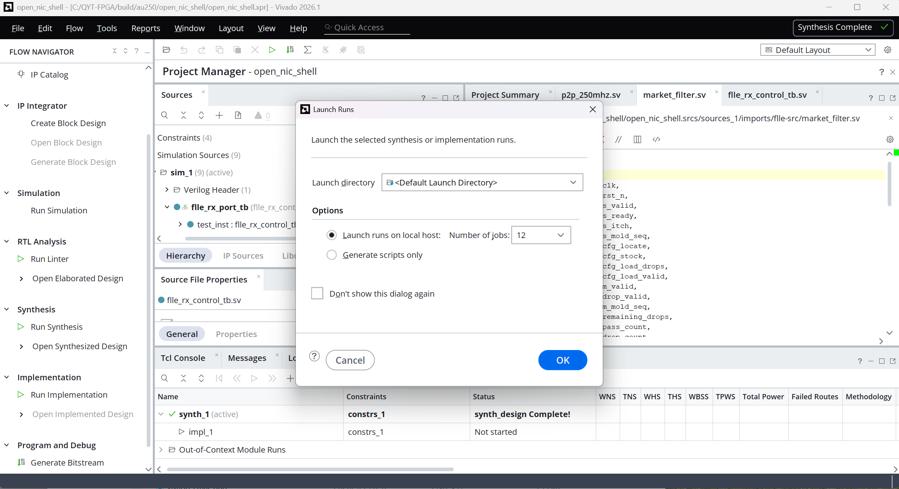</a>
<figcaption style="margin-top:8px;color:#475569;">图 3-23｜启动实现，Vivado 开始布局布线。</figcaption>
</figure>

实现完成后，弹窗显示 **Implementation successfully completed**，右上角为 **Implementation Complete**。底部 `impl_1` 显示 **route_design Complete!**，表示布局布线已经完成。

<figure style="max-width:760px;margin:16px auto;padding:10px;background:#f8fafc;border:1px solid #cbd5e1;border-radius:12px;">
<a href="images/course-visuals/08-u250-walkthrough/24-implementation-complete.png">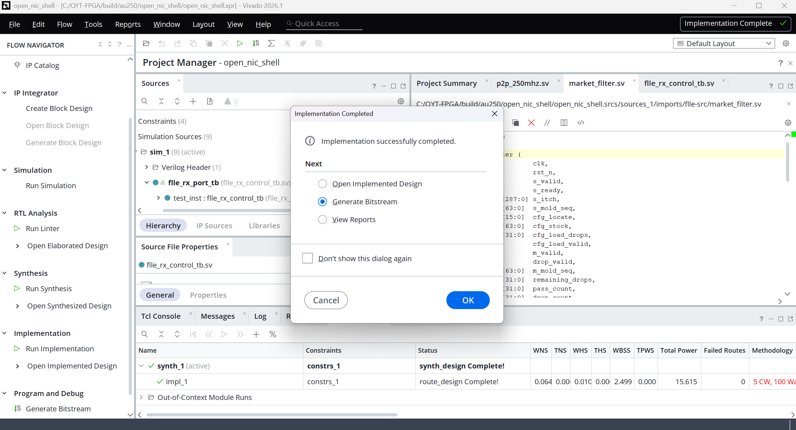</a>
<figcaption style="margin-top:8px;color:#475569;">图 3-24｜实现完成；下方 Design Runs 显示本轮时序汇总与布线状态。</figcaption>
</figure>

本例 **WNS = 0.064 ns、WHS = 0.010 ns**，建立时间和保持时间都有余量；**TNS、THS、TPWS均为0，Failed Routes为0**。这些读数说明本轮汇总中的对应时序检查通过，且没有布线失败。

查看完整报告时，选择 **Open Implemented Design**，通过 **Reports** 打开 **Report Timing Summary**、**Report DRC** 和 **Report Methodology**。DRC 是设计规则检查，Methodology 检查时钟、约束和设计用法；图中的 Methodology 条目在对应报告中逐项核对。

<div style="border-left:6px solid #7e22ce;background:#f3e8ff;padding:12px 16px;border-radius:8px;margin:14px 0;"><span style="display:inline-block;padding:3px 12px;border-radius:6px;background:#7e22ce;color:#fff;font-weight:800;">输出解读 · 能否按目标时钟工作</span> <span style="font-weight:700;color:#581c87;">综合确认能形成电路；这里核对实际连线后的时间、约束覆盖和设计规则。</span></div>

| 查看项目 | 读什么 | 继续判断 |
| --- | --- | --- |
| Design Runs / 布线状态 | `impl_1` 已完成布线 | 所需连接完成 |
| Setup（建立时间） | WNS：最差裕量；TNS：负裕量总和 | WNS不为负、TNS为0，并检查约束覆盖 |
| Hold（保持时间） | WHS：最差裕量；THS：负裕量总和 | WHS不为负、THS为0 |
| Pulse Width（时钟脉宽） | 脉宽检查 | 无脉宽违例 |
| 约束、DRC、Methodology | 未约束路径与规则项 | 所有关键路径已覆盖，相关问题已处理 |

<div style="border-left:6px solid #ea580c;background:#fff7ed;padding:12px 16px;border-radius:8px;margin:14px 0;">
<span style="display:inline-block;padding:3px 12px;border-radius:6px;background:#ea580c;color:#fff;font-weight:800;">读数提醒 · 裕量为负代表什么</span>
<p><strong>Setup：数据到得太晚。</strong>例如 <code>WNS = -0.10 ns</code>，表示最差路径还差 <strong>0.10 ns</strong> 才能满足采样前的建立时间要求。</p>
<p><strong>Hold：数据变得太早。</strong>例如 <code>WHS = -0.05 ns</code>，表示最差路径还需要多保持 <strong>0.05 ns</strong>，才能满足采样后的保持时间要求。以上负数仅用于解释读数。</p>
<p><strong>我们在调试中也遇到过负裕量，调整电路并重新实现后，这些时序问题得到解决。</strong>本轮结果为 <code>WNS = 0.064 ns</code>、<code>WHS = 0.010 ns</code>，两项都有正余量。</p>
<p style="margin-bottom:0;">负裕量说明当前时序要求未满足；判断整份设计，还要结合其余时序项和约束覆盖。<a href="https://docs.amd.com/r/en-US/ug835-vivado-tcl-commands/report_timing_summary">AMD Timing Summary 说明</a></p>
</div>

<div style="border-left:6px solid #0891b2;background:#cffafe;padding:12px 16px;border-radius:8px;margin:14px 0;"><span style="display:inline-block;padding:3px 12px;border-radius:6px;background:#0891b2;color:#fff;font-weight:800;">继续条件</span> <span style="font-weight:700;color:#164e63;">布线完成，时序与规则满足目标要求后，进入配置文件生成。生成文件与时序达标是两个独立结果，都需要核对。</span></div>

<a id="step-3-6"></a>

### 3.6 生成配置

<div style="border:2px solid #4f46e5;background:#eef2ff;padding:10px 12px;border-radius:8px;margin:14px 0;">
<div style="font-weight:900;color:#312e81;margin-bottom:4px;">导航卡 · U250：实现与验证</div>
<div style="font-weight:700;color:#312e81;margin-bottom:8px;">范畴：离线编译　本步知识：生成并找到 U250 的 .bit 文件　<span style="display:inline-block;white-space:nowrap;">位置：全章第 11 / 19 项 · 本组第 2 / 4 项</span></div>
<div style="margin:8px 0;padding:8px 12px;background:#fff;border-radius:6px;color:#312e81;line-height:1.7;"><strong>乐高导航 · ⑤ 输出详细方案 → ⑥ 查看拼装细节</strong><br>把已经拼好的结果编码成 .bit 配置方案；再用 Schematic 看连接、Device 看摆放与布线。 <a href="#vivado-blocks-map" style="color:#4338ca;">回看操作地图</a></div>
<span style="display:inline-block;margin:3px;padding:4px 10px;border-radius:6px;background:#f8fafc;border:1px solid #a5b4fc;color:#312e81;font-weight:800;"><a href="#step-3-5" style="color:inherit;text-decoration:none;">3.5 实现与检查</a></span>
<span style="display:inline-block;margin:3px;padding:4px 10px;border-radius:6px;background:#15803d;color:#fff;font-weight:800;"><a href="#step-3-6" style="color:inherit;text-decoration:none;">3.6 生成配置</a></span>
<span style="display:inline-block;margin:3px;padding:4px 10px;border-radius:6px;background:#f8fafc;border:1px solid #a5b4fc;color:#312e81;font-weight:800;"><a href="#step-3-7" style="color:inherit;text-decoration:none;">3.7 连接板卡</a></span>
<span style="display:inline-block;margin:3px;padding:4px 10px;border-radius:6px;background:#f8fafc;border:1px solid #a5b4fc;color:#312e81;font-weight:800;"><a href="#step-3-8" style="color:inherit;text-decoration:none;">3.8 实卡验收标准</a></span>
</div>

实现得到芯片上的电路布局，下一步把它写成器件能读取的配置数据。U250 使用 Bitstream（比特流），本例文件后缀为 `.bit`。

<div style="border-left:6px solid #15803d;background:#dcfce7;padding:12px 16px;border-radius:8px;margin:14px 0;"><span style="display:inline-block;padding:3px 12px;border-radius:6px;background:#15803d;color:#fff;font-weight:800;">动手操作 · 3.6</span> <span style="font-weight:700;color:#14532d;">在当前 U250 工程选择 Generate Bitstream，将实现结果输出为配置文件。</span></div>

1. 点击左侧 **Program and Debug → Generate Bitstream**。
2. 在 **Launch Runs** 中确认本机运行，点击 **OK**。
3. 完成后，确认 **Bitstream Generation successfully completed** 或右上角 **write_bitstream Complete**。
4. 在完成弹窗选择 **Open Implemented Design → OK**。本节先核对 `.bit` 文件并观察电路，3.7 再打开 Hardware Manager。

<div style="border-left:6px solid #ea580c;background:#fff7ed;padding:12px 16px;border-radius:8px;margin:14px 0;"><span style="display:inline-block;padding:3px 12px;border-radius:6px;background:#ea580c;color:#fff;font-weight:800;">注意 · 截图与本步选择</span> <span style="font-weight:700;color:#9a3412;">下图用于确认生成成功；继续操作时改选第一项 Open Implemented Design。图中选中的 Hardware Manager 在 3.7 使用。</span></div>

<figure style="max-width:760px;margin:16px auto;padding:10px;background:#f8fafc;border:1px solid #cbd5e1;border-radius:12px;">
<a href="images/course-visuals/08-u250-walkthrough/25-bitstream-complete.png">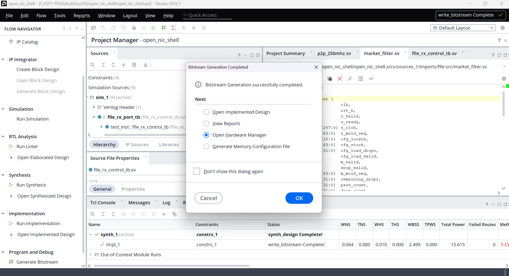</a>
<figcaption style="margin-top:8px;color:#475569;">图 3-25｜比特流生成完成。图中选中的是硬件管理入口；按本节顺序改选 Open Implemented Design，先观察实现结果。</figcaption>
</figure>

在文件资源管理器中打开以下目录，找到 **`open_nic_shell.bit`**；右键选择 **属性**，核对文件大小与修改时间。

<div style="border-left:6px solid #7e22ce;background:#f3e8ff;padding:12px 16px;border-radius:8px;margin:14px 0;"><span style="display:inline-block;padding:3px 12px;border-radius:6px;background:#7e22ce;color:#fff;font-weight:800;">仅供展示 · 配置文件目录</span> <span style="font-weight:700;color:#581c87;">在 Windows 文件资源管理器地址栏打开此路径，查找 open_nic_shell.bit；这是文件位置。</span></div>

```text
C:\QYT-FPGA\build\au250\open_nic_shell\open_nic_shell.runs\impl_1
```

<figure style="max-width:760px;margin:16px auto;padding:10px;background:#f8fafc;border:1px solid #cbd5e1;border-radius:12px;">
<a href="images/course-visuals/08-u250-walkthrough/26-bitstream-file-properties.png">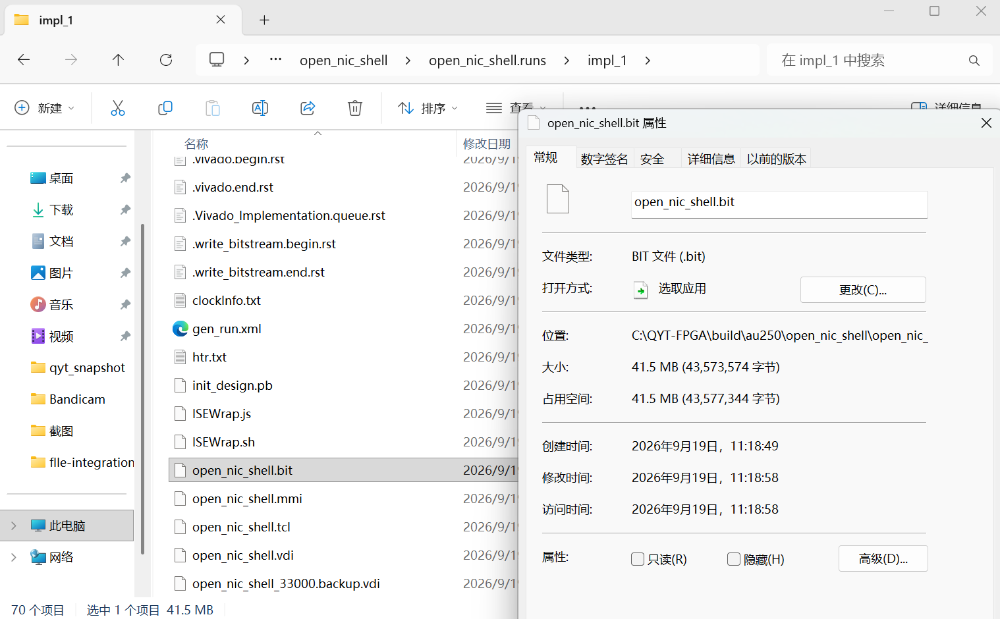</a>
<figcaption style="margin-top:8px;color:#475569;">图 3-26｜本轮配置文件为 open_nic_shell.bit，大小41.5 MB；修改时间为2026年9月19日11:18:58。</figcaption>
</figure>

图中实际文件大小为 **43,573,574 字节**。文件大小随设计与生成选项变化，核对时以自己的本轮产物为准。

<div style="border-left:6px solid #7e22ce;background:#f3e8ff;padding:12px 16px;border-radius:8px;margin:14px 0;"><span style="display:inline-block;padding:3px 12px;border-radius:6px;background:#7e22ce;color:#fff;font-weight:800;">文件去向 · 从工程到设备</span> <span style="font-weight:700;color:#581c87;">工程管理源码，Vivado 构建电路，生成的 .bit 交给 Hardware Manager 装载。</span></div>

| 文件 | 作用 | 谁使用 |
| --- | --- | --- |
| `.sv` | 电路源码 | Vivado 读取并构建设计 |
| `.xpr` | 工程入口，保存文件与工具设置 | 开发者用 Vivado 打开 |
| `.bit` | U250 FPGA 配置数据 | Hardware Manager 装入匹配器件 |

保留 `.bit` 与对应工程、源码和报告，就能知道板上配置来自哪一份设计。[AMD 器件编程文件说明](https://docs.amd.com/r/2021.2-English/ug835-vivado-tcl-commands/program_hw_devices)

**看一眼：我们的代码变成了什么电路？**

打开已有的 **Open Implemented Design**，就能查看这份配置背后的电路。**Device**（器件视图）像芯片的地图，显示资源位置与布局；**Schematic**（电路连接图）像接线图，显示模块和逻辑单元之间怎样连接。

<div style="border-left:6px solid #15803d;background:#dcfce7;padding:12px 16px;border-radius:8px;margin:14px 0;"><span style="display:inline-block;padding:3px 12px;border-radius:6px;background:#15803d;color:#fff;font-weight:800;">动手观察 · 芯片布局</span> <span style="font-weight:700;color:#14532d;">打开实现结果，切换到 Device；左侧 Netlist 中沿模块层次找到课程过滤器。</span></div>

在 **Netlist**（网表）中依次展开 `box_250mhz_inst → p2p_250mhz_inst → rx_filter_inst → filter_inst → core (market_filter)`。其中 `rx_filter_inst` 的名称可能带有 `genblk2[0]` 等前缀，它表示代码生成的层次。

<figure style="max-width:760px;margin:16px auto;padding:10px;background:#f8fafc;border:1px solid #cbd5e1;border-radius:12px;">
<a href="images/course-visuals/08-u250-walkthrough/28-implemented-device-layout.png">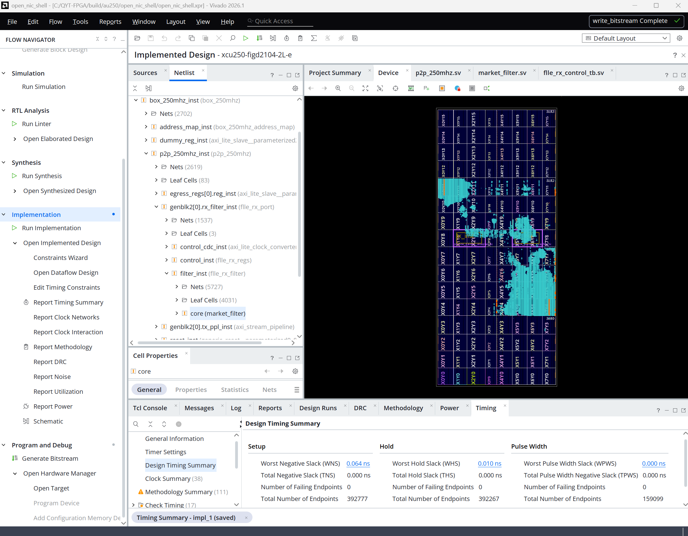</a>
<figcaption style="margin-top:8px;color:#475569;">图 3-27｜右侧全景上的斑驳色块是整份设计占用的资源格子；左侧能找到 market_filter，它在全景上几乎看不出来。</figcaption>
</figure>

<div style="border-left:6px solid #7e22ce;background:#f3e8ff;padding:12px 16px;border-radius:8px;margin:14px 0;"><span style="display:inline-block;padding:3px 12px;border-radius:6px;background:#7e22ce;color:#fff;font-weight:800;">看图理解 · 全景上的斑驳色块</span> <span style="font-weight:700;color:#581c87;">深色底是还空着的格子；黄褐、青蓝点子是已经占用的格子，缩远后叠在一起，看起来像锈斑。这些色块主要是 OpenNIC Shell 的收发包链路：CMAC、QDMA、时钟和总线。market_filter 只占很少单元，全景上看不太出来。</span></div>

Device 用资源格子展示电路在芯片上的位置。[AMD 器件资源显示](https://docs.amd.com/r/en-US/ug893-vivado-ide/Understanding-the-Device-Resource-Display)。下面切换到 Schematic，单独查看 `core` 的连接。

<div style="border-left:6px solid #15803d;background:#dcfce7;padding:12px 16px;border-radius:8px;margin:14px 0;"><span style="display:inline-block;padding:3px 12px;border-radius:6px;background:#15803d;color:#fff;font-weight:800;">动手观察 · 打开过滤器电路</span> <span style="font-weight:700;color:#14532d;">全景上看不清过滤器。在左侧 Netlist 中选中 core (market_filter)，右键选择 Schematic，或按 F4。</span></div>

<figure style="max-width:760px;margin:16px auto;padding:10px;background:#f8fafc;border:1px solid #cbd5e1;border-radius:12px;">
<a href="images/course-visuals/08-u250-walkthrough/29-open-core-schematic.png">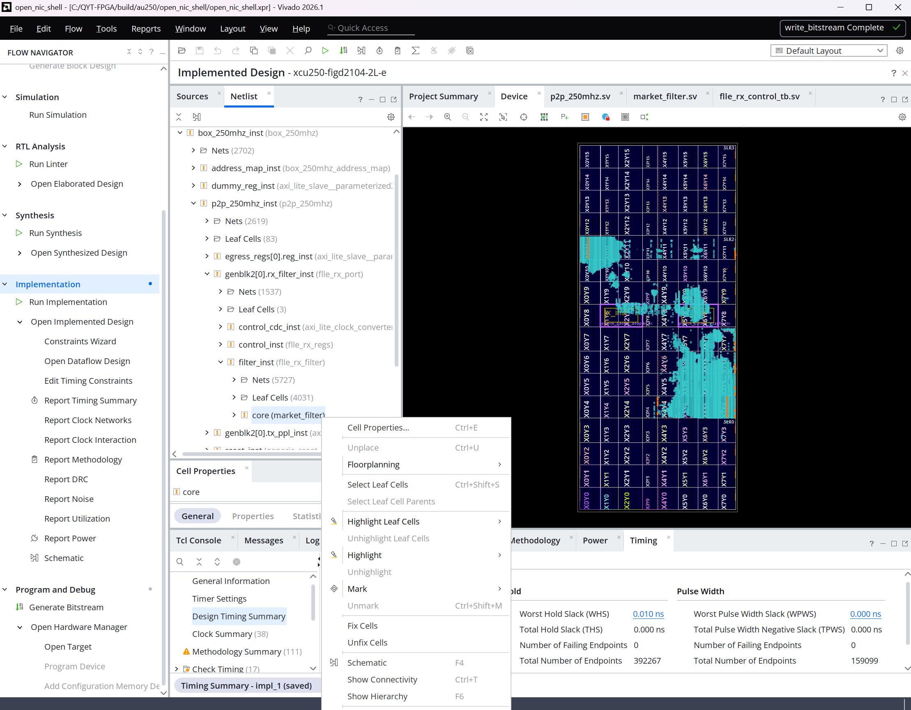</a>
<figcaption style="margin-top:8px;color:#475569;">图 3-28｜菜单下方的 Schematic 是电路图入口，快捷键为 F4。</figcaption>
</figure>

<div style="border-left:6px solid #7e22ce;background:#f3e8ff;padding:12px 16px;border-radius:8px;margin:14px 0;"><span style="display:inline-block;padding:3px 12px;border-radius:6px;background:#7e22ce;color:#fff;font-weight:800;">看图理解 · 模块怎样接起来</span> <span style="font-weight:700;color:#581c87;">蓝色 core 是过滤核心，外层方框表示它所在的模块层次，绿色线表示信号连接。</span></div>

<figure style="max-width:760px;margin:16px auto;padding:10px;background:#f8fafc;border:1px solid #cbd5e1;border-radius:12px;">
<a href="images/course-visuals/08-u250-walkthrough/30-market-filter-connections.png">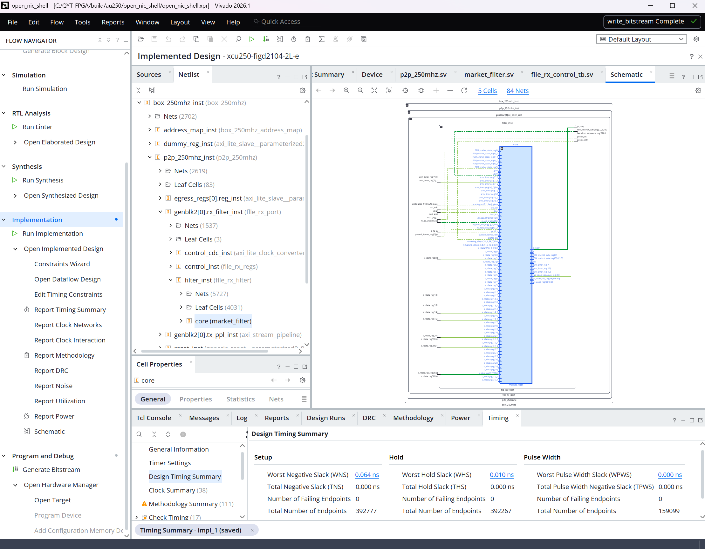</a>
<figcaption style="margin-top:8px;color:#475569;">图 3-29｜从工程层次追到过滤核心：源码中的模块，已经出现在实现后的网表里。</figcaption>
</figure>

这里的 `core` 对应前面讲过的 `market_filter.sv`，负责识别目标消息、消耗丢包额度并更新计数。连接图把它与外层接收逻辑的关系展示出来。[AMD Schematic 说明](https://docs.amd.com/r/en-US/ug906-vivado-design-analysis/Using-the-Schematic-Window)

<div style="border-left:6px solid #15803d;background:#dcfce7;padding:12px 16px;border-radius:8px;margin:14px 0;"><span style="display:inline-block;padding:3px 12px;border-radius:6px;background:#15803d;color:#fff;font-weight:800;">动手观察 · 展开内部</span> <span style="font-weight:700;color:#14532d;">单击右侧蓝色 core 方框左上角的小“＋”，展开内部电路；用放大镜查看局部。</span></div>

<figure style="max-width:760px;margin:16px auto;padding:10px;background:#f8fafc;border:1px solid #cbd5e1;border-radius:12px;">
<a href="images/course-visuals/08-u250-walkthrough/31-market-filter-expanded-logic.png">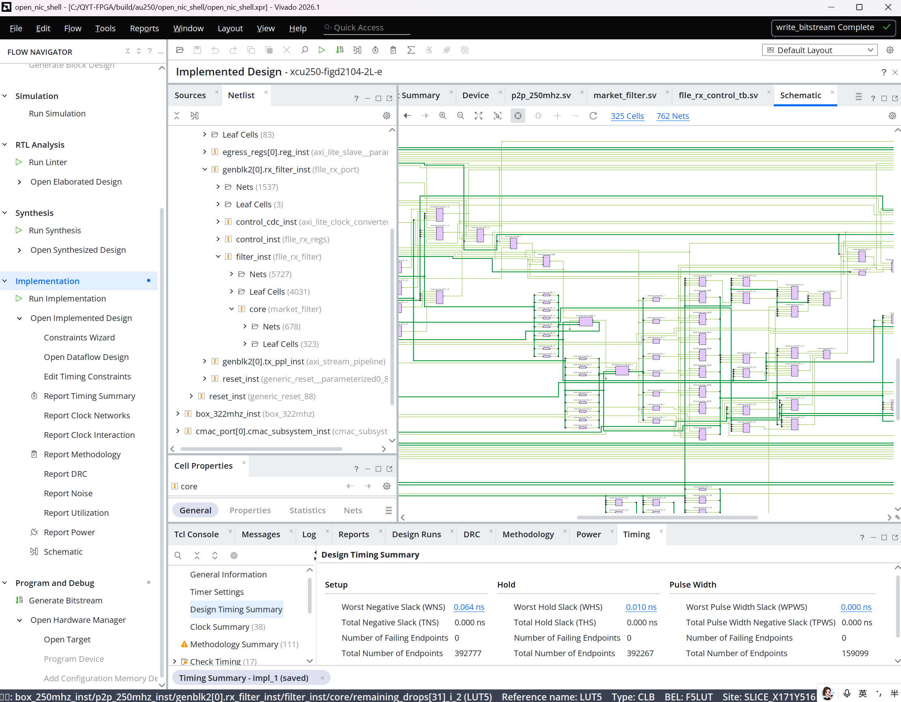</a>
<figcaption style="margin-top:8px;color:#475569;">图 3-30｜展开后的局部电路；左侧 Leaf Cells (323) 表示 core 内的底层单元数量。</figcaption>
</figure>

**Leaf Cells**（叶子单元）是层次展开到底的基本电路单元。图中底部状态栏可见 `LUT5`：它是五输入 LUT（查找表），通过配置实现逻辑运算；旁边的 `Site: SLICE_X171Y516` 则给出该单元在芯片上的位置。比较、计数和状态保存等源码逻辑，会由工具组合成这样的电路单元与连线。看懂“模块 → 单元 → 芯片位置”这条关系，就能把前面的代码与实现结果对应起来。[AMD 电路展开说明](https://docs.amd.com/r/2025.2-English/ug893-vivado-ide/Expanding-Logic-from-Selected-Cells-and-Pins)

<div style="border-left:6px solid #0891b2;background:#cffafe;padding:12px 16px;border-radius:8px;margin:14px 0;"><span style="display:inline-block;padding:3px 12px;border-radius:6px;background:#0891b2;color:#fff;font-weight:800;">继续条件</span> <span style="font-weight:700;color:#164e63;">生成状态成功，输出目录中存在本次 open_nic_shell.bit；接下来把它交给真实板卡。</span></div>

<a id="step-3-7"></a>

### 3.7 连接板卡

<div style="border:2px solid #4f46e5;background:#eef2ff;padding:10px 12px;border-radius:8px;margin:14px 0;">
<div style="font-weight:900;color:#312e81;margin-bottom:4px;">导航卡 · U250：实现与验证</div>
<div style="font-weight:700;color:#312e81;margin-bottom:8px;">范畴：扩展设计　本步知识：通过 USB-JTAG 将配置装入 FPGA　<span style="display:inline-block;white-space:nowrap;">位置：全章第 12 / 19 项 · 本组第 3 / 4 项</span></div>
<div style="margin:8px 0;padding:8px 12px;background:#fff;border-radius:6px;color:#312e81;line-height:1.7;"><strong>乐高导航 · ⑦ 按方案在真实硬件上实施</strong><br>将 .bit 写入已连接的 FPGA，让芯片中已有的组件与连线按方案配置，实际电路开始工作。 <a href="#vivado-blocks-map" style="color:#4338ca;">回看操作地图</a></div>
<span style="display:inline-block;margin:3px;padding:4px 10px;border-radius:6px;background:#f8fafc;border:1px solid #a5b4fc;color:#312e81;font-weight:800;"><a href="#step-3-5" style="color:inherit;text-decoration:none;">3.5 实现与检查</a></span>
<span style="display:inline-block;margin:3px;padding:4px 10px;border-radius:6px;background:#f8fafc;border:1px solid #a5b4fc;color:#312e81;font-weight:800;"><a href="#step-3-6" style="color:inherit;text-decoration:none;">3.6 生成配置</a></span>
<span style="display:inline-block;margin:3px;padding:4px 10px;border-radius:6px;background:#15803d;color:#fff;font-weight:800;"><a href="#step-3-7" style="color:inherit;text-decoration:none;">3.7 连接板卡</a></span>
<span style="display:inline-block;margin:3px;padding:4px 10px;border-radius:6px;background:#f8fafc;border:1px solid #a5b4fc;color:#312e81;font-weight:800;"><a href="#step-3-8" style="color:inherit;text-decoration:none;">3.8 实卡验收标准</a></span>
</div>

**Hardware Manager**（硬件管理器）负责发现连接的器件并装入配置文件。U250 支持 USB-JTAG：电脑通过 USB 线访问卡上的 JTAG 调试与配置接口。[U250 配置方式](https://docs.amd.com/r/en-US/ug1289-u200-u250-reconfig-accel/UltraScale-Device-Configuration)

图 1-1 是卡的顶面散热外壳，FPGA 芯片在外壳下面。配置口焊在卡自己的 I/O 挡板上，和两个 QSFP28 网口同一侧。这块挡板跟着卡走：卡插进哪台主机，就从那台主机后窗的挡板插线。官方把这个口写成 Micro-AB（USB）JTAG 配置口 / micro-USB 维护口，出厂常带防尘盖。[UG1301 卡接口](https://docs.amd.com/r/en-US/ug1301-getting-started-guide-alveo-accelerator-cards/Card-Interfaces-and-Details)、[DS962 USB 维护口](https://docs.amd.com/r/en-US/ds962-u200-u250/USB-Maintenance-Port)

电脑这边接普通 USB 主机口，实验室最常见是 **USB Type-A**。线用 **USB-A 转 Micro-USB**。开发电脑只有 USB-C 时，换一条 USB-C 转 Micro-USB 即可。

<div style="border-left:6px solid #7e22ce;background:#f3e8ff;padding:12px 16px;border-radius:8px;margin:14px 0;"><span style="display:inline-block;padding:3px 12px;border-radius:6px;background:#7e22ce;color:#fff;font-weight:800;">仅供展示</span> <span style="font-weight:700;color:#581c87;">官方图把 Network Interface 标在两个大口上，把 Micro-USB Interface 标在挡板下方小口上。</span></div>

<figure style="max-width:420px;margin:16px auto;padding:10px;background:#f8fafc;border:1px solid #cbd5e1;border-radius:12px;">
<a href="images/course-visuals/08-diagrams/08-ug1301-alveo-card-features.png">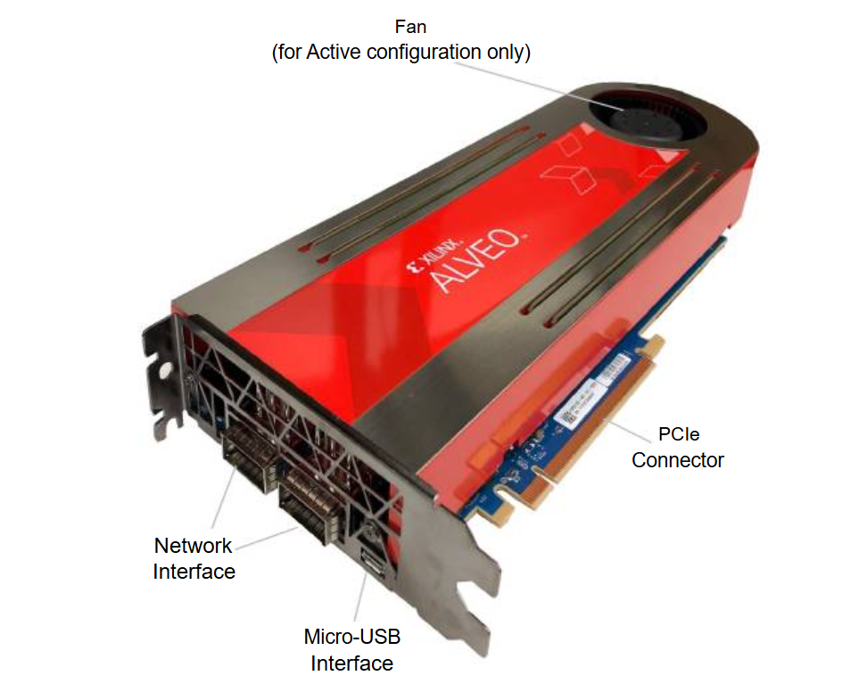</a>
<figcaption style="margin-top:8px;color:#475569;">图 3-31｜UG1301「Alveo Card Features」。Network Interface 是两个 QSFP28；Micro-USB Interface 是挡板下方小口。红壳是 Xilinx 时期 U200/U250 同一套挡板。</figcaption>
</figure>

<div style="border-left:6px solid #ea580c;background:#ffedd5;padding:12px 16px;border-radius:8px;margin:14px 0;"><span style="display:inline-block;padding:3px 12px;border-radius:6px;background:#ea580c;color:#fff;font-weight:800;">实卡准备</span> <span style="font-weight:700;color:#9a3412;">U250 已安装在主机上，并按板卡要求供电和散热；USB-A 转 Micro-USB 线接到挡板上的维护口，开发电脑已安装线缆驱动。</span></div>

插卡主机负责承载板卡和接收数据，开发电脑负责运行 Vivado；两者可以是同一台，也可以是不同电脑。USB-JTAG 用于配置，业务报文通过网口和 PCIe 传输。

<div style="border-left:6px solid #15803d;background:#dcfce7;padding:12px 16px;border-radius:8px;margin:14px 0;"><span style="display:inline-block;padding:3px 12px;border-radius:6px;background:#15803d;color:#fff;font-weight:800;">有卡时操作 · 3.7</span> <span style="font-weight:700;color:#14532d;">在连接 USB-JTAG 的开发电脑打开 Hardware Manager，选择匹配的 U250 器件并装入本次 .bit。</span></div>

1. 点击 **Open Hardware Manager**。
2. 选择 **Open Target → Auto Connect**，让工具发现连接的硬件。
3. 在器件列表中确认 U250 对应的 FPGA，右键选择 **Program Device**。
4. 在 **Bitstream file** 中选择本次 `open_nic_shell.bit`，点击 **Program**。
5. 等待编程完成；主机驱动和控制工具就绪后，再按 3.8 的标准验收。

<figure style="max-width:760px;margin:16px auto;padding:10px;background:#f8fafc;border:1px solid #cbd5e1;border-radius:12px;">
<a href="images/course-visuals/08-u250-walkthrough/27-hardware-manager-auto-connect.png"></a>
<figcaption style="margin-top:8px;color:#475569;">图 3-32｜Open Target → Auto Connect 是连接入口；画面中的 unconnected 表示当前尚未打开硬件目标。</figcaption>
</figure>

未连接板卡时，可以先完成配置文件生成并打开此界面；接好已上电板卡的 USB-JTAG 后，再继续连接与编程。

Target 是工具发现的硬件连接目标。板卡上电、调试线缆与驱动就绪后，由 Hardware Manager 打开这个目标。[AMD 连接与编程流程](https://docs.amd.com/api/khub/documents/BC6KbvE7h20uatPL33eeUQ/content)

这条路线把配置直接装进 FPGA。需要断电后自动加载时，再使用板卡的 Flash（非易失性存储器）配置流程。若 USB 连接在另一台主机上，可以在那台机器使用 Vivado/Lab Edition，或让本地 Hardware Manager 连接其硬件服务。

<div style="border-left:6px solid #0891b2;background:#cffafe;padding:12px 16px;border-radius:8px;margin:14px 0;"><span style="display:inline-block;padding:3px 12px;border-radius:6px;background:#0891b2;color:#fff;font-weight:800;">继续条件</span> <span style="font-weight:700;color:#164e63;">Hardware Manager 完成器件配置后，在插卡主机确认 PCIe 设备、配套驱动和网口链路；它们共同为下一步收包与控制提供入口。</span></div>

<a id="step-3-8"></a>

### 3.8 实卡验收标准

<div style="border:2px solid #4f46e5;background:#eef2ff;padding:10px 12px;border-radius:8px;margin:14px 0;">
<div style="font-weight:900;color:#312e81;margin-bottom:4px;">导航卡 · U250：实现与验证</div>
<div style="font-weight:700;color:#312e81;margin-bottom:8px;">范畴：扩展设计　本步知识：明确实卡入口与报文验收标准　<span style="display:inline-block;white-space:nowrap;">位置：全章第 13 / 19 项 · 本组第 4 / 4 项</span></div>
<div style="margin:8px 0;padding:8px 12px;background:#fff;border-radius:6px;color:#312e81;line-height:1.7;"><strong>乐高导航 · ⑧ 用真货检查分拣机</strong><br>用真实报文核对过滤效果。本节先明确验收标准；执行时还需准备主机驱动、寄存器与收发工具。 <a href="#vivado-blocks-map" style="color:#4338ca;">回看操作地图</a></div>
<span style="display:inline-block;margin:3px;padding:4px 10px;border-radius:6px;background:#f8fafc;border:1px solid #a5b4fc;color:#312e81;font-weight:800;"><a href="#step-3-5" style="color:inherit;text-decoration:none;">3.5 实现与检查</a></span>
<span style="display:inline-block;margin:3px;padding:4px 10px;border-radius:6px;background:#f8fafc;border:1px solid #a5b4fc;color:#312e81;font-weight:800;"><a href="#step-3-6" style="color:inherit;text-decoration:none;">3.6 生成配置</a></span>
<span style="display:inline-block;margin:3px;padding:4px 10px;border-radius:6px;background:#f8fafc;border:1px solid #a5b4fc;color:#312e81;font-weight:800;"><a href="#step-3-7" style="color:inherit;text-decoration:none;">3.7 连接板卡</a></span>
<span style="display:inline-block;margin:3px;padding:4px 10px;border-radius:6px;background:#15803d;color:#fff;font-weight:800;"><a href="#step-3-8" style="color:inherit;text-decoration:none;">3.8 实卡验收标准</a></span>
</div>

**本节只讲实卡验收标准，主机操作入口待板卡联调后补齐。** 当前可跟做的实录止于生成 `.bit` 和查看实现结果；3.7 给出有卡时的编程入口。要检验实际收包，还需配套驱动、课程寄存器访问工具和收发环境，准备关系如下。

| 所需入口 | 执行位置与用途 | 当前准备情况 |
| --- | --- | --- |
| OpenNIC 驱动与收包入口 | 插卡的 Linux 主机；通过 PCIe 接收板卡送来的包 | 从 [OpenNIC 官方项目](https://github.com/Xilinx/open-nic)取得；驱动版本、安装步骤和实际接口名待板卡环境核对 |
| 课程寄存器访问工具 | 插卡主机；写入授权/撤销，读取额度、计数和丢弃序号 | 本工程地址映射与主机命令尚待联调；OpenNIC 不自带课程过滤命令 |
| 发包与序号观察 | 对端流量工具向 U250 网口低速发包，插卡主机查看接收序号 | 报文格式沿用 3.2；工具、链路和接收入口待确认 |

这些入口就绪后，按下表验收。一次授权只改变额度，无需重新生成 `.bit`。本例 `flle_rx_port.sv` 将 `ARM_TIMEOUT_CYCLES` 设为 `1250000000`，在 250 MHz 下约为 5 秒；主动撤销、超时或复位都会清除未用额度。

<div style="border-left:6px solid #7e22ce;background:#f3e8ff;padding:12px 16px;border-radius:8px;margin:14px 0;"><span style="display:inline-block;padding:3px 12px;border-radius:6px;background:#7e22ce;color:#fff;font-weight:800;">实卡验收方法</span> <span style="font-weight:700;color:#581c87;">下面是有卡时逐项核对的预期行为；从低速、能够核对序号的报文开始，观察位置在 PCIe 主机接收侧。</span></div>

| 验收动作 | 预期现象 |
| --- | --- |
| 无额度时发送目标及非目标报文 | 全部通过 |
| 授权一次后先发非目标报文 | 非目标通过，额度仍为1 |
| 有效期内发送目标报文 | 丢弃计数加1，记录该包序号，额度归零 |
| 随后再发目标报文 | 正常通过 |
| 撤销未用额度，或等待5秒到期 | 后续目标报文通过 |

比较主机收到的序号与设备记录的丢弃序号，确认缺失的正是授权命中的那一包。结束时撤销剩余额度，再发包确认正常接收。

<div style="border-left:6px solid #0891b2;background:#cffafe;padding:12px 16px;border-radius:8px;margin:14px 0;"><span style="display:inline-block;padding:3px 12px;border-radius:6px;background:#0891b2;color:#fff;font-weight:800;">验收标准</span> <span style="font-weight:700;color:#164e63;">接收端缺失的序号与设备丢弃记录一致；一次授权只增加一次丢弃，撤销后正常通过。吞吐与延迟需要另行测量。</span></div>

U250 已有的构建实录与实卡验收标准到这里对应起来。下面使用另一套交换机课程代码完成相同任务，重点看板级接口、应用打包与 EOS 操作。

## 4 交换机：适配与部署

<a id="step-4-1"></a>

### 4.1 比较平台

<div style="border:2px solid #4f46e5;background:#eef2ff;padding:10px 12px;border-radius:8px;margin:14px 0;">
<div style="font-weight:900;color:#312e81;margin-bottom:4px;">导航卡 · 交换机：适配与部署</div>
<div style="font-weight:700;color:#312e81;margin-bottom:8px;">范畴：机制讲解　本步知识：分清两类设备的接口与产物差异　<span style="display:inline-block;white-space:nowrap;">位置：全章第 14 / 19 项 · 本组第 1 / 5 项</span></div>
<span style="display:inline-block;margin:3px;padding:4px 10px;border-radius:6px;background:#15803d;color:#fff;font-weight:800;"><a href="#step-4-1" style="color:inherit;text-decoration:none;">4.1 比较平台</a></span>
<span style="display:inline-block;margin:3px;padding:4px 10px;border-radius:6px;background:#f8fafc;border:1px solid #a5b4fc;color:#312e81;font-weight:800;"><a href="#step-4-2" style="color:inherit;text-decoration:none;">4.2 接入厂商工程</a></span>
<span style="display:inline-block;margin:3px;padding:4px 10px;border-radius:6px;background:#f8fafc;border:1px solid #a5b4fc;color:#312e81;font-weight:800;"><a href="#step-4-3" style="color:inherit;text-decoration:none;">4.3 生成应用包</a></span>
<span style="display:inline-block;margin:3px;padding:4px 10px;border-radius:6px;background:#f8fafc;border:1px solid #a5b4fc;color:#312e81;font-weight:800;"><a href="#step-4-4" style="color:inherit;text-decoration:none;">4.4 装载与接线</a></span>
<span style="display:inline-block;margin:3px;padding:4px 10px;border-radius:6px;background:#f8fafc;border:1px solid #a5b4fc;color:#312e81;font-weight:800;"><a href="#step-4-5" style="color:inherit;text-decoration:none;">4.5 验证与恢复</a></span>
</div>

本节以 Arista 7135V-48Y-4QC 为目标，它使用 AMD Versal HBM VH1542。前面学会的仿真、综合、实现和报告检查继续适用；接到具体设备的工程与接口需要换成该型号的配套设计。

这台设备有 **48 个 SFP28 和 4 个 QSFP28 业务端口**，内部由第一层交换矩阵（Crosspoint，负责接通信号路径）和一颗 FPGA 配合工作。可以把端口想成门口，交换矩阵想成接线台，FPGA 想成运行过滤逻辑的加工车间。[官方端口与架构说明](https://www.arista.com/en/products/7135v-series)

<div style="border-left:6px solid #7e22ce;background:#f3e8ff;padding:12px 16px;border-radius:8px;margin:14px 0;"><span style="display:inline-block;padding:3px 12px;border-radius:6px;background:#7e22ce;color:#fff;font-weight:800;">看图理解 · 端口与 FPGA</span> <span style="font-weight:700;color:#581c87;">多个端口共用内部的 FPGA，流量是否经过过滤器，由接线配置决定。</span></div>

两种业务路径可以简化理解为：

- **直接转接：** 入口 → 交换矩阵 → 出口。
- **经过过滤器：** 入口 → 交换矩阵 → FPGA 过滤器 → 交换矩阵 → 出口。

因此，后面装载应用后，还要把选定端口接入过滤器的数据通路。具体端口映射与速率按配套工程和应用的端口配置确定。

交换机由 EOS（Arista 的交换机操作系统）管理。下面的 BVL 是该目标平台的板级规范标识，用于选择与设备匹配的开发材料。

| 内容 | U250 主线 | 7135V 交换机 |
| --- | --- | --- |
| 业务任务 | 一次授权丢一个目标行情包 | 完成相同课堂任务 |
| 课程代码 | `flle_rx_port`、`flle_rx_filter`、`market_filter` | `frame_filter`、`nvda_match`、`drop_once`、`control_regs` |
| 未用额度 | 默认在 250 MHz 下约 5 秒后清零 | 无超时；保留到命中、撤销或复位 |
| 基础工程 | U250 OpenNIC 工程 | 对应 BVL 板级规范的完整厂商开发包 |
| 数据出口 | 本例送往 PCIe 主机 | 本例送往交换机出口网口 |
| 管理入口 | 主机访问控制寄存器 | EOS 应用通过设备接口管理 FPGA |
| 配置与分发 | 本例生成 `.bit` 并经 JTAG 配置 | 对应 Versal 工程生成 `.pdi`，随管理程序等打包为 `.swix` |

两套代码分别实现目标匹配与一次丢弃，接口、缓存方式及额度生命周期各自定义。U250 在主机接收侧验收，交换机在出口网口验收；4.5 核对一次丢弃和主动撤销，5 秒到期检查只属于 U250。

<div style="border-left:6px solid #7e22ce;background:#f3e8ff;padding:12px 16px;border-radius:8px;margin:14px 0;"><span style="display:inline-block;padding:3px 12px;border-radius:6px;background:#7e22ce;color:#fff;font-weight:800;">关键图 · 换设备，换连接</span> <span style="font-weight:700;color:#581c87;">上面跟踪 U250 收包到主机，下面跟踪交换机从入口到出口；两条路径在各自出口核对报文。</span></div>

<figure style="max-width:820px;margin:16px auto;padding:10px;background:#f8fafc;border:1px solid #cbd5e1;border-radius:12px;">
<a href="images/course-visuals/08-diagrams/08-board-switch-paths.svg"></a>
</figure>

<a id="step-4-2"></a>

### 4.2 接入厂商工程

<div style="border:2px solid #4f46e5;background:#eef2ff;padding:10px 12px;border-radius:8px;margin:14px 0;">
<div style="font-weight:900;color:#312e81;margin-bottom:4px;">导航卡 · 交换机：适配与部署</div>
<div style="font-weight:700;color:#312e81;margin-bottom:8px;">范畴：扩展设计　本步知识：取得厂商工程并了解课程文件分工　<span style="display:inline-block;white-space:nowrap;">位置：全章第 15 / 19 项 · 本组第 2 / 5 项</span></div>
<span style="display:inline-block;margin:3px;padding:4px 10px;border-radius:6px;background:#f8fafc;border:1px solid #a5b4fc;color:#312e81;font-weight:800;"><a href="#step-4-1" style="color:inherit;text-decoration:none;">4.1 比较平台</a></span>
<span style="display:inline-block;margin:3px;padding:4px 10px;border-radius:6px;background:#15803d;color:#fff;font-weight:800;"><a href="#step-4-2" style="color:inherit;text-decoration:none;">4.2 接入厂商工程</a></span>
<span style="display:inline-block;margin:3px;padding:4px 10px;border-radius:6px;background:#f8fafc;border:1px solid #a5b4fc;color:#312e81;font-weight:800;"><a href="#step-4-3" style="color:inherit;text-decoration:none;">4.3 生成应用包</a></span>
<span style="display:inline-block;margin:3px;padding:4px 10px;border-radius:6px;background:#f8fafc;border:1px solid #a5b4fc;color:#312e81;font-weight:800;"><a href="#step-4-4" style="color:inherit;text-decoration:none;">4.4 装载与接线</a></span>
<span style="display:inline-block;margin:3px;padding:4px 10px;border-radius:6px;background:#f8fafc;border:1px solid #a5b4fc;color:#312e81;font-weight:800;"><a href="#step-4-5" style="color:inherit;text-decoration:none;">4.5 验证与恢复</a></span>
<div style="margin-top:8px;padding-top:8px;border-top:1px solid #c7d2fe;color:#312e81;font-size:14px;line-height:1.7;"><strong>本节展开：</strong><a href="#step-4-2-1" style="color:#312e81;">4.2.1 先取得支持 BVL 的完整 FDK</a> → <a href="#step-4-2-2" style="color:#312e81;">4.2.2 在参考工程中接入课程模块</a> → <a href="#step-4-2-3" style="color:#312e81;">4.2.3 代码各做什么</a></div>
</div>

<a id="step-4-2-1"></a>

#### 4.2.1 先取得支持 BVL 的完整 FDK

**和 U250 的思路相同：先取得基础工程，再接入课程代码。** U250 使用 OpenNIC；7135V 需要厂商提供的 FDK（FPGA 开发套件）及匹配的板级参考工程。BVL 是板级规范标识，用于选择对应工程与镜像。

从 [Arista Software Download](https://www.arista.com/en/support/software-download) 申请支持本机型号与 BVL 的完整 FDK；账号没有相应下载项时，联系 Arista 支持或供货商。按开发包要求准备 Vivado、Versal 器件支持和许可，再在 Vivado 中打开参考工程。[开发包申请清单](assets/08-arista-fpga-draft/DOWNLOAD-REQUEST.md)

<div style="border-left:6px solid #7e22ce;background:#f3e8ff;padding:12px 16px;border-radius:8px;margin:14px 0;"><span style="display:inline-block;padding:3px 12px;border-radius:6px;background:#7e22ce;color:#fff;font-weight:800;">操作前提 · 厂商配套环境</span> <span style="font-weight:700;color:#581c87;">课程尚未取得完整 BVL 开发包；以下说明文件职责与构建、打包顺序，具体工程入口和接口适配以该包说明为准。</span></div>

<a id="step-4-2-2"></a>

#### 4.2.2 在参考工程中接入课程模块

取得配套工程后，通过 **Add Sources → Add or create design sources** 加入下面四份设计源码，并按 FDK 接口将过滤模块接入接收、发送与管理通路。保留厂商工程顶层。和 U250 一样，**加入文件后还要接线，报文才会经过我们的模块**；具体接法由配套工程决定。

课程文件统一在 `assets/08-arista-fpga-draft/`，角色如下。

<a id="step-4-2-3"></a>

#### 4.2.3 代码各做什么

| 文件 | 作用 |
| --- | --- |
| [frame_filter.sv](assets/08-arista-fpga-draft/frame_filter.sv) | 收齐一帧，调用匹配与额度模块，决定整帧转发或丢弃 |
| [nvda_match.sv](assets/08-arista-fpga-draft/nvda_match.sv) | 检查协议、组播地址、端口与 NVDA 行情字段，取出行情序号 |
| [drop_once.sv](assets/08-arista-fpga-draft/drop_once.sv) | 保存一次额度；目标包消耗额度，同时记录丢弃计数与序号 |
| [control_regs.sv](assets/08-arista-fpga-draft/control_regs.sv) | 接收授权/撤销命令，供管理程序读取状态和计数 |
| [filter_tb.sv](assets/08-arista-fpga-draft/filter_tb.sv) | 为以上模块提供仿真报文与控制命令，检查转发、丢弃和寄存器读数 |
| [eos/ 管理程序](assets/08-arista-fpga-draft/eos/README.md) | 注册 EOS 命令、装载镜像、访问寄存器并显示结果 |

这套课程核心先收齐一帧再判断，用于低速逐帧验证。业务判断在 FPGA 中执行，`eos/` 管理程序在交换机 CPU 上提供后文的操作命令；板级适配和实卡效果仍需配套环境验证。

<a id="step-4-3"></a>

### 4.3 生成应用包

<div style="border:2px solid #4f46e5;background:#eef2ff;padding:10px 12px;border-radius:8px;margin:14px 0;">
<div style="font-weight:900;color:#312e81;margin-bottom:4px;">导航卡 · 交换机：适配与部署</div>
<div style="font-weight:700;color:#312e81;margin-bottom:8px;">范畴：扩展设计　本步知识：用 Vivado 和厂商工具生成镜像与安装包　<span style="display:inline-block;white-space:nowrap;">位置：全章第 16 / 19 项 · 本组第 3 / 5 项</span></div>
<span style="display:inline-block;margin:3px;padding:4px 10px;border-radius:6px;background:#f8fafc;border:1px solid #a5b4fc;color:#312e81;font-weight:800;"><a href="#step-4-1" style="color:inherit;text-decoration:none;">4.1 比较平台</a></span>
<span style="display:inline-block;margin:3px;padding:4px 10px;border-radius:6px;background:#f8fafc;border:1px solid #a5b4fc;color:#312e81;font-weight:800;"><a href="#step-4-2" style="color:inherit;text-decoration:none;">4.2 接入厂商工程</a></span>
<span style="display:inline-block;margin:3px;padding:4px 10px;border-radius:6px;background:#15803d;color:#fff;font-weight:800;"><a href="#step-4-3" style="color:inherit;text-decoration:none;">4.3 生成应用包</a></span>
<span style="display:inline-block;margin:3px;padding:4px 10px;border-radius:6px;background:#f8fafc;border:1px solid #a5b4fc;color:#312e81;font-weight:800;"><a href="#step-4-4" style="color:inherit;text-decoration:none;">4.4 装载与接线</a></span>
<span style="display:inline-block;margin:3px;padding:4px 10px;border-radius:6px;background:#f8fafc;border:1px solid #a5b4fc;color:#312e81;font-weight:800;"><a href="#step-4-5" style="color:inherit;text-decoration:none;">4.5 验证与恢复</a></span>
<div style="margin-top:8px;padding-top:8px;border-top:1px solid #c7d2fe;color:#312e81;font-size:14px;line-height:1.7;"><strong>本节展开：</strong><a href="#step-4-3-1" style="color:#312e81;">4.3.1 在 Vivado 生成 <code>.pdi</code></a> → <a href="#step-4-3-2" style="color:#312e81;">4.3.2 一张图看懂打包</a></div>
</div>

<a id="step-4-3-1"></a>

#### 4.3.1 在 Vivado 生成 `.pdi`

接入完成后，按 FDK 的验证流程加入 `filter_tb.sv` 检查课程逻辑，并完成板级仿真；随后在 Vivado 中依次进行 **综合 → 实现 → 时序与规则检查 → Generate Device Image**。

| 平台 | 配置产物 | 用途 |
| --- | --- | --- |
| U250（UltraScale+） | `.bit`，比特流文件 | 配置本章 U250 的 FPGA 电路 |
| 本节 7135V / BVL 工程（Versal） | `.pdi`，可编程器件镜像 | 由配套装载流程配置 Versal 器件 |

两者都是对应器件的配置产物，不能通过改后缀互换。[AMD 器件镜像说明](https://docs.amd.com/r/2024.2-English/ug1388-acap-system-integration-validation-methodology/Creating-the-Device-Image)

从 FDK 构建日志确认 `.pdi` 的输出位置。后文用 `flle_filter-bvl.pdi` 作为交付文件名，同时准备与该镜像匹配的端口定义 JSON；它们一起进入应用包。

<a id="step-4-3-2"></a>
<a id="step-4-3-3"></a>
<a id="step-4-3-4"></a>

#### 4.3.2 一张图看懂打包

**把电路镜像和管理文件放在一起，先用厂商规则打成 RPM，再用官方工具封成 SWIX。交换机接收的是最终的 `.swix` 应用包。**

<div style="border-left:6px solid #7e22ce;background:#f3e8ff;padding:12px 16px;border-radius:8px;margin:14px 0;"><span style="display:inline-block;padding:3px 12px;border-radius:6px;background:#7e22ce;color:#fff;font-weight:800;">关键图 · 文件怎样变成交换机应用包</span> <span style="font-weight:700;color:#581c87;">从左向右看：准备什么、谁负责打包、最后拿哪个文件上交换机。需要匹配的完整 FDK 环境。</span></div>

<figure style="max-width:820px;margin:16px auto;padding:10px;background:#f8fafc;border:1px solid #cbd5e1;border-radius:12px;">
<a href="images/course-visuals/08-diagrams/08-switch-packaging-overview.svg"></a>
</figure>

- **工具从哪里来：** `app.mk` 和运行库随 [Arista FDK](https://www.arista.com/en/support/software-download) 取得；`swi-tools` 见 [Arista 官方仓库](https://github.com/aristanetworks/swi-tools#installation)。在配套 Linux 开发环境中使用。
- **最终交付什么：** 本例命名为 `flle_filter-0.2.0.swix`，下一节把它复制到交换机并安装。

需要实际准备目录或敲打包命令时，查阅[手动打包参考：文件位置、安装命令与产物](assets/08-arista-fpga-draft/packaging/MANUAL-PACKAGING.md)。取得安装包并备好配套交换机后，再进入 4.4；尚未备齐时，先在这里看懂打包流程。

<a id="step-4-4"></a>

### 4.4 装载与接线

<div style="border:2px solid #4f46e5;background:#eef2ff;padding:10px 12px;border-radius:8px;margin:14px 0;">
<div style="font-weight:900;color:#312e81;margin-bottom:4px;">导航卡 · 交换机：适配与部署</div>
<div style="font-weight:700;color:#312e81;margin-bottom:8px;">范畴：扩展设计　本步知识：安装应用、装载镜像并接通网口路径　<span style="display:inline-block;white-space:nowrap;">位置：全章第 17 / 19 项 · 本组第 4 / 5 项</span></div>
<span style="display:inline-block;margin:3px;padding:4px 10px;border-radius:6px;background:#f8fafc;border:1px solid #a5b4fc;color:#312e81;font-weight:800;"><a href="#step-4-1" style="color:inherit;text-decoration:none;">4.1 比较平台</a></span>
<span style="display:inline-block;margin:3px;padding:4px 10px;border-radius:6px;background:#f8fafc;border:1px solid #a5b4fc;color:#312e81;font-weight:800;"><a href="#step-4-2" style="color:inherit;text-decoration:none;">4.2 接入厂商工程</a></span>
<span style="display:inline-block;margin:3px;padding:4px 10px;border-radius:6px;background:#f8fafc;border:1px solid #a5b4fc;color:#312e81;font-weight:800;"><a href="#step-4-3" style="color:inherit;text-decoration:none;">4.3 生成应用包</a></span>
<span style="display:inline-block;margin:3px;padding:4px 10px;border-radius:6px;background:#15803d;color:#fff;font-weight:800;"><a href="#step-4-4" style="color:inherit;text-decoration:none;">4.4 装载与接线</a></span>
<span style="display:inline-block;margin:3px;padding:4px 10px;border-radius:6px;background:#f8fafc;border:1px solid #a5b4fc;color:#312e81;font-weight:800;"><a href="#step-4-5" style="color:inherit;text-decoration:none;">4.5 验证与恢复</a></span>
<div style="margin-top:8px;padding-top:8px;border-top:1px solid #c7d2fe;color:#312e81;font-size:14px;line-height:1.7;"><strong>本节展开：</strong><a href="#step-4-4-1" style="color:#312e81;">4.4.1 上传并安装扩展</a> → <a href="#step-4-4-2" style="color:#312e81;">4.4.2 启用应用，由应用装载 PDI</a> → <a href="#step-4-4-3" style="color:#312e81;">4.4.3 把入口、FPGA 和出口连起来</a></div>
</div>

<a id="step-4-4-1"></a>

#### 4.4.1 上传并安装扩展

**取得配套 FDK、完成打包，并备好交换机后，再执行本节。** 如果还没有 `flle_filter-0.2.0.swix`，先停在 4.3 的打包流程图；具体打包步骤见[手动打包参考](assets/08-arista-fpga-draft/packaging/MANUAL-PACKAGING.md)。

有了安装包与设备后，操作分为 **安装应用文件 → 装入 FPGA 镜像 → 接通报文路径** 三步。以下是待实机验证的迁移操作说明。

先在交换机 EOS 终端检查版本与接口能力，并保存测试前的配置和连接输出，供恢复时对照：

<div style="border-left:6px solid #15803d;background:#dcfce7;padding:12px 16px;border-radius:8px;margin:14px 0;"><span style="display:inline-block;padding:3px 12px;border-radius:6px;background:#15803d;color:#fff;font-weight:800;">动手操作（有 FDK 时）· EOS 环境核对</span> <span style="font-weight:700;color:#14532d;">有配套交换机时，在 EOS 终端读取版本、扩展与 L1 能力，保存原配置；这些查询不改变连接。</span></div>

```text
enable
show version
show extensions
show running-config
show l1 source capabilities
show l1 source
```

这里使用隔离的测试端口。`show version` 与打包时填写的版本对应；`show l1 source capabilities` 用来核对内部应用接口与外部端口能否按计划连接。[Arista L1 命令参考](https://www.arista.com/en/um-eos/eos-7130-layer-1-commands)

在 **Linux 开发机终端** 上传安装包。示例主机名 `arista-fpga` 和用户 `admin` 替换为真实管理地址和有相应权限的账号：

<div style="border-left:6px solid #15803d;background:#dcfce7;padding:12px 16px;border-radius:8px;margin:14px 0;"><span style="display:inline-block;padding:3px 12px;border-radius:6px;background:#15803d;color:#fff;font-weight:800;">动手操作（有 FDK 时）· Linux 上传</span> <span style="font-weight:700;color:#14532d;">在开发机终端执行；替换真实账号与管理地址。将 SWIX 复制到交换机 flash，再通过 SSH 登录。</span></div>

```bash
cd /work/flle-switch/app
scp flle_filter-0.2.0.swix admin@arista-fpga:/mnt/flash/
ssh admin@arista-fpga
```

`scp` 将文件复制到交换机的 flash 存储。使用 Windows 时也可在 WinSCP 中，将同一个 `.swix` 拖入 `/mnt/flash/`，随后打开 EOS 终端。

在 **EOS 终端** 执行：

<div style="border-left:6px solid #15803d;background:#dcfce7;padding:12px 16px;border-radius:8px;margin:14px 0;"><span style="display:inline-block;padding:3px 12px;border-radius:6px;background:#15803d;color:#fff;font-weight:800;">动手操作（有 FDK 时）· EOS 安装扩展</span> <span style="font-weight:700;color:#14532d;">在交换机 EOS 终端执行；前置为 SWIX 已上传。将包放入扩展目录并安装，再查安装状态。</span></div>

```text
enable
copy flash:flle_filter-0.2.0.swix extension:
extension flle_filter-0.2.0.swix
show extensions
```

`copy` 把文件放入扩展管理目录，`extension` 安装扩展。`show extensions` 应显示该包为已安装状态（`I`）；仅看到可用状态（`A`）还没有完成安装。安装带 CLI 的扩展后，如会话退出，重新 SSH 登录后继续。[EOS 扩展管理说明](https://www.arista.com/en/um-eos/eos-managing-eos-extensions)

<a id="step-4-4-2"></a>

#### 4.4.2 启用应用，由应用装载 PDI

安装后，本课包注册了 `flle_filter` 配置入口，以及 `show flle_filter ...` 查询命令。**这些是课程应用提供的命令**；`extension`、`interface` 等才是 EOS 原有的管理命令。

<div style="border-left:6px solid #15803d;background:#dcfce7;padding:12px 16px;border-radius:8px;margin:14px 0;"><span style="display:inline-block;padding:3px 12px;border-radius:6px;background:#15803d;color:#fff;font-weight:800;">动手操作（有 FDK 时）· EOS 装载</span> <span style="font-weight:700;color:#14532d;">启用常驻管理进程，等待镜像装载完成，再核对应用状态和寄存器读数。</span></div>

```text
configure terminal
flle_filter
   no disabled
end
show flle_filter status
show flle_filter counters
```

`no disabled` 启用课程应用。安装 SWIX 是把文件放进交换机的存储；启用后，管理进程才选取 BVL FPGA，并把 `/opt/apps/flle_filter/fpga/flle_filter-bvl.pdi` 和配套端口 JSON 交给厂商 FDK 装载接口。核心调用位于 `eos/filter_control.py`：

<div style="border-left:6px solid #7e22ce;background:#f3e8ff;padding:12px 16px;border-radius:8px;margin:14px 0;"><span style="display:inline-block;padding:3px 12px;border-radius:6px;background:#7e22ce;color:#fff;font-weight:800;">仅供展示 · 管理代码摘录</span> <span style="font-weight:700;color:#581c87;">filter_control.py 通过厂商接口提交 PDI 和端口定义；这个调用由已启动的管理应用执行。</span></div>

```python
self.fpga.load_image(image, blocking=False, port_def=port_def)
```

`image` 是镜像路径，`port_def` 是配套端口定义；`blocking=False` 让管理进程在等待装载时继续处理 EOS 事件。装载完成后，程序核对应用标识，并清除未用额度。[厂商装载接口源码](https://github.com/aristanetworks/openfdk/blob/13a7aac5b0aaba1ed7bbeb04dd71c5b3bded6d9d/resources/libapp/device.py)

<div style="border-left:6px solid #7e22ce;background:#f3e8ff;padding:12px 16px;border-radius:8px;margin:14px 0;"><span style="display:inline-block;padding:3px 12px;border-radius:6px;background:#7e22ce;color:#fff;font-weight:800;">仅供展示 · 输出解读 · 应用就绪</span> <span style="font-weight:700;color:#581c87;">将 EOS 状态查询与寄存器读数一起检查；下表列出继续接线前应满足的条件。</span></div>

| 查询 | 就绪时应核对什么 |
| --- | --- |
| `show flle_filter status` | 应用运行，`running` 为真、`image_state` 为 `applied` |
| `show flle_filter counters` | `app_id` 对应 `0x464C4C45`（ASCII 的 FLLE；十进制为 `1179405381`），`status` 第 0 位为 0 |

`applied` 表示镜像已应用；正确的 `app_id` 表示管理程序读到的是本课寄存器接口。到这里完成的是电路与管理入口，下面再接通报文路径。

<a id="step-4-4-3"></a>

#### 4.4.3 把入口、FPGA 和出口连起来

L1（物理层）连接可以理解成交换机内部的配线架：指定信号从哪里来、送到哪里去。下图假设外部入口为 `Ethernet1`、出口为 `Ethernet2`，FPGA 应用接口为 `Application1/1`。

<div style="border-left:6px solid #7e22ce;background:#f3e8ff;padding:12px 16px;border-radius:8px;margin:14px 0;"><span style="display:inline-block;padding:3px 12px;border-radius:6px;background:#7e22ce;color:#fff;font-weight:800;">关键图 · 交换机报文路径</span> <span style="font-weight:700;color:#581c87;">正向经过 FPGA 后送到出口；反向采用图中的直通连接。</span></div>

<div style="max-width:820px;margin:14px auto;padding:10px;background:#f8fafc;border:1px solid #cbd5e1;border-radius:12px;"></div>

先依据加载镜像的端口 JSON、7135V 配套说明与 `show l1 source capabilities`，确认实际接口名称、通道方向、速率和 FEC 配置。只有它们与图中假设一致时，才直接采用下面的接口名。

<div style="border-left:6px solid #15803d;background:#dcfce7;padding:12px 16px;border-radius:8px;margin:14px 0;"><span style="display:inline-block;padding:3px 12px;border-radius:6px;background:#15803d;color:#fff;font-weight:800;">动手操作（有 FDK 时）· EOS 连接路径</span> <span style="font-weight:700;color:#14532d;">接口名、速率和通道映射已按配套工程核对后，在 EOS 配置隔离测试端口；末尾查询实际 L1 路径。</span></div>

```text
configure terminal
interface Application1/1
   l1 source interface Ethernet1
interface Ethernet2
   l1 source interface Application1/1
interface Ethernet1
   l1 source interface Ethernet2
end
show l1 source
show l1 path
```

`l1 source interface X` 的读法是：**当前接口的发送方向，使用 X 接口收到的信号**。三条设置分别实现：

| 当前接口 | 来源 | 得到的路径 |
| --- | --- | --- |
| `Application1/1` | `Ethernet1` | 外部入口 → FPGA 输入 |
| `Ethernet2` | `Application1/1` | FPGA 输出 → 外部出口 |
| `Ethernet1` | `Ethernet2` | 反向报文直接返回入口侧 |

最后两条查询用于核对实际连接，接通后即可用低速报文验证过滤功能。以上是 EOS 的 L1 配置形式；7135V 的可用映射由目标镜像和平台能力共同决定。[官方 L1 配置与查询](https://www.arista.com/en/um-eos/eos-7130-layer-1-commands)

<div style="border-left:6px solid #0891b2;background:#cffafe;padding:12px 16px;border-radius:8px;margin:14px 0;"><span style="display:inline-block;padding:3px 12px;border-radius:6px;background:#0891b2;color:#fff;font-weight:800;">继续条件 · 应用与路径就绪</span> <span style="font-weight:700;color:#164e63;">应用状态为 running / applied、app_id 正确，L1 查询与计划路径一致后，再发送低速测试报文。</span></div>

<a id="step-4-5"></a>

### 4.5 验证与恢复

<div style="border:2px solid #4f46e5;background:#eef2ff;padding:10px 12px;border-radius:8px;margin:14px 0;">
<div style="font-weight:900;color:#312e81;margin-bottom:4px;">导航卡 · 交换机：适配与部署</div>
<div style="font-weight:700;color:#312e81;margin-bottom:8px;">范畴：扩展设计　本步知识：核对交换机出口行为并恢复测试连接　<span style="display:inline-block;white-space:nowrap;">位置：全章第 18 / 19 项 · 本组第 5 / 5 项</span></div>
<span style="display:inline-block;margin:3px;padding:4px 10px;border-radius:6px;background:#f8fafc;border:1px solid #a5b4fc;color:#312e81;font-weight:800;"><a href="#step-4-1" style="color:inherit;text-decoration:none;">4.1 比较平台</a></span>
<span style="display:inline-block;margin:3px;padding:4px 10px;border-radius:6px;background:#f8fafc;border:1px solid #a5b4fc;color:#312e81;font-weight:800;"><a href="#step-4-2" style="color:inherit;text-decoration:none;">4.2 接入厂商工程</a></span>
<span style="display:inline-block;margin:3px;padding:4px 10px;border-radius:6px;background:#f8fafc;border:1px solid #a5b4fc;color:#312e81;font-weight:800;"><a href="#step-4-3" style="color:inherit;text-decoration:none;">4.3 生成应用包</a></span>
<span style="display:inline-block;margin:3px;padding:4px 10px;border-radius:6px;background:#f8fafc;border:1px solid #a5b4fc;color:#312e81;font-weight:800;"><a href="#step-4-4" style="color:inherit;text-decoration:none;">4.4 装载与接线</a></span>
<span style="display:inline-block;margin:3px;padding:4px 10px;border-radius:6px;background:#15803d;color:#fff;font-weight:800;"><a href="#step-4-5" style="color:inherit;text-decoration:none;">4.5 验证与恢复</a></span>
<div style="margin-top:8px;padding-top:8px;border-top:1px solid #c7d2fe;color:#312e81;font-size:14px;line-height:1.7;"><strong>本节展开：</strong><a href="#step-4-5-1" style="color:#312e81;">4.5.1 准备三帧可核对的报文</a> → <a href="#step-4-5-2" style="color:#312e81;">4.5.2 无额度，先确认三帧全部通过</a> → <a href="#step-4-5-3" style="color:#312e81;">4.5.3 授权一次，再发送同样三帧</a> → <a href="#step-4-5-4" style="color:#312e81;">4.5.4 验证撤销，再恢复连接</a></div>
</div>

<a id="step-4-5-1"></a>

#### 4.5.1 准备三帧可核对的报文

验证位置从 U250 的主机接收侧移到交换机出口：**入口记录发送序号，出口抓包，EOS 读取 FPGA 计数**。使用流量发生器的单包/低速重放功能，逐帧发送，等上一帧处理完成后再发下一帧；本例不测吞吐上限。

测试帧与 `nvda_match.sv` 采用同一教学格式：

| 字段 | 目标帧内容 |
| --- | --- |
| Ethernet / IPv4 | 无 VLAN；IPv4 首部 20 字节、无分片；IPv4 总长度 86 字节 |
| 地址 | 源 IP `20.1.1.1`，目的组播 IP `233.74.125.32`；目的 MAC 按该组播地址映射 |
| UDP | 目的端口 `31032`，UDP 长度 66 字节 |
| MoldUDP64（行情批次封装） | 一条消息，消息长度 36 字节；批次序号作为核对标记 |
| ITCH 行情消息 | 类型 `A`、Locate `8095`、股票字段 `NVDA` 加四个空格 |
| 帧长度 | 100 字节，不含 FCS；流量工具按正常规则填写长度与校验字段 |

从这份目标帧复制三份，序号分别设为 **101、102、103**。把 101 的股票字段改为另一个 8 字节值，使它成为非目标帧；102、103 保持目标条件。报文编辑器或现有抓包重放工具负责准备这些字节，课程不要求手写发包程序。

出口主机使用 Wireshark 抓取对应网卡，显示过滤器填写 `udp.dstport == 31032`。已识别 MoldUDP64 时查看协议树的序号；按原始 UDP 负载查看时，序号位于偏移 10～17 字节，按网络字节序读取。

<a id="step-4-5-2"></a>

#### 4.5.2 无额度，先确认三帧全部通过

在 EOS 撤销额度，读取并记下第一组计数：

<div style="border-left:6px solid #15803d;background:#dcfce7;padding:12px 16px;border-radius:8px;margin:14px 0;"><span style="display:inline-block;padding:3px 12px;border-radius:6px;background:#15803d;color:#fff;font-weight:800;">动手操作（有 FDK 时）· 撤销并记基线</span> <span style="font-weight:700;color:#14532d;">在已就绪的 EOS 应用中撤销额度，记下发送前的收发、丢弃和错误计数。</span></div>

```text
configure terminal
flle_filter
   disarm
end
show flle_filter counters
```

低速依次发送 101、102、103，停止发送并等待路径排空，再执行同一条 `show flle_filter counters`，与发送前的计数比较。

<div style="border-left:6px solid #0891b2;background:#cffafe;padding:12px 16px;border-radius:8px;margin:14px 0;"><span style="display:inline-block;padding:3px 12px;border-radius:6px;background:#0891b2;color:#fff;font-weight:800;">核对标准 · 无额度全部通过</span> <span style="font-weight:700;color:#164e63;">出口收到 101、102、103；rx_count 与 tx_count 各增加 3，drop_count 和 error_count 不增加。</span></div>

<a id="step-4-5-3"></a>

#### 4.5.3 授权一次，再发送同样三帧

先开始新一轮出口抓包，并记录本轮发送前的计数。在 EOS 发放一次额度：

<div style="border-left:6px solid #15803d;background:#dcfce7;padding:12px 16px;border-radius:8px;margin:14px 0;"><span style="display:inline-block;padding:3px 12px;border-radius:6px;background:#15803d;color:#fff;font-weight:800;">动手操作（有 FDK 时）· 授权一次</span> <span style="font-weight:700;color:#14532d;">在 EOS 应用中发放一次额度，再读状态；确认额度待用后才发送本轮三帧。</span></div>

```text
configure terminal
flle_filter
   arm once
end
show flle_filter counters
```

此时 `status` 第 0 位应为 1，表示额度待用。依次发送 101、102、103，停止发送并排空后，再执行 `show flle_filter counters`，与本轮抓包一起核对下表。

<div style="border-left:6px solid #7e22ce;background:#f3e8ff;padding:12px 16px;border-radius:8px;margin:14px 0;"><span style="display:inline-block;padding:3px 12px;border-radius:6px;background:#7e22ce;color:#fff;font-weight:800;">仅供展示 · 输出解读 · 三包进，两包出</span> <span style="font-weight:700;color:#581c87;">以下是验收标准。对照本轮发送记录、出口抓包和计数增量逐项检查。</span></div>

| 观察项 | 本轮预期 | 说明 |
| --- | --- | --- |
| 出口序号 | 收到 101、103，缺少 102 | 非目标通过；第一个目标丢弃；后续目标通过 |
| `rx_count` / `tx_count` 增量 | `+3` / `+2` | FPGA 接收三帧，发出两帧 |
| `drop_count` / `error_count` 增量 | `+1` / `+0` | 一次规则丢弃，没有新增错误帧 |
| `status` 第 0 位 | `0` | 一次额度已消耗 |
| `last_sequence` | `102` | 电路记录的丢弃序号与出口缺失一致 |
| `sequence_stable` | `True` | 管理程序取得稳定的丢弃序号读数 |

<a id="step-4-5-4"></a>

#### 4.5.4 验证撤销，再恢复连接

最后验证“领到额度后主动撤销”。在 EOS 连续执行授权和撤销：

<div style="border-left:6px solid #15803d;background:#dcfce7;padding:12px 16px;border-radius:8px;margin:14px 0;"><span style="display:inline-block;padding:3px 12px;border-radius:6px;background:#15803d;color:#fff;font-weight:800;">动手操作（有 FDK 时）· 验证主动撤销</span> <span style="font-weight:700;color:#14532d;">在 EOS 应用中先授权再撤销，读取基线；之后发送一个目标帧，核对它正常通过。</span></div>

```text
configure terminal
flle_filter
   arm once
   disarm
end
show flle_filter counters
```

记录计数，发送一个新的目标帧（例如序号 104），排空后再次执行 `show flle_filter counters`。出口应收到 104，收发计数各加 1，丢弃计数不增加。

结束时先停止发包并保持撤销状态，按 4.4.1 保存的配置恢复 L1 连接。若测试前的连接恰好是 **Ethernet1 ↔ Ethernet2 双向直通，且 Application1/1 使用默认来源**，对应的恢复命令为：

<div style="border-left:6px solid #15803d;background:#dcfce7;padding:12px 16px;border-radius:8px;margin:14px 0;"><span style="display:inline-block;padding:3px 12px;border-radius:6px;background:#15803d;color:#fff;font-weight:800;">动手操作（有 FDK 时）· 恢复 L1 连接</span> <span style="font-weight:700;color:#14532d;">仅适用于正文给出的原始连接条件。在 EOS 恢复外部双向直通和应用接口默认来源，再查路径。</span></div>

```text
configure terminal
interface Ethernet2
   l1 source interface Ethernet1
interface Ethernet1
   l1 source interface Ethernet2
interface Application1/1
   no l1 source
end
show l1 source
show l1 path
```

前两条连接设置恢复外部双向直通；`no l1 source` 将应用接口恢复为平台默认来源。若测试前使用其他来源，按保存的配置恢复原值。[L1 来源与恢复语法](https://www.arista.com/en/um-eos/eos-7130-layer-1-commands)

核对恢复后，再停用课程应用：

<div style="border-left:6px solid #15803d;background:#dcfce7;padding:12px 16px;border-radius:8px;margin:14px 0;"><span style="display:inline-block;padding:3px 12px;border-radius:6px;background:#15803d;color:#fff;font-weight:800;">动手操作（有 FDK 时）· 停用应用</span> <span style="font-weight:700;color:#14532d;">确认外部路径恢复后，在 EOS 停用课程应用并查询状态；镜像卸载，已安装的扩展包保留。</span></div>

```text
configure terminal
flle_filter
   disabled
end
show flle_filter status
```

`disabled` 停用管理应用并卸载其镜像，安装包仍保留。以后需要重新测试，可以再用 `no disabled` 启用并重新核对路径。

<div style="border-left:6px solid #dc2626;background:#fee2e2;padding:12px 16px;border-radius:8px;margin:14px 0;"><span style="display:inline-block;padding:3px 12px;border-radius:6px;background:#dc2626;color:#fff;font-weight:800;">可选清理 · 卸载扩展</span> <span style="font-weight:700;color:#7f1d1d;">仅在不再使用课程应用时操作：应用已停用、测试路径已恢复。在 EOS 移除 flle_filter 扩展，随后核对安装状态。</span></div>

```text
no extension flle_filter-0.2.0.swix
show extensions
```

现在可以沿整条链路说明：源码由 Vivado 构建；U250 的 `.bit` 通过 Hardware Manager 装载；交换机的 `.pdi` 随应用组成 `.swix`，由 EOS 应用装入。电路装载后，管理命令控制一次额度，报文与计数共同验证行为。

| 验收层次 | 要看的结果 | 说明什么 |
| --- | --- | --- |
| 模块仿真 | 用例结果与正常结束 | 受测条件下的处理行为 |
| 完整工程综合 | 综合完成与网表 | 源码形成目标电路 |
| 实现检查 | 时序、约束与规则报告 | 电路满足目标实现要求 |
| 配置文件与装载 | 文件生成、器件配置状态 | 配置已交给匹配器件 |
| 报文验证 | 接收序号与设备计数 | 设备按规则处理报文 |

本章实录已覆盖接收过滤模块仿真、完整 U250 工程综合与实现、比特流生成及文件位置，并展示硬件管理器的连接入口。主要时序汇总读数见3.5；完整规则检查与实卡结果按对应报告和设备状态确认。交换机部分用于说明具备配套工程后的迁移方法。

<a id="step-5-1"></a>

## 5 行业延伸

### 5.1 三个部署案例

<div style="border:2px solid #4f46e5;background:#eef2ff;padding:10px 12px;border-radius:8px;margin:14px 0;">
<div style="font-weight:900;color:#312e81;margin-bottom:4px;">导航卡 · 行业延伸</div>
<div style="font-weight:700;color:#312e81;margin-bottom:8px;">范畴：行业旁支　本步知识：同类 FPGA 平台解决过哪些实际问题　<span style="display:inline-block;white-space:nowrap;">位置：全章第 19 / 19 项 · 本组第 1 / 1 项</span></div>
<span style="display:inline-block;margin:3px;padding:4px 10px;border-radius:6px;background:#15803d;color:#fff;font-weight:800;"><a href="#step-5-1" style="color:inherit;text-decoration:none;">5.1 三个部署案例</a></span>
</div>

下面三个公开案例分别展示链路仲裁、监测打戳和报时服务。它们使用各自年代的设备，不表示都已迁移到本章的 7135V。

<div style="border-left:6px solid #7e22ce;background:#f3e8ff;padding:12px 16px;border-radius:8px;margin:14px 0;"><span style="display:inline-block;padding:3px 12px;border-radius:6px;background:#7e22ce;color:#fff;font-weight:800;">关键图 · FPGA 交换机的三个应用</span> <span style="font-weight:700;color:#581c87;">上：Enyx 选择链路；中：德交所监测报文；下：Netnod 回答时间。点击图片查看 SVG。</span></div>

<div style="background:#f8fafc;border:1px solid #cbd5e1;border-radius:12px;padding:10px;max-width:820px;margin:14px auto;">
<a href="images/course-visuals/08-diagrams/08-fpga-switch-real-world-cases.svg"></a>
</div>

| 案例 | 电路处理什么 |
| --- | --- |
| Enyx nxLink Secure | 专用微波与光纤冗余路径间的报文仲裁、去重 |
| 德交所 MetaWatch | 为监测副本加时间戳并汇聚，核对先后与时延 |
| Netnod NTP/NTS | NTP（网络时间协议）解析报时请求、填时间戳并回复；NTS 为时间服务增加认证 |

以上是公开部署案例，本课未复现或测量其性能。

<div style="border-left:6px solid #7e22ce;background:#f3e8ff;padding:12px 16px;border-radius:8px;margin:14px 0;">
<span style="display:inline-block;padding:3px 12px;border-radius:6px;background:#7e22ce;color:#fff;font-weight:800;">仅供展示</span>
<span style="font-weight:700;color:#581c87;">微波可缩短跨城传播时间：空气传播快于普通光纤，点对点路线也可更直接。微波受天气影响，光纤提供冗余。nxLink 双路复制，由接收端 FPGA 仲裁、去重；备用链路也能持续传送副本。</span>
</div>

原始出处：[Arista / Enyx 部署案例（第 3–4 页）](https://www.arista.com/assets/data/pdf/CaseStudies/Enyx-Case-Study.pdf)、[德交所 MetaWatch 部署案例（第 2–3 页）](https://www.arista.com/assets/data/pdf/CaseStudies/CaseStudy-DeutscheBoerse.pdf)、[Netnod 时间服务部署案例](https://www.arista.com/assets/data/pdf/CaseStudies/Arista-Netnod-CaseStudy.pdf)及[开源工程](https://github.com/Netnod/FPGA_NTP_SERVER)。补充说明：[Euronext 微波交易网络](https://www.euronext.com/en/news/reducing-latency-stock-exchange-order-data-transmission-wireless-microwave-networks)、[nxLink 光纤冗余与报文去重](https://www.exegy.com/products/nxlink/)。

## 总结与理解检查

本章把过滤规则接入 OpenNIC，通过仿真检查行为，再经综合、实现生成 U250 的 `open_nic_shell.bit`，并查看电路连接与布局。拿到板卡后，才能继续编程与实卡联调；交换机路线则需要配套 FDK、应用包和设备。

<div style="border-left:6px solid #7e22ce;background:#f3e8ff;padding:12px 16px;border-radius:8px;margin:14px 0;"><span style="display:inline-block;padding:3px 12px;border-radius:6px;background:#7e22ce;color:#fff;font-weight:800;">理解检查 · 回看这条构建路线</span> <span style="font-weight:700;color:#581c87;">先用自己的话回答，再展开参考答案。</span></div>

1. 为什么只加入过滤源码还不够，还要换入课程版 `p2p_250mhz.sv`？
2. 授权一次后，连续到来的两个目标行情包都会被丢弃吗？U250 的未用额度会一直保留吗？
3. 综合产生的网表和实现完成后的布局布线，各说明了什么？
4. 本章 U250 的 `.bit`、Versal 的 `.pdi` 与交换机的 `.swix`，分别交给谁使用？
5. 生成 `.bit` 能否证明实卡验收完成？U250 与交换机分别在哪里核对报文？

<details>
<summary>参考答案</summary>

1. 课程版接线文件把过滤器插入接收路径，报文才会经过这些判断模块。
2. 额度为 1 时只丢弃第一个符合条件的包；U250 未用额度约 5 秒后清零，交换机这套代码没有该超时。
3. 网表说明使用哪些电路单元及其连接；实现进一步确定器件中的位置和实际布线路径，并检查时序等约束。
4. `.bit` 用于配置 U250 的 FPGA；`.pdi` 用于配套流程配置 Versal；`.swix` 交给 EOS 安装，包含电路镜像与管理文件。
5. 不能，还需要板卡编程与收发验证。U250 在主机接收侧核对，交换机在出口网口核对。

</details>

## 配套资料

| 本地资料 | 用途 |
| --- | --- |
| [课程源码](assets/09-verilator/u250-course-files/README.md) | 五份 SystemVerilog 文件及各自用途 |
| [U250 参考工程](assets/09-verilator/u250-reference/README.md) | 官方固定版本与工程说明 |
| [安装图册](images/course-visuals/08-vivado-install/README.md) | 安装与许可操作原图 |
| [U250 操作图册](images/course-visuals/08-u250-walkthrough/README.md) | 工程接入、仿真与构建原图 |
| [U250 外观图](images/course-visuals/08-diagrams/08-alveo-u250-card.png) | Alveo U250 顶面产品外观 |
| [UG1301 卡接口标注图](images/course-visuals/08-diagrams/08-ug1301-alveo-card-features.png) | 官方标出 Network Interface 与 Micro-USB Interface |
| [U250 挡板产品图](images/course-visuals/08-diagrams/08-alveo-u250-io-bracket.png) | AMD 现行黑壳侧视，正文改用带标注图 |
| [交换机开发材料](assets/08-arista-fpga-draft/DOWNLOAD-REQUEST.md) | 目标板级工程与配套资料要求 |
| [交换机课程源码](assets/08-arista-fpga-draft/README.md) | 过滤电路、EOS 管理代码与官方工具打包设置的说明 |
| [三个部署案例图](images/course-visuals/08-diagrams/08-fpga-switch-real-world-cases.svg) | Enyx、德交所、Netnod 三面板示意 |

| 官方资料 | 用途 |
| --- | --- |
| AMD Vivado 下载 `https://www.amd.com/en/support/downloads/adaptive-socs-and-fpgas/development-tools/2026-1.html` | 开发工具安装入口 |
| [AMD 许可说明](https://www.amd.com/en/products/software/adaptive-socs-and-fpgas/licensing-faq.html) | 工具许可范围与评估许可 |
| [OpenNIC 项目总页](https://github.com/Xilinx/open-nic) | 官方总入口，指向 Shell、驱动和 DPDK |
| [OpenNIC Shell](https://github.com/Xilinx/open-nic-shell) | U250 网卡基础工程仓库 |
| [本课固定官方 ZIP](https://github.com/Xilinx/open-nic-shell/archive/940907fc99fc8d73dbea0028b3a23095a660a42a.zip) | 固定提交 `940907fc99fc8d73dbea0028b3a23095a660a42a` 的源码压缩包 |
| [U250 配置方式](https://docs.amd.com/r/en-US/ug1289-u200-u250-reconfig-accel/UltraScale-Device-Configuration) | USB-JTAG 与 Flash 配置 |
| [UG1301 安装板卡](https://docs.amd.com/r/en-US/ug1301-getting-started-guide-alveo-accelerator-cards/Installing-the-Card) | PCIe x16 槽、相邻双槽与 8-pin PCIe AUX |
| AMD U250 Active 产品页 `https://www.amd.com/en/products/accelerators/alveo/u250/a-u250-a64g-pq-g.html` | 官方挡板侧视产品图来源 |
| [UG1301 卡接口](https://docs.amd.com/r/en-US/ug1301-getting-started-guide-alveo-accelerator-cards/Card-Interfaces-and-Details) | 挡板是卡接口；Micro-USB 维护口在挡板上 |
| [DS962 产品规格](https://docs.amd.com/r/en-US/ds962-u200-u250/Alveo-Product-Details) | 全高双宽、PCIe Gen3 x16、215 W |
| [DS962 USB 维护口](https://docs.amd.com/r/en-US/ds962-u200-u250/USB-Maintenance-Port) | micro-USB 维护口说明 |
| [AMD 器件资源显示](https://docs.amd.com/r/en-US/ug893-vivado-ide/Understanding-the-Device-Resource-Display) | Device 视图中的资源格子 |
| [Arista 7135V](https://www.arista.com/en/products/7135v-series) | 交换机平台说明 |
| [Arista OpenFDK](https://github.com/aristanetworks/openfdk) | 厂商工程、接口和示例构建系统 |
| [Arista swi-tools](https://github.com/aristanetworks/swi-tools) | EOS 扩展包工具 |
| [Arista / Enyx 部署案例](https://www.arista.com/assets/data/pdf/CaseStudies/Enyx-Case-Study.pdf) | nxLink 微波与光纤冗余 |
| [德交所 MetaWatch 案例](https://www.arista.com/assets/data/pdf/CaseStudies/CaseStudy-DeutscheBoerse.pdf) | 监测副本打戳与汇聚 |
| [Netnod 时间服务案例](https://www.arista.com/assets/data/pdf/CaseStudies/Arista-Netnod-CaseStudy.pdf) | FPGA 上的 NTP/NTS |
| [Netnod FPGA NTP 工程](https://github.com/Netnod/FPGA_NTP_SERVER) | 开源报时实现 |
