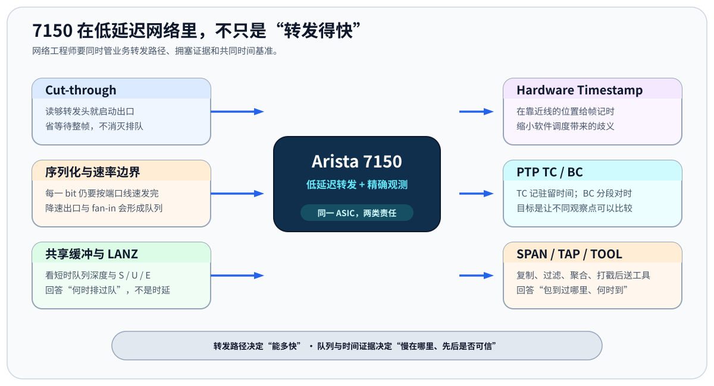

# 课程配套说明

## 当前课程顺序（2026-09-19）

学生主线为第00～08章。原第 04 章监控教学退出，原第五～十章依次前移；课堂直接读取实验脚本和交易页面中的结果。时间单位、计时区间、分位数、样本与预热集中在新第 04 章首次测量前。

| 新章 | 内容 | 现役配套目录 | 进入下一章前保留什么 |
| --- | --- | --- | --- |
| 00 | 计算机基础 | `assets/00-basics/` | 主机收发、缓存与调度的基本概念 |
| 01 | 设备与连线 | `assets/01-architecture/` | 管理通道、数据链路、已准备的工具 |
| 02 | 交易平台 | `assets/02-trading-baseline/` | `02-trading-baseline.env` 指向本次已部署平台 |
| 03 | 行情与订单报文 | `assets/03-live-traffic/` | 原行情模式已恢复，平台继续在线 |
| 04 | 软件交接与测量 | `assets/04-live-software/` | 四张测量卡的结果；已恢复的线程配置 |
| 05 | 四条收发路径 | `assets/05-kernel-bypass/` | SFC/READY、四路控制台与订单会话 |
| 06 | 交换机与授时 | `assets/06-arista-time/` | QoS 临时配置已撤回，交易仍能完成 |
| 07 | XDP | `assets/07-xdp/` | 过滤已卸载，行情完整性与下单已恢复 |
| 08 | FPGA：从代码到设备 | `assets/09-verilator/u250-course-files/`、`assets/08-arista-fpga-draft/` | U250配置文件与报告；板卡及交换机验证另按实机证据登记 |

## 运行态和历史编号

正文编号为00～08。源码、图片、历史 RUN_ID、原始输出、归档运行包名和现有 `reports/run-state/*.env` 名称保持原路径；第08章继续复用 `assets/09-verilator/` 中的U250源码，这个资产目录名不代表仍有独立第09章。第04章实验标识仍使用 `-05-deque-cv` 等既有名称。

这不是不能改名，而是改名须同步迁移状态文件的写入方、读取方与恢复入口。本轮保持这些接口，新第 04 章继续使用 `05-deque-cv.env` 等已有状态文件。

不得手写状态文件绕过前置步骤，也不得为了改章号重建历史测量记录。

## 第 03 章

第 03 章保持三项实验和两张报文解码树。章末从线上报文转向“发送前的线程交接”，不再插入独立监控安装或200笔订单基线。

## 第 04 章

四张执行卡直接读取第 02 章应用运行态，无监控服务或看板安装前置。课堂先讲 ns/μs/ms，明确入队前、发送前、最终回报后三个记录点，再讲 P50/P99 和固定预热；随后按原脚本执行队列、等待方式和 CPU 位置的对照实验。

每轮 MANUAL 400 个正式样本，P50/P99 分别取排序后第200/396个；AUTO 对照按自己的样本数统计。CSV 保留 precondition、warmup、measured，摘要只使用 measured。每个候选重复八轮，先通过样本与环境有效性检查，再讨论快慢。

现役四张 shell 的业务动作、采样参数和恢复逻辑保持，仅配套路径随目录搬移；其历史有效/无效批次仍按原记录判断。

## 第 05 章

v13 包封存三种 Trader、F-Stack、DPDK、TCPDirect 和运行库；课堂不会现场联网编译这些客户端。独立的 source、build-inputs 与 provenance 归档把源码、构建输入、命令和实际 ELF 连起来。按当前 Git 恢复合同，这四项加上第 02 章准备 A 的 Onload 源码共 5 个固定文件都进入精确白名单；管理机即使恢复，也能从私有 Git checkout 后先验 5/5 SHA，再直接分发运行包。第 02 章准备 A 按需为当前 Guest 内核编译 Onload 模块，第 05 章准备 A 只读核验，这与应用运行包是两件事。

目录卡 · 源码、编译记录、ELF 和部署路径 平时改 `apps/`；重建时读 source / build-inputs / provenance；上课只验签并分发 runtime。

| 阶段 | 当前项目中的固定位置 | 它保存什么、什么时候使用 |
| --- | --- | --- |
| 日常开发源码 | `apps/flle-trading-lab/Makefile` 与 `apps/flle-trading-lab/src/` | Git 跟踪的 C/C++ 真源；需要改业务或 Transport 时改这里 |
| 封存源码 | `artifacts/blobs/x2522/ch05-four-path/v13/flle-ch05-four-path-v13-source.tgz` | 本次构建对应的不可变源码快照；用于审计“当时到底编了什么” |
| 固定构建输入 | `artifacts/blobs/x2522/ch05-four-path/v5/flle-ch05-four-path-v5-build-inputs-x86_64-jammy.tgz` | 实际消费的 TCPDirect / F-Stack 头文件与静态库；需要复现应用 ELF 时使用 |
| 编译说明书 | `artifacts/blobs/x2522/ch05-four-path/v13/BUILD-PROVENANCE.json` | Ubuntu、编译器、flags、命令、输入 SHA 与 8 个输出 ELF SHA 的对应关系 |
| 编译后运行包 | `artifacts/blobs/x2522/ch05-four-path/v13/flle-ch05-four-path-v13-x86_64-jammy-runtime.tgz` | 课堂真正复制的固定包；含 `bin/`、F-Stack 配置、运行库、工具与内部 manifest |
| 部署后目录 | `.1/.2:/var/tmp/flle-trading-lab-&lt;RUN_ID&gt;/transport-runtime/flle-ch05-four-path/` | controller 验 SHA 后解包；`.1` 从 `bin/` 启动 Exchange，`.2` 从同一 `bin/` 启动 Trader |

<strong>为什么 DPDK 更底层，单笔 TCP 延迟却不一定更低？</strong>
<strong>已确认：DPDK 确实使用了 X2522。</strong>本轮已取证 VFIO / IOMMU type 1、<code>net_sfc_efx</code> PMD、ULL firmware 与端口 RX/TX 增长，没有落回普通虚拟网卡。

<strong>当前路径：<code>OUCH → F-Stack TCP → DPDK PMD → X2522</code>。</strong>测的不是“裸 DPDK 发一个以太网帧”。DPDK 提供高速包处理底座，不提供完整 TCP；为保持与前三路相同的 SoupBinTCP/OUCH 业务，本实现必须叠加 F-Stack 的 TCP、<code>ff_*</code> 接口和 reactor。而 Onload 与 TCPDirect 本来就是针对 Solarflare/X2522 优化的低延迟 TCP 路径，并有 CTPIO / VI 活路径收据。

<strong>边界：二层或 UDP 可能更短，但已不是同一 TCP 业务。</strong>减少栈层次后本机处理时间可能更低，可靠传输、顺序、重传、会话与 SoupBinTCP 登录语义也随之改变，不能与本表混排；若自行实现同等 TCP 语义并做 run-to-completion 优化，需要另开实验重新测量。本 RUN 只能说明当前 F-Stack TCP 实现相对 Onload / TCPDirect 慢约数微秒，不代表 DPDK 的性能上限；现有计时没有把 F-Stack、PMD 和 NIC 分段，不能把差值唯一归给某一层。

### v12 历史证据封存与复现边界

| 对象 | 章末状态 |
|---|---|
| `.2` X2522 | PCI owner 为 `sfc`；`ens64np1` 与 `20.1.1.2/24` 在；SFC 控制台按合同保留 128×2 MiB 大页 |
| `.1` X2522 | 保持 `sfc` 与 `20.1.1.1/24`；四路在线测量的 RSS / IRQ 合同继续由当前 RUN 持有 |
| 四路进程 | Exchange、Socket、Onload、TCPDirect、Gateway 与控制器在线；DPDK Trader 未启动并显示 WAITING |
| 网页交接 | `http://10.1.1.101:8088/` 为 HTTP 200；可继续前三路下单，也可重新切换 DPDK |
| 固定产物 | v12 source=`4e79723b…6903e`、provenance=`796c83ef…37b1`、runtime=`163618cc…c9f3`；build-inputs 继承 v5 `6caa8e25…f451` |
| 当时状态完整证据 | `reports/course-runs/20260903T004905Z-06-four-path-orders/`；准备 D、四张单笔、Williams 比较、GUI 交接收据及各层 SHA 齐全，目录受 gitignore 保护 |
| 正式发布复现基线 | DEC-191 的 `20260902T020809Z-06-four-path-orders` 与 `20260902T021948Z-06-four-path-orders`；两份都闭合 16 格、17,600 笔和首次现场交还。旧 RUN 未同时固定 Exchange RSS/IRQ 与 irqbalance，只作问题定位历史 |

这份 RUN 是已经完成准备的 current-state 实机验收；它不冒充“四机 clean snapshot 从准备 A 到恢复四路控制台一次顺刷”。发布前最后一道门仍是从课程快照按绿卡全链执行。

第 06 章可以直接从这个 `SFC/READY/sfc` 现场继续。若教师要完全关机、做快照或重刷前序章节，再单独使用控制器的全停机动作；它不是本章面向学员的默认收尾。

## 第 06 章

### 三项主实验共用一套在线交易基线

第 02 章已经部署完整平台，第 05 章已切回 SFC 比较配置。本章沿用第 02 章的 `RUN_ID` 和现有 Socket 长连接、8088 页面，在实验前、中、后硬验 `SFC / READY / sfc`，让交易全程在线。

| 主实验 | 在线业务怎样参与 | 为了看清现象额外加什么 | 本章主证据 |
| --- | --- | --- | --- |
| 实验一：QoS | 两档各下 120 笔真实 SoupBinTCP/OUCH Socket 订单，全部成交；每档 60 组 `SELL→BUY`，净持仓不变 | Et11+Et12 的受控 MoldUDP64/ITCH 负载争用订单所走的 Et1 出口 | DSCP、TC、Q1/Q5、LANZ 与订单 p99 同窗对账 |
| 实验二：LANZ 可视化 | 交易 GUI 和当前交易 RUN 保持在线；实验一已经证明真实订单与 Et1 队列事件能同窗出现 | 双入口 MoldUDP64/ITCH 受控负载稳定跨过 LANZ 阈值，并把 S/E 推送到 `.101` 的 8088 页面 | 10k 无事件、25k 有事件，EOS 本地统计与 streaming 接收窗口相互印证 |
| 实验三：PTP 时间 | Exchange 持续播放真实 UDP 行情，Trader 持续接收；不另发业务探针 | 7150 临时提供 PTP 时间，Et1 入向副本在 Et11 盖戳 | `.2` 进入 `SLAVE`，真实行情 `15505/15505` 配对并得到 p50/p99 |

三条纪律贯穿三项实验：

- **业务是真的，拥塞是造的。** 订单太小，堵不住 10G 出口；QoS / LANZ 用课程生成、结构合法的 MoldUDP64/ITCH 负载制造可重复的拥塞，负载发往隔离测试 MAC，不进 Trader。
- **交换机只写 running-config。** 退出先停负载，再撤销临时 QoS、LANZ、PTP、镜像和测试 MAC；startup-config 从不保存。
- **PTP 报文只负责对表。** 实验三被测的仍是真实历史 ITCH 行情。

### 补充速查

先用一个比喻建立整章的直觉。把交换机想成快递分拨站：

| 本章概念 | 分拨站里对应什么 |
| --- | --- |
| cut-through | 扫到面单就启动下一条传送带，不等整件货物卸完 |
| serialization（序列化） | 货物再急，也得按闸口宽度一点点过，快不了 |
| 出口队列 / LANZ | 出口只有一条道，排队时门口的感应器把队伍长度记下来 |
| PTP | 给各站的秒表统一对表，事后才能拼出完整时间线 |
| SPAN / TAP（流量复制） | 不拦原车，另派一辆取证车沿途拍照 |

仅供展示 下表是本章高频缩写的速查，读到正文时不必回头查资料；每一项在对应小节还会再展开一次。

| 缩写 | 全称 | 一句话解释 |
| --- | --- | --- |
| ASIC | Application-Specific Integrated Circuit | 交换机里专门做转发的芯片，转发决定由它做，不经过 CPU |
| FM6000 | Fulcrum / Intel 交换芯片型号 | 本课这台 7150 里面那颗做转发的芯片 |
| FDB | Forwarding Database | MAC 地址转发表，决定目的 MAC 该从哪个口出去 |
| FCS | Frame Check Sequence | 以太帧末尾的校验字段，帧收完才能验 |
| LANZ | Latency Analyzer | Arista 的出口队列观测功能，队列变长时记一条事件 |
| PHC | PTP Hardware Clock | 网卡上那只独立的硬件钟，`/dev/ptp0` 就是它 |
| SPAN | Switched Port Analyzer | 交换机把某个口的流量复制一份送到观测口 |
| TAP | Test Access Point | 旁路复制点；可以是无源光 TAP，也可以接到专用 TAP aggregator 的输入口 |
| E-Series | Optical Transceivers | Arista 的光模块，插在交换机口或网卡口上；不是交换机 |
| p50 / p99 | 中位数 / 99 分位数 | 一批时延样本的中间值，以及约 99% 样本不超过的阈值 |

关键图 整章只讲一个故事，分三幕：数据怎么走、时间怎么比、慢在哪一段。

| 幕 | 这一幕的角度 | 正文走到哪 | 现场 |
| --- | --- | --- | --- |
| 第一幕 | 慢在转发，还是慢在排队？ | 运行 ① → 推演 A → 推演 B → 实验一 QoS → 实验二 LANZ；盘纤 / L1 是旁支 | 在线真实订单与 LANZ 可视化 |
| 第二幕 | 两只钟怎样先对上表？ | 原理：NTP 与 PTP | 看懂对时关系 |
| 第三幕 | 从交换机入口到网卡花了多久？ | 实验三：入口戳 → 网卡戳 → 相减 | 在线真实行情 |

三幕串故事，后文用 4 个内容组定位；每张导航卡同时标出全章和组内位置。

关键图 这张地图把 7150 的能力分成两半：左侧是业务流量真正要走的那条路，右侧是为了留下证据而额外加的观测手段。

贯穿全章的判断是：**cut-through 缩短固定等待，调度决定谁先走，LANZ / 时间戳 / PTP 负责留下证据。** 先辨明职责，再判断它们如何改变延迟。

| 能力 | 在低延迟网络里解决什么 | 代价与本章边界 |
| --- | --- | --- |
| cut-through | 减少"等整帧收完"的固定等待 | 仍受线速、速率转换与出口队列约束 |
| strict priority / WRR（Weighted Round Robin，加权轮转） | 决定多个队列谁先出、各占多少份额 | 本章用真实 Socket 订单验证 DSCP→TC→队列命中；只改 running-config，结束即回滚 |
| multicast / mirror replication（组播 / 镜像复制） | 一份行情扇出给多个接收者，或复制给观测工具 | 多出口和工具口都要单独做容量预算；章末展开 SPAN / TAP / TOOL |
| LANZ / 硬件时间戳 / PTP | 分别记录队列长度、帧到达时刻和时钟之间的关系 | 它们让问题变得可观察、可比较，但不会缩短业务转发路径 |

### 历史证据范围

证据边界 正文数字来自 2026-09-03：QoS `095143Z`、LANZ `100334Z`、PTP `085652Z`，共用第 05 章 `20260903T061746Z`在线基线。2026-09-04 又按正文连跑五个入口并全部通过（`091422Z / 091432Z / 091617Z / 091728Z / 091852Z`）。PTP 使用 7150 软件戳本地 Master，因此当前绝对值只用于方法验证，不对标数据手册 `350 ns` 或 UTC 合规精度。

## 第 08 章

现役正文是 [FPGA：从代码到设备](08-fpga-from-code-to-device.md)。

第八章使用Windows Vivado GUI完成安装许可、OpenNIC U250工程接入、模块仿真、综合、实现和.bit生成，再讲板卡连接、验收与交换机迁移。现有截图证明离线构建完成；硬件管理器尚未连接目标，实卡编程和收发仍待验证。

## 第 07～08 章

两章沿用第03章的ITCH字段和“一次授权只丢一包”的任务。第07章在主机XDP入口实测；第08章通过电路仿真与U250工程构建理解硬件实现，实卡部分按设备就绪条件继续。

## 快照恢复后的顺刷

仅 `.111` 管理机保留仓库与课程制品，`.1/.2/.11/.101` 的当前状态不能作为快照后的前置条件。先核对 SSH 身份，再从第 01 章准备工具与线路、第 02 章部署平台、第 03 章认包，随后直接进入第 04 章的软件测量。

状态链仍以第 02 章为应用身份的唯一生成者。第一、三章不另造应用指针；第 04 章四张测量卡依次写出本章测量结果，后续步骤读取脚本保存的文件。失败时查当前 RUN，不借用历史状态继续。

本次目录与教学顺序调整只做本地检查。历史实跑保存在 [2026-09-08 复刷报告](refs/FLLE_Snapshot_Replay_And_Polish_2026-09-08.md)，其中章号采用当时编号。

## 独立目录迁移检查

固定课堂根目录为 `/qyt-fll`。配套资产核查与范围见[迁移核查记录](refs/MIGRATION-2026-09-19.md)。`reports/run-state/` 是搬来的历史指针；应从第 01、02 章核对环境和部署状态，不把复制来的 RUN 当作本次授课已执行。当前离线工具清单包含七组，不再准备 P4/BMv2。FPGA 仿真、整板时序和实卡验收是不同的验证级别；保留的[时序诊断](refs/evidence/ch09-u250-routed-diagnosis-20260919/README.md)不能省略。
