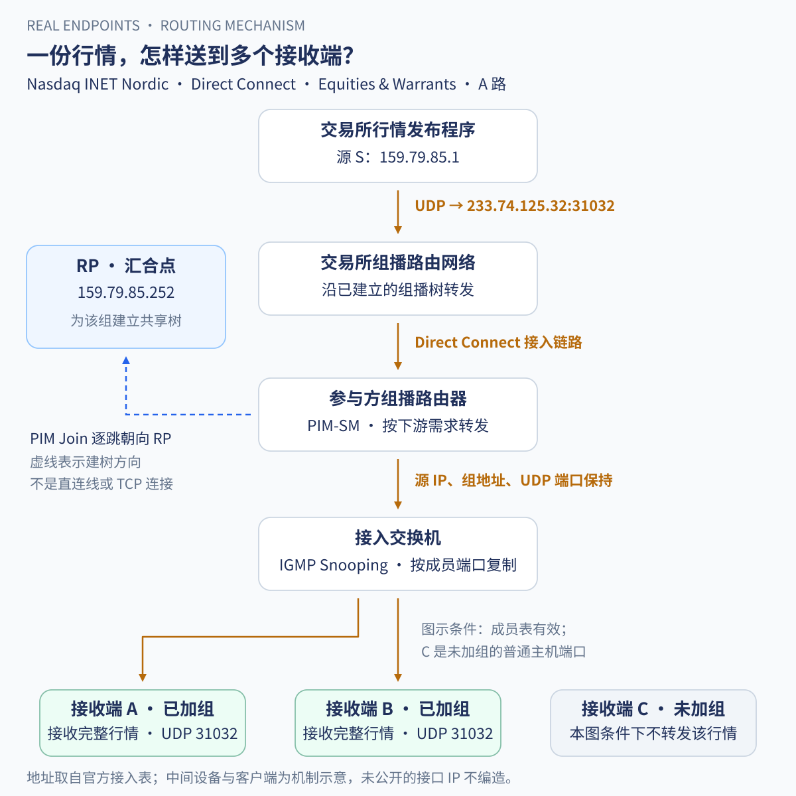

# Nasdaq 真实组播地址与传播过程

本资料承接[第 02 章](../../02-host-native-trading-system-baseline.md#nasdaq-multicast)，供课后查阅。正文实验只需完成加组、成员与收包检查。

接收真实行情前，参与方先拿到交易所或接入服务商发布的连接参数：**哪台机器发送、发往哪个组、程序监听哪个 UDP 端口、从哪条接入线路接收**。端口按行情服务或频道分配，接收端采用普通 Socket、Onload 或其他技术，并不要求交易所为这些技术分别换一个目的端口。

本课保留下面案例的 `233.74.125.32:31032` 作为 A 路，另设 `233.74.125.33:31033` 作为课程 B 路；后者不是下面 Nasdaq 接入表中的 B 路地址。组播地址不是某一台接收机的单播 IP。标准 IPv4 特定源组播（SSM）地址段是 `232.0.0.0/8`；`239.0.0.0/8` 是管理域范围组播。这是网络服务的地址划分，不是主机源过滤接口的适用范围。[RFC 2365](https://www.rfc-editor.org/rfc/rfc2365.html)、[RFC 4607](https://www.rfc-editor.org/rfc/rfc4607.html)

本课在 A、B 两组 `233.74.125.32/.33` 上调用 `IP_ADD_SOURCE_MEMBERSHIP`，为每个接收 Socket 指定源 `20.1.1.1`，即 INCLUDE 该源。Linux 的这个源过滤接口不要求组地址属于 `232/8`；使用它也不表示本课部署了 SSM 路由。[Linux 加组接口](https://man7.org/linux/man-pages/man2/IP_ADD_SOURCE_MEMBERSHIP.2const.html)、[RFC 3376 §2～3：Socket 与接口接收状态](https://www.rfc-editor.org/rfc/rfc3376.html#section-2)

**主机的接收条件与线上 IGMP 版本要分开看。** IGMPv3 可报告源列表；遇到 IGMPv2 查询器时，主机按兼容规则发送 v2 组报告，Linux 仍按 Socket 的源列表决定是否交付报文。本课已有查询器回执是 v2，当前配置没有强制改成 v3，因此不能把新的加组调用直接写成“现场已经发出 v3 报告”或“交换机已按源剪枝”。①A 查看主机源记录，①B 仍核对两组 Dynamic / Et2；现场版本以查询和抓到的报告为准。[RFC 3376 §7.2.1](https://www.rfc-editor.org/rfc/rfc3376.html#section-7.2.1)、[Linux 5.15 接收源检查](https://github.com/torvalds/linux/blob/v5.15/net/ipv4/igmp.c#L2484)

下面采用 **Nasdaq INET Nordic 的 Equities & Warrants、Direct Connect 接入**。这是另一市场的真实生产接入案例，用于解释网络分发；本地回放内容仍是美国市场 AAPL/NVDA 历史样例。地址来自下表所引的 **v4.0 生产接入表第 1 页**。

| 参数 | 主站 VASBY · A 路 | 备用站 STOCKHOLM SOUTH · B 路 |
| --- | --- | --- |
| 行情源 IP（S） | `159.79.85.1` | `159.79.78.145` |
| 组播目的 IP（G） | `233.74.125.32` | `233.74.125.202` |
| 行情 UDP 目的端口 | `31032` | `31202` |
| RP（Rendezvous Point，汇合点） | `159.79.85.252/32` | `159.79.85.249/32` |
| 丢包重请求服务 · UDP | `159.79.81.8:31532` | `159.79.76.8:31702` |

这些是[官方生产接入表](https://www.nasdaq.com/docs/2025/09/09/Connectivity-Guideline-INET-PROD-20250909-v4.0.pdf)中的真实地址。表中 RP 对应 Direct Connect / NODE 的 PIM-SM 接入条件；使用 Extranet 服务商时，应按服务商交付的路由参数配置。公开地址不等于可从普通互联网直接订阅，参与方需要已开通的行情服务与接入线路。

**A 路的一份行情报文就是：源 `159.79.85.1` → 目的 `233.74.125.32`，UDP 目的端口 `31032`。** 源 UDP 端口未在该表公布，不补造；组地址代表接收者集合，不作为客户端自己的网卡 IP。参与方机器仍使用自己接收接口的单播 IP，再由程序加入这个组。

### 跨多个设备时：先建立组播树，再沿树分发

**IGMP** 负责接收主机与本地组播路由器之间的成员报告；**PIM-SM**（Protocol Independent Multicast – Sparse Mode，协议无关组播稀疏模式）负责路由器之间按接收需求建立分发树。**RP** 是该组共享树的汇合点，帮助接收方找到发送方；它的地址与行情源地址各有职责。[PIM-SM 标准 RFC 7761](https://www.rfc-editor.org/rfc/rfc7761.html)

关键图 · 真实端点与机制示意 橙线表示 A 路行情向接收端传播；蓝色虚线表示路由器朝 RP 建树。源、组、端口与 RP 来自官方接入表，中间设备和客户端为机制示意，未公开接口不编造 IP。

按接收端开始订阅的顺序理解：

1. **参与方程序加入组。** 程序绑定行情 UDP 端口，并通过接收接口加入 `233.74.125.32`；主机用 IGMP 报告成员关系。Nasdaq 的[组播接入说明](https://www.nasdaq.com/docs/inet_itch_nls_multicast_1.pdf)第 7～8 页展示了 `IP_ADD_MEMBERSHIP`、IGMP 报告与查询的关系；该说明为历史机制资料，地址以本节 v4.0 接入表为准。
2. **参与方路由器向上游建立分支。** 在此 PIM-SM 接入方式下，路由器使用 `G → RP` 映射，逐跳向 RP 的方向发送 Join，形成 `(*,G)` 共享树分支。前提是沿途存在到 RP 与行情源的路由、PIM 邻居关系及允许该行情的转发配置；加入本地主机组本身不会自动完成这些配置。
3. **源端与接收分支接通。** 标准 PIM-SM 中，源侧路由器向 RP 注册源，接收分支接入后，行情按树上的出接口列表复制。路由器可随后建立朝向源的 `(S,G)` 最短路径树，因此 RP 不一定是每份行情永久经过的中转站。`(S,G)` 状态也不等于接收应用已经采用 SSM 订阅。[RFC 7761 §3](https://www.rfc-editor.org/rfc/rfc7761.html#section-3)
4. **行情经过路由器和接入交换机抵达程序。** 未做地址转换时，源 IP、组播目的 IP 与 UDP 端口保持，路由器递减 TTL、重新封装下一跳以太网帧。接入交换机根据有效成员表，把该组行情复制到有接收者的主机端口。两个接收者都获得完整消息流，而不是各分到一半。

图中的路径是依据公开接入参数和协议工作方式还原的角色关系，**不是 Nasdaq 内网的逐跳实测拓扑**。实际的中间路由器数量、接口 IP 与客户主机地址没有公开；本地 `.1 → Arista → .2` 在同一 VLAN 中，只复现其中的二层交付与应用接收。

本课的本地操作见准备 C 和运行 ①A～①C：只使用一台 Arista 交换机，配置 IGMP、让客户端加组、核对成员与实际收包。此处的 PIM 和 RP 用来理解生产接入，不在本地配置。
