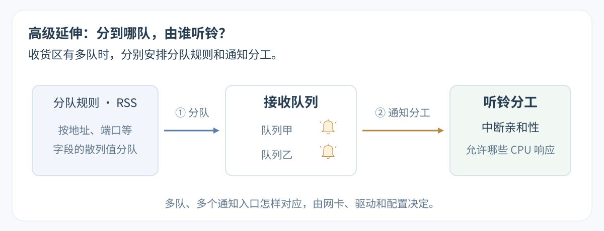
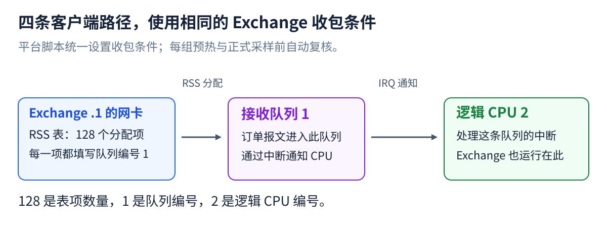

# 第 05 章：代码、配图与实验记录

### 2026-09-16 · 准备 B 更新为快照恢复后的用户实测

正文按用户后续反馈保留第 2～7 部分的小标题、结果和解释，至“可以进入运行 ① 下单”为止，取自原件连续节选；省略阶段日志、耗时与归档路径，不再压成六行裸字段。来源：`reports/course-runs/20260916T094235Z-02-trading-platform/profile-switches/20260916T095938.194980247Z/raw/result.txt`。同目录八项 SHA 核验通过，`before.txt` 与 `after.txt` 摘要一致，默认订单 DSCP 为 0。此证据确认用户已成功切到 TRANSPORT，不能替代后续真单、正式比较或第六章实验结果。

### 2026-09-16 · 第五、六章顺稿与第四章快照接续

课堂接续统一使用第二章原上线命令（不加参数）：恢复第四章末快照后、尚未执行准备 B 时，在 `.111` 重跑 `01-restore-trading-lab.sh`，已有 A/B 平台核验后补齐程序，再进入第五章准备 A/B。`--prepare-capabilities` 继续保留为维护入口，不在课程主线。正文修正部署所在章节，区分准备 B 停止客户端行情处理与正式采样暂停 Exchange 回放；原码、四路图、正式比较数字保持。

准备 B 运行时显示七个阶段、各阶段日志位置及完成耗时；完整结果仍写入 `raw/result.txt`。第二阶段只核对第二章已准备的客户端，不再分发安装。

### 2026-09-16 · 从第四章快照接续 Socket／Onload 打标更新

当前准备 A 校验 v13 与 `posix-qos-v1` 两份包；第二章上线入口调用 `prepare-posix-qos.sh` 预置客户端与控制工作区。旧第四章快照可用上线入口的 `--prepare-capabilities` 补齐，保持交易进程与记录。准备 B 只调用 `--check`，随后切换测试配置。Exchange、网页和原 v13 文件不改。重复执行核对同一更新包；旧客户端映像不匹配时重新启动测试客户端。更新包随 Git 精确白名单保存，课堂不下载、不编译。

`posix-qos.enabled` 在第二章软件准备时写入。无该标记时控制器继续选择原 v13；有标记时必须通过固定 manifest、文件与 ELF 摘要核验，缺包或损坏不会退回旧程序冒充通过。原生收据和独立分析器同时识别新路径，并要求 DSCP 0；标记非零时客户端拒绝正式测量订单。

Socket／Onload 的 `trader.cpp`、`posix_order_transport.cpp`、`order_transport.hpp` 阅读副本取自更新包，其余源码仍来自 v13；`CODE-MAP.json` 分别登记。正文旧性能表及单笔数字为更新前实测，不作为本次新客户端的性能验证。

本轮只在 `.111` 编译和本机回环测试，未部署现场 VM，也未执行 Arista/TRex 实验。目标 X2522 上的 Onload 打标与从快照顺刷仍待用户本轮输出确认。

## 现役课堂入口（2026-09-16）

正文为两项准备、四路订单、统一比较、恢复，共八步。第二章安装和 IOMMU 操作不重复；旧 `01c-verify-runtime.sh` / `02c-verify-iommu.sh` 保留为按需诊断，不在课堂导航中。文件名保持，旧准备 C/D 在本版改称 A/B。

| 正文步骤 | 入口 |
|---|---|
| 准备 A | `02-four-path-preflight.sh` |
| 准备 B | `03-four-path-lab-ready.sh` |
| 运行 ① | `04-socket-real-order.sh` |
| 运行 ② | `05-onload-real-order.sh` |
| 运行 ③ | `06-tcpdirect-real-order.sh` |
| 运行 ④ | `07-dpdk-real-order.sh` |
| 运行 ⑤ | `08-four-path-compare.sh` |
| 实验收尾 | `09-four-path-handoff.sh` |

### 图、正文原码与完整源码

准备 A 保留 `05-source-build-deploy.svg`，放在检查命令前，说明源码、编译和部署位置；这张来源图与后面四张收发路径图承担不同任务。原图字节不变，正文不再重复其源码映射表。

正文按四路逐节说明代码核心，再展示路径图与关键原码；取消跨图编号对照表，编号只用于本节图文对应。完整源码页作为补充，不能替代正文摘录。Kernel Socket 用四个短代码块覆盖图中的五个动作：创建 Socket、connect 建连、队列取单、发送、接收。正文只保留关键调用，条件变量和完整收发循环留在源码位置卡所列文件中；与另外三路保持同一讲解粒度。全章八个 C++ 代码块；Onload 省去重复 Socket 原码，改为展示普通/Onload 两种启动前缀，并解释 LD_PRELOAD、latency 配置及本课的客户端选择。启动示意按 apps/flle-trading-lab/scripts/transport_labctl.sh 的两个启动函数整理，正文标明仅展示前缀及参数省略。原码说明卡统一用深蓝色粗体写明“摘自 文件名”；跨文件片段按顺序列全来源，不用“同一源文件”代称。省略处显式标记，均逐行核对封存源码。四图的代码框统一加粗，并保持图标、标题与代码框之间的留白。

[完整源码阅读页](code-reading.html)与四张路径图使用 K / O / Z / D 编号。七份完整 C++ 文件取自 `artifacts/blobs/x2522/ch05-four-path/v13/flle-ch05-four-path-v13-source.tgz`，对应本章已部署测试程序；不把当前工作树中的普通 Trader 当成封存二进制的源码。当前控制器的两个完整启动函数单独展示，说明 Onload 如何加载同一个程序。O4 属于外部 Onload 库机制，说明在阅读页中，不伪造成本项目函数。

维护者在仓库根目录运行 `python3 assets/05-kernel-bypass/build-code-visuals.py`，生成四张路径 SVG、VI/CTPIO 图、PMD 收发图、HTML 阅读页、供 IDE 打开的 `source-reading/` 原码副本及 [CODE-MAP.json](CODE-MAP.json)。图中参数适度省略；源码正文逐行保留原文，行号与黄色标记置于源码外。映射文件记录源码包、各文件的 SHA 与编号行号；重复调用按所属函数定位。K4 对应 `common.hpp:133` 的阻塞接收，Z4 对应 `tcpdirect_order_transport.cpp:82` 的发送重试。HTML 只需本地浏览器，无外部脚本或网络依赖。

Kernel Socket、TCPDirect、DPDK + F-Stack 三节在解析图后、代码讲解前放「源码位置」卡：浅蓝底说明用途，白色文本框列出 `assets/05-kernel-bypass/source-reading/…` 项目根相对路径。Kernel Socket 的收发原理紧接路径图，随后再列源码位置和关键调用；正文省去 TCP_NODELAY 细节。路径无链接、无前导斜杠，直接列全名；Onload 复用 Kernel Socket 程序，取消单独源码卡及控制器函数介绍，直接讲 onload 启动命令和 profile。正文撤下源码索引和 HTML 阅读页入口，两者继续作为配套维护材料保留。`source-reading/` 内容从固定包生成，不参与运行构建。

VI/CTPIO 图位于 Onload 段：VI 是收发与事件资源，CTPIO 是发送方式；普通 Socket 代码不直接调用它们。对照 AMD 的 VI、CTPIO、启用条件和 sf-np 模式说明，不把“启用”当成每帧使用 CTPIO。最新复核把 K/O/Z 顶行改为先取单、按需建连，O1 补齐 latency 启动配置，O4 写明最长 100 ms 轮询；Onload 默认 sf-np，TCPDirect 显式指定。本课链路实测为 10Gb/s，支持 ct，但本课配置沿用 sf-np；X2522-25G 型号不能用作实际速率读数。六张改动图均按 800px 与原尺寸查看；本轮只改图文与生成资产，没有部署或重跑实验。

### CTPIO 与 PMD 的讲解边界（2026-09-16）

正文和现役图不再引入 sf-np / ef_vi；CTPIO 只解释 CPU 推送、节省 DMA 取包等待、CPU 开销、接收仍用 DMA。TCPDirect 使用 CTPIO 放在 TCPDirect 节说明。实际配置名和代码保留在配套证据，不改运行参数。

PMD 图展示驱动管理 TX/RX 描述符及完成事件，箭头表示处理顺序，不表示报文依次复制经过各框。发送/接收的数据搬运由网卡 DMA 完成；不能把 PMD 和 CTPIO 当作互斥或同层的两种技术。

DPDK 结果解读依据封存 dpdk_trader.cpp 的 maybe_start_order()：取得交接区订单、编码 OUCH 后才设置 send_ns；bridge_loop() 的交接在计时起点之前。四窗 post/fstack.log 均记录 net_sfc_efx 与 `running FW variant is ultra-low-latency`，原件 SHA 已核对。因此支持网卡和使用低延迟固件已有证据；仍未做 CTPIO 开关、协议栈配置或线程交接的单变量实验，不能给 RTT 差距指定单一原因，也不宣称 DPDK 已达最优。对照官方 DPDK 21.11 PMD 设计原则和 sfc_efx 运行配置；复核来源见 `refs/evidence/chapter05-pmd-ctpio-20260916.json`。

### 四路比较改为一张表（2026-09-16）

format-comparison-report.py 每种路径只打印一行，依次列发送前 P50/P99、订单 RTT P50/P95/P99、整体 P50/P99；三个计时段的七个统计值全部保留。标题突出整体，表后按“先看整体、再看 RTT、最后查发送前”解释。使用终端显示列宽对齐中文标题，现役 08-four-path-compare.sh 已调用此格式器，无需更换入口；采样、统计、路径与总账核验均沿用。

首次合并表格时，仅用当时已保存的 balanced-analysis/summary.json 验证并重排输出，未发单。该版文件 SHA-256 为 bf9db0b44bbfe9b61bd3e09dbdf2a3dbd3a73dd30719d38eeae1e445dcf72f86，及分析 README 的 SHA 均通过。正文总表和后文 RTT 数字同步采用这份完整结果：DPDK 的发送前 P50/P99=5.296/26.561 µs、RTT P50=23.926 µs、整体 P50/P99=29.325/51.185 µs，与用户贴出的新轮发送前和整体数据一致。先前章节记录中的 24.171 µs 属于上一轮，不能与新轮混排。完整数值和来源摘要见 refs/evidence/chapter05-unified-comparison-table-20260916.json；原始报告未改写。

### 用户确认的最终比较结果（2026-09-16）

用户重跑运行⑤并指定最终结果。正文总表已改为这轮的完整 28 个读数，与当前 balanced-analysis/summary.json 及用户粘贴的终端结果逐项一致；该文件 SHA-256 为 c172f24194acbb4c7ba1b7c7bcf199e58e516e7d65d12f8a990f19e7d7e14b85，分析清单两项均通过。正式样本 16,000 笔、预热 1,600 笔、路径 16/16、总账增量 17,600，原格式器核验通过。

整体 P50（Kernel / Onload / TCPDirect / DPDK）为 39.462 / 29.125 / 28.402 / 29.561 µs，整体 P99 为 63.496 / 39.808 / 38.551 / 52.076 µs。正文补充“三种用户态常态耗时接近，DPDK 尾部仍较高”的读法，并同步后文 RTT 例子。当前正文采用本条结果，接管上一条首次合表的数值；此前记录作为历史保留。核验见 refs/evidence/chapter05-final-comparison-results-20260916.json。本次为归档复核与文档更新，没有重新提交订单，未变更测量脚本。

### 运行约定与原始证据

CTPIO 说明区分 CPU 推送与 NIC DMA 读取，两者仍使用主机内存；本课 X2522 的逐帧条件来自固定 Onload 包 `src/include/ci/internal/opts_netif_def.h` 的 EF_CTPIO 定义。普通内核路径不使用 CTPIO 的依据是该包 `src/driver/linux_net/drivers/net/ethernet/sfc/ef10.c` 中 `efx_ef10_stat_mask` 的驱动注释；仅适用于本课 X2522 路径，不推广为所有网卡的内核驱动都不能使用 CTPIO。

正文的 CTPIO 使用证据来自 `reports/course-runs/20260915T115124Z-02-trading-platform/four-path-comparison/native-receipts/` 下 `1-2-openonload`、`2-1-openonload`、`3-3-openonload`、`4-4-openonload` 的 pre/post/onload-stackdump.txt。每窗 `txq: tot_pkts` 从 5 到 1106、ctpio_pkts 从 3 到 1102、pio_pkts 从 2 到 4，合计完成发送 4404，其中 CTPIO 4396（99.8183%）、PIO 8；每窗两种发送计数之和都与总发送增量相等。ctpio_dma_fallbacks 和 tx_dma_doorbells 的增量均为 0。固定 Onload 源码 `src/lib/transport/ip/netif_debug.c` 将 tot_pkts 打印为 tx_dmaq_done_seq，统计口径是发送完成计数。八个原件已按比较目录 SHA256SUMS 复核，CTPIO 增量与 `chapter05-code-paths-redesign-20260916.json` 一致。该比例仅代表四个窗口的目标 Onload 栈；不是成交订单比例，也不能据此量化单独开启 CTPIO 的延迟收益。此次只复核归档，未新采样。

入口加载 `reports/run-state/02-trading-baseline.env`。准备 A 读取固定包、对应源码、行情文件、构建环境和 RSS 条件；准备 B 复用已有 Exchange / 网页，停止普通客户端并启动 TRANSPORT 配置。`DEQUE_CV`、CPU 亲和性、TCP_NODELAY、路径资格均在测量前核对，不能删除检查以绕过失败。

单笔操作会新增一笔模拟订单；正式比较会新增 17,600 笔（1,600 预热、16,000 正式），不是幂等查询。四轮顺序由同一测量程序执行，不拆成手工重排；每格只采当前路径，其他 SFC 客户端可以待命，但 AUTO 策略进程停止。正式采样窗口暂停回放并复核，窗口外会恢复；仅停止客户端行情处理不等于网络永远没有行情。

网卡由 SFC 切至 DPDK 时，控制器核对 BDF、IOMMU、独占进程及部署身份，建立 deadman 和失败恢复；异常先交还 `sfc`，恢复未完成返回 125。准备/采样/分析失败均非零退出并保留记录，不生成成功表。准备 B 的失败会打印阶段和日志末尾。收尾入口核对 SFC/READY、前三路 ONLINE、DPDK WAITING、网页与数据链路。

本轮平台 `20260915T115124Z-02-trading-platform`。本轮操作与 stdout 汇集于 `reports/course-runs/20260916T010702Z-ch05-code-paths/`；单笔原件在平台目录 `classroom-runs/`，正式原件和独立分析在 `four-path-comparison/`。重复比较先移入 `comparison-history/`；每笔数据和路径原件均保留，SHA 清单可以独立复核。单笔正文保留该轮实测读数；正式比较总表已更新到上方“用户确认的最终比较结果”所列轮次。四路单笔节选由当前脚本的打印段读取已保存 JSON 重新格式化，按成交结果、实际路径、往返耗时分组，同时显示 ns 和 µs；订单编号、耗时原值不变。其余四步仍节选原始 stdout。旧原件不改写，也未为排版重新提交订单；采集日期和 RUN 不重复写入紫卡。

准备 B 的正文输出按用户本轮粘贴的终端内容更新，逐字保留当前脚本第 2～6 部分（切换结果、配置、客户端、队列、Exchange/网页）及注释；省去平台编号和 evidence 路径。此前五个状态值一致，变化只在展示格式，没有为更新正文重新执行切换。

DPDK 的 Exchange 收据支持 `NATIVE_AB_V1`：核对原平台部署清单、运行中可执行文件和 MULTICAST_A 启动参数；历史未带标签的 v13 记录仍按旧合同核对。新增字段仍封存在原有 `exchange-process.txt` 中，未放宽客户端、IOMMU、路径计数和成交总账门槛。

本轮八个入口均返回 0；四路单笔全部成交，正式比较 16 格路径通过，1,600 笔预热与 16,000 笔正式样本均唯一，Exchange 成交增量为 17,600。收尾为 SFC/READY/sfc、前三路 ONLINE、DPDK WAITING、网页 HTTP 200、ping 3/3。新输出同时展示 queue→send 与 queue→final 的 P50/P99，不用分位数相减推算发送前成本。

本轮状态与结果见[设计及实施记录](../../refs/FLLE_Chapter05_Code_Paths_2026-09-16.md)。下文只保留历次来源与变更历史，其中旧准备编号、旧 UNICAST 平台和“待适配”状态均不代表当前课堂。

---

# 当前入口调整：沿用第二章完整平台

### 2026-09-16 · 准备 D 退出 1 已修复并实跑

控制器现在按部署清单复用第二章 native A/B Exchange；有旧 RSS 收据但已经恢复基线时，先核验、归档再应用。失败输出包含阶段与日志，回滚保留切换前已核验的 Exchange/网页。两份控制脚本已同步 `.2`；现役 RUN `20260915T115124Z-02-trading-platform` 恢复后，原准备 D 返回 0，前后身份/摘要一致，前三路 ONLINE，DPDK WAITING。

本次只验证准备 D，未下单或测量。DPDK native receipt 与正式分析器仍有旧 Exchange 路径/UNICAST 限制，进入对应操作前需适配。下方同日“操作目的”条目保留当时说明状态，本条接管启动兼容修复状态。[核验](../../refs/evidence/chapter05-ready-repair-20260916.json)

### 2026-09-16 · 准备 D 补充操作目的

正文在准备 D 命令前说明：本章停止 AUTO 进程，测试单由网页或测量脚本触发；这与第 04 章保留 AUTO 陪跑不同。`start_sfc_clients` 使用 `--role MANUAL --market-receiver 0 --order-queue DEQUE_CV --lock-order-queue 1 --order-cpu 2 --management-cpu 3`，`sfc` 分支停止普通行情接收器，目的在于减少客户端行情解析、盘口更新和调度干扰。

不能将“关闭客户端行情接收”写成“关闭网络行情”：当前 `start_exchange` 仍以 `--market-mode UNICAST --replay-speed 1` 运行旧包程序，没有关闭行情发送。本次只改说明；前轮登记的 A/B 新版 Exchange 与 TRANSPORT 切换适配仍未实施，未运行准备 D 或修改任何脚本、程序、图件及历史输出。[核验](../../refs/evidence/chapter05-test-client-purpose-20260916.json)

### 2026-09-12 · 打印名称与正文一致

继续处理用户提出的八处细节：准备D/运行②/收尾的实际打印名称统一为 Kernel Socket 与 Onload；用原历史值执行打印代码生成文档展示，未发单或切换。删除 POSIX 摘录中只隔空行的假省略；两个计时窗口升为独立公共说明；导航前导四部分名与表格一致；明确正式表来自2026-09-12采样并由format-comparison-report.py重新生成；收尾统一称恢复网页控制台；理解题增加到八题，恢复排名边界题；三份辅助C程序各占一行路径。 改名限于显示文本；OPENONLOAD、POSIX_SOCKET 等程序标识保持不变。 [核验记录](../../refs/evidence/chapter05-review-final-details-20260912.json)

### 2026-09-12 · 整章复审：源码原样、输出说明由脚本生成

按用户整章评估，删除重复 Mermaid 总导航与海关比喻表，保留 10 行任务表和逐节导航卡；去掉范畴、重复青色判断卡及章尾恢复/边界复述。统一正文路径名称和前置条件/测试单元等用词，解释 AUTO/MANUAL 与 no-IOMMU 的 N，ZF 详细定义移到运行③，补 ctpio=3 的失败行为。三处 C++ 节选保留原始 if/check/返回值赋值，源码入口及对应 engine 放到紫卡，所有紫卡含“仅供展示”。配套资产以项目根目录为基准列出准确路径，并改写维护用语。比较表实际格式化脚本补 1 µs=1000 ns、测试单元和仅展示 queue→final P50 的说明；本轮从对应历史归档重新生成展示，原数值保持。 `format-comparison-report.py` 仅整理已校验结果，不改变统计方法。单笔脚本与运行接口不变；历史原始文件未修改。 [核验记录](../../refs/evidence/chapter05-full-review-20260912.json)

### 2026-09-12 · 运行 ①～⑤及收尾直接输出注释

运行 ①～⑤与实验收尾的实际脚本统一打印分组注释，正文直接采用本轮完整 stdout，删除后置字段表、判断卡及重复性能表。四路单笔、16 格正式比较、SFC 收尾全部实跑通过；正式样本 16000 笔，含预热提交 17600 笔且总账闭合。最终 SFC/READY/sfc、前三路 ONLINE、DPDK WAITING、网页 HTTP 200、ping 3/3。 `08-four-path-compare.sh` 在原分析器和 SHA 校验通过后调用 `format-comparison-report.py`，课堂表统一显示 µs，保留原始 ns 数据；原分析器长输出位于 raw/four-path-balanced-analysis.txt，新展示位于 raw/four-path-classroom-result.txt。订单失败、错误引擎或统计不完整时不打印成功结论。验证见 [持久核验](../../refs/evidence/chapter05-classroom-output-format-20260912.json)。

## 2026-09-12 · ch05 目录完整实跑通过

现役资产目录、文件名、v13解包根已统一ch05；迁移34个vault文件，40份运行文件（含8个编译产物）原字节保持。新平台RUN=20260912T134347Z-02-trading-platform：准备A/B/C/D、四路单笔、16格正式比较和收尾全部通过；17600唯一提交、16000正式样本、Exchange账本增量17600闭合。最终SFC/READY/sfc，Socket/Onload/TCPDirect在线、DPDK等待，网页HTTP200、数据链路ping3/3。迁移后运行包SHA=0e5d77fef1e4891b9f2220681c18162da6c605ea5619ea00e28022f23281dc00。 记录见 [持久核验](../../refs/evidence/chapter05-path-migration-live-20260912.json)。

## 2026-09-12 · 现役资产已迁至 ch05

用户明确要求把现役四路径资产从ch06迁为ch05，取代前轮“旧包名不改”的约定。已迁移vault目录和文件名、v5构建输入解包根及v13运行包解包根，同步脚本、图文、白名单、目录与SHA。v13包仅MANIFEST和provenance内容改变，40份其他文件及8个编译产物全部保持原字节；依赖包内容也相同。旧归档内部与旧RUN原始记录保留，分析器兼容两种历史路径。 完整路径为 `/qyt-fll/artifacts/blobs/x2522/ch05-four-path/v13/`，运行包名 `flle-ch05-four-path-v13-x86_64-jammy-runtime.tgz`；虚拟机解包根为 `transport-runtime/flle-ch05-four-path/`。下方旧日期说明与旧RUN记录只保留当时事实。

## 2026-09-12 · 准备 D 只换客户端

学生正文把准备 D 写成停掉普通 AUTO / MANUAL，换上已部署的测试客户端。课堂顺序图保持原结构，只改准备 D 那一行说明。`03-four-path-lab-ready.sh` 现按准备 C 的方式打印开头说明和六项注释；字段值仍沿用历史切换。本步仍不下单。

## 2026-09-12 · 学生图聚焦编译时机，源码差异留在教师记录

用户要求让图承担说明，图下尽量减少文字；同一项目客户端只突出部署时编译与课前编译，不在学生正文展开版本差异。最终图补完整运行包路径、主要源码映射、编译/部署时机、目录与Kernel/Onload共用文件；删除图下重复段落和四行功能表，仅保留包/源码链接、旧包名及沿用Exchange的短说明。准确源码差异留教师记录，未宣称两个版本源码逐字一致或全部行为相同。

## 2026-09-12 · 更正：相同项目不等于相同源码版本

核对 .101 当前平台构建目录与 v13 源码包：trader.cpp 校验值分别为 904dab6ff391a9b67e8418125691e22c5b48d0f13bf1d09bc909b2c38e19632b 与 f61b0a0fe288f20d8d7734bec45c6ab5d22d66c49e66214c3267cc4ee8ecbfed。

两者属于同一项目、使用相同主要源文件名，但源码版本不同；部署时源码已有FeedHandler抽取、行情接收断开处理、缺口诊断和交易门控等更新。posix_order_transport.cpp相同。不得把“两份构建产物”解释为完全相同源码的两次编译；本章Kernel与Onload仍共用v13包内同一个ELF。本次只读比较源码，未编译或部署。

<a id="receive-queue-irq"></a>

## 接收队列与中断：分到哪队，由谁处理

比较四条收发路径时，还要固定 Exchange 的收包分工，避免接收端的变化干扰结果。用第 00 章的收货比喻看，多队收货需要分别安排“货分到哪队”和“由谁听铃”。

<div style="background:#f8fafc;border:1px solid #cbd5e1;border-radius:12px;padding:10px;max-width:820px;margin:14px auto;">

</div>

| 图中编号 | 分工 |
| --- | --- |
| **① 分到哪队：接收队列与 RSS** | 接收队列（RX Queue）把收包工作分成多组。RSS（Receive Side Scaling，接收侧扩展）通常按源／目的地址、端口等字段的散列值选择队列，像按编号分到不同收货队 |
| **② 由谁听铃：中断亲和性** | 中断（IRQ）通知 CPU 处理收包工作；中断亲和性限定哪些 CPU 可以响应这个通知，像指定谁负责听铃 |

队列、通知入口与 CPU 的对应关系由网卡、驱动和配置决定。[Linux RSS 与中断分工](https://docs.kernel.org/networking/scaling.html)

### Exchange 收包配置（教师参考）

学生正文保留自动检查和本节解释入口，无需手动配置。平台启动时 `platform-baseline.sh::platform_start_software` 已调用 `configure_exchange_rss`；准备 D 再由 `transport_labctl.sh start` 配置或复核。运行 ⑤ 的测量脚本在每格预热前调用模式检查，即使模式未变，也复核 RSS、IRQ 和 irqbalance。此前“运行⑤才统一应用”的说明不准确，以此处为准。



| 检查识别的配置 | 含义 |
| --- | --- |
| `baseline-0-1-2-3` | 普通配置，128项按队列0、1、2、3循环；准备检查允许此状态，随后由平台脚本统一设置 |
| `measure-all-1` | 测量配置，128项都指向队列1，中断固定由逻辑CPU2处理 |

源码到程序的对应关系以 `apps/flle-trading-lab/Makefile` 为准：Kernel / Onload 使用 `trader.cpp + posix_order_transport.cpp`；TCPDirect 使用 `trader.cpp + tcpdirect_order_transport.cpp` 并链接 TCPDirect 库；DPDK 使用 `dpdk_trader.cpp` 并链接 F-Stack / DPDK。源码图现逐行标出，正文列出管理机运行包的完整绝对路径。

## 2026-09-12 · 准备 C：文件去向、编译时机与有用途的检查结果

同名文件补充核对：当前 .2 的普通 flle-trader SHA256 为 d2b59d5102ef27d313c4428c5435baa8b3e61799e7bfd3ff88cd156aa8167b2e，运行包版本为 300d8cbee53fb10e755b964c78bdb384490e92d46703cc9ed384de0cb164879a，cmp 判为 DIFFERENT。它们都是项目的 Socket 客户端，图中应称“两份构建产物”；校验值不同本身不能推出业务功能不同。第05章 Kernel 与 Onload 必须共用运行包中的那一份。

用户要求用图解释“源码在哪、编译后的程序在哪、何时编译”，并指出旧输出缺少教学用途。正文新增两张图：普通客户端在第02章首次部署时由 `.101` 的 g++-11 编译，四路径客户端则由课前运行包提供；第02章解包、第05章复用。另图说明固定 Exchange 收包条件的目的及 RSS → 队列 → IRQ/CPU 的关系，128、1、2 分别为表项数、队列编号与逻辑 CPU 编号。

实际路径由 platform-baseline.sh::platform_build_native、transport_labctl.sh::install_runtime_on_host 和 v13 BUILD-PROVENANCE.json 核对。`.111` 的源码在 apps/flle-trading-lab/src/；当前本地 build/flle-trader 是独立构建产物。`.2` 三个四路径 ELF 位于 `/var/tmp/flle-trading-lab-20260912T001617Z-02-trading-platform/transport-runtime/flle-ch06-four-path/bin/`，文件类型与SHA均和 v13 封存记录相符。该RUN来自现有平台状态，非本轮新部署；v13记录日期为09-08，其中DPDK ELF继承v12，不把三个文件都写成09-08重编译。

02-four-path-preflight.sh 现在实际打印六项 PASS 与用途，完整 archive、code-contract、preflight 输出各存独立日志；失败显示具体问题，始终保存退出码和SHA。原 mapfile 的进程替换可能吞掉底层 preflight 非零退出，现改为先直接等待命令、确认成功后再解析结果；同时拒绝缺项、重复项、FAIL状态及未知收包配置。10项本地测试使用临时目录与模拟命令，不连设备。

新脚本实跑 `20260912T130838.299593593Z-06-four-path-preflight`：六项通过、退出0，Exchange 当前为 measure-all-1、队列1/CPU2；本轮只读检查，没有编译、部署或改变收包配置。旧“对/证”和长字段输出从学生正文撤去，正文直接展示此次实际输出。[持久记录](../../refs/evidence/chapter05-preparation-clarity-20260912.json)保存原输出、校验与测试结果。两图按800/1200px整图查看，旧图不改。

RSS依据为 [Linux Scaling](https://docs.kernel.org/networking/scaling.html#rss-receive-side-scaling)，2026-09-12读取；本课具体128项、IRQ亲和性和两种允许状态回源控制脚本核对，不能当作所有网卡默认值。

## 2026-09-12 · 准备 A 脚本直接输出分组说明（双端实跑通过）

按用户纠正，七组标题、字段注释、VI 解释和最终继续提示现由 `01c-verify-runtime.sh` 直接打印，全部值在运行时读取。每台设备独占一段输出，两段之间打印 72 个等号作为分隔线。两端循环均成功后才打印继续准备 B 的提示；Onload 与内核模块版本新增非空及一致性检查，失败打印 NOT_READY 并非零退出。保留未知原生输出及 stderr，sfc 版本、字符设备和网卡绑定检查继续生效。

已在 .1/.2 执行，RUN_ID 为 `20260912T125806.682397991Z-06-runtime-verify`，EXIT_CODE=0，两端均为 runtime=READY。正文摘取这次日志的 .1 分组和双端结束提示，省略 .2 的同格式内容；不再用人工注释版冒充终端格式。原始运行目录受 reports 忽略规则管理，完整 stdout、run.env 和 SHA 清单同时保存在[持久核验记录](../../refs/evidence/chapter05-runtime-script-20260912.json)，无需修改忽略规则。

`python3 assets/05-kernel-bypass/test-runtime-report.py` 用临时目录和模拟 SSH/设备测试九种情况：双端成功、版本不一致、版本缺失、sfc 不一致、两类设备分别缺失、驱动绑定错误、查询命令失败及额外原生行保留。失败发生于第二端时，不得打印双端成功提示；每种结果都核对退出码和证据 SHA。测试不连接设备。

## 2026-09-12 · 准备 A 输出改为分组注释展示

按用户要求，正文将准备 A 的 .1 历史输出分成检查对象、Onload 版本、构建信息、sfc 版本、两类设备入口和结果七组。版本关系、字符设备与 VI 说明、两端 READY 继续条件及后续加速验证均写进 # 注释；删除块后的说明段与关键现象卡。紫卡标为“带注释输出”，展示中分开 loaded_sfc / expected_sfc，原始数值保持。

原始结果仍在 [运行时检查日志](../../reports/course-runs/20260907T145936.025447662Z-06-runtime-verify/raw/result.txt)，其 SHA256 为 68e9a0b294eed75e8a7455ec032de1b5d4a2aa5567b248cbee089ac328bcecda，与原清单一致。运行脚本与归档不改；本轮只是教学展示，不宣称终端原样打印这些注释。

## 2026-09-12 · 开篇比喻与驱动分组

用户指出“单子→API”混淆被传递的数据与办理入口，现改为“办事窗口→收发接口”。前三路保留 sfc / SFC 模式，第四路改绑 vfio-pci 并由 DPDK 独占；驱动绑定与 TCP 处理位置分别说明。vfio-pci 是 Linux 通用驱动，不是 DPDK 专有接口。

ZF 首现按官方源码 [zf.h](https://github.com/Xilinx-CNS/tcpdirect/blob/master/src/include/zf/zf.h) 与 [zf_stack.h](https://github.com/Xilinx-CNS/tcpdirect/blob/master/src/include/zf/zf_stack.h) 解释为 TCPDirect 接口名称及代码前缀，例示 zf_init 初始化库。2026-09-12 读取的官方材料未给出 ZF 的字母展开，不臆造全称；本地 tcpdirect_order_transport.cpp 也调用该函数。只改文字，不改图、代码或运行条件。

## 2026-09-12 · 用户评估复核：单笔与分位数

单笔入口 04～07 各提交一笔订单，没有统一预热阶段。`trader.cpp::order_loop` 在调用 `transact` 前完成 `connect_order_session`（建连与 Soup 登录），RTT 从后者内部的 send_ns 开始；不能把建连时间算进 order_rtt_ns。单笔可能受缓存和调度状态影响，但没有证据把 Onload 的 123663 ns 具体归因于其中某一项。

主表使用 `analyze_four_transport_raw.py::equal_cell_mean_summary`：每格先算分位数，再将同一路径四格对应统计量等权平均。逐笔满足 submit_to_final_ns = queue_to_send_ns + order_rtt_ns，不代表 p50 或 p99 可以相加减。

只读核对 [09-08 归档汇总](../../reports/course-runs/20260908T124624Z-02-trading-platform/four-path-comparison/balanced-analysis/summary.json) 中 `summary.*.balanced_equal_cell_mean`：

| 路径 | 两列 p50 相减（ns，不是发送前 p50） | 单独统计的发送前 p50（ns） |
| --- | --- | --- |
| Kernel Socket | 8213 | 8292 |
| OpenOnload | 8461 | 8269 |
| TCPDirect | 8357 | 8314 |
| DPDK + F-Stack | 5408 | 5342 |

DPDK 的发送前 p50 确实最小，但这是完整实现的区间统计；`dpdk_trader.cpp::bridge_loop` 经 mailbox 向轮询线程交接订单，并未单独测量这次交接的贡献。增加处理步骤不自动推出总耗时更高。本轮仅核对既有代码与归档，没有新采样。

术语补齐依据：[AMD CTPIO Modes](https://docs.amd.com/r/en-US/ug1586-onload-user/CTPIO-Modes) 的 store-and-forward / no-poison，以及 [Williams 设计论文](https://www.jstatsoft.org/article/view/v029c01) 对平衡拉丁方的说明，均于 2026-09-12 读取。`ch06-four-path/v13` 是章节前移前封存的制品名，v13 是包版本；不重命名路径或修改封存内容。图库 [现役与归档清单](../../images/course-visuals/05-diagrams/README.md#2026-09-12--现役与归档清单) 明确保留 10 张现役图和 47 张历史图，SHA 校验仍覆盖全部文件。

第二章一次安装 Onload/IOMMU 前置和全部交易程序，当前平台状态统一读取 `reports/run-state/02-trading-baseline.env`。本章准备 A/B 使用 `01c-verify-runtime.sh` 与 `02c-verify-iommu.sh` 只读核对，各自生成RUN、退出码、原始日志及SHA清单（失败也留证）；准备 D `03-four-path-lab-ready.sh` 只启用已部署的路径测试客户端，并核对 Exchange/网页进程与文件清单不变。旧 A/B 文件仅兼容委托到第二章安装入口，不再作为本章课堂卡。重复贴运行⑤时，已有报告与原生证据分别归档到comparison-history和远端native-receipts-history；新一轮单独取证，保留前次结果。

下方历史验证段保留迁移前 RUN；当前完整顺刷状态见 `../../../00.NEXT-AI-HANDOFF.md`。

# 2026-09-12 历史资产入口

当时正文按下面顺序执行；现役入口以本文顶部八步表为准：

| 正文入口 | 唯一资产 |
|---|---|
| 准备 A | `01c-verify-runtime.sh` |
| 准备 B | `02c-verify-iommu.sh` |
| 准备 C | `02-four-path-preflight.sh` + `four-path-build-contract-audit.sh` |
| 准备 D | `03-four-path-lab-ready.sh` |
| 运行 ① | `04-socket-real-order.sh` |
| 运行 ② | `05-onload-real-order.sh` |
| 运行 ③ | `06-tcpdirect-real-order.sh` |
| 运行 ④ | `07-dpdk-real-order.sh` |
| 运行 ⑤ | `08-four-path-compare.sh` |
| 实验收尾 | `09-four-path-handoff.sh` |

其余同号脚本与源码是上一版组件尺子、历史诊断或教师恢复工具，不是本章当前绿卡。它们留盘用于复核旧 RUN；不得因文件名前缀相同替换上表入口。真实课堂结果只认正文列出的资产、当前固定制品和对应 RUN 的 SHA。

迁移前历史验证：固定运行包为 v12（SHA-256=`163618ccbb99d272d1f4703822781984d754c690d23fba5503e503486e33c9f3`）；准备 A `092818Z`、去重后的准备 B `100808Z`、准备 C `100819Z` 均 exit 0且 SHA 通过，DEC-191 正式发布复现基线仍是 `020809Z/021948Z`。准备 A 只管 Onload/设备入口/地址；准备 B 只管 Guest IOMMU/VFIO；准备 C 只管 runtime、source→ELF、行情资产、Builder、RSS 和总闸。当时 live RUN 为 `20260903T004905Z-06-four-path-orders`：运行 ①～⑤、17,600 笔账本和新版交接均 exit 0，网页 HTTP 200，`SFC/READY/sfc`，Socket / Onload / TCPDirect ONLINE，DPDK WAITING；`ch06-four-path.env` 正确指向该 RUN。默认收尾不再关闭四路控制台；完全停机只供教师维护或快照前使用。

维护者静态验证使用 Python 标准库 `unittest`，不依赖 `pytest`：

```bash
python3 -m unittest discover -s apps/flle-trading-lab/tests
python3 assets/05-kernel-bypass/test-02b-guest-iommu-prep-static.py
```

## 2026-09-12 · 第五章粗扫后的阅读与来源说明

本轮只整理第 05 章图文：保留四项准备、四路单笔、统一比较和恢复；删除正文重复的第二张所有权总图，文件仍在图库中。四张路径图与全部命令、C++ 节选和历史输出保持原字节，计时 SVG 单独修正。阶段为 LOCAL DOC / SOURCE / VISUAL REVIEW，不是新实机测量，尚未逐节深审。

正文样本分别来自：准备 A 为 `20260912T125806.682397991Z-06-runtime-verify`，准备 B 为 `20260907T145936.640721886Z-06-iommu-verify`；准备 C 为 `20260912T130838.299593593Z-06-four-path-preflight`；准备 D 和四路单笔来自 `20260907T112313Z-02-trading-platform`；正式 17,600 笔与交接来自 `20260908T124624Z-02-trading-platform`。授权工具输出来自 2026-07-20。它们各自保留原日期，不合并成同一次运行。

维护细节保留如下：TRANSPORT/SFC 先停普通 AUTO/MANUAL 与共享 `flle-feed-receiver`，再拉只下单的测试客户端；SFC 就绪后重新启动接收器和只建簿、不下单的 Guardian。新 Guardian 从 session 中途接入会 FEED GAP，恢复脚本走已有 Exchange `REPLAY|RESTART`（不清模拟持仓），网页五档从开盘簿面重新跟行情。DPDK 先停消费者再停接收器。停止接收器不保证网卡没有行情单播，正式采样另行暂停回放、核对身份/序号及暂停租约。返回普通 SOFTWARE 交易配置时也会恢复接收器。

旧稿 DPDK 单笔卡完整顺刷记录为 76～78 秒，热现场定点复跑约 38 秒，均指整卡管理流程；这些数字不进入订单 RTT。旧稿 Plus 节的 Onload CTPIO 增量 4396、DMA fallback 0 属于先前机制收据，不作为 09-08 主表的新增核验。原稿可由本轮基线 Git 版本追溯。

### 计时与术语核对

`trader.cpp::transact` 在 OUCH 编码后、`send_soup` 前记录 send_ns；`dpdk_trader.cpp::maybe_start_order` 在 `queue_soup` 前记录同一边界。最终 E/J 解码后记录 completed_ns，A 不结束计时。因此 order_rtt_ns 包含封装、收发实现、网络及对端处理；不能解释为包已上链路后的纯网络时间。

新增术语依据为 [Linux VFIO 文档](https://docs.kernel.org/driver-api/vfio.html)、[DPDK 21.11 net_sfc_efx](https://doc.dpdk.org/guides-21.11/nics/sfc_efx.html)、[AMD CTPIO](https://docs.amd.com/r/en-US/ug1586-onload-user/CTPIO) 与 [CTPIO Modes](https://docs.amd.com/r/en-US/ug1586-onload-user/CTPIO-Modes)，2026-09-12 重新读取。CTPIO 全称为 Cut Through Programmed Input Output；名称不代表当前启用 cut-through 发线模式，本课 TCPDirect 源码设 sf-np，Onload latency profile 同为存储转发。此次只核对定义与既有实现，没有重新验证在线连接或硬件计数。

### 后续逐节阅读

四张路径图保持同一版式，适合并排看差别。准备 B 的隔离图仍然偏密，部分旧图的箭头沿用早期样式；本轮只核对其整体可读性和职责，没有宣称所有历史图满足最新箭头细则。后续若重画，按硬规则 §3.3.3 统一整图箭头，并避免把 VFIO/IOMMU 误读为额外 TCP 处理层。
