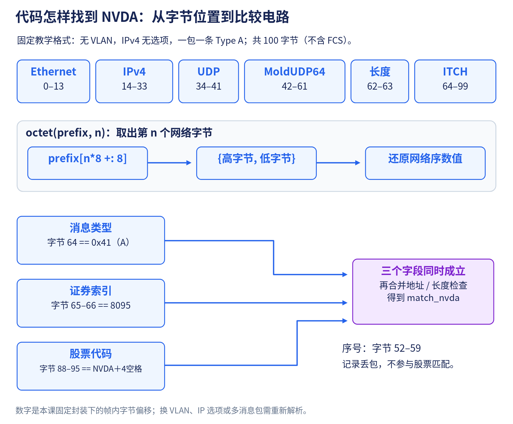
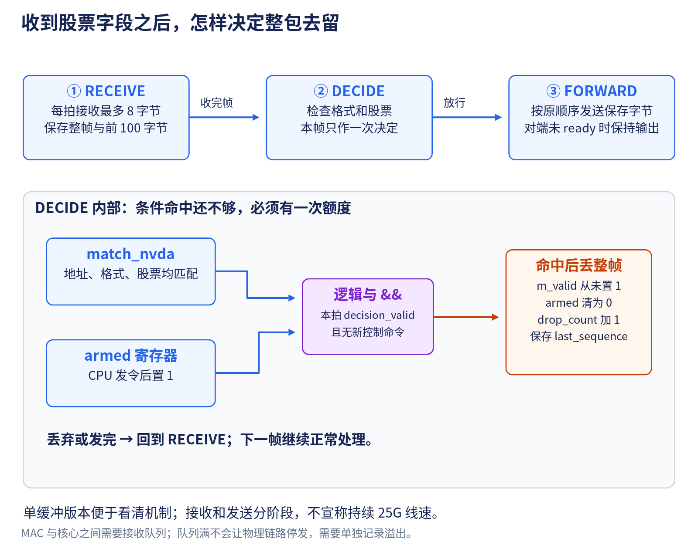
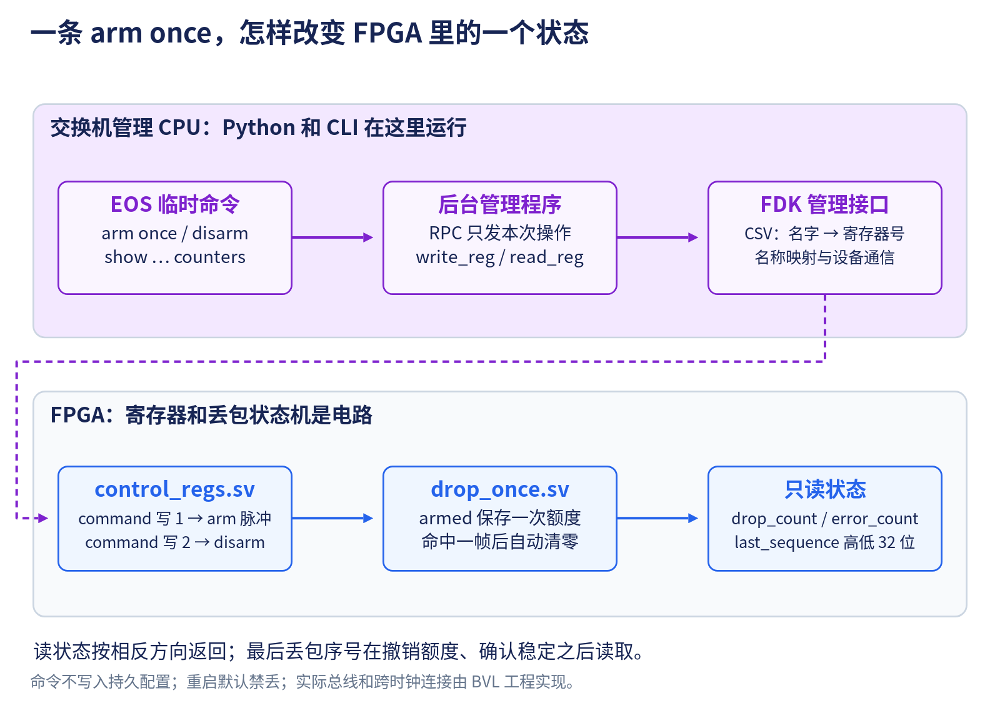

# 选读：过滤电路源码详解

本附录保留第 08 章过滤电路的完整逐段讲解，供希望继续阅读 SystemVerilog、接口时序和寄存器实现的读者选读。课程主线只保留两处关键源码示例，随后继续工具操作；阅读本附录不是运行实验的前置条件。

返回[第 08 章接入代码](../../08-fpga-from-code-to-device.md#step-3-2)。完整实现见 [字段匹配](nvda_match.sv)、[一次额度](drop_once.sv)、[帧缓存](frame_filter.sv)、[寄存器](control_regs.sv)、[管理程序](eos/README.md)。

本步开始阅读本课的 SystemVerilog 源码。这里采用 **RTL（寄存器传输级）** 的描述方式，写出数据怎样参与判断、结果怎样保存。先看字段判断与缓存电路，再说明 Python 管理程序怎样控制它们。

源码就是能用编辑器打开的文字。本课 `nvda_match.sv` 中有这样一行：

<div style="border-left:6px solid #7e22ce;background:#f3e8ff;padding:12px 16px;border-radius:8px;margin:14px 0;"><span style="display:inline-block;padding:3px 12px;border-radius:6px;background:#7e22ce;color:#fff;font-weight:800;">仅供展示 · SystemVerilog 源码摘录</span> <span style="font-weight:700;color:#581c87;">来自配套 nvda_match.sv；这里只读代码，下方继续展开完整字段判断。</span></div>

```systemverilog
assign match_nvda = transport_ok && message_ok;
```

`transport_ok` 表示网络头检查通过，`message_ok` 表示行情内容检查通过；`&&` 表示两个条件都要成立，结果写为 `match_nvda`。`assign` 描述随输入变化的逻辑关系；Vivado 据此实现逻辑与电路。Python 管理程序负责给这套电路发命令，例如“允许再丢一次”；逐包判断由配置好的电路执行。

### 找到行情字段

#### 先确定帧的布局

先写“认出目标包”的电路。核心收到的是 MAC 交付的帧，从目的 MAC 地址首字节编号，**不含前导码和帧尾校验值 FCS**；发送时由 MAC 补上 FCS。

本例限定无 VLAN、IPv4 头20字节、无分片、UDP 中一条 Type A；不匹配条件且通过接收完整性检查的帧放行。

<div style="border-left:6px solid #7e22ce;background:#f3e8ff;padding:12px 16px;border-radius:8px;margin:14px 0;"><span style="display:inline-block;padding:3px 12px;border-radius:6px;background:#7e22ce;color:#fff;font-weight:800;">关键图 · 从帧内偏移到三个比较器</span> <span style="font-weight:700;color:#581c87;">先定位字节，再按网络字节序拼数值，最后比较目标字段。</span></div>

<div style="background:#f8fafc;border:1px solid #cbd5e1;border-radius:12px;padding:10px;max-width:820px;margin:14px auto;">
<a href="../../images/course-visuals/08-arista-fpga-draft/03-fields-and-comparators.svg"></a>
</div>

| 层或字段 | 帧内位置，从 0 开始 | 本例读取什么 |
| --- | --- | --- |
| Ethernet | 0–13 | EtherType 为 `0x0800` |
| IPv4 | 14–33 | 版本/头长、UDP 协议号、源/目的地址、长度、分片标记 |
| UDP | 34–41 | 目的端口 31032、UDP 长度 66 |
| MoldUDP64 | 42–61 | 52–59 是 64 位序号；60–61 的消息数为 1 |
| 消息长度 | 62–63 | 36 字节 |
| ITCH Type A | 64–99 | 类型在 64，Locate 在 65–66，Stock 在 88–95 |

**14＋20＋8＋20＋2＋36＝100字节**；IPv4长86，UDP长66。UDP长度含8字节头，载荷为58字节，与第03章的 `UDP, length 58` 一致。Stock 在 ITCH 内偏移24，故在帧内 `64＋24＝88`。[MoldUDP64](https://nasdaqtrader.com/content/technicalsupport/specifications/dataproducts/moldudp64.pdf)、[ITCH Add Order](https://www.nasdaqtrader.com/content/technicalsupport/specifications/dataproducts/NQTVITCHspecification.pdf)

#### 用 `octet` 取一个字节

一个字节是8位。SystemVerilog 用 `logic` 声明信号，`[7:0]` 表示8位。这里 `prefix` 共800位，保存前100字节：首字节放 `[7:0]`，第二字节放 `[15:8]`。

<div style="border-left:6px solid #7e22ce;background:#f3e8ff;padding:12px 16px;border-radius:8px;margin:14px 0;"><span style="display:inline-block;padding:3px 12px;border-radius:6px;background:#7e22ce;color:#fff;font-weight:800;">仅供展示 · nvda_match.sv：取字节函数</span> <span style="font-weight:700;color:#581c87;">bytes 是前100字节，n 是所取字节的位置。</span></div>

```systemverilog
function automatic [7:0] octet(input logic [799:0] bytes, input integer n);
    octet = bytes[n*8 +: 8];
endfunction
```

`[n*8 +: 8]` 从第 `n*8` 位取8位；函数返回 `[7:0]`，`automatic` 使局部变量独立。本课 `n` 均为固定偏移，综合后连接对应位段。`{高字节, 低字节}` 拼网络序数值，如 `1f 9f → 0x1f9f → 8095`。

#### 先核对封装，再比较股票

`assign` 描述随输入变化的组合逻辑；`==` 判断相等，`&&` 要求所有条件同时成立。`16'd100` 表示16位十进制100，`16'h0800` 表示16位十六进制0800。

<div style="border-left:6px solid #7e22ce;background:#f3e8ff;padding:12px 16px;border-radius:8px;margin:14px 0;"><span style="display:inline-block;padding:3px 12px;border-radius:6px;background:#7e22ce;color:#fff;font-weight:800;">仅供展示 · nvda_match.sv：本课封装条件</span> <span style="font-weight:700;color:#581c87;">长度、地址和端口共同限定目标；分片偏移及“后续还有分片”的 MF 标志必须为零。</span></div>

```systemverilog
assign transport_ok =
    frame_bytes == 16'd100 &&
    {octet(prefix, 12), octet(prefix, 13)} == 16'h0800 &&
    octet(prefix, 14) == 8'h45 && octet(prefix, 23) == 8'd17 &&
    ({octet(prefix, 20), octet(prefix, 21)} & 16'h3fff) == 16'd0 &&
    {octet(prefix, 16), octet(prefix, 17)} == 16'd86 &&
    {octet(prefix, 26), octet(prefix, 27), octet(prefix, 28), octet(prefix, 29)} == 32'h14010101 &&
    {octet(prefix, 30), octet(prefix, 31), octet(prefix, 32), octet(prefix, 33)} == 32'he94a7d20 &&
    {octet(prefix, 36), octet(prefix, 37)} == 16'd31032 &&
    {octet(prefix, 38), octet(prefix, 39)} == 16'd66;
```

| 写法 | 在检查什么 |
| --- | --- |
| `frame_bytes == 100` | MAC 交给核心的这帧长度 |
| `0x0800`、`0x45`、`17` | IPv4、20 字节 IPv4 头、UDP |
| 分片字段与 `0x3fff` 相与后等于 0 | 无 MF 标记、分片偏移为 0；允许 DF 标记 |
| `0x14010101` / `0xe94a7d20` | `20.1.1.1` / `233.74.125.32` |
| `86`、`31032`、`66` | IPv4 长度、UDP 目的端口、UDP 长度 |

适配层把网口信号转换成核心接口，并提供接收错误标志；匹配器不检查 IP/UDP 校验和。

<div style="border-left:6px solid #7e22ce;background:#f3e8ff;padding:12px 16px;border-radius:8px;margin:14px 0;"><span style="display:inline-block;padding:3px 12px;border-radius:6px;background:#7e22ce;color:#fff;font-weight:800;">仅供展示 · nvda_match.sv：股票条件</span> <span style="font-weight:700;color:#581c87;">先确认一包一条、消息长度正确，再比较类型、索引和完整股票代码。</span></div>

```systemverilog
assign message_ok =
    {octet(prefix, 60), octet(prefix, 61)} == 16'd1 &&
    {octet(prefix, 62), octet(prefix, 63)} == 16'd36 &&
    octet(prefix, 64) == 8'h41 &&
    {octet(prefix, 65), octet(prefix, 66)} == 16'd8095 &&
    {octet(prefix, 88), octet(prefix, 89), octet(prefix, 90), octet(prefix, 91),
     octet(prefix, 92), octet(prefix, 93), octet(prefix, 94), octet(prefix, 95)} == 64'h4e56444120202020;

assign match_nvda = transport_ok && message_ok;
```

`8'h41` 是字符 `A`；`64'h4e56444120202020` 是 `NVDA` 加四空格，八字节都要比较。

比较器各自读取字段并合并结果；代码行顺序不等于硬件执行顺序，资源映射由综合确定。

<div style="border-left:6px solid #7e22ce;background:#f3e8ff;padding:12px 16px;border-radius:8px;margin:14px 0;"><span style="display:inline-block;padding:3px 12px;border-radius:6px;background:#7e22ce;color:#fff;font-weight:800;">仅供展示 · nvda_match.sv：记录对象</span> <span style="font-weight:700;color:#581c87;">序号用于核对丢了哪一包，与股票匹配分开。</span></div>

```systemverilog
assign sequence_number = {
    octet(prefix, 52), octet(prefix, 53), octet(prefix, 54), octet(prefix, 55),
    octet(prefix, 56), octet(prefix, 57), octet(prefix, 58), octet(prefix, 59)
};
```

### 控制整包去留

#### 股票字段还没到，帧头怎么办

匹配器能认出股票，但整帧怎样留下或丢掉？Stock 直到偏移95的字节才到齐；若此前已发出帧头，就不能再保证整帧未发出。本例因此**先缓存完整帧，再决定去留**，代价是增加等待。

<div style="border-left:6px solid #7e22ce;background:#f3e8ff;padding:12px 16px;border-radius:8px;margin:14px 0;"><span style="display:inline-block;padding:3px 12px;border-radius:6px;background:#7e22ce;color:#fff;font-weight:800;">关键图 · 接收、裁决和发送怎样接起来</span> <span style="font-weight:700;color:#581c87;">缓存保存数据，一次额度决定去留，出口只看 valid / ready 交付。</span></div>

<div style="background:#f8fafc;border:1px solid #cbd5e1;border-radius:12px;padding:10px;max-width:820px;margin:14px auto;">
<a href="../../images/course-visuals/08-arista-fpga-draft/04-buffer-and-drop.svg"></a>
</div>

#### 一个接口每拍带来多少数据

**一拍就是一个时钟周期。** `frame_filter.sv` 每拍最多传8字节，最早字节放在 `data[7:0]`；`s_` 是输入，`m_` 是输出。在时钟上升沿，发送方的 `valid` 和接收方的 `ready` 同时为1，才交付这一拍数据，这叫**握手**。

这组信号采用 AXI4-Stream 的基本握手方式；指定 MAC IP 的位宽、错误标志、时钟复位及流控仍须适配。[握手规范 §2.2](https://documentation-service.arm.com/static/64819f1516f0f201aa6b963c)

| 信号 | 含义 | 何时使用 |
| --- | --- | --- |
| `data[63:0]` | 这一拍的最多 8 字节 | 有效交付时存入缓存或从缓存发出 |
| `keep[7:0]` | 每一位标记对应字节是否有效 | 本课非尾拍为 `ff`；尾拍非零且从低位连续有效，100字节帧末拍为 `0f` |
| `valid` | 发送方给出了有效数据 | 与 `ready` 同时为 1 才交付 |
| `ready` | 接收方可以接下这一拍 | `valid=1`、`ready=0` 时，发送方保持 valid、data、keep、last |
| `last` | 当前拍是帧尾 | 接收端据此开始裁决，发送端据此统计完整帧 |
| `s_error` | 本课增加的接收错误标志，由适配层给出 | 记入错误丢弃，不消耗策略额度 |

<div style="border-left:6px solid #7e22ce;background:#f3e8ff;padding:12px 16px;border-radius:8px;margin:14px 0;"><span style="display:inline-block;padding:3px 12px;border-radius:6px;background:#7e22ce;color:#fff;font-weight:800;">仅供展示 · frame_filter.sv：保存整帧</span> <span style="font-weight:700;color:#581c87;">缓存容量为 256×8＝2048 字节；另留 100 字节前缀给匹配器。</span></div>

```systemverilog
localparam integer WORDS = 256; // 2048 bytes, excluding FCS.
typedef enum logic [1:0] {RECEIVE, DECIDE, FORWARD} state_t;
state_t state;
logic [63:0] data_mem [0:WORDS-1];
logic [7:0]  keep_mem [0:WORDS-1];
```

`localparam` 定义构建时常量；`enum` 列出接收、裁决、发送三个状态。`data_mem` 是256项数组，每项64位；`keep_mem` 保存每项的有效字节标记。

超过2048字节的帧收完后计入错误计数 `error_count`，不消耗策略额度；数组使用哪些芯片存储资源由综合决定。

<div style="border-left:6px solid #7e22ce;background:#f3e8ff;padding:12px 16px;border-radius:8px;margin:14px 0;"><span style="display:inline-block;padding:3px 12px;border-radius:6px;background:#7e22ce;color:#fff;font-weight:800;">仅供展示 · frame_filter.sv：接收字节</span> <span style="font-weight:700;color:#581c87;">RECEIVE 分支：握手后保存数据，前100字节同时写入 prefix。</span></div>

```systemverilog
if (write_index < WORDS) begin
    data_mem[write_index] <= s_data;
    keep_mem[write_index] <= s_keep;
    for (i = 0; i < 8; i = i + 1)
        if (write_index*8+i < 100 && s_keep[i])
            prefix[(write_index*8+i)*8 +: 8] <= s_data[i*8 +: 8];
    write_index <= write_index + 1'b1;
end else begin
    bad_frame <= 1'b1;
end
```

`write_index` 指向下一个缓存位置，握手后加1；`for` 描述同拍八条字节通道。收到 `last` 后转入 `DECIDE`，下一拍用完整前缀裁决。这里 `<=` 表示在时钟边沿保存新值。

#### 发令后只保留一次额度

`armed=1` 保存一次额度；`decision_valid` 每帧只在裁决时成立，避免同一命中反复计数。

<div style="border-left:6px solid #7e22ce;background:#f3e8ff;padding:12px 16px;border-radius:8px;margin:14px 0;"><span style="display:inline-block;padding:3px 12px;border-radius:6px;background:#7e22ce;color:#fff;font-weight:800;">仅供展示 · drop_once.sv：决定这一帧是否丢弃</span> <span style="font-weight:700;color:#581c87;">arm 是发额度，disarm 是撤销；两者须同步到核心时钟。</span></div>

```systemverilog
assign drop_frame = decision_valid && match_nvda && armed && !disarm && !arm;

always_ff @(posedge clk) begin
    if (rst) begin
        armed        <= 1'b0;
        drop_count   <= 32'd0;
        last_sequence <= 64'd0;
    end else begin
        if (disarm)
            armed <= 1'b0;
        else if (arm)
            armed <= 1'b1;
        else if (drop_frame)
            armed <= 1'b0;

        if (drop_frame) begin
            drop_count    <= drop_count + 1'b1;
            last_sequence <= sequence_number;
        end
    end
end
```

命中时同时清额度、加计数、存序号，后续匹配帧放行。命令优先级是 disarm ＞ arm ＞ 消耗额度；命令与裁决同拍时，本帧不消耗额度。

`clk` 是时钟，`rst` 是复位；`always_ff @(posedge clk)` 在上升沿更新寄存器。非阻塞赋值 `<=` 先读取旧状态，再统一更新。

#### 放行时逐字节保持原内容

<div style="border-left:6px solid #7e22ce;background:#f3e8ff;padding:12px 16px;border-radius:8px;margin:14px 0;"><span style="display:inline-block;padding:3px 12px;border-radius:6px;background:#7e22ce;color:#fff;font-weight:800;">仅供展示 · frame_filter.sv：输出控制</span> <span style="font-weight:700;color:#581c87;">只有 FORWARD 状态给出有效数据；出口没有 ready 时读指针保持。</span></div>

```systemverilog
assign s_ready = state == RECEIVE;
assign m_valid = state == FORWARD;
assign m_data  = data_mem[read_index[7:0]];
assign m_keep  = keep_mem[read_index[7:0]];
assign m_last  = m_valid && read_index == word_count - 1'b1;
assign decision_valid = state == DECIDE && !bad_frame;
```

<div style="border-left:6px solid #7e22ce;background:#f3e8ff;padding:12px 16px;border-radius:8px;margin:14px 0;"><span style="display:inline-block;padding:3px 12px;border-radius:6px;background:#7e22ce;color:#fff;font-weight:800;">仅供展示 · frame_filter.sv：发送完成</span> <span style="font-weight:700;color:#581c87;">每次握手推进一拍；最后一拍被接下，才把 tx_count 加一。</span></div>

```systemverilog
FORWARD: if (m_valid && m_ready) begin
    if (m_last) begin
        tx_count <= tx_count + 1'b1;
        state <= RECEIVE;
        write_index <= 0;
        byte_count <= 0;
        prefix <= 0;
        bad_frame <= 0;
    end else begin
        read_index <= read_index + 1'b1;
    end
end
```

`DECIDE` 遇到策略丢弃或坏帧就直接回 `RECEIVE`，该帧从未置 `m_valid=1`；放行则保留原 `data/keep`。

#### 这里怎样讨论低延时

本例**收、发分阶段，只验证教学功能，未提供持续25G线速实现**。`s_ready=0` 只暂停内部交付，不能让网线停发；板级适配必须补接收队列及独立溢出计数。核心之前丢掉的帧不会自动进入 `error_count`。

100字节在25 Gbit/s上的串行化已需 **32 ns**，还未计前导码、FCS、接口、缓存与裁决。台架应逐帧低速发送、等输出或丢弃完成再发下一帧；不能直接接入现役回放。

双缓冲和流水可提高吞吐，但仍须验证突发与时序。提前转发还要处理后到的股票字段，不能仅换成 cut-through 就保持整帧丢弃。实际延时按同一帧的入口/出口测量，不能套用设备的 L1 指标。

### 命令与寄存器

过滤电路中的 `armed` 保存一次额度。现在把管理命令接到它：CPU 写入命令寄存器，电路产生 arm 或 disarm 脉冲，改变 `armed`。

<div style="border-left:6px solid #7e22ce;background:#f3e8ff;padding:12px 16px;border-radius:8px;margin:14px 0;"><span style="display:inline-block;padding:3px 12px;border-radius:6px;background:#7e22ce;color:#fff;font-weight:800;">关键图 · 从本课命令追到 armed</span> <span style="font-weight:700;color:#581c87;">命令行调用 Python，Python 经 FDK 写寄存器，硬件产生控制脉冲。</span></div>

<div style="background:#f8fafc;border:1px solid #cbd5e1;border-radius:12px;padding:10px;max-width:820px;margin:14px auto;">
<a href="../../images/course-visuals/08-arista-fpga-draft/05-register-control.svg"></a>
</div>

#### 编号、名称和硬件必须对应

<div style="border-left:6px solid #7e22ce;background:#f3e8ff;padding:12px 16px;border-radius:8px;margin:14px 0;"><span style="display:inline-block;padding:3px 12px;border-radius:6px;background:#7e22ce;color:#fff;font-weight:800;">仅供展示 · flle_filter_registers.csv</span> <span style="font-weight:700;color:#581c87;">CSV 供管理库读取，number 是本应用寄存器编号，width 是位数。</span></div>

```csv
number,name,type,writeable,width
0,app_id,reserved,false,32
1,command,ctl,true,32
2,status,status,false,32
3,rx_count,status,false,32
4,tx_count,status,false,32
5,drop_count,status,false,32
6,error_count,status,false,32
7,last_sequence_hi,status,false,32
8,last_sequence_lo,status,false,32
```

`command` 写1触发 arm、写2触发 disarm，读回0；`status` 最低位为 armed；`app_id=0x464c4c45` 标识本课电路。

**CSV 只把名称映射到编号。** `control_regs.sv` 才实现读写；板级适配把 FDK 总线请求转成写使能 `wr_en`、地址 `wr_addr` 和数据 `wr_data`。管理总线与过滤器若使用不同的时钟，还要可靠传递完整请求，这称为**跨时钟域处理（CDC）**。[RegisterFile](https://github.com/aristanetworks/openfdk/blob/13a7aac5b0aaba1ed7bbeb04dd71c5b3bded6d9d/resources/libapp/register_file.py)

<div style="border-left:6px solid #7e22ce;background:#f3e8ff;padding:12px 16px;border-radius:8px;margin:14px 0;"><span style="display:inline-block;padding:3px 12px;border-radius:6px;background:#7e22ce;color:#fff;font-weight:800;">仅供展示 · control_regs.sv：写请求产生脉冲</span> <span style="font-weight:700;color:#581c87;">地址 1 对应 command；两个输出在没有新写请求的下一拍回到 0。</span></div>

```systemverilog
always_ff @(posedge clk) begin
    if (rst) begin
        arm <= 0;
        disarm <= 0;
    end else begin
        arm    <= wr_en && wr_addr == 4'd1 && wr_data[0];
        disarm <= wr_en && wr_addr == 4'd1 && wr_data[1];
    end
end
```

<div style="border-left:6px solid #7e22ce;background:#f3e8ff;padding:12px 16px;border-radius:8px;margin:14px 0;"><span style="display:inline-block;padding:3px 12px;border-radius:6px;background:#7e22ce;color:#fff;font-weight:800;">仅供展示 · control_regs.sv：状态读回</span> <span style="font-weight:700;color:#581c87;">按同一编号返回状态；64 位序号分成高、低两个 32 位寄存器。</span></div>

```systemverilog
always_comb begin
    case (rd_addr)
        0: rd_data = 32'h464c4c45; // ASCII FLLE, teaching application ID.
        1: rd_data = 32'd0;       // Write-one commands, not stored settings.
        2: rd_data = {31'd0, armed};
        3: rd_data = rx_count;
        4: rd_data = tx_count;
        5: rd_data = drop_count;
        6: rd_data = error_count;
        7: rd_data = last_sequence[63:32];
        8: rd_data = last_sequence[31:0];
        default: rd_data = 32'd0;
    endcase
end
```

CDC 适配还须返回完成确认，不能直接把一个时钟下的短脉冲交给另一个时钟。64位序号分两次读取前，先 disarm 并确认值稳定，避免高、低两半取自不同次更新。

#### EOS 命令怎样交给 Python

管理代码在配套目录的 `eos/` 下。它们运行在交换机管理 CPU 上，作用是启停应用、发一次额度和查看状态；报文本身不经过这些 Python 函数。

| 文件 | 负责哪一段 |
| --- | --- |
| `FlleFilter.yaml` | 声明本课 EOS 命令和应用模式 |
| `FlleFilterCli.py` | 接收用户输入，把一次操作交给后台管理程序 |
| `FlleFilterDaemon.py` | 后台管理程序，负责镜像生命周期与命令处理 |
| `filter_control.py` | 核对电路标识、写额度、读计数与序号 |
| `filter_rpc.py` | 检查临时请求是否过期或重复，避免同一请求再次发额度 |

命令处理程序向后台发一条临时请求，后台返回结果；这种调用叫 **RPC（远程过程调用）**，这里双方就在同一台交换机上。它不写入 EOS 的持久配置，重启不会重放“丢一次”。[EOS SDK 请求接口](https://github.com/aristanetworks/EosSdk/blob/a66f65bb4674fefa5a9312ee1e5fd6895f2810b2/eos/agent.h#L123-L134)

本课定义这些命令；安装应用后才存在：

| 命令及位置 | 作用 |
| --- | --- |
| `flle_filter` 应用模式下 `arm once` | 发放一次丢包额度 |
| 同模式下 `disarm` | 撤销尚未使用的额度 |
| `show flle_filter status` | 查看应用是否完成装载、是否就绪 |
| `show flle_filter counters` | 读取电路计数和最后丢包序号 |

发放额度最终会到达 `filter_control.py` 的写寄存器方法：

<div style="border-left:6px solid #7e22ce;background:#f3e8ff;padding:12px 16px;border-radius:8px;margin:14px 0;"><span style="display:inline-block;padding:3px 12px;border-radius:6px;background:#7e22ce;color:#fff;font-weight:800;">仅供展示 · filter_control.py：一次写请求</span> <span style="font-weight:700;color:#581c87;">代码节选；COMMAND_ADDRESS=1，与 CSV 和 control_regs.sv 的 command 编号一致。</span></div>

```python
self.fpga.communicator.write_reg(COMMAND_ADDRESS, value)
```

`value=1` 发额度，`value=2` 撤销。调用前检查镜像已装载、`app_id` 正确；调用报错时不自动重试。因为第一次写入可能已经生效，盲目重试就可能在丢掉一帧后又发出一次额度。

状态读取仍使用 `RegisterFile.read_reg()`，按 CSV 中的名称找编号。最后序号分高低两次读取，只在未 armed、读取前后丢包计数不变时返回，避免拼接两次更新。第7步再看 PDI 怎样被装入芯片。

