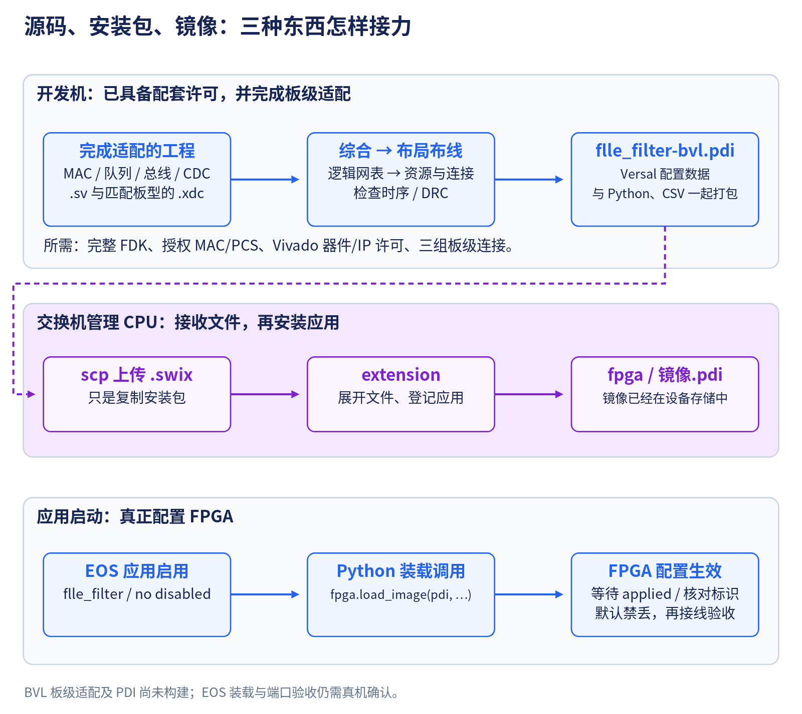

# 交换机应用手动打包参考

本文保留第08章的文件摆放与逐条打包命令，供取得完整FDK后使用；未完成BVL实机验证，版本与接口以配套FDK为准。

<a id="step-4-3-2"></a>

#### 4.3.2 官方打包工具在哪里

Vivado 生成电路镜像；EOS 安装的应用还包含管理程序、命令定义和寄存器表。先把这些文件制成 RPM（Linux 软件安装包），再用 Arista 工具封装为 SWIX（EOS 软件扩展包），相当于把“电路配置”和“管理面板”放进一个安装包。

| 工具/文件 | 官方取得位置 | 本步用途 |
| --- | --- | --- |
| `make`、`rpmbuild` | 匹配 FDK 指定的 Linux 构建环境及其系统软件源 | 执行构建规则、生成 RPM |
| `resources/app.mk`、`resources/rpm.spec` | [Arista 完整 FDK 下载入口](https://www.arista.com/en/support/software-download)；公开规则见 [OpenFDK](https://github.com/aristanetworks/openfdk/blob/13a7aac5b0aaba1ed7bbeb04dd71c5b3bded6d9d/resources/app.mk) | 厂商提供的文件整理、安装和 RPM 打包规则 |
| `swi-tools` | [Arista 官方仓库及安装说明](https://github.com/aristanetworks/swi-tools#installation)，Python 包名为 `switools` | 将 RPM 和扩展清单封装为 SWIX |

在匹配 FDK 的 Linux 开发机上打包，按其说明备齐 `make`、`rpmbuild` 和开发依赖。公开规则可参考 OpenFDK 3.2.0，实际使用的版本以完整 FDK 为准。

课程提供 [app-settings.mk](app-settings.mk)，声明应用名称、文件和构建设置；打包规则使用厂商原有的 `app.mk`。以下命令安装官方封包工具，已有兼容工具环境时直接使用。

<div style="border-left:6px solid #15803d;background:#dcfce7;padding:12px 16px;border-radius:8px;margin:14px 0;"><span style="display:inline-block;padding:3px 12px;border-radius:6px;background:#15803d;color:#fff;font-weight:800;">动手操作（有 FDK 时）· 安装官方封包工具</span> <span style="font-weight:700;color:#14532d;">在 Linux 开发机终端建立独立工具环境，安装 Arista 发布的 switools 并查看帮助；在课前完成。</span></div>

```bash
python3 -m venv /work/flle-switch/packaging-tools
source /work/flle-switch/packaging-tools/bin/activate
python3 -m pip install switools
swi-tools create --help
```

确认 `swi-tools create --help` 可用；工具版本与依赖按 FDK 配套要求选择。[官方工具说明](https://github.com/aristanetworks/swi-tools#creating-a-swix)

<a id="step-4-3-3"></a>

#### 4.3.3 备齐文件，先生成 RPM

在 Linux 文件管理器中建立下面的目录，并按表复制文件。`src/` 是准备安装的应用文件，`fdk/` 保留完整厂商包。这一步准备文件，不启动综合或向交换机写入任何内容。

| 取哪个文件 | 放到哪里，相对于 `/work/flle-switch/app/` |
| --- | --- |
| [app-settings.mk](app-settings.mk) | `app-settings.mk` |
| [应用包标识文件](__init__.py) | `src/__init__.py`，让 Python 识别应用包 |
| [课程版权许可](../LICENSE-Arista-BSD-3-Clause.txt) | `src/LICENSE-Arista-BSD-3-Clause.txt` |
| [课程 eos 目录](../eos/README.md)中的四份 `.py` 和一份 `.yaml` | `src/eos/` |
| 本轮 Vivado 生成的 PDI，以及同次端口配置的 JSON | `src/fpga/flle_filter-bvl.pdi`、`src/fpga/flle_filter-bvl-ports.json` |
| [寄存器表](../flle_filter_registers.csv) | `src/fpga/flle_filter_registers.csv` |

厂商开发包放在 `/work/flle-switch/fdk/`，其中的 `resources/app.mk`、`resources/rpm.spec` 和 `resources/libapp/` 保持原样；应用打包时也会带上厂商运行库。

先在交换机 EOS 终端执行 `show version`，把版本与 FDK 支持列表核对；将下一条命令中的 `<已核对的EOS版本>` 替换为实际版本。然后在 **Linux 开发机终端** 执行：

<div style="border-left:6px solid #15803d;background:#dcfce7;padding:12px 16px;border-radius:8px;margin:14px 0;"><span style="display:inline-block;padding:3px 12px;border-radius:6px;background:#15803d;color:#fff;font-weight:800;">动手操作（有 FDK 时）· 生成 RPM 与清单</span> <span style="font-weight:700;color:#14532d;">在 Linux 开发机上手动调用厂商规则，只生成下面点名的两个目标；镜像已由 Vivado 生成。</span></div>

```bash
cd /work/flle-switch/app
make -f app-settings.mk -f /work/flle-switch/fdk/resources/app.mk \
  ARISTA_FDK_DIR=/work/flle-switch/fdk \
  APP_EOS_VERSION="'<已核对的EOS版本>'" \
  flle_filter-0.2.0.x86_64.rpm \
  /work/flle-switch/app/build/swixbuild/manifest.yaml
```

<div style="border-left:6px solid #7e22ce;background:#f3e8ff;padding:12px 16px;border-radius:8px;margin:14px 0;"><span style="display:inline-block;padding:3px 12px;border-radius:6px;background:#7e22ce;color:#fff;font-weight:800;">仅供展示 · 输出解读 · 第一阶段产物</span> <span style="font-weight:700;color:#581c87;">make 成功结束后，应得到 RPM 与 manifest.yaml；此时尚未封装 SWIX。</span></div>

两个 `-f` 分别读取课程设置与厂商规则，`ARISTA_FDK_DIR` 指向完整 FDK，`APP_EOS_VERSION` 填入已核对的 EOS 版本（保留内外两层引号）。成功后，在 `app/` 下得到：

- `flle_filter-0.2.0.x86_64.rpm`：包含镜像、配套文件和管理程序的应用包。
- `build/swixbuild/manifest.yaml`：EOS 扩展清单，说明适用版本及 CLI 注册所需的 `ConfigAgent` 重启。

核对这两个产物后再封装 SWIX。它们是配套环境下的预期产物，本课尚未完成交换机实测。

<a id="step-4-3-4"></a>

#### 4.3.4 用官方工具封装 SWIX

保持刚才的终端与工具环境，在同一个 `app/` 目录调用 Arista 的封包工具：

<div style="border-left:6px solid #15803d;background:#dcfce7;padding:12px 16px;border-radius:8px;margin:14px 0;"><span style="display:inline-block;padding:3px 12px;border-radius:6px;background:#15803d;color:#fff;font-weight:800;">动手操作（有 FDK 时）· 封装 SWIX</span> <span style="font-weight:700;color:#14532d;">输入是已确认的 RPM 与扩展清单；直接调用 Arista 官方封包命令。</span></div>

```bash
swi-tools create -i build/swixbuild/manifest.yaml \
  flle_filter-0.2.0.swix flle_filter-0.2.0.x86_64.rpm
```

<div style="border-left:6px solid #7e22ce;background:#f3e8ff;padding:12px 16px;border-radius:8px;margin:14px 0;"><span style="display:inline-block;padding:3px 12px;border-radius:6px;background:#7e22ce;color:#fff;font-weight:800;">仅供展示 · 输出解读 · 最终交付文件</span> <span style="font-weight:700;color:#581c87;">核对新生成的 flle_filter-0.2.0.swix；它是下一步复制到交换机的安装包。</span></div>

`-i` 指向刚生成的清单；后面先写输出 `.swix`，再写输入 `.rpm`。成功后，同一目录得到 **`/work/flle-switch/app/flle_filter-0.2.0.swix`**，下一步上传的就是它。[Arista 官方 SWIX 工具](https://github.com/aristanetworks/swi-tools#creating-a-swix)

安装到交换机后，应用文件位于 `/opt/apps/flle_filter/`：`fpga/` 中有 PDI、端口 JSON 和寄存器 CSV，`eos/` 中有课程管理代码，`libapp/` 是厂商运行库。整个输入输出关系是 **PDI + 管理文件 → RPM + manifest → SWIX**。

<div style="border-left:6px solid #7e22ce;background:#f3e8ff;padding:12px 16px;border-radius:8px;margin:14px 0;"><span style="display:inline-block;padding:3px 12px;border-radius:6px;background:#7e22ce;color:#fff;font-weight:800;">关键图 · 镜像到应用包</span> <span style="font-weight:700;color:#581c87;">从 PDI 与配套文件出发，核对打包、上传、安装和装载的先后关系。</span></div>

<div style="max-width:820px;margin:14px auto;padding:10px;background:#f8fafc;border:1px solid #cbd5e1;border-radius:12px;"></div>

