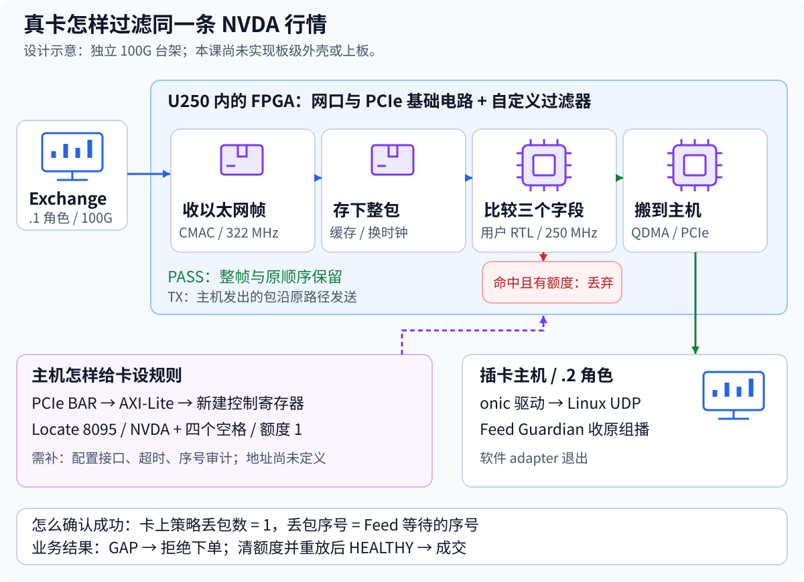
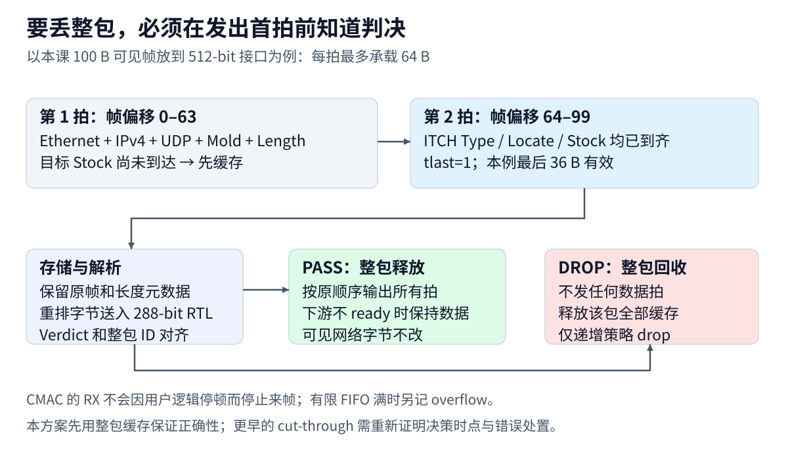
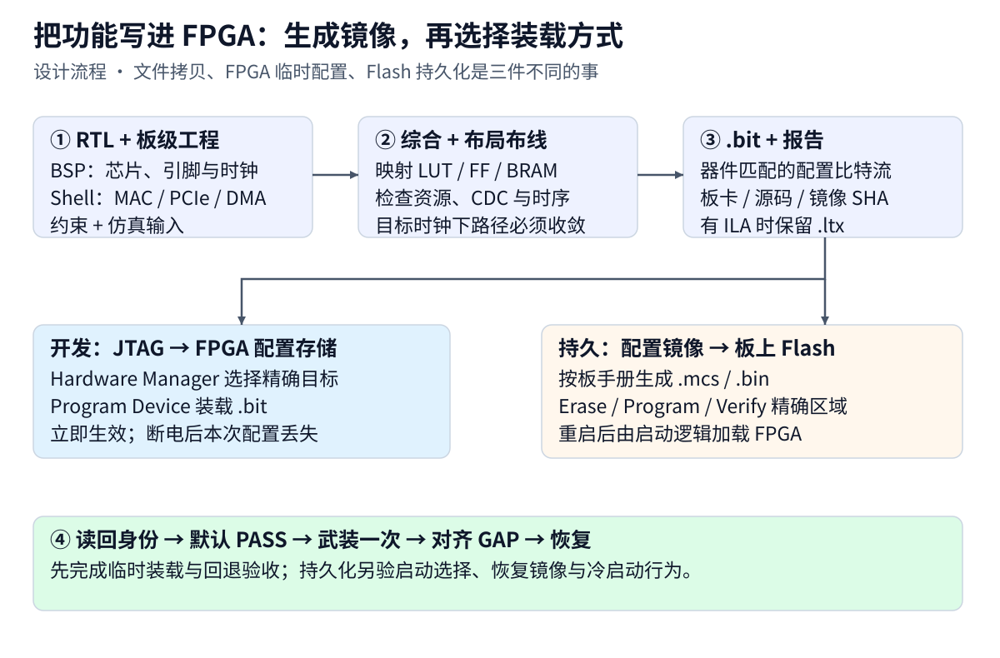

# 历史第09章真卡工程补充说明（设计／未实测）

> **历史 U250 / OpenNIC 路线，保留供对照。** 当前第 09 章改用 Alveo V80 / AMR 3.0.0；本页的 au250、onic、.bit 和未实现的演示工具不适用于 V80。当前工程见同目录 `v80/README.md`。

**假设卡已经到手：AMD Alveo U250，采用 Vivado RTL + OpenNIC 路线。** U250 是带网络接口的 FPGA 加速卡，装入 NIC shell 后承担网卡职责。本文件保留接口和恢复条件的工程细节；面向现场的逐步命令、产物与通过标准见 [U250 台架操作单](U250-LAB-STEPS.md)。本课尚未构建或上板，仍不增加现役课堂绿卡。

读真卡手册，先把陌生词换成熟悉的角色：

| 名称 | 它实际负责什么 |
| --- | --- |
| PCIe / BDF | 卡与主机之间的高速连接 / 系统识别具体设备功能的总线地址，不是 IP 地址 |
| JTAG / Flash | 调试与配置芯片的管理通道 / 断电后仍保存启动镜像的板上存储器 |
| Shell / IP 核 | 已接好的板卡基础电路 / 其中可复用的功能模块 |
| BAR / AXI-Lite | 主机访问设备的地址窗口 / FPGA 内部读写控制寄存器的总线 |
| DMA / QDMA | 卡直接向主机内存搬数据 / 按队列组织这种搬运的硬件模块 |

### 第一步：拿型号找资料，先确定板卡能怎样用　〔设计／未实测〕

| 要确认什么 | 我会查看哪里 | 本路线如何落定 |
| --- | --- | --- |
| 芯片、板版、供电、散热、PCIe 插槽 | 铭牌、[UG1289 板卡手册](https://docs.amd.com/r/en-US/ug1289-u200-u250-reconfig-accel/Introduction) | U250 对应板级配置，按手册接辅助电源与服务器风道 |
| 网络、JTAG 与配置存储 | 手册的 QSFP28、USB-JTAG、Flash 章节 | 明确网络口与烧录口；保留出厂恢复镜像 |
| Shell 与编译器 | [OpenNIC Shell](https://github.com/Xilinx/open-nic-shell/tree/940907fc99fc8d73dbea0028b3a23095a660a42a)、`script/board_settings/au250.tcl` | 核 `au250`、实际芯片 part、板文件、Vivado/IP 版本，以及 CMAC 许可是否有效 |
| Host 驱动 | [OpenNIC Driver](https://github.com/Xilinx/open-nic-driver/tree/3de226996ff5bacf8c4bdcec5318725e39c80b23) | 与 shell/QDMA 版本配套，准备对应内核头文件 |
| 当前设备状态 | 主机 `lspci -nnk`、`lspci -vv`、JTAG 枚举 | 保存 BDF、驱动、链路宽度/速率和已有镜像；初始无 PCIe 设计时可能尚无 BDF |

Shell 可以理解为流水线的“厂房”：它接好物理口、时钟、PCIe 和管理总线；用户 RTL 是放入厂房的检验工位。软件 shell 命令行与这里的 NIC shell 是两个概念。

**选卡取舍：本版本 OpenNIC 交付的是 CMAC 100G 数据口，没有现成 10G 模式；装这套镜像的 U250 不能靠换线接上 7150 的 10G 口。** 仍选 U250 作教学假设，是因为公开 shell、驱动和装载资料相互配套，便于讲清完整工程链。

| 设计路线（均未实测） | 具体要换什么 | 代价 |
| --- | --- | --- |
| 本例采用：独立 100G 台架 | Exchange 侧另配 100G NIC / 发包主机，与 U250 直连；迁入同一应用与行情数据 | 保持过滤任务，改变物理链路；7150 不在此数据路径中 |
| 保留课堂 10G 拓扑 | 另用 [10G/25G Ethernet Subsystem IP](https://docs.amd.com/r/4.1-English/pg210-25g-ethernet)，配置为 10G，重做 shell 的 MAC/PHY、时钟、引脚与数据宽度适配 | 是新增板级开发；需另核许可、收发器与连接器支持，不是改一个速率参数 |

**编译前先过许可门。** OpenNIC 的 [CMAC license 说明](https://github.com/Xilinx/open-nic-shell/blob/940907fc99fc8d73dbea0028b3a23095a660a42a/README.md#cmac-license)指出，`cmac_usplus` 的 100G IP 有免费许可，但仍需领取并让 Vivado 识别；装了 Vivado 不代表这项许可已具备。缺许可会阻止 bitstream 生成；补许可后还要重置并重新生成 IP 输出文件，再继续构建。

### 第二步：先把卡变成能收发的网卡　〔设计／未实测〕

下面的 RX/TX 是收/发方向；CMAC 是所选 100G MAC 模块，Packet Adapter 是转换数据格式和时钟节拍的适配模块。onic 是配套 Linux 驱动，netdev 是系统呈现出来的网络接口。

关键图 · 设计／未实测 设计路径：100G 收包经用户过滤器到 DMA；主机只接收放行的帧。

先构建官方 shell、装载默认数据路径、连接好 100G 对端，再在隔离 Linux 主机编译 `onic.ko`。网络与 FEC（链路前向纠错）按双方要求配置；驱动文档要求链路先就绪，再用 `sudo insmod onic.ko` 装驱动，并检查 `dmesg`、netdev、`ethtool -i` 与 `ethtool -S`。

把固定行情接入这条新链路，确认默认 PASS、包序号连续和 OUCH 往返。**这一轮还没有业务过滤**，它将网线、驱动或 DMA 故障与后续 RTL 错误分开。

| 真卡模块 | 怎样工作 | 替换现役软件的哪一段 |
| --- | --- | --- |
| CMAC | 100G Ethernet MAC，将帧变成数据拍 | 软件 socket 之前的线侧收包 |
| Packet Adapter | 整包 FIFO、322/250 MHz 转换，在 RX 恢复反压能力 | 软件模型没有对应硬件职责 |
| RX 用户逻辑 | 解析头部、保存整帧、给 RTL 输入并处理 verdict | C++ adapter 的协议拆解和转发 |
| QDMA | Queue DMA，把 PASS 帧送入主机内存 | 让包进入驱动和正常 UDP 接收 |
| AXI-Lite 控制接口 | 寄存器读写，通过 PCIe BAR 访问 | 文件控制改为硬件寄存器控制 |

第一版把过滤器放在 **250 MHz RX 用户区、QDMA 之前**，TX 原样透传。这是易验证的工程选择；默认 shell 已有整包缓冲，不把它宣传为极限低延迟架构。

### 第三步：给现役 RTL 补上整帧输入输出　〔设计／未实测〕

`market_filter.sv` 只会读 288-bit ITCH、输出 PASS/DROP 与 Sequence；把它单独综合成 `.bit`，还不能收网线上的包。需要写一个 packet wrapper（包处理外壳），把它接进 shell。

AXI4-Stream 是 FPGA 模块间传数据的接口约定，不是线上的新协议。一“拍”是一次时钟传输；`tdata` 装数据，`tkeep` 标出有效字节，`tlast` 标出最后一拍，`tvalid/tready` 完成收发握手。

关键图 · 设计／未实测 设计判决：Stock 第二拍才到齐，先缓存，随后整包放行或回收。

| Wrapper 工位 | 具体实现 | 必须守住的边界 |
| --- | --- | --- |
| 收帧与缓存 | 按 `tvalid && tready` 接拍，保存 `tdata/tkeep/tlast` 与长度/来源元数据 | 未决定前不向 QDMA 发出首拍 |
| Parser | 校验实际帧长与 IP/UDP/Mold 声明长度；定位 Type A 与 Sequence | 无 tag、IHL=5、非分片、Count=1、Length=36 才进入本课谓词 |
| 字节重排 | 按 OpenNIC 低字节先映射的接口，把网络字节 0 放到 RTL `[287:280]` | 不能把 512-bit 总线直接截取低 288 bit 当作 ITCH |
| 调用核心 | 凑齐 36 B 后仅握手一次，保存该包 ID 与 Sequence | 停顿期间输入保持；配置写入拍不重复接收 |
| Verdict 暂存 | 锁存单拍 `m_valid/drop_valid`，关联整帧缓存 | 下游停顿不能漏掉一拍 verdict |
| 整帧出口 | PASS 输出原帧；DROP 回收整帧；其它有效协议按约定旁路 | 未匹配帧也走有序路径，不能超越前面尚未裁决的包 |

本课无 tag 帧的 Stock 在总帧偏移 88–95，因此 64 B/拍时，要到第二拍才能认全。先缓存后裁决可以避免把目标包的头部送进 DMA 再发现它该丢。

CMAC RX 无 `tready`，链路不会因内部停顿自动停止来帧。有限 FIFO 的溢出计数必须与 `policy_drop` 分开；扩展时同时验证突发、最大帧、坏帧和连续包。RTL 的“每周期能判断一次”不能直接推出系统线速。

### 第四步：接控制总线，给 FPGA 设置过滤条件　〔设计／未实测〕

将本章一次性额度机制扩展为硬件控制设计：默认额度 0，写入目标字段，清审计，最后一次 ARM（武装：允许策略生效）提交配置与额度 1。DISARM 则关闭策略丢包。这里用主机的 PCIe BAR → AXI-Lite 到用户寄存器，代替当前 adapter 的文件控制路径。

| 我会增加的控制逻辑 | 为什么加 | 如何检验 |
| --- | --- | --- |
| shadow/active（待生效 / 已生效）与提交代号 | 多次总线写入不会让包读到半新半旧规则 | ARM 后读回 active 代号及完整字段 |
| 配置握手 / CDC（不同时钟之间的交接） | 控制时钟与数据时钟不同，不能只逐位同步整组字段 | 控制请求只在包边界生效，返回确认 |
| 硬件期限 | 当前 C++ 的 5 秒自动撤销不能随 adapter 一起消失 | 无命中/软件退出时，额度也能自动清零 |
| 状态快照 | Session/64-bit Sequence 和多个计数需一致读回 | 先 latch（锁存一份副本）再读，避免读高低位之间数据已改变 |

这些是新 wrapper 需要实现的接口，现役核心没有完整的 BAR、CDC、超时或 Session 寄存器。地址以新工程的 address map 为准；运行前先读 build ID 和 map 版本，不能对陌生卡照抄别人的寄存器偏移。

### 第五步：从 RTL 生成可装载镜像　〔设计／未实测〕

综合把 RTL 变成逻辑电路；布局布线决定这些电路放在芯片哪里、怎样连线。DRC 检查设计规则，时序报告检查信号能否赶上采样；setup/hold 要求采样前后数据稳定。scoreboard 是仿真中逐包核对输入输出的“对账本”。

关键图 · 设计／未实测 设计流程：生成镜像后，区分 JTAG 临时配置与 Flash 上电启动。

| 顺序 | 我会实际做的动作 | 本步产物 / 通过标准 |
| --- | --- | --- |
| 集成 | 在自有 plugin 目录实现 `box_250mhz` wrapper 与地址映射；另一用户区沿用默认连接 | `user_plugin_250mhz_inst.vh` 与 `build_box_250mhz.tcl` 引入模块 |
| 仿真 | 保留六项核心自测，再加整帧 scoreboard、随机背压、相邻包、复位/期限测试 | DROP 恰好一次；其余输出字节与顺序和输入一致 |
| 建工程 | 在 OpenNIC 的 `script/` 中以 `vivado -mode batch -source build.tcl -tclargs -board au250 -user_plugin <绝对目录> -impl 1` 构建 | Vivado 项目与实际板型/IP 参数 |
| 看报告 | 读综合资源、DRC、布局布线后的 timing summary、时钟和 CDC 报告 | 必需路径已约束，setup/hold 收敛；不能只有一个“成功”按钮 |
| 封存 | 保存 `.bit`、源码/shell/IP/板文件版本、约束、报告及 SHA；有片上逻辑分析仪 ILA 时保存探针说明文件 `.ltx` | 镜像可追溯到唯一构建；用户区有可读 build ID |

`-impl 1` 才继续生成 bitstream；默认建工程不等于生成镜像。`-post_impl 1` 可生成配置存储文件，但还要核对其地址布局与板卡恢复合同。工具版本按固定 shell 的支持组合选择，首次构建可达数十分钟至数小时。

ILA（Integrated Logic Analyzer，片上逻辑分析仪）是放进 FPGA 的观测探针。触发点可设为 DROP，捕获 Type/Locate/Stock、额度和帧 ID；它辅助解释内部动作，不能替代线侧包与应用 GAP 证据。

### 第六步：先通过 JTAG 临时装进去　〔设计／未实测〕

烧录是 **重配置硬件**。完整 shell 包含 PCIe IP，重配时链路可能消失；台架先停止该卡流量，释放该卡所有 PF（可单独被驱动占用的 PCIe 物理功能）的驱动/VM 占用，并准备主机带外控制。用独立开发机通过板卡 USB-JTAG 管理口连接，管理网不走被重配的卡。

| Hardware Manager 中的顺序 | 具体操作 | 看什么确认 |
| --- | --- | --- |
| 打开目标 | Open Hardware Manager → Open Target；按线缆序列号和器件身份选这张卡 | 实际 FPGA part 与生成镜像的 part 一致 |
| 指定程序 | 在该器件的 Program Device 中选择本次 `.bit`；有 ILA 再选配套 `.ltx` | 路径和 SHA 指向本次构建 |
| 开始配置 | Program，等待完成，再 refresh device | FPGA 配置状态正常；有 ILA 时探针可见 |
| 恢复主机枚举 | 按下方官方脚本说明选择重扫；首次装载按要求暖重启 | BDF、PCI ID、BAR 和链路重新出现 |
| 装驱动接流 | 网络/FEC 就绪后加载匹配 `onic`，读 build ID，默认额度仍为 0 | 镜像身份、netdev、基本收发与原回放都通过 |

此时配置写入 FPGA 的易失配置存储，断电后不会自动保留本次设计。下面是 [OpenNIC 随附脚本](https://github.com/Xilinx/open-nic-shell/blob/940907fc99fc8d73dbea0028b3a23095a660a42a/README.md#programming-fpga)的两种参考方式，**先审阅并适配台架，二选一，不串成必刷命令**。

| 官方入口（本课未执行） | 在哪里、怎样使用 | 读源码时必须核什么 |
| --- | --- | --- |
| [`script/setup_device.sh`](https://github.com/Xilinx/open-nic-shell/blob/940907fc99fc8d73dbea0028b3a23095a660a42a/script/setup_device.sh) | 在插卡宿主机调用，参数为不带域的 `BB:DD.F`；脚本固定补 `0000:`。它先调整上游 PCIe 桥的致命错误上报，等待人工在 Hardware Manager 装载，按 `c` 后重扫 | 提前核实际设备、上游桥和原寄存器值；非 `0000` 域不能原样套用；维护后恢复原错误上报设置 |
| [`script/program_fpga.sh`](https://github.com/Xilinx/open-nic-shell/blob/940907fc99fc8d73dbea0028b3a23095a660a42a/script/program_fpga.sh) | 在该版本 `script/` 目录运行；输入为 `BITSTREAM_PATH BOARD [PROBES_PATH]`，另设完整 BDF 的 `EXTENDED_DEVICE_BDF1`，按需设第二功能地址 | 它会卸驱动、移除 PCIe 功能、调用同目录 Tcl 装载再重扫；先核全部设备所有权、Vivado 环境与目标器件选择；该提交 Tcl 使用的 `$hw_device` 未在 `au250.tcl` 定义，需先适配，不能直接作为 U250 可用入口 |

必须提前安排三种异常：**Dell/iDRAC 可能因 PCIe 链路消失而强制重启；已加载 onic 时重扫可能挂住内核；首次尚无 BDF 时 setup 脚本不适用。** 上游还要求首次直接装载后暖重启（重启系统、不切断电源）；Flash 启动则需冷启动。先保留独立 JTAG 开发机和带外管理，并确认宿主机可安全停机；官方脚本存在不等于本课主板已验证。

### 第七步：让上电后自动加载——写 Flash 用户镜像区　〔设计／未实测〕

这一步在临时装载、过滤与回退均验收后进行。以下参数来自 **UG1289 v1.1 的 U200/U250 配置布局**，已按[资料复核记录](../../refs/FLLE_Ch08_10_Theory_Hardware_Source_Review_2026-09-05.md)核对；实卡板版、Flash 型号、启动配置与恢复镜像仍待人工核对，全部一致后才能使用。

| 顺序 | 实际要做什么 | 关键值或选择 |
| --- | --- | --- |
| 核启动方案 | 对照板版、Flash 型号、原平台和恢复方式 | Vitis target platform 与自定义设计切换，按手册先恢复出厂镜像 |
| 生成配置镜像 | 在 Vivado 用 `write_cfgmem` 从本次 `.bit` 生成 `.mcs` | `-interface spix4 -size 128`；用户区起点 `0x01002000` |
| 保护恢复区 | 保留出厂 golden，不从地址 0 写自定义镜像 | `0x00000000–0x01001FFF` 为手册列出的保护区域 |
| 选存储器 | Hardware Manager → Add Configuration Device | 手册指定 `mt25qu01g-spi-x1_x2_x4`，先核实际器件 |
| 写入并校验 | Program Configuration Memory Device，选 `.mcs` 与 Configuration File Only | 对指定范围 Program / Verify；不选整个 Flash 擦除 |
| 启动验证 | 按手册断开 JTAG，再对主机冷重启 | 卡自动恢复本次 build ID，默认 PASS，再做收发验收 |

例如生成阶段的参数组合是 `write_cfgmem -format mcs -interface spix4 -size 128 -loadbit "up 0x01002000 <本次.bit>" -file <本次.mcs>`。文件名来自本次构建；`size` 单位是 MB。这是参数讲解，尚未在本课执行。[板卡烧录章节](https://docs.amd.com/r/en-US/ug1289-u200-u250-reconfig-accel/MCS-File-Generation-and-Alveo-Card-Programming)、[Vivado 配置存储操作](https://docs.amd.com/r/2025.1-English/ug908-vivado-programming-debugging/Programming-a-Configuration-Memory-Device)。

`.bit` 是 FPGA 配置；`.mcs` 是带地址信息的配置存储镜像；`.xclbin` 属于另一路 Vitis/XRT 的平台与 kernel 交付合同。本例采用完整 Vivado/OpenNIC 工程，不能把三种文件互相改后缀来用。

### 第八步：回到同一条 NVDA 过滤任务　〔设计／未实测〕

前述设计完成并通过台架验证后，物理网卡应在 DMA 前裁决，原 C++ adapter 退出；统一接收器 `flle-feed-receiver` 从新 NIC 接收 `233.74.125.32:31032`。保留同一源/组/端口和历史行情内容，确认旧 NIC 或第二条订阅没有额外副本送入 Guardian。

**把真卡接进现有应用，还要做一次接收端迁移。** 以下是待实现、待验证的操作合同，不能直接照搬当前绿卡：

| 从软件模型切到真卡（设计／未实测） | 具体动作与检查 |
| --- | --- |
| 先停旧路径 | 停本次 adapter、清其控制文件；停止旧行情消费者，保留独立管理网。不要同时保留两张数据口上的 `20.1.1.2` |
| 认新卡、新口 | 用 `lspci -nnk`、`ethtool -i` 对上新 BDF、`onic` 驱动和 netdev；采用第一步已选定的 100G 台架或新 10G shell，不能直接接现有 7150 |
| 迁移数据地址 | 将 `20.1.1.2/24` 配到已验证的新数据口，核对到 `.1` 的路由和组播入接口；独立台架中的 `.1` 仍发原行情 |
| 恢复直接订阅 | 以 `--multicast-receiver 1` 启动 `flle-feed-receiver`，Guardian 通过 `--feed-socket` 读取它的本机分发；接收器在新数据接口加入 `233.74.125.32:31032`；测试期间 Exchange 只发 MULTICAST，排除单播副本绕过 |
| 适配课程控制器 | 新增真卡 profile（设备配置档案），登记 BDF/netdev/驱动并验证启动与回退。当前 `feed-guardianctl.sh direct` 和交接门要求 `SFC/READY/sfc`，不能删掉断言硬跑 `onic` |
| 与模拟卡的不同点 | 不再由 adapter 转发到 `42121`，统一接收器恢复原组播订阅；预期 `feed.path=MULTICAST`。应用协议不变，但硬件身份和启动配置必须适配 |

| 阶段 | 真卡上怎么做 | 预期证据 |
| --- | --- | --- |
| PASS 基线 | 默认额度 0；从新数据口播放同一行情 | 入口、DMA 后与 Feed 序列一致 |
| 单次 DROP | ARM 后继续发包；额度由共享裁决单元消耗 | 目标 Type A 才使 `policy_drop+1`，第二个目标 PASS |
| 精确对账 | 用线侧捕获 + 片上审计 + 主机抓包 | 同一 Session/Sequence 入口有、主机无，且等于 `next_expected` |
| 业务保护 | 观察 Feed GAP，再尝试下单 | `gap_size=1`、GUI 阻断、API 400；overflow/error 增量为 0 |
| 恢复 | 清额度，Replay Restart，建立新 Session | HEALTHY、两笔纸面真协议订单成交、净持仓不变 |
| 回退 | 换回已验证 PASS 镜像或原 NIC 路径，恢复驱动/订阅 | build ID 和路径正确，交易再次通过 |

测试台架成功后才把卡交给虚拟机：先在宿主机配置板卡，核对 PF 所有权和 IOMMU 隔离组（哪些设备功能必须一起分配），再做 PCIe 直通、Guest（虚拟机内部系统）驱动和网络映射。VM 快照不包含 FPGA 配置存储与 Flash，恢复快照后仍要读回镜像身份；不能在 Guest 正占用设备时重配 FPGA。

有意丢一条 Add Order 是故障注入课题。若长期只删 NVDA 的 Add Order，却继续给旧 Feed Handler 送该证券的撤单/成交，序列和订单簿都可能失去完整性。生产证券裁剪需另设计目录、依赖消息、输出序列和恢复协议；与本课“造一个可归因 GAP”是不同任务。

## 2026-09-07：真卡命令与源码复核（DEC-369）

用户要求具体发现设备、编译装载、状态查询和过滤效果，新增 [U250 台架操作单](U250-LAB-STEPS.md)，学生正文改四步操作。保留一张收发位置图；构建/缓存两张图移为本工程说明参考，SVG 字节未改。

本轮只读核对固定上游源码，发现两处影响复现的细节：

- `build.tcl` 在用户区目录或 `build_box_*.tcl` 缺失时回退默认插件；因此插件构建前增加文件清单检查，且要求实现后确认核心实例与有效连接。输出路径包含两层 `open_nic_shell` 名称（项目目录与 runs 前缀），正文/操作单使用源码实际路径。
- `program_fpga.tcl` 读取板配置后使用 `$hw_device`；本提交 `au250.tcl` 只定义 part、board_part、zynq_family，没有定义该变量。U250 操作单采用官方 Hardware Manager 命令，显式选择唯一 JTAG 目标/器件；不把原壳脚本包装为已可直接执行的烧录命令。

设备管理命令依据 AMD UG835；网页的具体 2022.1 `program_hw_devices` 入口本轮返回不可访问，改核官方当前入口及固定 OpenNIC Tcl，不能记录该旧网页为成功读取。TShark 解码入口与三项输出字段另核 Wireshark 4.4.0 源码，注册 `moldudp64` 到 UDP Decode As；未在本机安装或运行 TShark。

下表为本轮实际读取的公开源文件 SHA256。Shell 固定 `940907fc99fc8d73dbea0028b3a23095a660a42a`，Driver 固定 `3de226996ff5bacf8c4bdcec5318725e39c80b23`；源码可按前文链接重取，临时下载不是持久证据依赖。

| 公开源文件 | 本轮读取 SHA256 |
| --- | --- |
| Shell / README.md | `e92c13d0468e73391cec09be961fd4476011af09c9c30adeebfa8de082970606` |
| Shell / script/build.tcl | `b06d7c7cee6df16017e8e23a341f9007567e7cc82b658c134a6ea4ed8035431e` |
| Shell / script/board_settings/au250.tcl | `c32045deccf34522e6bc1d6dbb8d6bcffa0ab19b4bc67938864ab75c3a43c2ed` |
| Shell / script/program_fpga.tcl | `57fa163bbcb8a4d8ef92492a23c7623ac810a5ae7199bfd05e7a1ae8ceda04c1` |
| Driver / README.md | `35f24d474ec8d0c62d7ff6115838c6fcdfa5301c5b821d8f6a64fc5bff5b87c4` |
| Driver / Makefile | `c7ef4a849c6c315b864d6f6c640b8619eb0dd18202a4dcb253126e699b1c0bf2` |
| [Wireshark 4.4.0 / packet-moldudp64.c](https://github.com/wireshark/wireshark/blob/wireshark-4.4.0/epan/dissectors/packet-moldudp64.c) | `4f97562d97c3b1c84c586ecf148250b9316b1358772a131ac66f9c6b08958f49` |

验证边界：Bash 片段语法、Tcl 括号/花括号完整性、卡片/导航/本地链接/HTML、现役源码与历史输出不变、图册摘要及 diff 静态核对。没有 Vivado 综合、JTAG 装载、驱动加载、真卡抓包、板上控制或新 RUN；四个 Tcl 片段未调用硬件命令。

## 2026-09-07：模拟终端与配置读回（DEC-370）

按用户要求，正文新增明确标识的命令与模拟输出，假定U250已通过默认收发且已提供完整插件。BDF `0000:65:00.0`、目录 `/work/flle-u250-lab`、标记 `0xF1100001`、会话 `DEMO000001` 和所有示例计数都不是环境事实。本仓库仍未实现整包插件和板上控制CLI；模拟返回不归入实测回执。

| 展示内容 | 本轮核对的一手来源 |
| --- | --- |
| lspci设备类别/903f | [OpenNIC DPDK官方操作记录](https://github.com/Xilinx/open-nic-dpdk#section-7-writing-to-initialize-the-opennic-hardware-registers)；示例地址改成65:00.0，非原现场输出 |
| 驱动名/0.21/网口名 | [固定onic_main.c](https://github.com/Xilinx/open-nic-driver/blob/3de226996ff5bacf8c4bdcec5318725e39c80b23/onic_main.c)；总线0x65=101，故示例名onic101s0f0 |
| ethtool字段与物理收包计数 | [固定onic_ethtool.c](https://github.com/Xilinx/open-nic-driver/blob/3de226996ff5bacf8c4bdcec5318725e39c80b23/onic_ethtool.c)；只展示已定义字段，计数是示意 |
| read_verilog与镜像标记构建参数 | 固定Shell build.tcl在用户插件目录source构建入口；bitstream_userid写BITSTREAM.CONFIG.USERID。本章两行read_verilog是追加节选，不是完整插件脚本 |
| 编程成功的HIGH提示 | [Fraunhofer IMS工程原始操作记录](https://github.com/Fraunhofer-IMS/airisc_core_complex/blob/main/doc/Quickstart.txt)；该来源为其它器件，只用于Vivado日志格式，不是U250实测 |
| DONE查询 | [AMD UG908](https://docs.amd.com/r/2023.1-English/ug908-vivado-programming-debugging/Programming-the-Hardware-Device)的REGISTER.IR.BIT5_DONE |
| USERID→USERCODE | [AMD UG570](https://docs.amd.com/r/en-US/ug570-ultrascale-configuration/USR_ACCESSE2)；REGISTER.USERCODE属性见[AMD属性参考](https://docs.amd.com/api/khub/documents/IvvjZm3lP3_eq7h_nXMS_g/content) |
| HTML/Markdown分界 | [CommonMark HTML blocks](https://spec.commonmark.org/0.31.2/#html-blocks)；div块需要空行终止后续围栏才正常解析 |

新增读取的固定源码SHA256：

- `onic_main.c`：`9deb4f015164ff0952be5196116c5d2c3d5100c5fae7d5d1e4b19143e222b362`。
- `onic_ethtool.c`：`82421266e3d292e1b5709e7881fbb2d8fe12f6741dc117d201a46b6bf2aa638e`。

没有运行Vivado、读取实卡寄存器、装载驱动或接流；`DONE=1`及`f1100001`是模拟返回。正式验收仍需编程无错误、DONE完成、标记符合实际构建登记，以及板上真实收发/过滤核对。

## 2026-09-07：加载与策略状态展示（DEC-371）

用户要求真卡假设部分用show说明加载前后，不再模拟抓包。本章正文和U250操作单现采用拟设计的 `flle-fpga show --device <BDF>` / `flle-fpga arm --device <BDF> --drops 1`，不提供假可执行文件；这不是厂家已有工具。其实现合同见 [操作单第6节](U250-LAB-STEPS.md#6-管理工具怎样读回策略状态待实现接口)。

本例卡加载前已有默认OpenNIC，所以可按默认路径收发；本章镜像增加NVDA过滤能力，初始化规则但额度0；发令装入一次额度后才允许丢弃。配置期间的PCIe中断不属于加载完成后的稳定状态。show应从板上身份/模块能力/实际条件与额度读取，不能把本地文件当读回。实际核心的条件与一次额度接口见market_filter.sv；完整wrapper、地址表、PCIe可读Build ID与管理工具仍待实现。

本文件上面的真实收发/丢弃/恢复验收要求继续作为未来台架实施依据。删除的是学生正文及操作单中的模拟抓包展示，并未证明真实硬件性能或改变现役软件实验结果；无新设备查询、构建、烧录或RUN。

## 2026-09-07：学生Shell操作与开发者内部实现分开（DEC-372）

用户明确只想看关键Shell命令怎样敲，正文已撤所有Tcl代码块，文字压缩约六成。真实Vivado构建仍由Shell启动；read_verilog、program_hw_devices与寄存器查询留给开发者配套。拟设计的flle-fpga新增load入口，供学生场景用一条Shell命令加载并看状态；其实现合同见U250操作单第7节。

load不是现成上游命令，本轮没有写它的实现。示例BDF必须通过预先登记的卡/JTAG映射定位目标；编程无错误后读取DONE/USERCODE，再整理输出，不以本地文件名证明烧写。正文将真实构建路径下的.bit复制为nvda-filter.bit以缩短load命令，没有改变镜像内容。内部维护与读回边界保留本文件，不在学生流程重复展开。
