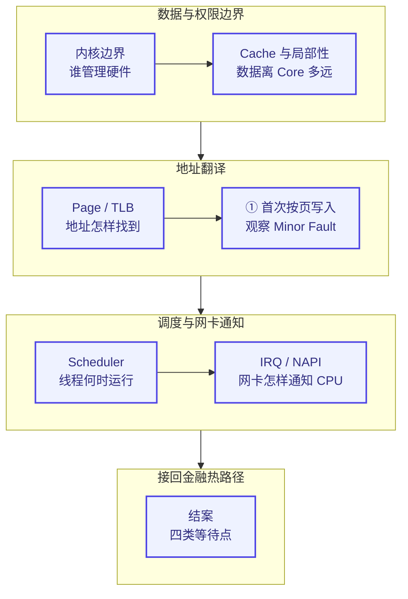

# 第零部分：CPU Cache、内存与操作系统基础——低延迟之前的热路径

## 为什么同一段程序会忽快忽慢

一条行情到达网卡后，还要由程序读出并处理。网线很快，程序却可能在等数据、等内存准备，或等 CPU 轮到自己。**本章先认识这些等待从哪里来。** 每条消息都会反复经过的处理代码，后文称为“热路径”。

> “The latency of an Instruction with memory operand can vary greatly due to a number of factors, including data locality in the memory/cache hierarchy.”
>
> —— [Intel® 64 and IA-32 Architectures Optimization Reference Manual](https://www.intel.com/content/dam/doc/manual/64-ia-32-architectures-optimization-manual.pdf)

Intel 这句话说的是：同一条指令，取数据的位置不同，等待就可能不同。Cache 是 CPU 附近的小容量缓存，RAM 是主内存；可以先想成主厨手边的台面与后厨仓库。后面依次看数据放哪、地址怎么找、谁能使用 CPU，以及网卡怎样通知它。

| 官方入口 | 本章只取什么 |
| --- | --- |
| [Linux Memory Management](https://docs.kernel.org/admin-guide/mm/index.html) | 虚拟内存、page、HugeTLB 的职责边界 |
| [Linux Page Tables](https://docs.kernel.org/mm/page_tables.html) | **TLB hit / miss、页表查找、page fault** 的关系 |
| [Linux NAPI](https://docs.kernel.org/networking/napi.html) | 网卡中断如何衔接 **NAPI / softirq** |
| [Intel Optimization Reference Manual](https://www.intel.com/content/www/us/en/content-details/671488/intel-64-and-ia-32-architectures-optimization-reference-manual-volume-1.html) | Cache、内存层级与局部性的架构入口 |
| [SI prefixes (BIPM)](https://www.bipm.org/en/measurement-units/si-prefixes) | 本课延迟数字用的 **milli / micro / nano** 词头 |

<div style="border-left:6px solid #0891b2;background:#cffafe;padding:12px 16px;border-radius:8px;margin:14px 0;"><span style="display:inline-block;padding:3px 12px;border-radius:6px;background:#0891b2;color:#fff;font-weight:800;">一屏结论</span> <span style="font-weight:700;color:#164e63;">同一段代码偶尔慢一截，常见等待点是 <strong>Cache Miss、TLB Miss / Page Fault、线程调度和 Interrupt / NAPI</strong>。Kernel Bypass 优化的是<strong>逐包数据路径</strong>；代码始终由 CPU 执行，系统资源始终由操作系统管理。</span></div>

## 本章学习目标

**学完本章：** 能沿一条行情热路径，指出**数据、地址、线程和网卡通知**分别可能在哪里等待。

**本章深度：** 每个机制讲到“能定位等待点”为止。真实耗时属于另一类证据：**第四部分**给出延迟分布与尾延迟的测量方法，**第五部分**用编译型 C++ 实验分析热路径上的软件工作。后文数字写成 `ns` / `μs` / `ms`，换算见下表。

<div style="border-left:6px solid #0891b2;background:#cffafe;padding:12px 16px;border-radius:8px;margin:14px 0;"><span style="display:inline-block;padding:3px 12px;border-radius:6px;background:#0891b2;color:#fff;font-weight:800;">课堂时间尺子</span> <span style="font-weight:700;color:#164e63;">国际单位制（SI，International System of Units）词头来自 [BIPM](https://www.bipm.org/en/measurement-units/si-prefixes)。本课延迟只读这三档，从小到大：纳秒 → 微秒 → 毫秒。</span></div>

| 符号 | 英文 | 中文 | 换算 |
| --- | --- | --- | --- |
| `ns` | nanosecond | 纳秒 | `10^-9` 秒 |
| `μs` | microsecond | 微秒 | `1 μs = 1000 ns`；键盘上常写成 `us` |
| `ms` | millisecond | 毫秒 | `1 ms = 1000 μs` |

## 本章导航

<div style="border-left:6px solid #7e22ce;background:#f3e8ff;padding:12px 16px;border-radius:8px;margin:14px 0;"><span style="display:inline-block;padding:3px 12px;border-radius:6px;background:#7e22ce;color:#fff;font-weight:800;">本章导航</span> <span style="font-weight:700;color:#581c87;">本章分成 4 部分，共 7 个导航项；先用总图看完整路线，再在每节导航卡里查看全章与本组位置。</span></div>



固定顺序就是：**数据与权限边界 → 地址翻译 → 调度与网卡通知 → 接回金融热路径**。

## 任务地图

| 导航项 | 所属部分 | 这一项回答什么 |
| --- | --- | --- |
| 1. 内核边界 | 数据与权限边界 | 应用怎样通过内核与 Driver 使用硬件 |
| 2. Cache 与局部性 | 数据与权限边界 | 数据离 Core 越远为什么通常等得越久 |
| 3. 虚拟内存 | 地址翻译 | 虚拟地址怎样经 TLB 与页表找到物理页 |
| 运行 ①：首次按页写入 | 地址翻译 | 用首次按页写入观察 Minor Fault |
| 4. 调度 | 调度与网卡通知 | Runnable 线程怎样被 Scheduler 选中运行 |
| 5. 中断、NAPI 与多队列 | 调度与网卡通知 | IRQ、NAPI 与队列怎样把收包工作交给 CPU |
| 6. 一页结案 | 接回金融热路径 | 把数据、地址、调度与网卡通知接回同一条热路径 |

## 1. 内核边界：应用通过系统调用使用硬件

<div style="border:2px solid #4f46e5;background:#eef2ff;padding:10px 12px;border-radius:8px;margin:14px 0;"><div style="font-weight:900;color:#312e81;margin-bottom:4px;">导航卡 · 数据与权限边界</div><div style="font-weight:700;color:#312e81;margin-bottom:8px;">范畴：纸面模型　本步知识：应用怎样通过内核与 Driver 使用硬件　位置：全章第 1 / 7 项 · 本组第 1 / 2 项</div><span style="display:inline-block;margin:3px;padding:4px 10px;border-radius:6px;background:#15803d;color:#fff;font-weight:800;">1. 内核边界</span><span style="display:inline-block;margin:3px;padding:4px 10px;border-radius:6px;background:#f8fafc;border:1px solid #a5b4fc;color:#312e81;font-weight:800;">2. Cache 与局部性</span></div>

<div style="background:#f8fafc;border:1px solid #cbd5e1;border-radius:12px;padding:10px;max-width:820px;margin:14px auto;">
<div style="font-weight:900;color:#0f172a;margin-bottom:8px;">内核边界 · 请求向下，结果向上</div>

<div style="color:#475569;font-size:13px;margin-top:8px;">应用不能随意控制整台机器。它通过系统调用这个入口，请 Linux 内核分配资源或执行收发；Driver（驱动）再把操作落实到具体硬件。</div>
</div>

| 层级 | 本课程中的例子 | 关键边界 |
| --- | --- | --- |
| 用户态 | 行情解析、交易逻辑 | 普通应用在这一层运行 |
| 内核态 | CPU 调度、内存管理、网络栈 | 管理全局资源与硬件访问 |
| Driver | X2522 的 `sfc`、Broadcom 的 `bnxt_en` | 把内核操作翻译成设备动作 |

**一个贯穿本章的比喻——服务器像一间厨房：**

| 厨房角色 | 真实对象 | 本章在哪里用到 |
| --- | --- | --- |
| 总控台 | **Linux 内核** | 第 1 节：应用只能按窗口提交请求 |
| 主厨的手 | **CPU Core** | 真正执行代码的是单个 Core |
| 手边小台面 | **L1 / L2 / L3 Cache** | 第 2 节：越靠近越小、越快 |
| 后厨仓库 | **RAM** | 第 2 节：容量大，取货路径长 |
| 库存单编号 | **虚拟地址 / Page / TLB** | 第 3 节：先翻译编号，再取货 |
| 排班表 | **Scheduler** | 第 4 节：谁现在上灶 |
| 传菜铃 | **IRQ / NAPI** | 第 5 节：外面有事需要处理 |

## 2. Cache 与局部性：离 Core 越远，等待通常越明显

<div style="border:2px solid #4f46e5;background:#eef2ff;padding:10px 12px;border-radius:8px;margin:14px 0;"><div style="font-weight:900;color:#312e81;margin-bottom:4px;">导航卡 · 数据与权限边界</div><div style="font-weight:700;color:#312e81;margin-bottom:8px;">范畴：纸面模型　本步知识：数据离 Core 越远为什么通常等得越久　位置：全章第 2 / 7 项 · 本组第 2 / 2 项</div><span style="display:inline-block;margin:3px;padding:4px 10px;border-radius:6px;background:#f8fafc;border:1px solid #a5b4fc;color:#312e81;font-weight:800;">1. 内核边界</span><span style="display:inline-block;margin:3px;padding:4px 10px;border-radius:6px;background:#15803d;color:#fff;font-weight:800;">2. Cache 与局部性</span></div>

<div style="background:#f8fafc;border:1px solid #cbd5e1;border-radius:12px;padding:10px;max-width:820px;margin:14px auto;">
<div style="font-weight:900;color:#0f172a;margin-bottom:8px;">存储层级 · 从寄存器、Cache 到 RAM</div>

<div style="color:#475569;font-size:13px;margin-top:8px;">层级表示距离与职责；一次读取在哪一层命中就在哪一层返回，图中的箭头是位置关系而非固定串行顺序。磁盘只作距离对比，正常报文热路径停在 RAM 以内。</div>
</div>

| 对象 | 先记住什么 | 低延迟关注点 |
| --- | --- | --- |
| **Register / L1** | 离 Core 最近，容量最小；L1d 存数据、L1i 存指令 | 最热的指令和数据尽量留近 |
| **L2 / L3（LLC，Last Level Cache）** | 更大，也更远；L3 常由多个 Core 共享 | 共享与竞争会改变命中情况 |
| **RAM** | 容量大，访问路径更长 | Cache Miss 后可能在这里等待 |
| **Cache Line** | CPU 搬运连续数据的粒度；课程机为 **64 B** | 字段布局决定搬来多少有用数据 |

<div style="border-left:6px solid #7e22ce;background:#f3e8ff;padding:12px 16px;border-radius:8px;margin:14px 0;"><span style="display:inline-block;padding:3px 12px;border-radius:6px;background:#7e22ce;color:#fff;font-weight:800;">已验证现场锚点 · 教师取证</span> <span style="font-weight:700;color:#581c87;">2026-08-19 在观察机 <code>.101</code> 只读采集：4 个逻辑 CPU；单实例 L1d 48 KiB、L1i 32 KiB、L2 1280 KiB、L3 55296 KiB（约 54 MiB）；Cache Line 64 B；Page 4096 B。证据：<code>20260819T135057Z-00-cpu-cache-baseline</code>。这组字段描述的是机器规格，性能结论由后续测量给出。</span></div>

### 局部性：一次搬来的 64 B，有多少真正被使用

<div style="background:#f8fafc;border:1px solid #cbd5e1;border-radius:12px;padding:10px;max-width:820px;margin:14px auto;">
<div style="font-weight:900;color:#0f172a;margin-bottom:8px;">局部性对照 · 相同字段，不同摆放</div>

<div style="color:#475569;font-size:13px;margin-top:8px;">左侧四个字段共用一条 64 B Line；右侧分散到四条 Line。图说明的是搬运范围：字段宽度为示意画法，实际收益取决于真实布局与访问模式。</div>
</div>

- **紧凑、顺序访问**：更可能用较少 Cache Line 完成工作。
- **跨步、跳跃访问**：更可能触碰更多 Cache Line。
- **小而固定的热状态**：更容易留在 Cache。
- **巨大结构反复全扫**：更容易挤掉真正的热点。

<div style="border-left:6px solid #0891b2;background:#cffafe;padding:12px 16px;border-radius:8px;margin:14px 0;"><span style="display:inline-block;padding:3px 12px;border-radius:6px;background:#0891b2;color:#fff;font-weight:800;">推算与测量的分工</span> <span style="font-weight:700;color:#164e63;">“四个字段落在 1 条还是 4 条 Line”用地址除以 64 就能当场算出，所以本节用图和算式确认。真实耗时还受预取、乱序执行与各级命中共同影响，取决于具体的字段布局与访问模式：第四部分给出测量延迟分布的方法，第五部分用编译型实验和公平 A/B 合同分析热路径上的软件工作。</span></div>

## 3. 虚拟内存：TLB、Page Fault 与 HugePage

<div style="border:2px solid #4f46e5;background:#eef2ff;padding:10px 12px;border-radius:8px;margin:14px 0;"><div style="font-weight:900;color:#312e81;margin-bottom:4px;">导航卡 · 地址翻译</div><div style="font-weight:700;color:#312e81;margin-bottom:8px;">范畴：纸面模型　本步知识：虚拟地址怎样经 TLB 与页表找到物理页　位置：全章第 3 / 7 项 · 本组第 1 / 2 项</div><span style="display:inline-block;margin:3px;padding:4px 10px;border-radius:6px;background:#15803d;color:#fff;font-weight:800;">3. 虚拟内存</span><span style="display:inline-block;margin:3px;padding:4px 10px;border-radius:6px;background:#f8fafc;border:1px solid #a5b4fc;color:#312e81;font-weight:800;">运行 ①：首次按页写入</span></div>

程序使用的是虚拟地址，内存实际按物理页存放数据。可以把虚拟地址看成库存编号，页表是“编号对应哪个货架”的账本；TLB 是 CPU 手边缓存的常用对应关系。访问数据前，先完成这次查找。

**地址翻译主线：**

1. 应用给出**虚拟地址**。
2. **TLB Hit**：直接取得已缓存的翻译结果。
3. **TLB Miss**：硬件继续查页表。
4. 当前页表项不能直接完成访问：触发 **Page Fault**，由内核补映射、处理写时复制（COW，修改共享页前先复制）或报告非法访问。

<div style="background:#f8fafc;border:1px solid #cbd5e1;border-radius:12px;padding:10px;max-width:820px;margin:14px auto;">
<div style="font-weight:900;color:#0f172a;margin-bottom:8px;">地址翻译 · Hit、Miss 与 Fault 是三条不同分支</div>

<div style="color:#475569;font-size:13px;margin-top:8px;">TLB Miss 会继续查页表；若当前页表项仍不能满足这次访问，例如映射尚未准备或需要 COW，CPU 会触发 Page Fault 交给内核处理。本章只观察匿名映射首次写入产生的 Minor Fault，处理过程停留在内存内。</div>
</div>

| 名词 | 它缓存或管理什么 | 一句话区分 |
| --- | --- | --- |
| **Cache Line** | 业务数据搬运粒度；课程机 64 B | 管**数据搬运**，粒度 64 B |
| **Page** | 虚拟内存映射块；课程机 4 KiB | 管**地址映射**，粒度 4 KiB |
| **TLB** | 虚拟地址到物理地址的翻译结果 | 存的是**翻译结果**，业务数据由 Cache 存 |
| **HugePage** | 更大的 Page，常见 2 MiB / 1 GiB | 用**更少页表项**覆盖同样多内存，减轻 TLB 压力 |
| **Page Fault** | 当前页表项不能直接完成这次访问，需要内核介入 | 本章观察**按需分配**；COW 与非法访问也会走 Fault 入口 |
| **Minor / Major Fault** | 分界是**这次缺页要不要存储 I/O**。Minor：在内存内完成，例如分配零页、映射到已驻留页面、COW 复制；Major：必须从存储读入 | 本章实验产生的是 **Minor** |

## 运行 ①：首次按页写入：观察 Minor Fault

前三节都是理论。这一步用全章唯一的实验，把“**页面尚未准备好**”变成一个能在自己终端看到的数字。

<div style="border:2px solid #4f46e5;background:#eef2ff;padding:10px 12px;border-radius:8px;margin:14px 0;"><div style="font-weight:900;color:#312e81;margin-bottom:4px;">导航卡 · 地址翻译</div><div style="font-weight:700;color:#312e81;margin-bottom:8px;">范畴：纸面模型　本步知识：用首次按页写入观察 Minor Fault　位置：全章第 4 / 7 项 · 本组第 2 / 2 项</div><span style="display:inline-block;margin:3px;padding:4px 10px;border-radius:6px;background:#f8fafc;border:1px solid #a5b4fc;color:#312e81;font-weight:800;">3. 虚拟内存</span><span style="display:inline-block;margin:3px;padding:4px 10px;border-radius:6px;background:#15803d;color:#fff;font-weight:800;">运行 ①：首次按页写入</span></div>

**实验逻辑：** 先用**匿名 `mmap`**（向内核申请一段内存映射，背后不对应文件）建立虚拟映射，再开始计数，然后对 128 个 Page 各首次写 1 B。这样安排，是为了让这 128 次写入成为观察窗内的**主要目标触页动作**。

**预期现象：** 映射刚建立时只有虚拟地址、还没有物理页；首次写到尚未准备的 Page 时，会触发 **Minor Fault** 让内核补上映射。因此 `minor_fault_delta` 应与 `touched_pages` **同量级**。

**读数边界：** `ru_minflt` 统计的是**整个进程**的累计缺页，解释器自身的活动也计入同一计数器。因此这个实验成立的判据是两个数字同量级，而不是精确相等或逐次对应。

<div style="border-left:6px solid #15803d;background:#dcfce7;padding:12px 16px;border-radius:8px;margin:14px 0;"><span style="display:inline-block;padding:3px 12px;border-radius:6px;background:#15803d;color:#fff;font-weight:800;">需要运行 · 运行 ①</span> <span style="font-weight:700;color:#14532d;">在【课程 Linux 终端】运行；只需 <code>python3</code>；影响范围仅限当前进程申请的这段内存，进程退出即释放；预计数秒。</span></div>

```bash
python3 - <<'PY'
import mmap
import os
import resource

page = os.sysconf("SC_PAGE_SIZE")
size = page * 128
buf = mmap.mmap(-1, size,
                flags=mmap.MAP_PRIVATE | mmap.MAP_ANONYMOUS,
                prot=mmap.PROT_READ | mmap.PROT_WRITE)
before = resource.getrusage(resource.RUSAGE_SELF).ru_minflt

for offset in range(0, size, page):
    buf[offset] = 1

after = resource.getrusage(resource.RUSAGE_SELF).ru_minflt
print("page_size=%d" % page)
print("touched_pages=%d" % (size // page))
print("minor_fault_delta=%d" % (after - before))
buf.close()
PY
```

<div style="border-left:6px solid #7e22ce;background:#f3e8ff;padding:12px 16px;border-radius:8px;margin:14px 0;"><span style="display:inline-block;padding:3px 12px;border-radius:6px;background:#7e22ce;color:#fff;font-weight:800;">实测样例 · 输出解读</span> <span style="font-weight:700;color:#581c87;">2026-08-25 在 <code>.101</code> 实测，RUN <code>20260825T045052Z-00-page-fault-shape</code>。三行输出依次是 Page 大小、按页写入次数和本进程 Minor Fault 增量；重点看后两个数字是否同量级。</span></div>

```text
page_size=4096
touched_pages=128
minor_fault_delta=128
```

| 字段 | 读法 |
| --- | --- |
| `page_size=4096` | 当前进程看到的 Page 为 **4 KiB** |
| `touched_pages=128` | 代码确实按 Page 间隔写了 128 次 |
| `minor_fault_delta=128` | 观察窗内本进程的 Minor Fault 计数增量，与触碰页数同量级 |

<div style="border-left:6px solid #0891b2;background:#cffafe;padding:12px 16px;border-radius:8px;margin:14px 0;">
<span style="display:inline-block;padding:3px 12px;border-radius:6px;background:#0891b2;color:#fff;font-weight:800;">关键现象</span>
<div style="font-weight:700;color:#164e63;margin-top:8px;"><strong>看什么：</strong><code>touched_pages</code> 与 <code>minor_fault_delta</code> 应<strong>同量级</strong>。</div>
<div style="font-weight:700;color:#164e63;margin-top:6px;"><strong>若偏离：</strong>只说明本机结果未符合本实验预期；先核对映射类型、Page 大小、触碰粒度和运行环境，再判断原因。</div>
<div style="font-weight:700;color:#164e63;margin-top:6px;"><strong>证据边界：</strong>首次按页写入会让本进程的 Minor Fault 计数出现同量级增长；计数属于整个进程，不能逐次归因到某一行 Python。业务路径的延迟分布与软件工作量属于另一类证据：第四部分讲测量方法，第五部分用编译型实验与公平 A/B 分析机制，二者都不能由本实验直接外推生产性能。</div>
</div>

**下一线索：** 页面准备好，只代表数据可以被访问；热路径线程还必须被 Scheduler 选中，才能真正运行。

## 4. 调度：从 Runnable 到 Running，中间隔着一次 Scheduler 选择

<div style="border:2px solid #4f46e5;background:#eef2ff;padding:10px 12px;border-radius:8px;margin:14px 0;"><div style="font-weight:900;color:#312e81;margin-bottom:4px;">导航卡 · 调度与网卡通知</div><div style="font-weight:700;color:#312e81;margin-bottom:8px;">范畴：纸面模型　本步知识：Runnable 线程怎样被 Scheduler 选中运行　位置：全章第 5 / 7 项 · 本组第 1 / 2 项</div><span style="display:inline-block;margin:3px;padding:4px 10px;border-radius:6px;background:#15803d;color:#fff;font-weight:800;">4. 调度</span><span style="display:inline-block;margin:3px;padding:4px 10px;border-radius:6px;background:#f8fafc;border:1px solid #a5b4fc;color:#312e81;font-weight:800;">5. 中断、NAPI 与多队列</span></div>

<div style="background:#f8fafc;border:1px solid #cbd5e1;border-radius:12px;padding:10px;max-width:820px;margin:14px auto;">
<div style="font-weight:900;color:#0f172a;margin-bottom:8px;">线程状态 · 准备好之后，还要等待 Scheduler 选择</div>

<div style="color:#475569;font-size:13px;margin-top:8px;">线程先由 Runnable 经 Scheduler 进入 Running；运行中发生等待才进入 Blocked / Sleeping，条件满足后再回 Runnable。</div>
</div>

| 状态或设置 | 一眼读懂 | 低延迟含义 |
| --- | --- | --- |
| **Runnable** | 已准备好，正在等 CPU | 排队时间仍会形成抖动 |
| **Running** | 此刻占用某个 CPU | 被换下后，热路径代码暂停 |
| **CPU affinity** | 限定“允许在哪些 CPU 跑” | `0-3` 是允许范围，每次的实际落点由 Scheduler 决定 |
| **Context switch** | CPU 从一个执行上下文切到另一个 | 计数反映切换发生了多少次，快慢要结合延迟分布判断 |

**排班表决定谁现在上灶。** CPU affinity 限定线程能坐哪些“座位”，不保证它始终独占座位。第五章会实际比较 CPU 放置的影响；下一节先看收包工作怎样进入 CPU。

## 5. 中断、NAPI 与多队列：网卡怎样通知 CPU

<div style="border:2px solid #4f46e5;background:#eef2ff;padding:10px 12px;border-radius:8px;margin:14px 0;"><div style="font-weight:900;color:#312e81;margin-bottom:4px;">导航卡 · 调度与网卡通知</div><div style="font-weight:700;color:#312e81;margin-bottom:8px;">范畴：纸面模型　本步知识：IRQ、NAPI 与队列怎样把收包工作交给 CPU　位置：全章第 6 / 7 项 · 本组第 2 / 2 项</div><span style="display:inline-block;margin:3px;padding:4px 10px;border-radius:6px;background:#f8fafc;border:1px solid #a5b4fc;color:#312e81;font-weight:800;">4. 调度</span><span style="display:inline-block;margin:3px;padding:4px 10px;border-radius:6px;background:#15803d;color:#fff;font-weight:800;">5. 中断、NAPI 与多队列</span></div>

- **中断（IRQ）**：硬件事件让目标 CPU 进入**中断上下文**，可能打断当时正在运行的任务——厨房里的**传菜铃**。
- **MSI-X**：PCIe 设备用消息方式发中断，提供**多个中断向量**；不同队列可以配置到不同向量，再进一步绑定到不同 CPU。向量与队列的具体对应关系由网卡、驱动和配置决定。
- **软中断（softirq）/ NAPI**：在常见的中断驱动收包模式中，IRQ Handler 调度 NAPI；一次 Poll 可以处理多个包。NAPI 通常在 softirq 上下文执行，也可以由 busy polling 或独立内核线程驱动。

<div style="background:#f8fafc;border:1px solid #cbd5e1;border-radius:12px;padding:10px;max-width:820px;margin:14px auto;">
<div style="font-weight:900;color:#0f172a;margin-bottom:8px;">常见中断驱动收包路径 · IRQ 通知，NAPI 批量处理</div>

<div style="color:#475569;font-size:13px;margin-top:8px;">图画常见的中断驱动、单队列、单 CPU 路径。一次 IRQ 可以启动一轮 NAPI Poll，一轮 Poll 可以处理多个包，因此包与 IRQ 没有固定比例。</div>
</div>

**常见的中断驱动路径：** `Packet → RX Queue → MSI-X / IRQ → NAPI / softirq → Socket → App Thread`

| 对象 | 它决定什么 | 顺序位置 |
| --- | --- | --- |
| **RSS**（Receive Side Scaling） | 包进入哪条 RX Queue | IRQ 之前 |
| **RX Queue** | NIC 把包放到哪条接收队列 | DMA 与通知的队列归属 |
| **IRQ / MSI-X** | 队列通过哪个中断向量发出“有事”通知 | 进入 CPU / 内核入口 |
| **IRQ affinity** | 这条通知允许落到哪些 CPU | 控制通知终点 |
| **NAPI / softirq** | 常见路径中批量完成后续网络处理 | IRQ 之后、应用可见之前 |

<div style="border-left:6px solid #0891b2;background:#cffafe;padding:12px 16px;border-radius:8px;margin:14px 0;"><span style="display:inline-block;padding:3px 12px;border-radius:6px;background:#0891b2;color:#fff;font-weight:800;">证据边界</span> <span style="font-weight:700;color:#164e63;">IRQ 标记的位置是“硬件事件刚进入 CPU / 内核入口”这一刻；交易应用完成 <code>recv + parse</code> 位于这条路径更后面，中间还有 NAPI、Socket 和线程调度。Kernel Bypass 优化的正是这中间几段。</span></div>

## 6. 一页结案：把等待点接回金融热路径

<div style="border:2px solid #4f46e5;background:#eef2ff;padding:10px 12px;border-radius:8px;margin:14px 0;"><div style="font-weight:900;color:#312e81;margin-bottom:4px;">导航卡 · 接回金融热路径</div><div style="font-weight:700;color:#312e81;margin-bottom:8px;">范畴：全章回收　本步知识：把数据、地址、调度与网卡通知接回同一条热路径　位置：全章第 7 / 7 项 · 本组第 1 / 1 项</div><span style="display:inline-block;margin:3px;padding:4px 10px;border-radius:6px;background:#15803d;color:#fff;font-weight:800;">6. 一页结案</span></div>

<div style="background:#f8fafc;border:1px solid #cbd5e1;border-radius:12px;padding:10px;max-width:820px;margin:14px auto;">
<div style="font-weight:900;color:#0f172a;margin-bottom:8px;">热路径全景 · 数据经 DMA 落到 RAM，通知经 IRQ 进入 CPU</div>

<div style="color:#475569;font-size:13px;margin-top:8px;">第 5 节那张图讲<strong>通知顺序</strong>，这张讲<strong>对象与数据落点</strong>：紫色是 NIC 读取主机内存里的 Descriptor，橙色是 NIC 把报文直接 DMA 写入 Packet Buffer，红色是独立的 MSI-X / IRQ 通知；NAPI 是 CPU Core 内执行的软件，CPU 再经 Cache 读取 Buffer，最后由应用解析。数据与通知可以并行，各步骤也可能重叠；地址翻译与线程调度由下表补齐。</div>
</div>

**图中三个新词在这里先建立字面认识，第一部分沿真实网卡的抓包边界再次遇到它们：**

- **RX Descriptor**：NIC 与 Driver 约定的收包位置清单，记录“把下一个包放进哪块内存”。
- **DMA**（Direct Memory Access）：NIC 直接读写主机内存，这段搬运不占用 CPU 指令。
- **Packet Buffer**：RAM 中真正存放报文字节的那块内存，CPU 随后从这里读取。

| 等待或打断点 | 发生了什么 | 后续在哪里继续 |
| --- | --- | --- |
| **Cache Miss** | 热数据不在靠近 Core 的 Cache | 第五部分：订单交接、固定储存与等待方式 |
| **TLB Miss / Page Fault** | 地址翻译要继续查找，或内核准备映射 | 第五部分：预分配与 warmup；第六部分：HugePage 配置 |
| **Scheduler / Context Switch** | 热路径线程被换下，要等下一次被选中 | 第五部分：CPU affinity 与公平 A/B 合同 |
| **IRQ / NAPI** | 网卡事件插入 CPU / 内核处理路径 | 第五部分：订单线程与收包工作的 CPU 放置；第六部分：内核旁路 |

**交给第一部分的问题：** 下一章沿真实路径确认 **PCIe Function → Driver → Link → Packet Capture**，看一条报文由哪些硬件和软件对象接力。

## 理解检查

1. **Page** 和 **Cache Line** 各自负责什么，粒度分别是多少？
2. 网卡 IRQ 出现时，报文走到了这条路径的哪个位置？后面还要经过什么？
3. Kernel Bypass 之后，CPU 和 Linux 各自还承担什么职责？

**参考要点：** Page 管地址映射（4 KiB），Cache Line 管数据搬运（64 B）；IRQ 停在硬件事件进入 CPU / 内核入口这一刻，后面还有 NAPI、Socket 和线程调度；Bypass 改变的是逐包数据路径，CPU 继续执行代码，操作系统继续管理设备、内存与进程。

## 清理、资产与交接

| 项目 | 内容 |
| --- | --- |
| 清理 / 回滚 | 唯一实验只申请当前 Python 进程的内存，进程结束即由内核回收；系统配置保持原样 |
| 当前实测证据 | `20260819T135057Z-00-cpu-cache-baseline`、`20260825T045052Z-00-page-fault-shape` |
| 下一入口 | `01-financial-low-latency-architecture.md` |

| 本地资产 | 行数 | 当前职责 |
| --- | ---: | --- |
| `assets/00-basics/01-cpu-cache-baseline.sh` | 24 | **教师 / 审计取证**：更新第 2 节的机器现场锚点 |
| `assets/00-basics/02-page-fault-shape.sh` | 33 | **唯一课堂实验**的远端取证与 SHA 封存版本 |

## 延伸阅读

| 资料 | 继续查什么 |
| --- | --- |
| [SI prefixes (BIPM)](https://www.bipm.org/en/measurement-units/si-prefixes) | milli / micro / nano 的官方符号与倍率 |
| [Intel 64 and IA-32 Architectures Software Developer Manuals](https://www.intel.com/content/www/us/en/developer/articles/technical/intel-sdm.html) | CPU 架构、内存管理与中断 |
| [Linux 5.15 CFS Scheduler](https://docs.kernel.org/5.15/scheduler/sched-design-CFS.html) | 课程机内核世代对应的调度设计入口 |
| [Linux NAPI](https://docs.kernel.org/networking/napi.html) | NAPI 实例、IRQ 与轮询处理 |
