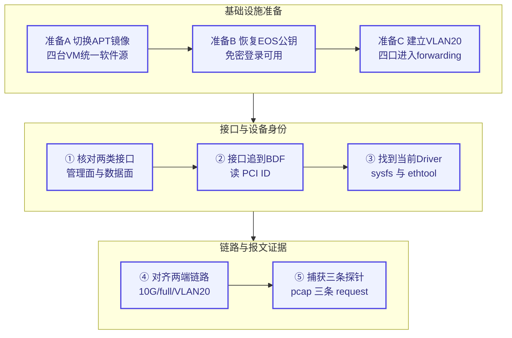
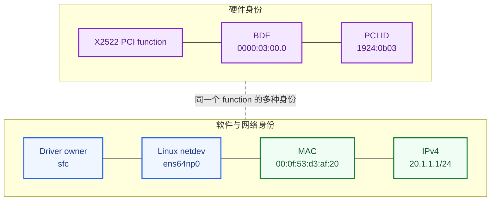
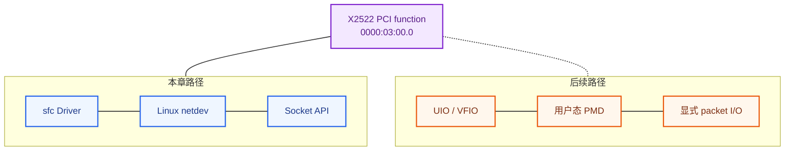
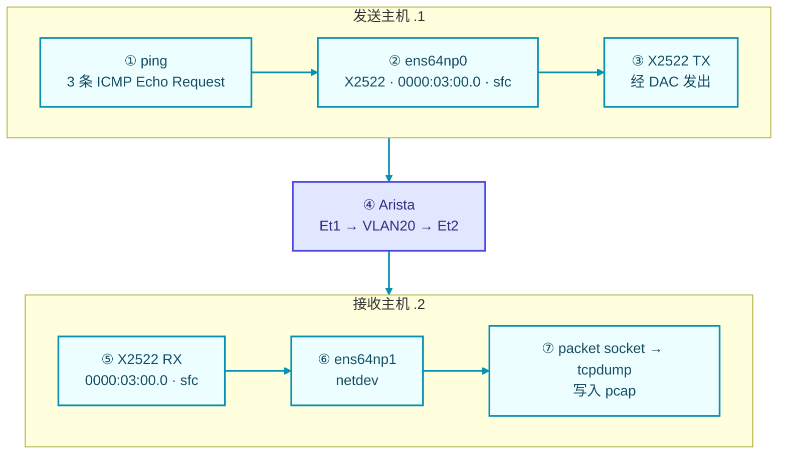

# 第一部分：低延迟实验环境基线——接线、PCIe、万兆 NIC、Driver 与 Arista

## 先把一条报文的路认清

先想一个现场：SSH能登录，接口也显示`UP`，交易应用却说一条行情都没收到。要定位它，不能盯着一个绿色状态；必须沿一条真实交接链逐站核对。

把报文想成一件快递：NIC是主机收发室，PCIe是收发室通往CPU/内存的走廊，Driver是负责搬运的人，Arista是分拣中心，VLAN是分拣中心里互不串货的隔间。接口`UP`只像“门牌已经挂上”，不等于货物已经被应用签收。

Linux 把网络接口对象叫 netdev，例如后面要查的 `ens64np1`；驱动（Driver）是操作系统控制网卡的代码。

本章两端是 `.1` 发送主机（后面扮演 Exchange，交易所）和 `.2` 接收主机（后面扮演 Trader，交易客户端）。沿路核对**接线、设备身份、Driver 归属、链路状态和报文证据**；行情与订单的业务含义从第二部分开始。

本章只做三件事：

1. 从快照状态恢复刷课所需的软件源、登录与VLAN20。
2. 从 Linux 接口名找到对应网卡、驱动和交换机端口。
3. 发送三条 ping 探针，用抓包文件（pcap）留下到达指定网口的证据。

<div style="border-left:6px solid #7e22ce;background:#f3e8ff;padding:12px 16px;border-radius:8px;margin:14px 0;"><span style="display:inline-block;padding:3px 12px;border-radius:6px;background:#7e22ce;color:#fff;font-weight:800;">关键图</span> <span style="font-weight:700;color:#581c87;">先分清登录和探针各走哪条路：每台主机有一个管理虚拟口和一个 X2522 数据口，但只有 X2522 通过一根 DAC 接入 Arista 数据交换机。</span></div>

<div style="background:#f8fafc;border:1px solid #cbd5e1;border-radius:12px;padding:10px;max-width:820px;margin:14px auto;">

</div>

**读图：** 管理虚拟口只负责登录；每台主机只有 X2522 通过**一根全双工 DAC**接入 Arista。这里的连线表示物理或逻辑连接，不表示事件先后。

## 本章学习目标

1. 看懂课程接线，分清每台主机的管理口、X2522 数据口和对应 Arista 端口。
2. 从 `接口名 → BDF → PCI ID → driver → 链路 → 交换机端口 → pcap` 逐层取证。
3. 说清每一层证据能证明什么、还不能证明什么。

## 本章导航

<div style="border-left:6px solid #7e22ce;background:#f3e8ff;padding:12px 16px;border-radius:8px;margin:14px 0;"><span style="display:inline-block;padding:3px 12px;border-radius:6px;background:#7e22ce;color:#fff;font-weight:800;">本章导航</span> <span style="font-weight:700;color:#581c87;">本章分成 3 部分，共 8 个导航项；先用总图看完整路线，再在每节导航卡里查看全章与本组位置。外层大框从上往下推进，框内卡片从左往右执行。</span></div>



固定顺序就是：**基础设施准备 → 接口与设备身份 → 链路与报文证据**。

## 任务地图

| 导航项 | 所属部分 | 这一项回答什么 |
| --- | --- | --- |
| 准备 A：统一软件源与 Builder 工具链 | 基础设施准备 | 统一四台 VM 软件源与 Builder 工具链 |
| 准备 B：恢复 EOS 课程公钥 | 基础设施准备 | 恢复 EOS 课程公钥并先认交换机身份 |
| 准备 C：建立课程交换基础拓扑 | 基础设施准备 | 建立 VLAN20 与四口转发基线 |
| 运行 ①：快速核对两类接口 | 接口与设备身份 | 分清管理口与 X2522 数据口 |
| 运行 ②：接口追到 PCIe BDF | 接口与设备身份 | 把 netdev 追到 PCIe BDF |
| 运行 ③：找到当前 Driver | 接口与设备身份 | 确认当前 Driver 与设备归属 |
| 运行 ④：对齐主机与交换机链路 | 链路与报文证据 | 对齐主机链路与交换机端口 |
| 运行 ⑤：捕获三条真实探针 | 链路与报文证据 | 用 pcap 确认三条探针到达 |

<div style="border-left:6px solid #7e22ce;background:#f3e8ff;padding:12px 16px;border-radius:8px;margin:14px 0;"><span style="display:inline-block;padding:3px 12px;border-radius:6px;background:#7e22ce;color:#fff;font-weight:800;">本章证据边界</span> <span style="font-weight:700;color:#581c87;">本章只回答“当前实验数据路径能不能被识别、接管、连通、抓到探针”。正文展示的是本环境的只读实测输出，每段样例都标注了它来自哪次 RUN，学员重刷时数值和 RUN_ID 都会变化。ping 与 pcap 是最小探针证据，不是交易协议证据。</span></div>

| 本章证据 | 能证明什么 | 不能证明什么 |
| --- | --- | --- |
| 接口地址 | 管理口和数据口没有拿错 | 应用已经处理业务消息 |
| PCIe BDF + PCI ID | netdev 背后是课程预期 X2522 function | 当前链路一定无抖动 |
| Driver `sfc` | 当前由内核自带 `sfc` 驱动接管 | 后续 DPDK/Bypass 也在线 |
| host + EOS link | 两端 10G/full/VLAN20 状态对齐 | 应用级协议已经闭环 |
| ping + pcap | 三条 ICMP 探针到达指定接口 | `.2` 应用已经 `recv + parse` |

## 环境提醒：低延迟 VM 资源基线

低延迟测量像称毫克级重量：秤桌还在晃，后面的三位小数就没有意义。课程快照已经包含下列 VM 资源基线，正常刷课不需要重复设置；只有 VM 被迁移、克隆、修改硬件，或者开机报告资源不足时，才回到 vSphere 复核。这里不做绿色自动实验，因为 Guest 只能看到 vCPU 和内存，不能证明 ESXi 已经应用独占调度。

<div style="border-left:6px solid #7e22ce;background:#f3e8ff;padding:12px 16px;border-radius:8px;margin:14px 0;"><span style="display:inline-block;padding:3px 12px;border-radius:6px;background:#7e22ce;color:#fff;font-weight:800;">留作恢复提醒 · ESXi 低延迟基线</span> <span style="font-weight:700;color:#581c87;">`.1 Exchange` 与 `.2 Trader` 使用同一口径；编辑页只显示配置，成功开机且没有资源错误才说明宿主机接受了它。</span></div>

<div style="background:#f8fafc;border:1px solid #cbd5e1;border-radius:12px;padding:10px;max-width:820px;margin:14px auto;">

</div>

vSphere 编辑页把 `.1 Exchange` 的 Reservation 显示为 `9200 MHz`，Limit 为 Unlimited。这是 `4 × 2300 MHz`，等于本机 Guest 可见的 Xeon Platinum 8336C 标称基频。

<div style="background:#f8fafc;border:1px solid #cbd5e1;border-radius:12px;padding:10px;max-width:820px;margin:14px auto;">

</div>

同一台 VM 的 Latency Sensitivity 为 `High`。黄色提示写明：High 要求 100% CPU 与内存预留。

<div style="background:#f8fafc;border:1px solid #cbd5e1;border-radius:12px;padding:10px;max-width:820px;margin:14px auto;">

</div>

同一页 CPU 区里，`I/O MMU` 必须勾成 `Enabled`。这是 Guest 里那道隔离闸的宿主机开关；后面承包出站闸时，要靠它限制网卡能碰哪段内存。上面这张图是 `.1 Exchange` 的编辑页；`.2 Trader` 用同一口径。`Hardware virtualization` 和 `Performance Counters` 保持关闭——那是另一件事，不要为了「看起来更全」一起勾上。

| vSphere 项 | 本实验值 | 不要做什么 |
| --- | --- | --- |
| CPU | `4 vCPU` | 不在实验中途改 vCPU 数 |
| Reservation | `9200 MHz = 4 × 2300 MHz` | 不按 Turbo 频率填写 `13904 MHz` |
| Limit / Shares | `Unlimited / Normal` | 不设置 CPU Limit |
| Memory | `16 GB` 且 100% 预留 | 不允许 balloon 或 swap 进入测量现场 |
| Latency Sensitivity | `High` | 若开机报资源不足，不绕过检查继续测 |
| Scheduling Affinity | 留空 | 不在 ESXi 层手写 `all` 或 pCPU 列表 |
| I/O MMU | `Enabled` | 不要和「宿主机自己给直通网卡用的 IOMMU」混成一句话 |
| Hardware virtualization | 关闭 | 不要把它当成 I/O MMU 的附属开关 |

vSphere 按 `vCPU 数 × 宿主机标称基频` 封顶 Reservation。本机填 `9400 MHz` 会卡在 `9200 MHz`。`High` 负责让 ESXi 尝试给每个 vCPU 独占物理核；后续实验里的 `taskset` 只负责把 C++ 线程放到 Guest vCPU。`I/O MMU` 只负责把隔离闸暴露给 Guest；Guest 内核还要自己打开，这一步放到真正用这道闸的时候再核对。两层职责不同。测量期间还应避免 vMotion、自动 DRS 迁移和快照任务；如果任何一项无法满足，后续结果只能标为“当前观察”，不能写成稳定优化收益。

## 准备 A：统一软件源与 Builder 工具链

从干净快照刷课时统一四台 VM 的软件源，避免后续安装漂移。四台固定为 Ubuntu 22.04 amd64；首次执行会保留一份原始源文件，并只在 Builder `.101` 安装第二部分需要的 `g++-11` 与 `make`。

<div style="border:2px solid #4f46e5;background:#eef2ff;padding:10px 12px;border-radius:8px;margin:14px 0;"><div style="font-weight:900;color:#312e81;margin-bottom:4px;">导航卡 · 基础设施准备</div><div style="font-weight:700;color:#312e81;margin-bottom:8px;">范畴：工具准备　本步知识：统一四台 VM 软件源与 Builder 工具链　位置：全章第 1 / 8 项 · 本组第 1 / 3 项</div><span style="display:inline-block;margin:3px;padding:4px 10px;border-radius:6px;background:#15803d;color:#fff;font-weight:800;">准备 A：统一软件源与 Builder 工具链</span><span style="display:inline-block;margin:3px;padding:4px 10px;border-radius:6px;background:#f8fafc;border:1px solid #a5b4fc;color:#312e81;font-weight:800;">准备 B：恢复 EOS 课程公钥</span><span style="display:inline-block;margin:3px;padding:4px 10px;border-radius:6px;background:#f8fafc;border:1px solid #a5b4fc;color:#312e81;font-weight:800;">准备 C：建立课程交换基础拓扑</span></div>

<div style="border-left:6px solid #15803d;background:#dcfce7;padding:12px 16px;border-radius:8px;margin:14px 0;"><span style="display:inline-block;padding:3px 12px;border-radius:6px;background:#15803d;color:#fff;font-weight:800;">需要运行 · 准备 A</span> <span style="font-weight:700;color:#14532d;">在【跳板机】以 root 运行；顺序处理 `.1/.2/.11/.101`；修改四台 VM 的 `/etc/apt/sources.list` 并执行 `apt-get update`，只在 `.101` 安装 `g++-11` 与 `make`；预计 1～4 分钟；预期四台索引刷新无错误且 `.101` 打印三项工具路径。</span></div>

```bash
#!/usr/bin/env bash
set -Eeuo pipefail
cd /financial-low-latency
RUN_ID="$(date -u +%Y%m%dT%H%M%SZ)-01-vm-apt-china-mirror"
OUT="Documents/reports/course-runs/$RUN_ID"; mkdir -p "$OUT/raw"
printf 'RUN_ID=%s\n' "$RUN_ID" >"$OUT/run.env"

{
for host in 10.1.1.1 10.1.1.2 10.1.1.11 10.1.1.101; do
  printf '\n===== root@%s =====\n' "$host"
  ssh -o BatchMode=yes -o StrictHostKeyChecking=yes "root@$host" \
    bash -s -- "$host" <<'REMOTE'
set -Eeuo pipefail
REMOTE_HOST="$1"
. /etc/os-release
printf '$ cat /etc/os-release\n'; cat /etc/os-release
printf '$ dpkg --print-architecture\n'; dpkg --print-architecture
if [ "$ID" != ubuntu ] || [ "$VERSION_CODENAME" != jammy ]; then
  printf 'STOP: this card expects Ubuntu jammy\n' >&2; exit 1
fi
[ -e /etc/apt/sources.list.flle-original ] || cp -a /etc/apt/sources.list /etc/apt/sources.list.flle-original
install -m 0644 /dev/stdin /etc/apt/sources.list <<'SOURCES'
deb https://mirrors.aliyun.com/ubuntu/ jammy main restricted universe multiverse
deb https://mirrors.aliyun.com/ubuntu/ jammy-updates main restricted universe multiverse
deb https://mirrors.aliyun.com/ubuntu/ jammy-backports main restricted universe multiverse
deb https://mirrors.aliyun.com/ubuntu/ jammy-security main restricted universe multiverse
SOURCES
printf '$ cat /etc/apt/sources.list\n'; cat /etc/apt/sources.list
printf '$ apt-get -o Acquire::Retries=3 update\n'
apt-get -o Acquire::Retries=3 update
printf '$ apt-cache policy g++-11\n'; apt-cache policy g++-11
if [ "$REMOTE_HOST" = 10.1.1.101 ]; then
  printf '$ apt-get -y install g++-11 make\n'
  DEBIAN_FRONTEND=noninteractive apt-get -o Acquire::Retries=3 -y install g++-11 make
  printf '$ command -v g++-11 make python3\n'; command -v g++-11 make python3
  printf '$ g++-11 --version\n'; g++-11 --version | head -1
fi
REMOTE
done
} 2>&1 | tee "$OUT/raw/result.txt"
(cd "$OUT" && sha256sum raw/result.txt run.env >SHA256SUMS); printf 'evidence=%s\n' "$OUT"
```

<div style="border-left:6px solid #7e22ce;background:#f3e8ff;padding:12px 16px;border-radius:8px;margin:14px 0;"><span style="display:inline-block;padding:3px 12px;border-radius:6px;background:#7e22ce;color:#fff;font-weight:800;">仅供展示 · 输出解读</span> <span style="font-weight:700;color:#581c87;">完整输出按 `===== root@… =====` 分成四段，只有 `.101` 末尾打印工具路径。下面 6 行是 2026-08-29 实测关键行（RUN `20260829T010427Z-01-vm-apt-china-mirror`），完整原文在 `Documents/reports/course-runs/20260829T010427Z-01-vm-apt-china-mirror/raw/result.txt`。</span></div>

```text
$ command -v g++-11 make python3
/usr/bin/g++-11
/usr/bin/make
/usr/bin/python3
$ g++-11 --version
g++-11 (Ubuntu 11.4.0-1ubuntu1~22.04.3) 11.4.0
```

| 输出段 | 关键行 | 判断 |
| --- | --- | --- |
| Builder 工具链 | `/usr/bin/g++-11`、`/usr/bin/make`、`/usr/bin/python3` | 这三项只在 `.101` 打印；第二部分只读 preflight 已到位 |
| 编译器版本 | `g++-11 (Ubuntu 11.4.0-1ubuntu1~22.04.3) 11.4.0` | 紧跟 `$ g++-11 --version`，不是 `command -v` 的下一行 |
| 安装范围 | 完整日志里只有 `.101` 出现 `$ apt-get -y install g++-11 make` | `.1/.2/.11` 只换源并刷新索引 |

<div style="border-left:6px solid #7e22ce;background:#f3e8ff;padding:12px 16px;border-radius:8px;margin:14px 0;"><span style="display:inline-block;padding:3px 12px;border-radius:6px;background:#7e22ce;color:#fff;font-weight:800;">首次安装提示</span> <span style="font-weight:700;color:#581c87;">本轮是干净快照后的第一次安装：`.101` 新装了 `g++-11` 与 `make`，`needrestart` 列出一批延后重启的服务。这不是安装失败。准备 A 不主动重启服务，以最终的三项工具路径和 `g++-11 --version` 为通过条件。</span></div>

<div style="border-left:6px solid #0891b2;background:#cffafe;padding:12px 16px;border-radius:8px;margin:14px 0;"><span style="display:inline-block;padding:3px 12px;border-radius:6px;background:#0891b2;color:#fff;font-weight:800;">完成后继续</span> <span style="font-weight:700;color:#164e63;">四段都完成 `apt-get update` 且没有报错即可进入准备 B；失败时查看终端报错和本次 RUN 的 `raw/result.txt`。镜像格式依据 <a href="https://developer.aliyun.com/mirror/ubuntu">阿里云 Ubuntu 镜像使用说明</a>。</span></div>

## 准备 B：恢复 EOS 课程公钥

首次准备环境，或交换机清空配置重启后执行。公钥只写入 running-config，startup-config 保持原样。写公钥之前，先看这台交换机现在是谁。

<div style="border:2px solid #4f46e5;background:#eef2ff;padding:10px 12px;border-radius:8px;margin:14px 0;"><div style="font-weight:900;color:#312e81;margin-bottom:4px;">导航卡 · 基础设施准备</div><div style="font-weight:700;color:#312e81;margin-bottom:8px;">范畴：工具准备　本步知识：恢复 EOS 课程公钥并先认交换机身份　位置：全章第 2 / 8 项 · 本组第 2 / 3 项</div><span style="display:inline-block;margin:3px;padding:4px 10px;border-radius:6px;background:#f8fafc;border:1px solid #a5b4fc;color:#312e81;font-weight:800;">准备 A：统一软件源与 Builder 工具链</span><span style="display:inline-block;margin:3px;padding:4px 10px;border-radius:6px;background:#15803d;color:#fff;font-weight:800;">准备 B：恢复 EOS 课程公钥</span><span style="display:inline-block;margin:3px;padding:4px 10px;border-radius:6px;background:#f8fafc;border:1px solid #a5b4fc;color:#312e81;font-weight:800;">准备 C：建立课程交换基础拓扑</span></div>

<div style="border-left:6px solid #7e22ce;background:#f3e8ff;padding:12px 16px;border-radius:8px;margin:14px 0;"><span style="display:inline-block;padding:3px 12px;border-radius:6px;background:#7e22ce;color:#fff;font-weight:800;">仅供展示 · 配机前先认身份</span> <span style="font-weight:700;color:#581c87;">2026-08-31 在交换机控制台只读执行 `show version`。下面认型号、EOS 版本和主机名；uptime 与空闲内存会变。序列号已脱敏。</span></div>

```text
fll-arista#show version
Arista DCS-7150S-24-F
Hardware version:      02.00
Serial number:         （设备序列号略）
Hardware MAC address:  001c.7368.e239
System MAC address:    001c.7368.e239

Software image version: 4.23.16M-2GB
Architecture:           i686
Internal build version: 4.23.16M-2GB-40226546.42316M
Internal build ID:      bb71297b-4523-465f-a576-6c7d1cb24663

Uptime:                 0 weeks, 2 days, 11 hours and 55 minutes
Total memory:           4009040 kB
Free memory:            3065276 kB
```

| 看哪一行 | 本轮 | 它表示什么 |
|---|---|---|
| 提示符 `fll-arista#` | 主机名已是课程名 | 连上的是这台实验交换机，不是别的盒子 |
| `DCS-7150S-24-F` / `Hardware version: 02.00` | 24 口 7150S | 后面 cut-through、VLAN20、10G DAC 都落在这台硬件上 |
| `Software image version: 4.23.16M-2GB` | i686，build `4.23.16M-2GB-40226546.42316M` | 公钥、VLAN 命令按这条 EOS 写；7150 最高到 4.23 |
| `Hardware MAC` / `System MAC` | `001c.7368.e239` | 交换机自己的系统 MAC，不是 `.1` / `.2` 网卡 MAC |

这台 7150 除了本章要用的 VLAN20 二层转发，还有第二种官方用法：**TAP Aggregation**（tap / tool）。[Arista TAP Aggregation](https://www.arista.com/assets/data/pdf/Whitepapers/TAP_Aggregation_Product_Brief-2.pdf)把它写成线速复制、过滤，并带纳秒级报文时间戳。官方 MIB 写得很干脆：整机先进入独占复制模式后，普通 bridging / routing 关掉。

> With the tapagg feature, the Arista switching device is first put into an exclusive mode to do the desired packet replication. In this mode, normal switching functions like bridging, routing etc. are disabled.
>
> —— [ARISTA-TAPAGG-MIB](https://www.arista.com/assets/data/docs/MIBS/ARISTA-TAPAGG-MIB.txt)

<div style="border-left:6px solid #7e22ce;background:#f3e8ff;padding:12px 16px;border-radius:8px;margin:14px 0;"><span style="display:inline-block;padding:3px 12px;border-radius:6px;background:#7e22ce;color:#fff;font-weight:800;">仅供展示</span> <span style="font-weight:700;color:#581c87;">先记住这条旁路：主路径继续走；副本进 tap，7150 打时间戳，再从 tool 送给分析机。本章不配。2026-08-31 只读核过现场，实战等到第七章再设计。</span></div>


| 现场核验 | 读数 |
|---|---|
| 命令吃得进 | 空闲 Et3 上，`switchport mode tap`、`switchport mode tool`、`mac timestamp before-fcs` 都被接受；`show active` 能看到。随后已 `default interface Ethernet3` 交还。RUN `20260831T132443Z` |
| 环境还不够 | 只有 Et1 / Et2 / Et11 / Et12 有线；`.11` 没有 PHC。整机 `tap aggregation mode exclusive` 本轮没开，开了会关二层 |
| 只读对照 | `20260831T131936Z`：`Tap-aggregation is not enabled`，没有 monitor session |

准备 C 仍然只建 VLAN20。不要在 Et1 / Et2 上写 `switchport mode tap` 或 `switchport mode tool`，也不要开整机 tapagg。

看完身份，下面才写 running-config 里的公钥。

<div style="border-left:6px solid #15803d;background:#dcfce7;padding:12px 16px;border-radius:8px;margin:14px 0;"><span style="display:inline-block;padding:3px 12px;border-radius:6px;background:#15803d;color:#fff;font-weight:800;">需要运行 · 准备 B</span> <span style="font-weight:700;color:#14532d;">在【跳板机】以 root 运行；读取仓库外 root-only EOS 凭据（`/root/.config/flle/eos_admin_password`，`0600`），凭据缺失时在交互终端提示输入一次密码；只改 running-config；预计数十秒；预期完成后公钥登录可用并打印账户状态。</span></div>

```bash
#!/usr/bin/env bash
set -Eeuo pipefail
cd /financial-low-latency
RUN_ID="$(date -u +%Y%m%dT%H%M%SZ)-01-eos-key-bootstrap"
OUT="Documents/reports/course-runs/$RUN_ID"; mkdir -p "$OUT/raw"
printf 'RUN_ID=%s\n' "$RUN_ID" >"$OUT/run.env"

python3 Documents/newDoc/assets/common/eos-key-bootstrap.py \
  >"$OUT/raw/bootstrap-tool.txt" 2>&1
printf '%s\n' 'show users accounts' >"$OUT/raw/eos.plan"
printf '===== admin@10.1.1.253 · EOS public key =====\n'; python3 Documents/newDoc/assets/common/eos_cli.py --mode show \
  --plan "$OUT/raw/eos.plan" --output "$OUT/raw/eos.txt" \
  2>&1 | tee "$OUT/raw/eos-terminal.txt"
(cd "$OUT" && sha256sum raw/* run.env >SHA256SUMS); printf 'evidence=%s\n' "$OUT"
```

<div style="border-left:6px solid #7e22ce;background:#f3e8ff;padding:12px 16px;border-radius:8px;margin:14px 0;"><span style="display:inline-block;padding:3px 12px;border-radius:6px;background:#7e22ce;color:#fff;font-weight:800;">输出解读 · EOS 原生命令</span> <span style="font-weight:700;color:#581c87;">Python 只负责 SSH 交互和证据保存。公钥尚未可用时，EOS 实际执行下面的命令；若公钥登录已经成功，工具直接返回 `PASS_EOS_PUBLIC_KEY_ALREADY_READY`，不重复配置。</span></div>

```text
switch> enable
switch# configure terminal
switch(config)# username admin ssh-key ssh-ed25519 <公钥正文> flle-course-jump-host-20260722
switch(config)# end
switch# show users accounts
```

| EOS 命令 | 作用 |
| --- | --- |
| `enable` | 必要时从 `>` 进入特权模式 |
| `configure terminal` | 进入 running-config 配置模式 |
| `username admin ssh-key …` | 给 `admin` 安装课程公钥 |
| `end` | 退出配置模式 |
| `show users accounts` | 只读确认账户、角色与公钥 |

`<公钥正文>`由工具读取 `/root/.ssh/flle_course_ed25519.pub` 后替换，不能原样输入；`flle-course-jump-host-20260722`只是公钥的**备注名**，用于标识来源，不是用户名、主机名或密码。命令链没有执行 `copy running-config startup-config` 或 `write memory`，因此只改变 running-config。

<div style="border-left:6px solid #7e22ce;background:#f3e8ff;padding:12px 16px;border-radius:8px;margin:14px 0;"><span style="display:inline-block;padding:3px 12px;border-radius:6px;background:#7e22ce;color:#fff;font-weight:800;">实测输出 · 账户复验</span> <span style="font-weight:700;color:#581c87;">安装工具日志落在 `raw/bootstrap-tool.txt`，EOS 只读复验结果落在 `raw/eos.txt`。下面是 2026-08-25 实测关键行（RUN `20260825T100809Z-01-eos-key-bootstrap`），展示时截断公钥内容。</span></div>

```text
$ show users accounts
user: admin
       role: network-admin
       privilege level: 15
       ssh public key: ssh-ed25519 AAAA…（公钥内容略） flle-course-jump-host-20260722
```

| 关键行 | 判断 |
| --- | --- |
| `user: admin` / `role: network-admin` | 课程使用的账户和角色存在 |
| `privilege level: 15` | 后续 show 与受控配置命令可执行 |
| `ssh public key: ssh-ed25519 …` | 课程公钥已在 running-config 中，免密登录可用 |

<div style="border-left:6px solid #0891b2;background:#cffafe;padding:12px 16px;border-radius:8px;margin:14px 0;"><span style="display:inline-block;padding:3px 12px;border-radius:6px;background:#0891b2;color:#fff;font-weight:800;">完成后继续</span> <span style="font-weight:700;color:#164e63;">终端没有认证或 EOS 命令错误即可进入准备 C；失败时查看本次 RUN 的 `raw/bootstrap-tool.txt` 与 `raw/eos-terminal.txt`。仓库内不记录任何口令。</span></div>

## 准备 C：建立课程交换基础拓扑

每次交换机从干净 startup 启动后执行，由 running-config 建立后续课程共用的 VLAN20、四个实验端口和 Vlan20 地址，并等转发面收敛。

<div style="border:2px solid #4f46e5;background:#eef2ff;padding:10px 12px;border-radius:8px;margin:14px 0;"><div style="font-weight:900;color:#312e81;margin-bottom:4px;">导航卡 · 基础设施准备</div><div style="font-weight:700;color:#312e81;margin-bottom:8px;">范畴：工具准备　本步知识：建立 VLAN20 与四口转发基线　位置：全章第 3 / 8 项 · 本组第 3 / 3 项</div><span style="display:inline-block;margin:3px;padding:4px 10px;border-radius:6px;background:#f8fafc;border:1px solid #a5b4fc;color:#312e81;font-weight:800;">准备 A：统一软件源与 Builder 工具链</span><span style="display:inline-block;margin:3px;padding:4px 10px;border-radius:6px;background:#f8fafc;border:1px solid #a5b4fc;color:#312e81;font-weight:800;">准备 B：恢复 EOS 课程公钥</span><span style="display:inline-block;margin:3px;padding:4px 10px;border-radius:6px;background:#15803d;color:#fff;font-weight:800;">准备 C：建立课程交换基础拓扑</span></div>

<div style="border-left:6px solid #15803d;background:#dcfce7;padding:12px 16px;border-radius:8px;margin:14px 0;"><span style="display:inline-block;padding:3px 12px;border-radius:6px;background:#15803d;color:#fff;font-weight:800;">需要运行 · 准备 C</span> <span style="font-weight:700;color:#14532d;">在【跳板机】以 root 运行；前置是准备 B 已完成；幂等配置 VLAN20、Et1/Et2/Et11/Et12 和 Vlan20，只改 running-config；最多轮询 15 次等四口进入 `forwarding`；预计数十秒；预期打印最终 STP 状态。</span></div>

```bash
#!/usr/bin/env bash
set -Eeuo pipefail
cd /financial-low-latency

RUN_ID="$(date -u +%Y%m%dT%H%M%SZ)-01-switch-course-baseline"
OUT="Documents/reports/course-runs/${RUN_ID}"
mkdir -p "$OUT/raw"
printf 'RUN_ID=%s\n' "$RUN_ID" >"$OUT/run.env"

cat >"$OUT/raw/eos-plan.txt" <<'EOS'
configure terminal
vlan 20
name fll
interface Ethernet1
switchport access vlan 20
spanning-tree portfast
interface Ethernet2
switchport access vlan 20
spanning-tree portfast
interface Ethernet11
switchport access vlan 20
spanning-tree portfast
interface Ethernet12
switchport access vlan 20
spanning-tree portfast
interface Vlan20
ip address 20.1.1.254/24
no ip routing
end
show vlan id 20
show interfaces Ethernet1 status
show interfaces Ethernet2 status
show interfaces Ethernet11 status
show interfaces Ethernet12 status
show ip interface brief
EOS

printf '===== admin@10.1.1.253 · EOS course baseline =====\n'; python3 Documents/newDoc/assets/common/eos_cli.py \
  --mode controlled-config --plan "$OUT/raw/eos-plan.txt" \
  --output "$OUT/raw/eos.txt" 2>&1 | tee "$OUT/raw/eos-terminal.txt"
printf '%s\n' 'show spanning-tree vlan 20' >"$OUT/raw/eos-stp-plan.txt"; ready=0
for attempt in $(seq 1 15); do
  python3 Documents/newDoc/assets/common/eos_cli.py --mode show \
    --plan "$OUT/raw/eos-stp-plan.txt" --output "$OUT/raw/eos-stp.txt" \
    >"$OUT/raw/eos-stp-terminal.txt" 2>&1
  [[ "$(grep -Ec '^Et(1|2|11|12)[[:space:]]+designated[[:space:]]+forwarding' "$OUT/raw/eos-stp.txt")" -eq 4 ]] && { ready=1; break; }; sleep 2
done
cat "$OUT/raw/eos-stp-terminal.txt"; (( ready == 1 ))
(cd "$OUT" && sha256sum raw/*.txt run.env >SHA256SUMS); printf 'evidence=%s\n' "$OUT"
```

<div style="border-left:6px solid #7e22ce;background:#f3e8ff;padding:12px 16px;border-radius:8px;margin:14px 0;"><span style="display:inline-block;padding:3px 12px;border-radius:6px;background:#7e22ce;color:#fff;font-weight:800;">仅供展示 · 输出解读</span> <span style="font-weight:700;color:#581c87;">三条原生命令来自 RUN `20260829T010922Z-01-switch-course-baseline`：VLAN 与地址在 `raw/eos.txt`，STP 在 `raw/eos-stp.txt`。每条命令只看后面那几行重点输出。</span></div>

```text
$ show vlan id 20
20    fll                              active    Cpu, Et1, Et2, Et11, Et12
```

```text
$ show ip interface brief
Management1       10.1.1.253/24       up           up                1500
Vlan20            20.1.1.254/24       up           up                1500
```

```text
$ show spanning-tree vlan 20
Et1              designated forwarding 2000      128.1    P2p Edge
Et2              designated forwarding 2000      128.2    P2p Edge
Et11             designated forwarding 2000      128.11   P2p Edge
Et12             designated forwarding 2000      128.12   P2p Edge
```

| 命令 | 重点输出 | 判断 |
| --- | --- | --- |
| `$ show vlan id 20` | `20 fll active Cpu, Et1, Et2, Et11, Et12` | 课程数据 VLAN 已建立，四个实验口都在里面 |
| `$ show ip interface brief` | `Management1 10.1.1.253/24`、`Vlan20 20.1.1.254/24` | 管理面还是 `.253`；数据面网关和主机 `20.1.1.x` 同网段 |
| `$ show spanning-tree vlan 20` | 四口都是 `designated forwarding` | 转发面已收敛，可以承载报文 |

<div style="border-left:6px solid #0891b2;background:#cffafe;padding:12px 16px;border-radius:8px;margin:14px 0;"><span style="display:inline-block;padding:3px 12px;border-radius:6px;background:#0891b2;color:#fff;font-weight:800;">完成后继续</span> <span style="font-weight:700;color:#164e63;">四个端口同时为 `designated forwarding` 即可进入运行 ①；轮询超时会保留最后一次原始状态并以非零退出停止。本卡只进入 running-config，startup-config 保持原样。</span></div>

## 运行 ①：快速核对两类接口

课程拓扑固定两类接口。先打印这份映射，确认后面所有数据路径证据都落在 X2522 数据口上。

<div style="border:2px solid #4f46e5;background:#eef2ff;padding:10px 12px;border-radius:8px;margin:14px 0;"><div style="font-weight:900;color:#312e81;margin-bottom:4px;">导航卡 · 接口与设备身份</div><div style="font-weight:700;color:#312e81;margin-bottom:8px;">范畴：现场只读　本步知识：分清管理口与 X2522 数据口　位置：全章第 4 / 8 项 · 本组第 1 / 3 项</div><span style="display:inline-block;margin:3px;padding:4px 10px;border-radius:6px;background:#15803d;color:#fff;font-weight:800;">运行 ①：快速核对两类接口</span><span style="display:inline-block;margin:3px;padding:4px 10px;border-radius:6px;background:#f8fafc;border:1px solid #a5b4fc;color:#312e81;font-weight:800;">运行 ②：接口追到 PCIe BDF</span><span style="display:inline-block;margin:3px;padding:4px 10px;border-radius:6px;background:#f8fafc;border:1px solid #a5b4fc;color:#312e81;font-weight:800;">运行 ③：找到当前 Driver</span></div>

### 本步理论：管理面和数据面是两条路

管理口 `ens33 / 10.1.1.x` 像维修通道，负责 SSH 登录和执行命令；X2522 数据口 `ens64np0/ens64np1 / 20.1.1.x` 是课程数据通道，承载后续实验流量和本章探针。两条路在同一台 VM 上，但用途不同：管理口能登录不代表数据面正确。

**理论落到实验：** 脚本对 `.1/.2` 各执行两次 `ip -4 -o addr show`，一次读管理口、一次读数据口，学员据此确认没有拿错网络平面。

<div style="border-left:6px solid #15803d;background:#dcfce7;padding:12px 16px;border-radius:8px;margin:14px 0;"><span style="display:inline-block;padding:3px 12px;border-radius:6px;background:#15803d;color:#fff;font-weight:800;">需要运行 · 运行 ①</span> <span style="font-weight:700;color:#14532d;">在【跳板机】以 root 运行；远端全部只读，不改网络配置；预计数秒；预期依次打印 `.1/.2` 的管理口与 X2522 数据口地址，并保存原始输出。</span></div>

```bash
#!/usr/bin/env bash
set -Eeuo pipefail
cd /financial-low-latency

RUN_ID="$(date -u +%Y%m%dT%H%M%SZ)-01-plane-map"
OUT="Documents/reports/course-runs/${RUN_ID}"
mkdir -p "$OUT/raw"
printf 'RUN_ID=%s\n' "$RUN_ID" >"$OUT/run.env"

{
for item in '10.1.1.1 ens64np0' '10.1.1.2 ens64np1'; do
  read -r host data_if <<<"$item"
  printf '\n===== root@%s =====\n' "$host"
  ssh -o BatchMode=yes -o StrictHostKeyChecking=yes "root@$host" \
    bash -s -- "$data_if" <<'REMOTE'
set -Eeuo pipefail
data_if="$1"
printf '$ ip -4 -o addr show dev ens33\n'
ip -4 -o addr show dev ens33
printf '$ ip -4 -o addr show dev %s\n' "$data_if"
ip -4 -o addr show dev "$data_if"
REMOTE
done
} 2>&1 | tee "$OUT/raw/planes.txt"
(cd "$OUT" && sha256sum raw/planes.txt run.env >SHA256SUMS); printf 'evidence=%s\n' "$OUT"
```

<div style="border-left:6px solid #7e22ce;background:#f3e8ff;padding:12px 16px;border-radius:8px;margin:14px 0;"><span style="display:inline-block;padding:3px 12px;border-radius:6px;background:#7e22ce;color:#fff;font-weight:800;">仅供展示 · 输出解读</span> <span style="font-weight:700;color:#581c87;">四条原生命令来自 RUN `20260829T011305Z-01-plane-map`，完整原文在 `raw/planes.txt`。每条命令只看后面那一行地址。</span></div>

```text
===== root@10.1.1.1 =====
$ ip -4 -o addr show dev ens33
2: ens33    inet 10.1.1.1/24 brd 10.1.1.255 scope global ens33
$ ip -4 -o addr show dev ens64np0
3: ens64np0    inet 20.1.1.1/24 brd 20.1.1.255 scope global ens64np0
```

```text
===== root@10.1.1.2 =====
$ ip -4 -o addr show dev ens33
2: ens33    inet 10.1.1.2/24 brd 10.1.1.255 scope global ens33
$ ip -4 -o addr show dev ens64np1
3: ens64np1    inet 20.1.1.2/24 brd 20.1.1.255 scope global ens64np1
```

<div style="border-left:6px solid #7e22ce;background:#f3e8ff;padding:14px 18px;border-radius:8px;margin:14px 0;">
<div style="font-weight:900;color:#581c87;margin-bottom:8px;">仅供展示 · 看懂一个接口名</div>
<div style="font-weight:700;color:#581c87;">接口名 <code>ens33</code> / <code>ens64np0</code> 来自 systemd/udev 的 <a href="https://www.freedesktop.org/software/systemd/man/latest/systemd.net-naming-scheme.html">可预测网卡命名</a>：以太网前缀 + 固件给出的 PCI 热插拔槽位号；多端口卡再拼上固件端口名。</div>
<pre style="background:#faf5ff;border:1px solid #c4b5fd;padding:12px 14px;border-radius:6px;margin:12px 0 0;overflow-x:auto;color:#3b0764;"><code>ens64np0
│  │ └─ n + p0   n 表示后面跟 phys_port_name；固件端口名就是 p0
│  └──── s64     PCI 热插拔槽位 64（固件编号，不是速率、也不是 ifindex）
└─────── en      Ethernet</code></pre>
</div>

| 课程里的名字 | 拆开以后 | 现场对应 |
| --- | --- | --- |
| `ens33` | `en` + `s33` | 管理虚拟口；单口，没有 `n…` 后缀 |
| `ens64np0` | `en` + `s64` + `n` + `p0` | `.1` 的 X2522 口，`phys_port_name=p0` |
| `ens64np1` | `en` + `s64` + `n` + `p1` | `.2` 的 X2522 口，`phys_port_name=p1` |

**33 和 64 没有换算关系。** 它们是两张不同 PCI 设备各自拿到的槽位号，不是相邻序号，更不是翻倍。`np` 也不是一个单词：`n` 是命名前缀，`p0` / `p1` 才是端口名。

| 命令 | 重点输出 | 判断 |
| --- | --- | --- |
| `.1` `$ ip -4 -o addr show dev ens33` | `2: ens33 inet 10.1.1.1/24` | 管理口，只用于登录 |
| `.1` `$ ip -4 -o addr show dev ens64np0` | `3: ens64np0 inet 20.1.1.1/24` | 数据口；后续 ping 与 pcap 用这个端点 |
| `.2` `$ ip -4 -o addr show dev ens33` | `2: ens33 inet 10.1.1.2/24` | 管理口，只用于登录 |
| `.2` `$ ip -4 -o addr show dev ens64np1` | `3: ens64np1 inet 20.1.1.2/24` | 数据口名称与 `.1` 不同，命令不能互抄 |

<div style="border-left:6px solid #0891b2;background:#cffafe;padding:12px 16px;border-radius:8px;margin:14px 0;"><span style="display:inline-block;padding:3px 12px;border-radius:6px;background:#0891b2;color:#fff;font-weight:800;">关键现象</span> <span style="font-weight:700;color:#164e63;">两台主机都返回 `ens33 / 10.1.1.x` 和各自 X2522 数据口 `/ 20.1.1.x`。若数据口没有 `20.1.1.x`，先停在这一步，不要继续做设备身份和抓包。</span></div>

**下一线索：** 接口映射确认了；下一步从数据口 netdev 追到具体 PCIe function。

## 运行 ②：接口追到 PCIe BDF

`ens64np0` 只是 Linux 当前给 netdev 的名字。本步把它追到硬件身份：PCIe 地址加设备数字 ID。

<div style="border:2px solid #4f46e5;background:#eef2ff;padding:10px 12px;border-radius:8px;margin:14px 0;"><div style="font-weight:900;color:#312e81;margin-bottom:4px;">导航卡 · 接口与设备身份</div><div style="font-weight:700;color:#312e81;margin-bottom:8px;">范畴：现场只读　本步知识：把 netdev 追到 PCIe BDF　位置：全章第 5 / 8 项 · 本组第 2 / 3 项</div><span style="display:inline-block;margin:3px;padding:4px 10px;border-radius:6px;background:#f8fafc;border:1px solid #a5b4fc;color:#312e81;font-weight:800;">运行 ①：快速核对两类接口</span><span style="display:inline-block;margin:3px;padding:4px 10px;border-radius:6px;background:#15803d;color:#fff;font-weight:800;">运行 ②：接口追到 PCIe BDF</span><span style="display:inline-block;margin:3px;padding:4px 10px;border-radius:6px;background:#f8fafc;border:1px solid #a5b4fc;color:#312e81;font-weight:800;">运行 ③：找到当前 Driver</span></div>

### 本步理论：一个网口有多种身份

<div style="border-left:6px solid #7e22ce;background:#f3e8ff;padding:14px 18px;border-radius:8px;margin:14px 0;">
<div style="font-weight:900;color:#581c87;margin-bottom:8px;">仅供展示 · 看懂一个 BDF 地址</div>
<div style="font-weight:700;color:#581c87;">Linux 按 <code>Domain:Bus:Device.Function</code> 编排 PCIe 地址；严格来说 <code>Bus:Device.Function</code> 才是 BDF，现场也常把含 domain 的完整地址简称 BDF。它只在“当前主机看到的 PCIe 拓扑”里有意义：两台主机都显示 <code>0000:03:00.0</code>，不表示同一张物理网卡。</div>
<pre style="background:#faf5ff;border:1px solid #c4b5fd;padding:12px 14px;border-radius:6px;margin:12px 0 0;overflow-x:auto;color:#3b0764;"><code>0000:03:00.0
│    │  │  └─ Function 0
│    │  └──── Device/Slot 00
│    └─────── Bus 03
└──────────── Domain 0000</code></pre>
</div>

`Domain` 是 PCI segment，单机常见 `0000`；`Bus` 是拓扑里的总线编号；`Device` 是这条 bus 上枚举出的设备号，不要直接等同机箱物理槽位；`Function` 是同一设备暴露的功能号，多端口卡或虚拟功能会出现多个 function。

同一件快递会同时有“仓库货位、商品型号和运输标签”。BDF回答网卡在当前主机的哪个function，PCI ID回答厂商与型号，MAC则是可被软件修改的二层标签。三条线索交叉后，即使接口名漂移也能重新找到正确的数据口。

<div style="border-left:6px solid #7e22ce;background:#f3e8ff;padding:12px 16px;border-radius:8px;margin:14px 0;"><span style="display:inline-block;padding:3px 12px;border-radius:6px;background:#7e22ce;color:#fff;font-weight:800;">关键图</span> <span style="font-weight:700;color:#581c87;">图中的连线只表示“这些身份属于同一个 NIC function”，不是事件先后，因此不画方向箭头。</span></div>



**读图：** BDF、PCI ID、Driver、netdev、MAC 和 IPv4 描述同一个对象的不同身份，不能互相替代。

**理论落到实验：** 脚本先用 `readlink` 把 netdev 追到 sysfs 设备路径并取末段作为 BDF，再读 MAC，最后用 `lspci -nn -s <BDF>` 读类别和数字 ID。判断由学员按三段输出完成。

<div style="border-left:6px solid #15803d;background:#dcfce7;padding:12px 16px;border-radius:8px;margin:14px 0;"><span style="display:inline-block;padding:3px 12px;border-radius:6px;background:#15803d;color:#fff;font-weight:800;">需要运行 · 运行 ②</span> <span style="font-weight:700;color:#14532d;">在【跳板机】以 root 运行。读取每台数据口的 sysfs 设备路径、MAC，以及对应 PCI 设备的一行 <code>lspci</code>。</span></div>

```bash
#!/usr/bin/env bash
set -Eeuo pipefail
cd /financial-low-latency

RUN_ID="$(date -u +%Y%m%dT%H%M%SZ)-01-pci-identity"
OUT="Documents/reports/course-runs/${RUN_ID}"
mkdir -p "$OUT/raw"
printf 'RUN_ID=%s\n' "$RUN_ID" >"$OUT/run.env"

{
for item in '10.1.1.1 ens64np0' '10.1.1.2 ens64np1'; do
  read -r host data_if <<<"$item"
  printf '\n===== root@%s · %s =====\n' "$host" "$data_if"
  ssh -o BatchMode=yes -o StrictHostKeyChecking=yes "root@$host" \
    bash -s -- "$data_if" <<'REMOTE'
set -Eeuo pipefail
data_if="$1"
printf '$ readlink -f /sys/class/net/%s/device\n' "$data_if"
readlink -f "/sys/class/net/$data_if/device"
printf '$ cat /sys/class/net/%s/address\n' "$data_if"
cat "/sys/class/net/$data_if/address"
bdf="$(basename "$(readlink -f "/sys/class/net/$data_if/device")")"
printf '$ lspci -nn -s %s\n' "$bdf"
lspci -nn -s "$bdf"
REMOTE
done
} 2>&1 | tee "$OUT/raw/pci-identity.txt"
(cd "$OUT" && sha256sum raw/pci-identity.txt run.env >SHA256SUMS); printf 'evidence=%s\n' "$OUT"
```

<div style="border-left:6px solid #7e22ce;background:#f3e8ff;padding:12px 16px;border-radius:8px;margin:14px 0;"><span style="display:inline-block;padding:3px 12px;border-radius:6px;background:#7e22ce;color:#fff;font-weight:800;">仅供展示 · 输出解读</span> <span style="font-weight:700;color:#581c87;">每台主机三段：sysfs 设备路径、MAC、`lspci` 行。下面是 2026-08-26 实测输出（RUN `20260826T005203Z-01-pci-identity`），`.2` 段结构相同，只有 MAC 末字节不同。</span></div>

```text
===== root@10.1.1.1 · ens64np0 =====
$ readlink -f /sys/class/net/ens64np0/device
/sys/devices/pci0000:03/0000:03:00.0
$ cat /sys/class/net/ens64np0/address
00:0f:53:d3:af:20
$ lspci -nn -s 0000:03:00.0
03:00.0 Ethernet controller [0200]: Solarflare Communications XtremeScale SFC9250 10/25/40/50/100G Ethernet Controller [1924:0b03] (rev 01)
```

<div style="border-left:6px solid #7e22ce;background:#f3e8ff;padding:14px 18px;border-radius:8px;margin:14px 0;">
<div style="font-weight:900;color:#581c87;margin-bottom:8px;">仅供展示 · sysfs、readlink 与 lspci</div>
<div style="font-weight:700;color:#581c87;">本步用三个入口定位同一块 PCI 设备。</div>
<div style="margin-top:10px;color:#3b0764;"><strong>sysfs 是什么：</strong>一种虚拟文件系统，专门把内核里的对象（设备、驱动、模块）导出成目录和文件。它挂在 <code>/sys</code> 上，设备路径都以 <code>/sys/...</code> 开头。<code>/sys/class/net/ens64np0</code> 是这块网口在“网卡这一类”里的入口；里面的 <code>device</code> 是一条捷径，指向真正的 PCI 设备目录。</div>
<div style="margin-top:8px;color:#3b0764;"><strong><code>readlink -f</code></strong>：把捷径一层层走完，打印最终真实路径。解析结果是 <code>/sys/devices/pci0000:03/0000:03:00.0</code>，末段就是 PCIe 地址（BDF）。</div>
<div style="margin-top:8px;color:#3b0764;"><strong><code>lspci</code></strong>：列出本机 PCI/PCIe 设备。<code>-s 0000:03:00.0</code> 只看这一台；<code>-nn</code> 同时给出名称和数字 ID，所以行里会出现 <code>[1924:0b03]</code>。</div>
</div>

| 字段 | 实测例子 | 学员读什么 |
| --- | --- | --- |
| sysfs 设备路径 | `/sys/devices/pci0000:03/0000:03:00.0` | 末段就是完整 PCIe 地址 |
| BDF | `0000:03:00.0` | 后续 driver、`bus-info` 都要与它一致 |
| MAC | `00:0f:53:d3:af:20`（`.2` 为 `…:21`） | 当前二层标签，接口名漂移时辅助定位 |
| 设备类别 | `Ethernet controller [0200]` | 这个地址上是以太网控制器 |
| PCI ID | `[1924:0b03]` | `1924` 厂商、`0b03` 设备，确认是课程 X2522 |
| 修订号 | `(rev 01)` | 当前硬件 revision |

两台主机都显示 `0000:03:00.0`，这是各自独立的 PCIe 拓扑，不是同一张物理卡。`lspci` 显示的设备名是本机 PCI 数据库解析结果，判断硬件型号以数字 ID 为准。

<div style="border-left:6px solid #0891b2;background:#cffafe;padding:12px 16px;border-radius:8px;margin:14px 0;"><span style="display:inline-block;padding:3px 12px;border-radius:6px;background:#0891b2;color:#fff;font-weight:800;">关键现象</span> <span style="font-weight:700;color:#164e63;">逐台核对三点：设备路径以 `0000:03:00.0` 结尾、MAC 是六组十六进制字节、`lspci` 行包含 `Ethernet controller [0200]` 与 `[1924:0b03]`。没有输出通常表示接口名不存在或没有 PCI 父设备；数字 ID 不同表示这个地址上是另一类设备。</span></div>

**下一线索：** 硬件 function 找到了，但“设备存在”不等于“Linux 网络栈正在使用它”。当前是谁拥有它？

## 运行 ③：找到当前 Driver

操作系统已经看见这块 PCI 设备。本步确认：当前由哪个 Linux 驱动在管理它。

<div style="border:2px solid #4f46e5;background:#eef2ff;padding:10px 12px;border-radius:8px;margin:14px 0;"><div style="font-weight:900;color:#312e81;margin-bottom:4px;">导航卡 · 接口与设备身份</div><div style="font-weight:700;color:#312e81;margin-bottom:8px;">范畴：现场只读　本步知识：确认当前 Driver 与设备归属　位置：全章第 6 / 8 项 · 本组第 3 / 3 项</div><span style="display:inline-block;margin:3px;padding:4px 10px;border-radius:6px;background:#f8fafc;border:1px solid #a5b4fc;color:#312e81;font-weight:800;">运行 ①：快速核对两类接口</span><span style="display:inline-block;margin:3px;padding:4px 10px;border-radius:6px;background:#f8fafc;border:1px solid #a5b4fc;color:#312e81;font-weight:800;">运行 ②：接口追到 PCIe BDF</span><span style="display:inline-block;margin:3px;padding:4px 10px;border-radius:6px;background:#15803d;color:#fff;font-weight:800;">运行 ③：找到当前 Driver</span></div>

### 本步理论：先认出当前驱动名字

PCI地址只回答“收发室在哪”；Driver回答“现在由哪个搬运员负责把内核队列与网卡连接起来”。设备出现在`lspci`里，不等于已经有人搬货。本步只核这一件事。

<div style="border-left:6px solid #7e22ce;background:#f3e8ff;padding:12px 16px;border-radius:8px;margin:14px 0;"><span style="display:inline-block;padding:3px 12px;border-radius:6px;background:#7e22ce;color:#fff;font-weight:800;">关键图</span> <span style="font-weight:700;color:#581c87;">同一块 PCI 设备同一时刻走其中一条路径。本章核左边；右边留给后续章节。</span></div>



**理论落到实验：** 一条线索读 `/sys/bus/pci/devices/<BDF>/driver` 指向哪个驱动目录；另一条用 `ethtool -i` 从接口读出 `driver` 和 `bus-info`。两条都指向同一个名字，并且 `bus-info` 与运行 ② 的 BDF 相同。

<div style="border-left:6px solid #15803d;background:#dcfce7;padding:12px 16px;border-radius:8px;margin:14px 0;"><span style="display:inline-block;padding:3px 12px;border-radius:6px;background:#15803d;color:#fff;font-weight:800;">需要运行 · 运行 ③</span> <span style="font-weight:700;color:#14532d;">在【跳板机】以 root 运行。读取每台数据口对应 PCI 设备的 driver 路径，以及 <code>ethtool -i</code> 里的 driver 和 bus-info。</span></div>

```bash
#!/usr/bin/env bash
set -Eeuo pipefail
cd /financial-low-latency

RUN_ID="$(date -u +%Y%m%dT%H%M%SZ)-01-driver-owner"
OUT="Documents/reports/course-runs/${RUN_ID}"
mkdir -p "$OUT/raw"
printf 'RUN_ID=%s\n' "$RUN_ID" >"$OUT/run.env"

{
for item in '10.1.1.1 ens64np0' '10.1.1.2 ens64np1'; do
  read -r host data_if <<<"$item"
  printf '\n===== root@%s · %s =====\n' "$host" "$data_if"
  ssh -o BatchMode=yes -o StrictHostKeyChecking=yes "root@$host" \
    bash -s -- "$data_if" <<'REMOTE'
set -Eeuo pipefail
data_if="$1"
bdf="$(basename "$(readlink -f "/sys/class/net/$data_if/device")")"
printf '$ readlink -f /sys/bus/pci/devices/%s/driver\n' "$bdf"
readlink -f "/sys/bus/pci/devices/$bdf/driver"
printf '$ ethtool -i %s\n' "$data_if"
ethtool -i "$data_if"
REMOTE
done
} 2>&1 | tee "$OUT/raw/driver-owner.txt"
(cd "$OUT" && sha256sum raw/driver-owner.txt run.env >SHA256SUMS); printf 'evidence=%s\n' "$OUT"
```

<div style="border-left:6px solid #7e22ce;background:#f3e8ff;padding:12px 16px;border-radius:8px;margin:14px 0;"><span style="display:inline-block;padding:3px 12px;border-radius:6px;background:#7e22ce;color:#fff;font-weight:800;">仅供展示 · 输出解读</span> <span style="font-weight:700;color:#581c87;">下面摘录RUN `20260826T011956Z-01-driver-owner`的`.1`段8行关键原始字段；完整能力列表与`.2`段保存在RUN。</span></div>

```text
===== root@10.1.1.1 · ens64np0 =====
$ readlink -f /sys/bus/pci/devices/0000:03:00.0/driver
/sys/bus/pci/drivers/sfc
$ ethtool -i ens64np0
driver: sfc
version: 5.15.0-164-generic
firmware-version: 8.0.0.1015 rx1 tx1
bus-info: 0000:03:00.0
```

<div style="border-left:6px solid #7e22ce;background:#f3e8ff;padding:14px 18px;border-radius:8px;margin:14px 0;">
<div style="font-weight:900;color:#581c87;margin-bottom:8px;">仅供展示 · sfc 与 ethtool -i</div>
<div style="margin-top:0;color:#3b0764;"><strong><code>sfc</code> 是什么：</strong>这块 X2522 在 Linux 里的内核网卡驱动模块名。Solarflare 系列网卡的驱动目录就叫 <code>sfc</code>。sysfs 路径末段和 <code>ethtool -i</code> 的 <code>driver</code> 字段都应当是这个名字。</div>
<div style="margin-top:8px;color:#3b0764;"><strong><code>ethtool -i</code></strong>：从网口视角查询当前驱动、驱动版本、固件版本和 PCI 总线地址。</div>
</div>

| 字段 | 实测例子 | 学员读什么 |
| --- | --- | --- |
| sysfs driver 路径 | `/sys/bus/pci/drivers/sfc` | 末段 `sfc` 就是这个 function 当前的 owner |
| `driver` | `sfc` | netdev 由哪个内核模块暴露 |
| `version` | `5.15.0-164-generic` | 当前这份 sfc 自己报的版本。内核自带驱动会报内核发行号；第六部分装厂商驱动后会换成厂商自己的版本号，两套数字不能比大小 |
| `firmware-version` | `8.0.0.1015 rx1 tx1` | 网卡固件版本，与驱动分开看 |
| `bus-info` | `0000:03:00.0` | 必须与运行 ② 的 BDF 一致 |

<div style="border-left:6px solid #0891b2;background:#cffafe;padding:12px 16px;border-radius:8px;margin:14px 0;"><span style="display:inline-block;padding:3px 12px;border-radius:6px;background:#0891b2;color:#fff;font-weight:800;">关键现象</span> <span style="font-weight:700;color:#164e63;">逐台核两组对应：sysfs 末段 <code>sfc</code> 与 <code>driver: sfc</code> 相同，<code>bus-info: 0000:03:00.0</code> 与运行 ② 的 BDF 相同。</span></div>

**下一线索：** 正确 driver 已接管设备，但它仍可能面对断线、低速协商或交换机端口 down。下一步同时检查链路两端。

## 运行 ④：对齐主机与交换机链路

主机的 carrier 表示物理链路已建立；交换机端还要核对状态、速率和 VLAN。本步把两端放在一起核对。

<div style="border:2px solid #4f46e5;background:#eef2ff;padding:10px 12px;border-radius:8px;margin:14px 0;"><div style="font-weight:900;color:#312e81;margin-bottom:4px;">导航卡 · 链路与报文证据</div><div style="font-weight:700;color:#312e81;margin-bottom:8px;">范畴：现场只读　本步知识：对齐主机链路与交换机端口　位置：全章第 7 / 8 项 · 本组第 1 / 2 项</div><span style="display:inline-block;margin:3px;padding:4px 10px;border-radius:6px;background:#15803d;color:#fff;font-weight:800;">运行 ④：对齐主机与交换机链路</span><span style="display:inline-block;margin:3px;padding:4px 10px;border-radius:6px;background:#f8fafc;border:1px solid #a5b4fc;color:#312e81;font-weight:800;">运行 ⑤：捕获三条真实探针</span></div>

### 本步理论：`UP` 至少包含五层不同状态

“门牌挂着、门已打开、地址写对、路线可达、签收单出现”是五件事。Linux与交换机上的`UP`只覆盖其中一部分，因此本步同时看admin、carrier、地址、交换机端口和后续报文证据，不能用一个词替代整条链。

排障最常见的误区是把一个绿色状态当成全部状态。这五层是诊断梯子，不是自动成立的因果链，每层都要用自己的证据闭合。

| 状态层 | 常用证据 | 本层能证明什么 |
| --- | --- | --- |
| admin up | `ip link` | 管理员已经启用接口 |
| carrier up | `ethtool` | 物理信号与链路协商已建立 |
| address/route | `ip addr`、`ip route` | 三层端点和转发选择符合本轮配置 |
| neighbor/可达 | `ip neigh`、`ping` | 端点之间具备 IP 可达性 |
| packet evidence | pcap、NIC/交换机 counter | 观察窗口记录到真实报文 |

<div style="border:2px solid #7e22ce;background:#faf5ff;padding:14px 16px;border-radius:10px;margin:16px 0;">
<div style="font-weight:900;color:#581c87;margin-bottom:10px;">实体链路 · Cisco SFP-H10GB-CU5M</div>

<div style="color:#581c87;font-weight:700;margin-top:10px;">两条数据链路都是 10GBASE-CR SFP+ DAC。照片是 `.1 Exchange ↔ Et1` 这一根 Cisco SFP-H10GB-CU5M（5 米）；`.2 Trader ↔ Et2` 是同类的另一根。主机侧把它读成 `10000Mb/s`、`Full` 与 `Link detected: yes`。</div>
</div>

<div style="border-left:6px solid #15803d;background:#dcfce7;padding:12px 16px;border-radius:8px;margin:14px 0;"><span style="display:inline-block;padding:3px 12px;border-radius:6px;background:#15803d;color:#fff;font-weight:800;">需要运行 · 运行 ④</span> <span style="font-weight:700;color:#14532d;">在【跳板机】以 root 运行。读取 `.1/.2` 数据口的 <code>ethtool</code>，以及交换机 Et1、Et2 和 VLAN20 的状态。</span></div>

```bash
#!/usr/bin/env bash
set -Eeuo pipefail
cd /financial-low-latency

RUN_ID="$(date -u +%Y%m%dT%H%M%SZ)-01-link-pair"
OUT="Documents/reports/course-runs/${RUN_ID}"
mkdir -p "$OUT/raw"
printf 'RUN_ID=%s\n' "$RUN_ID" >"$OUT/run.env"

# 主机侧：到 .1/.2 各读一次数据口 ethtool
for item in '10.1.1.1 ens64np0' '10.1.1.2 ens64np1'; do
  read -r host data_if <<<"$item"
  printf '\n===== root@%s =====\n$ ethtool %s\n' "$host" "$data_if" | tee -a "$OUT/raw/host-links.txt"
  ssh -n -o BatchMode=yes -o StrictHostKeyChecking=yes "root@$host" \
    "ethtool '$data_if'" 2>&1 | tee -a "$OUT/raw/host-links.txt"
done

# 交换机侧：读 Et1、Et2 端口状态和 VLAN20
printf '%s\n' 'show interfaces Ethernet1 status' \
  'show interfaces Ethernet2 status' 'show vlan id 20' >"$OUT/eos.plan"
printf '===== admin@10.1.1.253 · EOS link state =====\n'; python3 Documents/newDoc/assets/common/eos_cli.py --mode show \
  --plan "$OUT/eos.plan" --output "$OUT/raw/arista-links.txt" \
  2>&1 | tee "$OUT/raw/arista-terminal.txt"

(cd "$OUT" && sha256sum raw/* run.env eos.plan >SHA256SUMS); printf 'evidence=%s\n' "$OUT"
```

<div style="border-left:6px solid #7e22ce;background:#f3e8ff;padding:12px 16px;border-radius:8px;margin:14px 0;"><span style="display:inline-block;padding:3px 12px;border-radius:6px;background:#7e22ce;color:#fff;font-weight:800;">仅供展示 · 输出解读</span> <span style="font-weight:700;color:#581c87;">主机 `ethtool` 与三条 EOS 命令来自 RUN `20260829T012210Z-01-link-pair`。`ethtool` 完整能力表在 `raw/host-links.txt`，交换机原文在 `raw/arista-terminal.txt`。每条命令只看后面那几行重点。</span></div>

```text
===== root@10.1.1.1 =====
$ ethtool ens64np0
	Speed: 10000Mb/s
	Duplex: Full
	Port: FIBRE
	Link detected: yes
```

`Port` 是驱动报告的物理端口类别。这份内核 `sfc` 把 X2522 的 SFP+ 笼子报成 `FIBRE`。交换机 Type 给出当前介质名，这里是 `10GBASE-CR`。`.2` 的 `$ ethtool ens64np1` 四行相同。

```text
$ show interfaces Ethernet1 status
Et1               connected    20       full   10G    10GBASE-CR
```

```text
$ show interfaces Ethernet2 status
Et2               connected    20       full   10G    10GBASE-CR
```

```text
$ show vlan id 20
20    fll                              active    Cpu, Et1, Et2, Et11, Et12
```

| 命令 | 重点输出 | 判断 |
| --- | --- | --- |
| `.1` `$ ethtool ens64np0`（`.2` 相同） | `Speed: 10000Mb/s`、`Duplex: Full`、`Link detected: yes` | 主机侧 10G 全双工、carrier 已起来 |
| `$ show interfaces Ethernet1 status` | `Et1 connected 20 full 10G 10GBASE-CR` | `.1` 对端已接入 VLAN20，介质是 DAC |
| `$ show interfaces Ethernet2 status` | `Et2 connected 20 full 10G 10GBASE-CR` | `.2` 对端已接入 VLAN20，介质是 DAC |
| `$ show vlan id 20` | `20 fll active Cpu, Et1, Et2, Et11, Et12` | VLAN20 已启用，四个实验口都在成员里 |

<div style="border-left:6px solid #0891b2;background:#cffafe;padding:12px 16px;border-radius:8px;margin:14px 0;"><span style="display:inline-block;padding:3px 12px;border-radius:6px;background:#0891b2;color:#fff;font-weight:800;">关键现象</span> <span style="font-weight:700;color:#164e63;">主机侧两台都是 `10000Mb/s / Full / yes`；交换机侧 Et1、Et2 都是 `connected / 20 / full / 10G`，VLAN20 为 `active`。出现 `Unknown!`、低于 10G、`Half`、`no` 或 `notconnect` 时，直接指出异常字段属于哪一端。</span></div>

**下一线索：** 两端链路已经起来。下一步在 `.2` 抓包，把三条 ICMP 探针写入 pcap。

## 运行 ⑤：捕获三条真实探针

本步用 ICMP 做一条最小、低风险、容易抓包的数据路径探针，并在接收端留下 pcap。

<div style="border:2px solid #4f46e5;background:#eef2ff;padding:10px 12px;border-radius:8px;margin:14px 0;"><div style="font-weight:900;color:#312e81;margin-bottom:4px;">导航卡 · 链路与报文证据</div><div style="font-weight:700;color:#312e81;margin-bottom:8px;">范畴：现场只读　本步知识：用 pcap 确认三条探针到达　位置：全章第 8 / 8 项 · 本组第 2 / 2 项</div><span style="display:inline-block;margin:3px;padding:4px 10px;border-radius:6px;background:#f8fafc;border:1px solid #a5b4fc;color:#312e81;font-weight:800;">运行 ④：对齐主机与交换机链路</span><span style="display:inline-block;margin:3px;padding:4px 10px;border-radius:6px;background:#15803d;color:#fff;font-weight:800;">运行 ⑤：捕获三条真实探针</span></div>

### 本步理论：在指定数据口抓三条 ICMP 探针

ping回包像寄件人收到“已送达”通知，pcap则是指定收发室留下的原始签收单。两者同时存在，才能证明探针确实走了X2522数据口；它仍不能代替Trader业务进程自己的`recv + parse`收据。

`.1` 从数据口发出三条 ICMP Echo Request。`.2` 的 `tcpdump` 在 `ens64np1` 上把匹配帧写入 pcap。本步要看的就是这三条出现在指定数据口上的报文。

<div style="border-left:6px solid #7e22ce;background:#f3e8ff;padding:12px 16px;border-radius:8px;margin:14px 0;"><span style="display:inline-block;padding:3px 12px;border-radius:6px;background:#7e22ce;color:#fff;font-weight:800;">关键图</span> <span style="font-weight:700;color:#581c87;">先看上排字节怎样进内存，再看下排：抓包留副本，内核继续处理并回应。</span></div>

<div style="background:#f8fafc;border:1px solid #cbd5e1;border-radius:12px;padding:10px;max-width:820px;margin:14px auto;">

</div>

帧从 DAC 进入 X2522 之后，常见内核收包路径是这样：`sfc Driver` 事先在主机内存里备好一批 **RX Buffer**，把它们的地址登记进 **RX Descriptor**。网卡收到帧，取出下一条描述符里的地址，用 **DMA** 把报文字节经 PCIe 直接写进那块内存；搬运本身不需要 CPU 逐字节复制；缓冲区准备和后续处理仍需要 CPU。

内核官方把 [NAPI](https://docs.kernel.org/networking/napi.html) 定义成网络栈的事件处理机制：`the device notifies the host about new events via an interrupt. The host then schedules a NAPI instance to process the events.` 也就是说，**通知的是中断，不是 NAPI**。中断处理里调用 `napi_schedule()` 之后，`sfc` 的 **poll** 才开始工作：它读完成事件，把已经在内存里的帧交给 `ens64np1`。poll 不是再从网卡把字节拉过来。

帧到了 `ens64np1` 之后走两条去向。一条是 **packet socket**：它按 OSI 二层把匹配帧复制一份给 `tcpdump`，写入 pcap。另一条是内核协议栈：IP 层认出这是发给 `20.1.1.2` 的 ICMP Echo Request，ICMP 处理生成一条 Echo Reply，沿 TX 路径从 `ens64np1` 发回 `.1`。`.1` 收到回包，`ping` 才打印 `3 received`。

| 名词 | 它是什么 |
| --- | --- |
| RX Buffer | 接收缓冲区：主机内存（RAM）里由驱动预先备好的一块空间，用来存放收到的报文字节 |
| RX Descriptor | 接收描述符：网卡与驱动共享的一张登记表，每条记录下一帧写入哪块 RX Buffer |
| DMA | Direct Memory Access：网卡经 PCIe 直接读写主机内存，这段搬运不占用 CPU 指令 |
| sfc Driver | 当前接管 X2522 的 Linux 网卡驱动：预先备好 RX Buffer 并登记描述符；poll 时把已经 DMA 进内存的帧交给 netdev |
| NAPI | Linux 网络栈的事件处理机制：中断负责通知并调度；随后驱动的 poll 一批一批处理已经在内存里的包 |
| packet socket | `tcpdump` 观察指定 netdev 上二层报文的入口 |
| pcap | `tcpdump` 写下的报文文件 |

**读图：** 报文字节先经 DMA 写进内存，通知再让 CPU 处理收包工作。之后分成抓包观察和协议栈处理两路：pcap 记录请求的副本，ICMP 回应让发送端看到 `3 received`；抓包工具没有挡在业务必经路径上。

<div style="border-left:6px solid #15803d;background:#dcfce7;padding:12px 16px;border-radius:8px;margin:14px 0;"><span style="display:inline-block;padding:3px 12px;border-radius:6px;background:#15803d;color:#fff;font-weight:800;">需要运行 · 运行 ⑤</span> <span style="font-weight:700;color:#14532d;">在【跳板机】以 root 运行。先在 <code>.2</code> 的 <code>ens64np1</code> 上抓包，再从 <code>.1</code> 发出三条 ICMP 探针，最后回读 pcap。</span></div>

```bash
#!/usr/bin/env bash
set -Eeuo pipefail
cd /financial-low-latency

RUN_ID="$(date -u +%Y%m%dT%H%M%SZ)-01-packet-proof"
OUT="Documents/reports/course-runs/${RUN_ID}"
REMOTE="/var/tmp/$RUN_ID"
mkdir -p "$OUT/raw"
printf 'RUN_ID=%s\n' "$RUN_ID" >"$OUT/run.env"
SSH=(-o BatchMode=yes -o StrictHostKeyChecking=yes)
BPF='icmp[icmptype] = icmp-echo and src 20.1.1.1 and dst 20.1.1.2'

cleanup() {
  ssh -n "${SSH[@]}" root@10.1.1.2 "rm -rf -- '$REMOTE'" >/dev/null 2>&1 || true
}
trap cleanup EXIT

# 先在 .2 启动抓包，过滤 .1 → .2 的 ICMP echo request
ssh -n "${SSH[@]}" root@10.1.1.2 "mkdir -m 700 '$REMOTE'"
ssh -n "${SSH[@]}" root@10.1.1.2 \
  "timeout 8 tcpdump -ni ens64np1 -c 3 -w '$REMOTE/probe.pcap' '$BPF'" \
  >"$OUT/raw/capture.txt" 2>&1 &
CAPTURE_PID=$!
sleep 1

# 再从 .1 数据口发出三条 ping
printf '===== root@10.1.1.1 · ping sender =====\n$ ping -I ens64np0 -c 3 -W 1 20.1.1.2\n' \
  | tee "$OUT/raw/sender.txt"
ssh -n "${SSH[@]}" root@10.1.1.1 \
  'ping -I ens64np0 -c 3 -W 1 20.1.1.2' 2>&1 | tee -a "$OUT/raw/sender.txt"

wait "$CAPTURE_PID"
printf '\n===== root@10.1.1.2 · tcpdump receiver =====\n'
printf '$ timeout 8 tcpdump -ni ens64np1 -c 3 -w %s/probe.pcap %s\n' "$REMOTE" "'$BPF'"
cat "$OUT/raw/capture.txt"

scp "${SSH[@]}" "root@10.1.1.2:$REMOTE/probe.pcap" "$OUT/raw/probe.pcap"
ssh -n "${SSH[@]}" root@10.1.1.2 \
  "tcpdump -nn -r '$REMOTE/probe.pcap'" >"$OUT/raw/receiver.txt" 2>&1
printf '\n$ tcpdump -nn -r %s/probe.pcap\n' "$REMOTE"
cat "$OUT/raw/receiver.txt"
(cd "$OUT" && sha256sum raw/* run.env >SHA256SUMS); printf 'evidence=%s\n' "$OUT"
```

<div style="border-left:6px solid #7e22ce;background:#f3e8ff;padding:12px 16px;border-radius:8px;margin:14px 0;"><span style="display:inline-block;padding:3px 12px;border-radius:6px;background:#7e22ce;color:#fff;font-weight:800;">仅供展示 · 输出解读</span> <span style="font-weight:700;color:#581c87;">三条原生命令来自 RUN `20260829T013035Z-01-packet-proof`：发送端在 `raw/sender.txt`，抓包在 `raw/capture.txt`，回读在 `raw/receiver.txt`。时间戳与 ICMP id 每次会变。每条命令只看后面那几行重点。</span></div>

```text
$ ping -I ens64np0 -c 3 -W 1 20.1.1.2
PING 20.1.1.2 (20.1.1.2) from 20.1.1.1 ens64np0: 56(84) bytes of data.
3 packets transmitted, 3 received, 0% packet loss, time 2033ms
```

```text
$ timeout 8 tcpdump -ni ens64np1 -c 3 -w /var/tmp/20260829T013035Z-01-packet-proof/probe.pcap 'icmp[icmptype] = icmp-echo and src 20.1.1.1 and dst 20.1.1.2'
tcpdump: listening on ens64np1, link-type EN10MB (Ethernet)
3 packets captured
0 packets dropped by kernel
```

```text
$ tcpdump -nn -r /var/tmp/20260829T013035Z-01-packet-proof/probe.pcap
09:30:37.228135 IP 20.1.1.1 > 20.1.1.2: ICMP echo request, id 2, seq 1, length 64
09:30:38.236981 IP 20.1.1.1 > 20.1.1.2: ICMP echo request, id 2, seq 2, length 64
09:30:39.261006 IP 20.1.1.1 > 20.1.1.2: ICMP echo request, id 2, seq 3, length 64
```

| 命令 | 重点输出 | 判断 |
| --- | --- | --- |
| `$ ping -I ens64np0 -c 3 -W 1 20.1.1.2` | `from 20.1.1.1 ens64np0`；`3 packets transmitted, 3 received, 0% packet loss` | 从指定数据口发出，三次都有响应 |
| `$ timeout 8 tcpdump -ni ens64np1 -c 3 -w …` | `listening on ens64np1`；`3 packets captured`；`0 packets dropped by kernel` | 在 `.2` 数据口写入三条，无内核丢包 |
| `$ tcpdump -nn -r …/probe.pcap` | 三条 `20.1.1.1 > 20.1.1.2: ICMP echo request`，`seq 1/2/3` | 方向、类型、序号都对 |

`rtt min/avg/max/mdev` 只是 ping 自带的往返统计，本章不把它当作低延迟性能结论；延迟测量的口径在第四部分统一定义。

<div style="border-left:6px solid #0891b2;background:#cffafe;padding:12px 16px;border-radius:8px;margin:14px 0;"><span style="display:inline-block;padding:3px 12px;border-radius:6px;background:#0891b2;color:#fff;font-weight:800;">关键现象</span> <span style="font-weight:700;color:#164e63;">发送端统计为 `3 transmitted / 3 received / 0% packet loss`；接收端 pcap 出现三条 `.1 → .2` 的 `ICMP echo request`，序号依次 1、2、3。缺序号、方向相反或接口不对时，先检查抓包接口与 BPF。</span></div>

## 本章结案：五层证据怎样拼起来

| 证据 | 证明内容 | 适用范围 |
| --- | --- | --- |
| 接口映射基线 | `ens33` 与 X2522 数据口分别使用课程预设地址 | 当前接口基线 |
| 接口 → MAC → BDF → PCI ID | 当前接口对应预期 X2522 function | 当前设备身份 |
| sysfs + `ethtool -i` | 当前 X2522 由内核自带 `sfc` 驱动管理 | 当前 kernel driver 所有权 |
| host + switch link | 两端物理连接与 10G/full 协商状态正常 | 当前链路状态 |
| sender + receiver pcap | 三条真实探针到达 `.2` X2522 | 当前三报文观察窗口 |

<div style="border-left:6px solid #7e22ce;background:#f3e8ff;padding:12px 16px;border-radius:8px;margin:14px 0;"><span style="display:inline-block;padding:3px 12px;border-radius:6px;background:#7e22ce;color:#fff;font-weight:800;">关键图</span> <span style="font-weight:700;color:#581c87;">本章五层证据拼成这条路径：`.1` 的 ping 从数据口发出，经 Arista VLAN20 到达 `.2`，由 `tcpdump` 写入 pcap。</span></div>



**读图：** ①～③ 是发送端身份与出口；④ 是交换机 VLAN20 转发；⑤～⑦ 是接收端身份与 pcap。本章证据停在 `.2` 的 pcap。四台远端恢复时，本章还会在全新 `.101` 物化构建工具；第二部分再从唯一持久的 `.111` 管理机恢复 Exchange、AUTO、MANUAL 和网页，让 `.2` 应用第一次真正 `recv + parse` 行情并完成订单闭环。

## 理解检查

1. `.1` 和 `.2` 各有哪两类接口？真正通过 DAC 接入 Arista 的是哪一个？
2. `readlink`、`lspci`、`ethtool` 和 `tcpdump` 分别从哪个观察窗口取证？
3. `ens64np0`、`0000:03:00.0`、`1924:0b03` 和 `sfc` 分别是什么身份？
4. 主机显示 `Link detected: yes`，这一层证明了什么？本章的报文证据停在哪里？
5. ping 和接收端 pcap 共同证明到哪里？第二部分从哪一层继续？

## 参考答案

1. 每台主机有管理口 `ens33` 和 X2522 数据口（`.1` 是 `ens64np0`，`.2` 是 `ens64np1`）。通过 DAC 接入 Arista 的是各自的 X2522 数据口。
2. `readlink` 从 sysfs 追到 PCIe function；`lspci` 按 BDF 读设备类别和 PCI ID；`ethtool -i` 看 Driver 与 `bus-info`，不带 `-i` 看链路；`tcpdump` 在指定 netdev 上观察二层报文并写入 pcap。
3. `ens64np0` 是 Linux netdev 名；`0000:03:00.0` 是这台主机上的 PCIe 地址（BDF）；`1924:0b03` 是 PCI vendor/device ID；`sfc` 是当前接管这块卡的 Linux 驱动。
4. `Link detected: yes` 证明本端物理链路已经协商起来。本章报文证据停在 `.2` 的 `ens64np1` 上的 pcap。
5. ping 的 `3 received` 加上 pcap 里三条 `.1 → .2` echo request，证明探针到达指定数据口。第二部分从应用层继续：部署 C++ Exchange 与两个独立 Trader，让程序接收行情、形成交易意图并完成第一笔纸面订单。

## 外部参考资料

| 资料 | 本章用途 |
| --- | --- |
| [systemd.net-naming-scheme(7)](https://www.freedesktop.org/software/systemd/man/latest/systemd.net-naming-scheme.html) | `ens33` / `ens64np0` 这类可预测网卡名怎么拼出来 |
| [sysfs(5)](https://man7.org/linux/man-pages/man5/sysfs.5.html) | `/sys`、`/sys/class/net` 是内核摊开的设备目录 |
| [readlink(1)](https://man7.org/linux/man-pages/man1/readlink.1.html) | `-f` 沿着符号链接走到真实路径 |
| [lspci(8)](https://man7.org/linux/man-pages/man8/lspci.8.html) | 按 PCI 地址列出设备类别与数字 ID |
| [Linux PCI sysfs](https://docs.kernel.org/PCI/sysfs-pci.html) | PCI function 与 sysfs 身份入口 |
| [Linux ethtool netlink](https://docs.kernel.org/networking/ethtool-netlink.html) | driver 与 link 状态接口 |
| [Linux networking scaling](https://docs.kernel.org/networking/scaling.html) | 后续 queue/RSS/CPU 路径入口 |
| [tcpdump man page](https://www.tcpdump.org/manpages/tcpdump.1.html) | 接收端 pcap 与 BPF 过滤 |
| [Linux NAPI](https://docs.kernel.org/networking/napi.html) | 设备用中断通知主机，再调度 NAPI poll 处理已在内存里的收包事件 |
| [Linux packet socket `packet(7)`](https://man7.org/linux/man-pages/man7/packet.7.html) | packet socket 在 device driver / OSI Layer 2 级别接收原始报文 |
| [Arista 7150S family paper](https://www.arista.com/assets/data/pdf/Whitepapers/Arista_7150S_Family_WP.pdf) | 交换平台、cut-through 与 PTP 定位 |
| [Arista TAP Aggregation](https://www.arista.com/assets/data/pdf/Whitepapers/TAP_Aggregation_Product_Brief-2.pdf) | tap / tool 复制与纳秒级时间戳 |
| [ARISTA-TAPAGG-MIB](https://www.arista.com/assets/data/docs/MIBS/ARISTA-TAPAGG-MIB.txt) | 整机 tapagg 为独占模式，关闭普通 bridging / routing |
| [Timestamping on the 7150 Series](https://arista.my.site.com/AristaCommunity/s/article/timestamping-on-the-7150-series) | 入向记时、出向写入；也可打在生产交换机的镜像副本上 |
| [Configure the Virtual Machine Latency Sensitivity](https://techdocs.broadcom.com/us/en/vmware-cis/vsphere/vsphere/9-0/configure-the-virtual-machine-latency-sensitivity.html) | High 要求 CPU 预留与 100% 内存预留 |
| [Performance Tuning for Latency-Sensitive Workloads](https://www.vmware.com/docs/perf-latency-tuning-vsphere8) | Reservation 通常按基频 × vCPU 填写 |
