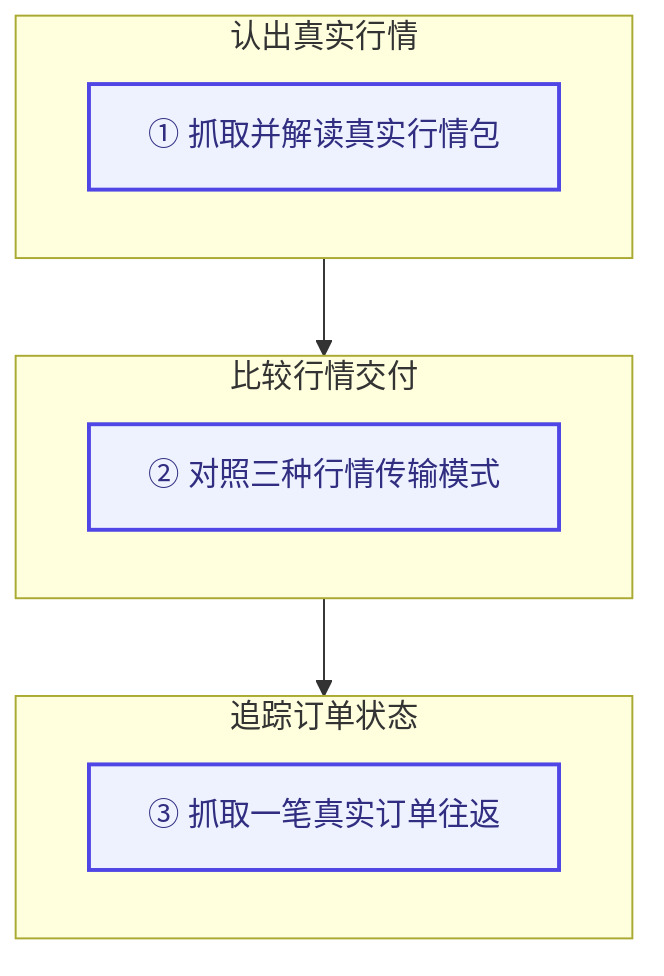

# 第三部分：真实交易流量与协议——从行情事件到订单回报

## ITCH 与 OUCH 是什么

第二章已经让行情刷新、订单成交。本章把这两个屏幕现象打开来看：**一条行情包里写了什么，为什么同一条行情会有多个副本，怎样从报文确认一笔订单成交。**

把协议想成信件：ITCH 是市场发来的行情内容，MoldUDP64 是带编号的 UDP 信封；OUCH 是下单与回执的内容，SoupBinTCP 在 TCP 字节流里标出每封信的边界。先记住这两组搭配，字段用到时再拆。

| 内容与信封 | 谁发给谁 | 本章看什么 |
| --- | --- | --- |
| ITCH / MoldUDP64 | Exchange `.1` → 行情接收程序 `.2` | 行情事件、消息序号、重复与缺失 |
| OUCH / SoupBinTCP | `.2` → `.1` 下单，`.1` → `.2` 返回回执 | 同一笔请求是否被接收、成交或拒绝 |

ITCH 与 OUCH 是 Nasdaq 的协议产品名。行情可以用单播或组播交付；本课订单则各用一条 TCP 长连接。下面的规范是查字段的依据，课堂先沿两条业务路径看实包。

| 官方入口 | 本章采用什么 |
| --- | --- |
| [TotalView-ITCH 5.0](https://www.nasdaqtrader.com/content/technicalsupport/specifications/dataproducts/NQTVITCHSpecification_5.0.pdf) | AAPL/NVDA 历史订单事件与成交事件 |
| [MoldUDP64](https://www.nasdaqtrader.com/content/technicalsupport/specifications/dataproducts/moldudp64.pdf) | 行情的 UDP 信封：session、sequence、一包里有几条 ITCH |
| [OUCH 5.0](https://www.nasdaqtrader.com/content/technicalsupport/specifications/TradingProducts/OUCH5.0.pdf) | Enter Order 与 Accepted / Executed / Rejected 的消息布局 |
| [SoupBinTCP](https://www.nasdaqtrader.com/content/technicalsupport/specifications/dataproducts/soupbintcp.pdf) | 订单 TCP 连接的登录与分帧 |
| [Nasdaq ITCH 数据入口](https://emi.nasdaq.com/ITCH/) | 本课历史样例的公开下载入口 |

这里沿用网络工程师熟悉的 Ethernet、IP、UDP、TCP；新增的行情和订单字段随报文逐层解释。

## 本章学习目标

1. 从真实 pcap 指出 **MoldUDP64 的 session / sequence / message count** 与其中的 ITCH 事件，并说明它们怎样驱动行情接收与整理程序（Feed Handler）。
2. 切换单播、组播与双路，依据**目的端点、membership 和 sequence 重合**解释复制发生在哪里，以及应用为什么仍要去重。
3. 在 MANUAL 的既有 TCP 长连接里找到一次 OUCH `O → A → E`，用请求编号 **UserRefNum** 把请求、接收和成交关联起来，同时不干扰并行的 AUTO client。

## 本章导航

<div style="border-left:6px solid #7e22ce;background:#f3e8ff;padding:12px 16px;border-radius:8px;margin:14px 0;"><span style="display:inline-block;padding:3px 12px;border-radius:6px;background:#7e22ce;color:#fff;font-weight:800;">本章导航</span> <span style="font-weight:700;color:#581c87;">本章分成 3 部分，共 3 个导航项；先用总图看完整路线，再在每节导航卡里查看全章与本组位置。依次认出真实行情、比较行情交付、追踪订单状态；所用应用继续保持在线。</span></div>



固定顺序就是：**认出真实行情 → 比较行情交付 → 追踪订单状态**。

## 任务地图

| 导航项 | 所属部分 | 这一项回答什么 |
| --- | --- | --- |
| 运行 ①：抓取并解读真实行情包 | 认出真实行情 | 从 pcap 读出 MoldUDP64 与 ITCH 字段 |
| 运行 ②：对照三种行情传输模式 | 比较行情交付 | 对照单播、组播与双路复制位置 |
| 运行 ③：抓取一笔真实订单往返 | 追踪订单状态 | 用 UserRefNum 关联 OUCH 请求与回报 |

本章展示实验室线路上的报文；ITCH 内容取自官方历史样例，订单由课程系统做纸面撮合。运行①已有干净快照取证；运行②③展示较早现场样例，仍待沿同一基线重新取证。各输出旁标明批次，完整范围见[教师说明](TEACHER-FLOW-NOTES.md#第-03-章)。

## 行情向外发布，订单带着回执回来

<div style="border-left:6px solid #7e22ce;background:#f3e8ff;padding:12px 16px;border-radius:8px;margin:14px 0;"><span style="display:inline-block;padding:3px 12px;border-radius:6px;background:#7e22ce;color:#fff;font-weight:800;">关键图</span> <span style="font-weight:700;color:#581c87;">上半条是 Exchange 单向发布的行情事件；下半条是两个 client 各自拥有的双向订单会话。网页只观察和控制，不在这两条 C++ 报文热路径中。</span></div>

<div style="background:#f8fafc;border:1px solid #cbd5e1;border-radius:12px;padding:10px;max-width:820px;margin:14px auto;">

</div>

### 先说清楚：“真实”到哪一层

| 层次 | 当前事实 | 不能说成什么 |
| --- | --- | --- |
| ITCH 内容 | 来自 Nasdaq 2026-06-12 官方历史样例，过滤 AAPL/NVDA 时保留消息原字节 | 当前正在接收 Nasdaq 生产行情 |
| Mold / Soup / OUCH | 课程 C++ 应用按公开字段布局生成；session、sequence、订单与回报都属于本次实验 | 已通过 Nasdaq 认证、可以连接生产系统 |
| Ethernet / IP / UDP / TCP | `.1 ↔ .2` 经过 X2522、DAC 与 Arista 的真实实验室报文，pcap 从 `.2 ens64np1` 取得 | 抓到的是交易所机房原始线缆上的包 |
| 成交 | Exchange 在历史订单簿最佳对手价上做纸面撮合，AUTO/MANUAL 结果进入本轮账本 | 真实资金、券商清算或交易所正式成交 |

角色也要固定：**`.2 Trader` 代表已经拥有订单通道的 Nasdaq 会员侧订单接入程序（member-side order-entry client）。** 本课省略普通投资者到券商、券商柜台、MPID/账户授权与生产级盘前风控，不把 `.2 → .1` 讲成任何个人都能绕过券商直连交易所。

## 运行 ①：抓取并解读真实行情包

网页已经显示 AAPL/NVDA 盘口，但网页状态是加工后的结果。本卡向下走到 `.2` 的 `ens64np1`，保存 200 个真实组播 datagram，并从同一 pcap 逐层取出 Mold 与 ITCH 字段。

<div style="border:2px solid #4f46e5;background:#eef2ff;padding:10px 12px;border-radius:8px;margin:14px 0;"><div style="font-weight:900;color:#312e81;margin-bottom:4px;">导航卡 · 认出真实行情</div><div style="font-weight:700;color:#312e81;margin-bottom:8px;">范畴：现场只读　本步知识：从 pcap 读出 MoldUDP64 与 ITCH 字段　位置：全章第 1 / 3 项 · 本组第 1 / 1 项</div><span style="display:inline-block;margin:3px;padding:4px 10px;border-radius:6px;background:#15803d;color:#fff;font-weight:800;">运行 ①：抓取并解读真实行情包</span></div>

### 本步理论：ITCH 是事件流，Mold 是交付信封

**一份 ITCH Add Order 不是“当前股价”对象，而是订单簿状态机的一次输入。** `A/F` 增加订单，`E/C/X/D/U` 执行、取消、删除或替换已有订单，`P` 表示成交。很多后续事件只携带 `order_reference_number`，所以 **Feed Handler 必须先保留前序订单状态**，才知道它影响 AAPL 还是 NVDA、哪一档数量在变。

MoldUDP64 不理解这些业务事件，它只在一批 ITCH 消息前面加三个交付字段。继续用信封来读：**`session` 是邮批，`sequence` 是流水号，`message_count` 告诉收件人信封里装了几封内件**。收件人先核信封是否连续，再把每条 ITCH 交给订单簿状态机。

| MoldUDP64 offset | 宽度 | 字段 | 当前应用怎样使用 |
| ---: | ---: | --- | --- |
| 0 | 10 | Session | 本课按市场日期与回放轮次生成，例如 `0612260001`；**新轮次触发 Feed 与纸面状态换代** |
| 10 | 8 | Sequence Number | 本包**第一条** ITCH 的序号；包内第 `n` 条是 `first_sequence+n` |
| 18 | 2 | Message Count | 后面有多少个 `2-byte length + ITCH message` |
| 20… | 变长 | Message Length + Message | 逐条恢复 ITCH 边界，**不把 UDP payload 当成单一固定 Tick** |

同一套 20 字节头还会变成心跳包、收市包和方向相反的补包请求，下面这张图把它们画在一起。

<div style="border-left:6px solid #7e22ce;background:#f3e8ff;padding:12px 16px;border-radius:8px;margin:14px 0;"><span style="display:inline-block;padding:3px 12px;border-radius:6px;background:#7e22ce;color:#fff;font-weight:800;">仅供展示</span> <span style="font-weight:700;color:#581c87;">这张图回答：UDP payload 怎么切。蓝色 / 青色是头，黄色是 Count，绿色才是 ITCH；虚线框表示后面没有消息。</span></div>

<div style="background:#f8fafc;border:1px solid #cbd5e1;border-radius:12px;padding:10px;max-width:820px;margin:14px auto;">

</div>

上半部分是所有下游包共用的那 20 字节。下半部分是四种情况：**`Count` 在 `1～65534` 时，头后面才跟着绿色的 `Len + ITCH`；`Count` 是 `0`（心跳）或 `0xFFFF`（收市）时，读完 20 字节就结束**。最后一行箭头方向相反，那是接收端发出的补包请求，末尾 2 字节的含义变成“请补几条”。

**本课运行 ① 只会抓到数据包**：当前 Exchange 不发心跳和收市，也没有 Re-request Server，所以应用里出现 `gap` 只表示发现了缺口，不等于已经补回。

接收程序还要把“收到包”变成“连续、只处理一次的事件流”：

| 输入情况 | 应用负责什么 |
| --- | --- |
| Session 改变 | 开始新一轮，重建对应的行情与纸面状态 |
| Sequence 连续 | 按序把 ITCH 事件交给订单簿 |
| 同序号副本再次到达 | 识别重复，避免同一事件应用两次 |
| 序号中间缺了一条 | 留住后续消息、报告缺口；本课以重放新会话恢复，未实现自动补包服务 |

当前 Exchange 为降低等待，每个 Mold datagram 立即发 1 条 ITCH。**“一包一条”是本应用的选择，不是 MoldUDP64 的协议限制**——官方格式允许一包多条，decoder 与自测也支持 `message_count>1`。以后比较 batching 时，要同时算更少的 syscall / 包头开销和凑批带来的等待。

绿色块里面是什么，由下一层回答：**Mold 与 ITCH 是一层套一层，不是两种并列的格式。**

<div style="border-left:6px solid #7e22ce;background:#f3e8ff;padding:12px 16px;border-radius:8px;margin:14px 0;"><span style="display:inline-block;padding:3px 12px;border-radius:6px;background:#7e22ce;color:#fff;font-weight:800;">仅供展示</span> <span style="font-weight:700;color:#581c87;">这张图回答：前面的字段表、包结构图和后面的五种事件表分别对应哪一层。Mold 只负责交付，ITCH 才改订单簿。</span></div>

<div style="background:#f8fafc;border:1px solid #cbd5e1;border-radius:12px;padding:10px;max-width:820px;margin:14px auto;">

</div>

**第 1 层**只回答“这是哪一轮、下一条序号是多少、后面有几封信”。**第 2 层**用 `Len` 把 UDP payload 切成一条条 ITCH。**第 3 层**打开其中一封：先读共同 11 字节，再按 `Type` 读 Body。

<div style="border-left:6px solid #7e22ce;background:#f3e8ff;padding:12px 16px;border-radius:8px;margin:14px 0;"><span style="display:inline-block;padding:3px 12px;border-radius:6px;background:#7e22ce;color:#fff;font-weight:800;">仅供展示</span> <span style="font-weight:700;color:#581c87;">这张图回答：运行 ① 会碰到的五种 ITCH 各自多了哪些字段、Feed Handler 拿它们做什么。紫块相同，后面的 Body 不同。</span></div>

<div style="background:#f8fafc;border:1px solid #cbd5e1;border-radius:12px;padding:10px;max-width:820px;margin:14px auto;">

</div>

图上格子用 [Nasdaq TotalView-ITCH 5.0](https://www.nasdaqtrader.com/content/technicalsupport/specifications/dataproducts/NQTVITCHSpecification_5.0.pdf) 的官方字段名，后面拆包也用这些名字。**括号里的数字是字节宽度**：`Stock(8)` 表示 Stock 宽 8 字节，不是 8 只股票。

| 官方字段 | 它是什么 | 线上长什么样 |
| --- | --- | --- |
| Message Type | 这条 ITCH 是哪一种事件 | 1 字节 ASCII。本卡会碰到 `A` `D` `E` `P` `U` |
| Stock Locate | 当天给这只证券分配的短整数索引，**它不是 Stock** | 2 字节整数 |
| Tracking Number | Nasdaq 内部跟踪号 | 2 字节整数 |
| Timestamp | 这条事件的源时间 | 6 字节整数，自当日午夜起的**纳秒** |
| Order Reference Number | 交易所给这笔挂单发的当日编号。**后面的 `D` / `E` / `U` 靠它找回原来那笔 `A`** | 8 字节整数 |
| Original Order Reference Number | Order Replace 里被换掉的**旧**编号 | 8 字节整数 |
| New Order Reference Number | Order Replace 里新挂上的编号；之后的 `E` / `D` **只引用新号** | 8 字节整数 |
| Buy/Sell Indicator | 订单方向字段 | Add Order 等订单消息用 `B` / `S`；**`P` Trade 从 2014 年起固定为 `B`，不能据此推断真实 resting side** |
| Shares | 这笔挂单有多少股 | 4 字节整数。`5` 就是 5 股 |
| Executed Shares | 这一次成交从原单上扣掉多少股 | 4 字节整数 |
| Stock | 股票代码，解析器按官方名打印 `Stock:` | 8 个 ASCII，左边写代码、右边补空格。**`AAPL` 在线上是 `AAPL` 加 4 个空格，不是整数** |
| Price | 价格 | 4 字节整数，**隐含四位小数**。`2052400` 读成 `205.2400` |
| Match Number | 交易所给这一次成交发的当日编号 | 8 字节整数 |

**`A` 是这组消息里创建展示订单状态的建档消息。** 它一次给出 Stock、Buy/Sell Indicator、Shares 与 Price；后面的 `D` / `E` 往往只带 Order Reference Number，所以 Feed Handler 必须留着当初那笔 `A`。

**`U` 是改价或改量**，官方叫 Order Replace：交易所收回 Original Order Reference Number，发一个 New Order Reference Number。它没有 Stock 和 Buy/Sell Indicator，两项都从当初的 `A` 继承。Feed Handler 按旧号把旧 Price / Shares 从展示簿拿掉，再按新号挂回去；之后的 `E` / `D` 只引用新号。

**`P` 是“成交发生了，但展示簿上本来就没有这笔单”**，官方叫 Trade（Non-Cross），给的是非展示订单的成交细节。它入场时没发过 `A`，所以不能用 `E` 去扣一档看得见的数量。`P` 带 Stock、Shares、Price 与一个 Buy/Sell Indicator；但官方规定该 Indicator 固定为 `B`，**不能拿它判断真实买卖方向**。只重建展示簿的人可以忽略 `P`，因此网页五档数字不动。

**这五种事件改的是网页上的五档盘口，不是「交易记录」里的 Exchange 账本**——账本只记 AUTO / MANUAL 用 OUCH 打下的纸面单，历史 ITCH 不会在那张表里多出一行。盘口的 `L1`～`L5` 是按价格排好的五档，不是 `A/D/E/P/U` 五种消息。

样例 Timestamp `36691827555212` 按上表还原为 `10:11:31.827555212`，与第二部分 `09:30` 回放起点属于同一源时间轴。当前 `ItchBook` 仍按 Stock 这 8 个字符哈希聚合价格档，**改用 Stock Locate 索引是后续可单独测量的优化候选，不是本章已取得的性能结论**。

**理论落到实验：** 你不用在网页上点模式。脚本自己记下当前 `market_mode`，只切到 `MULTICAST`，在 `.2 ens64np1` 抓 200 个组播 UDP，再拆 Mold / ITCH，退出时切回原模式。本卡挑一条 `A` 作为人类可读样例，**一条 Add Order 不代表整个协议**；UNICAST / DUAL 由运行 ② 自动轮换。

等价文件入口：`bash Documents/newDoc/assets/03-live-traffic/01-capture-live-market.sh`。

<div style="border-left:6px solid #15803d;background:#dcfce7;padding:12px 16px;border-radius:8px;margin:14px 0;"><span style="display:inline-block;padding:3px 12px;border-radius:6px;background:#15803d;color:#fff;font-weight:800;">需要运行 · 运行 ①</span> <span style="font-weight:700;color:#14532d;">在【持久管理机 `/financial-low-latency`】以 root 运行；前置是第二部分四服务在线且 `.2 ens64np1` 可抓包；脚本自动切到 MULTICAST、抓 200 个组播包并恢复原模式，你不用改网页；不停止回放或订单进程；实测约 6 秒；预期终端打出一棵 Packet Details 树，里面有当前 session、连续 sequence 和一条 AAPL/NVDA Add Order。</span></div>

```bash
#!/usr/bin/env bash
set -euo pipefail
cd /financial-low-latency
REPO_ROOT=/financial-low-latency
SELF="$REPO_ROOT/Documents/newDoc/assets/03-live-traffic/01-capture-live-market.sh"
TOOLS="$REPO_ROOT/Documents/newDoc/assets/03-live-traffic"
STATE="$REPO_ROOT/Documents/reports/run-state/02-trading-baseline.env"
LABCTL="$REPO_ROOT/apps/flle-trading-lab/scripts/labctl.sh"
source "$STATE"
BASE_RUN_ID="$RUN_ID"
CHAPTER_RUN_ID="$(date -u +%Y%m%dT%H%M%SZ)-03-live-market"
OUT="$REPO_ROOT/Documents/reports/$CHAPTER_RUN_ID"
REMOTE="/var/tmp/$CHAPTER_RUN_ID-market.pcap"
API="${WEB_URL%/}"
mkdir -p "$OUT/raw"
# ~~~~~先确认第二章四个服务还在线~~~~~
bash "$LABCTL" verify "$BASE_RUN_ID" >"$OUT/raw/verify.txt"
# ~~~~~记下当前行情模式；EXIT 时只恢复它，并删掉 .2 上的临时 pcap~~~~~
ORIGINAL_MODE="$(curl -fsS "$API/api/state" | python3 -c 'import json,sys;print(json.load(sys.stdin)["market_mode"])')"
cleanup() {
  curl -fsS -X POST -H 'Content-Type: application/json' -d "{\"market_mode\":\"$ORIGINAL_MODE\"}" "$API/api/market" >/dev/null || true
  ssh root@10.1.1.2 "rm -f '$REMOTE'" || true
}
trap cleanup EXIT
# ~~~~~只切 MULTICAST；不切 UNICAST/DUAL，也不用点网页~~~~~
curl -fsS -X POST -H 'Content-Type: application/json' -d '{"market_mode":"MULTICAST"}' "$API/api/market" >/dev/null
# ~~~~~在 .2 ens64np1 抓 200 个组播 UDP：-nn 不反解名字，-s 0 整帧，-c 200 够数就停~~~~~
ssh root@10.1.1.2 "rm -f '$REMOTE'; timeout 8 tcpdump -i ens64np1 -nn -s 0 -c 200 -w '$REMOTE' 'udp dst port 42120 and dst host 239.20.1.20'" 2>&1 | tee "$OUT/raw/tcpdump.txt"
# ~~~~~拉回管理机后按 Ethernet → IPv4 → UDP → MoldUDP64 → ITCH 5.0 拆同一帧~~~~~
scp "root@10.1.1.2:$REMOTE" "$OUT/raw/live-market.pcap" >/dev/null
python3 "$TOOLS/inspect_market_pcap.py" "$OUT/raw/live-market.pcap" | tee "$OUT/raw/decoded.txt"
# ~~~~~写 run.env 与 SHA；trap EXIT 会把 market_mode 切回 ORIGINAL_MODE~~~~~
{
  printf 'CHAPTER_RUN_ID=%s\nBASE_RUN_ID=%s\n' "$CHAPTER_RUN_ID" "$BASE_RUN_ID"
  printf 'CAPTURE_HOST=10.1.1.2\nCAPTURE_INTERFACE=ens64np1\nORIGINAL_MODE=%s\n' "$ORIGINAL_MODE"
} >"$OUT/run.env"
sha256sum "$SELF" "$TOOLS/pcap_tools.py" "$TOOLS/inspect_market_pcap.py" \
  "$OUT/raw/live-market.pcap" "$OUT/raw/tcpdump.txt" "$OUT/raw/decoded.txt" "$OUT/run.env" >"$OUT/SHA256SUMS"
sha256sum -c "$OUT/SHA256SUMS" >/dev/null
echo "evidence=$OUT"
```

运行结果重点看：**终端里那棵 Packet Details 树**。Ethernet / IPv4 / UDP 用 [Wireshark](https://www.wireshark.org/docs/dfref/) 详情树同名；Mold 用 [MoldUDP64](https://www.nasdaqtrader.com/content/technicalsupport/specifications/dataproducts/moldudp64.pdf) 的 Session / Sequence Number / Message Count；ITCH 按 [TotalView-ITCH 5.0](https://www.nasdaqtrader.com/content/technicalsupport/specifications/dataproducts/NQTVITCHSpecification_5.0.pdf) 解。**Ubuntu 自带的 NASDAQ-ITCH 解析器还是 2.0/3.0，会把 Stock、Shares、Price 读错**，所以绿卡不写 Wireshark GUI 或 `tshark`。

<div style="border-left:6px solid #7e22ce;background:#f3e8ff;padding:12px 16px;border-radius:8px;margin:14px 0;"><span style="display:inline-block;padding:3px 12px;border-radius:6px;background:#7e22ce;color:#fff;font-weight:800;">仅供展示 · 输出解读</span> <span style="font-weight:700;color:#581c87;">先看整窗收据：`tcpdump.txt` 的抓包数与丢包数，`decoded.txt` 开头三行的 packets、path / session 和 sequence 范围。数据来自 RUN `20260829T080513Z-03-live-market`；下面图和表是同一帧的 1～19 行。</span></div>

```text
200 packets captured
0 packets dropped by kernel
pcap_magic=d4c3b2a1 linktype=1 packets=200 mold_packets=200
path=20.1.1.1:54670->239.20.1.20:42120 session=0612260001
sequence=15165566..15165765 message_count=1..1 itch_types=A:75,D:72,E:21,P:4,U:28
```

<div style="border-left:6px solid #7e22ce;background:#f3e8ff;padding:12px 16px;border-radius:8px;margin:14px 0;"><span style="display:inline-block;padding:3px 12px;border-radius:6px;background:#7e22ce;color:#fff;font-weight:800;">仅供展示</span> <span style="font-weight:700;color:#581c87;">这张图就是运行 ① 终端里的 Packet Details 树，来自 RUN `20260829T080513Z-03-live-market` 的 `raw/decoded.txt` Frame 1。左侧 1～19 与下表同一行号、同一字段、同一取值。</span></div>

<div style="background:#f8fafc;border:1px solid #cbd5e1;border-radius:12px;padding:10px;max-width:820px;margin:14px auto;">

</div>

| # | 图上字段 | 图上值 | 学员读什么 |
| ---: | --- | --- | --- |
| 1 | Frame 1 | `100 bytes on wire, 100 bytes captured` | 整帧 100 字节，抓全了 |
| 2 | Ethernet II | `Src: 00:0f:53:d3:af:20, Dst: 01:00:5e:14:01:14` | `.1` 的 X2522 发到组播 MAC |
| 3 | Internet Protocol Version 4 | `Src: 20.1.1.1, Dst: 239.20.1.20` | 在线 Exchange 发到课程组地址 |
| 4 | User Datagram Protocol | `Src Port: 54670, Dst Port: 42120` | 行情 UDP；目的端口是课堂组播 `42120` |
| 5 | MoldUDP64 | — | 交付层；下面 6～9 行属于它 |
| 6 | Session | `0612260001` | Sequence Number 只在这个 session 里解释 |
| 7 | Sequence Number | `15165566` | 这一帧的 Mold 序号 |
| 8 | Message Count | `1` | 这一 UDP 只装一条 ITCH |
| 9 | Message Length | `36` | 这条 ITCH 占 36 字节 |
| 10 | Nasdaq TotalView-ITCH 5.0 | — | 订单簿事件层；下面 11～19 行属于它 |
| 11 | Message Type | `A (Add Order)` | 往订单簿加一笔 |
| 12 | Stock Locate | `8095` | 当天证券短索引，不是 Stock |
| 13 | Tracking Number | `0` | Nasdaq 内部跟踪号；本帧为 0 |
| 14 | Timestamp | `53694827979165` | 自当日午夜起的纳秒 |
| 15 | Order Reference Number | `1442528511` | 后续 Delete / Execute / Replace 用这个号找同一笔 |
| 16 | Buy/Sell Indicator | `B` | 买 |
| 17 | Shares | `20` | 4 字节整数，就是 20 股 |
| 18 | Stock | `NVDA` | 8 字节 ASCII，右边补空格；树上已去掉尾空格 |
| 19 | Price | `2052400` | 隐含四位小数，读成 `205.2400` |

<div style="border-left:6px solid #0891b2;background:#cffafe;padding:12px 16px;border-radius:8px;margin:14px 0;"><span style="display:inline-block;padding:3px 12px;border-radius:6px;background:#0891b2;color:#fff;font-weight:800;">关键现象</span> <span style="font-weight:700;color:#164e63;">请先确认 `mold_packets=200` 与 sequence 范围相差 199，再确认树上 Stock 只可能是 AAPL/NVDA、Price 非零。若端点错误，先查行情模式与 BPF；若 Mold 数量不等于 pcap 数量或 message 边界越界，停在协议封装层。完整证据在本 RUN 的 `raw/live-market.pcap`、`raw/tcpdump.txt` 与 `raw/decoded.txt`。</span></div>

**下一线索：** 一份组播行情已经可见，但页面上还有单播和双路按钮。它们不是三套业务协议，而是同一 Mold/ITCH 字节的三种复制方式。

## 运行 ②：对照三种行情传输模式

本卡不重新制造 gap、duplicate、late 输入。它只切换在线 Exchange 的发送模式，让同一业务事件在真实链路上呈现不同目的端点，再观察双路为什么自然产生 duplicate。

<div style="border:2px solid #4f46e5;background:#eef2ff;padding:10px 12px;border-radius:8px;margin:14px 0;"><div style="font-weight:900;color:#312e81;margin-bottom:4px;">导航卡 · 比较行情交付</div><div style="font-weight:700;color:#312e81;margin-bottom:8px;">范畴：现场只读　本步知识：对照单播、组播与双路复制位置　位置：全章第 2 / 3 项 · 本组第 1 / 1 项</div><span style="display:inline-block;margin:3px;padding:4px 10px;border-radius:6px;background:#15803d;color:#fff;font-weight:800;">运行 ②：对照三种行情传输模式</span></div>

### 本步理论：选择传输模式，就是选择在哪里复制

**单播**像 Exchange 分别派两名快递员，各送一份到 AUTO 和 MANUAL；**组播**像先把一份交给网络分拣中心，再由网络复制给已经“订阅”的接收者；**双路**让两条路线同时送，同一流水号会到达两次。**应用去重不是因为 UDP“坏”，而是因为系统主动选择了冗余路线。**

<div style="border-left:6px solid #7e22ce;background:#f3e8ff;padding:12px 16px;border-radius:8px;margin:14px 0;"><span style="display:inline-block;padding:3px 12px;border-radius:6px;background:#7e22ce;color:#fff;font-weight:800;">关键图</span> <span style="font-weight:700;color:#581c87;">三种模式不改变 Mold/ITCH 内容。单播由发送应用为两个 client 复制；组播只向 group 发一份，主机内两个 socket 通过 membership 接收；双路同时保留两种副本，Feed Handler 按 `(session, sequence)` 只连续交付一次。</span></div>

<div style="background:#f8fafc;border:1px solid #cbd5e1;border-radius:12px;padding:10px;max-width:820px;margin:14px auto;">

</div>

| 模式 | Exchange 实际 `sendto` 目标 | `.2` 上谁接收 | 当前目的 |
| --- | --- | --- | --- |
| `UNICAST` | `.2:42121` 与 `.2:42122` | AUTO 与 MANUAL 各自的 unicast socket | 点到点基线；发送方随接收者数量复制 |
| `MULTICAST` | `239.20.1.20:42120` | 两个进程都已 join 的 multicast socket | 一次发布，多订阅者接收 |
| `DUAL` | group + 两个 unicast 端点 | 每个进程同时从两条路径看到同一 sequence | 教学中的路径冗余；先到副本交付，后到副本去重 |

本卡同时保留三种证据，各回答一个问题：**membership 回答“主机订阅了什么”，pcap 回答“线上到了什么”，应用 duplicate counter 回答“应用怎么处理”**。`ip maddr` 里的 `239.20.1.20 users 2` 只是主机收据，不证明每个业务包都已被应用连续交付。

**双路不是免费可靠性**：它增加网络副本、socket 唤醒、解析和去重工作。真正独立的 Feed A/B 还需要独立发布链、故障域、恢复源和运营控制，本课 `DUAL` 只在同一 `.1 → .2` 路径上验证应用的 first-valid / duplicate 行为。

**理论落到实验：** 三种模式都是 UDP。脚本依次切 `UNICAST`、`MULTICAST`、`DUAL`，用同一个 BPF 抓 `udp dst portrange 42120-42122`；解析器按目的 IP / 端口计数，在 DUAL pcap 里算 sequence 交集，同时读 membership users 与应用 duplicate 增量，退出时恢复原模式。**只比目的端点，不再拆第二棵 Mold / ITCH 树。**

<div style="border-left:8px solid #4f46e5;background:#e0e7ff;padding:14px 18px;border-radius:8px;margin:16px 0;"><span style="display:inline-block;padding:4px 12px;border-radius:6px;background:#4f46e5;color:#fff;font-weight:900;">实验资源与 Profile 卡</span><div style="font-weight:800;color:#312e81;margin-top:8px;">资源：`.1` Exchange、`.2 ens64np1`、UDP `42120–42122`；绑定：现有 AUTO/MANUAL 两个 client；Profile：第二部分普通 Linux 基线；本步变量：只改变 Exchange `market_mode`；保护边界：不停止回放、不改策略、订单连接或接口配置；验证/释放：三份 pcap + membership + duplicate，`trap EXIT` 恢复原模式。</div></div>

等价文件入口：`bash Documents/newDoc/assets/03-live-traffic/02-compare-market-transports.sh`。

<div style="border-left:6px solid #15803d;background:#dcfce7;padding:12px 16px;border-radius:8px;margin:14px 0;"><span style="display:inline-block;padding:3px 12px;border-radius:6px;background:#15803d;color:#fff;font-weight:800;">需要运行 · 运行 ②</span> <span style="font-weight:700;color:#14532d;">在【持久管理机】以 root 运行；前置是运行 ① 通过且应用仍在线；会短时改变 Exchange 行情模式，并在 `.2` 对 UDP `42120-42122` 各抓 120 个包，不改主机网络配置；实测约 4 秒；预期单播只有两个端点、组播只有 group、双路三者都有且 sequence 重合，退出后自动恢复原模式。</span></div>

```bash
#!/usr/bin/env bash
set -euo pipefail
cd /financial-low-latency
REPO_ROOT=/financial-low-latency
SELF="$REPO_ROOT/Documents/newDoc/assets/03-live-traffic/02-compare-market-transports.sh"
TOOLS="$REPO_ROOT/Documents/newDoc/assets/03-live-traffic"
source "$REPO_ROOT/Documents/reports/run-state/02-trading-baseline.env"
BASE_RUN_ID="$RUN_ID"; API="${WEB_URL%/}"
CHAPTER_RUN_ID="$(date -u +%Y%m%dT%H%M%SZ)-03-market-paths"
OUT="$REPO_ROOT/Documents/reports/$CHAPTER_RUN_ID"; mkdir -p "$OUT/raw"
# ~~~~~记下当前行情模式；EXIT 时只恢复它，并删掉 .2 上的临时 pcap~~~~~
ORIGINAL_MODE="$(curl -fsS "$API/api/state" | python3 -c 'import json,sys;print(json.load(sys.stdin)["market_mode"])')"
cleanup() {
  curl -fsS -X POST -H 'Content-Type: application/json' -d "{\"market_mode\":\"$ORIGINAL_MODE\"}" "$API/api/market" >/dev/null || true
  ssh root@10.1.1.2 "rm -f /var/tmp/$CHAPTER_RUN_ID-*.pcap" || true
}
trap cleanup EXIT
# ~~~~~切模式后等 state 回读到同一值；三种模式都抓 udp 42120-42122~~~~~
set_mode() {
  curl -fsS -X POST -H 'Content-Type: application/json' -d "{\"market_mode\":\"$1\"}" "$API/api/market" >/dev/null
  for _ in $(seq 1 20); do
    [ "$(curl -fsS "$API/api/state" | python3 -c 'import json,sys;print(json.load(sys.stdin)["market_mode"])')" = "$1" ] && return; sleep 0.1
  done; return 1
}
capture() {
  set_mode "$1"; remote="/var/tmp/$CHAPTER_RUN_ID-$1.pcap"
  ssh root@10.1.1.2 "rm -f '$remote'; timeout 8 tcpdump -i ens64np1 -nn -s 0 -c 120 -w '$remote' 'udp dst portrange 42120-42122'" 2>&1 | tee "$OUT/raw/$1-tcpdump.txt"
  scp "root@10.1.1.2:$remote" "$OUT/raw/$1.pcap" >/dev/null
}
# ~~~~~先抓 UNICAST，再抓 MULTICAST；BPF 相同，差别只在 Exchange 发往哪~~~~~
capture UNICAST
capture MULTICAST
# ~~~~~DUAL 先记下 duplicate，抓完再等 counter 增加~~~~~
set_mode DUAL
BEFORE="$(curl -fsS "$API/api/state" | python3 -c 'import json,sys;print(json.load(sys.stdin)["feed"]["duplicates"])')"
capture DUAL
for _ in $(seq 1 20); do
  AFTER="$(curl -fsS "$API/api/state" | python3 -c 'import json,sys;print(json.load(sys.stdin)["feed"]["duplicates"])')"; [ "$AFTER" -gt "$BEFORE" ] && break; sleep 0.2
done
FINAL="$(curl -fsS "$API/api/state")"
read -r PENDING GAPS < <(python3 -c 'import json,sys;d=json.load(sys.stdin)["feed"];print(d["pending"], d["gaps"])' <<<"$FINAL")
ssh root@10.1.1.2 'ip maddr show dev ens64np1' >"$OUT/raw/membership.txt"
USERS="$(awk '$1=="inet" && $2=="239.20.1.20" {print $4}' "$OUT/raw/membership.txt")"
# ~~~~~对照三份目的端点、membership 与 duplicate；写 run.env 与 SHA~~~~~
python3 "$TOOLS/inspect_transport_pcaps.py" "$OUT/raw/UNICAST.pcap" "$OUT/raw/MULTICAST.pcap" "$OUT/raw/DUAL.pcap" --duplicates-before "$BEFORE" --duplicates-after "$AFTER" --membership-users "$USERS" --pending "$PENDING" --gaps "$GAPS" | tee "$OUT/raw/decoded.txt"
printf 'CHAPTER_RUN_ID=%s\nBASE_RUN_ID=%s\nORIGINAL_MODE=%s\n' "$CHAPTER_RUN_ID" "$BASE_RUN_ID" "$ORIGINAL_MODE" >"$OUT/run.env"
sha256sum "$SELF" "$TOOLS/pcap_tools.py" "$TOOLS/inspect_transport_pcaps.py" "$OUT"/raw/* "$OUT/run.env" >"$OUT/SHA256SUMS"
sha256sum -c "$OUT/SHA256SUMS" >/dev/null
echo "evidence=$OUT"
```

运行结果重点看：**终端那 5 行对照**。样例来自历史 RUN `20260828T081642Z-03-market-paths`，**干净快照重跑后数字会变，关系应保持**。

<div style="border-left:6px solid #7e22ce;background:#f3e8ff;padding:12px 16px;border-radius:8px;margin:14px 0;"><span style="display:inline-block;padding:3px 12px;border-radius:6px;background:#7e22ce;color:#fff;font-weight:800;">仅供展示 · 输出解读</span> <span style="font-weight:700;color:#581c87;">前三行是三种模式各 120 个 UDP 的目的计数：`multicast` 是 `239.20.1.20:42120`，`auto_unicast` 是 `.2:42121`，`manual_unicast` 是 `.2:42122`。第四行是 membership、DUAL sequence 重合与应用 duplicate。`verdict` 不单独当证据。</span></div>

```text
mode=UNICAST captured=120 multicast=0 auto_unicast=60 manual_unicast=60
mode=MULTICAST captured=120 multicast=120 auto_unicast=0 manual_unicast=0
mode=DUAL captured=120 multicast=40 auto_unicast=40 manual_unicast=40
membership=239.20.1.20 users=2 dual_sequence_overlap=80 duplicate_delta=875 pending=0 gaps=0
verdict=THREE_TRANSPORT_MODES_PASS
```

| 输出行 | 实测例子 | 学员读什么 |
| --- | --- | --- |
| `UNICAST` | `multicast=0 auto_unicast=60 manual_unicast=60` | 没有 group；同一发送方分别发到 AUTO 与 MANUAL |
| `MULTICAST` | `multicast=120 auto_unicast=0 manual_unicast=0` | 线上只有 group，不为两个进程各发一份 |
| `DUAL` | `multicast=40 auto_unicast=40 manual_unicast=40` | 同一窗口里三条 UDP 路径都出现 |
| `users` | `2` | `.2 ens64np1` 上两个 socket 订阅同一 group |
| `dual_sequence_overlap` | `80` | group 与两个 unicast 各 40 个序号重合 |
| `duplicate_delta` | `875` | DUAL 期间应用 duplicate 在涨；它和 120 包窗口不是一对一 |
| `pending` / `gaps` | `0` / `0` | 重复副本没有制造新的业务缺口 |

<div style="border-left:6px solid #0891b2;background:#cffafe;padding:12px 16px;border-radius:8px;margin:14px 0;"><span style="display:inline-block;padding:3px 12px;border-radius:6px;background:#0891b2;color:#fff;font-weight:800;">关键现象</span> <span style="font-weight:700;color:#164e63;">请横向比较三行：每行总计都为 120，但非零目的端点随模式改变；再确认 `users=2`、`dual_sequence_overlap>0`、`duplicate_delta>0` 且 `pending/gaps=0`。若 DUAL 三个端点齐全但 duplicate 不增长，故障在应用分类或状态上报；若 group 为零，先查 Exchange 模式、membership 与交换路径。原始证据位于该 RUN 的 `raw/`。</span></div>

**这一卡不产生延迟排名。** 三次抓取不是受控 benchmark，顺序、缓存、轮询窗口和负载都没有冻结；比较模式或加速技术要等第四部分建立测量合同。

**下一线索：** 行情是 Exchange 面向订阅者的事件发布；订单相反，它需要一条有身份、有状态、可返回多类结果的双向会话。

## 运行 ③：抓取一笔真实订单往返

第二部分已经证明一笔手动 IOC 可以成交。接下来从 `.2` 的现有 TCP 长连接中抓出它真正发出的 OUCH Enter Order，以及 Exchange 返回的 Accepted 和 Executed。

<div style="border:2px solid #4f46e5;background:#eef2ff;padding:10px 12px;border-radius:8px;margin:14px 0;"><div style="font-weight:900;color:#312e81;margin-bottom:4px;">导航卡 · 追踪订单状态</div><div style="font-weight:700;color:#312e81;margin-bottom:8px;">范畴：现场只读　本步知识：用 UserRefNum 关联 OUCH 请求与回报　位置：全章第 3 / 3 项 · 本组第 1 / 1 项</div><span style="display:inline-block;margin:3px;padding:4px 10px;border-radius:6px;background:#15803d;color:#fff;font-weight:800;">运行 ③：抓取一笔真实订单往返</span></div>

### 本步理论：先认回执，再把它对回同一笔订单

报文用一个字母标记消息类型。先认出下单请求和几种回执，再用请求编号把它们连起来：

| 字母 | 官方单词 | 谁发给谁 | 意思 |
| --- | --- | --- | --- |
| `O` | Enter Order | client → Exchange | 我要下一笔单 |
| `A` | Accepted | Exchange → client | 交易所收下了，给了服务端订单号 |
| `E` | Executed | Exchange → client | 这笔单成交了 |
| `J` | Rejected | Exchange → client | 这笔单被拒了；本课也会遇到，但主线验收看的是成交 |

**Accepted 只证明“收下了”，Executed 才证明“成交了”**，所以不能合成一步。`J` 的官方单词是 Rejected，字母不是 `R`。ITCH 行情里也有 `A`（Add Order）和 `E`（Order Executed），那是订单簿事件，不是你这笔手工单的回执。

TCP 长连接像一通不断线的专线电话：**字节按顺序到达，却不会替你标出每句话在哪里结束。** SoupBinTCP 先登录，再用长度和类型切句。OUCH 里 **UserRefNum 把 Accepted / Executed 对回同一笔请求**，ClOrdID 是客户自己写的单号，Match Number 只标识这一次成交。

<div style="border-left:6px solid #7e22ce;background:#f3e8ff;padding:12px 16px;border-radius:8px;margin:14px 0;"><span style="display:inline-block;padding:3px 12px;border-radius:6px;background:#7e22ce;color:#fff;font-weight:800;">关键图</span> <span style="font-weight:700;color:#581c87;">AUTO 与 MANUAL 各有一条长期 TCP 会话，互不暂停。一次 MANUAL IOC 在已有连接中形成三条业务消息；TCP segment 边界不等于 Soup 或 OUCH 消息边界。</span></div>

<div style="background:#f8fafc;border:1px solid #cbd5e1;border-radius:12px;padding:10px;max-width:820px;margin:14px auto;">

</div>

SoupBinTCP 的业务 frame 是 `2-byte big-endian length + 1-byte packet type + payload`。**这是两套字母，不是一种消息的两种写法**：外层 Packet Type 是 Soup 的 `U` / `S`，里层 Type 才是 OUCH 的 `O` / `A` / `E`。读法固定为**「O 在 U 里、A 在 S 里、E 在 S 里」**，不是「U 在 O 里」。TCP 可以把多个 frame 合并进一个 segment，也可以拆开，所以解析器**先按 TCP sequence 重组，再按 Soup Packet Length 切信封，最后打开 Message 里的 OUCH**。

生命周期图回答谁发给谁，下面这张图回答同一条字节怎么套。

<div style="border-left:6px solid #7e22ce;background:#f3e8ff;padding:12px 16px;border-radius:8px;margin:14px 0;"><span style="display:inline-block;padding:3px 12px;border-radius:6px;background:#7e22ce;color:#fff;font-weight:800;">仅供展示</span> <span style="font-weight:700;color:#581c87;">这张图回答：外层 U/S 和里层 O/A/E 怎么套。先按 Packet Length 切开 Soup，再读 Message 里的 OUCH Type；两套字母不要合成一种消息。</span></div>

<div style="background:#f8fafc;border:1px solid #cbd5e1;border-radius:12px;padding:10px;max-width:820px;margin:14px auto;">

</div>

[SoupBinTCP](https://www.nasdaqtrader.com/content/technicalsupport/specifications/dataproducts/soupbintcp.pdf) 的 **Packet Length 从 Packet Type 算到本包结束**，所以 `U` 加 47 字节 Enter Order 时 Length 是 `48`。绿框里是 [OUCH 5.0](https://www.nasdaqtrader.com/content/technicalsupport/specifications/TradingProducts/OUCH5.0.pdf) 的字段名，当前应用把 Appendage Length 固定为 `0`。**Soup 自己也有 `A` / `J` / `O`（登录接受、登录拒绝、登出），和 OUCH 的 `A` / `J` / `O` 不是一层。**

| 官方字段 | 它是哪一层 | 线上长什么样 |
| --- | --- | --- |
| Packet Length | Soup 外层 | 2 字节大端。本卡 `U`+`O` 是 `48`，`S`+`A` 是 `65`，`S`+`E` 是 `37` |
| Packet Type | Soup 外层 | 1 字节 ASCII。本卡业务包是 `U` 和 `S` |
| Message | Soup 外层里的内件 | 变长。本卡整封就是一条 OUCH |
| Type | OUCH 里层 | 1 字节 ASCII。本卡会碰到 `O` `A` `E` |
| UserRefNum | OUCH 里层 | 4 字节整数，**client 自己选**。`O` / `A` / `E` / `J` 都带它，**本卡靠它把三条消息收成一笔** |
| Side | OUCH 里层 | 1 字节 ASCII，client 在 Enter Order 里自己写：**`B` = buy（买），`S` = sell（卖）**。官方另有 `T` sell short、`E` sell short exempt，本卡不出现 |
| Quantity | OUCH 里层 | 4 字节整数。`O` / `A` 是下单股数，**`E` 是这一次成交股数** |
| Symbol | OUCH 里层 | 8 个 ASCII，右边补空格。**OUCH 叫 Symbol，ITCH 叫 Stock** |
| Price | OUCH 里层 | 8 字节整数，**隐含四位小数**。`2968800` 读成 `296.8800` |
| ClOrdID | OUCH 里层 | 14 个 ASCII，**也是 client 自己写**。出现在 `O` / `A` / `J`；**36 字节的 `E` 不带** |
| Order Reference Number | OUCH 里层 | 8 字节整数，**Exchange 在 `A` 里另发**的服务端挂单号 |
| Order State | OUCH 里层 | 1 字节 ASCII：`L` Live 或 `D` Dead |
| Match Number | OUCH 里层 | 8 字节整数，**Exchange 在 `E` 里生成**，标识这一次成交 |
| Appendage Length | OUCH 里层 | 2 字节整数。当前应用固定为 `0` |

两个易混点：Side 的 `S` 是卖，和 **Soup 外层 Packet Type `S`（Sequenced Data）不是一层**；`E` 在 OUCH 里是 Executed，在 Side 取值里却是 sell short exempt。

**这几个号不是同一种身份的几种写法。** [OUCH 5.0](https://www.nasdaqtrader.com/content/technicalsupport/specifications/TradingProducts/OUCH5.0.pdf) 的规则可压成三条：当日订单由 `(logical OUCH Account, UserRefNum)` 唯一识别；ClOrdID 不承担账户内日唯一性检查；Match Number 由 Exchange 分配，用来标识一次成交。当前应用再额外使用 Order Reference Number 表示 Exchange 已接收订单的服务端挂单身份。

<div style="border-left:6px solid #7e22ce;background:#f3e8ff;padding:12px 16px;border-radius:8px;margin:14px 0;"><span style="display:inline-block;padding:3px 12px;border-radius:6px;background:#7e22ce;color:#fff;font-weight:800;">仅供展示</span> <span style="font-weight:700;color:#581c87;">这张图回答：三个 ID 分别由谁决定、出现在 O / A / E 的哪一条。左边两格是 client 自己写的请求身份；右边两格是 Exchange 另发的服务端号。紫 / 青 / 绿三块是同一笔单走完时，哪些号被原样带回、哪个号是新发的。</span></div>

<div style="background:#f8fafc;border:1px solid #cbd5e1;border-radius:12px;padding:10px;max-width:820px;margin:14px auto;">

</div>

| 官方字段 | 谁决定 | 出现在本卡哪些消息 | 它和另外两个的关系 |
| --- | --- | --- | --- |
| UserRefNum | `.2` client 自己选，严格递增 | `O`、`A`、`E`，拒绝时还有 `J` | **主关联键**。官方唯一键是 `(OUCH Account, UserRefNum)`，不是 ClOrdID，也不是 Match Number |
| ClOrdID | `.2` client 自己写 | `O`、`A`，拒绝时还有 `J`；**`E` 不带** | 给人看的客户单号。本课写成 `MANU` / `AUTO` 加同一串 UserRefNum 方便扫读，**这是课程编码，不是官方要求两者相等** |
| Match Number | `.1` Exchange 生成 | **只有 `E`** | 标识这一次成交，**不能代替 UserRefNum 去认“哪一笔订单”**。它由本课纸面 ledger 自增，不能拿去对运行 ① 里的公开成交 |

<div style="border-left:6px solid #7e22ce;background:#f3e8ff;padding:12px 16px;border-radius:8px;margin:14px 0;"><span style="display:inline-block;padding:3px 12px;border-radius:6px;background:#7e22ce;color:#fff;font-weight:800;">仅供展示 · Soup 会话包与实现边界</span> <span style="font-weight:700;color:#581c87;">Soup 管连接和 framing，OUCH 管订单业务。先分清外层 Packet Type，才能解释为什么当前短抓包只出现 `U/S`，也不会把两个协议都使用的字母 `J` 混成一种消息。</span></div>

| Soup packet type | 方向与职责 | 当前应用状态 |
| --- | --- | --- |
| `L` Login Request | client → server，声明账户与期望 session/sequence | 已实现；连接启动时发送，本卡抓包前已完成 |
| `A` Login Accepted | server → client，确认 session 与下一序号 | 已实现；本卡抓包前已完成 |
| `U` / `S` Data | client → server 的 Unsequenced Data；server → client 的 Sequenced Data | 已实现；本卡 pcap 中的 OUCH `O` 在 `U` 内，`A/E` 在两条 `S` 内 |
| `R` / `H` Heartbeat | client → server 的 Client Heartbeat；server → client 的 Server Heartbeat | 只存在 Exchange 收到 `R` 后回复 `H` 的骨架；Trader 未周期发送 `R`，不构成完整判活 |
| `J` Login Rejected | server → client，登录失败后关闭连接 | 未实现；它与 `S` 内携带的 OUCH `J` Rejected 不是同一层消息 |
| `O` / `Z` | client Logout Request；server End of Session | 未实现 |

| OUCH 消息 | 关键字段 | 它证明什么 | 它还没有证明什么 |
| --- | --- | --- | --- |
| `O` Enter Order | UserRefNum、Side、Quantity、Symbol、Price、Time In Force、ClOrdID | client 发出了哪一笔请求 | 不代表 Exchange 已接收或成交 |
| `A` Order Accepted | 相同 UserRefNum/ClOrdID、新 Order Reference Number、Order State | Exchange 已接收并建立订单身份 | 不代表已发生 Execution |
| `E` Order Executed | 相同 UserRefNum、Quantity、Price、Match Number | 该订单发生了成交 | 不等同于完整生产清算或资金交收 |
| `J` Rejected | 相同 UserRefNum、reason | 请求未通过门禁 | 本卡选择可成交 IOC，不主动制造 Reject |

本课实现里，**AUTO 的 UserRefNum 落在 `[1, 2,000,000,000]`，MANUAL 落在 `[2,100,000,000, 4,099,999,999]`**，两个进程还拥有不同 PID、management port 与 TCP source port，所以手动下单和自动策略可以并行。

抓包开始时两条连接早已完成 Soup 登录，**所以 pcap 不会伪称捕获了启动登录**；`sessions.txt` 用 `ss -ntp` 与 PID 文件证明当时确有两条 ESTABLISHED 会话。解析器**只选 ClOrdID 以 `MANU` 开头的流**，并行 AUTO 订单不会被误认为本单。

**理论落到实验：** 在 `.2 ens64np1` 对 `tcp port 43120` 做 4 秒短抓取，同时调用第二部分已验的 `first_trade.py` 发一笔 MANUAL IOC。只读解析器按 TCP sequence 重组两个方向，按 Soup Packet Length 切帧，选出 MANUAL `O`，**再按相同 UserRefNum 找到 `A/E`**；若 Enter Order 落在同一个 TCP segment，就按 Ethernet → IPv4 → TCP → SoupBinTCP → OUCH 打一棵 Packet Details 树。

等价文件入口：`bash Documents/newDoc/assets/03-live-traffic/03-capture-live-order.sh`。

<div style="border-left:6px solid #15803d;background:#dcfce7;padding:12px 16px;border-radius:8px;margin:14px 0;"><span style="display:inline-block;padding:3px 12px;border-radius:6px;background:#15803d;color:#fff;font-weight:800;">需要运行 · 运行 ③</span> <span style="font-weight:700;color:#14532d;">在【持久管理机】以 root 运行；前置是两条 client 会话在线、AAPL 盘口可成交；短时抓取 `.2 ↔ .1:43120` 并提交 1 股 MANUAL 纸面 IOC，AUTO 与行情回放继续独立运行；实测约 5 秒；预期看到两条 TCP session，在 MANUAL flow 中解出相同 UserRefNum 的 OUCH `O/A/E`，并打出 Soup `U` / OUCH Enter Order 的 Packet Details 树。</span></div>

```bash
#!/usr/bin/env bash
set -euo pipefail
cd /financial-low-latency
REPO_ROOT=/financial-low-latency
SELF="$REPO_ROOT/Documents/newDoc/assets/03-live-traffic/03-capture-live-order.sh"
TOOLS="$REPO_ROOT/Documents/newDoc/assets/03-live-traffic"
TRADE_TEST="$REPO_ROOT/apps/flle-trading-lab/tests/first_trade.py"
source "$REPO_ROOT/Documents/reports/run-state/02-trading-baseline.env"
BASE_RUN_ID="$RUN_ID"; API="${WEB_URL%/}"
CHAPTER_RUN_ID="$(date -u +%Y%m%dT%H%M%SZ)-03-live-order"
OUT="$REPO_ROOT/Documents/reports/$CHAPTER_RUN_ID"; mkdir -p "$OUT/raw"
REMOTE="/var/tmp/$CHAPTER_RUN_ID-order.pcap"
cleanup() { ssh root@10.1.1.2 "rm -f '$REMOTE'" || true; }
trap cleanup EXIT
# ~~~~~记下 AUTO/MANUAL PID 和两条已建立的 43120 会话~~~~~
ssh root@10.1.1.2 "printf 'auto_pid='; cat '$RUN_DIR/trader-auto.pid'; printf 'manual_pid='; cat '$RUN_DIR/trader-manual.pid'; ss -ntpH state established '( dport = :43120 )'" >"$OUT/raw/sessions.txt"
# ~~~~~在 .2 ens64np1 后台抓 4 秒 tcp 43120~~~~~
ssh root@10.1.1.2 "rm -f '$REMOTE'; timeout -s INT 4 tcpdump -i ens64np1 -nn -s 0 -U -w '$REMOTE' 'tcp port 43120'" >"$OUT/raw/tcpdump.txt" 2>&1 &
CAPTURE_PID=$!
sleep 0.5
# ~~~~~窗口内发一笔 MANUAL IOC；AUTO 和行情继续跑~~~~~
python3 "$TRADE_TEST" --base-url "$API" >"$OUT/raw/first-trade.txt"
RC=0; wait "$CAPTURE_PID" || RC=$?
[ "$RC" -eq 0 ] || [ "$RC" -eq 124 ]
# ~~~~~拉回后按 Ethernet → IPv4 → TCP → SoupBinTCP → OUCH 拆同一帧~~~~~
scp "root@10.1.1.2:$REMOTE" "$OUT/raw/live-order.pcap" >/dev/null
python3 "$TOOLS/inspect_order_pcap.py" "$OUT/raw/live-order.pcap" "$OUT/raw/sessions.txt" | tee "$OUT/raw/decoded.txt"
# ~~~~~写 run.env 与 SHA；trap EXIT 会删掉 .2 上的临时 pcap~~~~~
printf 'CHAPTER_RUN_ID=%s\nBASE_RUN_ID=%s\nWEB_URL=%s\n' "$CHAPTER_RUN_ID" "$BASE_RUN_ID" "$WEB_URL" >"$OUT/run.env"
sha256sum "$SELF" "$TOOLS/pcap_tools.py" "$TOOLS/inspect_order_pcap.py" "$TRADE_TEST" \
  "$OUT/raw/live-order.pcap" "$OUT/raw/tcpdump.txt" "$OUT/raw/sessions.txt" "$OUT/raw/first-trade.txt" "$OUT/raw/decoded.txt" "$OUT/run.env" >"$OUT/SHA256SUMS"
sha256sum -c "$OUT/SHA256SUMS" >/dev/null
echo "evidence=$OUT"
```

运行结果重点看：**终端先打 6 行身份摘要，再打一棵 Packet Details 树**。Ethernet / IPv4 / TCP 用 [Wireshark](https://www.wireshark.org/docs/dfref/) 详情树同名；Soup 用 [SoupBinTCP](https://www.nasdaqtrader.com/content/technicalsupport/specifications/dataproducts/soupbintcp.pdf) 的 Packet Length / Packet Type；OUCH 按 [OUCH 5.0](https://www.nasdaqtrader.com/content/technicalsupport/specifications/TradingProducts/OUCH5.0.pdf) 官方名解。样例来自历史 RUN `20260828T081946Z-03-live-order`，**干净快照重跑后数字会变，关系应保持**。

<div style="border-left:6px solid #7e22ce;background:#f3e8ff;padding:12px 16px;border-radius:8px;margin:14px 0;"><span style="display:inline-block;padding:3px 12px;border-radius:6px;background:#7e22ce;color:#fff;font-weight:800;">仅供展示 · 输出解读</span> <span style="font-weight:700;color:#581c87;">先看整窗收据：`sessions.txt` 保存原生 `ss` 与 PID，`live-order.pcap` 保存原始 TCP 帧。下面 6 行是 RUN `20260828T081946Z-03-live-order` 的身份链，第一行刻意分开“已建立会话数”与“短窗口内有 payload 的流数”。再往下图和表是同一帧 Enter Order 的 1～14 行。</span></div>

```text
pcap_magic=d4c3b2a1 linktype=1 established_sessions=2 captured_payload_flows=2 auto_pid=37934 manual_pid=38093
manual_flow=20.1.1.2:59859->20.1.1.1:43120 soup_client=U soup_server=S
OUCH_O user_ref=2586659223 clordid=MANU2586659223 symbol=AAPL side=BUY quantity=1 limit_x10000=2968800
OUCH_A user_ref=2586659223 order_ref=101112 state=L
OUCH_E user_ref=2586659223 filled=1 fill_x10000=2918800 match=901112
identity=user_ref:O=A=E clordid:O=A verdict=LIVE_ORDER_FLOW_PASS
```

<div style="border-left:6px solid #7e22ce;background:#f3e8ff;padding:12px 16px;border-radius:8px;margin:14px 0;"><span style="display:inline-block;padding:3px 12px;border-radius:6px;background:#7e22ce;color:#fff;font-weight:800;">仅供展示</span> <span style="font-weight:700;color:#581c87;">这张图就是运行 ③ 终端里 Enter Order 那一帧的 Packet Details 树。端口与 OUCH 字段来自历史 RUN `20260828T081946Z-03-live-order`；MAC 来自第一部分已核的 `.1/.2` X2522。左侧 1～14 与下表同一行号、同一字段、同一取值。干净快照重跑后数字会变。</span></div>

<div style="background:#f8fafc;border:1px solid #cbd5e1;border-radius:12px;padding:10px;max-width:820px;margin:14px auto;">

</div>

| # | 图上字段 | 图上值 | 学员读什么 |
| ---: | --- | --- | --- |
| 1 | Ethernet II | `Src: 00:0f:53:d3:af:21, Dst: 00:0f:53:d3:af:20` | `.2` 的 X2522 发到 `.1` |
| 2 | Internet Protocol Version 4 | `Src: 20.1.1.2, Dst: 20.1.1.1` | MANUAL client 发到在线 Exchange |
| 3 | Transmission Control Protocol | `Src Port: 59859, Dst Port: 43120` | 订单 TCP；目的端口是课堂 `43120` |
| 4 | SoupBinTCP | — | 会话层；下面 5～6 行属于它 |
| 5 | Packet Length | `48` | 后面还有 48 字节：1 字节 Type 加 47 字节 Enter Order |
| 6 | Packet Type | `U (Unsequenced Data)` | **Soup 外层**，client → Exchange 的业务信封 |
| 7 | Nasdaq OUCH 5.0 | — | 订单业务层；下面 8～14 行属于它 |
| 8 | Type | `O (Enter Order)` | **OUCH 里层**，我要下一笔单 |
| 9 | UserRefNum | `2586659223` | client 自己选；**后面 Accepted / Executed 用这个号对同一笔** |
| 10 | Side | `B` | `B` = buy（买），卖是 `S` = sell。本课样例是买单 |
| 11 | Quantity | `1` | 4 字节整数，就是 1 股 |
| 12 | Symbol | `AAPL` | 8 字节 ASCII，右边补空格；树上已去掉尾空格 |
| 13 | Price | `2968800` | 隐含四位小数，读成 `296.8800` |
| 14 | ClOrdID | `MANU2586659223` | client 自己写；**Accepted 必须带回同一个值，Executed 不带这个字段** |

| 字段 | 实测例子 | 学员读什么 |
| --- | --- | --- |
| `established_sessions` | `2` | **`ss` 证明 AUTO 与 MANUAL 各保持独立订单连接**，本卡没有关闭 AUTO |
| `captured_payload_flows` | `2` | 本次 4 秒窗口内 AUTO 也恰好发了 payload；**该值可能是 1 或 2，不承担会话存在性判断** |
| `manual_flow` | `.2:59859 → .1:43120` | 从 ClOrdID 识别出的 MANUAL 会话使用自己的 ephemeral source port |
| `soup_client/server` | `U / S` | 请求和回报都在 SoupBinTCP frame 里，**不按 TCP packet 猜边界** |
| `OUCH_O` | `clordid=MANU2586659223 side=BUY quantity=1` | MANUAL client 发出的 IOC 请求与业务身份 |
| `OUCH_A` | `order_ref=101112 state=L` | **只是已接收**，并分配了服务端订单引用 |
| `OUCH_E` | `filled=1 fill_x10000=2918800 match=901112` | **成交才在这里**；`match=901112` 标识这一次成交，不是订单号 |
| `identity` | `user_ref:O=A=E` | **三条消息属于同一笔订单**，不能只按到达相邻关系猜关联 |

<div style="border-left:6px solid #0891b2;background:#cffafe;padding:12px 16px;border-radius:8px;margin:14px 0;"><span style="display:inline-block;padding:3px 12px;border-radius:6px;background:#0891b2;color:#fff;font-weight:800;">关键现象</span> <span style="font-weight:700;color:#164e63;">请先从 `sessions.txt` 确认 `established_sessions=2`，不要要求安静的 AUTO 必须出现在 4 秒 payload 窗口；再横向核对 O/A/E 的 UserRefNum 完全相同、O/A 的 ClOrdID 相同，并确认树上 Packet Type 是 `U`、Type 是 `O`。若只有 O 没有 A/E，沿 Exchange 接收或撮合查；若 A 有而 E 无，本单只是已接收，不能宣布成交。</span></div>

## 这些协议知识怎样接到后面的低延迟技术

现在已经能从报文中认出行情和订单。后面改变收发方式、增加过滤或测量耗时，都要保留这里确认过的消息含义与关联关系。

| 后续技术 | 它会改变什么 | 本章哪些东西必须保持不变 |
| --- | --- | --- |
| 第四部分测量 | 增加接收、策略、发送、回报等时间点与 raw sample | 同一 session/sequence、同一 O/A/E 关联和同类输入负载 |
| RSS / IRQ / CPU affinity | 改变包到达哪个 queue、哪个 CPU 处理 | 不能把双路 duplicate 当成两次业务更新 |
| XDP / eBPF | 在 socket 之前更早解析或筛选 Ethernet/IP/UDP/Mold | 必须先做 bounds check，正确找到 Mold count 与每条 ITCH 边界 |
| OpenOnload / TCPDirect | 改变 UDP/TCP 从 NIC 到应用的内核路径 | Soup frame、OUCH 状态链和两条独立 session 仍需正确 |
| DPDK | 应用接管 RX/TX queue、轮询与 buffer 生命周期 | membership/复制方式会变化，但 Feed session/sequence 责任不会消失 |
| 交换机优化与双 Feed | 改变转发、复制、排队或故障域 | first-valid、duplicate、gap 与恢复入口仍在应用合同内 |

这也是本章只保留三张卡的原因：**一份真实行情、一组真实复制差异、一笔真实订单状态链**，已经给后续性能章节提供了稳定的测量对象。

## 最终验收与证据边界

| 验收层 | 原始证据 | 当前判断标准 | 不能外推 |
| --- | --- | --- | --- |
| 行情端点 | `live-market.pcap`、`tcpdump.txt` | `.1 → group:42120`，200 个有效 Mold packet | 长期无丢包 |
| 协议解析 | `decoded.txt` + parser SHA | session/sequence/count 与 ITCH Add Order 可从 pcap 复算 | 已实现全部 ITCH 类型 |
| 传输复制 | 三份 mode pcap | 单播、组播、双路目的端点分布不同 | 三者延迟排名 |
| 控制/应用状态 | `membership.txt` + duplicate delta | 两个 membership；双路 sequence 重合且应用 duplicate 增长 | 生产双 Feed 独立性 |
| 订单会话 | `sessions.txt` | AUTO/MANUAL 两条 ESTABLISHED TCP 会话 | 长期重连恢复能力 |
| 订单状态链 | `live-order.pcap`、`first-trade.txt`、`decoded.txt` | MANUAL OUCH O/A/E 使用相同 UserRefNum，一股成交；Enter Order 可按 Packet Details 树复算 | 真实资金、清算或生产交易所兼容 |

三个解析器都是**只读、确定性的教师审计工具**：输入 pcap 与 session 文本，任何边界、端点或字段关系不满足即非零退出，不修改应用或设备。公共 `pcap_tools.py` 负责 pcap / Ethernet / IPv4 / UDP / TCP 与短窗口 TCP 重组，三个入口只实现本卡的 Mold/ITCH、模式关系或 Soup/OUCH 判断。**相同输入重复得到相同输出。** 每次 RUN 都封存当时所用源码路径的 SHA；源码或解析器改动后，必须由新 RUN 重新封账，不能拿旧 RUN 证明新版本。

## 清理、恢复与交接

三张卡都使用精确的远端临时文件名并在 `trap EXIT` 中清理，运行 ①② 还会恢复进入实验前的行情模式。**应用保持在线**，正常进入第四部分时不执行第二部分的 stop。

| 交接对象 | 位置 | 用途 |
| --- | --- | --- |
| 第二部分在线状态 | `Documents/reports/run-state/02-trading-baseline.env` | 精确加载基础 RUN 与网页入口 |
| 行情包证据 | `Documents/reports/20260829T080513Z-03-live-market/` | 原 pcap、tcpdump、解码结果和 SHA |
| 传输模式证据 | `Documents/reports/20260828T081642Z-03-market-paths/` | 三份 pcap、membership、关系输出和 SHA |
| 订单往返证据 | `Documents/reports/20260828T081946Z-03-live-order/` | 两条 session、订单 pcap、业务结果和 SHA |
| 下一入口 | 第四部分的测量合同 | 在同一 C++ 热路径上固定起止点、负载、warmup、raw sample 与统计口径 |

## 理解检查

1. 为什么当前 **`message_count=1`** 不能讲成“MoldUDP64 一包只能装一条 ITCH”？`0`、`0xffff` 与 Request Packet 又分别承担什么职责？
2. 为什么 ITCH **`E/D/U`** 事件可能没有 Stock，却仍能正确改变 AAPL 或 NVDA 订单簿？
3. **`MULTICAST`** 在 pcap 里只有一份 group datagram，为什么两个 client 都能接收？
4. **`DUAL`** 为什么应该增长 duplicate，却不应该产生第二次业务交付？
5. 为什么抓到 OUCH **`A`** 之后还不能宣布订单成交？
6. 本章哪些字节来自官方历史数据，哪些是课程应用生成的？为什么真实 pcap 不等于已经连接 Nasdaq 生产系统？
7. 为什么本章三次抓包**不能**用来判断组播一定比单播快，或 TCP 一定比 UDP 慢？
8. 为什么短窗口没有 Soup `L/A` 不能推出“应用没有登录”？**Soup `J` 又为什么不等于 OUCH `J`**？

## 参考答案

1. Mold header 的 Message Count 与逐条 length 明确支持消息列表，**一包一条只是本应用的 profile**。`0` 是携带下一预期序号的 heartbeat，`0xffff` 是 end-of-session；缺口通过 Request Packet 向独立 Re-request Server 请求，当前应用没有实现这条恢复服务。
2. **Feed Handler 先用 Add Order 保存 `Order Reference Number → Stock / Price / Shares`**，后续事件凭 Order Reference Number 找回所属订单再更新簿。
3. `.2 ens64np1` 上两个 socket 都加入了 `239.20.1.20`；网络把**一份**组播送到主机，**内核按 membership 分发给两个接收者**。
4. group 与 unicast 携带**相同的 `(session, sequence)`**；Feed Handler 让先到副本进入 pending / 连续交付，后到副本只增加 duplicate counter。
5. **`A` 只表示 Exchange 已接收订单并建立引用**；只有独立的 `E` 才携带成交数量、价格与 Match Number。
6. ITCH 内容来自 Nasdaq 官方历史样例；Mold/Soup/OUCH、session/sequence 和纸面订单由课程 C++ 应用生成；Ethernet/IP/UDP/TCP 则是实验室真实线路上的报文。**真实线路证据不包含生产认证、券商链路、交易所正式成交或清算。**
7. 三张卡只验证功能与报文关系，**没有冻结负载、CPU、缓存、采样点、warmup 和统计窗口**；性能比较要等第四部分建立测量合同。
8. 两条连接在抓包前已经用 `L → A` 完成登录，短抓包只观察后续 `U/S`。**Soup `J` 是连接层 Login Rejected；OUCH `J` 是订单层 Rejected，由 Soup `S` 承载。**

## 本地配套资产

| 资产 | 行数 | 职责 |
| --- | ---: | --- |
| `assets/03-live-traffic/01-capture-live-market.sh` | 40 | 运行 ① 粘贴安全学生入口 |
| `assets/03-live-traffic/02-compare-market-transports.sh` | 49 | 运行 ② 粘贴安全学生入口 |
| `assets/03-live-traffic/03-capture-live-order.sh` | 33 | 运行 ③ 粘贴安全学生入口 |
| `assets/03-live-traffic/pcap_tools.py` | 139 | 只读 pcap 与 Ethernet/IP/UDP/TCP 公共解析、短窗口重组 |
| `assets/03-live-traffic/inspect_market_pcap.py` | 124 | MoldUDP64 边界、连续 sequence，并按 Packet Details 树打印一条 ITCH Add Order |
| `assets/03-live-traffic/inspect_transport_pcaps.py` | 67 | 三模式目的端点、sequence overlap、duplicate与连续交付状态 |
| `assets/03-live-traffic/inspect_order_pcap.py` | 153 | 两条已建立会话归属、MANUAL SoupBinTCP/OUCH O/A/E 状态链，并按 Packet Details 树打印 Enter Order |
| `assets/03-network/` | — | 旧版临时 Socket 实验，仅作历史审计，不进入当前学生主线 |

## 外部参考资料

| 资料 | 本章用途 |
| --- | --- |
| [Nasdaq TotalView-ITCH 5.0](https://www.nasdaqtrader.com/content/technicalsupport/specifications/dataproducts/NQTVITCHSpecification_5.0.pdf) | 消息类型、字段宽度、隐含四位小数与事件语义 |
| [Nasdaq MoldUDP64](https://www.nasdaqtrader.com/content/technicalsupport/specifications/dataproducts/moldudp64.pdf) | session、sequence、message count、heartbeat、end-of-session 与重传请求 |
| [Nasdaq OUCH 5.0](https://www.nasdaqtrader.com/content/technicalsupport/specifications/TradingProducts/OUCH5.0.pdf) | Enter Order、Accepted、Executed、Rejected 字段与状态 |
| [Nasdaq SoupBinTCP](https://www.nasdaqtrader.com/content/technicalsupport/specifications/dataproducts/soupbintcp.pdf) | 登录、长度前缀、Data、heartbeat、logout 与 end-of-session packet type |
