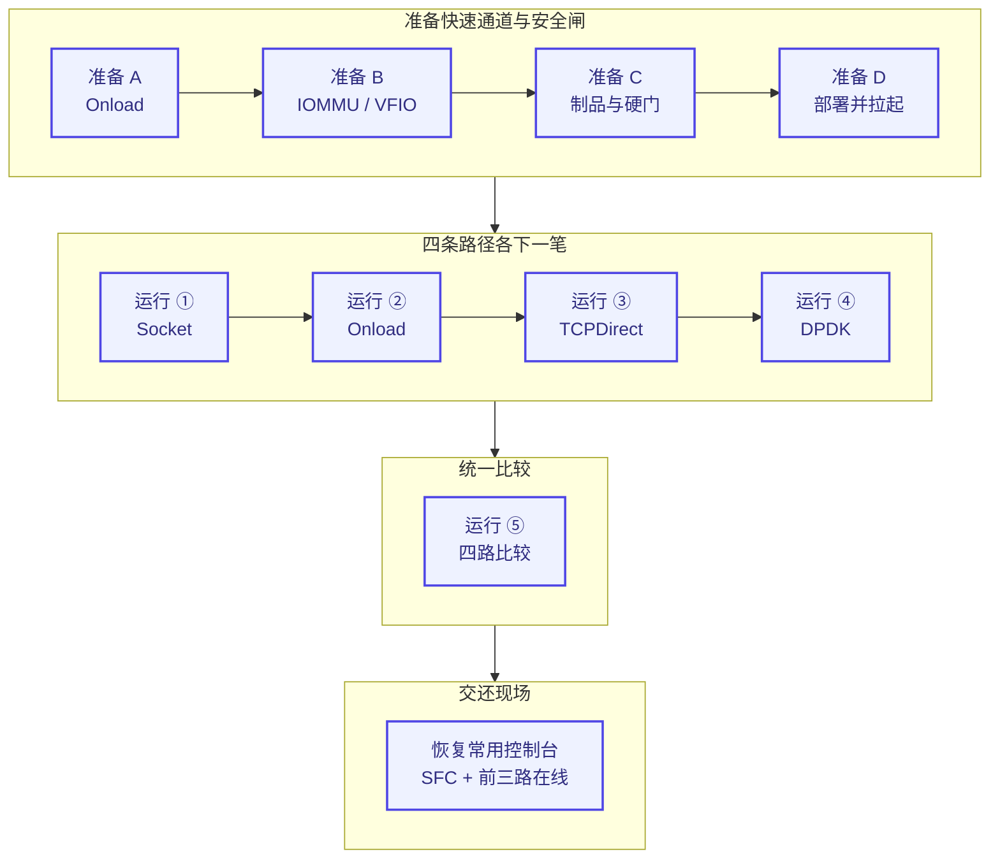

# 第六部分：同一笔订单，四条出站路径

## Kernel Bypass 是什么

第五章已经把订单交到下单线程手里。现在继续往外走：**同样一笔订单，能否少经过几次系统软件的交接？** 本章逐条确认四种收发方式能成交，再用同一把秒表比较。

AMD 在 TCPDirect User Guide 的 Introduction 中这样界定 kernel bypass：

> data can be transmitted to and received from the network directly by the application, without involvement of the operating system.
>
> —— [AMD TCPDirect User Guide · §1.1 Introduction](https://docs.amd.com/v/u/en-US/SF-116303-CD-TCPDirect_User_Guide)

换成中文：**Kernel Bypass 绕开的是报文热路径上的内核代办，不是把操作系统删掉。** CPU 仍执行应用和 TCP；操作系统仍负责进程、内存、设备授权与异常恢复。真正改变的是：应用能否直接操作为自己准备的网卡队列，以及为了做到这一点，要不要改代码、要不要接管整块网卡。

| 官方入口 | 它定义什么 | 本章落在哪一步 |
|---|---|---|
| [AMD OpenOnload UG1586](https://docs.amd.com/r/en-US/ug1586-onload-user) | 标准 socket 的透明加速与 X2522 用户态数据面 | 运行 ②：同一 POSIX 客户端换启动方式 |
| [AMD TCPDirect User Guide](https://docs.amd.com/v/u/en-US/SF-116303-CD-TCPDirect_User_Guide) | TCPDirect 专用接口（ZF API）、用户态 TCP 与网卡队列 | 运行 ③：改用 ZF Transport 并真下单 |
| [DPDK 21.11 `net_sfc_efx` PMD](https://doc.dpdk.org/guides-21.11/nics/sfc_efx.html) 与 [F-Stack](https://github.com/F-Stack/f-stack) | X2522 用户态驱动负责收发；F-Stack 补上 TCP/IP | 运行 ④：安全接管 X2522 并完成真单 |

方案名写作 OpenOnload；命令、模块和运行输出常缩写为 Onload。下文按具体对象使用这两个名字。

本章用“订单过海关”贯穿四条路径：

| 课堂说法 | 真实对象 |
|---|---|
| 旅客 | 同一笔 AAPL 一股 IOC 订单 |
| 单子 | 客户端本机的 Transport（连接与字节流收发层）API |
| 办手续的人 | Kernel、Onload、TCPDirect 或 F-Stack 的 TCP 实现 |
| 出站闸 | Trader `.2` 上的 X2522 PCI function（可独立绑定驱动的网卡设备）`0000:03:00.0` |

普通 socket 是公共海关；OpenOnload 保留原单子，改走快速通道；TCPDirect 换成 ZF 专用单子；DPDK + F-Stack 连出站闸的经营权也一起接过来。**Exchange 看到的 TCP、SoupBinTCP 与 OUCH 都不变，改造发生在客户端本机。** 这只是控制边界由浅入深的展开顺序，不是性能名次。

这里的“同一笔”是**同一业务合同**，不是复用订单 ID：四路都发送 AAPL 1 股可成交 IOC，逐笔走完 Enter → Accepted → Executed；只有运行 ⑤ 的正式批次才按 BUY / SELL 交替。Exchange 仍是第二章的纸面撮合系统，不是实盘交易所。

<div style="border-left:6px solid #7e22ce;background:#f3e8ff;padding:12px 16px;border-radius:8px;margin:14px 0;"><span style="display:inline-block;padding:3px 12px;border-radius:6px;background:#7e22ce;color:#fff;font-weight:800;">关键图</span> <span style="font-weight:700;color:#581c87;">这张图先回答：四条路分别换了什么，X2522 的所有权是否改变。</span></div>

<div style="background:#f8fafc;border:1px solid #cbd5e1;border-radius:12px;padding:10px;max-width:820px;margin:14px auto;">

</div>

## 本章学习目标

完成本章后，你应能：

- 从真实代码和运行收据中分清四条路径，而不只是记住四个软件名。
- 用同一业务合同、线上协议、完成点和 `DEQUE_CV` 入口策略，公平比较四种真实实现。
- 说清 X2522 的用户态队列、小报文直送、用户态驱动与 Plus 授权在哪里体现，并安全交还网卡所有权。

## 本章导航

<div style="border-left:6px solid #7e22ce;background:#f3e8ff;padding:12px 16px;border-radius:8px;margin:14px 0;"><span style="display:inline-block;padding:3px 12px;border-radius:6px;background:#7e22ce;color:#fff;font-weight:800;">本章导航</span> <span style="font-weight:700;color:#581c87;">本章分成 4 部分，共 10 个导航项；先用总图看完整路线，再在每节导航卡里查看全章与本组位置。四项准备只做一次，四条路径各下一笔，再统一比较并单独交还现场。</span></div>



固定顺序就是：**准备快速通道与安全闸 → 四条路径各下一笔 → 统一比较 → 交还现场**。

## 任务地图

| 导航项 | 所属部分 | 这一项回答什么 |
| --- | --- | --- |
| 准备 A：安装 Onload 双端运行时 | 准备快速通道与安全闸 | 安装并核对 Onload 双端运行时 |
| 准备 B：打开 Guest 安全 VFIO 闸 | 准备快速通道与安全闸 | 打开 Guest IOMMU 与安全 VFIO 闸 |
| 准备 C：核对四路径开工条件 | 准备快速通道与安全闸 | 核对四条路径的开工条件 |
| 准备 D：一次拉起四路实验环境 | 准备快速通道与安全闸 | 一次部署并拉起四路环境 |
| 运行 ①：Kernel Socket 下单 | 四条路径各下一笔 | 确认 Kernel Socket 完成同一笔 OUCH 订单 |
| 运行 ②：OpenOnload 下单 | 四条路径各下一笔 | 确认 OpenOnload 完成同一笔 OUCH 订单 |
| 运行 ③：TCPDirect 下单 | 四条路径各下一笔 | 确认 TCPDirect 完成同一笔 OUCH 订单 |
| 运行 ④：DPDK + F-Stack 下单 | 四条路径各下一笔 | 确认 DPDK 与 F-Stack 完成同一笔 OUCH 订单 |
| 运行 ⑤：统一比较四条路径 | 统一比较 | 用同一合同比较四条路径的 p50 与 p99 |
| 实验收尾：恢复常用四路控制台 | 交还现场 | 把数据面切回 SFC 并恢复常用四路控制台 |

## 准备 A：安装 Onload 双端运行时

Exchange 在 `.1`，SFC 阶段的三条客户端都在 `.2`；本轮 `.1` 的 Exchange 仍走标准 Linux TCP。两端安装同一份 Onload 运行时，是为了课程镜像可互换角色、也让后续源码构建依赖一致，并不表示本轮两端数据面都被加速。

脚本通过 `10.1.1.x` 管理网复制的是安装包，不是被测订单。首次从干净快照进入时会编译、安装并加载，预计 5～15 分钟；已经存在 `/dev/onload` 时跳过编译和 reload，只复核依赖与现场，所以会明显更快。reload 后会恢复课程既定网口名和 `20.1.1.1/2`。

<div style="border:2px solid #4f46e5;background:#eef2ff;padding:10px 12px;border-radius:8px;margin:14px 0;"><div style="font-weight:900;color:#312e81;margin-bottom:4px;">导航卡 · 准备快速通道与安全闸</div><div style="font-weight:700;color:#312e81;margin-bottom:8px;">范畴：工具准备　本步知识：安装并核对 Onload 双端运行时　位置：全章第 1 / 10 项 · 本组第 1 / 4 项</div><span style="display:inline-block;margin:3px;padding:4px 10px;border-radius:6px;background:#15803d;color:#fff;font-weight:800;">准备 A：安装 Onload 双端运行时</span><span style="display:inline-block;margin:3px;padding:4px 10px;border-radius:6px;background:#f8fafc;border:1px solid #a5b4fc;color:#312e81;font-weight:800;">准备 B：打开 Guest 安全 VFIO 闸</span><span style="display:inline-block;margin:3px;padding:4px 10px;border-radius:6px;background:#f8fafc;border:1px solid #a5b4fc;color:#312e81;font-weight:800;">准备 C：核对四路径开工条件</span><span style="display:inline-block;margin:3px;padding:4px 10px;border-radius:6px;background:#f8fafc;border:1px solid #a5b4fc;color:#312e81;font-weight:800;">准备 D：一次拉起四路实验环境</span></div>

<div style="border-left:6px solid #dc2626;background:#fee2e2;padding:12px 16px;border-radius:8px;margin:14px 0;"><span style="display:inline-block;padding:3px 12px;border-radius:6px;background:#dc2626;color:#fff;font-weight:800;">风险与回滚</span> <span style="font-weight:700;color:#7f1d1d;">首次安装会重载驱动，数据口可能短暂改名或丢地址；管理操作始终走 `10.1.1.x`。脚本按 PCI 找回网口并恢复 `20.1.1.1/2`，任一验收失败即停。</span></div>

<div style="border-left:6px solid #15803d;background:#dcfce7;padding:12px 16px;border-radius:8px;margin:14px 0;"><span style="display:inline-block;padding:3px 12px;border-radius:6px;background:#15803d;color:#fff;font-weight:800;">需要运行 · 准备 A</span> <span style="font-weight:700;color:#14532d;">在【持久管理机】以 root 串行执行；首次编译约 5～15 分钟，已有运行时通常不到 1 分钟。终验段先写“对 / 证”，再跟原生命令；两端版本、设备入口、`sfc` 与地址齐全才继续。</span></div>

```bash
#!/usr/bin/env bash
set -Eeuo pipefail
cd /financial-low-latency
RUN_ID="$(date -u +%Y%m%dT%H%M%SZ)-06-onload-runtime-prep"
OUT="Documents/reports/course-runs/$RUN_ID"; mkdir -p "$OUT/raw"; printf 'RUN_ID=%s\n' "$RUN_ID" >"$OUT/run.env"
ARCHIVE="artifacts/blobs/x2522/onload/v9.0.2/onload-9f330e7-vm-2522-01.tgz"
# ~~~~~通过管理网向两端分发 Onload 安装归档~~~~~
printf '%s  %s\n' 998d218db3733d85e3732f56790eca963f24deb05c6da4306d4dd9ab0c29d9e2 "$ARCHIVE" | sha256sum -c -
for item in '10.1.1.1 ens64np0 20.1.1.1' '10.1.1.2 ens64np1 20.1.1.2'; do
  read -r host iface addr <<<"$item"; remote="/var/tmp/$RUN_ID.tgz"
  scp -q -o BatchMode=yes -o StrictHostKeyChecking=yes "$ARCHIVE" "root@$host:$remote"
  ssh -o BatchMode=yes -o StrictHostKeyChecking=yes root@"$host" bash -s -- "$remote" "$iface" "$addr" <<'REMOTE' 2>&1 | tee -a "$OUT/raw/result.txt"
set -Eeuo pipefail
archive="$1"; iface="$2"; addr="$3"; src=/opt/flle/course-src/onload-9f330e7
cleanup(){ find /var/tmp -maxdepth 1 -type f -name "${archive##*/}" -delete; }; trap cleanup EXIT
printf '%s  %s\n' 998d218db3733d85e3732f56790eca963f24deb05c6da4306d4dd9ab0c29d9e2 "$archive" | sha256sum -c -
# ~~~~~装编译依赖；没有 /dev/onload 才编译安装~~~~~
pre=/opt/flle/prewarm/apt; cache=/var/cache/apt/archives
(cd "$pre" && printf '%s  %s\n' \
  5243177370b810cc40341801a3b8def6cdd7477ac765862f7727a868629947a3 cpp-11_11.4.0-1ubuntu1~22.04.3_amd64.deb \
  ddbaa04f056637caa11798750638bf4586c8b273719fd1bee70d0ecb3d872b94 g++-11_11.4.0-1ubuntu1~22.04.3_amd64.deb \
  5422307110e695d62a2574c8b765bf38d48b2ed520206e5b7d2b9081a68008f3 gcc-11_11.4.0-1ubuntu1~22.04.3_amd64.deb | sha256sum -c -)
install -m 644 "$pre"/*.deb "$cache/"
apt-get -o Acquire::Retries=3 update
DEBIAN_FRONTEND=noninteractive apt-get -o Acquire::Retries=3 install -y --no-install-recommends build-essential libcap-dev python3-dev "linux-headers-$(uname -r)"
if ! test -c /dev/onload; then
  if ! test -x "$src/scripts/onload_install"; then test ! -e "$src"; mkdir -p "${src%/*}"; tar -xzf "$archive" -C "${src%/*}"; fi
  "$src/scripts/onload_install" --no-initramfs
  onload_tool reload
fi
# ~~~~~reload 可能改网口名、丢掉地址；按 PCI 恢复后连续复核课程 IP~~~~~
udevadm settle
current="$(basename "$(find /sys/bus/pci/devices/0000:03:00.0/net -mindepth 1 -maxdepth 1 -print -quit)")"
test -n "$current"
if test "$current" != "$iface"; then
  test ! -e "/sys/class/net/$iface"; ip link set dev "$current" down
  ip link set dev "$current" name "$iface"
fi
networkctl reconfigure "$iface" || true
ready=0; for n in $(seq 1 30); do addr_snapshot="$(ip -4 -o addr show dev "$iface")"; grep -Fq " $addr/" <<<"$addr_snapshot" && { ready=1; break; }; sleep 1; done
test "$ready" -eq 1; for _ in 1 2; do sleep 1; addr_snapshot="$(ip -4 -o addr show dev "$iface")"; grep -Fq " $addr/" <<<"$addr_snapshot"; done
version_snapshot="$(onload --version)"; grep -Eq '^Onload 9f330e7[[:space:]]*$' <<<"$version_snapshot"; grep -Eq '^Kernel module: 9f330e7[[:space:]]*$' <<<"$version_snapshot"; test -c /dev/onload; test -c /dev/sfc_char; test "$(basename "$(readlink /sys/bus/pci/devices/0000:03:00.0/driver)")" = sfc
printf '\n%s / verify\n' "$(hostname)"
printf '===== 查主机名 =====\n[哪台] 对: vm-2522-01 或 vm-2522-02  证: 没看错机\n$ hostname\n%s\n' "$(hostname)"
printf '===== 查 Onload 版本 =====\n[Onload版本] 对: Onload 9f330e7 与 Kernel module: 9f330e7 两行一致  证: 用户态与模块同一棵树\n$ onload --version\n%s\n' "$version_snapshot"
printf '===== 查字符设备 =====\n[字符设备] 对: /dev/onload 与 /dev/sfc_char 都以 c 开头  证: 栈控制和 VI 入口都在\n$ ls -l /dev/onload /dev/sfc_char\n'; ls -l /dev/onload /dev/sfc_char
printf '===== 查出站闸主人 =====\n[出站闸主人] 对: /sys/bus/pci/drivers/sfc  证: 本步仍由 sfc 管卡\n$ readlink -f .../0000:03:00.0/driver\n%s\n' "$(readlink -f /sys/bus/pci/devices/0000:03:00.0/driver)"
printf '===== 查数据口地址 =====\n[数据口] 对: %s 上有 %s/24  证: reload 后课程地址还在\n$ ip -4 -o addr show dev %s\n%s\n' "$iface" "$addr" "$iface" "$addr_snapshot"
REMOTE
done
(cd "$OUT" && sha256sum raw/result.txt run.env >SHA256SUMS); echo "evidence=$OUT"
```

<div style="border-left:6px solid #7e22ce;background:#f3e8ff;padding:12px 16px;border-radius:8px;margin:14px 0;"><span style="display:inline-block;padding:3px 12px;border-radius:6px;background:#7e22ce;color:#fff;font-weight:800;">仅供展示 · 输出解读</span> <span style="font-weight:700;color:#581c87;">下面列出 `.2` 的终验读数；读数仍来自 RUN `20260831T062259Z-06-onload-runtime-prep`。用户态与内核模块版本、两个字符设备、`sfc` 和课程地址同时出现才通过。</span></div>

```text
vm-2522-02 / verify
===== 查主机名 =====
[哪台] 对: vm-2522-01 或 vm-2522-02  证: 没看错机
$ hostname
vm-2522-02
===== 查 Onload 版本 =====
[Onload版本] 对: Onload 9f330e7 与 Kernel module: 9f330e7 两行一致  证: 用户态与模块同一棵树
$ onload --version
Onload 9f330e7
Kernel module: 9f330e7
===== 查字符设备 =====
[字符设备] 对: /dev/onload 与 /dev/sfc_char 都以 c 开头  证: 栈控制和 VI 入口都在
$ ls -l /dev/onload /dev/sfc_char
crw-rw-rw- 1 root root 237, 0 Aug 31 11:37 /dev/onload
crw-rw-rw- 1 root root 238, 0 Aug 31 11:38 /dev/sfc_char
===== 查出站闸主人 =====
[出站闸主人] 对: /sys/bus/pci/drivers/sfc  证: 本步仍由 sfc 管卡
$ readlink -f .../0000:03:00.0/driver
/sys/bus/pci/drivers/sfc
===== 查数据口地址 =====
[数据口] 对: ens64np1 上有 20.1.1.2/24  证: reload 后课程地址还在
$ ip -4 -o addr show dev ens64np1
4: ens64np1    inet 20.1.1.2/24 brd 20.1.1.255 scope global ens64np1\       valid_lft forever preferred_lft forever
```

读法：先看 `===== 查… =====` 这一项在做什么，再看 `对:`，对一下下面那行原文，最后看 `证:`。`c` 表示 character device。`/dev/onload` 是 Onload stack 与加速 socket 的控制、支撑入口；`/dev/sfc_char` 是 Virtual Interface（VI，分给进程的收发队列入口）、过滤器和 DMA（网卡直接访问内存）资源的申请入口。它们都不是业务报文逐包穿过的普通文件。

| 字段 | 实测例子 | 学员读什么 |
|---|---|---|
| 运行时版本 | `Onload 9f330e7`、`Kernel module: 9f330e7` | 两行必须精确一致；不一致指向安装包或内核构建 |
| 字符设备 | 两行均以 `crw` 开头 | 首字符 `c` 才是字符设备；缺项指向栈控制或 VI 资源入口 |
| 驱动与地址 | `/sys/bus/pci/drivers/sfc`、`20.1.1.2/24` | 两项要同时在；缺项指向 reload 后的网口恢复 |

<div style="border-left:6px solid #0891b2;background:#cffafe;padding:12px 16px;border-radius:8px;margin:14px 0;"><span style="display:inline-block;padding:3px 12px;border-radius:6px;background:#0891b2;color:#fff;font-weight:800;">关键现象</span> <span style="font-weight:700;color:#164e63;">请同时找到版本、两扇字符设备门、`sfc` 与数据地址；缺一项就停在准备 A，完整日志在本卡输出的 `evidence=` 目录。</span></div>

## 准备 B：打开 Guest 安全 VFIO 闸

先把主机内存想成一座仓库：网卡的 DMA 像一辆不等 CPU 搬运、能直接进仓库装卸的叉车。它很快，但必须有地址围栏；IOMMU 负责翻译并检查 DMA 地址，VFIO 则在用户态接管设备时继续执行这道围栏。

第一章在 ESXi 打开的 I/O MMU 只是把“门框”暴露给 Guest。GRUB 是下次开机使用的启动清单：`intel_iommu=on` 要求 Linux 启用 Intel IOMMU，`iommu=pt` 让非 VFIO 设备默认使用恒等映射，并不等于关闭 IOMMU。执行 `update-grub` 后还要重启，参数才会出现在当前 `/proc/cmdline`，内核随后才建立 `/sys/kernel/iommu_groups/`。

<div style="border-left:6px solid #7e22ce;background:#f3e8ff;padding:12px 16px;border-radius:8px;margin:14px 0;"><span style="display:inline-block;padding:3px 12px;border-radius:6px;background:#7e22ce;color:#fff;font-weight:800;">关键图 · 启动配置怎样变成 DMA 围栏</span> <span style="font-weight:700;color:#581c87;">上半段回答 GRUB 为什么必须重启，下半段回答 group、VFIO 与 IOMMU 怎样共同限制 X2522。</span></div>

<div style="background:#f8fafc;border:1px solid #cbd5e1;border-radius:12px;padding:10px;max-width:820px;margin:14px auto;">

</div>

| 名词 | 用人话说 | 本卡真正检查什么 |
| --- | --- | --- |
| ESXi I/O MMU | 给虚拟机装上可用的 DMA 门框 | 它只提供能力，不能代替 Guest 内核启用 IOMMU |
| GRUB | 保存“下次 Linux 开机带哪些参数”的清单 | 配置文件写对、`update-grub` 成功，并通过重启让参数进入当前 cmdline |
| `intel_iommu=on` | 打开 Guest 内的 DMA 地址翻译与检查 | `/proc/cmdline` 中必须出现，sysfs 随后能给设备列出隔离组 |
| `iommu=pt` | 普通非 VFIO 设备优先走恒等映射 | 它减少普通设备的映射转换工作，不会取消 VFIO 设备的地址围栏 |
| IOMMU group | 硬件能够安全一起交接的最小“钥匙串” | `7` 只是本机编号；关键是组内只有 X2522 的 `0000:03:00.0` |
| VFIO | 把设备交给用户态，同时只开放已登记内存页 | DPDK 阶段由 `vfio-pci` 接管，并得到 IOMMU type 1，而不是 unsafe no-IOMMU |

因此，安全门闸不是“看到 group 7 就通过”，而是同时满足三件事：当前 cmdline 已启用 IOMMU、X2522 所在组没有夹带其他设备、VFIO 仍通过 IOMMU 工作。任何一项缺失都停止接管。

在本课程里，这张准备卡主要服务于后面的 **DPDK + VFIO** 阶段。它解决的是用户态接管网卡时的 DMA 安全和设备所有权，不是性能加速开关；Kernel Socket、OpenOnload 与 TCPDirect 阶段仍由 `sfc` 管理 X2522，不会因为打开 IOMMU 就自动变快。

更准确地说，四路不是四条完全平行的线，而是分成两类所有权路线：前三路都保留 `owner=sfc`，只改变 TCP 栈、API 或用户态队列访问方式；DPDK 不仅换成 F-Stack 和 PMD，还要把同一个 PCI function 独占交给 `vfio-pci`。因此 DPDK 活跃时，前三个客户端必须暂停，不能让 `sfc` 与 `vfio-pci` 同时控制同一块 X2522。

<div style="border-left:6px solid #7e22ce;background:#f3e8ff;padding:12px 16px;border-radius:8px;margin:14px 0;"><span style="display:inline-block;padding:3px 12px;border-radius:6px;background:#7e22ce;color:#fff;font-weight:800;">关键图 · 前三路与 DPDK 到底在哪里分开</span> <span style="font-weight:700;color:#581c87;">左边三路共享 `sfc` 所有权；右边 DPDK 走 F-Stack → PMD → VFIO/IOMMU 专线，并独占 X2522。</span></div>

<div style="background:#f8fafc;border:1px solid #cbd5e1;border-radius:12px;padding:10px;max-width:820px;margin:14px auto;">

</div>

脚本先只读打印两端的主机名、GRUB 配置、备份、当前 cmdline 与隔离组；每一项先用 `===== 查… =====` 写出在做什么，再写“对的样子”和“这能证明什么”，然后跟原生命令。已经合格的主机以这一次 `probe` 作为结论，不再重复整套 `verify`；只有本卡实际修改并重启过的主机才做必要的重启后复验。两端预检完成后，脚本单独加载 `vfio-pci` 并各查一次 `unsafe no-IOMMU=N`。任一端写入或 `update-grub` 失败，本轮已触碰的主机会一起回滚；遗留备份不会阻塞重跑。快照恢复后需要重新执行本卡。

<div style="border:2px solid #4f46e5;background:#eef2ff;padding:10px 12px;border-radius:8px;margin:14px 0;"><div style="font-weight:900;color:#312e81;margin-bottom:4px;">导航卡 · 准备快速通道与安全闸</div><div style="font-weight:700;color:#312e81;margin-bottom:8px;">范畴：工具准备　本步知识：打开 Guest IOMMU 与安全 VFIO 闸　位置：全章第 2 / 10 项 · 本组第 2 / 4 项</div><span style="display:inline-block;margin:3px;padding:4px 10px;border-radius:6px;background:#f8fafc;border:1px solid #a5b4fc;color:#312e81;font-weight:800;">准备 A：安装 Onload 双端运行时</span><span style="display:inline-block;margin:3px;padding:4px 10px;border-radius:6px;background:#15803d;color:#fff;font-weight:800;">准备 B：打开 Guest 安全 VFIO 闸</span><span style="display:inline-block;margin:3px;padding:4px 10px;border-radius:6px;background:#f8fafc;border:1px solid #a5b4fc;color:#312e81;font-weight:800;">准备 C：核对四路径开工条件</span><span style="display:inline-block;margin:3px;padding:4px 10px;border-radius:6px;background:#f8fafc;border:1px solid #a5b4fc;color:#312e81;font-weight:800;">准备 D：一次拉起四路实验环境</span></div>

<div style="border-left:6px solid #dc2626;background:#fee2e2;padding:12px 16px;border-radius:8px;margin:14px 0;"><span style="display:inline-block;padding:3px 12px;border-radius:6px;background:#dc2626;color:#fff;font-weight:800;">风险与回滚</span> <span style="font-weight:700;color:#7f1d1d;">脚本只接受空值或课程固定值，并把备份写到 `/var/backups/flle-ch06-grub.&lt;本卡 RUN_ID&gt;`。写入阶段失败会自动回滚；重启后若 Guest 未恢复，从 ESXi 控制台按 `configure.txt` 中 `$ backup` 后的精确路径还原 `/etc/default/grub`，再执行 `update-grub && reboot`。</span></div>

<div style="border-left:6px solid #15803d;background:#dcfce7;padding:12px 16px;border-radius:8px;margin:14px 0;"><span style="display:inline-block;padding:3px 12px;border-radius:6px;background:#15803d;color:#fff;font-weight:800;">需要运行 · 准备 B</span> <span style="font-weight:700;color:#14532d;">在【持久管理机】以 root 执行；脚本先预检两端，需要修改时才重启对应主机，过程可能持续数分钟；管理连接始终走 `10.1.1.x`。两端 cmdline、独占 group 和 `unsafe no-IOMMU=N` 都对上才继续；未修改主机不会再打印第二套相同结果。</span></div>

```bash
#!/usr/bin/env bash
set -Eeuo pipefail
cd /financial-low-latency
RUN_ID="$(date -u +%Y%m%dT%H%M%SZ)-06-guest-iommu-prep"
OUT="Documents/reports/course-runs/$RUN_ID"; mkdir -p "$OUT/raw"
printf 'RUN_ID=%s\n' "$RUN_ID" >"$OUT/run.env"
exec 9>/run/lock/flle-ch06-guest-iommu.lock; flock -n 9
HOSTS=(10.1.1.1 10.1.1.2)
remote(){ ssh -o BatchMode=yes -o StrictHostKeyChecking=yes root@"$1" bash -s -- "$2" "$RUN_ID" <<'REMOTE'
set -Eeuo pipefail
action=$1; run=$2; file=/etc/default/grub; backup="/var/backups/flle-ch06-grub.$run"
state(){ line="$(grep '^GRUB_CMDLINE_LINUX=' "$file" || true)"; cmdline="$(cat /proc/cmdline)"; group="$(readlink -f /sys/bus/pci/devices/0000:03:00.0/iommu_group 2>/dev/null || true)"
devices=""; test -z "$group" || devices="$(find "$group/devices" -mindepth 1 -maxdepth 1 -printf '%f\n' 2>/dev/null | LC_ALL=C sort || true)"; backups="$(find /var/backups -maxdepth 1 -type f -name 'flle-ch06-grub.*' -printf '%p\n' | LC_ALL=C sort)"; }
raw(){ printf '%s / %s\n' "$(hostname)" "$action"
printf '===== 查主机名 =====\n[哪台] 对: vm-2522-01 或 vm-2522-02  证: 没看错机\n$ hostname\n%s\n' "$(hostname)"
printf '===== 查 GRUB 下次清单 =====\n[GRUB下次清单] 对: GRUB_CMDLINE_LINUX="intel_iommu=on iommu=pt"  证: 下次开机仍开 IOMMU\n$ grep ^GRUB_CMDLINE_LINUX= /etc/default/grub\n%s\n' "$line"
printf '===== 查本轮备份 =====\n[本轮备份] 对: <none> 或本卡 flle-ch06-grub.<RUN>  证: 旧备份不挡重跑\n$ find /var/backups -name flle-ch06-grub.*\n%s\n' "${backups:-<none>}"
printf '===== 查当前 cmdline =====\n[当前cmdline] 对: 同一行同时有 intel_iommu=on 和 iommu=pt  证: Guest IOMMU 已生效\n$ cat /proc/cmdline\n%s\n' "$cmdline"
printf '===== 查隔离组 =====\n[隔离组] 对: /sys/kernel/iommu_groups/7（7只是本机号）  证: 内核已给 X2522 建 DMA 围栏\n$ readlink -f .../iommu_group\n%s\n' "${group:-<absent>}"
printf '===== 查组里有谁 =====\n[组里有谁] 对: 只有 0000:03:00.0  证: 钥匙串无夹带，才能单独交 VFIO\n$ ls .../iommu_group/devices\n%s\n' "${devices:-<absent>}"; }
valid(){ test "$(grep -c '^GRUB_CMDLINE_LINUX=' "$file")" -eq 1
case "$line" in 'GRUB_CMDLINE_LINUX=""'|'GRUB_CMDLINE_LINUX="intel_iommu=on iommu=pt"');; *) return 1;; esac; }
runtime_ok(){ case " $cmdline " in *' intel_iommu=on '*) ;; *) return 1;; esac; case " $cmdline " in *' iommu=pt '*) ;; *) return 1;; esac
test "${group##*/}" = 7; test "$devices" = 0000:03:00.0; }
case "$action" in
  probe) state; raw; valid; test "$line" = 'GRUB_CMDLINE_LINUX="intel_iommu=on iommu=pt"' && runtime_ok && exit 0; exit 10 ;;
  apply) state; valid; test ! -e "$backup"; install -m 600 "$file" "$backup"; printf '$ backup\n%s\n' "$backup"
    tmp=$(mktemp /etc/default/grub.flle06.XXXXXX); trap 'rm -f "$tmp"' EXIT; sed 's/^GRUB_CMDLINE_LINUX=""$/GRUB_CMDLINE_LINUX="intel_iommu=on iommu=pt"/' "$file" >"$tmp"; install -m 644 "$tmp" "$file"; printf '$ update-grub\n'; update-grub ;;
  rollback) test ! -e "$backup" || { install -m 644 "$backup" "$file"; printf '$ update-grub\n'; update-grub; rm -f "$backup"; } ;;
  reboot) systemctl reboot ;;
  verify) state; raw; valid; test "$line" = 'GRUB_CMDLINE_LINUX="intel_iommu=on iommu=pt"'; runtime_ok ;;
  vfio) modprobe vfio-pci; unsafe="$(cat /sys/module/vfio/parameters/enable_unsafe_noiommu_mode)"; test "$unsafe" = N; printf '%s / vfio\n===== 查 VFIO DMA 安全模式 =====\n[unsafe no-IOMMU] 对: N  证: VFIO 不允许绕过 IOMMU\n$ cat /sys/module/vfio/parameters/enable_unsafe_noiommu_mode\n%s\n' "$(hostname)" "$unsafe" ;;
  commit) rm -f "$backup" ;;
esac
REMOTE
}
declare -A plan=(); preflight_failed=0
for host in "${HOSTS[@]}"; do
  if remote "$host" probe 2>&1 | tee -a "$OUT/raw/preflight.txt"; then plan[$host]=0; else rc=${PIPESTATUS[0]}; if test "$rc" -eq 10; then plan[$host]=10; else preflight_failed=1; fi; fi
done
test "$preflight_failed" -eq 0; touched=()
for host in "${HOSTS[@]}"; do
  test "${plan[$host]}" -eq 10 || continue; touched+=("$host")
  if remote "$host" apply 2>&1 | tee -a "$OUT/raw/configure.txt"; then continue; fi
  rollback_failed=0
  for item in "${touched[@]}"; do remote "$item" rollback 2>&1 | tee -a "$OUT/raw/rollback.txt" || rollback_failed=1; done
  test "$rollback_failed" -eq 0 || printf 'rollback incomplete; use the preserved RUN backup\n' >&2
  exit 1
done
declare -A boot=(); for host in "${touched[@]}"; do boot[$host]="$(ssh -n -o BatchMode=yes -o StrictHostKeyChecking=yes root@"$host" cat /proc/sys/kernel/random/boot_id)"; done
for host in "${touched[@]}"; do remote "$host" reboot >/dev/null 2>&1 || true; done
for host in "${touched[@]}"; do ready=0; for _ in {1..180}; do current="$(ssh -n -o ConnectTimeout=2 -o BatchMode=yes -o StrictHostKeyChecking=yes root@"$host" cat /proc/sys/kernel/random/boot_id 2>/dev/null || true)"; test -n "$current" && test "$current" != "${boot[$host]}" && { ready=1; break; }; sleep 1; done; test "$ready" -eq 1; done
for host in "${touched[@]}"; do remote "$host" verify 2>&1 | tee -a "$OUT/raw/after-boot.txt"; done
for host in "${HOSTS[@]}"; do remote "$host" vfio 2>&1 | tee -a "$OUT/raw/vfio.txt"; done
for host in "${touched[@]}"; do remote "$host" commit; done
(cd "$OUT" && sha256sum raw/* run.env >SHA256SUMS)
echo "evidence=$OUT"
```

<div style="border-left:6px solid #7e22ce;background:#f3e8ff;padding:12px 16px;border-radius:8px;margin:14px 0;"><span style="display:inline-block;padding:3px 12px;border-radius:6px;background:#7e22ce;color:#fff;font-weight:800;">仅供展示 · 输出解读</span> <span style="font-weight:700;color:#581c87;">下面摘自去重后 RUN `20260902T100808Z-06-guest-iommu-prep` 的 `.2` 两个职责块：完整 IOMMU 现场只在 `probe` 打一次，VFIO unsafe 模式随后单独查一次；根 SHA 覆盖 `preflight.txt` 与 `vfio.txt`。</span></div>

```text
vm-2522-02 / probe
===== 查主机名 =====
[哪台] 对: vm-2522-01 或 vm-2522-02  证: 没看错机
$ hostname
vm-2522-02
===== 查 GRUB 下次清单 =====
[GRUB下次清单] 对: GRUB_CMDLINE_LINUX="intel_iommu=on iommu=pt"  证: 下次开机仍开 IOMMU
$ grep ^GRUB_CMDLINE_LINUX= /etc/default/grub
GRUB_CMDLINE_LINUX="intel_iommu=on iommu=pt"
===== 查本轮备份 =====
[本轮备份] 对: <none> 或本卡 flle-ch06-grub.<RUN>  证: 旧备份不挡重跑
$ find /var/backups -name flle-ch06-grub.*
<none>
===== 查当前 cmdline =====
[当前cmdline] 对: 同一行同时有 intel_iommu=on 和 iommu=pt  证: Guest IOMMU 已生效
$ cat /proc/cmdline
BOOT_IMAGE=/vmlinuz-5.15.0-164-generic root=/dev/mapper/ubuntu--vg-ubuntu--lv ro intel_iommu=on iommu=pt
===== 查隔离组 =====
[隔离组] 对: /sys/kernel/iommu_groups/7（7只是本机号）  证: 内核已给 X2522 建 DMA 围栏
$ readlink -f .../iommu_group
/sys/kernel/iommu_groups/7
===== 查组里有谁 =====
[组里有谁] 对: 只有 0000:03:00.0  证: 钥匙串无夹带，才能单独交 VFIO
$ ls .../iommu_group/devices
0000:03:00.0
vm-2522-02 / vfio
===== 查 VFIO DMA 安全模式 =====
[unsafe no-IOMMU] 对: N  证: VFIO 不允许绕过 IOMMU
$ cat /sys/module/vfio/parameters/enable_unsafe_noiommu_mode
N
```

读法：先看 `===== 查… =====` 这一项在做什么，再看 `对:`，对一下下面那行原文，最后看 `证:`。两端 group 7 都只有 X2522 自身。这个结论是后面安全 VFIO 的门闸，不表示 DPDK 已经在运行。

| 字段 | 实测例子 | 学员读什么 |
|---|---|---|
| GRUB 与备份 | 原始 `GRUB_CMDLINE_LINUX`、备份路径或 `<none>` | 先确认配置可处理，再看本轮是否需要写入；旧备份只作恢复收据，不是阻塞锁 |
| Guest cmdline | `intel_iommu=on iommu=pt` | 两个参数必须同时出现；缺项表示 Guest IOMMU 尚未生效 |
| 隔离组 | group `7` 仅列 `0000:03:00.0` | 组内若有其他设备，就不能安全接管 X2522 |
| VFIO unsafe 模式 | `enable_unsafe_noiommu_mode=N` | VFIO 不允许绕开 IOMMU；这项属于准备 B，不再留给准备 C |

<div style="border-left:6px solid #0891b2;background:#cffafe;padding:12px 16px;border-radius:8px;margin:14px 0;"><span style="display:inline-block;padding:3px 12px;border-radius:6px;background:#0891b2;color:#fff;font-weight:800;">关键现象</span> <span style="font-weight:700;color:#164e63;">两端 cmdline 参数都在、组内都只有 `0000:03:00.0`，并且 unsafe no-IOMMU 都为 `N`。缺一项就停在准备 B；已经合格的主机只出现一套完整现场。</span></div>

## 准备 C：核对四路径开工条件

准备 A 已经核过 Onload、字符设备、`sfc` 与两端数据地址，准备 B 已经核过 Guest IOMMU、GRUB 和隔离组。本卡不再重复这些读数，只检查自己负责的六项：v12 运行包、源码到 ELF、行情回放资产、Builder 工具链、Exchange RSS 和四路总闸。

课堂使用已构建并验签的运行包。它像一箱配齐的工具：包含不同收发方式的客户端及依赖库，部署时复制到 `.1/.2`，不用现场重新编译所有客户端。ELF 是 Linux 可执行文件的格式，下面看网页按钮最终启动哪一份文件。

源码、构建输入和文件指纹的对应关系见[教师构建说明](TEACHER-FLOW-NOTES.md#第-06-章)。准备 A 的 Onload 内核模块仍需匹配当前 Linux 内核，与这里的应用运行包分开准备。

| 网页上的路径 | 最终执行的 ELF | 启动差别 |
| --- | --- | --- |
| Kernel Socket | `bin/flle-trader` | 直接启动，走 POSIX socket 与内核 TCP |
| OpenOnload | `bin/flle-trader` | **同一个 ELF**，由 `onload --profile=latency` 启动并接入 Onload 用户态栈 |
| TCPDirect | `bin/flle-trader-tcpdirect` | 编译时接入 ZF / TCPDirect API |
| DPDK + F-Stack | `bin/flle-trader-dpdk` | 编译时接入 F-Stack / DPDK，运行时再由 VFIO 独占 X2522 |

这里的 F-Stack、DPDK 与 TCPDirect 主要作为头文件、静态库和运行时组件进入对应 Trader，不要求每个名字都对应一个独立的下单程序。Onload 内核模块也不在 `v12/bin/`：它必须匹配当前 Guest 内核，所以由准备 A 在必要时单独编译。

<div style="border:2px solid #4f46e5;background:#eef2ff;padding:10px 12px;border-radius:8px;margin:14px 0;"><div style="font-weight:900;color:#312e81;margin-bottom:4px;">导航卡 · 准备快速通道与安全闸</div><div style="font-weight:700;color:#312e81;margin-bottom:8px;">范畴：现场只读　本步知识：核对四条路径的开工条件　位置：全章第 3 / 10 项 · 本组第 3 / 4 项</div><span style="display:inline-block;margin:3px;padding:4px 10px;border-radius:6px;background:#f8fafc;border:1px solid #a5b4fc;color:#312e81;font-weight:800;">准备 A：安装 Onload 双端运行时</span><span style="display:inline-block;margin:3px;padding:4px 10px;border-radius:6px;background:#f8fafc;border:1px solid #a5b4fc;color:#312e81;font-weight:800;">准备 B：打开 Guest 安全 VFIO 闸</span><span style="display:inline-block;margin:3px;padding:4px 10px;border-radius:6px;background:#15803d;color:#fff;font-weight:800;">准备 C：核对四路径开工条件</span><span style="display:inline-block;margin:3px;padding:4px 10px;border-radius:6px;background:#f8fafc;border:1px solid #a5b4fc;color:#312e81;font-weight:800;">准备 D：一次拉起四路实验环境</span></div>

<div style="border-left:6px solid #15803d;background:#dcfce7;padding:12px 16px;border-radius:8px;margin:14px 0;"><span style="display:inline-block;padding:3px 12px;border-radius:6px;background:#15803d;color:#fff;font-weight:800;">需要运行 · 准备 C</span> <span style="font-weight:700;color:#14532d;">在【持久管理机】以 root 执行，全程只读，通常约 5～10 秒。这是 37 行的专项开工工具：只做制品、构建链、行情资产、Builder、RSS 和总闸，不重复准备 A/B。</span></div>

```bash
cd /financial-low-latency
bash Documents/newDoc/assets/06-kernel-bypass/02-four-path-preflight.sh
```

<div style="border-left:6px solid #7e22ce;background:#f3e8ff;padding:12px 16px;border-radius:8px;margin:14px 0;"><span style="display:inline-block;padding:3px 12px;border-radius:6px;background:#7e22ce;color:#fff;font-weight:800;">仅供展示 · 输出解读</span> <span style="font-weight:700;color:#581c87;">下面是紧接新版准备 B 后运行的 `20260902T100819Z-06-four-path-preflight` 完整课堂原文；六项各回答一个新问题，详细源码命中行仍只写进 `raw/code-contract.txt`。</span></div>

```text
===== 查 v12 运行包 =====
[归档] 对: SHA-256=163618cc…c9f3  证: 四路客户端和运行库没漂
$ sha256sum -c
artifacts/blobs/x2522/ch06-four-path/v12/flle-ch06-four-path-v12-x86_64-jammy-runtime.tgz: OK
===== 查源码到 ELF 的对账 =====
[构建合同] 对: source / build-inputs / provenance / runtime 四项验签通过  证: 上课运行的是当前封存代码的已编译 ELF
$ four-path-build-contract-audit.sh
source_binary_contract=PASS
===== 查行情回放资产 =====
[control_assets] 对: PASS 且 symbols=AAPL,NVDA  证: 纸面行情文件还在
$ labctl preflight · control_assets
control_assets=PASS replay_bytes=561727241 symbols=AAPL,NVDA
===== 查 Builder 工具链 =====
[builder_tools] 对: .101 上有 g++-11  证: 管理机构建链还在
$ labctl preflight · builder_tools
builder_tools=PASS host=10.1.1.101 compiler=g++-11
===== 查 Exchange RSS 表 =====
[RSS] 对: table=baseline-0-1-2-3 或 measure-all-1  证: 空闲可开工，或本课测量仍受控
$ labctl preflight · exchange_rss
exchange_rss_preflight=PASS iface=ens64np0 entries=128 table=baseline-0-1-2-3 queue=1 irq=33 requested_cpu=3 effective_cpu=3 irqbalance=active exchange_cpu=2
===== 查四路开工总闸 =====
[transport_preflight] 对: PASS queue=DEQUE_CV  证: 可以进准备 D 部署并拉起
$ labctl preflight · transport
transport_preflight=PASS runtime_sha256=163618ccbb99d272d1f4703822781984d754c690d23fba5503e503486e33c9f3 queue=DEQUE_CV
evidence=Documents/reports/course-runs/20260902T100819Z-06-four-path-preflight
```

读法：先看 `===== 查… =====` 这一项在做什么，再看 `对:`，对一下下面那行原文，最后看 `证:`。这里分别核对文件、工具、网卡和应用入口。

| 字段 | 实测例子 | 学员读什么 |
|---|---|---|
| 归档指纹 | `163618cc…c9f3` | 必须命中本章 v12 固定字节，防止客户端或配置漂移 |
| 源码到 ELF | `source_binary_contract=PASS` | source、构建输入、provenance 和运行包是同一条可追溯链 |
| 行情资产 | `PASS replay_bytes=561727241 symbols=AAPL,NVDA` | AAPL/NVDA 固定回放文件仍完整 |
| Builder | `.101 compiler=g++-11` | 部署侧工具入口还在；课堂不会重新编译四路客户端 |
| Exchange RSS | `table=measure-all-1` 或 `baseline-0-1-2-3` | 空闲轮转表可以开工；`128→1` 且 IRQ 在 CPU 2、irqbalance inactive 表示当前四路仍按本课合同持有 |
| 应用入口 | `queue=DEQUE_CV` | 四路固定同一入口策略；DPDK 内部仍多一次 bridge→reactor 交棒 |

<div style="border-left:6px solid #0891b2;background:#cffafe;padding:12px 16px;border-radius:8px;margin:14px 0;"><span style="display:inline-block;padding:3px 12px;border-radius:6px;background:#0891b2;color:#fff;font-weight:800;">关键现象</span> <span style="font-weight:700;color:#164e63;">六项全部 PASS 就进入准备 D。Onload 和 IOMMU 的原始结论分别留在准备 A/B，不在这里再讲一遍。</span></div>

## 准备 D：一次拉起四路实验环境

准备 A～C 已经完成安装、安全和制品硬验。本卡只负责把固定运行包部署到 `.1/.2`，启动 Exchange、三个 SFC 客户端、控制器与网页，然后把唯一的 `RUN_ID` 写进运行态。**这里不下单，也不测延迟。**

如果同一个完整 RUN 仍处于 `SFC/READY/sfc`，本卡只读复用；如果现场已经彻底交还，则建立新 RUN；如果只剩一半进程或 owner 不明确，则拒绝继续并提示先做“实验收尾”。这样，后面五次运行不再承担部署、修环境或反复查一遍的职责。

<div style="border:2px solid #4f46e5;background:#eef2ff;padding:10px 12px;border-radius:8px;margin:14px 0;"><div style="font-weight:900;color:#312e81;margin-bottom:4px;">导航卡 · 准备快速通道与安全闸</div><div style="font-weight:700;color:#312e81;margin-bottom:8px;">范畴：工具准备　本步知识：一次部署并拉起四路环境　位置：全章第 4 / 10 项 · 本组第 4 / 4 项</div><span style="display:inline-block;margin:3px;padding:4px 10px;border-radius:6px;background:#f8fafc;border:1px solid #a5b4fc;color:#312e81;font-weight:800;">准备 A：安装 Onload 双端运行时</span><span style="display:inline-block;margin:3px;padding:4px 10px;border-radius:6px;background:#f8fafc;border:1px solid #a5b4fc;color:#312e81;font-weight:800;">准备 B：打开 Guest 安全 VFIO 闸</span><span style="display:inline-block;margin:3px;padding:4px 10px;border-radius:6px;background:#f8fafc;border:1px solid #a5b4fc;color:#312e81;font-weight:800;">准备 C：核对四路径开工条件</span><span style="display:inline-block;margin:3px;padding:4px 10px;border-radius:6px;background:#15803d;color:#fff;font-weight:800;">准备 D：一次拉起四路实验环境</span></div>

<div style="background:#f8fafc;border:1px solid #cbd5e1;border-radius:12px;padding:10px;max-width:820px;margin:14px auto;">

</div>

<div style="border-left:6px solid #15803d;background:#dcfce7;padding:12px 16px;border-radius:8px;margin:14px 0;"><span style="display:inline-block;padding:3px 12px;border-radius:6px;background:#15803d;color:#fff;font-weight:800;">需要运行 · 准备 D</span> <span style="font-weight:700;color:#14532d;">在【持久管理机】以 root 执行。长部署、状态 JSON 与路径硬门全部写入 raw；课堂只看到就绪摘要。首次通常几十秒，完整复用通常数秒。</span></div>

```bash
cd /financial-low-latency
bash Documents/newDoc/assets/06-kernel-bypass/03-four-path-lab-ready.sh
```

<div style="border-left:6px solid #7e22ce;background:#f3e8ff;padding:12px 16px;border-radius:8px;margin:14px 0;"><span style="display:inline-block;padding:3px 12px;border-radius:6px;background:#7e22ce;color:#fff;font-weight:800;">输出格式</span> <span style="font-weight:700;color:#581c87;">下面来自完整顺刷 RUN `20260902T085803Z-06-four-path-orders` 的准备结果原文；完整控制器与 API 对象留在同一 evidence，章末已正常收尾。</span></div>

```text
===== 四路实验准备完成 =====
result=READY
run_id=20260902T085803Z-06-four-path-orders
data_plane=SFC/READY/sfc
clients=Socket, Onload, TCPDirect ONLINE; DPDK WAITING
queue_mode=DEQUE_CV
next=运行 ①：Socket 下单
evidence=Documents/reports/course-runs/20260902T085803Z-06-four-path-orders
```

<div style="border-left:6px solid #0891b2;background:#cffafe;padding:12px 16px;border-radius:8px;margin:14px 0;"><span style="display:inline-block;padding:3px 12px;border-radius:6px;background:#0891b2;color:#fff;font-weight:800;">继续条件</span> <span style="font-weight:700;color:#164e63;">只要看到 `result=READY`、`SFC/READY/sfc` 和三路 ONLINE，就进入运行 ①；后续单笔运行不再把这批准备项重新打印一遍。</span></div>

### 四张单笔卡怎样读：先分清两个计时窗

运行 ①～④每张卡只下一笔，目的是确认“这条路径真的完成了同一笔 OUCH 订单”，不是给四路排速度名次。完整证据保留下面三个计时字段，课堂终端只突出共同主指标 `order_rtt_ns` 和真实 `engine`。

<div style="background:#f8fafc;border:1px solid #cbd5e1;border-radius:12px;padding:10px;max-width:820px;margin:14px auto;">

</div>

| 字段 | 网络工程师怎样读 |
|---|---|
| `queue_to_send_ns` | 订单在客户端完成本机准备、直到 OUCH 真正发出所用的时间 |
| `order_rtt_ns` | OUCH 发出后，到 Exchange 返回最终 `Executed` 的时间；四路正式比较的共同主指标 |
| `submit_to_final_ns` | 从提交订单到最终成交的完整交互时间，等于前两段之和 |

<div style="border-left:6px solid #0891b2;background:#cffafe;padding:12px 16px;border-radius:8px;margin:14px 0;"><span style="display:inline-block;padding:3px 12px;border-radius:6px;background:#0891b2;color:#fff;font-weight:800;">为什么分两步测</span> <span style="font-weight:700;color:#164e63;">运行 ①～④用一笔单确认 Socket、Onload、TCPDirect、DPDK 各自能工作；运行 ⑤再让四路使用同一订单、同一计时口径、相同预热和样本数，统一比较 p50 / p99。这样“认识技术”和“比较性能”不会混在一起。</span></div>

## 运行 ①：Kernel Socket 下单

<div style="border:2px solid #4f46e5;background:#eef2ff;padding:10px 12px;border-radius:8px;margin:14px 0;"><div style="font-weight:900;color:#312e81;margin-bottom:4px;">导航卡 · 四条路径各下一笔</div><div style="font-weight:700;color:#312e81;margin-bottom:8px;">范畴：现场只读　本步知识：确认 Kernel Socket 完成同一笔 OUCH 订单　位置：全章第 5 / 10 项 · 本组第 1 / 4 项</div><span style="display:inline-block;margin:3px;padding:4px 10px;border-radius:6px;background:#15803d;color:#fff;font-weight:800;">运行 ①：Kernel Socket 下单</span><span style="display:inline-block;margin:3px;padding:4px 10px;border-radius:6px;background:#f8fafc;border:1px solid #a5b4fc;color:#312e81;font-weight:800;">运行 ②：OpenOnload 下单</span><span style="display:inline-block;margin:3px;padding:4px 10px;border-radius:6px;background:#f8fafc;border:1px solid #a5b4fc;color:#312e81;font-weight:800;">运行 ③：TCPDirect 下单</span><span style="display:inline-block;margin:3px;padding:4px 10px;border-radius:6px;background:#f8fafc;border:1px solid #a5b4fc;color:#312e81;font-weight:800;">运行 ④：DPDK + F-Stack 下单</span></div>

本步只回答一个问题：**标准 Linux Socket 怎样把同一笔 OUCH 订单送到 Exchange，结果和本笔延迟是多少？**

### 路径特点：每次收发都要敲内核这扇门

<div style="background:#f8fafc;border:1px solid #cbd5e1;border-radius:12px;padding:10px;max-width:820px;margin:14px auto;">

</div>

Socket 的优势是标准、成熟、容易排障；代价是每次收发都经过通用内核 TCP/IP 路径。

### 关键代码：最普通的 POSIX TCP

下面只保留真正决定路径的几行；业务编码、SoupBinTCP 登录与 OUCH 解析四路共用，不在每节重复。

```cpp
fd_ = ::socket(AF_INET, SOCK_STREAM, 0);
::setsockopt(fd_, IPPROTO_TCP, TCP_NODELAY, &one, sizeof(one));
::connect(fd_, reinterpret_cast<sockaddr *>(&remote), sizeof(remote));

bool send_all(const void *data, std::size_t length) override {
  return fd_ >= 0 && flle::send_all(fd_, data, length);
}
bool recv_all(void *data, std::size_t length) override {
  return fd_ >= 0 && flle::recv_all(fd_, data, length);
}
```

源码位置：`apps/flle-trading-lab/src/posix_order_transport.cpp`。本步没有准备工作、没有代码审计，只发送一笔 AAPL 1 股可成交 IOC。

<div style="border-left:6px solid #15803d;background:#dcfce7;padding:12px 16px;border-radius:8px;margin:14px 0;"><span style="display:inline-block;padding:3px 12px;border-radius:6px;background:#15803d;color:#fff;font-weight:800;">需要运行 · 运行 ①</span> <span style="font-weight:700;color:#14532d;">预计数秒。本卡只下一笔 Socket；完整 API JSON 与当前 PID 路径收据写进独立证据目录，终端只打印这笔单。</span></div>

```bash
bash Documents/newDoc/assets/06-kernel-bypass/04-socket-real-order.sh
```

<div style="border-left:6px solid #7e22ce;background:#f3e8ff;padding:12px 16px;border-radius:8px;margin:14px 0;"><span style="display:inline-block;padding:3px 12px;border-radius:6px;background:#7e22ce;color:#fff;font-weight:800;">输出解读</span> <span style="font-weight:700;color:#581c87;">课堂只显示成交、共同 RTT 指标和真实路径；三个完整计时字段与 API 原件仍保存在本步 evidence。</span></div>

```text
===== 运行 ① · Kernel Socket 真单 =====
task=用 Kernel Socket 发送一笔 AAPL 1 股可成交 IOC
result=ORDER_EXECUTED
client_order_id=2100000000
order_rtt_ns=73404
engine=KERNEL_SOCKET
scope=单笔路径验证；正式延迟比较看运行 ⑤
evidence=Documents/reports/course-runs/20260902T085803Z-06-four-path-orders/classroom-runs/20260902T085914.127917992Z-run01-socket
```

| 字段 | 它回答什么 |
|---|---|
| `result` | Exchange 是否给出最终 `Executed` |
| `order_rtt_ns` | 客户端从发送 OUCH 到收到最终响应的本笔往返窗 |
| `engine` | 这笔单由哪种真实网络引擎完成，不由按钮名称自报 |
| `scope` | 明确本卡只验证路径；正式延迟比较看运行 ⑤ |

<div style="border-left:6px solid #0891b2;background:#cffafe;padding:12px 16px;border-radius:8px;margin:14px 0;"><span style="display:inline-block;padding:3px 12px;border-radius:6px;background:#0891b2;color:#fff;font-weight:800;">本步判断</span> <span style="font-weight:700;color:#164e63;">`ORDER_EXECUTED + KERNEL_SOCKET` 证明标准路径能完成交易；屏幕上的单笔值只是一笔交互观测，不拿它和正式 p50 排名。</span></div>

## 运行 ②：OpenOnload 下单

<div style="border:2px solid #4f46e5;background:#eef2ff;padding:10px 12px;border-radius:8px;margin:14px 0;"><div style="font-weight:900;color:#312e81;margin-bottom:4px;">导航卡 · 四条路径各下一笔</div><div style="font-weight:700;color:#312e81;margin-bottom:8px;">范畴：现场只读　本步知识：确认 OpenOnload 完成同一笔 OUCH 订单　位置：全章第 6 / 10 项 · 本组第 2 / 4 项</div><span style="display:inline-block;margin:3px;padding:4px 10px;border-radius:6px;background:#f8fafc;border:1px solid #a5b4fc;color:#312e81;font-weight:800;">运行 ①：Kernel Socket 下单</span><span style="display:inline-block;margin:3px;padding:4px 10px;border-radius:6px;background:#15803d;color:#fff;font-weight:800;">运行 ②：OpenOnload 下单</span><span style="display:inline-block;margin:3px;padding:4px 10px;border-radius:6px;background:#f8fafc;border:1px solid #a5b4fc;color:#312e81;font-weight:800;">运行 ③：TCPDirect 下单</span><span style="display:inline-block;margin:3px;padding:4px 10px;border-radius:6px;background:#f8fafc;border:1px solid #a5b4fc;color:#312e81;font-weight:800;">运行 ④：DPDK + F-Stack 下单</span></div>

本步只回答：**业务代码和 POSIX Socket 不改，Onload 怎样减少内核热路径交接，并完成同一笔订单？**

### 路径特点：单子没换，窗口换成快速通道

<div style="background:#f8fafc;border:1px solid #cbd5e1;border-radius:12px;padding:10px;max-width:820px;margin:14px auto;">

</div>

Onload 保留原来的应用、Socket API 和线上协议，只把可加速的常用 TCP 数据面移到用户态；建栈和异常路径仍与 Linux 协作。

### 关键代码：安装 OpenOnload 后多一条命令，用它带着原来的程序跑

这里其实只有两件事：

- `taskset -c 2,3` 指定这个进程用 CPU 2 和 3。Socket / Onload / TCPDirect 三路都加了，和走哪条网络栈无关。
- 准备 A 装好 OpenOnload 后，系统里多出一条 `onload` 命令（一般是 `/usr/bin/onload`）。后面跟上原来的编译文件，这个进程就走 OpenOnload。`--profile=latency` 只是这条命令自己的参数，用来选官方低延迟调参档。

不用 Onload 时，直接跑这个 ELF 就是完整的执行方式；OpenOnload 不要求你重写或重编译交易程序。

<div style="border-left:6px solid #7e22ce;background:#f3e8ff;padding:12px 16px;border-radius:8px;margin:14px 0;"><span style="display:inline-block;padding:3px 12px;border-radius:6px;background:#7e22ce;color:#fff;font-weight:800;">仅供展示</span> <span style="font-weight:700;color:#581c87;">运行 ①：直接跑 `flle-trader`。摘自 `transport_labctl.sh` 的 `start_sfc_clients`。</span></div>

```bash
taskset -c 2,3 '$RUNTIME_ROOT/bin/flle-trader' $common --management-port 48122 --user-ref-base $socket_base --user-ref-span $namespace_span --clordid-prefix SOCK --order-transport-label POSIX_SOCKET
```

<div style="border-left:6px solid #7e22ce;background:#f3e8ff;padding:12px 16px;border-radius:8px;margin:14px 0;"><span style="display:inline-block;padding:3px 12px;border-radius:6px;background:#7e22ce;color:#fff;font-weight:800;">仅供展示</span> <span style="font-weight:700;color:#581c87;">运行 ②：同一份 `flle-trader`，前面多一个 `onload`。</span></div>

```bash
taskset -c 2,3 onload --profile=latency '$RUNTIME_ROOT/bin/flle-trader' $common --management-port 48123 --user-ref-base $onload_base --user-ref-span $namespace_span --clordid-prefix ONLD --order-transport-label OPENONLOAD
```

官方依据是 [AMD OpenOnload UG1586 · Onload Transparency](https://docs.amd.com/r/en-US/ug1586-onload-user/Onload-Transparency)：应用继续用原来的 Socket 调用；`onload` 把它们接到用户态栈上。

<div style="border-left:6px solid #15803d;background:#dcfce7;padding:12px 16px;border-radius:8px;margin:14px 0;"><span style="display:inline-block;padding:3px 12px;border-radius:6px;background:#15803d;color:#fff;font-weight:800;">需要运行 · 运行 ②</span> <span style="font-weight:700;color:#14532d;">预计数秒；只下一笔 Onload。`Onloaded(Valid)`、连接与 CTPIO 收据在后台硬验并写 raw，不把栈转储刷满课堂终端。</span></div>

```bash
bash Documents/newDoc/assets/06-kernel-bypass/05-onload-real-order.sh
```

<div style="border-left:6px solid #7e22ce;background:#f3e8ff;padding:12px 16px;border-radius:8px;margin:14px 0;"><span style="display:inline-block;padding:3px 12px;border-radius:6px;background:#7e22ce;color:#fff;font-weight:800;">输出解读</span> <span style="font-weight:700;color:#581c87;">读法与运行 ①相同：先确认 `ORDER_EXECUTED`，再确认真实引擎是 `ONLOAD_USER_STACK`；单笔 RTT 只作现场感受。</span></div>

```text
===== 运行 ② · OpenOnload 真单 =====
task=用 OpenOnload 发送一笔 AAPL 1 股可成交 IOC
result=ORDER_EXECUTED
client_order_id=2500000000
order_rtt_ns=38236
engine=ONLOAD_USER_STACK
scope=单笔路径验证；正式延迟比较看运行 ⑤
evidence=Documents/reports/course-runs/20260902T085803Z-06-four-path-orders/classroom-runs/20260902T085915.281147574Z-run02-onload
```

<div style="border-left:6px solid #0891b2;background:#cffafe;padding:12px 16px;border-radius:8px;margin:14px 0;"><span style="display:inline-block;padding:3px 12px;border-radius:6px;background:#0891b2;color:#fff;font-weight:800;">本步判断</span> <span style="font-weight:700;color:#164e63;">`ORDER_EXECUTED + ONLOAD_USER_STACK` 证明同一 POSIX 客户端实际走了 Onload；单笔只证明功能与当时延迟，稳定收益留到运行 ⑤。</span></div>

## 运行 ③：TCPDirect 下单

<div style="border:2px solid #4f46e5;background:#eef2ff;padding:10px 12px;border-radius:8px;margin:14px 0;"><div style="font-weight:900;color:#312e81;margin-bottom:4px;">导航卡 · 四条路径各下一笔</div><div style="font-weight:700;color:#312e81;margin-bottom:8px;">范畴：现场只读　本步知识：确认 TCPDirect 完成同一笔 OUCH 订单　位置：全章第 7 / 10 项 · 本组第 3 / 4 项</div><span style="display:inline-block;margin:3px;padding:4px 10px;border-radius:6px;background:#f8fafc;border:1px solid #a5b4fc;color:#312e81;font-weight:800;">运行 ①：Kernel Socket 下单</span><span style="display:inline-block;margin:3px;padding:4px 10px;border-radius:6px;background:#f8fafc;border:1px solid #a5b4fc;color:#312e81;font-weight:800;">运行 ②：OpenOnload 下单</span><span style="display:inline-block;margin:3px;padding:4px 10px;border-radius:6px;background:#15803d;color:#fff;font-weight:800;">运行 ③：TCPDirect 下单</span><span style="display:inline-block;margin:3px;padding:4px 10px;border-radius:6px;background:#f8fafc;border:1px solid #a5b4fc;color:#312e81;font-weight:800;">运行 ④：DPDK + F-Stack 下单</span></div>

本步只回答：**把 POSIX Transport 改成 ZF API 后，代码和事件推进方式发生了什么？**

### 路径特点：线上仍是真 TCP，本机换成专用 API

<div style="background:#f8fafc;border:1px solid #cbd5e1;border-radius:12px;padding:10px;max-width:820px;margin:14px auto;">

</div>

Onload 保留原来的套接字接口；TCPDirect 改用专用 ZF API。代码里的 stack 是 TCP 网络栈，reactor 是处理收发事件的循环，由应用反复调用。X2522 仍归 `sfc`，线上仍是同一 TCP / SoupBinTCP / OUCH。

### 关键代码：建立网络栈，主动处理收发事件

```cpp
zf_attr_set_int(attr_, "ctpio", 3);
zf_attr_set_str(attr_, "ctpio_mode", "sf-np");
zf_stack_alloc(attr_, &stack_);

zft_connect(handle, reinterpret_cast<sockaddr *>(&remote),
            sizeof(remote), &zocket_);
while (zft_state(zocket_) == TCP_SYN_SENT &&
       std::chrono::steady_clock::now() < deadline)
  zf_reactor_perform(stack_);

const auto result = zft_send_single(zocket_, cursor + sent,
                                    length - sent, 0);
zft_zc_recv(zocket_, &message.msg, 0);
// ... 循环、重试与 buffer 归还见脚本全文
```

源码位置：`apps/flle-trading-lab/src/tcpdirect_order_transport.cpp`。这里摘的是每段的核心调用：建连、发送和接收都各自在 while 循环里，没进展就调用 `zf_reactor_perform` 推一次事件，所以 `deadline`、`cursor`、`sent` 都来自各自循环的上下文。`zft_zc_recv` 提供零拷贝接收视图，但当前适配器会把借用数据复制进 Soup 解析缓冲；因此本章不宣称端到端零拷贝。

<div style="border-left:6px solid #15803d;background:#dcfce7;padding:12px 16px;border-radius:8px;margin:14px 0;"><span style="display:inline-block;padding:3px 12px;border-radius:6px;background:#15803d;color:#fff;font-weight:800;">需要运行 · 运行 ③</span> <span style="font-weight:700;color:#14532d;">预计数秒；只下一笔 TCPDirect。当前 ZF stack、`ctpio=3/sf-np`、ESTABLISHED 与 TXQ 收据全部进 raw，课堂层只保留订单结果。</span></div>

```bash
bash Documents/newDoc/assets/06-kernel-bypass/06-tcpdirect-real-order.sh
```

<div style="border-left:6px solid #7e22ce;background:#f3e8ff;padding:12px 16px;border-radius:8px;margin:14px 0;"><span style="display:inline-block;padding:3px 12px;border-radius:6px;background:#7e22ce;color:#fff;font-weight:800;">输出解读</span> <span style="font-weight:700;color:#581c87;">读法与前两步相同：先确认 `ORDER_EXECUTED`，再确认真实引擎是 `ZF_REACTOR_POLL`；单笔 RTT 只作现场感受。</span></div>

```text
===== 运行 ③ · TCPDirect 真单 =====
task=用 TCPDirect 发送一笔 AAPL 1 股可成交 IOC
result=ORDER_EXECUTED
client_order_id=2900000000
order_rtt_ns=38502
engine=ZF_REACTOR_POLL
scope=单笔路径验证；正式延迟比较看运行 ⑤
evidence=Documents/reports/course-runs/20260902T085803Z-06-four-path-orders/classroom-runs/20260902T085916.595724889Z-run03-tcpdirect
```

`ZF_REACTOR_POLL` 说明这笔单确实由专用 ZF reactor 推进，而不是给 POSIX Socket 换了名字。这里先确认路径和成交；四路统一延迟结果留到运行 ⑤看。

<div style="border-left:6px solid #0891b2;background:#cffafe;padding:12px 16px;border-radius:8px;margin:14px 0;"><span style="display:inline-block;padding:3px 12px;border-radius:6px;background:#0891b2;color:#fff;font-weight:800;">本步判断</span> <span style="font-weight:700;color:#164e63;">`ORDER_EXECUTED + ZF_REACTOR_POLL` 证明第三条真实 TCP 路径完成交易；是否比 Onload 快不能由两笔交互单决定。</span></div>

## 运行 ④：DPDK + F-Stack 下单

<div style="border:2px solid #4f46e5;background:#eef2ff;padding:10px 12px;border-radius:8px;margin:14px 0;"><div style="font-weight:900;color:#312e81;margin-bottom:4px;">导航卡 · 四条路径各下一笔</div><div style="font-weight:700;color:#312e81;margin-bottom:8px;">范畴：现场只读　本步知识：确认 DPDK 与 F-Stack 完成同一笔 OUCH 订单　位置：全章第 8 / 10 项 · 本组第 4 / 4 项</div><span style="display:inline-block;margin:3px;padding:4px 10px;border-radius:6px;background:#f8fafc;border:1px solid #a5b4fc;color:#312e81;font-weight:800;">运行 ①：Kernel Socket 下单</span><span style="display:inline-block;margin:3px;padding:4px 10px;border-radius:6px;background:#f8fafc;border:1px solid #a5b4fc;color:#312e81;font-weight:800;">运行 ②：OpenOnload 下单</span><span style="display:inline-block;margin:3px;padding:4px 10px;border-radius:6px;background:#f8fafc;border:1px solid #a5b4fc;color:#312e81;font-weight:800;">运行 ③：TCPDirect 下单</span><span style="display:inline-block;margin:3px;padding:4px 10px;border-radius:6px;background:#15803d;color:#fff;font-weight:800;">运行 ④：DPDK + F-Stack 下单</span></div>

本步只回答：**当 DPDK 独占 X2522 时，谁负责网卡、谁负责 TCP，这一笔订单能否完成并安全交还？**

### 路径特点：这条线连网卡所有权也换了

<div style="background:#f8fafc;border:1px solid #cbd5e1;border-radius:12px;padding:10px;max-width:820px;margin:14px auto;">

</div>

DPDK 管用户态设备队列，F-Stack 补上 TCP/IP。和 Onload 不一样：Onload 那条路的网卡仍由 `sfc` 管，只是启动时前面多一条命令；DPDK 必须先把这块 X2522 从 Linux 的 `sfc` 驱动手里拿走，交给 `vfio-pci`，用户态才能独占收发。这块卡不能同时给 `sfc` 和 `vfio-pci`。切换本身要几十秒，那不是订单 RTT。

### 怎么从 sfc 切到 VFIO，再切回来

课堂脚本不让你手敲绑卡。网页上的「切到 DPDK 独占 / 交还并切回 SFC」和脚本里的 `curl` 是同一扇门：都 `POST /api/data-plane`。Gateway 再转给控制器的 `/mode`，最后由 `labctl` 在 `.2` 上停进程、换驱动、再启动。封装进去的是整段换主人流程，不是单独一条绑卡命令。

<div style="background:#f8fafc;border:1px solid #cbd5e1;border-radius:12px;padding:10px;max-width:820px;margin:14px auto;">

</div>

摘自 `07-dpdk-real-order.sh`：

<div style="border-left:6px solid #7e22ce;background:#f3e8ff;padding:12px 16px;border-radius:8px;margin:14px 0;"><span style="display:inline-block;padding:3px 12px;border-radius:6px;background:#7e22ce;color:#fff;font-weight:800;">仅供展示</span> <span style="font-weight:700;color:#581c87;">课堂入口：先 `mode=DPDK`，下单后再 `mode=SFC`。通过标准是 owner 变成 `vfio-pci`，交还后回到 `sfc`。</span></div>

```bash
post_mode(){ curl --max-time 620 -fsS -X POST -H 'Content-Type: application/json' -d '{"mode":"'"$1"'"}' "$API/api/data-plane"; }
switch="$(post_mode DPDK)"
# ... 下一笔 DPDK 单 ...
restored="$(post_mode SFC)"
```

控制器在 `.2` 上做的设备动作，才是真正换主人。官方工具是 [DPDK 21.11 `dpdk-devbind`](https://doc.dpdk.org/guides-21.11/linux_gsg/linux_drivers.html)：先加载 `vfio-pci`，再把 PCI 地址 `0000:03:00.0` 绑过去。摘自 `x2522-dpdk-trader-remote.sh`：

<div style="border-left:6px solid #7e22ce;background:#f3e8ff;padding:12px 16px;border-radius:8px;margin:14px 0;"><span style="display:inline-block;padding:3px 12px;border-radius:6px;background:#7e22ce;color:#fff;font-weight:800;">仅供展示</span> <span style="font-weight:700;color:#581c87;">切过去：这块 X2522 的驱动从 `sfc` 换成 `vfio-pci`。</span></div>

```bash
modprobe vfio-pci
"$DPDK_DEVBIND" --bind=vfio-pci "$BDF"
test "$(basename "$(readlink "/sys/bus/pci/devices/$BDF/driver")")" = vfio-pci
```

<div style="border-left:6px solid #7e22ce;background:#f3e8ff;padding:12px 16px;border-radius:8px;margin:14px 0;"><span style="display:inline-block;padding:3px 12px;border-radius:6px;background:#7e22ce;color:#fff;font-weight:800;">仅供展示</span> <span style="font-weight:700;color:#581c87;">切回来：同一块卡重新绑回 `sfc`，前三路才能重新使用它。</span></div>

```bash
"$DPDK_DEVBIND" --bind=sfc "$BDF"
```

准备 B 已经打开 Guest IOMMU，所以这次绑的是带地址围栏的 VFIO，不是 unsafe no-IOMMU。切过去之前会先停掉 Socket / Onload / TCPDirect，因为它们还在用 `sfc`。

### 关键代码：网卡交出去之后，API 也不再是 POSIX Socket

```cpp
order_fd_ = ff_socket(AF_INET, SOCK_STREAM, 0);
ff_connect(order_fd_, reinterpret_cast<linux_sockaddr *>(&remote),
           sizeof(remote));

ff_send(order_fd_, tx_buffer_.data() + tx_offset_,
        tx_buffer_.size() - tx_offset_, 0);
ff_recv(order_fd_, chunk.data(), chunk.size(), 0);

ff_run(&DpdkTrader::drive_entry, this);
```

源码位置：`apps/flle-trading-lab/src/dpdk_trader.cpp`。`ff_*` 是 F-Stack 的套接字接口；下面的收发队列由 DPDK 的 `net_sfc_efx` PMD（轮询模式网卡驱动）经 `vfio-pci` 直接访问 X2522。这已经不是在同一个 `flle-trader` 前面再加一条命令，而是换了另一个客户端。

<div style="border-left:6px solid #dc2626;background:#fee2e2;padding:12px 16px;border-radius:8px;margin:14px 0;"><span style="display:inline-block;padding:3px 12px;border-radius:6px;background:#dc2626;color:#fff;font-weight:800;">安全边界</span> <span style="font-weight:700;color:#7f1d1d;">本步会短暂把 `.2` 的 X2522 从 `sfc` 交给 `vfio-pci`。下单后立即恢复 `SFC/READY/sfc`；任一异常也先走补偿恢复，恢复失败以 125 退出并停止后续步骤。</span></div>

<div style="border-left:6px solid #15803d;background:#dcfce7;padding:12px 16px;border-radius:8px;margin:14px 0;"><span style="display:inline-block;padding:3px 12px;border-radius:6px;background:#15803d;color:#fff;font-weight:800;">需要运行 · 运行 ④</span> <span style="font-weight:700;color:#14532d;">完整顺刷本卡实测 76 秒，其他顺刷为 76～78 秒，课堂按 60～90 秒预留。其中绝大部分是停止、换 owner、启动、验收和恢复的管理链，真正下单仍只是一笔；热现场定点复跑约 38 秒不能冒充课堂常规耗时。IOMMU type 1、`net_sfc_efx`、ULL firmware 与 owner 原文保存在 raw/native receipts。</span></div>

```bash
bash Documents/newDoc/assets/06-kernel-bypass/07-dpdk-real-order.sh
```

<div style="border-left:6px solid #7e22ce;background:#f3e8ff;padding:12px 16px;border-radius:8px;margin:14px 0;"><span style="display:inline-block;padding:3px 12px;border-radius:6px;background:#7e22ce;color:#fff;font-weight:800;">输出解读</span> <span style="font-weight:700;color:#581c87;">本卡比前三步多一行 `restored`：先确认 `ORDER_EXECUTED` 与 `FSTACK_POLL`，再确认 X2522 已经交还。</span></div>

```text
===== 运行 ④ · DPDK + F-Stack 真单 =====
task=切到 DPDK 后发送一笔 AAPL 1 股可成交 IOC，并恢复 SFC
result=ORDER_EXECUTED
client_order_id=3900000000
order_rtt_ns=90495
engine=FSTACK_POLL
restored=SFC/READY/sfc
scope=单笔路径验证；正式延迟比较看运行 ⑤
evidence=Documents/reports/course-runs/20260902T085803Z-06-four-path-orders/classroom-runs/20260902T085917.727811746Z-run04-dpdk
```

上面的成交与引擎字段来自完整顺刷 RUN `20260902T085803Z-06-four-path-orders`；新版课堂输出只保留这些关键行。`engine` 从已验签的原生 `state.json` 读取，`restored` 是本卡额外必须给出的交还结果。

<div style="border-left:6px solid #0891b2;background:#cffafe;padding:12px 16px;border-radius:8px;margin:14px 0;"><span style="display:inline-block;padding:3px 12px;border-radius:6px;background:#0891b2;color:#fff;font-weight:800;">本步判断</span> <span style="font-weight:700;color:#164e63;">`ORDER_EXECUTED + FSTACK_POLL` 证明第四条路径完成同一业务；`restored=SFC/READY/sfc` 证明临时独占已经交还。60～90 秒是整张切换与恢复卡的耗时，不是订单 RTT。</span></div>

## 运行 ⑤：统一比较四条路径

<div style="border:2px solid #4f46e5;background:#eef2ff;padding:10px 12px;border-radius:8px;margin:14px 0;"><div style="font-weight:900;color:#312e81;margin-bottom:4px;">导航卡 · 统一比较</div><div style="font-weight:700;color:#312e81;margin-bottom:8px;">范畴：现场只读　本步知识：用同一合同比较四条路径的 p50 与 p99　位置：全章第 9 / 10 项 · 本组第 1 / 1 项</div><span style="display:inline-block;margin:3px;padding:4px 10px;border-radius:6px;background:#15803d;color:#fff;font-weight:800;">运行 ⑤：统一比较四条路径</span></div>

前四步是“逐条看懂、逐条成交”；本步才回答：**相同业务合同下，四条路径的稳定延迟关系是什么？**

### 比较方法：批量、预热、平衡顺序

<div style="background:#f8fafc;border:1px solid #cbd5e1;border-radius:12px;padding:10px;max-width:820px;margin:14px auto;">

</div>

图中每一行是一轮、每一列是本轮的测试位置。**Williams 平衡不是新的网络技术，也不是延迟指标**；它只是一张轮换顺序表，让四条路径在第 1～4 个测试位置各出现一次，避免某条路径总占“先测”或“后测”的便宜。

每个格子的动作完全相同：先发 100 笔预热单但不统计，再采集 1000 笔正式样本。四轮结束后，同一路径的四格等权汇总，主表报告 `send→final` 的 p50 / p95 / p99，并保留 `queue→final` 供审计。

正式测量固定的是**行情回放簿面**，不是冻结 Trader 或 Exchange。订单监听、撮合和 OUCH 响应一直工作；只暂停网页观察者和行情回放时钟。网页与脚本走的是同一真实 Transport，但网页样本更少、观察噪声更多，所以课堂性能比较以运行 ⑤ 为准。

<div style="border-left:6px solid #15803d;background:#dcfce7;padding:12px 16px;border-radius:8px;margin:14px 0;"><span style="display:inline-block;padding:3px 12px;border-radius:6px;background:#15803d;color:#fff;font-weight:800;">需要运行 · 运行 ⑤</span> <span style="font-weight:700;color:#14532d;">通常 3～8 分钟。长测量日志、16 格 raw JSON 和机制收据只写 evidence；终端最后只打印一张四路表和几条总账硬门。</span></div>

```bash
bash Documents/newDoc/assets/06-kernel-bypass/08-four-path-compare.sh
```

<div style="border-left:6px solid #7e22ce;background:#f3e8ff;padding:12px 16px;border-radius:8px;margin:14px 0;"><span style="display:inline-block;padding:3px 12px;border-radius:6px;background:#7e22ce;color:#fff;font-weight:800;">统一测试结果</span> <span style="font-weight:700;color:#581c87;">下面摘录 current-state 全链 RUN `20260902T085803Z-06-four-path-orders` 的人类可读主表。它使用正式脚本的统一口径，不是网页少量交互样本。</span></div>

```text
===== 平衡主表：四个 Williams 单元统计量等权平均 =====
路径                    send→final P50    P95       P99        queue→final P50
Kernel Socket                34398 ns     46556 ns     51850 ns         43233 ns
OpenOnload                   21351 ns     25374 ns     27714 ns         30162 ns
TCPDirect                    20429 ns     25708 ns     27439 ns         29247 ns
DPDK + F-Stack TCP           24955 ns     31994 ns     34786 ns         30430 ns
测量方法：4×4 Williams；每路每位置一次；每格 100 笔预热 + 1000 笔正式
订单结果：warmup Executed=1600（不统计）；measured Executed=16000
路径验证：16/16 个测试单元均命中计划 Transport
总账闭合：submitted=expected=17600
evidence=Documents/reports/course-runs/20260902T085803Z-06-four-path-orders/four-path-comparison/balanced-analysis
```

### 为什么正式比较要先预热

每个测试单元先发送 100 笔预热单，让连接、网络栈、内存和 CPU 执行路径进入可重复状态；这 100 笔不进入主表。随后再采集 1000 笔正式样本。四条路径都执行完全相同的步骤，因此比较的是相同负载、相同计时口径下的稳定结果，而不是某一笔交互订单的偶然波动。

| 路径 | 本轮 `send→final` p50 / p99 | 课堂只保留的结论 |
|---|---:|---|
| Kernel Socket | 34.398 / 51.850 µs | 本装置共同基线，明显高于三条旁路 |
| OpenOnload | 21.351 / 27.714 µs | 同 binary A/B 明显改善 |
| TCPDirect | 20.429 / 27.439 µs | 与 Onload 很接近，不排固定名次 |
| DPDK + F-Stack | 24.955 / 34.786 µs | 当前实现稳定在约 25 µs；不能只凭“更底层”预设第一 |

DPDK 负责收发报文，本章还在它上面运行 F-Stack 的 TCP。因此这里比较的是四种完整订单收发实现，不能把 DPDK 想成省掉全部协议处理的捷径。本轮已经确认它使用 X2522，并完成同样的订单业务；当前计时没有逐层拆分，几微秒的差值不能只归给某一个组件。Onload 的 CTPIO 计数、TCPDirect 的 VI/ZF 与发送计数说明相应加速路径确实参与；如果换成裸二层或 UDP，就改变了可靠传输与会话语义，不能与这里的 TCP 订单直接比较。

这一轮共提交 17,600 笔：四路各 4×(100+1000)。其中 1,600 笔只用于预热，16,000 笔进入统计。样本量、预热、测量顺序和观察环境都由脚本统一固定下来，所以主表可以在本装置、本 RUN 和统一测试合同内逐路比较；单笔交互值只验证路径与成交，不用于性能排名。

<div style="border-left:6px solid #0891b2;background:#cffafe;padding:12px 16px;border-radius:8px;margin:14px 0;"><span style="display:inline-block;padding:3px 12px;border-radius:6px;background:#0891b2;color:#fff;font-weight:800;">统一结论</span> <span style="font-weight:700;color:#164e63;">四路都完成同一真实 OUCH 业务；Kernel 是基线，Onload / TCPDirect 接近，DPDK 当前约 25 µs。精确数值只描述本 RUN，不外推成硬件固有排名或生产 SLA。</span></div>

## 实验收尾：恢复常用四路控制台

比较结束后，把可能处于 DPDK 的数据面切回 `SFC/READY/sfc`，保留本章四路控制台：Socket、Onload、TCPDirect 继续 ONLINE，DPDK 回到 WAITING。网页继续开放，学员可以随时用前三路下单，也可以之后再主动切换 DPDK。

<div style="border:2px solid #4f46e5;background:#eef2ff;padding:10px 12px;border-radius:8px;margin:14px 0;"><div style="font-weight:900;color:#312e81;margin-bottom:4px;">导航卡 · 交还现场</div><div style="font-weight:700;color:#312e81;margin-bottom:8px;">范畴：全章回收　本步知识：把数据面切回 SFC 并恢复常用四路控制台　位置：全章第 10 / 10 项 · 本组第 1 / 1 项</div><span style="display:inline-block;margin:3px;padding:4px 10px;border-radius:6px;background:#15803d;color:#fff;font-weight:800;">实验收尾：恢复常用四路控制台</span></div>

<div style="border-left:6px solid #15803d;background:#dcfce7;padding:12px 16px;border-radius:8px;margin:14px 0;"><span style="display:inline-block;padding:3px 12px;border-radius:6px;background:#15803d;color:#fff;font-weight:800;">必须执行 · 恢复常用控制台</span> <span style="font-weight:700;color:#14532d;">运行 ⑤ 完成后执行。脚本只做一次 SFC 恢复，再分别验证四路运行态、正确的 Gateway 页面和数据链路；长 JSON 留在 raw，终端只打印九行交接结果。</span></div>

```bash
bash Documents/newDoc/assets/06-kernel-bypass/09-four-path-handoff.sh
```

```text
===== 第 06 章恢复常用四路控制台 =====
result=READY
data_plane=SFC/READY/sfc
clients=Socket, Onload, TCPDirect ONLINE
dpdk=WAITING
web=http://10.1.1.101:8088/ HTTP 200
data_link=ping 3/3
next=第 07 章
evidence=Documents/reports/course-runs/20260903T004905Z-06-four-path-orders
```

<div style="border-left:6px solid #0891b2;background:#cffafe;padding:12px 16px;border-radius:8px;margin:14px 0;"><span style="display:inline-block;padding:3px 12px;border-radius:6px;background:#0891b2;color:#fff;font-weight:800;">收工标准</span> <span style="font-weight:700;color:#164e63;">只有 `SFC/READY/sfc`、前三路 ONLINE、DPDK WAITING、网页 HTTP 200 和 ping 3/3 同时出现，才进入第七章。这里保留的是可继续操作的四路课堂环境，不是完全关机状态。</span></div>

## 最终验收：四条路径各自证明了什么

| 路径 | 真实订单收据 | X2522 / 路径收据 | 本轮 `send→final` p50 / p99 |
|---|---|---|---|
| Kernel Socket | 100×4 热身 + 1000×4 正式，均 `Executed` | 当前 PID 的 established Kernel TCP；owner=`sfc`；Trader `orders` 增长 | 34.398 / 51.850 µs |
| OpenOnload | 100×4 热身 + 1000×4 正式，均 `Executed` | 当前 PID 的目标 established 连接与 `Onloaded(Valid)`；Trader `orders` 增长 | 21.351 / 27.714 µs；同 binary 四轮方向一致 |
| TCPDirect | 100×4 热身 + 1000×4 正式，均 `Executed` | 当前 PID 的唯一 ZF stack；`ctpio=3`、建立态连接、`txq added` 增长 | 20.429 / 27.439 µs；不同实现 |
| DPDK + F-Stack | 100×4 热身 + 1000×4 正式，均 `Executed` | 实际 Trader PID、IOMMU type 1、`net_sfc_efx`、ULL firmware；Trader `orders` 增长 | 24.955 / 34.786 µs；不同实现 |

表中 p50/p99 都是“四格 nearest-rank 统计量等权平均”，不是 4000 笔合并分位数。它保留 Williams 四格平衡，但仍只描述本 RUN；`queue→final`、轮次范围和极值必须回到运行 ⑤ 一起读，不能外推到生产券商链路、其他 CPU/NUMA 布局或长期 SLA。

## 从结果回到工程选型

| 方案 | 代码改造 | 硬件与运行责任 | 更合适的起点 |
|---|---|---|---|
| Kernel Socket | 无 | 常规 Linux 网络调优 | 通用基线、兼容性优先 |
| OpenOnload | 受支持 socket 源码通常不改，只换启动方式 | Onload 运行时、VI 与 CPU 调优 | 现有 TCP Gateway 的第一步低延迟改造 |
| TCPDirect | 重写最热 Transport，管理 ZF reactor 与 buffer 生命周期 | X2522 VI、CTPIO、大页与专用 API | 愿意长期拥有最热 TCP 路径的量化团队 |
| DPDK + F-Stack | 适配 `ff_*`、事件循环与部署状态机 | VFIO、PMD、大页、用户态 TCP 与设备恢复 | 已经需要自有数据面的团队；不因“更底层”自动采用 |

对现有 POSIX TCP Gateway，OpenOnload 通常是改造量最低的第一步：业务源码不改，只换启动方式。TCPDirect 仍是真 TCP，保留券商协议，只替换本机 Transport；DPDK 若用于 TCP 下单，还要像本章一样接入并维护用户态 TCP 栈。

DPDK 更常作为虚拟交换、防火墙、包网关、行情接收等自有数据面的底座；拿它做 TCP 下单时，还要同时维护用户态 TCP 与故障恢复状态机。

### Plus 授权究竟买到了什么

OpenOnload 的开源许可证和卡上的 activation key 是两件事。厂商驱动下的脱敏收据为：

| 层次 | 授权边界 |
|---|---|
| OpenOnload 软件 | 源码由 GPLv2 / BSD 组件组成，不等于卡上已经开放全部硬件功能 |
| X2 普通 Onload | AMD XCN20007 说明满足 Onload / firmware 版本门槛后，不再要求单独的 SFS-OL key |
| X2 TCPDirect | 仍要求 Onload + TCPDirect keys，或一枚同时包含两者的 `Plus` key |

<div style="border-left:6px solid #7e22ce;background:#f3e8ff;padding:12px 16px;border-radius:8px;margin:14px 0;"><span style="display:inline-block;padding:3px 12px;border-radius:6px;background:#7e22ce;color:#fff;font-weight:800;">仅供展示 · 现场收据</span> <span style="font-weight:700;color:#581c87;">下面三行来自 2026-07-20 厂商工具只读收据；序列号已省略，产品名、Installed keys 与功能清单保持原文。</span></div>

```text
  Product name		Solarflare XtremeScale X2522-25G Adapter
  Installed keys	Plus
ens64np1: [REDACTED], $Onload, $Precision Time, $TCP Direct, $Low Latency, $SolarCapture Tap, $Plus
```

这份 2026-07-20 收据证明当日卡上装有 Plus；本轮真单则回答“哪些能力真的参与了这次四路测试”。[AMD X2522 Quick Start](https://docs.amd.com/r/en-US/ug1664-amd-solarflare-x2522-25g-quick-start/AMD-Solarflare-Adapters-Covered-by-this-Guide?contentId=BekxaDHCYDSLsjcPfu2dIA) 把 `X2522-25G-Plus` 的预装能力列为 UltraLowLatency、Onload、TCPDirect 与 PTP；本机工具使用 `Low Latency` / `Precision Time` 等现场名称。是否随本卡出厂，仍以采购 SKU 或厂商记录为准。

| 本机授权清单项 | 本章是否实际使用 | 本章收据 |
|---|---|---|
| `$Onload` | **是** | 四格当前 PID 均为 `Onloaded(Valid)`；CTPIO 增量合计 `4396`，DMA fallback 为 `0` |
| `$TCP Direct` | **是** | 四格均有唯一当前 PID ZF stack、`ctpio=3/sf-np` 与 TXQ `added` 增长 |
| `$Low Latency` / UltraLowLatency | **是** | Onload 实际触发 CTPIO；DPDK PMD 明确报告 X2522 正运行 ultra-low-latency firmware |
| `$Precision Time` / PTP | 本章四路计时**未使用** | 本章延迟来自应用单调时钟，不把 PHC/PTP 混入四路比较；硬件时间戳另在第七章验证 |
| `$SolarCapture Tap` | 本章**未使用** | 四路客户端和正式测量器均不经过 SolarCapture；不把“已安装”冒充“已启用” |
| `$Plus` | 授权集合标记，不是第五条数据面 | 由 `Installed keys Plus` 证明安装；实际使用情况以上四项逐一判断 |

因此，本章不是只展示“我们买了 Plus”：它实际使用了 Onload、TCPDirect 和 UltraLowLatency/CTPIO/ULL 相关能力；Precision Time 与 SolarCapture Tap 明确保留给各自场景，不为凑功能而混进延迟实验。

X2522 的硬件特点在本章分别落到这些收据：

| X2522 能力 | 本章在哪条路径看见 |
|---|---|
| 普通 `sfc` netdev | Kernel Socket 基线与最终恢复 |
| RSS indirection / RX ring | `.1` 四路控制台在线期间维持 128/128 桶到 ring 1、IRQ 33→CPU 2 与暂停的 `irqbalance`；只有教师明确完全停机时才恢复开场轮转表与服务状态 |
| VI、过滤器、DMA | Onload / TCPDirect 用户态数据面 |
| CTPIO | Onload 当前 stack 计数非零；TCPDirect 强制 `ctpio=3/sf-np` 并验证当前 ZF 发送计数增长，不声称每包归因 |
| 原生 DPDK PMD | `net_sfc_efx` 探测收据 |
| Ultra-low-latency firmware | DPDK PMD 启动原文 |
| Plus 授权 | `Installed keys Plus` 与 TCP Direct 能力清单 |

这块 X2522 的价值不是“安装某个软件后必然第一”，而是提供多条可选择、可取证的低延迟硬件路径。工程团队仍要用自己的协议、代码与负载证明哪条路径真正合适。

## 下一章：订单出主机以后

本章已在准备好的现场完成验证（CURRENT-STATE PASS）；从四机干净快照完整顺刷仍待验证（CLEAN SNAPSHOT PENDING）。

收尾通过后保留四路控制台。第七章沿报文继续到 7150：先看出口争用怎样影响订单，再用队列记录与时间戳定位。完全停机、快照恢复和构建复现另见[教师说明](TEACHER-FLOW-NOTES.md#第-06-章)。

## 理解检查

1. Onload 与 Kernel 都用 CPU 处理 TCP，Onload 为什么仍可能更快？
2. `/dev/onload` 与 `/dev/sfc_char` 为什么都不是业务包逐包经过的“网口”？
3. 把券商客户端适配到 TCPDirect 时，线上协议保留什么，本机代码改什么？
4. DPDK 为什么还需要 F-Stack？
5. 为什么 `DEQUE_CV` 相同仍不表示四条网络引擎完全同构？
6. 本轮四个 p50 为什么不能直接写成四种技术的固有排名？
7. 为什么不能用 p50、p99 或单个 max 给四条路径排一个总榜？

参考答案：

1. 它把 TCP 和逐包数据面移到应用侧，并借助 X2522 VI/队列，减少系统调用、上下文切换、通用内核栈交接与部分唤醒。
2. 前者用于建栈、socket/FD 管理和内核协作；后者用于申请 VI、队列、过滤器与 DMA 映射。热路径建好后，包走映射队列。
3. 保留 TCP、SoupBinTCP/OUCH、登录、心跳、序号与业务字段；把 POSIX Transport 改成 ZF connect/send/零拷贝接收 API/reactor，并重验重连、背压和 buffer 生命周期。本课适配器仍把借用的 ZF buffer 复制进 Soup 解析缓冲，不宣称端到端零拷贝。
4. DPDK/PMD 处理设备队列与报文缓冲，不提供通用 TCP 连接状态机；F-Stack 补上 TCP/IP 与 socket 语义。
5. 它只固定应用队列为空时的等待方式；ZF 与 F-Stack 网络 reactor 仍有各自的轮询与事件推进。
6. 只有 Kernel / Onload 是同 binary A/B；TCPDirect 与 DPDK 都换了客户端实现，DPDK 每轮仍要进入独占 VFIO phase。四个数描述本轮实现，不是技术常数。
7. p50、p99 和 max 是同一计时窗的不同统计量，分别描述中间、尾部和极端样本。还必须分清 send→final 与 queue→final 两种起止点；DPDK 在发送前另有一次交接，单个 max 又容易被偶发停顿推动。课堂只保留两次硬件受控 RUN 都成立的层级：Kernel 高于三条旁路；Onload/TCPDirect 很接近，DPDK 报稳定绝对值，不拼总榜或生产 SLA。

## 本地配套资产

| 路径 | 用途 |
|---|---|
| `assets/06-kernel-bypass/01b-onload-runtime-prep.sh` | 准备 A：双端 Onload 运行时安装与恢复 |
| `assets/06-kernel-bypass/02b-guest-iommu-prep.sh` | 准备 B：Guest IOMMU 与 group 7 |
| `assets/06-kernel-bypass/test-02b-guest-iommu-prep-static.py` | 准备 B 离线审计：两阶段顺序、回滚、硬验与正文逐字一致 |
| `assets/06-kernel-bypass/02-four-path-preflight.sh` | 准备 C：固定归档、source→ELF 对账与四路径只读门闸 |
| `assets/06-kernel-bypass/four-path-build-contract-audit.sh` | 准备 C 的只读教师 helper：验 source/runtime、构建映射、三类 API 与 F-Stack INI |
| `assets/06-kernel-bypass/03-four-path-lab-ready.sh` | 准备 D：部署、启动、复用三态与就绪摘要；不下单 |
| `assets/06-kernel-bypass/04-socket-real-order.sh` | 运行 ①：一笔 Kernel Socket 真单 |
| `assets/06-kernel-bypass/05-onload-real-order.sh` | 运行 ②：一笔 OpenOnload 真单 |
| `assets/06-kernel-bypass/06-tcpdirect-real-order.sh` | 运行 ③：一笔 TCPDirect 真单 |
| `assets/06-kernel-bypass/07-dpdk-real-order.sh` | 运行 ④：安全 VFIO、一笔 DPDK 真单与立即恢复 |
| `assets/06-kernel-bypass/08-four-path-compare.sh` | 运行 ⑤：预热、四轮正式比较与人类可读表格 |
| `assets/06-kernel-bypass/09-four-path-handoff.sh` | 实验收尾：恢复 SFC、保留前三路与 GUI 在线、DPDK 回 WAITING |
| `apps/flle-trading-lab/scripts/measure_four_transports.py` | 预置测量程序：单飞、轮次、nearest-rank、逐笔 JSON 与 SHA |
| `apps/flle-trading-lab/scripts/analyze_four_transport_raw.py` | 独立只读分析：重算 16 格、路径身份、账本与四格等权主表 |
| `apps/flle-trading-lab/scripts/measure_kernel_onload_mechanism.py` | 教师诊断尺子：订单 TCP syscall 与订单线程调度计数；当前运行 ①～⑤不调用 |
| `apps/flle-trading-lab/scripts/transport_labctl.sh` | 预置控制器：部署、模式切换、deadman、收据与恢复 |
| `apps/flle-trading-lab/flle_trading/transport_reuse.py` | 准备 D 只读三态合同：完整同 RUN 复用、严格交还 fresh、半残留拒绝 |
| `apps/flle-trading-lab/tests/test_transport_reuse.py` | 三态分支回归：Controller/Gateway 身份、客户端状态、clean 与坏 JSON |
| `apps/flle-trading-lab/third_party/fstack/f-stack-x2522.audit` | F-Stack 关键配置逐行审计合同 |
| `artifacts/blobs/x2522/ch06-four-path/v12/flle-ch06-four-path-v12-source.tgz` | 应用与 DPDK 生命周期源码闭包，SHA-256=`4e79723b1cb0aaf4f137072fce638a969a4ea56c94f7eb8cb5ca6de3ba46903e` |
| `artifacts/blobs/x2522/ch06-four-path/v5/flle-ch06-four-path-v5-build-inputs-x86_64-jammy.tgz` | TCPDirect / F-Stack 应用构建输入闭包；不冒充上游静态库源码闭包 |
| `artifacts/blobs/x2522/ch06-four-path/v12/BUILD-PROVENANCE.json` | 两次 clean build、运行包复现与 source→ELF 映射 |
| `artifacts/blobs/x2522/ch06-four-path/v12/flle-ch06-four-path-v12-x86_64-jammy-runtime.tgz` | 当前固定应用二进制、F-Stack 配置、控制脚本、运行库与 manifest |
| `assets/06-kernel-bypass/tcp_rtt.c`、`l2_probe_rtt.c`、`l2_echo.c` 等 | 组件级辅助尺子，用于机制隔离与排障 |

## 外部参考资料

| 官方入口 | 本章用途 |
|---|---|
| [AMD OpenOnload UG1586](https://docs.amd.com/r/en-US/ug1586-onload-user) | 标准 socket 的透明加速、内核模块与用户态数据面 |
| [AMD TCPDirect User Guide](https://docs.amd.com/v/u/en-US/SF-116303-CD-TCPDirect_User_Guide) | Kernel bypass 定义、ZF API 与 TCPDirect 数据面 |
| [AMD XCN20007](https://docs.amd.com/v/u/en-US/XCN20007) | X2 系列普通 Onload 的 activation key 变化 |
| [AMD X2522 产品页](https://www.amd.com/en/products/ethernet-adapters/x2522.html) | X2522 的 Onload、TCPDirect 与低延迟硬件能力 |
| [AMD X2522 Quick Start · Plus SKU](https://docs.amd.com/r/en-US/ug1664-amd-solarflare-x2522-25g-quick-start/AMD-Solarflare-Adapters-Covered-by-this-Guide?contentId=BekxaDHCYDSLsjcPfu2dIA) | `X2522-25G-Plus` 与预装 activation keys 的产品边界 |
| [DPDK 21.11 Programmer's Guide](https://doc.dpdk.org/guides-21.11/prog_guide/) | PMD、大页、队列与用户态设备数据面 |
| [DPDK 21.11 `net_sfc_efx` PMD](https://doc.dpdk.org/guides-21.11/nics/sfc_efx.html) | X2522 支持、低延迟 profile 与 firmware variant 参数 |
| [DPDK 21.11 Linux Drivers](https://doc.dpdk.org/guides-21.11/linux_gsg/linux_drivers.html) | VFIO、IOMMU 与设备绑定条件 |
| [F-Stack 上游项目](https://github.com/F-Stack/f-stack) | 在 DPDK 上提供 TCP/IP 栈与 `ff_*` API |
