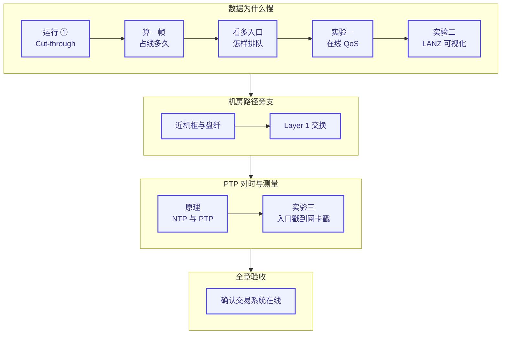

# 第七部分：在线交易系统中的 Arista QoS、LANZ 与 PTP

## 低延迟交换与 PTP 是什么

第六章已经比较了订单怎样走出主机。本章沿报文走进交换机：**出口忙时，怎样让订单先走；行情晚到时，怎样查出时间花在哪一段。** 继续使用已经在线的交易系统。

交换机像快递分拨站：cut-through（直通转发）让包裹还没卸完就开始往外送；QoS 决定出口前谁先走；LANZ 则是记录队伍长度的传感器。先把这三者放回同一条路，再讨论各站秒表怎样对齐。

IEEE SA 在 IEEE 1588-2019 的标准摘要中这样界定 PTP：

> In this standard, a protocol is defined that provides precise synchronization of clocks in packet-based networked systems. […] The protocol supports synchronization accuracy and precision in the sub-microsecond range with minimal network and local computing resources.
>
> —— [IEEE 1588-2019 · Standard Abstract](https://standards.ieee.org/ieee/1588/6825/)

PTP 是设备之间的对时协议。它让交换机和网卡上的两只钟建立可比较的关系，后面才能把同一条行情在两处的到达时刻相减。对时误差仍会进入测量结果。

本章分三幕：**看转发与排队 → 给两只钟对表 → 配对同一帧的时间戳。** 订单与行情沿用课程系统；为了稳定制造排队，QoS / LANZ 实验另加受控背景流量。交换机只改运行配置（running-config），不保存到启动配置（startup-config）；各实验结束后撤销临时配置，交易系统保持在线。

| 官方入口 | 用途 |
| --- | --- |
| [Arista EOS QoS](https://www.arista.com/en/um-eos/eos-quality-of-service) | 查订单分类、队列映射与调度 |
| [Arista EOS LANZ](https://www.arista.com/en/um-eos/eos-latency-analyzer-lanz) | 查队列事件与阈值单位 |
| [IEEE 1588-2019](https://standards.ieee.org/ieee/1588/6825/) | 查 PTP 对时标准 |
| [Arista 时间戳说明](https://www.arista.com/assets/data/pdf/Whitepapers/Overview_Arista_Timestamps.pdf) | 查帧时间戳与配套时间信息 |

## 本章学习目标

1. **说清一帧的时间花在哪。** 把链路时延拆成上线、光电转换、介质传播、固定转发和排队五笔账，区分物理下限、固定开销与常见的尾延迟来源。
2. **说清两端的时间凭什么可以相减。** 理解 NTP 与 PTP 的用途差别，知道 PTP 怎样让 7150 与网卡硬件时钟（PHC，PTP Hardware Clock）对表，并说出两个硬件时间戳各盖在哪里。
3. **说清结论背后的证据是什么。** 用 LANZ 判断出口是否排队，用带时间戳的流量副本按段定位，并说清每种证据的适用边界。

<div style="border-left:6px solid #7e22ce;background:#f3e8ff;padding:12px 16px;border-radius:8px;margin:14px 0;"><span style="display:inline-block;padding:3px 12px;border-radius:6px;background:#7e22ce;color:#fff;font-weight:800;">关键图</span> <span style="font-weight:700;color:#581c87;">三件事沿同一路径展开：先看出口如何排队，再用 LANZ 留下队列记录，最后对齐时钟、比较行情到达时刻。</span></div>

<div style="background:#f8fafc;border:1px solid #cbd5e1;border-radius:12px;padding:10px;max-width:820px;margin:14px auto;">

</div>

## 本章导航

<div style="border-left:6px solid #7e22ce;background:#f3e8ff;padding:12px 16px;border-radius:8px;margin:14px 0;"><span style="display:inline-block;padding:3px 12px;border-radius:6px;background:#7e22ce;color:#fff;font-weight:800;">本章导航</span> <span style="font-weight:700;color:#581c87;">本章分成 4 部分，共 10 个导航项。前 7 项解释数据为什么慢以及机房路径旁支；第 8 项只讲清 NTP / PTP；第 9 项把交换机入口戳与网卡硬件戳真正相减；第 10 项做一次章末验收。能力查询、工具安装和 PHC 读取由实验三脚本在开跑前自动完成。</span></div>



固定顺序就是：**数据为什么慢 → 机房路径旁支 → PTP 对时与测量 → 全章验收**。

## 任务地图

| 导航项 | 所属部分 | 这一项回答什么 |
| --- | --- | --- |
| 运行 ①：确认 Cut-through | 数据为什么慢 | 确认当前是 cut-through，Et1/Et2 是 10G |
| 算一帧占线多久 | 数据为什么慢 | 计算一帧在 10G 上最少占出口多久 |
| 看多入口怎样排队 | 数据为什么慢 | 解释多入口汇聚为什么产生短时排队 |
| 实验一：在线 QoS | 数据为什么慢 | 让真实订单命中指定优先级队列 |
| 实验二：LANZ 可视化 | 数据为什么慢 | 把 LANZ 队列事件推到 8088 |
| 旁支：近机柜与盘纤 | 机房路径旁支 | 解释近机柜为什么仍要控制光程 |
| 旁支：Layer 1 交换 | 机房路径旁支 | 解释 Layer 1 交换的适用位置 |
| 原理：NTP 与 PTP | PTP 对时与测量 | 两只钟怎样建立可比较的时间关系 |
| 实验三：入口戳到网卡戳 | PTP 对时与测量 | 时间戳在哪里打，以及怎样配对相减 |
| 确认交易系统在线 | 全章验收 | 用真实订单确认端到端业务仍然可用 |

## 第一幕：数据为什么慢

这一幕区分两种等待：交换机何时开始向外发，以及出口忙时要排多久。路线是确认 cut-through → 计算序列化 → 解释多入口汇聚 → 验证 QoS 队列 → 用 LANZ 取证。

## 运行 ①：确认 Cut-through：核对 7150 与 10G 链路

先确认两个地基条件：7150 当前使用 cut-through，Et1 / Et2 同为 10G。VLAN 和 MAC 地址转发表（FDB，Forwarding Database）只核对课程路径；后文重点看开始转发的时机与独立存在的出口排队。

<div style="border:2px solid #4f46e5;background:#eef2ff;padding:10px 12px;border-radius:8px;margin:14px 0;"><div style="font-weight:900;color:#312e81;margin-bottom:4px;">导航卡 · 数据为什么慢</div><div style="font-weight:700;color:#312e81;margin-bottom:8px;">范畴：现场只读　本步知识：确认当前是 cut-through，Et1/Et2 是 10G　位置：全章第 1 / 10 项 · 本组第 1 / 5 项</div><span style="display:inline-block;margin:3px;padding:4px 10px;border-radius:6px;background:#15803d;color:#fff;font-weight:800;">运行 ①：确认 Cut-through</span><span style="display:inline-block;margin:3px;padding:4px 10px;border-radius:6px;background:#f8fafc;border:1px solid #a5b4fc;color:#312e81;font-weight:800;">算一帧占线多久</span><span style="display:inline-block;margin:3px;padding:4px 10px;border-radius:6px;background:#f8fafc;border:1px solid #a5b4fc;color:#312e81;font-weight:800;">看多入口怎样排队</span><span style="display:inline-block;margin:3px;padding:4px 10px;border-radius:6px;background:#f8fafc;border:1px solid #a5b4fc;color:#312e81;font-weight:800;">实验一：在线 QoS</span><span style="display:inline-block;margin:3px;padding:4px 10px;border-radius:6px;background:#f8fafc;border:1px solid #a5b4fc;color:#312e81;font-weight:800;">实验二：LANZ 可视化</span></div>

<div style="border:2px solid #7e22ce;background:#faf5ff;padding:14px 16px;border-radius:10px;margin:16px 0;">
<div style="font-weight:900;color:#581c87;margin-bottom:10px;">实体交换平台 · Arista DCS-7150S-24-F</div>
<div style="display:grid;grid-template-columns:repeat(auto-fit,minmax(280px,1fr));gap:12px;">
<figure style="margin:0;">

<figcaption style="color:#581c87;font-weight:700;margin-top:8px;">正面：Et1 接 `.1 Exchange`，Et2 接 `.2 Trader`。</figcaption>
</figure>
<figure style="margin:0;">

<figcaption style="color:#581c87;font-weight:700;margin-top:8px;">反面：双电源与四个风扇，同一台设备的供电和散热面。</figcaption>
</figure>
</div>
</div>

### 本步理论：Cut-through 只把“开始发”提前

7150 的转发由专用集成电路（ASIC）完成，本机使用 FM6000 系列转发芯片。帧从 Et1 进入芯片后，芯片一旦读到足以作出转发决定的帧头，就启动 Et2 发送。此时帧尾可能还在进入 Et1，帧头已从 Et2 发出。

cut-through 省下的是“等整帧收完”的固定时间；端口线速不变，出口忙时仍要排队。

<div style="border-left:6px solid #7e22ce;background:#f3e8ff;padding:12px 16px;border-radius:8px;margin:14px 0;"><span style="display:inline-block;padding:3px 12px;border-radius:6px;background:#7e22ce;color:#fff;font-weight:800;">关键图</span> <span style="font-weight:700;color:#581c87;">Et1 → Parser → VLAN → FDB → 决定 → Et2 队列 → 序列化 → Et2。绿虚线是 LANZ 观察点。</span></div>

<div style="background:#f8fafc;border:1px solid #cbd5e1;border-radius:12px;padding:10px;max-width:820px;margin:14px auto;">

</div>

| 低延迟阶段 | 网络工程师要盯什么 |
| --- | --- |
| ingress / parser | 帧进没进来、头能不能认 |
| VLAN / FDB | 是不是同一广播域、目的 MAC 该出哪口 |
| egress queue | 多个入口有没有抢同一个出口 |
| serialization | 整帧按线速发完要多久 |

对照的 store-and-forward（存储转发）先收完整帧、验过帧尾校验字段（FCS，Frame Check Sequence），再转发。cut-through 用更早开始发送换取更低的固定时延；代价是读到 FCS 前已经发送，坏帧可能已有部分进入下游。

两种模式都要完成线上序列化，也都会遇到出口排队。因此 `mode` 只证明当前转发方式，不是逐包纳秒时延读数。

<div style="border-left:6px solid #7e22ce;background:#f3e8ff;padding:12px 16px;border-radius:8px;margin:14px 0;"><span style="display:inline-block;padding:3px 12px;border-radius:6px;background:#7e22ce;color:#fff;font-weight:800;">关键图</span> <span style="font-weight:700;color:#581c87;">同一帧长、同一线速；只比较出口从哪一刻开始发送。</span></div>

<div style="background:#f8fafc;border:1px solid #cbd5e1;border-radius:12px;padding:10px;max-width:820px;margin:14px auto;">

</div>

### 先把交换机延迟的起止点说清

[Arista 7150S Data Sheet](https://www.arista.com/assets/data/pdf/Datasheets/7150S_Datasheet.pdf) 标出 7150S-24 的 SFP+ 口到口延迟为 `from 350 ns`：cut-through，任意口对，所有帧长同一量级。课堂把它归入**空闲出口上的固定转发时间**，与排队和整帧序列化分开读。

要读这个数字，先选定测量方法。[RFC 8238](https://www.rfc-editor.org/rfc/rfc8238.html) 把交换机延迟定义成四种：FIFO、FILO、LILO、LIFO。起点选输入的首 bit 或尾 bit，终点选输出的首 bit 或尾 bit，两两组合就是这四种。做数据中心设备横向比较时用 FILO；研究 cut-through 多快开始出帧时，同时看 FIFO。

<div style="border-left:6px solid #7e22ce;background:#f3e8ff;padding:12px 16px;border-radius:8px;margin:14px 0;"><span style="display:inline-block;padding:3px 12px;border-radius:6px;background:#7e22ce;color:#fff;font-weight:800;">关键图</span> <span style="font-weight:700;color:#581c87;">FIFO、FILO、LILO、LIFO 是四种测量交换机延迟的方法；图里重点看 FIFO 与 FILO。</span></div>

<div style="background:#f8fafc;border:1px solid #cbd5e1;border-radius:12px;padding:10px;max-width:820px;margin:14px auto;">

</div>

| 方法 | 全称 | 起点 → 终点 | 最适合回答什么 |
| --- | --- | --- | --- |
| FIFO | First In First Out | 输入首 bit → 输出首 bit | cut-through 多快开始转发 |
| FILO | First In Last Out | 输入首 bit → 输出尾 bit | 整帧穿过被测设备（DUT，Device Under Test）的共同比较口径；包含序列化 |
| LILO | Last In Last Out | 输入尾 bit → 输出尾 bit | 帧尾在设备内的推进关系 |
| LIFO | Last In First Out | 输入尾 bit → 输出首 bit | 对 cut-through 可能出现负值，RFC 8238 禁止拿它做设备横比 |

数据表没写 FIFO / FILO 字母，但“cut-through + 所有帧长同一量级”支持课堂将 **350 ns 解读为 FIFO 口径**（工程推断）。若按 FILO 量，64B 与 1514B 在 10GbE 上单序列化就相差约 `1160 ns`。运行 ① 只验证当前模式，350 ns 仍是厂商规格值。

拿到任何一个写着 ns 的交换机延迟，先把六件事填一遍：

| 要问清的事 | 这份 350 ns 怎么填 | 依据 |
| --- | --- | --- |
| 测量方法 | FIFO（输入首 bit → 输出首 bit） | 推断：cut-through + 所有帧长同一量级；数据表未写字母 |
| 帧长 | 64B～9216B 都按同一量级报 | Data Sheet 的 latency profile |
| 线速 | SFP+ 口；本课现场是 10G | 表行 `Latency (SFP+ Ports)`；Et1/Et2 为 10G |
| 负载 | 出口空闲时的起点值；未写负载百分比 | 原文 `from 350 ns`；出口争用时要进缓冲 |
| 端口对 | 任意 SFP+ 口到任意 SFP+ 口；7150S-24 是 350 ns | 原文 any port to any other port；52/64 口机型是 380 ns |
| 分位数 | 未写 p50 / p99 | `from` 是最优起点，不是分位统计 |

少填一行，两个同样写着 ns 的数字就可能不是同一把尺。

**理论落到实验：** 绿色卡只读 EOS。主要判断是 `Current switching mode: cut through` 与 Et1/Et2 10G；VLAN/FDB 只作为“确实是这条链路”的辅助收据。

等价文件入口：`bash Documents/newDoc/assets/07-arista-time/01-arista-fabric-inventory.sh`。

<div style="border-left:6px solid #15803d;background:#dcfce7;padding:12px 16px;border-radius:8px;margin:14px 0;"><span style="display:inline-block;padding:3px 12px;border-radius:6px;background:#15803d;color:#fff;font-weight:800;">需要运行 · 运行 ①</span> <span style="font-weight:700;color:#14532d;">在【持久管理机 `/financial-low-latency`】以 root 运行；前置是第一章准备 B/C 已恢复公钥和 VLAN20；只读八条 show，不写 running-config、不 save；预计数秒；预期 Et1/Et2 为 connected / VLAN 20 / 10G，mode 为 cut through。</span></div>

```bash
#!/usr/bin/env bash
set -Eeuo pipefail
cd /financial-low-latency
RUN_ID="$(date -u +%Y%m%dT%H%M%SZ)-07-arista-inventory"
OUT="Documents/reports/course-runs/$RUN_ID"; mkdir -p "$OUT/raw"
printf 'RUN_ID=%s\n' "$RUN_ID" >"$OUT/run.env"
TRANS="$OUT/raw/eos-transcript.txt"

printf '%s\n' \
  'show version' \
  'show interfaces Ethernet1 status' \
  'show interfaces Ethernet2 status' \
  'show interfaces Ethernet1 counters' \
  'show interfaces Ethernet2 counters' \
  'show vlan id 20' \
  'show mac address-table dynamic vlan 20' \
  'show switch forwarding-mode' >"$OUT/eos.plan"

python3 Documents/newDoc/assets/common/eos_cli.py --mode show \
  --plan "$OUT/eos.plan" --output "$TRANS" >/dev/null

{
  printf 'fll-arista / verify\n'
  while IFS='|' read -r title note cmd; do
    printf '===== 查%s =====\n%s\n$ %s\n' "$title" "$note" "$cmd"
    awk -v cmd="$cmd" '
      $0 == "$ " cmd {p=1; found=1; next}
      p && /^\$ / {exit}
      p && $0 == cmd " | no-more" {next}
      p {print}
      END {if (!found) exit 1}
    ' "$TRANS"
  done <<'ITEMS'
Et1状态|[Et1] 对: connected / VLAN 20 / full / 10G / 10GBASE-CR  证: Exchange 侧入口在课程链路上|show interfaces Ethernet1 status
Et2状态|[Et2] 对: connected / VLAN 20 / full / 10G / 10GBASE-CR  证: Trader 侧出口同速 10G|show interfaces Ethernet2 status
VLAN20成员|[VLAN20] 对: active，成员含 Cpu, Et1, Et2, Et11, Et12  证: 实验走的是课程 VLAN20|show vlan id 20
VLAN20动态FDB|[FDB] 对: 000f.53d3.af20 在 Et1，000f.53d3.af21 在 Et2  证: 两端 MAC 学在正确的口|show mac address-table dynamic vlan 20
转发模式|[mode] 对: Current switching mode: cut through  证: 当前按 cut-through 工作，不是逐包时延|show switch forwarding-mode
ITEMS
} | tee "$OUT/raw/terminal.txt"
(cd "$OUT" && sha256sum raw/*.txt eos.plan run.env >SHA256SUMS)
echo "evidence=$OUT"
```

<div style="border-left:6px solid #7e22ce;background:#f3e8ff;padding:12px 16px;border-radius:8px;margin:14px 0;"><span style="display:inline-block;padding:3px 12px;border-radius:6px;background:#7e22ce;color:#fff;font-weight:800;">2026-09-03 本轮实测 · 输出解读</span> <span style="font-weight:700;color:#581c87;">下面是脚本在 RUN `20260903T052512Z-07-arista-inventory` 当场打到终端的内容；正文转录仅清理表格行尾空格，字段与行顺序不变。每项先分隔线，再命令，再 EOS 原文。八条 show 的完整混排原件在同目录 `raw/eos-transcript.txt`，课堂输出在 `raw/terminal.txt`。</span></div>

```text
fll-arista / verify
===== 查Et1状态 =====
[Et1] 对: connected / VLAN 20 / full / 10G / 10GBASE-CR  证: Exchange 侧入口在课程链路上
$ show interfaces Ethernet1 status
Port       Name   Status       Vlan     Duplex Speed  Type         Flags Encapsulation
Et1               connected    20       full   10G    10GBASE-CR


===== 查Et2状态 =====
[Et2] 对: connected / VLAN 20 / full / 10G / 10GBASE-CR  证: Trader 侧出口同速 10G
$ show interfaces Ethernet2 status
Port       Name   Status       Vlan     Duplex Speed  Type         Flags Encapsulation
Et2               connected    20       full   10G    10GBASE-CR


===== 查VLAN20成员 =====
[VLAN20] 对: active，成员含 Cpu, Et1, Et2, Et11, Et12  证: 实验走的是课程 VLAN20
$ show vlan id 20
VLAN  Name                             Status    Ports
----- -------------------------------- --------- -------------------------------
20    fll                              active    Cpu, Et1, Et2, Et11, Et12


===== 查VLAN20动态FDB =====
[FDB] 对: 000f.53d3.af20 在 Et1，000f.53d3.af21 在 Et2  证: 两端 MAC 学在正确的口
$ show mac address-table dynamic vlan 20
          Mac Address Table
------------------------------------------------------------------

Vlan    Mac Address       Type        Ports      Moves   Last Move
----    -----------       ----        -----      -----   ---------
  20    000f.53d3.af20    DYNAMIC     Et1        1       19:10:24 ago
  20    000f.53d3.af21    DYNAMIC     Et2        1       4:25:57 ago
Total Mac Addresses for this criterion: 2

          Multicast Mac Address Table
------------------------------------------------------------------

Vlan    Mac Address       Type        Ports
----    -----------       ----        -----
Total Mac Addresses for this criterion: 0

===== 查转发模式 =====
[mode] 对: Current switching mode: cut through  证: 当前按 cut-through 工作，不是逐包时延
$ show switch forwarding-mode
Current switching mode:    cut through
Available switching modes: cut through, store and forward
```

读法固定：先看 `===== 查… =====` 确认对象，再用 `对:` 核对原始读数，最后用 `证:` 把读数放进判断链。

| 字段 | 实测例子 | 学员读什么 |
| --- | --- | --- |
| Current switching mode | `cut through` | 本步主结论：当前按 cut-through 工作；不是逐包时延 |
| Et1 / Et2 状态 | `connected / full / 10G / 10GBASE-CR` | 两侧线速一致，后面的序列化口径是 10GbE |
| 路径辅助收据 | VLAN20 成员与两条动态 FDB | 只确认实验确实经过 Et1→Et2，不展开基础 VLAN 教学 |

<div style="border-left:6px solid #0891b2;background:#cffafe;padding:12px 16px;border-radius:8px;margin:14px 0;"><span style="display:inline-block;padding:3px 12px;border-radius:6px;background:#0891b2;color:#fff;font-weight:800;">关键现象</span> <span style="font-weight:700;color:#164e63;">先看 `Current switching mode: cut through`，再看 Et1/Et2 都是 10G。VLAN/FDB 只负责防止认错路径；端口 notconnect 或 MAC 学错口时停下。</span></div>

下一线索：模式和线速都确认了。既然出口按 10G 发送，那就先算一算——一帧最少要占用这个出口多久？

## 算一帧占线多久：按 10GbE 换算

<div style="border:2px solid #4f46e5;background:#eef2ff;padding:10px 12px;border-radius:8px;margin:14px 0;"><div style="font-weight:900;color:#312e81;margin-bottom:4px;">导航卡 · 数据为什么慢</div><div style="font-weight:700;color:#312e81;margin-bottom:8px;">范畴：纸面换算　本步知识：计算一帧在 10G 上最少占出口多久　位置：全章第 2 / 10 项 · 本组第 2 / 5 项</div><span style="display:inline-block;margin:3px;padding:4px 10px;border-radius:6px;background:#f8fafc;border:1px solid #a5b4fc;color:#312e81;font-weight:800;">运行 ①：确认 Cut-through</span><span style="display:inline-block;margin:3px;padding:4px 10px;border-radius:6px;background:#15803d;color:#fff;font-weight:800;">算一帧占线多久</span><span style="display:inline-block;margin:3px;padding:4px 10px;border-radius:6px;background:#f8fafc;border:1px solid #a5b4fc;color:#312e81;font-weight:800;">看多入口怎样排队</span><span style="display:inline-block;margin:3px;padding:4px 10px;border-radius:6px;background:#f8fafc;border:1px solid #a5b4fc;color:#312e81;font-weight:800;">实验一：在线 QoS</span><span style="display:inline-block;margin:3px;padding:4px 10px;border-radius:6px;background:#f8fafc;border:1px solid #a5b4fc;color:#312e81;font-weight:800;">实验二：LANZ 可视化</span></div>

这里的**序列化（serialization）**是把一帧的比特按线速逐位推上线缆，与软件的对象序列化不同。帧越长，占用出口越久；这笔时间不随转发模式消失。

算法非常简单，路径固定后只改帧长：`时间 = 帧字节数 × 8 ÷ 线速`。下面先把 64 和 1514 当成两个给定字节数换算。注意口径：标准最短帧的 64 字节含 4 字节 FCS；常见抓包中的 1514 字节是 14 字节头加 1500 字节载荷，通常不含 FCS。

| 计入的字节数 | 口径 | 仅这些字节在 10GbE 上占线多久 |
| --- | --- | --- |
| 64 字节 | 最短标准以太网帧 | 51.2 ns |
| 1514 字节 | 14 字节头 + 1500 字节载荷 | 1211.2 ns |
| 相差 | 大帧比小帧多占线 | 1160 ns |

store-and-forward 需要先收完 1514 字节帧，完整收帧时间是 `1211.2 ns`；cut-through 读到足以转发的帧头就可启动出口。[7150S Data Sheet](https://www.arista.com/assets/data/pdf/Datasheets/7150S_Datasheet.pdf) 未公布启动所需的帧头长度，因此本表只给出完整收帧这部分的量级，不代替两种模式的实测差值。

表中差值只是给定字节数的换算，不能直接当作完整线路开销的差。按同一含 FCS 口径，大帧应计 1518 字节。以太网在每帧前后还有 Preamble（前导码）、SFD（帧起始定界符）和 IFG（帧间隔）这些线路开销；后续做发流速率预算时再把它们加进来。

<div style="border-left:6px solid #7e22ce;background:#f3e8ff;padding:12px 16px;border-radius:8px;margin:14px 0;"><span style="display:inline-block;padding:3px 12px;border-radius:6px;background:#7e22ce;color:#fff;font-weight:800;">关键图</span> <span style="font-weight:700;color:#581c87;">同一条 10GbE 闸口；小帧和大帧只是占线时间不同。</span></div>

<div style="background:#f8fafc;border:1px solid #cbd5e1;border-radius:12px;padding:10px;max-width:820px;margin:14px auto;">

</div>

<div style="border-left:6px solid #64748b;background:#f8fafc;padding:12px 16px;border-radius:8px;margin:14px 0;"><span style="display:inline-block;padding:3px 12px;border-radius:6px;background:#64748b;color:#fff;font-weight:800;">无需运行</span> <span style="font-weight:700;color:#334155;">这一项用单位换算完成；`02-serialization-time.sh` 可作为课后计算器和历史证据。</span></div>

### Cut-through 的四个边界

cut-through 的收益不是随时都能拿到。下面四种场景决定了它什么时候有效、什么时候等于没开：

| 场景 | cut-through 能不能省时间 | 原因 |
| --- | --- | --- |
| 出口空闲、进出同速 | 能，这是它的理想工况 | 读到转发决定就能立刻启动出口 |
| 出口正被别的流量占用 | 不能，照样排队 | 队列在转发决定之后，与转发模式无关 |
| 进出速率不同 | 不能只凭全局 mode 判断收益 | 10G 进、1G 出会让帧尾在缓存积压；1G 进、10G 出则要先积累足够数据避免出口发空。是否仍能提前启动由 ASIC 实现决定 |
| 帧本身是坏帧 | 能，但这正是它的代价 | FCS 在帧尾，读到时头部可能已经发出去了 |

最后一行值得多说一句：坏帧已经发出去一部分之后，芯片具体怎么收场（比如故意破坏帧尾让下游丢弃），取决于芯片型号和 EOS 的实现，不能只凭"用的是 cut-through"这一条就推断出来。

<div style="background:#f8fafc;border:1px solid #cbd5e1;border-radius:12px;padding:10px;max-width:820px;margin:14px auto;">

</div>

### 把一条链路拆成五项时间账单

一条链路的总时间要拆成五笔账：

1. **序列化**——把帧一位位推上线，由帧长和线速决定。
2. **PHY / FEC**——物理层编解码和可选的纠错编码，是一笔固定开销。
3. **介质传播**——信号在光纤或铜缆里跑，由距离决定，约 5 ns/m。
4. **固定转发**——芯片查表、做决定的时间；课堂把 [7150S Data Sheet](https://www.arista.com/assets/data/pdf/Datasheets/7150S_Datasheet.pdf) 的 `from 350 ns` 作为这一项的 FIFO 工程解读。
5. **排队**——出口被占用时的等待。

这些项目帮助定位原因，不能把不同测量口径的规格值直接相加；设备口到口规格可能已包含部分物理层处理。固定帧长、路径与配置后，前四项通常较稳定，出口排队则会被 microburst（微突发）瞬间放大。因此延迟要看 p99，LANZ 则记录这第五笔账何时发生。

<div style="border-left:6px solid #7e22ce;background:#f3e8ff;padding:12px 16px;border-radius:8px;margin:14px 0;"><span style="display:inline-block;padding:3px 12px;border-radius:6px;background:#7e22ce;color:#fff;font-weight:800;">关键图</span> <span style="font-weight:700;color:#581c87;">升级速率、改变 FEC、缩短光程、换 ASIC、治理队列，分别改变五张不同的账。</span></div>

<div style="background:#f8fafc;border:1px solid #cbd5e1;border-radius:12px;padding:10px;max-width:820px;margin:14px auto;">

</div>

图中的「多出 FEC」指升到 25G / 100G 后，标准光口通常保留默认开启的 FEC，因而多一截固定等待。FEC 是交换机口和网卡口上按模块类型工作的功能。

[Arista E-Series](https://www.arista.com/assets/data/pdf/Datasheets/E-Series-Optical-Transceivers-Q%26A.pdf)（Optical Transceivers，光模块，插在交换机口或网卡口上）的卖点正是“允许关 FEC”：光学做够好，两端都用它时不开 FEC 也满足 BER，端口才允许关掉，最多省约 `250 ns`。接标准模块时通常仍按链路规范保留 FEC。

FEC 开着时，厂商给的等待量级是：

| 端口上开着的纠错 | 厂商延迟 |
| --- | --- |
| 25G Firecode / BASE-R FEC | 约 80 ns |
| 25G RS-FEC | 约 250 ns |
| 100G RS-FEC | 约 150 ns |

本课 Et1 / Et2 是 `10GBASE-CR` DAC，没有这一截。100G 带着 RS-FEC 仍可能比 25G RS-FEC 更快，因为序列化短了四倍，两笔账要一起算。

至此，1514 字节帧在 10G 上的占线时间是 `1211.2 ns`；运行 ① 则把现场模式锁定为 cut-through。两种模式的实测差值仍属独立性能问题。

下一线索：单帧的时间下限清楚了。真正的麻烦从第二个入口开始——两股流量同时挤向一个出口时会发生什么？

## 看多入口怎样排队：为什么平均不忙仍会拥塞

<div style="border:2px solid #4f46e5;background:#eef2ff;padding:10px 12px;border-radius:8px;margin:14px 0;"><div style="font-weight:900;color:#312e81;margin-bottom:4px;">导航卡 · 数据为什么慢</div><div style="font-weight:700;color:#312e81;margin-bottom:8px;">范畴：纸面模型　本步知识：解释多入口汇聚为什么产生短时排队　位置：全章第 3 / 10 项 · 本组第 3 / 5 项</div><span style="display:inline-block;margin:3px;padding:4px 10px;border-radius:6px;background:#f8fafc;border:1px solid #a5b4fc;color:#312e81;font-weight:800;">运行 ①：确认 Cut-through</span><span style="display:inline-block;margin:3px;padding:4px 10px;border-radius:6px;background:#f8fafc;border:1px solid #a5b4fc;color:#312e81;font-weight:800;">算一帧占线多久</span><span style="display:inline-block;margin:3px;padding:4px 10px;border-radius:6px;background:#15803d;color:#fff;font-weight:800;">看多入口怎样排队</span><span style="display:inline-block;margin:3px;padding:4px 10px;border-radius:6px;background:#f8fafc;border:1px solid #a5b4fc;color:#312e81;font-weight:800;">实验一：在线 QoS</span><span style="display:inline-block;margin:3px;padding:4px 10px;border-radius:6px;background:#f8fafc;border:1px solid #a5b4fc;color:#312e81;font-weight:800;">实验二：LANZ 可视化</span></div>

把 Fan-in（多入口汇聚）想成**两条匝道同时并入一条主路**：多路流量在同一短窗汇向一个出口，合计到达量一旦超过出口容量，余量就在出口前排队。

它的反直觉之处是：**每个入口单看都不忙，合起来却可能超过同一个出口。** Fan-in 关注的不是一分钟平均流量，而是几路流量有没有在同一个短窗口里撞到一起。

用一组不带单位的数字就能说明白。假设出口在一个很短的时间窗里能送走 10 份流量：

- 只有一个入口进来 8 份：8 < 10，走得掉，不用排队。
- 两个入口各进来 8 份：每一路单看都低于 10，但同时到达就是 16 份，出口只能送走 10 份，剩下 6 份必须先坐在缓冲区里等。

这 6 份等待就是第五笔账。高频交易关心微秒级短窗的碰撞；按分钟平均的利用率会抹平这类“整体不忙，少数订单突然变慢”的 microburst。

<div style="border-left:6px solid #7e22ce;background:#f3e8ff;padding:12px 16px;border-radius:8px;margin:14px 0;"><span style="display:inline-block;padding:3px 12px;border-radius:6px;background:#7e22ce;color:#fff;font-weight:800;">关键图</span> <span style="font-weight:700;color:#581c87;">先沿箭头读：入口 A 到 8 份，入口 B 也到 8 份；两路在同一短窗口汇向一个只能发 10 份的出口，所以 16 − 10 = 6 份留在出口队列。</span></div>

<div style="background:#f8fafc;border:1px solid #cbd5e1;border-radius:12px;padding:10px;max-width:820px;margin:14px auto;">

</div>

| profile | arrival | capacity | queued | 学员读什么 |
| --- | ---: | ---: | ---: | --- |
| `one_ingress` | 8 | 10 | 0 | 到达低于出口，不用排队 |
| `two_ingress` | 16 | 10 | 6 | 只加了一个入口，短窗就积压 |

<div style="border-left:6px solid #64748b;background:#f8fafc;padding:12px 16px;border-radius:8px;margin:14px 0;"><span style="display:inline-block;padding:3px 12px;border-radius:6px;background:#64748b;color:#fff;font-weight:800;">无需运行</span> <span style="font-weight:700;color:#334155;">这是建立排队直觉的简化模型；`03-queue-fanin-model.sh` 可作为课后计算器，真机证据由后面的 LANZ 实验给出。</span></div>

### 共享缓冲、队列与组播复制怎样连起来

在 7150 上，这 6 份流量进入动态共享缓冲：空闲端口的份额可被突发出口借用，以吸收更大的短时峰值。**共享不等于无限**，池子用尽仍会丢包。

组播行情由 ASIC 直接复制到多个出口，无需 CPU 逐份处理；但每份副本都要**独立序列化、独立排队**。因此同一条行情可能在 A 口准时到达，在正受争用的 B 口晚到几十微秒。

| 工具 | 它真正做什么 | 低延迟使用边界 |
| --- | --- | --- |
| strict priority（严格优先级） | 只要更高的 strict 队列里有包，就先发它 | 只适合边界清楚、带宽受控的关键类；把整条高流量行情都塞进去，仍可能让低队列饥饿 |
| WRR（加权轮转） | 让多个队列按份额轮流出队 | 各队列都有机会，但关键包可能要等别人轮完一圈 |
| LANZ | 记录出口队列的瞬时长度和事件 | 它是传感器，不是调度算法，看得见拥塞但治不了拥塞 |

## 实验一：在线 QoS：订单怎样进入优先级队列

<div style="border:2px solid #4f46e5;background:#eef2ff;padding:10px 12px;border-radius:8px;margin:14px 0;"><div style="font-weight:900;color:#312e81;margin-bottom:4px;">导航卡 · 数据为什么慢</div><div style="font-weight:700;color:#312e81;margin-bottom:8px;">范畴：教师维护窗　本步知识：让真实订单命中指定优先级队列　位置：全章第 4 / 10 项 · 本组第 4 / 5 项</div><span style="display:inline-block;margin:3px;padding:4px 10px;border-radius:6px;background:#f8fafc;border:1px solid #a5b4fc;color:#312e81;font-weight:800;">运行 ①：确认 Cut-through</span><span style="display:inline-block;margin:3px;padding:4px 10px;border-radius:6px;background:#f8fafc;border:1px solid #a5b4fc;color:#312e81;font-weight:800;">算一帧占线多久</span><span style="display:inline-block;margin:3px;padding:4px 10px;border-radius:6px;background:#f8fafc;border:1px solid #a5b4fc;color:#312e81;font-weight:800;">看多入口怎样排队</span><span style="display:inline-block;margin:3px;padding:4px 10px;border-radius:6px;background:#15803d;color:#fff;font-weight:800;">实验一：在线 QoS</span><span style="display:inline-block;margin:3px;padding:4px 10px;border-radius:6px;background:#f8fafc;border:1px solid #a5b4fc;color:#312e81;font-weight:800;">实验二：LANZ 可视化</span></div>

### 出口忙时，怎样让订单先走

这是一个典型场景：行情、订单、备份和抓包流量共用一个出口，平时都不忙；备份一突发，订单或行情的 p99 就抬起来。要让订单先走，需要连做五个动作：**谁打标、入口信不信、标记映射到哪个 Traffic Class（内部流量类别）、Traffic Class 进入哪个 TX queue（发送队列）、多个队列怎样出队。** 本节先给推荐做法，再逐个动作展开。

### 推荐做法：订单打 EF，交换机 strict 出队

本课在受控实验网中采用这套配置：**订单流打 DSCP 46（EF），在自己控制的接入口信任这个标记，让它落到一个显式 strict 的出口队列；行情和订单能分线就分线，分不开再靠这套 QoS。** 本课实验一就是这条路线的完整落地。

| 动作 | 推荐做法 | 依据 |
| --- | --- | --- |
| 先分路 | 行情和订单优先走不同物理连接；共用出口只留给分不开的场景 | [Cboe CFE Connectivity Manual](https://cdn.cboe.com/resources/membership/CBOE-FUTURES-EXCHANGE-CONNECTIVITY-MANUAL.pdf) 把 L1 行情与 L3 订单 / TCP 产品按连接分路 |
| 选码点 | 订单流打 DSCP `46`，即 Expedited Forwarding（EF） | [RFC 3246](https://www.rfc-editor.org/rfc/rfc3246.html) 推荐 `101110` = 46，目标是低时延、低抖动、低丢包 |
| 谁打标 | 主机侧按五元组打标；本课用 iptables mangle 只标 `.2 → .1:43120` 的订单连接 | [Cisco DiffServ 指南](https://www.cisco.com/c/en/us/td/docs/ios-xml/ios/qos_dfsrv/configuration/15-mt/qos-dfsrv-15-mt-book/qos-dfsrv.pdf) 把 online trading programs 列为 EF 适用程序；Linux [`iptables-extensions`](https://man7.org/linux/man-pages/man8/iptables-extensions.8.html#DSCP) 提供 DSCP target |
| 入口信任 | 自己控制的低延迟主机专用口才 trust DSCP；外部或多租户入口先重分类 | [Cisco Trading Floor Architecture](https://www.cisco.com/c/en/us/td/docs/solutions/Verticals/Trading_Floor_Architecture-E.html) 的共享金融网络用 QoS 保护延迟敏感应用 |
| 映射与出队 | 沿用平台默认 DSCP 40～47→TC5→Q5，再把 Q5 显式配成 `priority strict` | [Arista EOS QoS 手册](https://www.arista.com/en/um-eos/eos-quality-of-service) 的 FM6000 默认表与 strict 配置 |
| 控总量 | 限制有权打 EF 的主机与端口，并给 strict 类规定可接受的总速率 | RFC 3246 要求 priority queue 实现的 EF 必须限制对其他流量的损害 |

这套做法分三层：DSCP 46 来自 IETF，TC5 / Q5 是 FM6000 默认映射，“只标记订单连接、Q5 显式 strict”是本课策略。换厂商时重新核对映射和队列编号；生产落地还需补齐信任边界、strict 总量上限、容量验证与回滚。

### 标签从哪里来

OUCH 和 ITCH 是应用消息；DSCP 是 IPv4 / IPv6 头里的网络字段，CoS 是 802.1Q tag 里的三位 PCP。标签在三处产生：

1. **应用自己写**：建 socket 后 [`setsockopt(IP_TOS)`](https://www.kernel.org/pub/linux/docs/man-pages/book/man-pages-6.17.pdf)，组包时把 DSCP 填进 TOS 字节（`TOS` 是这一字节的老名字）。
2. **主机策略写**：iptables / nftables mangle 按五元组改 DSCP，接口见 [`iptables-extensions`](https://man7.org/linux/man-pages/man8/iptables-extensions.8.html#DSCP)。**本课选这一种**：改动最小，交易进程不用重编、不用重启。
3. **接入交换机重分类**：按信任策略使用端口、VLAN、五元组或 ACL 设置内部 Traffic Class。

**信任 DSCP 等于声明该入口属于受控信任域。** 自管低延迟主机的专用口可直接 trust；外部或多租户入口先清洗、再重分类，避免任意流量占用 strict 队列。

第六章四路下单到交换机都走同一套 DSCP → TC → 队列，差别只在谁写标签：

| 下单路径 | 推荐打标 | 本章落点 |
| --- | --- | --- |
| Kernel Socket | 能改程序就用 Socket TOS；程序不能动再用 iptables | 实验用 iptables，不改交易进程 |
| OpenOnload | Socket TOS。加速路径看不见内核 iptables，见 [Onload `onload_iptables`](https://docs.amd.com/r/en-US/ug1586-onload-user/onload_iptables) | 保留当前配置；实验聚焦 Kernel Socket |
| TCPDirect | 交换机按五元组 / 端口分类。[TCPDirect User Guide](https://docs.amd.com/v/u/en-US/SF-116303-CD-TCPDirect_User_Guide) 没有 POSIX `IP_TOS` | 保留当前配置；生产优先交换机分类 |
| DPDK + F-Stack | 交换机按五元组 / 端口分类；用户态组 IP 头时也可以直接写 DSCP | 保留当前配置；生产按报文合同选择打标点 |

### 7150 怎样从 DSCP 走到 TX queue

<div style="border-left:6px solid #7e22ce;background:#f3e8ff;padding:12px 16px;border-radius:8px;margin:14px 0;"><span style="display:inline-block;padding:3px 12px;border-radius:6px;background:#7e22ce;color:#fff;font-weight:800;">关键图</span> <span style="font-weight:700;color:#581c87;">先顺着五个动作认路。最关键的一句在红框里：strict 只决定已经进入 Q5 的包怎么排，不会替你完成入口分类。</span></div>

<div style="background:#f8fafc;border:1px solid #cbd5e1;border-radius:12px;padding:10px;max-width:820px;margin:14px auto;">

</div>

本机 Et2 变更前的实机读数是 `Trust Mode: COS`、`Default COS: 0`，这也符合 EOS switched port 的默认 trust 模式。有 802.1Q tag 时读 PCP；没有 tag 时用端口 Default COS。OUCH 不会自己选队列。本课是 access 口，所以实验在 Et2 改 `qos trust dscp`。分类来源、CoS→TC、TC→TX queue 分别见手册 [Table 12 / 13 / 17](https://www.arista.com/en/um-eos/eos-quality-of-service)。

<div style="border-left:6px solid #7e22ce;background:#f3e8ff;padding:12px 16px;border-radius:8px;margin:14px 0;"><span style="display:inline-block;padding:3px 12px;border-radius:6px;background:#7e22ce;color:#fff;font-weight:800;">关键图</span> <span style="font-weight:700;color:#581c87;">左边是本课：没 tag，Default COS 0 进 Q1。右边是有 tag 时：默认 trust 直接读 CoS，再进对应队列。</span></div>

<div style="background:#f8fafc;border:1px solid #cbd5e1;border-radius:12px;padding:10px;max-width:820px;margin:14px auto;">

</div>

DSCP 是 IPv4 [DS field](https://www.rfc-editor.org/rfc/rfc2474.html) 的高 6 位（0～63），低 2 位属于 [ECN](https://www.rfc-editor.org/rfc/rfc3168.html)；TOS 是整字节的旧称。本课的 EF 是 DSCP 46，实测 ECN=`00`，因此线上字节为 `0xb8`。Arista `show qos maps` 的 d1 / d2 是十进制十位和个位；默认 46→TC5 见下图与 [Table 14](https://www.arista.com/en/um-eos/eos-quality-of-service)。

<div style="border-left:6px solid #7e22ce;background:#f3e8ff;padding:12px 16px;border-radius:8px;margin:14px 0;"><span style="display:inline-block;padding:3px 12px;border-radius:6px;background:#7e22ce;color:#fff;font-weight:800;">关键图</span> <span style="font-weight:700;color:#581c87;">报文里是 6 个比特合成 46；CLI 的 d1 / d2 只是十位和个位，不是 TOS 再拆一层。</span></div>

<div style="background:#f8fafc;border:1px solid #cbd5e1;border-radius:12px;padding:10px;max-width:820px;margin:14px auto;">

</div>

<div style="border-left:6px solid #7e22ce;background:#f3e8ff;padding:12px 16px;border-radius:8px;margin:14px 0;"><span style="display:inline-block;padding:3px 12px;border-radius:6px;background:#7e22ce;color:#fff;font-weight:800;">关键图</span> <span style="font-weight:700;color:#581c87;">每个格子先写成 DSCP 数字，再标 TC。橙色 40～47 是 TC5；加粗框是本课用的 46。</span></div>

<div style="background:#f8fafc;border:1px solid #cbd5e1;border-radius:12px;padding:10px;max-width:820px;margin:14px auto;">

</div>

标记档只改变 Trader → Exchange 这一向；背景一直留在 Q1。三个配置落点见图。

<div style="border-left:6px solid #7e22ce;background:#f3e8ff;padding:12px 16px;border-radius:8px;margin:14px 0;"><span style="display:inline-block;padding:3px 12px;border-radius:6px;background:#7e22ce;color:#fff;font-weight:800;">关键图</span> <span style="font-weight:700;color:#581c87;">青色是订单方向：Et2 读 DSCP，芯片映到 TC5 / Q5，Et1 按 strict 出队。灰色虚线是回程 Execution，本课不打标。</span></div>

<div style="background:#f8fafc;border:1px solid #cbd5e1;border-radius:12px;padding:10px;max-width:820px;margin:14px auto;">

</div>

Traffic Class 是 ASIC 内部值，交换芯片带着它转发，出口再查 `TC → tx-queue`。回程要进高优先级，需要另做入口分类。

### 7150 上的调度配置

本机 `DCS-7150S-24-F / EOS 4.23.16M-2GB` 已验证：Q5 配 `priority strict` 后，`show qos interfaces Ethernet1` 显示 `SP / SP`；Q3 上的 `no priority` 让 Q3～Q0 进入轮转（RR）带宽分配。实验沿用默认 DSCP→TC 映射，订单进 Q5，Q7 留给控制面。

<div style="border-left:6px solid #7e22ce;background:#f3e8ff;padding:12px 16px;border-radius:8px;margin:14px 0;"><span style="display:inline-block;padding:3px 12px;border-radius:6px;background:#7e22ce;color:#fff;font-weight:800;">仅供展示</span> <span style="font-weight:700;color:#581c87;">脚本会下到 7150 的调度；课堂不用手敲。</span></div>

```text
configure terminal
interface Ethernet2
   qos trust dscp
interface Ethernet1
   tx-queue 5
      priority strict
   tx-queue 3
      no priority
      bandwidth percent 40
   tx-queue 2
      bandwidth percent 30
   tx-queue 1
      bandwidth percent 20
   tx-queue 0
      bandwidth percent 10
end
```

### 在线共享出口里比较 Q1 与 strict Q5

脚本 `11-qos-real-order-contention-live.sh` 先配交换机，再跑两档：A 不打标进 Q1，B 只给当前订单连接打 DSCP 46 进 Q5。

单笔订单不足以稳定堵住 10G 出口，因此 `.11` 从 Et11 / Et12 各发 `500,000 pps`、1514B、15 秒，共同争用 Et1。测试 MAC `02:00:00:07:00:01` 被静态指向 Et1，帧真正占用出口队列；`.1` 网卡在硬件中丢弃非本机 MAC，不交给 Exchange 进程。

<div style="border-left:6px solid #7e22ce;background:#f3e8ff;padding:12px 16px;border-radius:8px;margin:14px 0;"><span style="display:inline-block;padding:3px 12px;border-radius:6px;background:#7e22ce;color:#fff;font-weight:800;">关键图</span> <span style="font-weight:700;color:#581c87;">上排两路橙色对齐进 Q1，下排青色对齐进 Q5。灰色回程从 Exchange 底边回到 Trader 底边。</span></div>

<div style="background:#f8fafc;border:1px solid #cbd5e1;border-radius:12px;padding:10px;max-width:820px;margin:14px auto;">

</div>

<div style="border-left:6px solid #ea580c;background:#fff7ed;padding:12px 16px;border-radius:8px;margin:14px 0;"><span style="display:inline-block;padding:3px 12px;border-radius:6px;background:#ea580c;color:#fff;font-weight:800;">在线教师实验 · 约 2～3 分钟</span> <span style="font-weight:700;color:#9a3412;">在【持久管理机 `/financial-low-latency`】以 root 运行；第六章 GUI 和 Socket 长连接保持在线。临时改 mangle、TRex、QoS / LANZ / 静态 MAC，不 save；退出全撤。预期两档各 120 笔成交，B 档 Q5 `+240`，p99 明显低于 A 档。</span></div>

```bash
bash Documents/newDoc/assets/07-arista-time/11-qos-real-order-contention-live.sh
```

<div style="border-left:6px solid #7e22ce;background:#f3e8ff;padding:12px 16px;border-radius:8px;margin:14px 0;"><span style="display:inline-block;padding:3px 12px;border-radius:6px;background:#7e22ce;color:#fff;font-weight:800;">仅供展示</span> <span style="font-weight:700;color:#581c87;">关键代码 1 / 3：交换机临时配置。测试 MAC 静态指到 Et1，Et2 信任 DSCP，Et1 的 Q5 设成 strict。</span></div>

```bash
switch_config switch-qos-active \
  'configure terminal' \
  'queue-monitor length' \
  'mac address-table static 0200.0007.0001 vlan 20 interface Ethernet1' \
  'interface Ethernet2' 'qos trust dscp' \
  'interface Ethernet1' \
  'queue-monitor length thresholds 64 32' \
  'tx-queue 5' 'priority strict' 'exit' \
  'tx-queue 3' 'no priority' 'bandwidth percent 40' 'exit' \
  'tx-queue 2' 'bandwidth percent 30' 'exit' \
  'tx-queue 1' 'bandwidth percent 20' 'exit' \
  'tx-queue 0' 'bandwidth percent 10' 'exit' \
  'end'
# ... 见脚本全文
```

这一段建立两条路：背景帧占用 Et1，订单从 Et2 进入后按 DSCP 选队列。订单数字由后面的两档运行产生。

<div style="border-left:6px solid #7e22ce;background:#f3e8ff;padding:12px 16px;border-radius:8px;margin:14px 0;"><span style="display:inline-block;padding:3px 12px;border-radius:6px;background:#7e22ce;color:#fff;font-weight:800;">仅供展示</span> <span style="font-weight:700;color:#581c87;">关键代码 2 / 3：两档依次运行 `baseline`（订单进 Q1）和 `tagged`（当前订单连接加 DSCP 46 后进 Q5）。</span></div>

```bash
run_stage() {
  local stage="$1" tos="$2" tagged="$3"
  if test "$tagged" -eq 1; then
    HOST_RULE_ADDED=1
    ssh -o BatchMode=yes -o StrictHostKeyChecking=yes root@10.1.1.2 \
      bash -s -- "$SOURCE_PORT" "$RULE_TAG" <<'REMOTE'
set -eu
iptables -t mangle -A OUTPUT -o ens64np1 -p tcp \
  -s 20.1.1.2 -d 20.1.1.1 --sport "$1" --dport 43120 \
  -m comment --comment "$2" -j DSCP --set-dscp 46
iptables-save -t mangle | grep -F "$2"
REMOTE
  fi
  # ... 见脚本全文
  start_load "$stage"
  issue_orders "$stage" "$ORDER_COUNT" | tee "$RAW/$stage-orders-summary.txt"
  finish_load "$stage"
  # ... 见脚本全文
}
```

A 档跳过 iptables，订单进 Q1。B 档在 `.2` 上加规则后，终端会出现 `DSCP set 0x2e`，然后同样开 Et11/Et12 背景、再下 120 笔。

<div style="border-left:6px solid #7e22ce;background:#f3e8ff;padding:12px 16px;border-radius:8px;margin:14px 0;"><span style="display:inline-block;padding:3px 12px;border-radius:6px;background:#7e22ce;color:#fff;font-weight:800;">仅供展示</span> <span style="font-weight:700;color:#581c87;">关键代码 3 / 3：下单循环。每档 60 组 SELL→BUY，净持仓不变。</span></div>

```bash
  for index in $(seq 1 "$count"); do
    if (( index % 2 == 1 )); then
      side=SELL
      limit=1
    else
      side=BUY
      limit=999999999999
    fi
    payload="{\"symbol\":\"AAPL\",\"side\":\"$side\",\"quantity\":1,\"limit_price_x10000\":$limit,\"transport\":\"SOCKET\"}"
    # ... 见脚本全文
```

奇数笔卖 1 股、偶数笔买回；每档 `executed=120` 后 AAPL 净持仓不变。章末两笔真单也用同样的净零对冲。

运行结果重点看 RUN `20260903T095143Z-07-qos-contention-live`（根 SHA-256 `c86a2cad555d699ef12a03257cec9d3dac0932c28954781698c06b556c04e58d`）。完整摘要在该目录；下面是判断用的关键行。

<div style="border-left:6px solid #7e22ce;background:#f3e8ff;padding:12px 16px;border-radius:8px;margin:14px 0;"><span style="display:inline-block;padding:3px 12px;border-radius:6px;background:#7e22ce;color:#fff;font-weight:800;">仅供展示 · 输出解读</span> <span style="font-weight:700;color:#581c87;">同一 RUN 的终端摘要；重点看两档都是 15000000 背景、executed=120，以及 B 档 P5 +240 和 p99。</span></div>

```text
background_actual_packets=15000000 / 15000000
baseline=unmarked orders in Q1; executed=120; p50/p99=2199516/2333197 ns
baseline_queue=P1 +12213859; P5 +0; LANZ +2
tagged=DSCP46 -> TC5 -> Q5 explicit priority strict; executed=120; p50/p99=107044/190867 ns
tagged_queue=P1 +12193821; P5 +240; LANZ +1
p99_improvement_ratio=12.22x
```

| 看什么 | A 档 Q1 | B 档 Q5 | 课堂结论 |
| --- | --- | --- | --- |
| 背景帧 | `15,000,000` | `15,000,000` | 不是 B 档少发 |
| `.1` pcap TOS | 240 帧 `0x0` | 240 帧 `0xb8` | 标签在线上 |
| Et1 priority | P5 `+0` | P5 `+240` | 订单进了 Q5；P1 那一千多万是背景聚合，不是订单数 |
| 成交 p99 | `2,333,197 ns` | `190,867 ns` | 权威 RUN 改善 `12.22×`；后续三次复跑为 `13.50× / 10.21× / 12.50×`，只用于确认量级，不定义 SLA |

p99 取排序后第 119 个样本。无争用快验用 `10-qos-real-order-live.sh`，只证明进了 Q5，不能替代这张争用卡。

下一线索：交易包怎样进队列已经清楚。接下来看排队时 LANZ 留下什么。

## 实验二：LANZ 可视化：把队列事件推到 8088

上一实验已经让真实订单进入不同队列。现在专门观察排队：出口队列变长时，LANZ 会记下事件，并把记录送到网页。

下面做 10k / 25k 两档对照：固定端口、帧长、包数和阈值，**只改每个入口的发包速率**（pps，packets per second）。预期 10k 无事件，25k 在 Et2 / Traffic Class 1 留下事件。

<div style="border-left:6px solid #0891b2;background:#cffafe;padding:12px 16px;border-radius:8px;margin:14px 0;"><span style="display:inline-block;padding:3px 12px;border-radius:6px;background:#0891b2;color:#fff;font-weight:800;">容易混淆</span> <span style="font-weight:700;color:#164e63;">本节输出里的 `TC` 一律指 Traffic Class（交换机内部流量类别），不是队列字段本身。本机默认把 `TC1 → TX queue 1`；若改过映射，两边编号可以不同。PTP 资料里的 TC 是 Transparent Clock，只是缩写撞车，本章 PTP 主线用不到它。</span></div>

<div style="border:2px solid #4f46e5;background:#eef2ff;padding:10px 12px;border-radius:8px;margin:14px 0;"><div style="font-weight:900;color:#312e81;margin-bottom:4px;">导航卡 · 数据为什么慢</div><div style="font-weight:700;color:#312e81;margin-bottom:8px;">范畴：教师维护窗　本步知识：把 LANZ 队列事件推到 8088　位置：全章第 5 / 10 项 · 本组第 5 / 5 项</div><span style="display:inline-block;margin:3px;padding:4px 10px;border-radius:6px;background:#f8fafc;border:1px solid #a5b4fc;color:#312e81;font-weight:800;">运行 ①：确认 Cut-through</span><span style="display:inline-block;margin:3px;padding:4px 10px;border-radius:6px;background:#f8fafc;border:1px solid #a5b4fc;color:#312e81;font-weight:800;">算一帧占线多久</span><span style="display:inline-block;margin:3px;padding:4px 10px;border-radius:6px;background:#f8fafc;border:1px solid #a5b4fc;color:#312e81;font-weight:800;">看多入口怎样排队</span><span style="display:inline-block;margin:3px;padding:4px 10px;border-radius:6px;background:#f8fafc;border:1px solid #a5b4fc;color:#312e81;font-weight:800;">实验一：在线 QoS</span><span style="display:inline-block;margin:3px;padding:4px 10px;border-radius:6px;background:#15803d;color:#fff;font-weight:800;">实验二：LANZ 可视化</span></div>

### 本步理论：LANZ 记的是一次队列事件

LANZ 的工作方式像一个带高低两条水位线的液位计。给端口设定高、低两个阈值之后：队列长度涨过高水位，记一条 `S`（Start，事件开始）；还停在低水位之上，可能记若干条 `U`（Update，队深更新）；跌回低水位以下，记一条 `E`（End，事件结束）。所以 S、U、E 不是三张互不相干的表，而是**同一次事件的开头、中间和结尾**。

读输出时注意两点：屏幕常按“距现在最近”排序，因此 E 可能显示在更早的 S 前面；LANZ 记录的是**出口队列状态**，不是单笔 Tick 的端到端时延。

<div style="border-left:6px solid #7e22ce;background:#f3e8ff;padding:12px 16px;border-radius:8px;margin:14px 0;"><span style="display:inline-block;padding:3px 12px;border-radius:6px;background:#7e22ce;color:#fff;font-weight:800;">关键图</span> <span style="font-weight:700;color:#581c87;">S / U / E 是同一次事件的生命周期，不是三张无关表。</span></div>

<div style="background:#f8fafc;border:1px solid #cbd5e1;border-radius:12px;padding:10px;max-width:820px;margin:14px auto;">

</div>

| 记录 | 含义 | 这一步要看的字段 |
| --- | --- | --- |
| `S` | 队列涨过高水位，事件开始 | 接口、Traffic Class、起始队列长度 |
| `U` | 事件还在持续 | 更新后的队列长度 |
| `E` | 队列回落，事件结束 | 持续时长和整个事件里的最大队列长度 |

LANZ 报出来的队列长度单位是 **segment（缓冲段）**：芯片切缓冲区的一格，不是字节，也不是包。

本课 7150 使用 **FM6000** 转发芯片；[Arista LANZ](https://www.arista.com/en/um-eos/eos-latency-analyzer-lanz) 给出的缓冲段大小是 480 字节。因此阈值 `64` 表示 64 个缓冲段，不是 64 个包。

脚本把 Et2 高低水位设成 `64 / 32` 之后，再打两档：**每入口 10k pps 应无事件，25k pps 应在 Et2 的 1 号队列留下事件。** 这里的 10k / 25k 是每入口每秒包数。两档结果属于本课固定发流配方，不能把 25k pps 当作通用拥塞阈值；较低的平均速率也不能排除短窗口内的集中到达。

<div style="border-left:6px solid #7e22ce;background:#f3e8ff;padding:12px 16px;border-radius:8px;margin:14px 0;"><span style="display:inline-block;padding:3px 12px;border-radius:6px;background:#7e22ce;color:#fff;font-weight:800;">关键图</span> <span style="font-weight:700;color:#581c87;">图里的 10k No-event / 25k Et2 / TC1 / Count 164 来自历史停机 `show` A/B RUN `20260903T060803Z-07-lanz-live-ab`；它解释字段长什么样，不冒充下面在线 streaming RUN 的 `40/40` 接收窗口或 EOS `160`。</span></div>

<div style="background:#f8fafc;border:1px solid #cbd5e1;border-radius:12px;padding:10px;max-width:820px;margin:14px auto;">

</div>

实验一已经用真单把 Et1 / TC1 的 LANZ 变化与在线交易对上；实验二则使用 `.11` 的 Et11+Et12 和隔离测试 MAC `02:00:00:07:00:02`，稳定重现 Et2 跨阈值。课程生成的 MoldUDP64/ITCH 负载只负责制造队列，在线真单负责确认业务可用。

生产上由交换机把 S/U/E 拥塞事件推给收集器，持续记录端口、队列和队深；业务订单与行情包仍走数据面。

按 [Arista LANZ](https://www.arista.com/en/um-eos/eos-latency-analyzer-lanz)，本机 `DCS-7150S-24-F / EOS 4.23.16M-2GB` 在管理口 **TCP 50001** 上传送 **Google Protocol Buffer**，字段对应 [goarista lanz.proto](https://github.com/aristanetworks/goarista/blob/master/lanz/proto/lanz.proto) 的 `CongestionRecord`。`queue-monitor length` 记事件，`queue-monitor streaming` + `no shutdown` 开放推送；`.101` 连接 `10.1.1.253:50001`，并在 `8089/api/lanz` 提供只读 JSON。

`04b-lanz-stream-ab.sh` 运行时会把 LANZ 底栏临时接入第六章 8088 页面：10k 仍空，25k 显示 Et2 的 S/E。脚本结束后按 `source.sha256` 逐字节恢复原页面；普通下单本身不触发该底栏。

<div style="border-left:6px solid #ea580c;background:#fff7ed;padding:12px 16px;border-radius:8px;margin:14px 0;"><span style="display:inline-block;padding:3px 12px;border-radius:6px;background:#ea580c;color:#fff;font-weight:800;">教师现场 · 在线 LANZ 可视化</span> <span style="font-weight:700;color:#9a3412;">在【持久管理机 `/financial-low-latency`】以 root 运行；保持当前交易 RUN 与 8088 页面在线。脚本借 `.11` 打 10k / 25k，并临时打开 LANZ length + streaming；不保存 startup-config。预期：脚本运行期间 8088 最下方才出现底栏，10k 仍空，25k 出现 Et2 的 S/E。结束后 running-config 撤掉，8088 恢复实验前逐字节相同的第六章发布资产；`.101:8089` 接收器仍保留事件 JSON 供复核。</span></div>

```bash
bash Documents/newDoc/assets/07-arista-time/04b-lanz-stream-ab.sh
```

<div style="border-left:6px solid #7e22ce;background:#f3e8ff;padding:12px 16px;border-radius:8px;margin:14px 0;"><span style="display:inline-block;padding:3px 12px;border-radius:6px;background:#7e22ce;color:#fff;font-weight:800;">仅供展示</span> <span style="font-weight:700;color:#581c87;">关键代码 1 / 3：`04b-lanz-stream-ab.sh` 下到 7150 的两层命令。先开 length 并监视 Et2，再开 streaming；测试 MAC 静态指到 Et2。</span></div>

```bash
FAKE_MAC_DOTTED="0200.0007.0002"
FAKE_MAC_COLON="02:00:00:07:00:02"
# ... 见脚本全文
printf '%s\n' \
  'show clock' 'configure terminal' 'queue-monitor length' \
  "mac address-table static $FAKE_MAC_DOTTED vlan 20 interface Ethernet2" \
  'interface Ethernet2' 'queue-monitor length thresholds 64 32' 'end' \
  'configure terminal' 'queue-monitor streaming' 'no shutdown' 'end' \
  # ... 见脚本全文
```

`queue-monitor length` 在交换机里记 S/U/E；`queue-monitor streaming` + `no shutdown` 才让管理口 TCP 50001 对外推 protobuf。测试 MAC 是 `02:00:00:07:00:02`，和实验一指向 Et1 的 `02:00:00:07:00:01` 不是同一个，挤的是 Trader 方向的 Et2 出口。

<div style="border-left:6px solid #7e22ce;background:#f3e8ff;padding:12px 16px;border-radius:8px;margin:14px 0;"><span style="display:inline-block;padding:3px 12px;border-radius:6px;background:#7e22ce;color:#fff;font-weight:800;">仅供展示</span> <span style="font-weight:700;color:#581c87;">关键代码 2 / 3：`lanz_stream_collector.py` 主动连上交换机，再给 8088 底栏提供只读 JSON。</span></div>

```python
SWITCH_HOST = "10.1.1.253"
SWITCH_PORT = 50001
LISTEN_HOST = "0.0.0.0"
LISTEN_PORT = 8089
# ... 见脚本全文

def stream_once():
    """连上 7150:50001，循环解 LanzRecord。"""
    conn = socket.create_connection((SWITCH_HOST, SWITCH_PORT), CONNECT_TIMEOUT_SEC)
    # ... 见脚本全文
            apply_record(decode_lanz_record(raw))
```

接收器作为 TCP 客户端主动连接 7150，按 goarista 的 uvarint 帧长解码 `LanzRecord` 中的 START/UPDATE/END，再由 `.101:8089/api/lanz` 提供给 8088 底栏。这条管理观测链与成交链分开。

<div style="border-left:6px solid #7e22ce;background:#f3e8ff;padding:12px 16px;border-radius:8px;margin:14px 0;"><span style="display:inline-block;padding:3px 12px;border-radius:6px;background:#7e22ce;color:#fff;font-weight:800;">仅供展示</span> <span style="font-weight:700;color:#581c87;">关键代码 3 / 3：同一组 4096 帧、1514B 的 MoldUDP64/ITCH，只改每入口 pps。先 10k，再 25k。</span></div>

```bash
run_stage() {
  local stage="$1" pps="$2"
  # ... 见脚本全文
    "/usr/bin/python3 '$REMOTE_DIR/trex_lanz_lower_client.py' --run-id '$RUN_ID' --mode burst --stage '$stage' --ingress-mode dual --dst-mac '$FAKE_MAC_COLON' --pps '$pps' --count 4096 --packet-size 1514 --payload-kind mold-itch --summary '$REMOTE_DIR/$stage.json'" \
  # ... 见脚本全文
}

run_stage dual-10k-4096 10000
run_stage dual-25k-4096 25000
```

两档都从 `.11` 的 Et11+Et12 同时打向 `02:00:00:07:00:02`。10k 接收器仍是 0；25k 时交换机看见 `10.1.1.101`，接收器打出 Ethernet2 的 START/END，页面下方同步出现。

运行结果重点看 RUN `20260903T100334Z-07-lanz-stream-ab`（根 SHA-256 `8c654aed92c196ff3f424ed4f25e4e7c9a39dce120fad30532563ff989c1c2d9`）。

<div style="border-left:6px solid #7e22ce;background:#f3e8ff;padding:12px 16px;border-radius:8px;margin:14px 0;"><span style="display:inline-block;padding:3px 12px;border-radius:6px;background:#7e22ce;color:#fff;font-weight:800;">仅供展示 · 输出解读</span> <span style="font-weight:700;color:#581c87;">第一段是脚本 stdout，第二段是同一 RUN 的 `raw/switch-post.txt`。接收窗口得到 40 对 S/E，EOS 本地统计为 `Et2 / 1 / 160`；两者窗口和口径不同，只要同档同时命中即可互证。退出后第六章发布资产再次通过 `source.sha256`。</span></div>

```text
et2_start=40 et2_end=40
fll-arista / .101 LANZ stream
protocol=MoldUDP64/ITCH5 controlled load -> isolated test MAC
===== 查10k 接收器 =====
[Et2] 对: START=0 END=0  证: 低档没有跨过当前阈值
===== 查25k 接收器 =====
[Et2] 对: START>0 且 END>0  证: 同一批拥塞事件已经推到 .101
$ curl -fsS http://10.1.1.101:8089/api/lanz
connected=true
et2 START=40 END=40
first START Ethernet2 tc=1 q=91
last END Ethernet2 tc=1 q=64
===== 查8088下方 =====
[panel] 对: 页面最下方出现同一批 S/E  证: 接收器与成交无关
===== 查恢复 =====
[status] 对: queue-monitor length disabled 且无 streaming  证: running 已撤，startup 未写；接收器仍保留刚才的事件
evidence=Documents/reports/course-runs/20260903T100334Z-07-lanz-stream-ab
root_sha256=8c654aed92c196ff3f424ed4f25e4e7c9a39dce120fad30532563ff989c1c2d9
```

同一 RUN 的 `raw/switch-post.txt` 另有下面两张交换机收据；客户端源端口每轮可变：

```text
$ show queue-monitor length statistics
Interface      Traffic Class  Count
-----------------------------------------------------------------
Et2             1               160

$ show queue-monitor streaming clients
Number of clients connected : 1
--------------------------------
::ffff:10.1.1.101:36762
```

| 场景 | 字段 | 实测例子 | 学员读什么 |
| --- | --- | --- | --- |
| 10k | 接收器 Et2 | START=0 END=0 | 没跨过当前阈值，页面下方是空的 |
| 25k | 接收器第一条 | `START Ethernet2 tc=1 q=91` | 1 号队列涨过阈值，事件已经离开交换机 |
| 25k | EOS clients | `10.1.1.101:36762` | 交换机确认收集器就是 `.101`；源端口每次可变 |
| 25k | 两个观察面 | 接收窗口 START=40 END=40；EOS 本地统计 `Et2 / 1 / 160` | 同一档同时出现 streaming 事件和本地命中；不同窗口不能硬做数量相等断言 |

## 旁支：近机柜与盘纤

<div style="border:2px solid #4f46e5;background:#eef2ff;padding:10px 12px;border-radius:8px;margin:14px 0;"><div style="font-weight:900;color:#312e81;margin-bottom:4px;">导航卡 · 机房路径旁支</div><div style="font-weight:700;color:#312e81;margin-bottom:8px;">范畴：行业旁支　本步知识：解释近机柜为什么仍要控制光程　位置：全章第 6 / 10 项 · 本组第 1 / 2 项</div><span style="display:inline-block;margin:3px;padding:4px 10px;border-radius:6px;background:#15803d;color:#fff;font-weight:800;">旁支：近机柜与盘纤</span><span style="display:inline-block;margin:3px;padding:4px 10px;border-radius:6px;background:#f8fafc;border:1px solid #a5b4fc;color:#312e81;font-weight:800;">旁支：Layer 1 交换</span></div>

这是五笔账里的第三笔——介质传播——在真实机房里的样子。

光纤单程传播延迟约 `5 ns/m`；几十米光程就是几百纳秒，**与 7150 固定转发延迟同量级**。这是介质和距离决定的物理时间；缩短光程才能直接缩短它。

共址机房用等光程消除近端机柜的物理优势：把各客户路径补到约定长度，近端因此多盘一卷光纤。

CME 曾公开说明共址客户到平台之间使用等长光纤；Cboe 当前的连接手册也写明，用相同的光程长度、盘纤和 OBR（Optical Backscatter Reflectometer，光背向散射反射计）测试来做延迟均衡。所以近端机柜里那卷看似浪费的盘纤，实际上是把物理距离变成了一份可以审计的公平性合同。

<div style="border-left:6px solid #7e22ce;background:#f3e8ff;padding:12px 16px;border-radius:8px;margin:14px 0;"><span style="display:inline-block;padding:3px 12px;border-radius:6px;background:#7e22ce;color:#fff;font-weight:800;">关键图</span> <span style="font-weight:700;color:#581c87;">近端路径用受控盘纤补足光程，让不同机柜到交易所网关的总 optical length 落在同一容差内。</span></div>

<div style="background:#f8fafc;border:1px solid #cbd5e1;border-radius:12px;padding:10px;max-width:820px;margin:14px auto;">

</div>

网络工程师应该会问三件事：合同管的是物理长度还是实测时延；光路用什么设备验收；变更跳线、模块或机柜位置后是否重新验光程。PTP 能让两端时间可比，但不能把光在介质里走过的时间抹掉。

## 旁支：Layer 1 交换

<div style="border:2px solid #4f46e5;background:#eef2ff;padding:10px 12px;border-radius:8px;margin:14px 0;"><div style="font-weight:900;color:#312e81;margin-bottom:4px;">导航卡 · 机房路径旁支</div><div style="font-weight:700;color:#312e81;margin-bottom:8px;">范畴：行业旁支　本步知识：解释 Layer 1 交换的适用位置　位置：全章第 7 / 10 项 · 本组第 2 / 2 项</div><span style="display:inline-block;margin:3px;padding:4px 10px;border-radius:6px;background:#f8fafc;border:1px solid #a5b4fc;color:#312e81;font-weight:800;">旁支：近机柜与盘纤</span><span style="display:inline-block;margin:3px;padding:4px 10px;border-radius:6px;background:#15803d;color:#fff;font-weight:800;">旁支：Layer 1 交换</span></div>

包交换机通过帧解析、查表和队列支持动态网络。若拓扑长期固定，需求只是以极小、稳定的延迟把行情信号复制给多台策略机，就可改用 Layer 1 cross-connect。

Layer 1 cross-connect 像一台**可远程配置的电子跳线架**：它在物理层连接收发器，原样转送比特，避开包解析、查表和普通出口队列。Arista 7130 Connect 的端口到端口规格最低约 `4 ns`；这是 7130 规格值，不是本课 7150 的实测数据。

<div style="background:#f8fafc;border:1px solid #cbd5e1;border-radius:12px;padding:10px;max-width:820px;margin:14px auto;">

</div>

| 场景 | 更像 L1 cross-connect | 更像 Packet switch |
| --- | --- | --- |
| 一路行情固定复制到 N 台策略机 | ✓ 固定 1:N、极低抖动 | 能做，但仍有包解析与每出口排队 |
| 需要 VLAN / ACL / 组播路由 / QoS | 不合适 | ✓ 使用 7150 一类 L2/L3 ASIC |
| 多路输入可能争同一出口 | 纯 L1 不负责包级仲裁 | ✓ 用 buffer / queue / scheduler 处理 |
| 远程跳线、流量复制点（TAP，Test Access Point）、信号再生 | ✓ 核心用途 | 通常不是首选 |

下面是 7130 EOS 官方文档中的命令形态，只用于让学员认得配置思想；本实验室没有 7130，**不能在 7150 上照敲**。

```text
! 7130：让 Ethernet2 直接取 Ethernet1 的 L1 信号
configure terminal
interface Ethernet2
   l1 source interface Ethernet1
end
show l1 source interface Ethernet2
show l1 path interface Ethernet1,2
show l1 matrix interface Ethernet1,2
```

收口判断是：L1 用更少的包交换职责换取更低延迟；动态地址、策略、汇聚和拥塞处理仍由 packet switch 承担。两者是职责分工，不是高低档替代。

队列记录已经能说明哪里发生过拥塞。若要计算一条行情从交换机到网卡花了多久，还需要两个到达时刻。下一幕先给交换机和网卡硬件钟（PHC）对表，第三幕再取同一帧的两个时间戳。

## 第二幕：先把两只钟对上

这一幕回答：**交换机时间戳和网卡时间戳为什么可以相减？** 关键不在单位同为纳秒，而在 PTP 先建立 7150 与 <code>.2</code> PHC 的时间关系。本幕讲原理，实验三完成现场对表。

## 原理：NTP 与 PTP

<div style="border:2px solid #4f46e5;background:#eef2ff;padding:10px 12px;border-radius:8px;margin:14px 0;"><div style="font-weight:900;color:#312e81;margin-bottom:4px;">导航卡 · PTP 对时与测量</div><div style="font-weight:700;color:#312e81;margin-bottom:8px;">范畴：机制讲解　本步知识：两只钟怎样建立可比较的时间关系　位置：全章第 8 / 10 项 · 本组第 1 / 2 项</div><span style="display:inline-block;margin:3px;padding:4px 10px;border-radius:6px;background:#15803d;color:#fff;font-weight:800;">原理：NTP 与 PTP</span><span style="display:inline-block;margin:3px;padding:4px 10px;border-radius:6px;background:#f8fafc;border:1px solid #a5b4fc;color:#312e81;font-weight:800;">实验三：入口戳到网卡戳</span></div>

NTP 和 PTP 都在“对表”：NTP 通常让主机系统时间跟随远端时间源；PTP 可把时间关系带到网卡 PHC，并尽量在靠近线缆的硬件中给收发事件打戳。后者能把应用调度和内核路径排除在硬件戳区间之外。

<div style="border-left:6px solid #7e22ce;background:#f3e8ff;padding:12px 16px;border-radius:8px;margin:14px 0;"><span style="display:inline-block;padding:3px 12px;border-radius:6px;background:#7e22ce;color:#fff;font-weight:800;">关键图 1 / 3</span> <span style="font-weight:700;color:#581c87;">左边看 NTP 怎样校主机系统钟，右边看 PTP 怎样把 7150 的时间带到网卡 PHC。这里只比较工作位置，不承诺一个脱离拓扑与设备条件的固定精度数字。</span></div>

<div style="background:#f8fafc;border:1px solid #cbd5e1;border-radius:12px;padding:10px;max-width:820px;margin:14px auto;">

</div>

本课只需记住 PTP 的三步：

1. 7150 作为本地 Master，发送 <code>Sync</code>；两步模式再用 <code>Follow_Up</code>补充精确发送时刻。
2. <code>.2</code> 上的 <code>ptp4l</code> 发送 <code>Delay_Req</code>，7150 用 <code>Delay_Resp</code> 回答。
3. <code>ptp4l</code> 根据这些时间戳估计钟差和路径时延，持续调整 X2522 的 PHC；进入 <code>SLAVE</code> 只表示它正在跟随 Master，不等于已经获得无限精度。

<div style="border-left:6px solid #0891b2;background:#cffafe;padding:12px 16px;border-radius:8px;margin:14px 0;"><span style="display:inline-block;padding:3px 12px;border-radius:6px;background:#0891b2;color:#fff;font-weight:800;">这一节的边界</span> <span style="font-weight:700;color:#164e63;">本课没有 GNSS，也不证明 UTC 合规；它只建立 7150 与 X2522 PHC 的本地时间关系。E2E 计算还假定正反方向足够对称，所以最终数字必须连同现场误差一起读。</span></div>

## 第三幕：从入口戳到网卡戳

这一幕只做一件事：让同一帧真实行情在 7150 入口和 <code>.2</code> 网卡各留一个硬件戳，再相减，得到“交换机到 Trader”这一段的时间。

## 实验三：入口戳到网卡戳

<div style="border:2px solid #4f46e5;background:#eef2ff;padding:10px 12px;border-radius:8px;margin:14px 0;"><div style="font-weight:900;color:#312e81;margin-bottom:4px;">导航卡 · PTP 对时与测量</div><div style="font-weight:700;color:#312e81;margin-bottom:8px;">范畴：教师维护窗　本步知识：时间戳在哪里打，以及怎样配对相减　位置：全章第 9 / 10 项 · 本组第 2 / 2 项</div><span style="display:inline-block;margin:3px;padding:4px 10px;border-radius:6px;background:#f8fafc;border:1px solid #a5b4fc;color:#312e81;font-weight:800;">原理：NTP 与 PTP</span><span style="display:inline-block;margin:3px;padding:4px 10px;border-radius:6px;background:#15803d;color:#fff;font-weight:800;">实验三：入口戳到网卡戳</span></div>

先看结论：减法的两个戳来自 **7150 Et1 入口**和 **<code>.2</code> X2522 网卡**。<code>.11</code> 只负责把带入口戳的副本和 Keyframe 收进 <code>copy.pcap</code>，它的抓包时间不参与这次减法。

<p style="text-align:center;font-size:1.2em;font-weight:900;color:#14532d;">本段时间 Δt = 网卡硬件 RX 戳 T<sub>rx</sub> − 交换机入口戳 T<sub>in</sub></p>

<div style="border-left:6px solid #7e22ce;background:#f3e8ff;padding:12px 16px;border-radius:8px;margin:14px 0;"><span style="display:inline-block;padding:3px 12px;border-radius:6px;background:#7e22ce;color:#fff;font-weight:800;">关键图 2 / 3</span> <span style="font-weight:700;color:#581c87;">从上往下读：先把两个测量时钟对上，再让同一帧走原路和副本路，最后把两份 pcap 收回管理机配对相减。</span></div>

<div style="background:#f8fafc;border:1px solid #cbd5e1;border-radius:12px;padding:10px;max-width:820px;margin:14px auto;">

</div>

### 当前方案按六步工作

1. **先对表。** 7150 做 PTP Master，<code>.2</code> 的 <code>ptp4l</code> 调整 X2522 PHC；<code>.11</code> 不参加 PTP。
2. **同时抓两边。** <code>.2</code> 用网卡硬件 RX 时间戳抓 <code>live.pcap</code>；<code>.11</code> 抓 <code>copy.pcap</code>。
3. **同一帧在 Et1 分叉。** 业务原帧从 Et2 去 <code>.2</code>，X2522 产生 <code>T_rx</code>；Et1 rx 的镜像副本从 Et11 去 <code>.11</code>，7150 把 Et1 入向帧尾时刻的短戳追加在副本末尾。
4. **抓完再汇聚。** 脚本停止两个 <code>tcpdump</code>，用 <code>scp</code> 收回两份 pcap，再在持久管理机批处理。
5. **还原并“剪掉”。** 分析器先用同一份 <code>copy.pcap</code> 里的 Keyframe 把末尾短戳还原为 <code>T_in</code>，再从副本载荷中去掉末尾 4 字节，恢复可与原帧比较的内容。
6. **配对再相减。** 用 <code>IP ID + UDP 目的端口 + UDP 载荷</code> 找到同一帧；唯一命中后计算 <code>T_rx − T_in</code>，缺失或重复帧单独计数。

| 文件 | 在哪里抓 | 真正提供什么 |
| --- | --- | --- |
| <code>copy.pcap</code> | <code>.11</code> | 带 4 字节入口短戳的副本和 Keyframe；还原出 <code>T_in</code> |
| <code>live.pcap</code> | <code>.2</code> | 业务原帧；pcap 记录时间来自 X2522 硬件 RX，即 <code>T_rx</code> |

<code>.11</code> 自己的主机抓包时间只用来在同一份文件中挑最近的 Keyframe，**从不拿来减 <code>.2</code> 的时间**。因此两台抓包主机不必互相对时；必须建立关系的是 7150 时间与 <code>.2</code> PHC。

### Keyframe 是什么

Keyframe 是 7150 **自己另外发出的小包**，而端口镜像（SPAN，Switched Port Analyzer）复制的是业务帧。副本末尾的 4 字节短戳是循环计数器片段，需要 Keyframe 才能还原完整 <code>T_in</code>。

[Arista 7150 时间戳白皮书](https://www.arista.com/assets/data/pdf/Whitepapers/Overview_Arista_Timestamps.pdf)说明：4 字节短戳来自约 350 MHz 计数器，Keyframe 则定期携带完整时刻和当前计数器读数。分析器用最近的 Keyframe 还原 <code>T_in</code>。本课用 `platform fm6000 keyframe` 从 Et11 发出 IP 协议 253 小包，与带戳副本同路到达 <code>.11</code>。

因此 <code>.11</code> 的过滤器是 <code>udp or ip proto 253</code>：UDP 捕获带戳副本，协议 253 捕获 Keyframe；两者合起来才能还原入口时刻。

<div style="border-left:6px solid #7e22ce;background:#f3e8ff;padding:12px 16px;border-radius:8px;margin:14px 0;"><span style="display:inline-block;padding:3px 12px;border-radius:6px;background:#7e22ce;color:#fff;font-weight:800;">仅供展示</span> <span style="font-weight:700;color:#581c87;">橙色实线是 SPAN 复制的行情副本，末尾只有 4 字节短戳；紫色虚线是 7150 自己另发的 Keyframe。两种包从 Et11 同一条路进 <code>copy.pcap</code>，分析器把短戳和最近一帧 Keyframe 加在一起，才得到 <code>T_in</code>。</span></div>

<div style="background:#f8fafc;border:1px solid #cbd5e1;border-radius:12px;padding:10px;max-width:820px;margin:14px auto;">

</div>

### 为什么它仍是 Arista 官方方案的一种

[Arista 7150 时间戳白皮书](https://www.arista.com/assets/data/pdf/Whitepapers/Overview_Arista_Timestamps.pdf)给出两种形态：生产交换机给 **mirror session 副本**打戳，Tap Aggregation 设备给 TAP 口的监控流量打戳；消费者再用 Keyframe 还原完整时间。本课的“Et1 rx 镜像 → Et11 带戳副本 → 旁路消费者”属于第一种形态。

实现边界是：**副本打戳、Keyframe 和旁路消费来自 Arista 机制；<code>.2</code> pcap、<code>scp</code> 汇聚和 Python 配对是本课实现。** 这是官方架构的简化落地，不等同于 Arista DANZ 成品工具。

### 推荐做法：生产只复制，专职设备打戳，硬件 GM 对表

老师的推荐结论是：**生产链路只提供 SPAN 或物理 TAP 副本，旁路专职设备打戳，带 GNSS 的硬件 Grandmaster 对表。** 本课单台 7150 是同一官方机制的最小实验形态；在线改业务原帧不作为生产方案。

| 方式 | 戳点在哪 | 适合什么 | 老师判断 |
| --- | --- | --- | --- |
| **本课：单台 7150 既转发又给镜像副本打戳** | 生产交换机 Et1 入口 | 只有一台交换机的实验室、临时排障 | 方法正确、官方形态；戳点最靠近业务，但生产交换机多背一份 mirror 和 PTP 负担，PTP 用软件戳本地 Master 时绝对值受残差限制 |
| 在线改业务原帧 | 原帧尾部 | 几乎没有 | **不推荐**。改了业务帧合同（+4 B 或无效 FCS），把测量格式带进生产链 |
| **双交换机：生产 SPAN / TAP → 专职 7150 Tap Aggregation** | 专职设备 TAP 口入口 | 多路 TAP / SPAN 汇聚、多工具消费的生产监控 | **推荐的生产形态**。隔离生产交换机、集中打戳；代价是戳点晚一跳，量的是监控链，业务链延时要靠两个业务观察点各打一戳再相减 |
| DMF Service Node 成品 | 监控 Fabric 入口（PTP 戳） | 多观察点、要实时 Flow Diff 和 IPFIX 输出的大型机房 | 上一行的成品化；买不买看规模。当前 Flow Diff 平台列为 7280R3 / 7800R3，不是 7150 |

### 在线给业务原帧打戳：能做，但不推荐

在线改帧设备可在原帧尾部追加或覆盖入口戳，再与接收网卡 RX 戳相减。但 7150 生产交换模式的官方落点是镜像副本：<code>before-fcs</code> 会追加 4 字节并重算 FCS，<code>replace-fcs</code> 则让普通接收端看到无效 FCS。两者都改变业务帧合同；前者在 10GbE 上还增加 <code>3.2 ns</code> 占线时间，因此生产上选择副本打戳。

### 官方现成的实时方案

当前 [DANZ Monitoring Fabric Service Node](https://www.arista.com/en/ug-dmf/dmf-dmf-service-node-appliance) 可从多个 TAP / SPAN 观察点接收副本，在监控 Fabric 入口加 PTP 戳，再在有限窗口内匹配同一包。Service Node 持续统计延时和丢包，以 IPFIX 送往 Analytics Node；[Recorder Node](https://www.arista.com/en/ug-dmf/dmf-dmf-recorder-node) 按需保存历史包。

<div style="border-left:6px solid #7e22ce;background:#f3e8ff;padding:12px 16px;border-radius:8px;margin:14px 0;"><span style="display:inline-block;padding:3px 12px;border-radius:6px;background:#7e22ce;color:#fff;font-weight:800;">关键图 3 / 3</span> <span style="font-weight:700;color:#581c87;">上半区是官方 DMF：多个观察点在监控 Fabric 入口打戳，由 Service Node 在线匹配。下半区是生产常见的专职 7150 Tap Aggregation：TAP / SPAN 副本在第二台设备入口打戳，再从 TOOL 口交给分析网卡。</span></div>

<div style="background:#f8fafc;border:1px solid #cbd5e1;border-radius:12px;padding:10px;max-width:820px;margin:14px auto;">

</div>

这里的“实时”是边收副本、边关联、边输出统计，无需等 pcap 抓完后再跑 Python。官方文档当前将 Flow Diff 平台列为 7280R3 / 7800R3；本课 7150 脚本只复现方法，不等同于该成品。

### 生产常见的双交换机方案

生产交换机提供 SPAN，或链路用物理 TAP 分光；第二台专职 7150 以 Tap Aggregation 模式在 TAP 入口打戳，再从 TOOL 口交给分析设备。它把“时间戳 + 流量整理 + 工具交付”集中到专职设备，是本课规模下推荐的生产形态。

它的戳点是副本到达专职 7150 的时刻；再减分析网卡 RX 戳，得到的是**监控链**时延。若要测生产链到 Trader 的时延，需在两个业务观察点对同一包各打一戳，并校准两条副本分支的固定基线。新增的设备、监控链和 PTP / 容量管理，换来生产隔离与可扩展性。

### 交换机和 Linux 实际用了什么命令

下面按目标拆开决定实验含义的命令。完整脚本统一执行冲突检查、证据封存和失败回滚。

<div style="border-left:6px solid #7e22ce;background:#f3e8ff;padding:12px 16px;border-radius:8px;margin:14px 0;"><span style="display:inline-block;padding:3px 12px;border-radius:6px;background:#7e22ce;color:#fff;font-weight:800;">仅供展示</span> <span style="font-weight:700;color:#581c87;">关键命令 1 / 7：对表。7150 在 Et2 当本地 Master，后面 <code>.2</code> 才能跟这只钟。</span></div>

~~~text
ptp mode boundary
interface Ethernet2
   ptp enable
~~~

这两行只建立 7150 与 <code>.2</code> PHC 的对表面；行情复制和 Keyframe 各由后面的命令承担。

<div style="border-left:6px solid #7e22ce;background:#f3e8ff;padding:12px 16px;border-radius:8px;margin:14px 0;"><span style="display:inline-block;padding:3px 12px;border-radius:6px;background:#7e22ce;color:#fff;font-weight:800;">仅供展示</span> <span style="font-weight:700;color:#581c87;">关键命令 2 / 7：复制。Et1 入向 SPAN 到 Et11；去 Et2 的原帧还是原样。</span></div>

~~~text
monitor session FLLETS source Ethernet1 rx
monitor session FLLETS destination Ethernet11
~~~

这两行建立副本路径；短戳和 Keyframe 分别由卡 3 / 7 和 4 / 7 完成。

<div style="border-left:6px solid #7e22ce;background:#f3e8ff;padding:12px 16px;border-radius:8px;margin:14px 0;"><span style="display:inline-block;padding:3px 12px;border-radius:6px;background:#7e22ce;color:#fff;font-weight:800;">仅供展示</span> <span style="font-weight:700;color:#581c87;">关键命令 3 / 7：打短戳。命令写在 Et11，记的是原帧进入 Et1 的时刻。</span></div>

~~~text
interface Ethernet11
   mac timestamp before-fcs
~~~

官方口径是入向帧最后一个字节到达时记时。<code>before-fcs</code> 只给副本追加 4 字节并重算 FCS；去 Et2 的原帧不变。这 4 字节单独看还原不出 <code>T_in</code>。

<div style="border-left:6px solid #7e22ce;background:#f3e8ff;padding:12px 16px;border-radius:8px;margin:14px 0;"><span style="display:inline-block;padding:3px 12px;border-radius:6px;background:#7e22ce;color:#fff;font-weight:800;">仅供展示</span> <span style="font-weight:700;color:#581c87;">关键命令 4 / 7：另发 Keyframe。默认不会发，必须单独指定从 Et11 送给 <code>.11</code>。</span></div>

~~~text
platform fm6000 keyframe FLLETS interface Ethernet11 21.1.1.11 000a.f7f8.48a0
platform fm6000 keyframe FLLETS source ip 20.1.1.254
platform fm6000 keyframe FLLETS fields skew
~~~

这三行才发出 IP 253 小包：出口 Et11，目的 MAC 是 <code>.11 ens64f0np0</code>（<code>000a.f7f8.48a0</code>），源地址用本课数据面 SVI <code>20.1.1.254</code>。只开镜像和 <code>mac timestamp</code>、不下这三条，Et11 上只有带短戳的 SPAN 副本。

<div style="border-left:6px solid #7e22ce;background:#f3e8ff;padding:12px 16px;border-radius:8px;margin:14px 0;"><span style="display:inline-block;padding:3px 12px;border-radius:6px;background:#7e22ce;color:#fff;font-weight:800;">仅供展示</span> <span style="font-weight:700;color:#581c87;">关键命令 5 / 7：给 <code>ptp4l</code> 看的配置文件。这是输入，不是下一条命令打出来的输出。</span></div>

~~~ini
[global]
# ... 见脚本全文
slaveOnly                   1
delay_mechanism             E2E
time_stamping               hardware
# ... 见脚本全文
~~~

脚本先把 <code>ptp-switch-slave.cfg</code> 拷到 <code>.2</code>。这三行规定：只当 Slave、用 E2E、用网卡硬件时间戳。完整文件还有域号和日志路径。网卡不会自己读这份文件。

<div style="border-left:6px solid #7e22ce;background:#f3e8ff;padding:12px 16px;border-radius:8px;margin:14px 0;"><span style="display:inline-block;padding:3px 12px;border-radius:6px;background:#7e22ce;color:#fff;font-weight:800;">仅供展示</span> <span style="font-weight:700;color:#581c87;">关键命令 6 / 7：在 <code>.2</code> 启动 <code>ptp4l</code>。它读上面的文件，在 <code>ens64np1</code> 上找 7150 对表。</span></div>

~~~bash
ptp4l -f ptp-switch-slave.cfg -i ens64np1 -s -m -q
~~~

<code>ptp4l</code> 是 [linuxptp](https://linuxptp.nwtime.org/documentation/ptp4l/) 的常驻 PTP 进程：<code>-f</code> 读配置，<code>-i</code> 指定网口，<code>-s</code> 限定 Slave，<code>-m</code> / <code>-q</code> 控制日志。它通过 <code>.2 ens64np1</code> ↔ Ethernet2 跟随 7150 本地 Master，调整 X2522 PHC；脚本看到 <code>to SLAVE</code> 后才继续抓包。

<div style="border-left:6px solid #7e22ce;background:#f3e8ff;padding:12px 16px;border-radius:8px;margin:14px 0;"><span style="display:inline-block;padding:3px 12px;border-radius:6px;background:#7e22ce;color:#fff;font-weight:800;">仅供展示</span> <span style="font-weight:700;color:#581c87;">关键命令 7 / 7：两边同时抓包。<code>.2</code> 用网卡硬件 RX 戳记原帧；<code>.11</code> 只收带戳副本和 Keyframe，它自己的时钟不是测量终点。</span></div>

~~~bash
# .2：业务原帧；pcap 记录时间取 X2522 硬件 RX 戳
tcpdump -i ens64np1 -j adapter_unsynced --time-stamp-precision=nano \
  -s 0 -w live.pcap 'udp and src host 20.1.1.1 and src port 38622'

# .11：Et11 带戳副本 + Keyframe；.11 自己的时钟不是测量终点
tcpdump -i ens64f0np0 --time-stamp-precision=nano \
  -s 0 -w copy.pcap 'udp or ip proto 253'
~~~

主脚本并行启动这两个抓包进程，学生只执行后面的完整实验入口。

### 执行实验：等待对时，抓取并计算

主脚本按顺序完成五件事：检查前置条件（硬件打戳能力、linuxptp 工具、PHC 可读）、配置 7150、等待 <code>.2</code> 进入 <code>SLAVE</code>、同时抓取副本与原帧、配对计算并自动恢复现场。

<div style="border-left:6px solid #ea580c;background:#fff7ed;padding:12px 16px;border-radius:8px;margin:14px 0;"><span style="display:inline-block;padding:3px 12px;border-radius:6px;background:#ea580c;color:#fff;font-weight:800;">在线教师实验 · 约 1 分钟</span> <span style="font-weight:700;color:#9a3412;">在【持久管理机 <code>/financial-low-latency</code>】以 root 运行；保持第六章交易 GUI 在线。脚本只改 running-config，不保存 startup-config，退出时撤销 PTP、镜像、打戳、Keyframe 和临时 VLAN。</span></div>

~~~bash
bash Documents/newDoc/assets/07-arista-time/12-stamped-span-live.sh
~~~

### 实验脚本真正关键的代码

分析器聚焦三步：剪短戳、配同帧、还原时间并相减。完整脚本的其余部分负责环境门、异常计数和现场恢复。

<div style="border-left:6px solid #7e22ce;background:#f3e8ff;padding:12px 16px;border-radius:8px;margin:14px 0;"><span style="display:inline-block;padding:3px 12px;border-radius:6px;background:#7e22ce;color:#fff;font-weight:800;">仅供展示</span> <span style="font-weight:700;color:#581c87;">关键代码 1 / 3：副本先取出入口短戳，再把末尾 4 字节从 UDP 载荷里剪掉。剪完之后，副本才能和原帧用同一份内容比较。</span></div>

```python
    payload = parsed["l4"][8:-4] if strip_trailer else parsed["l4"][8:]
    return {
        "ipid": parsed["ipid"],
        "dport": dst_port,
        "payload": payload,
        "frame_len": len(parsed["frame"]),
        "trailer": int.from_bytes(parsed["frame"][-4:], "big") if strip_trailer else None,
    }
```

`is_market_udp()` 在这里分叉：副本走 `strip_trailer=True`，末尾 4 字节留给后面还原入口时刻；原帧走 `False`，载荷保持原样。

<div style="border-left:6px solid #7e22ce;background:#f3e8ff;padding:12px 16px;border-radius:8px;margin:14px 0;"><span style="display:inline-block;padding:3px 12px;border-radius:6px;background:#7e22ce;color:#fff;font-weight:800;">仅供展示</span> <span style="font-weight:700;color:#581c87;">关键代码 2 / 3：用 IP ID、目的端口和已经剪过的 UDP 载荷，把副本和原帧配成同一帧。只接受恰好一对的结果。</span></div>

```python
    for item in copy_market:
        index[(item["ipid"], item["dport"], item["payload"])].append(item)
    pairs = []
    # ... 见脚本全文
    for item in live_market:
        key = (item["ipid"], item["dport"], item["payload"])
        hits = index.get(key, [])
        if len(hits) == 1:
            pairs.append((hits[0], item))
```

`pair_frames()` 先给副本建索引，再拿 `.2` 收到的每一帧去查。查到正好一条才入账；重复或找不到的帧不参与后面的减法。

<div style="border-left:6px solid #7e22ce;background:#f3e8ff;padding:12px 16px;border-radius:8px;margin:14px 0;"><span style="display:inline-block;padding:3px 12px;border-radius:6px;background:#7e22ce;color:#fff;font-weight:800;">仅供展示</span> <span style="font-weight:700;color:#581c87;">关键代码 3 / 3：Keyframe 把副本里的入口短戳还原成 `T_in`，live pcap 的硬件 RX 时间就是 `T_rx`，相减得到这一跳花了多久。</span></div>

```python
        keyframe = nearest_keyframe(keyframes, copy["capture_ns"])
        delta = signed_mod32(copy["trailer"] - (keyframe["asic700"] & (MOD32 - 1)))
        t_in = keyframe["utc_ns"] + delta * TICK_NS
        delays.append(live["rx_ns"] - t_in)
```

`.11` 的抓包时间只用来在同一份 `copy.pcap` 里挑最近的 Keyframe，不拿去减 `.2` 的时间。

上面是教学摘录；完整的 <code>live-support/stamped-span/analyze_stamped_span.py</code> 还处理重复帧、32 bit 回绕、窗口边沿、分位数和失败门，运行时以它为准。

### 结果只读三件事

2026-09-03 权威 RUN <code>20260903T085652Z-07-stamped-span-live</code> 给出：

| 结果 | 该怎么读 |
| --- | --- |
| <code>15505 / 15505</code> | 内部时间窗里的每一帧原行情都找到了带入口戳的副本 |
| p50 <code>56.832 µs</code>、p99 <code>101.376 µs</code> | 本轮按 <code>T_rx − T_in</code> 得到的区间分布 |
| <code>offset=-486 ns</code>，Keyframe <code>last_sync=0</code> | 两只钟建立了可比较关系；但本轮 PTP 对时链使用软件时间戳本地 Master，绝对值仍被同步残差限制。业务帧的 7150 入口戳本身仍由 ASIC 硬件产生 |

三次 RUN 的 p50 为 `56.8 / 90.1 / 93.9 µs`（`085652Z / 20260904T081440Z / 20260904T091728Z`）：配对率都是 100%、差值全正，绝对值却漂移几十微秒。这种“**能完成配对，绝对值仍有明显漂移**”的组合与软件戳本地 Master 残差一致。提高绝对值可信度，需要先改善时间源、交换机侧 PTP 打戳与 ASIC 校准，并评估路径不对称等误差；`last_sync≠0` 只是其中一项状态检查。若要追溯 UTC，还需可追溯时间源。

<div style="border-left:6px solid #0891b2;background:#cffafe;padding:12px 16px;border-radius:8px;margin:14px 0;"><span style="display:inline-block;padding:3px 12px;border-radius:6px;background:#0891b2;color:#fff;font-weight:800;">正确结论</span> <span style="font-weight:700;color:#164e63;">本实验验证了真实行情在交换机入口与交易网卡打戳、配对和相减的定位方法。当前结果的证据层级是方法验证；它不验收 7150 的 <code>from 350 ns</code>，也不证明 UTC 合规。更精确的区间结论，需要补齐上述同步与误差验证。</span></div>

<div style="border-left:6px solid #64748b;background:#f8fafc;padding:12px 16px;border-radius:8px;margin:14px 0;"><span style="display:inline-block;padding:3px 12px;border-radius:6px;background:#64748b;color:#fff;font-weight:800;">进阶与排障入口</span> <span style="font-weight:700;color:#334155;"><code>05-hardware-timestamp-capability.sh</code>、<code>05b-linuxptp-tooling-prep.sh</code>和 <code>06-phc-readonly.sh</code> 用于实验前置或工具排障；PTP TC OFF / ON、correctionField 和生产 UTC 时间链作为进阶参考。默认课堂顺序由主脚本统一完成前三项检查。</span></div>

## 确认交易系统在线

三项主实验都在交易在线时完成并各自撤销临时配置。章末仍建议跑一次统一验收：已在 SFC 时直接复用；只有处于 DPDK 或此前停过交易时才交还驱动或重新拉起第六章系统；最后用两笔净持仓不变的真实订单确认端到端业务可用。

<div style="border:2px solid #4f46e5;background:#eef2ff;padding:10px 12px;border-radius:8px;margin:14px 0;"><div style="font-weight:900;color:#312e81;margin-bottom:4px;">导航卡 · 全章验收</div><div style="font-weight:700;color:#312e81;margin-bottom:8px;">范畴：全章回收　本步知识：用真实订单确认端到端业务仍然可用　位置：全章第 10 / 10 项 · 本组第 1 / 1 项</div><span style="display:inline-block;margin:3px;padding:4px 10px;border-radius:6px;background:#15803d;color:#fff;font-weight:800;">确认交易系统在线</span></div>

<div style="border-left:6px solid #15803d;background:#dcfce7;padding:12px 16px;border-radius:8px;margin:14px 0;"><span style="display:inline-block;padding:3px 12px;border-radius:6px;background:#15803d;color:#fff;font-weight:800;">建议执行 · 章末验收</span> <span style="font-weight:700;color:#14532d;">在【持久管理机 `/financial-low-latency`】以 root 执行。在线主线用它留下统一收据；执行过 TC OFF / ON、切换过 DPDK 或停止过交易时，它同时是必做的恢复验收。脚本对半残留状态保持 fail-closed。</span></div>

```bash
bash Documents/newDoc/assets/07-arista-time/13-trading-online-final.sh
```

2026-09-03 章末 RUN `20260903T100854Z-07-trading-online-final` 的根清单 SHA-256 为 `3b770219ed4670e48cfee7667c0b03735a7872505af1ab3ba887810bccf2d60f`；`raw/source/` 同时封存了实际执行的章末脚本：

```text
===== 第 07 章章末交易上线验收 =====
result=PASS
data_plane=SFC/READY/sfc
clients=Socket, Onload, TCPDirect ONLINE; DPDK WAITING
web=http://10.1.1.101:8088/ HTTP 200
data_link=ping 3/3
real_orders=2/2 ORDER_EXECUTED via Socket/SoupBinTCP/OUCH; rtt_ns=124384/67517
position_AAPL=200->200 unchanged
handoff=conditional; already-SFC is reused without transition
evidence=Documents/reports/course-runs/20260903T100854Z-07-trading-online-final
```

| 运行后必须看到 | 合格值 | 它回答什么 |
| --- | --- | --- |
| 数据面 | `SFC / READY / sfc` | X2522 当前处于常用驱动和控制器管理下 |
| 客户端 | Socket、Onload、TCPDirect `ONLINE`；DPDK `WAITING` | 第六章准备好的多路径控制台仍可继续使用 |
| 交易页面 | `http://10.1.1.101:8088/` HTTP 200 | GUI 可用，不只是底层 ping 通 |
| 数据链 | `.2 → .1` ping `3/3` | 20.1.1.0/24 物理交易链路可用 |
| 真实订单 | `2/2 ORDER_EXECUTED`、两个 `order_rtt_ns>0`，AAPL 持仓前后相同 | Exchange、Trader、Socket 长连接、风控和业务状态共同在线 |

<div style="border-left:6px solid #0891b2;background:#cffafe;padding:12px 16px;border-radius:8px;margin:14px 0;"><span style="display:inline-block;padding:3px 12px;border-radius:6px;background:#0891b2;color:#fff;font-weight:800;">验收结论</span> <span style="font-weight:700;color:#164e63;">五层全部通过，才算这次章末验收完成。撤销 PTP、LANZ、QoS、镜像和测试 MAC 是归还实验资源；真实订单成交证明端到端业务仍然在线。只有此前确实停过业务时，这一步才同时承担“恢复上线”。</span></div>

下一章从“观察报文”转向“主动过滤”：在接收主机的驱动入口放一个小程序，只丢一条指定行情，再看接收端能否发现缺口并停止下单。

## 理解检查

1. cut-through 已开启，为什么仍可能慢？
2. 给 Q5 配 strict 后，订单会自动进入 Q5 吗？
3. LANZ 的 S / E 与订单 p99 是一个读数吗？
4. 为什么 .11 的抓包时间不参与本课减法？
5. 配对率 100% 为什么还不能宣布绝对时延准确？
6. 实验结束，除了撤销交换机临时配置，还要看什么？

### 参考答案

1. 它提前开始转发；出口争用产生的排队仍然存在。
2. 不会；还要打标、入口信任、DSCP→TC 和 TC→队列映射。
3. 前者是一场队列事件的开始与结束，后者是一批订单耗时的尾部分位数。
4. .11 只收副本；实际相减的是交换机入口戳与 .2 网卡硬件接收戳。
5. 配对正确只证明找到了同一帧，对时残差、校准和路径误差仍会影响差值。
6. 交易页面、原数据路径和客户端正常，两笔验证订单成交且净持仓不变。

## 本地配套资产

| 路径 | 用途 |
| --- | --- |
| `assets/07-arista-time/01-arista-fabric-inventory.sh` | 运行 ① 只读 Fabric |
| `02-serialization-time.sh` | 帧占线时间的单位换算器 |
| `03-queue-fanin-model.sh` | 多入口汇聚的排队模型 |
| `04-lanz-live-ab.sh` | 历史停机 LANZ `show` A/B 审计备用 |
| `04b-lanz-stream-ab.sh` / `lanz_stream_collector.py` | 实验二：交易在线，同一配方把 S/E 推到 `.101:8089` 和 8088 |
| `04-lanz-verified-evidence.sh` / `lanz-native-20260820.txt` | 无维护窗时的 LANZ 历史证据备用 |
| `05-hardware-timestamp-capability.sh` | 排障备用：只读 `show ptp` 与 `.2 ethtool -T` |
| `05b-linuxptp-tooling-prep.sh` | 排障备用：准备 LinuxPTP 工具 |
| `06-phc-readonly.sh` | 排障备用：单独读取 PHC 与同步状态 |
| `07-ptp-message-state.sh` / `ptp_message_model.py` | 进阶参考：展开 PTP 四类消息 |
| `09-ptp-tc-live-ab.sh` | 进阶维护窗：停交易后做 TC OFF / ON 精确对照；章末执行业务恢复验收 |
| `10-qos-real-order-live.sh` | 实验一快速版：无争用验证 Socket 真单 DSCP46→TC5→strict Q5 |
| `11-qos-real-order-contention-live.sh` | 实验一：真订单与双入口背景流争用 Et1，比较 Q1 / Q5、LANZ 和 p99 |
| `11-oneway-latency-live.sh` / `live-support/oneway/` | 历史旁支：同卡两端硬件戳对照；因 `.1/.2` 共享 X2522 时基，不作为实验三 PTP 证据 |
| `12-stamped-span-live.sh` | 实验三：交易在线，PTP 对表后配对真行情入口戳与 `.2` PHC RX |
| `13-trading-online-final.sh` | 章末建议验收；维护窗、DPDK 或停交易后必做。仅在 DPDK 时 handoff，最后以风险感知的两笔净零真实订单确认端到端业务在线 |
| `live-support/` / `LIVE-SUPPORT-SHA256SUMS` | 教师卡依赖的 tracked 程序与配置 |
| `08-ptp-tc-verified-evidence.sh` / `ptp-tc-native-20260820.txt` | 无维护窗时的旧 PTP 证据备用 |
| `09-ptp-tc-pcap-ab.sh` / `ptp-*-client-20260721.pcap` / `PTP-AB-SHA256SUMS` | 无维护窗时的固定 pcap A/B 备用 |

## 外部参考资料

| 官方入口 | 本章用途 |
| --- | --- |
| [IEEE 1588](https://standards.ieee.org/ieee/1588/6825/) | PTP 标准入口 |
| [RFC 5905](https://www.rfc-editor.org/rfc/rfc5905) | NTP：主机问远端服务器对时 |
| [Linux timestamping](https://docs.kernel.org/networking/timestamping.html) | socket / HW timestamp 接口 |
| [libpcap timestamp types](https://man7.org/linux/man-pages/man7/pcap-tstamp.7.html) | `adapter` / `adapter_unsynced` 的语义与抓包时间戳边界 |
| [linuxptp ptp4l](https://linuxptp.nwtime.org/documentation/ptp4l/) | BMCA、E2E 与 hardware timestamp |
| [linuxptp phc_ctl](https://linuxptp.nwtime.org/documentation/phc_ctl/) | PHC 只读入口 |
| [linuxptp phc2sys](https://www.linuxptp.org/documentation/phc2sys/) | PHC 与系统时钟的同步方向 |
| [RFC 8238](https://www.rfc-editor.org/rfc/rfc8238.html) | FIFO / FILO / LILO / LIFO 的精确定义与设备比较口径 |
| [EU RTS 25](https://eur-lex.europa.eu/legal-content/en/ALL/?uri=CELEX%3A32017R0574) | HFT / 交易场所业务钟的 UTC 最大偏差与粒度 |
| [CAT Clock Synchronization FAQ](https://www.catnmsplan.com/faq/r1) | CAT Industry Member business clock 的 NIST 同步要求 |
| [Arista 7150S family paper](https://www.arista.com/assets/data/pdf/Whitepapers/Arista_7150S_Family_WP.pdf) | 平台背景；现场仍以 EOS 为准 |
| [Arista 7150S Data Sheet](https://www.arista.com/assets/data/pdf/Datasheets/7150S_Datasheet.pdf) | 7150S-24 SFP+ `from 350 ns`、QoS 队列、strict priority / WRR 与 Precision Timing |
| [Arista E-Series Optics Q&amp;A](https://www.arista.com/assets/data/pdf/Datasheets/E-Series-Optical-Transceivers-Q%26A.pdf) | 光模块（不是交换机）；25G / 100G FEC 延迟示例；只作选型量级，不冒充当前 10G 链路实测 |
| [Arista EOS Quality of Service](https://www.arista.com/en/um-eos/eos-quality-of-service) | FM6000 Table 12～17：trust 来源、默认 DSCP 40～47→TC5、TC→Q 1:1、strict / WRR |
| [RFC 2474 · DS field](https://www.rfc-editor.org/rfc/rfc2474.html) | TOS 字节改称 DS field；高 6 位是 DSCP |
| [RFC 3246 · Expedited Forwarding](https://www.rfc-editor.org/rfc/rfc3246.html) | EF 推荐码点 46、低时延目标与 priority queue 的流量约束边界 |
| [Cisco DiffServ Configuration Guide](https://www.cisco.com/c/en/us/td/docs/ios-xml/ios/qos_dfsrv/configuration/15-mt/qos-dfsrv-15-mt-book/qos-dfsrv.pdf) | online trading programs 使用 EF、EF 采用 priority queue 的官方设计案例 |
| [Linux `IP_TOS`](https://www.kernel.org/pub/linux/docs/man-pages/book/man-pages-6.17.pdf) | 应用给 IPv4 socket 设置 TOS / DS 字段的系统接口 |
| [Linux iptables extensions](https://man7.org/linux/man-pages/man8/iptables-extensions.8.html#DSCP) | mangle 表按连接条件写 DSCP 的主机侧实现入口 |
| [Cboe CFE Connectivity Manual](https://cdn.cboe.com/resources/membership/CBOE-FUTURES-EXCHANGE-CONNECTIVITY-MANUAL.pdf) | L1 market-data-only 与 L3 订单 / TCP 产品物理分路的公开实例 |
| [Cisco Trading Floor Architecture](https://www.cisco.com/c/en/us/td/docs/solutions/Verticals/Trading_Floor_Architecture-E.html) | 共享金融网络用 QoS 保护关键交易应用的公开设计 |
| [Arista 7130 Layer 1](https://www.arista.com/en/products/7130-layer-1-network-switches-quick-look) / [L1 配置](https://www.arista.com/en/um-eos/eos-configuring-layer-1-on-the-7130-platform) | L1 cross-connect 的延迟定位、`l1 source` 与 show 命令 |
| [Arista LANZ](https://www.arista.com/en/um-eos/eos-latency-analyzer-lanz) | 队列事件字段 |
| [CME Co-Location](https://www.cmegroup.com/media-room/press-releases/2011/10/10/cme_co-location_servicestolaunchjanuary29.html) / [Cboe Connectivity Manual](https://www.cboe.com/document/tech-spec/document/technical-specifications/cboe-titanium-cboe-futures-exchange-connectivity-manual) | 等长光纤、公平接入与光程测量案例 |
| [ITU-T G.8275](https://www.itu.int/rec/T-REC-G.8275/en) | full / partial timing support profile 的官方入口 |
| [Arista Port Mirroring](https://www.arista.com/en/um-eos/eos-data-transfer) | 生产交换模式下的 mirror source / destination |
| [Arista TAP Aggregation](https://www.arista.com/en/um-eos/eos-test-access-point-aggregation) | tap / tool、group、时间戳与 exclusive 模式 |
| [Arista EOS User Manual](https://www.arista.com/en/assets/data/pdf/user-manual/um-books/EOS-User-Manual.pdf) | `mac timestamp` 的 Ethernet egress 接口语义、before-fcs 与恢复命令 |
| [Arista Advanced Monitoring](https://solutions.arista.com/hubfs/Arista/Datasheets/Arista_Enabling_Advanced_Monitoring_TechBulletin_0213.pdf) | 带戳副本、Keyframe 与分析工具的职责 |
| [Arista DMF Service Node](https://www.arista.com/en/ug-dmf/dmf-dmf-service-node-appliance) | 多 TAP / SPAN 观察点的 PTP 打戳、有限窗口匹配、延时 / 丢包与 IPFIX 输出 |
| [Arista DMF Recorder Node](https://www.arista.com/en/ug-dmf/dmf-dmf-recorder-node) | 旁路数据包的历史记录、查询与回放；不是实时匹配的必经环节 |
| [Arista DANZ Monitoring Fabric](https://www.arista.com/en/products/danz-monitoring-fabric/media) | Service / Analytics / Recorder 的实时与历史监控产品边界 |
| [ARISTA-TAPAGG-MIB](https://www.arista.com/assets/data/docs/MIBS/ARISTA-TAPAGG-MIB.txt) | 整机 tapagg 为独占模式 |
| [Overview of Arista Ethernet Capture Timestamps](https://www.arista.com/assets/data/pdf/Whitepapers/Overview_Arista_Timestamps.pdf) | 7150 入向记时、31-bit counter、Keyframe 与 mirror / TAP 场景 |
