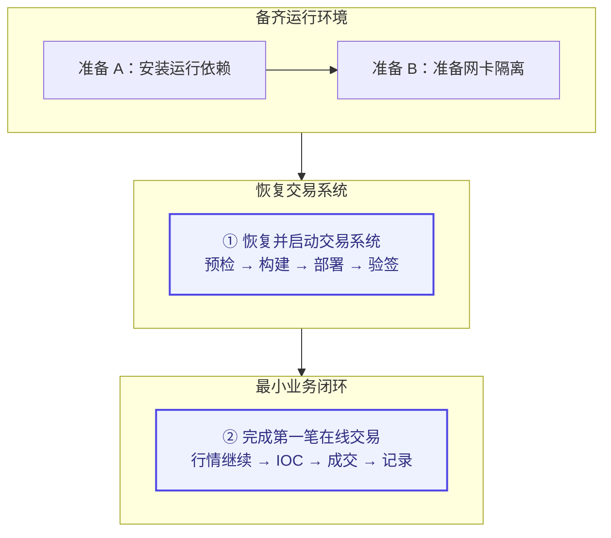
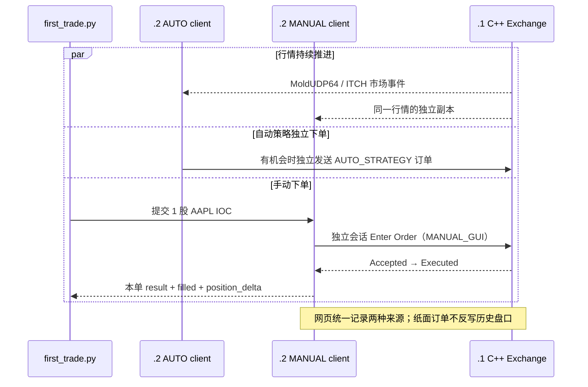

# 第二部分：一次部署完整交易平台——从环境交接到第一笔交易

## 先让市场和两个交易席位同时开张

第一部分已经把路修通，但路上还只有三条 ICMP 探针。现在要让 `.1` 像交易所一样持续发布行情，让 `.2` 上的 AUTO 与 MANUAL 两个独立交易席位同时看盘、各自决定、各自下单。

Exchange 是本课模拟的交易所；AUTO 按预置策略自动下单，MANUAL 接收学员的手工指令，二者是 `.2` 上两个独立进程。行情像广播，多个席位都能听；订单像挂号信，每笔都要有自己的编号和回执。

**本章一次备齐后续各章使用的交易程序、网页和运行库，再完成一笔手工纸面交易。** 后面只切换测试配置、接入过滤程序和下单，不再换一套交易系统。默认让 Socket、Onload、TCPDirect 三条下单路径同时在线；三条可并行使用的路径从本章就能下单，后续章节再逐条讲解其机制。 “已接收”只表示交易所收下请求，“已成交”才表示完成买卖。下面的协议规定这两类消息怎样表达；具体字段下一章再拆。

[Nasdaq TotalView-ITCH 5.0](https://www.nasdaqtrader.com/content/technicalsupport/specifications/dataproducts/NQTVITCHSpecification_5.0.pdf) 定义交易所发布的行情事件；[OUCH 5.0](https://www.nasdaqtrader.com/content/technicalsupport/specifications/TradingProducts/OUCH5.0.pdf) 定义订单请求与 Accepted、Executed、Rejected 等回报，分别表示已接收、已成交和被拒绝。

| 官方入口 | 本章采用什么 |
| --- | --- |
| [TotalView-ITCH 5.0](https://www.nasdaqtrader.com/content/technicalsupport/specifications/dataproducts/NQTVITCHSpecification_5.0.pdf) | AAPL/NVDA 历史订单事件与成交事件 |
| [MoldUDP64](https://www.nasdaqtrader.com/content/technicalsupport/specifications/dataproducts/moldudp64.pdf) | Exchange 向 Trader 发布行情的会话封装，承载在 UDP 组播（默认 `239.20.1.20:42120`） |
| [OUCH 5.0](https://www.nasdaqtrader.com/content/technicalsupport/specifications/TradingProducts/OUCH5.0.pdf) | Enter Order 与 Accepted/Executed/Rejected 消息布局 |
| [SoupBinTCP](https://www.nasdaqtrader.com/content/technicalsupport/specifications/dataproducts/soupbintcp.pdf) | 订单连接的登录与消息分帧，承载在 TCP（Exchange 监听 `43120`） |
| [Nasdaq ITCH 数据入口](https://emi.nasdaq.com/ITCH/) | 本课历史样例的公开下载入口 |

<div style="border-left:6px solid #7e22ce;background:#f3e8ff;padding:12px 16px;border-radius:8px;margin:14px 0;"><span style="display:inline-block;padding:3px 12px;border-radius:6px;background:#7e22ce;color:#fff;font-weight:800;">事故钩子</span> <span style="font-weight:700;color:#581c87;">如果每一章都换一段临时发包脚本，后面即使延迟数字下降，也不知道优化的是业务路径还是玩具程序。这里先冻结同一套应用与同一份行情输入，后续技术只改变路径，不改变要完成的交易。</span></div>

## 本章学习目标

1. 说清管理机、Exchange、AUTO client、MANUAL client 与网页观察端各自拥有什么，以及哪些机器会随快照恢复。
2. 从持久管理机分步准备并启动完整交易平台，并读懂 AAPL/NVDA 只在 `09:30–16:00` 回放、1× 持续 6 小时 30 分以及循环边界清仓的行为。
3. 用一笔独立的手动纸面 IOC 验收业务闭环：按这笔订单自己的成交结果、持仓增量与交易记录判断是否成立。

## 本章导航

<div style="border-left:6px solid #7e22ce;background:#f3e8ff;padding:12px 16px;border-radius:8px;margin:14px 0;"><span style="display:inline-block;padding:3px 12px;border-radius:6px;background:#7e22ce;color:#fff;font-weight:800;">本章导航</span> <span style="font-weight:700;color:#581c87;">本章分成 3 部分，共 4 个导航项；先用总图看完整路线，再在每节导航卡里查看全章与本组位置。先备齐系统依赖，再启动完整系统，最后用一笔订单验收业务闭环；网页浏览属于两步之间的人工观察，不另凑实验。</span></div>



固定顺序就是：**备齐运行环境 → 恢复交易系统 → 最小业务闭环**。

## 任务地图

| 导航项 | 所属部分 | 这一项回答什么 |
| --- | --- | --- |
| 准备 A：安装运行依赖 | 备齐运行环境 | 安装运行依赖 |
| 准备 B：准备网卡隔离 | 备齐运行环境 | 准备网卡隔离 |
| 运行 ①：恢复并启动交易系统 | 恢复交易系统 | 从快照恢复 Exchange、Trader 与网页观察面 |
| 运行 ②：完成第一笔在线交易 | 最小业务闭环 | 用一笔 IOC 核对成交、持仓与记录 |

<div style="border-left:6px solid #7e22ce;background:#f3e8ff;padding:12px 16px;border-radius:8px;margin:14px 0;"><span style="display:inline-block;padding:3px 12px;border-radius:6px;background:#7e22ce;color:#fff;font-weight:800;">本章证据边界</span> <span style="font-weight:700;color:#581c87;">新版平台部署与首笔交易已在 RUN <code>20260907T112313Z-02-trading-platform</code> 完成。各路径的性能与过滤效果由后续章节分别验证。</span></div>

## 准备 A：安装运行依赖

<div style="border:2px solid #4f46e5;background:#eef2ff;padding:10px 12px;border-radius:8px;margin:14px 0;"><div style="font-weight:900;color:#312e81;margin-bottom:4px;">导航卡 · 备齐运行环境</div><div style="font-weight:700;color:#312e81;margin-bottom:8px;">范畴：工具准备　本步知识：安装运行依赖　位置：全章第 1 / 4 项 · 本组第 1 / 2 项</div><span style="display:inline-block;margin:3px;padding:4px 10px;border-radius:6px;background:#15803d;color:#fff;font-weight:800;">准备 A：安装运行依赖</span><span style="display:inline-block;margin:3px;padding:4px 10px;border-radius:6px;background:#f8fafc;color:#312e81;font-weight:800;">准备 B：准备网卡隔离</span></div>

先把后续快速收发路径需要的运行库和网卡模块装好。Onload 是其中一套收发运行时，本章只准备它，第六章再讲怎样使用。首次安装会短暂重载数据口驱动；管理连接走独立管理网。

<div style="border-left:6px solid #15803d;background:#dcfce7;padding:12px 16px;border-radius:8px;margin:14px 0;"><span style="display:inline-block;padding:3px 12px;border-radius:6px;background:#15803d;color:#fff;font-weight:800;">需要运行 · 准备 A</span> <span style="font-weight:700;color:#14532d;">在持久管理机 .111 的仓库根目录以 root 执行；完成后再贴下一张卡。首次安装通常数分钟；已有依赖会先核验。</span></div>

```bash
bash Documents/newDoc/assets/02-trading-baseline/00a-runtime-prep.sh
```

## 准备 B：准备网卡隔离

<div style="border:2px solid #4f46e5;background:#eef2ff;padding:10px 12px;border-radius:8px;margin:14px 0;"><div style="font-weight:900;color:#312e81;margin-bottom:4px;">导航卡 · 备齐运行环境</div><div style="font-weight:700;color:#312e81;margin-bottom:8px;">范畴：工具准备　本步知识：准备网卡隔离　位置：全章第 2 / 4 项 · 本组第 2 / 2 项</div><span style="display:inline-block;margin:3px;padding:4px 10px;border-radius:6px;background:#f8fafc;color:#312e81;font-weight:800;">准备 A：安装运行依赖</span><span style="display:inline-block;margin:3px;padding:4px 10px;border-radius:6px;background:#15803d;color:#fff;font-weight:800;">准备 B：准备网卡隔离</span></div>

再准备网卡的内存隔离条件。IOMMU 给网卡访问内存划定范围，后续 DPDK 路径才可以安全接管网卡。脚本只在参数未生效时重启对应的 .1/.2；现在尚未启动交易程序。

<div style="border-left:6px solid #15803d;background:#dcfce7;padding:12px 16px;border-radius:8px;margin:14px 0;"><span style="display:inline-block;padding:3px 12px;border-radius:6px;background:#15803d;color:#fff;font-weight:800;">需要运行 · 准备 B</span> <span style="font-weight:700;color:#14532d;">在持久管理机 .111 的仓库根目录以 root 执行；完成后再贴下一张卡。首次安装通常数分钟；已有依赖会先核验。</span></div>

```bash
bash Documents/newDoc/assets/02-trading-baseline/00b-iommu-prep.sh
```

## 运行 ①：恢复并启动交易系统

这一卡把快照后的 `.1/.2/.101` 从“基础环境可用”推进到“交易应用在线”。它不靠远端 Git，也不在远端手工改源码：不恢复的管理机 `.111` 始终是代码、行情制品和部署证据的唯一恢复源。

<div style="border:2px solid #4f46e5;background:#eef2ff;padding:10px 12px;border-radius:8px;margin:14px 0;"><div style="font-weight:900;color:#312e81;margin-bottom:4px;">导航卡 · 恢复交易系统</div><div style="font-weight:700;color:#312e81;margin-bottom:8px;">范畴：工具准备　本步知识：从快照恢复 Exchange、Trader 与网页观察面　位置：全章第 3 / 4 项 · 本组第 1 / 1 项</div><span style="display:inline-block;margin:3px;padding:4px 10px;border-radius:6px;background:#15803d;color:#fff;font-weight:800;">运行 ①：恢复并启动交易系统</span></div>

### 先看本章最终要得到什么

<div style="border-left:6px solid #7e22ce;background:#f3e8ff;padding:12px 16px;border-radius:8px;margin:14px 0;"><span style="display:inline-block;padding:3px 12px;border-radius:6px;background:#7e22ce;color:#fff;font-weight:800;">关键图</span> <span style="font-weight:700;color:#581c87;">虚线先走部署和网页：原生客户端在 `.101` 编译，固定运行包分到 `.1/.2`；网页从 `.2` 看盘，手工单先到 MANUAL。实线才是以后要测的 C++ 热路径。</span></div>

<div style="background:#f8fafc;border:1px solid #cbd5e1;border-radius:12px;padding:10px;max-width:820px;margin:14px auto;">

</div>

**读图：** `.111` 把源码和行情制品送到 `.101`，`.101` 用 `g++-11` 编出二进制，把本次原生 `flle-trader` 分到 `.2`，同时向 `.1/.2` 安装已验签的完整路径运行包。Exchange 使用包内固定版本；默认启动 AUTO、原生 MANUAL、Onload 与 TCPDirect；DPDK 客户端在切到独占模式时启动。实线是 `.1` 与 `.2` 之间的 C++ 热路径：行情支持 UDP 单播、组播和双路，默认先用单播；订单走各自的 TCP / OUCH 会话。虚线里的网页从 `.2` client 读订单簿和成交；手工单先到 MANUAL 进程，再由这个进程向 Exchange 发出订单。Python 不进入行情处理或下单计时链。

| 角色 | 当前职责 | 快照恢复后的命运 |
| --- | --- | --- |
| 管理机 `.111 / 10.1.1.111` | Git 工作区、部署入口、已验行情制品、课程证据 | 唯一不恢复的主机，是恢复真源 |
| `.1 / 20.1.1.1` | C++ Exchange、历史 ITCH 回放、行情发布、纸面撮合 | 会恢复；第二部分重新部署 |
| `.2 / 20.1.1.2:48121` | C++ AUTO client、独立订单簿、策略、风控与订单会话 | 会恢复；第二部分重新部署 |
| `.2 / 20.1.1.2:48122` | C++ MANUAL client、独立订单簿、手工入口、风控与订单会话 | 会恢复；第二部分重新部署 |
| `.101 / 10.1.1.101` | `g++-11` 构建、Python 旁路网关、网页 UI | 会恢复；第一部分装工具，第二部分部署 Gateway |
| `.11 / 10.1.1.11` | 后续流量工具主机；本章不运行交易进程 | 会恢复；第一部分完成基础准备后保持待用 |

#### 这套市场哪里真实，哪里是模拟

| 层 | 当前实现 | 边界 |
| --- | --- | --- |
| 行情来源 | Nasdaq 官方公开的 2026-06-12 TotalView-ITCH 5.0 样例 | 只保留 AAPL/NVDA；保留消息原字节与原始交易所时间 |
| 行情演进 | 只播放 `09:30–16:00`；窗口内按历史事件时间原样推进 | 1× 为 6 小时 30 分；可倍速，但不压缩空档 |
| 行情传输 | UDP 组播（默认 `239.20.1.20:42120`），MoldUDP64 提供 session 与顺序号；同时提供 UDP 单播与双路入口 | 与真实交易所“行情走 UDP 组播、由交易所单向推送”的方向一致；本课未实现 MoldUDP64 重传服务器 |
| 订单协议 | OUCH 5.0 mandatory `O/A/E/J` 布局，经课堂 SoupBinTCP 子集传输 | 是协议课堂子集，不宣称可直连 Nasdaq 生产系统 |
| 订单传输 | TCP，每个 client 与 Exchange `43120` 建立自己的连接，登录后双向收发；开启 `TCP_NODELAY` | 与真实“订单走 TCP 有连接会话”的方向一致；未实现生产级的会话续传与心跳全集 |
| 成交 | 订单按当前历史盘口在独立内存 ledger 中做 IOC 纸面成交 | 不改写历史市场，不连接券商、账户或真实资金 |
| 自动交易 | AUTO client 根据五档不平衡、仓位上限和冷却时间自行下单 | 是可观察的教学策略，不构成投资建议 |
| 手动交易 | MANUAL client 独立接收网页意图并发送自己的订单 | 与 Exchange、AUTO client 作为独立进程并行运行；仍共享实验网络和机器资源 |

所以网页同时固定标注“历史行情”与“模拟成交”：市场事件是真的历史字节，今天发出的订单则只能在独立纸面账本中成交。历史时钟显示 `2026-06-12` 的原始事件时间。为了让 09:30 的订单簿不是从文件中段硬切出来的残缺视图，部署时先用 09:30 前的真实增量生成开盘检查点；网页只展示常规交易时段。

完整界面从本章就提供四条路径。默认“普通交易”下 Socket、Onload、TCPDirect 都已启动并可下单；DPDK 需要切换为独占模式。第六章启用“路径测试”，会暂停自动策略并锁定比较条件，程序文件和网页保持同一份。第八至十章会另外编译、加载过滤程序；它们接在既有交易路径上，不替换交易系统。

AUTO 是预置的课堂负载，不是本章要教授或调参的交易策略。页面只保留开关，并把当前规则写明；普通交易实验保持同一规则；进入路径比较与过滤实验时关闭策略，避免它干扰测试下单。

#### 后续为什么必须复用它

| 后续变量 | 仍然不变的业务基线 | 届时比较什么 |
| --- | --- | --- |
| CPU、内存、队列与亲和性 | 同一 MANUAL 客户端，AUTO 保持独立负载 | 热路径分布与尾部是否变化 |
| eBPF/XDP | 同一真实 ITCH 行情 | 更早观察或筛选后，应用责任怎样变化 |
| OpenOnload/TCPDirect | 同一订单会话与成交闭环 | 缩短内核网络路径后的差异 |
| DPDK/Kernel Bypass | 同一行情处理、策略和风控结果 | 驱动所有权与轮询模型带来的差异 |
| 交换机与组播优化 | 同一 AAPL/NVDA Feed | 转发、复制、排队与恢复行为的差异 |

第二部分只建立**功能控制组**，不拿本章的一次 `order_rtt_ns` 宣布性能。第四部分会先固定测量点、负载、环境和统计口径，再把后续优化与这一应用的普通 Linux profile 做公平 A/B。

### 源代码与恢复入口

完整应用在 [`apps/flle-trading-lab/`](../../apps/flle-trading-lab/)；学生不需要先读完几千行代码才能把系统拉起来。先按职责找到入口，第三部分再沿真实报文深入。

| 路径 | 负责什么 | 是否进入热路径 |
| --- | --- | --- |
| `src/exchange.cpp` | 历史回放、行情发布、订单连接、纸面撮合 | 是，C++ |
| `src/trader.cpp` | 同一二进制按 `AUTO/MANUAL` 角色启动为两个进程；各自拥有 Feed、风控、订单 ID 和订单会话 | 是，C++ |
| `src/nasdaq_protocol.hpp` | ITCH/MoldUDP64/OUCH/SoupBinTCP 课程子集编解码 | 是，C++ |
| `src/itch_book.hpp` | 从 ITCH 订单事件维护 AAPL/NVDA 订单簿 | 是，C++ |
| `src/book_checkpoint.cpp` | 从 09:30 前增量生成真实开盘订单簿检查点 | 部署工具 |
| `flle_trading/gateway.py` | 汇总旁路状态，提供 HTTP/SSE 与控制 API | 否，Python |
| `web/` | 浏览器行情、价格走势、盘口、策略、订单与成交界面 | 否，HTML/CSS/JS |
| `scripts/transport_labctl.sh` | 完整平台部署、普通交易与路径测试配置切换、验签和停止 | 编排工具 |
| `tests/first_trade.py` | 走和网页同一条 `/api/order` 接口，提交一笔手动 IOC，再按订单 ID 核对回执 | 课堂下单脚本 |
| `tests/latency_regression.py` | 在固定条件下采样 120 笔手动 IOC，断言订单 RTT 的 P99 低于 10 ms 上限 | 工程回归工具 |

行情制品已保存在管理机，恢复脚本核验后直接分发。完整源码目录和制品重建方法见 [Trading Lab 说明](../../apps/flle-trading-lab/README.md)；课堂上先看各服务是否启动，再核对首笔成交。

### 本步理论：从部署文件到服务在线

如果只把一个二进制复制到远端，最多证明文件存在。可重复恢复还必须回答：输入数据是不是同一份、编译是否通过、二进制放到正确角色、进程是否真在监听、运行源码和部署制品能否复算。

<div style="border-left:6px solid #7e22ce;background:#f3e8ff;padding:12px 16px;border-radius:8px;margin:14px 0;"><span style="display:inline-block;padding:3px 12px;border-radius:6px;background:#7e22ce;color:#fff;font-weight:800;">关键图</span> <span style="font-weight:700;color:#581c87;">运行①先在 <code>.101</code> 构建，再分发并启动服务，确认系统在线；运行②才提交第一笔订单并核对成交。图中分别标出源码、可执行文件和运行中的程序。</span></div>

<div style="background:#f8fafc;border:1px solid #cbd5e1;border-radius:12px;padding:10px;max-width:820px;margin:14px auto;">

</div>

**理论落到实验：** `labctl preflight` 先核对制品 SHA、按 `20.1.1.x` 地址解析真实数据口并检查 carrier；`deploy` 在 `.101` 用 `g++-11` 构建和测试，在 `.1` 生成 09:30 开盘检查点，再分发到 `.1/.2`；启动顺序先让 AUTO 与 MANUAL 两个 client 都完成收包准备，再启动 Exchange，避免任一客户端漏掉开头消息；`verify` 最后核对各进程、监听、摘要与健康接口，并确认三条常用下单路径在线。

<div style="border-left:6px solid #15803d;background:#dcfce7;padding:12px 16px;border-radius:8px;margin:14px 0;"><span style="display:inline-block;padding:3px 12px;border-radius:6px;background:#15803d;color:#fff;font-weight:800;">需要运行 · 运行 ①</span> <span style="font-weight:700;color:#14532d;">在【唯一持久的 `.111` 管理机 `/financial-low-latency`】以 root 运行；前置是第一部分已完成四机 SSH、`.101` 构建工具、`.1/.2` 数据地址和 VLAN20；脚本会在全新 `.101` 构建，向 `.1/.2/.101` 创建本 RUN 目录并启动完整交易平台；需复制 561.7 MB 行情制品并生成开盘检查点；预期打印 `TRADING_LAB_READY` 和 `platform=READY`。</span></div>

执行下面的入口。它会一次安装完整客户端集合与网页，生成本次实验目录，默认启动普通交易。重复执行只核验已部署平台，不另建系统。

```bash
bash Documents/newDoc/assets/02-trading-baseline/01-restore-trading-lab.sh
```

<div style="border-left:6px solid #7e22ce;background:#f3e8ff;padding:12px 16px;border-radius:8px;margin:14px 0;"><span style="display:inline-block;padding:3px 12px;border-radius:6px;background:#7e22ce;color:#fff;font-weight:800;">仅供展示 · 输出解读</span> <span style="font-weight:700;color:#581c87;">下面摘录本次部署的在线检查。完整日志另含 C++ 自测、165 项 Python 测试（隔离部署跳过 8 项仓库结构检查）、运行包与源码摘要核验。三条常用下单路径已启动，性能尚未在本章验收。</span></div>

```text
exchange=ONLINE pid=3281
trader-auto=ONLINE pid=21774
trader-manual=ONLINE pid=21830
gateway=ONLINE pid=12479
deployed_sha256=PASS exchange,trader_auto,trader_manual,source,replay,manifest,opening_book_checkpoint
restore_verdict=TRADING_LAB_READY
platform=READY profile=SOFTWARE capabilities=Socket,Onload,TCPDirect,DPDK,FeedGuardian
evidence=/financial-low-latency/Documents/reports/course-runs/20260907T112313Z-02-trading-platform
```

### 打开网页，先把系统看懂

在能访问课程管理网的浏览器打开：

```text
http://10.1.1.101:8088/
```

下面三张截图来自干净快照 RUN `20260829T023952Z-02-trading-baseline` 刚拉起来的页面。数字会随回放往前走，看的是每一块负责什么。

<div style="background:#f8fafc;border:1px solid #cbd5e1;border-radius:12px;padding:10px;max-width:820px;margin:14px auto;">

</div>

顶栏中间的时钟是 **2026-06-12** 的历史源时间，不是今天的墙钟。回放条告诉你现在播到常规时段 `09:30–16:00` 的哪一段、还剩多少墙钟、倍速是多少。左下是两只股票的最新成交价和最优买卖价；中间是当前选中股票的五档订单簿，买卖价中间那一行是价差和中间价。右下是 MANUAL 席位的手工入口：默认 IOC，点「发送买入订单」后，意图先到 `.2` 的 MANUAL 进程，再由它向 Exchange 发 OUCH。行情传输三个按钮是单播 / 组播 / 双路，第三部分会沿真实流量对照；切换成功本身不代表哪条更快。

页面上的 **bps** 是金融里的 **basis point（基点）**，不是网络里的 bits per second。1 bps = 0.01% = 万分之一。网页用最近 360 个页面采样的「最后一个价相对第一个价」来算：`(P后 − P前) / P前 × 10000`。截图里 AAPL `+3.04 bps`，意思是这段采样窗口里价格大约涨了万分之 3.04，也就是 0.0304%；它不表示带宽，也不表示延迟。

<div style="background:#f8fafc;border:1px solid #cbd5e1;border-radius:12px;padding:10px;max-width:820px;margin:14px auto;">

</div>

左图用的还是那 360 个页面采样，不是完整日线，也不是逐条 ITCH 延时图。右图「延时基线」只统计 **C++ AUTO 进程** 从发出订单到收到最终结果的 RTT；Python 网页不在这条计时链里，手动单的 RTT 出现在交易记录里。策略区是预置课堂负载：五档失衡到阈值就发 25 股 IOC，有冷却和仓位上限。本章只需要看见开关和合计持仓 / 模拟盈亏；这些数字不是投资建议，也不能拿来宣布优化收益。

<div style="background:#f8fafc;border:1px solid #cbd5e1;border-radius:12px;padding:10px;max-width:820px;margin:14px auto;">

</div>

交易记录把当前回放轮次里的自动单和手动单放在同一张表，用来源列区分。页面各取最近 7 条再按时间合并，所以两类来源都有稳定配额。下半张是职责边界：`.1` 持续回放并做纸面账本，`.2` 两个 C++ 席位各自收行情、下单，`.101` 只旁路展示。当前行情模式写在左下角；纸面成交不会改写已经发生过的 Nasdaq 历史订单簿。

让系统自行运行时，AUTO 进程会持续寻找机会；你也可以随时通过 MANUAL 进程下单。两个席位彼此独立，订单都带来源标签并进入网页同一份交易记录，也同时进入 Exchange 的内存 ledger。回放到 16:00，或手工点击「重新开始并清空交易」后，系统产生新 session，并清空上一轮订单、成交、持仓、P&L、延时样本和网页历史；远端 RUN 目录与证据不会删除。

**下一线索：** 服务在线只证明系统已启动；还要用一笔独立 MANUAL 订单确认这个席位与 Exchange 真正完成业务闭环。

## 运行 ②：完成第一笔在线交易

“下单成功”不能只看 HTTP 接口返回了一个订单号。本步要求同一笔订单穿过 MANUAL client → Exchange → MANUAL client，最后同时出现业务结果、成交数量、订单自身持仓增量和统一交易记录。

<div style="border:2px solid #4f46e5;background:#eef2ff;padding:10px 12px;border-radius:8px;margin:14px 0;"><div style="font-weight:900;color:#312e81;margin-bottom:4px;">导航卡 · 最小业务闭环</div><div style="font-weight:700;color:#312e81;margin-bottom:8px;">范畴：分步实验　本步知识：用一笔 IOC 核对成交、持仓与记录　位置：全章第 4 / 4 项 · 本组第 1 / 1 项</div><span style="display:inline-block;margin:3px;padding:4px 10px;border-radius:6px;background:#15803d;color:#fff;font-weight:800;">运行 ②：完成第一笔在线交易</span></div>

### 本步理论：在并发系统里按订单 ID 核对单笔订单

Exchange 像持续营业的交易所，AUTO 像机器人交易席位，MANUAL 像学员自己的席位。三者各自独立工作。要确认某一笔手工单做成了，就拿这封挂号信自己的订单 ID 和回执核对。网页上点「发送买入订单」和本步运行的 `first_trade.py`，走的是同一条手动下单接口：网页把按钮交给你点，脚本替你发同一条请求，再把回执打印出来。

#### 第一步：认出盘口上的两个价

订单簿分两边。卖方从低到高排，买方从高到低排，最靠近中间的两个价就是当前最优报价。下面用一份 AAPL 盘口举例：

| 位置 | 价格 | 叫什么 | 谁在这里成交 |
| --- | --- | --- | --- |
| 卖方 L2 | `296.30` | | |
| 卖方 L1 | `296.29` | **Best Ask**（最低卖价） | 你要**买入**，就是跟这个价成交 |
| 中间 | `0.05` | 价差（Spread） | 两个最优价之间的距离 |
| 买方 L1 | `296.24` | **Best Bid**（最高买价） | 你要**卖出**，就是跟这个价成交 |
| 买方 L2 | `296.23` | | |

一句话记法：**买入看卖方最低价，卖出看买方最高价。** 这个价叫「对手价」，因为它来自愿意跟你做成这笔交易的那一边。

#### 第二步：买单设价格上限，卖单设价格下限

下单只需要填一个数：限价。网页「手动下单」卡片里的**限价**输入框，和 `first_trade.py` 发出的 `limit_price_x10000`，是同一个字段。它的含义是「我最多能接受这么差的价」，不是「我要按这个价成交」。

买入 AAPL 时，盘口 Best Ask 是 `296.29`，一笔能成交的手动单是这样的：

| 项目 | 值 | 说明 |
| --- | --- | --- |
| 对手价 | `296.29` | 盘口上当前的 Best Ask |
| 限价（你填的数） | `301.29` | 比对手价宽松一点，表示「最多认到这个价」 |
| 成交价 | `296.29` | 订单到达 Exchange 那一刻的真实 Best Ask |

从看盘到订单抵达，报价可能变化。本课脚本把限价设得较宽，是为了更容易完成这次功能验收；实际仍按订单到达时、满足限价的对手报价纸面成交。**买单上限越高，允许的成交价也越高，不能保证还是提交前看到的报价。**

卖单方向相反：限价是最低可接受价格。以 Best Bid `296.24` 为例，填 `291.24` 表示允许以不低于它的价格卖出。

网页留空时，本教学程序按到达时的对手价处理；这属于本课界面约定。`first_trade.py` 则明确填写限价，必要时重新读盘并作有限次重试。

#### 第三步：IOC 决定没成交的部分怎么办

IOC 是 Immediate-Or-Cancel（立即成交或取消）：

| 情况 | 结果 |
| --- | --- |
| 1 股能马上成交 | `ORDER_EXECUTED`，`filled=1` |
| 到达时没有可成交的对手价 | 这一笔直接取消，不挂在订单簿上等 |
| 取消之后 | 脚本重新读一次盘口再试，最多 3 次 |

关键区别是：普通限价单没成交会留在订单簿上排队等人来撮合；IOC 不等，当场不成就作废。本步用 IOC，是因为要立刻知道这一股成没成交，而不是留下一笔挂着的委托。

自动策略可能恰好同时成交，所以账户合计持仓在下单前后不一定只变化 1 股。`first_trade.py` 用唯一 `client_order_id` 找回这笔 `origin=MANUAL_GUI` 的订单，核对它自己的 `filled_quantity=1` 与 `position_delta=+1/-1`，再确认相同订单已经进入统一交易记录和成交记录。脚本读 MANUAL client 当前的 AAPL 持仓，只为决定这一笔做买还是做卖，让敞口往回收；隔离自动策略靠的是订单 ID，不是持仓。

<div style="border-left:6px solid #7e22ce;background:#f3e8ff;padding:12px 16px;border-radius:8px;margin:14px 0;"><span style="display:inline-block;padding:3px 12px;border-radius:6px;background:#7e22ce;color:#fff;font-weight:800;">关键图</span> <span style="font-weight:700;color:#581c87;">行情回放、自动策略和手动下单是三条并行活动。`first_trade.py` 只是替你点同一下「发送订单」，再按订单 ID 读回执。</span></div>



**理论落到实验：** `first_trade.py` 把 `MANUAL_GUI` 意图交给独立 MANUAL 进程；真正的订单编码、独立 TCP 会话、纸面撮合、回报解析、持仓更新与记录仍由 `.2/.1` 的 C++ 完成。脚本按订单 ID 核对 `result`、`filled_quantity`、`position_delta` 与历史记录，并确认下单期间源时钟仍在前进、AUTO 策略开关保持原值；`order_rtt_ns` 同时打印，但本章不据此作性能结论。

<div style="border-left:6px solid #15803d;background:#dcfce7;padding:12px 16px;border-radius:8px;margin:14px 0;"><span style="display:inline-block;padding:3px 12px;border-radius:6px;background:#15803d;color:#fff;font-weight:800;">需要运行 · 运行 ②</span> <span style="font-weight:700;color:#14532d;">在【同一持久管理机】以 root 运行；前置是运行 ① 写出的 `02-trading-baseline.env`；影响是增加一笔 AAPL 1 股手动纸面 IOC 及其交易记录；预计数秒；预期成交 1 股并打印 `FIRST_TRADE_PASS`。</span></div>

整段脚本同样可以直接粘贴；文件执行命令是 `bash Documents/newDoc/assets/02-trading-baseline/02-first-trade.sh`。

```bash
#!/usr/bin/env bash
set -euo pipefail
cd /financial-low-latency
REPO_ROOT=/financial-low-latency
SELF="$REPO_ROOT/Documents/newDoc/assets/02-trading-baseline/02-first-trade.sh"
STATE="$REPO_ROOT/Documents/reports/run-state/02-trading-baseline.env"
LABCTL="$REPO_ROOT/apps/flle-trading-lab/scripts/labctl.sh"
TRADE_TEST="$REPO_ROOT/apps/flle-trading-lab/tests/first_trade.py"
test -s "$STATE"
source "$STATE"
case "$RUN_ID" in ""|*[!A-Za-z0-9._-]*) exit 2;; esac
OUT="$REPO_ROOT/Documents/reports/course-runs/$RUN_ID"
mkdir -p "$OUT/raw"

bash "$LABCTL" verify "$RUN_ID" >"$OUT/raw/verify-before-trade.txt"
python3 "$TRADE_TEST" --base-url "$WEB_URL" | tee "$OUT/raw/first-trade.txt"
sha256sum "$SELF" "$TRADE_TEST" "$OUT/raw/verify-before-trade.txt" \
  "$OUT/raw/first-trade.txt" >"$OUT/FIRST_TRADE_SHA256SUMS"
sha256sum -c "$OUT/FIRST_TRADE_SHA256SUMS" >/dev/null
echo "evidence=$OUT"
```

<div style="border-left:6px solid #7e22ce;background:#f3e8ff;padding:12px 16px;border-radius:8px;margin:14px 0;"><span style="display:inline-block;padding:3px 12px;border-radius:6px;background:#7e22ce;color:#fff;font-weight:800;">仅供展示 · 输出解读</span> <span style="font-weight:700;color:#581c87;">下面 8 行来自本次完整平台 RUN <code>20260907T112313Z-02-trading-platform</code> 的首笔交易；方向、价格、订单号与 RTT 每次可变，验收仍看 <code>FIRST_TRADE_PASS</code>。</span></div>

```text
system=READY source=NASDAQ_PUBLIC_ITCH_SAMPLE date=2026-06-12 replay=PLAYING
market_clock=09:31:09.081346227->09:31:09.863778196 source_advance_ns=782431969
order_id=2100000000 attempts=1 origin=MANUAL_GUI symbol=AAPL side=BUY quantity=1
limit_price_x10000=3013300 fill_price_x10000=2963300
result=ORDER_EXECUTED filled=1
position_delta=+1 manual_position=1 order_rtt_ns=55764
history=CLIENT_AND_EXCHANGE strategy_unchanged=true
verdict=FIRST_TRADE_PASS
```

| 字段 | 本次读数 | 怎样判断 |
| --- | --- | --- |
| 本单身份 | `order_id=2100000000`、`origin=MANUAL_GUI` | 按这一笔核对，不混入自动策略的订单 |
| 限价 / 成交价 | `301.33 / 296.33` | 买单只限定最高可接受价格，实际按到达时盘口成交 |
| 结果 / 持仓变化 | `ORDER_EXECUTED`、`filled=1`、`position_delta=+1` | 已经成交，并为本单增加 1 股持仓 |
| 双边记录 | `history=CLIENT_AND_EXCHANGE` | 客户端与交易所都记下这一笔 |
| RTT | `55764 ns` | 只是一笔功能样本，性能在后续固定条件下测量 |

网页“本轮最后一笔手动订单”显示相同订单号、成交价与持仓变化。核对这几个字段即可，不要求与历史示例的价格相同。

<div style="border-left:6px solid #0891b2;background:#cffafe;padding:12px 16px;border-radius:8px;margin:14px 0;"><span style="display:inline-block;padding:3px 12px;border-radius:6px;background:#0891b2;color:#fff;font-weight:800;">关键现象</span> <span style="font-weight:700;color:#164e63;">请从同一笔订单中同时找到 `replay=PLAYING`、`origin=MANUAL_GUI`、`result=ORDER_EXECUTED`、`filled=1`、`position_delta=±1`、`history=CLIENT_AND_EXCHANGE` 与 `strategy_unchanged=true`；缺任意一项都不能结束第二部分。完整证据保存在该 RUN 的 `raw/first-trade.txt` 与 `FIRST_TRADE_SHA256SUMS`。</span></div>

## 本章结案：什么状态可以进入第三部分

| 验收层 | 原始输出字段 | 学员判断标准 |
| --- | --- | --- |
| 第一部分交接 | `.1/.2` 数据地址、carrier、VLAN20、pcap | 仍以第一部分新 RUN 为准 |
| 恢复输入 | `control_assets=PASS` 与 replay SHA | 管理机保存的 AAPL/NVDA 制品完整 |
| 构建 | `SELFTEST PASS` | C++ 协议、订单簿与消息最小向量通过 |
| 运行态 | 四项 `ready` / `ONLINE` | Exchange、AUTO client、MANUAL client、Gateway 的进程和监听都在 |
| 可复算性 | `deployed_sha256=PASS` | 源码、二进制、replay、manifest 与 `opening_book_checkpoint` 没有漂移 |
| 业务闭环 | `ORDER_EXECUTED`、`filled=1`、`position_delta=±1`、`history=CLIENT_AND_EXCHANGE` | 一笔独立手动订单从意图走到成交，并在客户端和服务器两边留账 |

本章到此证明的是：在这次 RUN、这份历史输入和当前普通 Linux profile 下，应用能够恢复、显示市场并完成一笔纸面交易。它不证明延迟优劣、吞吐上限、长期稳定、真实资金安全或 Nasdaq 生产兼容。

第三部分直接继承这个在线应用，抓取并拆开它已经在使用的行情与订单流量：为什么行情适合 UDP 组播、订单为什么走 TCP 连接、哪些 session/sequence/UserRefNum 字段承担状态责任。所有拆解都基于本章这套已经在线的应用与它真实发出的报文。

## 清理、恢复与交接

正常进入第三章时保持平台在线，不需要清理。只有快照前或教师维护需要释放固定端口时，才停止状态文件记录的精确 RUN；命令不删除管理机证据，也不删除远端 RUN 目录：

<div style="border-left:6px solid #dc2626;background:#fee2e2;padding:12px 16px;border-radius:8px;margin:14px 0;"><span style="display:inline-block;padding:3px 12px;border-radius:6px;background:#dc2626;color:#fff;font-weight:800;">可选清理</span> <span style="font-weight:700;color:#7f1d1d;">只在快照前或停机维护时使用；脚本核对 PID 的命令身份后停止 AUTO、MANUAL、Exchange 与 Gateway，不用宽泛进程名杀进程，不删除历史行情和 RUN 证据。</span></div>

```bash
cd /financial-low-latency
source Documents/reports/run-state/02-trading-baseline.env
bash apps/flle-trading-lab/scripts/transport_labctl.sh stop "$RUN_ID"
```

| 交接对象 | 位置 | 用途 |
| --- | --- | --- |
| 当前运行状态 | `Documents/reports/run-state/02-trading-baseline.env` | 后续加载精确 `RUN_ID`、网页入口和 profile |
| 当前原始证据 | `Documents/reports/course-runs/<RUN_ID>/` | 恢复输出、首笔交易、SHA 清单 |
| 远端运行目录 | `/var/tmp/flle-trading-lab-<RUN_ID>` | 三台远端的四个进程、二进制、源码快照与日志 |
| 持久行情制品 | `artifacts/blobs/nasdaq/S061226-v50/` | 快照后重新分发；丢失时按 `apps/flle-trading-lab/README.md` 从官方 gzip 重建 |
| 下一入口 | 第三部分的真实流量地图 | 在当前应用上解释行情、订单、单播、组播和协议字段 |

## 理解检查

1. 为什么四台远端都恢复快照后，仍不需要联网重新下载完整 Nasdaq gzip？
2. 为什么 Python 网页不会掩盖后续 C++ 热路径的低延迟变化？
3. 网页上的“历史行情”与“模拟成交”分别说明哪一层真实、哪一层模拟？
4. 本课为何使用较宽的 IOC 限价？它能保证按提交前看到的价格成交吗？
5. 自动订单可能并行成交时，为什么要判断本单的 `position_delta`，而不能只比较账户总持仓前后差？

## 参考答案

1. 唯一不恢复的 `.111` 管理机已经持久保存过滤后的 AAPL/NVDA 字节、manifest 和 SHA；第二部分直接从 `.111` 向全新的远端分发。
2. 行情读取、订单簿、策略、风控、订单发送、回报处理和时间戳都在 C++；Python 只旁路消费状态并服务浏览器，停止网页不阻塞自动交易。
3. 行情消息和源时间来自 Nasdaq 官方历史样例；今天提交的订单不会改写历史市场，只在独立内存 ledger 里纸面成交。
4. 行情、AUTO 与 MANUAL 同时在线，读取报价到订单抵达之间盘口可能变化；放宽限价只是抬高允许成交的最差边界，并不保证任何条件下都能成交，因此脚本采用有上限的重读与重试。
5. 自动单可能在同一时间改变账户总持仓；`position_delta` 绑定唯一订单 ID，只描述本单造成的 `+1/-1`，因此不会把别的订单误算进验收结果。

## 本地配套资产

| 资产 | 用途 |
| --- | --- |
| `assets/02-trading-baseline/00a-runtime-prep.sh` | 准备 A：一次备齐运行依赖 |
| `assets/02-trading-baseline/00b-iommu-prep.sh` | 准备 B：按需配置并重启以启用网卡隔离 |
| `assets/02-trading-baseline/01-restore-trading-lab.sh` | 运行 ① 完整学生入口；仓库根执行 `bash Documents/newDoc/assets/02-trading-baseline/01-restore-trading-lab.sh` |
| `assets/02-trading-baseline/02-first-trade.sh` | 运行 ② 完整学生入口；仓库根执行 `bash Documents/newDoc/assets/02-trading-baseline/02-first-trade.sh` |
| `apps/flle-trading-lab/scripts/labctl.sh` | 预置应用的安全编排、验签与精确停止 |
| `apps/flle-trading-lab/tests/first_trade.py` | 按订单 ID 核对在线 IOC、持仓增量与统一记录 |
| `images/course-visuals/02-diagrams/02-trading-lab-runtime.svg` | 运行架构、热路径与观察路径 |
| `images/course-visuals/02-diagrams/02-build-start-trade.svg` | 构建、启动与首笔交易流程 |
| `images/course-visuals/02-diagrams/02-ui-replay-book-order.png` | 网页：回放、盘口与手工下单 |
| `images/course-visuals/02-diagrams/02-ui-trend-latency.png` | 网页：价格走势、延时基线与策略 |
| `images/course-visuals/02-diagrams/02-ui-blotter-path.png` | 网页：统一交易记录与系统路径 |
| `images/course-visuals/02-diagrams/02-ui-first-trade-receipt.png` | 网页：运行 ② 同一笔手动单回执 |

## 外部参考资料

| 资料 | 本章用途 |
| --- | --- |
| [Nasdaq TotalView-ITCH 5.0](https://www.nasdaqtrader.com/content/technicalsupport/specifications/dataproducts/NQTVITCHSpecification_5.0.pdf) | 历史行情消息与字段合同 |
| [Nasdaq MoldUDP64](https://www.nasdaqtrader.com/content/technicalsupport/specifications/dataproducts/moldudp64.pdf) | 行情分发的会话容器 |
| [Nasdaq OUCH 5.0](https://www.nasdaqtrader.com/content/technicalsupport/specifications/TradingProducts/OUCH5.0.pdf) | 订单进入与响应消息合同 |
| [Nasdaq SoupBinTCP](https://www.nasdaqtrader.com/content/technicalsupport/specifications/dataproducts/soupbintcp.pdf) | 订单连接的登录与 framing |
| [Nasdaq ITCH 数据入口](https://emi.nasdaq.com/ITCH/) | 官方公开历史样例入口 |
