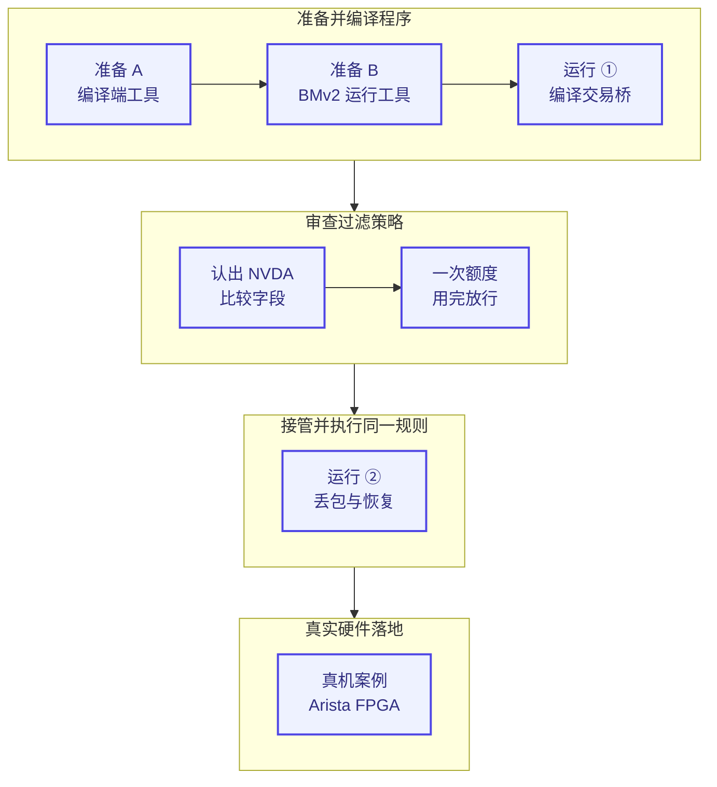

# 第09章：P4——让真实交易链路穿过可编程数据面

## P4 是什么

第八章把过滤程序放在接收主机的驱动入口。本章把检查站搬到两台主机之间：**让报文经过一个软件交换机，仍只丢一条 NVDA 行情，再核对缺口和恢复。** 先看程序如何描述处理规则，随后再看它怎样接入真实网线。

[P4-16 v1.2.5 规范](https://p4.org/wp-content/uploads/sites/53/2024/10/P4-16-spec-v1.2.5.html)定义：“P4 is a language for programming the data plane of network devices.”

**P4 是一门编程语言，用来定义网络设备怎样逐包处理报文。** 例如：读取行情里的消息类型和股票字段，按这些字段查表，再决定放行或丢弃。这段逐包处理过程叫**数据面**。

### 先看图：ASIC 与 FPGA，究竟能改哪里

ASIC 是为特定用途制造的专用芯片，**也可以被设计成可编程的**；Tofino 就是一种 P4 可编程交换 ASIC。FPGA 是现场可编程门阵列，提供可以配置功能和连接的基础逻辑资源。

<div style="border-left:6px solid #7e22ce;background:#f3e8ff;padding:12px 16px;border-radius:8px;margin:14px 0;"><span style="display:inline-block;padding:3px 12px;border-radius:6px;background:#7e22ce;color:#fff;font-weight:800;">关键图</span> <span style="font-weight:700;color:#581c87;">看紫色落在哪里：已有表里的规则、专用硬件里的处理程序，还是逻辑单元的功能与连接。</span></div>

<div style="background:#f8fafc;border:1px solid #cbd5e1;border-radius:12px;padding:10px;max-width:820px;margin:14px auto;">

</div>

**上两行的灰色框是已经制造好的专用处理单元；最下面每个灰格代表一组基础逻辑资源。** FPGA 左右两图的格子位置相同，改变的是里面做什么、哪些连接被选通。串行与并行只示意电路组织方式，不表示哪一种必然更快。

| 类型 | 用“机器”来理解 | 实际能改变什么 |
| --- | --- | --- |
| 传统固定功能 ASIC | 给现成机器填规则 | 在已有 VLAN、路由、ACL 等功能中配置匹配值和动作 |
| P4 可编程 ASIC | 为专用处理机器写程序 | 定义报文字段、解析过程、查表与动作；编译器安排到已有硬件资源上 |
| FPGA | 用电子积木组合处理机器 | 配置基础逻辑单元及其连接，搭出比较、存储、并行处理等电路 |

所以，P4 可编程 ASIC 的自由度已经超过“开关阀门”：可以改变识别和处理报文的程序。FPGA 则进一步开放电路的逻辑组合与连接；它通过预制的可配置连接实现这种变化，芯片里的金属线路仍是制造时铺好的。两者都受实际硬件资源限制。参考：[Intel Tofino 架构](https://www.intel.com/content/www/us/en/products/details/network-io/programmable-ethernet-switch.html)、[AMD FPGA 架构](https://docs.amd.com/r/en-US/ug1291-viv/FPGA-Architecture)。

### P4 程序写好后，由谁执行

**BMv2 是在 CPU 上执行 P4 报文处理逻辑的软件交换机。** 它让开发者方便地学习、测试和调试程序，也能接真实网口处理真实报文。本章使用其中的 `simple_switch` 程序。[BMv2 官方说明](https://github.com/p4lang/behavioral-model)

<div style="border-left:6px solid #7e22ce;background:#f3e8ff;padding:12px 16px;border-radius:8px;margin:14px 0;"><span style="display:inline-block;padding:3px 12px;border-radius:6px;background:#7e22ce;color:#fff;font-weight:800;">关键图</span> <span style="font-weight:700;color:#581c87;">先看下半部：报文最终交给 CPU 还是 ASIC 处理。上半部说明怎样为它准备程序。</span></div>

<div style="background:#f8fafc;border:1px solid #cbd5e1;border-radius:12px;padding:10px;max-width:820px;margin:14px auto;">

</div>

**P4 是语言，P4C 是编译器，target 是执行平台。** 本课把 P4 源码编成 BMv2 能加载的 JSON 文件；运行时用 `simple_switch_CLI` 配置规则、读取计数器，它通过 Thrift 管理接口与软件交换机通信。

软件验证后，若要迁到芯片，还需目标设备的编译器、驱动和板级支持；BMv2 的 JSON 不能直接装进硬件。厂商与工具边界见[教师参考](TEACHER-FLOW-NOTES.md#第-09-章)。

### 为什么低延时课程要学它

低延时工程需要判断：**哪些处理适合放到服务器，哪些可以提前交给网络硬件。** 例如在业务允许裁剪消息时，交换机提前过滤无关流量，可以减少后续链路负载、服务器收包和软件解析工作；延迟收益还取决于负载、排队和新增处理成本，要用实测判断。

本章用 **P4 + BMv2 学习和验证这种处理逻辑**。第08章在 `.2` 收包入口过滤；本章把同一条 NVDA 规则放到 `.11` 上的软件交换机，让 `.1` Exchange 与 `.2` Trader 的真实报文经过它。实验只丢一次目标行情，观察接收端检出行情序号缺口（GAP）、拒绝下单及随后恢复；这是功能与故障响应验证。

本课现有 7150 承担物理转发与 VLAN 隔离，P4 在 BMv2 上执行。章末用 Netnod 在 Arista 7130-48LB 上的报时服务案例，认识真实 FPGA 工程的编译、装载和网口连接。

| 官方入口 | 用途 |
| --- | --- |
| [P4-16 v1.2.5](https://p4.org/wp-content/uploads/sites/53/2024/10/P4-16-spec-v1.2.5.html) | 语言、解析、查表与动作；规范发布于 2024-10-11 |
| [BMv2](https://github.com/p4lang/behavioral-model) | 本章软件交换机的实现 |
| [Nasdaq MoldUDP64](https://nasdaqtrader.com/content/technicalsupport/specifications/dataproducts/moldudp64.pdf) | 行情的 Session、Sequence 与消息边界 |
| [Nasdaq TotalView-ITCH 5.0](https://www.nasdaqtrader.com/content/technicalsupport/specifications/dataproducts/NQTVITCHspecification.pdf) | Type A、Stock Locate、8 字节 Stock 与 36 字节 Add Order |

## 本章学习目标

- 分清 P4、BMv2、可编程 ASIC 和 FPGA 的职责。
- 用 P4 识别指定行情，以一次 DROP 和接收端 GAP 验证处理结果。
- 讲清同一过滤任务迁移到真实硬件时，需要怎样开发、装载和验收。

## 本章导航

<div style="border-left:6px solid #7e22ce;background:#f3e8ff;padding:12px 16px;border-radius:8px;margin:14px 0;"><span style="display:inline-block;padding:3px 12px;border-radius:6px;background:#7e22ce;color:#fff;font-weight:800;">本章导航</span> <span style="font-weight:700;color:#581c87;">本章分成 4 部分，共 7 个导航项；先用总图看完整路线，再在每节导航卡里查看全章与本组位置。先编译程序，再读懂过滤规则，再接管并执行同一规则，最后看 Arista FPGA 的外部案例。</span></div>



固定顺序就是：**准备并编译程序 → 审查过滤策略 → 接管并执行同一规则 → 真实硬件落地**。

## 任务地图

| 导航项 | 所属部分 | 这一项回答什么 |
| --- | --- | --- |
| 准备 A：编译端工具 | 准备并编译程序 | 分清编译主机与报文处理主机 |
| 准备 B：BMv2 运行工具 | 准备并编译程序 | 准备直接接线主机的 BMv2 与 CLI |
| 运行 ①：编译交易桥 | 准备并编译程序 | 把过滤源码编成软件交换机可加载的文件 |
| 按字段认出 NVDA | 审查过滤策略 | 五个字段怎样同时匹配 NVDA Type A |
| 只给一次丢包机会 | 审查过滤策略 | 命中后怎样用额度只丢一次 |
| 运行 ②：丢一条行情，核对缺口 | 接管并执行同一规则 | 用 P4 表执行同一条 NVDA Type A 规则并恢复 |
| 真机案例：Arista FPGA | 真实硬件落地 | 编译、安装、接通网口，查询 FPGA 返回的时间 |

## 准备并编译程序

### 准备 A：编译端工具

在 `.101` 安装编译工具；生成的制品随后交给直连交换机的 `.11` 执行。A/B 均校验同一软件源公钥的固定 SHA-256，通过后才登记软件源。

<div style="border:2px solid #4f46e5;background:#eef2ff;padding:10px 12px;border-radius:8px;margin:14px 0;"><div style="font-weight:900;color:#312e81;margin-bottom:4px;">导航卡 · 准备并编译程序</div><div style="font-weight:700;color:#312e81;margin-bottom:8px;">范畴：工具准备　本步知识：分清编译主机与报文处理主机　位置：全章第 1 / 7 项 · 本组第 1 / 3 项</div><span style="display:inline-block;margin:3px;padding:4px 10px;border-radius:6px;background:#15803d;color:#fff;font-weight:800;">准备 A：编译端工具</span><span style="display:inline-block;margin:3px;padding:4px 10px;border-radius:6px;background:#f8fafc;border:1px solid #a5b4fc;color:#312e81;font-weight:800;">准备 B：BMv2 运行工具</span><span style="display:inline-block;margin:3px;padding:4px 10px;border-radius:6px;background:#f8fafc;border:1px solid #a5b4fc;color:#312e81;font-weight:800;">运行 ①：编译交易桥</span></div>

同步源：`assets/09-p4/00-p4-toolchain-prep.sh`（完整脚本）。

<div style="border-left:6px solid #15803d;background:#dcfce7;padding:12px 16px;border-radius:8px;margin:14px 0;"><span style="display:inline-block;padding:3px 12px;border-radius:6px;background:#15803d;color:#fff;font-weight:800;">需要运行 · 准备 A · 编译端工具</span> <span style="font-weight:700;color:#14532d;">教师在跳板机执行，SSH 到 `.101`；前置为前章管理网与预热包可用。安装工具、登记软件源，不改接口/VLAN、不重启服务；首次安装可能超过 3 分钟。预期读到 P4C、BMv2 与 PI 版本；公钥指纹不符会在登记软件源前退出。</span></div>

```bash
#!/usr/bin/env bash
set -Eeuo pipefail
cd /financial-low-latency
source Documents/newDoc/assets/common/flle-remote.sh
RUN_ID="$(date -u +%Y%m%dT%H%M%SZ)-09-p4-toolchain-prep"
OUT="Documents/reports/course-runs/$RUN_ID"; mkdir -p "$OUT/raw"
printf 'RUN_ID=%s\n' "$RUN_ID" >"$OUT/run.env"

python3 Documents/newDoc/assets/common/install-offline-packages.py 10.1.1.101 p4 2>&1 | tee "$OUT/raw/result.txt"
ssh "${FLLE_SSH_OPTS[@]}" root@10.1.1.101 bash -s <<'REMOTE' 2>&1 | tee -a "$OUT/raw/result.txt"
set -Eeuo pipefail
printf '%s\n' '' '10.1.1.101 / verify' '===== 查软件包版本 =====' '[P4 工具包] 对: p4c / bmv2 / pi 均有版本  证: 编译端依赖已安装' '$ dpkg-query -W p4lang-p4c p4lang-bmv2 p4lang-pi'; dpkg-query -W -f='${Package} ${Version}\n' p4lang-p4c p4lang-bmv2 p4lang-pi
printf '%s\n' '' '10.1.1.101 / verify' '===== 查P4 编译器版本 =====' '[p4c] 对: 1.2.4.2  证: 实际调用的编译器版本明确' '$ p4c --version'; p4c --version
printf '%s\n' '' '10.1.1.101 / verify' '===== 查软件 target 版本 =====' '[BMv2] 对: 1.15.0-68f4a978  证: 软件交换机可执行文件可用，尚未接流' '$ simple_switch --version'; simple_switch --version
printf '%s\n' '' '10.1.1.101 / verify' '===== 查控制命令入口 =====' '[CLI] 对: /usr/bin/simple_switch_CLI  证: Thrift 控制客户端能从 PATH 找到' '$ command -v simple_switch_CLI'; command -v simple_switch_CLI
REMOTE
(cd "$OUT" && sha256sum raw/result.txt run.env >SHA256SUMS)
printf 'evidence=%s\n' "$OUT"
```

<div style="border-left:6px solid #7e22ce;background:#f3e8ff;padding:12px 16px;border-radius:8px;margin:14px 0;"><span style="display:inline-block;padding:3px 12px;border-radius:6px;background:#7e22ce;color:#fff;font-weight:800;">仅供展示 · 输出解读</span> <span style="font-weight:700;color:#581c87;">读取编译端版本与证据目录；P4C、BMv2、PI 均可读才继续准备 B。这里没有启动交换进程。</span></div>

读数取自下方所列历史 RUN，说明行由脚本直接输出；完整记录见该 RUN 的 `raw/`。

```text
Low-Latency-Ops / verify
===== 查软件包版本 =====
[P4 工具包] 对: p4c / bmv2 / pi 均有版本  证: 编译端依赖已安装
$ dpkg-query -W p4lang-p4c p4lang-bmv2 p4lang-pi
p4lang-bmv2 1.15.0-9
p4lang-p4c 1.2.4.2-3
p4lang-pi 0.1.1-1

Low-Latency-Ops / verify
===== 查P4 编译器版本 =====
[p4c] 对: 1.2.4.2  证: 实际调用的编译器版本明确
$ p4c --version
p4c 1.2.4.2 (SHA: 624c6be80 BUILD: RELEASE)

Low-Latency-Ops / verify
===== 查软件 target 版本 =====
[BMv2] 对: 1.15.0-68f4a978  证: 软件交换机可执行文件可用，尚未接流
$ simple_switch --version
1.15.0-68f4a978

Low-Latency-Ops / verify
===== 查控制命令入口 =====
[CLI] 对: /usr/bin/simple_switch_CLI  证: Thrift 控制客户端能从 PATH 找到
$ command -v simple_switch_CLI
/usr/bin/simple_switch_CLI
```

历史证据：`Documents/reports/course-runs/20260905T024410Z-09-p4-toolchain-prep/raw/result.txt`。

| 看哪里 | 怎样判断 |
| --- | --- |
| 软件包 / 编译器版本 | P4C、BMv2、PI 均有版本输出 |
| CLI 路径 | 能找到 `/usr/bin/simple_switch_CLI` |

<div style="border-left:6px solid #0891b2;background:#cffafe;padding:12px 16px;border-radius:8px;margin:14px 0;"><span style="display:inline-block;padding:3px 12px;border-radius:6px;background:#0891b2;color:#fff;font-weight:800;">关键现象</span> <span style="font-weight:700;color:#164e63;">版本与入口均可读才继续准备 B；失败时查看本次 evidence 目录下的 raw/result.txt。</span></div>

### 准备 B：BMv2 运行工具

`.11` 是承载 BMv2 进程的虚拟机，两个物理网口已直通给它。这里安装 `simple_switch`（逐包处理）与 `simple_switch_CLI`（配置、查询）；运行 ② 再启动进程并接入流量。

<div style="border:2px solid #4f46e5;background:#eef2ff;padding:10px 12px;border-radius:8px;margin:14px 0;"><div style="font-weight:900;color:#312e81;margin-bottom:4px;">导航卡 · 准备并编译程序</div><div style="font-weight:700;color:#312e81;margin-bottom:8px;">范畴：工具准备　本步知识：准备直接接线主机的 BMv2 与 CLI　位置：全章第 2 / 7 项 · 本组第 2 / 3 项</div><span style="display:inline-block;margin:3px;padding:4px 10px;border-radius:6px;background:#f8fafc;border:1px solid #a5b4fc;color:#312e81;font-weight:800;">准备 A：编译端工具</span><span style="display:inline-block;margin:3px;padding:4px 10px;border-radius:6px;background:#15803d;color:#fff;font-weight:800;">准备 B：BMv2 运行工具</span><span style="display:inline-block;margin:3px;padding:4px 10px;border-radius:6px;background:#f8fafc;border:1px solid #a5b4fc;color:#312e81;font-weight:800;">运行 ①：编译交易桥</span></div>

运行 ② 会用 CLI 展示已装规则和丢包计数；交互入口与本课对象见[查看路径、规则与放行结果](#p4-cli-inspection)。

同步源：`assets/09-p4/00b-bmv2-tool-prep.sh`（完整脚本）。

<div style="border-left:6px solid #15803d;background:#dcfce7;padding:12px 16px;border-radius:8px;margin:14px 0;"><span style="display:inline-block;padding:3px 12px;border-radius:6px;background:#15803d;color:#fff;font-weight:800;">需要运行 · 准备 B · BMv2 运行工具</span> <span style="font-weight:700;color:#14532d;">教师在跳板机执行，SSH 到 `.11`；前置为准备 A 完成、`.11` 管理可达。只安装 BMv2 工具，不接管双口、不重启服务；首次安装可能超过 3 分钟。预期版本与 CLI 路径均可读。</span></div>

```bash
#!/usr/bin/env bash
set -Eeuo pipefail
cd /financial-low-latency
source Documents/newDoc/assets/common/flle-remote.sh
RUN_ID="$(date -u +%Y%m%dT%H%M%SZ)-09-bmv2-tool-prep"
OUT="Documents/reports/course-runs/$RUN_ID"; mkdir -p "$OUT/raw"
printf 'RUN_ID=%s\n' "$RUN_ID" >"$OUT/run.env"
python3 Documents/newDoc/assets/common/install-offline-packages.py 10.1.1.11 bmv2 2>&1 | tee "$OUT/raw/result.txt"
ssh "${FLLE_SSH_OPTS[@]}" root@10.1.1.11 bash -s <<'REMOTE' 2>&1 | tee -a "$OUT/raw/result.txt"
set -Eeuo pipefail
printf '%s\n' '' '10.1.1.11 / verify' '===== 查软件交换机版本 =====' '[BMv2] 对: 1.15.0-68f4a978  证: 直接接线主机具备执行 P4 JSON 的工具' '$ simple_switch --version'; simple_switch --version 2>&1
printf '%s\n' '' '10.1.1.11 / verify' '===== 查Thrift 客户端路径 =====' '[CLI] 对: /usr/bin/simple_switch_CLI  证: 可通过 9090 控制本章 BMv2 的表和寄存器' '$ command -v simple_switch_CLI'; command -v simple_switch_CLI
REMOTE
(cd "$OUT" && sha256sum raw/result.txt run.env >SHA256SUMS)
printf 'evidence=%s\n' "$OUT"
```

<div style="border-left:6px solid #7e22ce;background:#f3e8ff;padding:12px 16px;border-radius:8px;margin:14px 0;"><span style="display:inline-block;padding:3px 12px;border-radius:6px;background:#7e22ce;color:#fff;font-weight:800;">仅供展示 · 输出解读</span> <span style="font-weight:700;color:#581c87;">数据面主机具备运行工具才继续编译；CLI 文件存在不等于 9090 已监听。</span></div>

读数取自下方所列历史 RUN，说明行由脚本直接输出；完整记录见该 RUN 的 `raw/`。

```text
10.1.1.11 / verify
===== 查软件交换机版本 =====
[BMv2] 对: 1.15.0-68f4a978  证: 直接接线主机具备执行 P4 JSON 的工具
$ simple_switch --version
1.15.0-68f4a978

10.1.1.11 / verify
===== 查Thrift 客户端路径 =====
[CLI] 对: /usr/bin/simple_switch_CLI  证: 可通过 9090 控制本章 BMv2 的表和寄存器
$ command -v simple_switch_CLI
/usr/bin/simple_switch_CLI
```

历史证据：`Documents/reports/course-runs/20260905T024416Z-09-bmv2-tool-prep/raw/result.txt`。

| 看哪里 | 怎样判断 |
| --- | --- |
| BMv2 版本 / CLI 路径 | 均能读到，才进入编译；失败看本次 raw/result.txt |

<div style="border-left:6px solid #0891b2;background:#cffafe;padding:12px 16px;border-radius:8px;margin:14px 0;"><span style="display:inline-block;padding:3px 12px;border-radius:6px;background:#0891b2;color:#fff;font-weight:800;">关键现象</span> <span style="font-weight:700;color:#164e63;">`.101` 的 P4C 与 `.11` 的 BMv2/CLI 入口均可读，准备阶段即通过；CLI 路径存在不等于已有 target 在监听 9090。</span></div>

### 运行 ①：编译交易桥

<div style="border:2px solid #4f46e5;background:#eef2ff;padding:10px 12px;border-radius:8px;margin:14px 0;"><div style="font-weight:900;color:#312e81;margin-bottom:4px;">导航卡 · 准备并编译程序</div><div style="font-weight:700;color:#312e81;margin-bottom:8px;">范畴：离线编译　本步知识：把过滤源码编成软件交换机可加载的文件　位置：全章第 3 / 7 项 · 本组第 3 / 3 项</div><span style="display:inline-block;margin:3px;padding:4px 10px;border-radius:6px;background:#f8fafc;border:1px solid #a5b4fc;color:#312e81;font-weight:800;">准备 A：编译端工具</span><span style="display:inline-block;margin:3px;padding:4px 10px;border-radius:6px;background:#f8fafc;border:1px solid #a5b4fc;color:#312e81;font-weight:800;">准备 B：BMv2 运行工具</span><span style="display:inline-block;margin:3px;padding:4px 10px;border-radius:6px;background:#15803d;color:#fff;font-weight:800;">运行 ①：编译交易桥</span></div>

#### 本步理论：一个包怎样被读懂、处理，再发出去

<div style="border-left:6px solid #7e22ce;background:#f3e8ff;padding:12px 16px;border-radius:8px;margin:14px 0;"><span style="display:inline-block;padding:3px 12px;border-radius:6px;background:#7e22ce;color:#fff;font-weight:800;">关键图</span> <span style="font-weight:700;color:#581c87;">跟着同一个包走：读出字段 → 决定去向 → 输出报文字节。</span></div>

<div style="background:#f8fafc;border:1px solid #cbd5e1;border-radius:12px;padding:10px;max-width:820px;margin:14px auto;">

</div>

| 图中环节 | 它具体做什么 |
| --- | --- |
| ① 读字段 · Parser（解析器） | 从报文字节读出 Ethernet、IP、UDP 和所需行情字段，供后面判断；读完不等于放行 |
| ② 决定去向 · Control（处理逻辑） | 用字段查表、执行动作，决定出口或丢弃；本课在这里执行一次 NVDA 丢包规则 |
| ③ 输出字节 · Deparser（报文输出） | 用 `emit` 按程序顺序把有效 header 写成字节，BMv2 接上保留的未解析载荷，再交给出口发送 |

**内容没改，为什么还要输出一次头部？** 本课 BMv2 解析后，把包表示为“已提取的 header 字段 + 剩余字节”。Deparser 按 `emit` 顺序把字段编码成输出字节；字段值和顺序未变，输出内容就与原来一致。这里改变的是内部表示，放行包的行情内容保持原样。参考：[Parser 实现](https://github.com/p4lang/behavioral-model/blob/68f4a978f465fd76e98fcdecb762981843fb7310/src/bm_sim/parser.cpp)、[Deparser 实现](https://github.com/p4lang/behavioral-model/blob/68f4a978f465fd76e98fcdecb762981843fb7310/src/bm_sim/deparser.cpp)。

`v1model` 规定本课 BMv2 各处理阶段的接口；下图把三环节展开为入口处理、队列与出口处理。编译器按这个目标架构检查程序。

<div style="border-left:6px solid #7e22ce;background:#f3e8ff;padding:12px 16px;border-radius:8px;margin:14px 0;"><span style="display:inline-block;padding:3px 12px;border-radius:6px;background:#7e22ce;color:#fff;font-weight:800;">关键图</span> <span style="font-weight:700;color:#581c87;">v1model 把 parser、ingress、target traffic manager、egress 与 deparser 分层；队列/复制属于 target 基础设施。</span></div>

<div style="background:#f8fafc;border:1px solid #cbd5e1;border-radius:12px;padding:10px;max-width:820px;margin:14px auto;">

</div>

**理论落到实验：** 用 `p4c-bm2-ss --p4v 16` 编译，再用 `ls -lh` 和 `sha256sum` 核对制品。通过表示程序可为这个软件目标生成制品，接流效果在运行 ② 验证。

本课编译器为 **p4c 1.2.4.2**；前文引用的 **P4-16 v1.2.5** 是语言规范，两套版本号独立。

本步会生成 JSON 和 P4Info：JSON 描述 BMv2 要执行的处理流程；P4Info 记录表、字段和编号等控制对象信息。三份 source 共用相同二层桥语义，逐步增加行情解析与策略：

| 程序 | 作用 | 实验范围 |
| --- | --- | --- |
| `trading_l2_bridge.p4` | Ethernet、link-local guard、MAC exact、multicast peer | 最小二层桥，仅编译对照 |
| `trading_bridge_itch_count.p4` | 解析 Mold/ITCH Stock，只计数不 drop | 编译通过；对照用 |
| `trading_bridge_nvda_drop.p4` | 同一桥上拆出 Locate，用 `remaining_drops` 丢一条 NVDA Type A | 编译 + 本章物理 live |

同步源：`assets/09-p4/08-compile-trading-bridge.sh`（完整脚本）。

<div style="border-left:6px solid #15803d;background:#dcfce7;padding:12px 16px;border-radius:8px;margin:14px 0;"><span style="display:inline-block;padding:3px 12px;border-radius:6px;background:#15803d;color:#fff;font-weight:800;">需要运行 · 运行 ①</span> <span style="font-weight:700;color:#14532d;">教师在跳板机执行，前置为准备 A/B 完成；远程在 `.101` 临时编译、取回制品并清理，不启动 target、不改交易路径。预计不足 3 分钟；预期生成三组 JSON/P4Info 与 SHA。</span></div>

```bash
#!/usr/bin/env bash
set -Eeuo pipefail
cd /financial-low-latency
source Documents/newDoc/assets/common/flle-remote.sh
RUN_ID="$(date -u +%Y%m%dT%H%M%SZ)-09-trading-bridge-compile"
OUT="Documents/reports/course-runs/$RUN_ID"; REMOTE="/var/tmp/$RUN_ID"
SRC=Documents/newDoc/assets/09-p4
NVDA_SOURCE_SHA="$(sha256sum "$SRC/trading_bridge_nvda_drop.p4" | awk '{print $1}')"
mkdir -p "$OUT/raw" "$OUT/artifacts"; printf 'RUN_ID=%s\n' "$RUN_ID" >"$OUT/run.env"
printf 'NVDA_SOURCE_SHA256=%s\n' "$NVDA_SOURCE_SHA" >>"$OUT/run.env"
cleanup(){ ssh -n "${FLLE_SSH_OPTS[@]}" root@10.1.1.101 "find '$REMOTE' -type f -delete 2>/dev/null; rmdir '$REMOTE' 2>/dev/null || true"; }
trap cleanup EXIT
ssh -n "${FLLE_SSH_OPTS[@]}" root@10.1.1.101 "mkdir '$REMOTE'"
scp -q "${FLLE_SSH_OPTS[@]}" "$SRC/trading_l2_bridge.p4" "$SRC/trading_bridge_itch_count.p4" "$SRC/trading_bridge_nvda_drop.p4" root@10.1.1.101:"$REMOTE/"
ssh -n "${FLLE_SSH_OPTS[@]}" root@10.1.1.101 "set -Eeuo pipefail; cd '$REMOTE'; printf '%s\\n' '' 'Low-Latency-Ops / build' '===== 查编译三份 P4 程序 =====' '[p4c-bm2-ss] 对: 各生成 JSON 与 P4Info  证: --p4v 16 选择 P4-16；JSON 给 BMv2，P4Info 描述控制对象' '\$ p4c-bm2-ss --p4v 16 --p4runtime-files <name>.p4info.txt -o <name>.json <name>.p4'; for name in trading_l2_bridge trading_bridge_itch_count trading_bridge_nvda_drop; do p4c-bm2-ss --p4v 16 --p4runtime-files \"\$name.p4info.txt\" -o \"\$name.json\" \"\$name.p4\"; done; printf '%s\\n' '' 'Low-Latency-Ops / build' '===== 查生成文件与大小 =====' '[制品] 对: 三份 JSON 和三份 P4Info  证: 确认文件落盘；大小不代表转发性能' '\$ ls -lh trading_*'; ls -lh trading_*; printf '%s\\n' '' 'Low-Latency-Ops / build' '===== 查P4 源码与制品指纹 =====' '[SHA-256] 对: 源码、JSON、P4Info 各有指纹  证: 核对编译、复制和后续加载是否使用同一制品' '\$ sha256sum trading_*'; sha256sum trading_*" 2>&1 | tee "$OUT/raw/compile.txt"
scp -q "${FLLE_SSH_OPTS[@]}" root@10.1.1.101:"$REMOTE/trading_l2_bridge.json" root@10.1.1.101:"$REMOTE/trading_l2_bridge.p4info.txt" root@10.1.1.101:"$REMOTE/trading_bridge_itch_count.json" root@10.1.1.101:"$REMOTE/trading_bridge_itch_count.p4info.txt" root@10.1.1.101:"$REMOTE/trading_bridge_nvda_drop.json" root@10.1.1.101:"$REMOTE/trading_bridge_nvda_drop.p4info.txt" "$OUT/artifacts/"
printf 'NVDA_JSON_SHA256=%s\n' "$(sha256sum "$OUT/artifacts/trading_bridge_nvda_drop.json" | awk '{print $1}')" >>"$OUT/run.env"
(cd "$OUT" && sha256sum raw/* artifacts/* run.env >SHA256SUMS)
printf 'evidence=%s\n' "$OUT"
```

<div style="border-left:6px solid #7e22ce;background:#f3e8ff;padding:12px 16px;border-radius:8px;margin:14px 0;"><span style="display:inline-block;padding:3px 12px;border-radius:6px;background:#7e22ce;color:#fff;font-weight:800;">仅供展示 · 输出解读</span> <span style="font-weight:700;color:#581c87;">每份 source 都生成 JSON 与 P4Info；运行 ② 加载 `trading_bridge_nvda_drop.json`，并用 Thrift 装表。</span></div>

运行①检查编译；运行②的配置脚本重新编译并记录源码与 JSON 摘要，确保装入的是当前程序。

读数取自下方所列历史 RUN，说明行由脚本直接输出；完整记录见该 RUN 的 `raw/`。

```text
Low-Latency-Ops / build
===== 查生成文件与大小 =====
[制品] 对: 三份 JSON 和三份 P4Info  证: 确认文件落盘；大小不代表转发性能
$ ls -lh trading_*
-rw-r--r-- 1 root root  55K Sep  5 10:44 trading_bridge_nvda_drop.json
-rw-r--r-- 1 root root 5.8K Sep  5 10:44 trading_bridge_nvda_drop.p4
-rw-r--r-- 1 root root 2.5K Sep  5 10:44 trading_bridge_nvda_drop.p4info.txt

Low-Latency-Ops / build
===== 查P4 源码与制品指纹 =====
[SHA-256] 对: 源码、JSON、P4Info 各有指纹  证: 核对编译、复制和后续加载是否使用同一制品
$ sha256sum trading_*
c9c1aaf2a91cff315b7b41f8a27cf81b0607cbb947a1431b5709d9fca0dc3dfb  trading_bridge_nvda_drop.json
65f269f3730059e80b2193a1ff4bd010da9c4cb0d49f16dbf11750cec040b5b5  trading_bridge_nvda_drop.p4
0143b108bd3440aa3f7a5b6cf08a273eaa8adc581034a58a8565fcf76178b6f2  trading_bridge_nvda_drop.p4info.txt
```

历史证据：`Documents/reports/course-runs/20260905T024420Z-09-trading-bridge-compile/raw/compile.txt`。

| 字段 | 实测例子 | 学员读什么 |
| --- | --- | --- |
| 制品文件名与大小 | `trading_bridge_nvda_drop.json` | `ls -lh` 列出三组非空 JSON / P4Info |
| SHA-256 | 输出中的源码与制品指纹 | 保存身份，后续装载据此核对 |

<div style="border-left:6px solid #0891b2;background:#cffafe;padding:12px 16px;border-radius:8px;margin:14px 0;"><span style="display:inline-block;padding:3px 12px;border-radius:6px;background:#0891b2;color:#fff;font-weight:800;">关键现象</span> <span style="font-weight:700;color:#164e63;">核对编译产物中的 JSON 文件名与源码指纹；运行 ② 将加载 NVDA 过滤程序对应的 JSON，再通过 CLI 配置规则。</span></div>

## 审查过滤策略

### 按字段认出 NVDA

<div style="border:2px solid #4f46e5;background:#eef2ff;padding:10px 12px;border-radius:8px;margin:14px 0;"><div style="font-weight:900;color:#312e81;margin-bottom:4px;">导航卡 · 审查过滤策略</div><div style="font-weight:700;color:#312e81;margin-bottom:8px;">范畴：源码展示　本步知识：五个字段怎样同时匹配 NVDA Type A　位置：全章第 4 / 7 项 · 本组第 1 / 2 项</div><span style="display:inline-block;margin:3px;padding:4px 10px;border-radius:6px;background:#15803d;color:#fff;font-weight:800;">按字段认出 NVDA</span><span style="display:inline-block;margin:3px;padding:4px 10px;border-radius:6px;background:#f8fafc;border:1px solid #a5b4fc;color:#312e81;font-weight:800;">只给一次丢包机会</span></div>

**本课只针对同时满足以下五项的行情：源 IP 为 `20.1.1.1`、目的 IP 为 `239.20.1.20`、消息类型为 A、Locate 为 8095、股票为 NVDA。** A 是 ITCH 的 Add Order 行情消息类型；股票字段是 `NVDA` 加四个空格，共 8 字节。

P4 源码先规定“比较哪几个字段”。下面五行 `exact` 表示每个字段都必须与规则值完全相等：

```p4
table market_policy {
    key = {
        hdr.ipv4.src: exact;
        hdr.ipv4.dst: exact;
        hdr.itch_type.value: exact;
        hdr.itch_add.locate: exact;
        hdr.itch_add.stock: exact;
    }
    actions = { select_policy; NoAction; }
    size = 8;
    default_action = NoAction();
}
```

**具体匹配值由 CLI 装入。** 运行 ② 的绿色卡片使用的就是这一条命令，五个值按上面字段的顺序填写：

```text
table_add IngressImpl.market_policy IngressImpl.select_policy 0x14010101 0xef140114 0x41 8095 0x4e56444120202020 =>
```

其中 `0x41` 是 A，`0x4e56444120202020` 是带四个空格的 NVDA。五项全部匹配才执行 `select_policy`；任一项不同就执行 `NoAction`，继续后面的转发判断。因此，这张策略表未命中并不直接丢包。

源码先确认本包走过指定 UDP 端口42120、单条36字节 Type A 行情的解析路径，并检查 IPv4 非分片，才使用这张策略表。[完整源码](assets/08-p4/trading_bridge_nvda_drop.p4)

### 只给一次丢包机会

<div style="border:2px solid #4f46e5;background:#eef2ff;padding:10px 12px;border-radius:8px;margin:14px 0;"><div style="font-weight:900;color:#312e81;margin-bottom:4px;">导航卡 · 审查过滤策略</div><div style="font-weight:700;color:#312e81;margin-bottom:8px;">范畴：源码展示　本步知识：命中后怎样用额度只丢一次　位置：全章第 5 / 7 项 · 本组第 2 / 2 项</div><span style="display:inline-block;margin:3px;padding:4px 10px;border-radius:6px;background:#f8fafc;border:1px solid #a5b4fc;color:#312e81;font-weight:800;">按字段认出 NVDA</span><span style="display:inline-block;margin:3px;padding:4px 10px;border-radius:6px;background:#15803d;color:#fff;font-weight:800;">只给一次丢包机会</span></div>

**匹配规则只做标记，不立即丢包。** 源码里的动作只有这一句：

```p4
action select_policy() { meta.policy_hit = 1; }
```

随后，源码仅在 `meta.policy_hit == 1` 时读取 `remaining_drops[0]`；只有读到的 `left > 0` 才进入丢包分支。该分支的关键操作如下（节选，额度读改在原代码的 `@atomic` 块内）：

```p4
remaining_drops.write(0, left - 1);              // 消费一次额度
dropped_sequence.write(0, hdr.mold.sequence);   // 记录被丢行情序号
policy_drop_packets.count(0);                  // 实际丢包数加一
drop();                                       // 丢弃本包
```

运行 ② 先用 CLI 把额度设为 1：第一个匹配包消费额度并被丢弃；后续匹配包读到 0，继续转发判断。CLI 的 `policy_drop_packets` 和 `dropped_sequence` 用于核对丢了几包、丢的是哪一包。

未被这条策略丢弃的帧，继续原有二层转发：目的 MAC 为 `01:80:c2:00:00:00`～`01:80:c2:00:00:0f` 的这组保留控制帧就地丢弃，普通组播发往对侧，单播按已安装的目的 MAC 规则选出口；只有未知单播走单播表的默认丢弃。这与上面的行情策略是两层判断。

## 接管并执行同一规则

### 运行 ②：丢一条行情，核对缺口

<div style="border:2px solid #4f46e5;background:#eef2ff;padding:10px 12px;border-radius:8px;margin:14px 0;"><div style="font-weight:900;color:#312e81;margin-bottom:4px;">导航卡 · 接管并执行同一规则</div><div style="font-weight:700;color:#312e81;margin-bottom:8px;">范畴：教师维护窗　本步知识：用 P4 表执行同一条 NVDA Type A 规则并恢复　位置：全章第 6 / 7 项 · 本组第 1 / 1 项</div><span style="display:inline-block;margin:3px;padding:4px 10px;border-radius:6px;background:#15803d;color:#fff;font-weight:800;">运行 ②：丢一条行情，核对缺口</span></div>

#### 本步理论：软件进程怎样接到真实报文

`simple_switch` 负责逐包处理，`simple_switch_CLI` 负责配置规则和读取计数。“数据面”就是前者实际处理报文的部分。**BMv2 本身是 Linux 进程；本课承载它的 `.11` 才是虚拟机。** 双物理网口已经直通给 `.11`，由 Linux 驱动管理。

<div style="border-left:6px solid #7e22ce;background:#f3e8ff;padding:12px 16px;border-radius:8px;margin:14px 0;"><span style="display:inline-block;padding:3px 12px;border-radius:6px;background:#7e22ce;color:#fff;font-weight:800;">关键图</span> <span style="font-weight:700;color:#581c87;">看两层连接：网口交给 Linux，进程再使用 Linux 接口收发包。图中是运行 ② 接流后的路径。</span></div>

<div style="background:#f8fafc;border:1px solid #cbd5e1;border-radius:12px;padding:10px;max-width:820px;margin:14px auto;">

</div>

接流需要两件事：启动时用 `--interface 1@ens64f0np0`、`--interface 2@ens64f1np1` 建立端口对应；再把 7150 的两侧分到 VLAN100/200，使跨侧报文必须经过 `.11` 上的 BMv2。对应关系见[官方接口参数说明](https://github.com/p4lang/behavioral-model#running-your-p4-program)。

#### 三种路径：为什么要划 VLAN

<div style="border-left:6px solid #7e22ce;background:#f3e8ff;padding:12px 16px;border-radius:8px;margin:14px 0;"><span style="display:inline-block;padding:3px 12px;border-radius:6px;background:#7e22ce;color:#fff;font-weight:800;">关键图</span> <span style="font-weight:700;color:#581c87;">把两侧隔开，报文才能经过中间的 P4 检查站；网线和主机 IP 保持原样。</span></div>

<div style="background:#f8fafc;border:1px solid #cbd5e1;border-radius:12px;padding:10px;max-width:820px;margin:14px auto;">

</div>

**像把一间大厅隔成两间房，中间只留一个检查站。** `switchport access vlan 100` 就是把当前端口划到“100号房间”；网线和主机 IP 都不换。实际操作从图①进入图③，图②只用来解释错误接法。

**理论落到实验：** `show vlan` 确认两侧成员，CLI 的 `table_dump` 查看规则，`counter_read` / `register_read` 读丢包数与序号；将它们与 Feed 缺口对账，最后恢复 VLAN20 并验证成交。

#### 四步演示：运行一张，讲完再运行下一张

每张卡片是一个独立脚本：**配置接流 → 查看 → 丢一包 → 恢复**。脚本完成本步就退出，卡片之间暂停行情，讲完再继续；任意阶段都可运行第4张恢复。本章现役脚本在两步间空闲 30 分钟后会自动回切；较长休息前先运行恢复卡，再重新开始。第十章的分步脚本采用不同的停顿机制，不能把两章的超时约定混用。

终端直接打印下方这种格式：命令、关键原生读数、一句解释；详细日志单独保存。①②读数取自历史 RUN `20260906T041235Z-09-p4-drop-live`，③④取自另一次历史 RUN `20260905T024425Z-09-p4-drop-live`，均由同一格式器整理；两组 session 和序号不连续。当次序号和播放状态以终端为准。[教师说明](assets/08-p4/TEACHER-LIVE-NOTES.md)

##### 1．配置并接入 P4

<div style="border-left:6px solid #15803d;background:#dcfce7;padding:12px 16px;border-radius:8px;margin:14px 0;"><span style="display:inline-block;padding:3px 12px;border-radius:6px;background:#15803d;color:#fff;font-weight:800;">需要运行 · ②-1 · 配置并接入 P4</span> <span style="font-weight:700;color:#14532d;">教师在跳板机执行；维护窗内，第08章已恢复，准备A/B及运行①完成。预期：VLAN分成两侧，BMv2装入规则；验证HEALTHY后暂停播放。</span></div>

```bash
bash Documents/newDoc/assets/09-p4/09a-configure-p4-path.sh
```

<div style="border-left:6px solid #7e22ce;background:#f3e8ff;padding:12px 16px;border-radius:8px;margin:14px 0;"><span style="display:inline-block;padding:3px 12px;border-radius:6px;background:#7e22ce;color:#fff;font-weight:800;">仅供展示 · 输出解读</span> <span style="font-weight:700;color:#581c87;">VLAN分成两侧，BMv2装入规则；验证HEALTHY后暂停播放。</span></div>

```text
[1/4 配置接流] 完成
# 命令：EOS配置命令节选，先工具口，再交易口。
interface Ethernet11
switchport access vlan 100
interface Ethernet12
switchport access vlan 200
interface Ethernet1
switchport access vlan 100
interface Ethernet2
switchport access vlan 200
# 结果：show vlan id 100 / show vlan id 200 的原生成员行。
100   FLLE_P4_LEFT                     active    Et1, Et11
200   FLLE_P4_RIGHT                    active    Et2, Et12
# CLI：register_read IngressImpl.remaining_drops 0
IngressImpl.remaining_drops[0]= 0
Feed：session=0612260113  integrity=HEALTHY  next_expected=174
行情播放：PAUSED
解读：两侧已分开，P4已装规则；放行检查通过，暂停播放等下一步。
完整回执：/financial-low-latency/Documents/reports/course-runs/20260906T041235Z-09-p4-drop-live
```

`vlan 100/200` 先建立两个区域；上面的 `switchport access vlan` 把端口划进去。Et1与Et11在左侧，Et2与Et12在右侧。

| 字段 | 实测例子 | 学员读什么 |
| --- | --- | --- |
| VLAN 成员 | 100：Et1/Et11；200：Et2/Et12 | 两侧分开，各接一个工具口 |
| Feed / 播放状态 | HEALTHY / PAUSED | 放行健康，已暂停等下一步 |

<div style="border-left:6px solid #0891b2;background:#cffafe;padding:12px 16px;border-radius:8px;margin:14px 0;"><span style="display:inline-block;padding:3px 12px;border-radius:6px;background:#0891b2;color:#fff;font-weight:800;">关键现象</span> <span style="font-weight:700;color:#164e63;">成员对应、行情健康且已暂停，再运行查看脚本；检查失败先读当次回执。</span></div>

<a id="p4-cli-inspection"></a>

##### 2．查看路径、规则与放行结果

<div style="border-left:6px solid #15803d;background:#dcfce7;padding:12px 16px;border-radius:8px;margin:14px 0;"><span style="display:inline-block;padding:3px 12px;border-radius:6px;background:#15803d;color:#fff;font-weight:800;">需要运行 · ②-2 · 查看路径、规则与放行结果</span> <span style="font-weight:700;color:#14532d;">教师在跳板机执行；第1张完成。预期：看到两侧VLAN成员、NVDA规则、丢包数0和HEALTHY；播放保持暂停。</span></div>

```bash
bash Documents/newDoc/assets/09-p4/09b-inspect-p4-path.sh
```

<div style="border-left:6px solid #7e22ce;background:#f3e8ff;padding:12px 16px;border-radius:8px;margin:14px 0;"><span style="display:inline-block;padding:3px 12px;border-radius:6px;background:#7e22ce;color:#fff;font-weight:800;">仅供展示 · 输出解读</span> <span style="font-weight:700;color:#581c87;">看到两侧VLAN成员、NVDA规则、丢包数0和HEALTHY；播放保持暂停。</span></div>

```text
[2/4 查看规则与放行] 完成
# EOS：show vlan id 100 / show vlan id 200
100   FLLE_P4_LEFT                     active    Et1, Et11
200   FLLE_P4_RIGHT                    active    Et2, Et12
# CLI：table_dump IngressImpl.market_policy
* ipv4.src            : EXACT     14010101
* ipv4.dst            : EXACT     ef140114
* itch_type.value     : EXACT     41
* itch_add.locate     : EXACT     1f9f
* itch_add.stock      : EXACT     4e56444120202020
Action entry: IngressImpl.select_policy -
# CLI：register_read IngressImpl.remaining_drops 0
IngressImpl.remaining_drops[0]= 0
# CLI：counter_read IngressImpl.policy_drop_packets 0
IngressImpl.policy_drop_packets[0]= (0 bytes, 0 packets)
Feed：session=0612260113  integrity=HEALTHY  next_expected=174
行情播放：PAUSED
解读：五字段规则已装入；丢包数0，行情健康，播放保持暂停。
完整回执：/financial-low-latency/Documents/reports/course-runs/20260906T041235Z-09-p4-drop-live
```

这些表名、寄存器和计数器来自我们的P4程序；脚本通过 `.11` 的 `simple_switch_CLI --thrift-port 9090` 查询它们。

| 字段 | 实测例子 | 学员读什么 |
| --- | --- | --- |
| 五个 EXACT 字段 | `41`、`1f9f`、`4e56444120202020` 等 | 与前面装入的五字段规则一致 |
| 额度 / 丢包数 / Feed | 0 / 0 packets / HEALTHY | 尚未丢包，行情健康 |

<div style="border-left:6px solid #0891b2;background:#cffafe;padding:12px 16px;border-radius:8px;margin:14px 0;"><span style="display:inline-block;padding:3px 12px;border-radius:6px;background:#0891b2;color:#fff;font-weight:800;">关键现象</span> <span style="font-weight:700;color:#164e63;">规则值正确、尚未丢包且 Feed 健康，才进入一次丢包演示。</span></div>

##### 3．用 CLI 丢一包并查看效果

<div style="border-left:6px solid #15803d;background:#dcfce7;padding:12px 16px;border-radius:8px;margin:14px 0;"><span style="display:inline-block;padding:3px 12px;border-radius:6px;background:#15803d;color:#fff;font-weight:800;">需要运行 · ②-3 · 用 CLI 丢一包并查看效果</span> <span style="font-weight:700;color:#14532d;">教师在跳板机执行；第2张完成；本次只能执行一次。预期：恢复播放并丢1包，序号与Feed缺口一致、订单被拒绝；随后暂停等讲解。</span></div>

```bash
bash Documents/newDoc/assets/09-p4/09c-drop-one-packet.sh
```

<div style="border-left:6px solid #7e22ce;background:#f3e8ff;padding:12px 16px;border-radius:8px;margin:14px 0;"><span style="display:inline-block;padding:3px 12px;border-radius:6px;background:#7e22ce;color:#fff;font-weight:800;">仅供展示 · 输出解读</span> <span style="font-weight:700;color:#581c87;">恢复播放并丢1包，序号与Feed缺口一致、订单被拒绝；随后暂停等讲解。</span></div>

```text
[3/4 一次丢包与缺口] 完成
# CLI：register_write IngressImpl.remaining_drops 0 1，给一次额度。
# 读回：register_read IngressImpl.dropped_sequence 0
IngressImpl.dropped_sequence[0]= 699
# 读回：counter_read IngressImpl.policy_drop_packets 0
IngressImpl.policy_drop_packets[0]= (100 bytes, 1 packets)
Feed：session=0612260092  integrity=GAP  next_expected=699
行情播放：PLAYING
Feed缺口：gap_size=1
订单API：http_status=400  error=FEED_NOT_HEALTHY
# CLI：register_write IngressImpl.remaining_drops 0 0（撤销额度）
# CLI：register_read IngressImpl.remaining_drops 0
IngressImpl.remaining_drops[0]= 0
解读：实际丢1包，P4序号与Feed缺口已对账；额度已清零，下一步恢复。
完整回执：/financial-low-latency/Documents/reports/course-runs/20260905T024425Z-09-p4-drop-live
```

| 字段 | 实测例子 | 学员读什么 |
| --- | --- | --- |
| `policy_drop_packets` | 100 bytes, 1 packets | 实际丢一帧 |
| `dropped_sequence` / `next_expected` | 699 / 699 | P4 丢掉的正是 Feed 等待的包 |
| `gap_size` / 订单错误 | 1 / FEED_NOT_HEALTHY | 缺一包，交易保护拒单 |
| `remaining_drops` | 0 | 额度已经清除 |

<div style="border-left:6px solid #0891b2;background:#cffafe;padding:12px 16px;border-radius:8px;margin:14px 0;"><span style="display:inline-block;padding:3px 12px;border-radius:6px;background:#0891b2;color:#fff;font-weight:800;">关键现象</span> <span style="font-weight:700;color:#164e63;">丢包数为 1、两端序号一致、Feed 缺口为 1 且拒单，才算对账通过。仅额度为 0 不足以证明丢包；当次序号不必是 699。</span></div>

##### 4．恢复原路径并验证交易

<div style="border-left:6px solid #15803d;background:#dcfce7;padding:12px 16px;border-radius:8px;margin:14px 0;"><span style="display:inline-block;padding:3px 12px;border-radius:6px;background:#15803d;color:#fff;font-weight:800;">需要运行 · ②-4 · 恢复原路径并验证交易</span> <span style="font-weight:700;color:#14532d;">教师在跳板机执行；演示结束，或需要提前退出。预期：回到图①：VLAN20直通、BMv2退出、行情HEALTHY，两笔订单成交。</span></div>

```bash
bash Documents/newDoc/assets/09-p4/09d-restore-p4-path.sh
```

<div style="border-left:6px solid #7e22ce;background:#f3e8ff;padding:12px 16px;border-radius:8px;margin:14px 0;"><span style="display:inline-block;padding:3px 12px;border-radius:6px;background:#7e22ce;color:#fff;font-weight:800;">仅供展示 · 输出解读</span> <span style="font-weight:700;color:#581c87;">回到图①：VLAN20直通、BMv2退出、行情HEALTHY，两笔订单成交。</span></div>

```text
[4/4 恢复原路径] 完成
# EOS：show vlan id 100 / show vlan id 200
% VLAN 100 not found in current VLAN database
% VLAN 200 not found in current VLAN database
# EOS：show interfaces status（四个实验端口）
Et1               connected    20       full   10G    10GBASE-CR
Et2               connected    20       full   10G    10GBASE-CR
Et11              notconnect   20       full   10G    10GBASE-CR
Et12              notconnect   20       full   10G    10GBASE-CR
Feed：session=0612260095  integrity=HEALTHY  next_expected=551
行情播放：PLAYING
恢复后订单：ORDER_EXECUTED / ORDER_EXECUTED
AAPL持仓：220 → 220
解读：原路径与工具交接检查通过，行情健康，两笔订单成交且净持仓不变。
完整回执：/financial-low-latency/Documents/reports/course-runs/20260905T024425Z-09-p4-drop-live
```

| 字段 | 实测例子 | 学员读什么 |
| --- | --- | --- |
| VLAN / 端口 | 100/200 not found；四口 VLAN20 | 原路径已恢复，工具口 notconnect |
| Feed / 订单 / 持仓 | HEALTHY；两笔 ORDER_EXECUTED；220 → 220 | 行情与交易恢复，净持仓不变 |

<div style="border-left:6px solid #0891b2;background:#cffafe;padding:12px 16px;border-radius:8px;margin:14px 0;"><span style="display:inline-block;padding:3px 12px;border-radius:6px;background:#0891b2;color:#fff;font-weight:800;">关键现象</span> <span style="font-weight:700;color:#164e63;">原路径与交易均恢复才结束；有一项不符，按完整回执定位并完成恢复。</span></div>

## 真实硬件落地

<a id="arista-fpga-hardware"></a>

### 真机案例：Arista FPGA

<div style="border:2px solid #4f46e5;background:#eef2ff;padding:10px 12px;border-radius:8px;margin:14px 0;"><div style="font-weight:900;color:#312e81;margin-bottom:4px;">导航卡 · 真实硬件落地</div><div style="font-weight:700;color:#312e81;margin-bottom:8px;">范畴：行业旁支　本步知识：编译、安装、接通网口，查询 FPGA 返回的时间　位置：全章第 7 / 7 项 · 本组第 1 / 1 项</div><span style="display:inline-block;margin:3px;padding:4px 10px;border-radius:6px;background:#15803d;color:#fff;font-weight:800;">真机案例：Arista FPGA</span></div>

**Netnod 已把 NTP/NTS 时间服务器做到 Arista 7130-48LB 的 FPGA 中。** NTP 让主机查询时间，NTS 为时间服务增加认证保护；这里演示普通 NTP 查询。项目公开了硬件代码、编译工程和管理程序，Arista 也发表了[部署案例](https://www.arista.com/assets/data/pdf/CaseStudies/Arista-Netnod-CaseStudy.pdf)。下面是该项目的具体操作路线，属于外部案例源码核对，本课尚未复现真机。

**主要任务目标：把 NTP 报时功能做成 FPGA 电路，让交换机直接回答主机“现在几点了”。** 将硬件代码编译成 `.bit` 镜像并加载后，由 FPGA 完成“接收报文 → 识别 NTP 请求 → 读取时间、填入时间戳 → 生成回复 → 从网口发回”。

CPU 负责安装、加载、配置和协助对时；准确时间仍依靠外部时间参考校准。任务的验收点是：测试主机查询 FPGA 的服务地址，收到有效的 NTP 时间回复。

<div style="border-left:6px solid #7e22ce;background:#f3e8ff;padding:12px 16px;border-radius:8px;margin:14px 0;"><span style="display:inline-block;padding:3px 12px;border-radius:6px;background:#7e22ce;color:#fff;font-weight:800;">关键图 · 命令、文件与 FPGA 电路各在哪里</span> <span style="font-weight:700;color:#581c87;">沿一张图看：开发机打包 → MOS 安装文件 → CPU 调用装载接口 → FPGA 电路处理报文。</span></div>

<div style="background:#f8fafc;border:1px solid #cbd5e1;border-radius:12px;padding:10px;max-width:820px;margin:14px auto;">

</div>

**App 是整套 FPGA 应用的安装包。** 图中蓝色的 Python 管理程序在 CPU 上运行；紫色的 `.bit` 是硬件配置数据，用来配置 FPGA 的逻辑资源与连接。一次装载配置出图中的这些电路，随后还要同步时钟，并通过寄存器设置服务 IP 等参数。电路清单对应[板级工程的源码列表](https://github.com/Netnod/FPGA_NTP_SERVER/blob/04c89fd2f2347843246ad825ace986db7408fe89/FPGA/targets/ntps_arista/src/ntps-lb2-cfg.json)。

#### ① 看代码、编译：真正处理报文的代码在哪里

固定参考版本为 [`04c89fd2`](https://github.com/Netnod/FPGA_NTP_SERVER/tree/04c89fd2f2347843246ad825ace986db7408fe89)，目标板为 **7130-48LB / `lb2`**。

| 文件（相对项目根目录） | 在做什么 |
| --- | --- |
| `FPGA/targets/ntps_arista/src/ntps-lb2-top.vhd` | 把实际 FPGA 收发引脚、时钟接到应用 |
| `FPGA/network_path/nts/src/rtl/nts_engine/nts_parser_ctrl.v` | 解析请求、检查协议与目的端口，组织回复头部 |
| `FPGA/network_path/nts/src/rtl/nts_engine/nts_timestamp.v` | 生成 NTP 回复中的时间字段 |
| `FPGA/targets/ntps_arista/src/example.py` | 实现 CLI 配置、装载镜像和寄存器访问 |

**仅供展示 · 原硬件代码节选**：解析器默认 NTP 端口为 123；回复时交换请求的 UDP 源、目的端口。[解析器源码](https://github.com/Netnod/nts/blob/3d621125e6062b1a26f97782922d3b48977c6463/src/rtl/nts_engine/nts_parser_ctrl.v)

```verilog
localparam [15:0] UDP_PORT_NTP = 'd0123;
assign tx_header_udp = { ipdecode_udp_port_dst_reg, ipdecode_udp_port_src_reg,
                         tx_udp_length_reg, tx_udp_checksum_reg };
```

**仅供展示 · 时间戳代码节选**：把硬件当前时间 `i_ntp_time` 加上配置的发送补偿，形成回复时间。这里是电路赋值，由 Vivado 综合成硬件。[时间戳源码](https://github.com/Netnod/nts/blob/3d621125e6062b1a26f97782922d3b48977c6463/src/rtl/nts_engine/nts_timestamp.v)

```verilog
p_transmit_timestamp_new = i_ntp_time + { 32'b0, ntp_tx_ofs_reg };
```

**仅供展示 · 开发机编译**：前置为已安装有对应器件/IP 许可的 Vivado 2019.2，以及从 Arista 取得的 FDK 2.5.0（含 `tscore` 时间同步工程）。`ARISTA_FDK_DIR` 填真实绝对路径；目录名用项目默认值。

```bash
git clone https://github.com/Netnod/FPGA_NTP_SERVER.git
cd FPGA_NTP_SERVER
git checkout --detach 04c89fd2f2347843246ad825ace986db7408fe89
git submodule update --init --recursive
source /opt/Xilinx/Vivado/2019.2/settings64.sh
export ARISTA_FDK_DIR="$PWD/arista_fdk-2.5.0"
cd FPGA/targets/ntps_arista
./build.sh
```

**看结果**：成功后有 `ntps-4.0.0.x86_64.rpm` 和 `ntps-4.0.0.swix`，包内包含 FPGA 镜像与管理程序。`build.sh` 实际调用 `make BOARDSTD=lb2`。README 仍提旧 FDK，本节按固定版本的[构建脚本](https://github.com/Netnod/FPGA_NTP_SERVER/blob/04c89fd2f2347843246ad825ace986db7408fe89/FPGA/targets/ntps_arista/build.sh)和 [Makefile](https://github.com/Netnod/FPGA_NTP_SERVER/blob/04c89fd2f2347843246ad825ace986db7408fe89/FPGA/targets/ntps_arista/Makefile)采用 2.5.0；当前未取得该 FDK，完整构建仍待复现。

#### ② 传包、安装：交换机怎么认识这个应用

**仅供展示 · 开发机上传并登录**：假设隔离台架中 `arista` 已解析为这台 7130 的管理地址，账户为 `admin`。设备运行与项目兼容的 **MOS 操作系统**，下面沿用项目原命令。

```bash
scp ntps-4.0.0.swix admin@arista:
ssh admin@arista
```

**看结果**：SCP 成功，随后进入交换机 CLI。首次安装、且设备上没有占用 FPGA 的旧应用时，执行：

**仅供展示 · MOS 安装应用**：先备份设备配置和原应用；安装后退出、重新 SSH 登录，以加载应用新增的 CLI。

```text
enable
config
install app ntps-4.0.0.swix
exit
exit
```

**看结果**：应用安装无错误，文件已放到设备存储中，重新登录后可以进入 `app ntps` 模式。**这一步确认安装；下一步的应用启动才触发 FPGA 装载。** [项目安装说明](https://github.com/Netnod/FPGA_NTP_SERVER/blob/04c89fd2f2347843246ad825ace986db7408fe89/FPGA/targets/ntps_arista/README.md)

#### ③ 配置、启动、接线：让 FPGA 接到真实请求

台架前置：测试主机为 `192.168.40.10/24`，用项目要求的 **10G SR/LR 光模块**接 Et1；前面板 PPS 已接可靠秒脉冲源，MOS 时钟已通过 NTP/PTP 对齐绝对时间，`tscore` 的时间源配置按所取得 FDK 完成。PPS 告诉电路“这一秒开始了”，系统时间告诉它“这是哪一秒”。精确 MOS 版本及时间源接线须按设备/FDK 确认。

**仅供展示 · MOS 配置并启动**：从新登录的 CLI 开始，设置的是 FPGA 报时服务地址。

```text
enable
config
app ntps
   mac address 52:5a:2c:18:2c:f6
   ip address 0 192.168.40.50
   no shutdown
exit
interface et1
   no shutdown
   source ap1
   destination ap1
exit
exit
```

**看结果**：`app ntps` 模式下的 `no shutdown` 触发镜像装载、时间同步和硬件配置；`interface et1` 下的同名命令只启用网口。`source ap1` 把 FPGA 输出送到 Et1，`destination ap1` 把 Et1 收到的信号送给 FPGA。`ap1` 就是应用 FPGA 的通道1。[项目端口接线说明](https://github.com/Netnod/FPGA_NTP_SERVER/blob/04c89fd2f2347843246ad825ace986db7408fe89/FPGA/targets/ntps_arista/README.md#production-use-using-a-sfp-port)

**仅供展示 · 装载代码节选**：调用链是 `no_shutdown()` → `program_fpga()` → `load_image(bit)`。`appdir` 是设备上 `example.py` 所在的安装目录；应用名 `ntps` 和板标准 `lb2` 拼出 `fpga/ntps-lb2.bit`。[应用源码](https://github.com/Netnod/FPGA_NTP_SERVER/blob/04c89fd2f2347843246ad825ace986db7408fe89/FPGA/targets/ntps_arista/src/example.py)

```python
# 在已安装的应用目录中，找到对应本机板标准的镜像。
bit = self.appdir + "/fpga/%s-%s.bit" % (self.name, self.fpga.board_standard)
# 交给厂商装载接口，把镜像中的硬件配置写入 FPGA。
self.fpga.load_image(bit)
```

#### ④ 查看：配置、网口和真实回复各看一次

**仅供展示 · MOS 读回配置**：从特权模式开始。

```text
config
app ntps
show ip address
exit
exit
show interface et1
show ntps synchronisation status
```

**看结果**：服务地址应为 `192.168.40.50`，Et1 的 RX/TX 链路均 up、源为 ap1，时间同步处于正常状态。`show ip address` 是 `example.py` 注册的应用命令，读取配置；链路和同步检查分别确认网口、时钟。

**仅供展示 · 测试主机查询 FPGA**：Linux 主机已安装 `ntpdate`，[`-q` 只查询](https://www.ntp.org/documentation/4.2.8-series/ntpdate/)，不设置本机时钟。

```bash
ntpdate -q 192.168.40.50
```

**看结果**：收到包含 `server`、`stratum`、`offset`、`delay` 的回复，分别表示服务地址、时钟层级、两端时间偏差、往返延迟估计。用当次查询结果判断，本文不填写模拟成功读数；`delay` 也不等于 FPGA 内部处理时延。[项目查询示例](https://github.com/Netnod/FPGA_NTP_SERVER/blob/04c89fd2f2347843246ad825ace986db7408fe89/FPGA/targets/ntps_arista/README.md#testing-locally-on-the-switch)

这个案例把**写代码 → 编译 → 上传 → 启动 → 接网口 → 收到回复**连起来了。与本课对照：P4C 为 BMv2 生成 JSON，由 CPU 执行过滤；这里 Vivado 生成 FPGA 电路镜像，报时请求由硬件处理。若移植 NVDA 过滤，仍须实现 ITCH 解析、一次额度和整包转发控制；本案例已有的 NTP 电路不会自动变成过滤器。版本、依赖与未复现项见[教师核对记录](assets/08-p4/ARISTA-HARDWARE-NOTES.md)。

## 回看本章的三件事

- 源码规定能读哪些字段、能做哪些动作；CLI 设置本次要匹配的值和丢包额度。
- 报文必须实际经过 BMv2，表项和计数才有意义；两侧 VLAN 把原来的直通路径隔开。
- 规则存在、确实丢包、接收端缺失和恢复成交，是四种不同证据，要逐项对上。

## 理解检查

1. 为什么不能让 Et1/Et2/Et11/Et12 都留在 VLAN20 再启动 BMv2？
2. AAPL/NVDA 行情目的 MAC 不在 unicast exact 表中，为什么仍可通过？
3. `market_policy` 表项存在时，为什么 `remaining_drops=0` 仍会放行？
4. P4 可编程 ASIC 与 FPGA，各允许开发者改变哪一层？
5. 回切时若先停止 BMv2、后恢复 Et1/Et2，会制造什么风险窗口？
6. Netnod 案例中，安装 SWIX、启动应用、收到 NTP 回复各证明了什么？

参考要点：会形成并行二层路径；组播位分支发往 peer；表项定义匹配范围，register 才是执行额度；ASIC 在已有专用单元上执行编译后的处理程序，FPGA 可配置逻辑单元功能与连接；先停 target 会让交易路径短暂全断；包安装表明文件已交付；启动触发镜像装载与配置；真实NTP回复才串起网口、硬件处理和返回路径。

## 章末状态与下一章

章末状态回到：Et1/2/11/12 的 running-config 为 access VLAN20，VLAN100/200 不存在；`.11` 双口 DOWN、无地址、无 XDP/BMv2；共享 Feed Guardian 为 `direct / HEALTHY`，行情恢复 `UNICAST`，交易为 `SFC/READY/sfc`。

第十章继续这条过滤规则，改用 SystemVerilog 描述电路逻辑。没有 FPGA 卡时，就在 `.2` 编译并运行软件模型：收发代码拿着模型的判断决定去留，最后仍核对同一条行情缺口。

## 本地配套资产

| 文件 | 用途 |
| --- | --- |
| `assets/09-p4/00-p4-toolchain-prep.sh` | `.101` P4C/BMv2/PI 工具链 |
| `00b-bmv2-tool-prep.sh` | `.11` BMv2 与 Thrift CLI runtime |
| `trading_l2_bridge.p4` | 最小二层桥，仅编译对照 |
| `trading_bridge_itch_count.p4` | Stock 计数扩展，compile-only 对照 |
| `trading_bridge_nvda_drop.p4` | 本章 live：Locate 8095 + remaining_drops |
| `08-compile-trading-bridge.sh` | 编译、取回 JSON/P4Info、SHA 封存 |
| `p4-trading-*.plan` | VLAN100/200 的进入、查看与恢复计划 |
| `09a-configure-p4-path.sh`～`09d-restore-p4-path.sh` | 学生可见的教师维护短入口 |
| `live-support/stage-actions.sh` / `stage-session.py` | 四阶段动作、持久运行态与超时恢复 |
| `TEACHER-LIVE-NOTES.md` | 教师保护、CLI直连入口与验证边界 |
| `ARISTA-HARDWARE-NOTES.md` | Netnod / 7130-48LB 案例的固定版本、命令出处与复现条件 |
| `09-trading-bmv2-live.sh` | `RETIRED / HISTORICAL`：旧 allow-all 交易桥 |
| 旧 `01–07` 脚本及历史 evidence | `RETIRED / HISTORICAL`：旧自造帧/独立 CRUD 课程，不是现役主线 |

## 外部参考资料

| 资料 | 用途 |
| --- | --- |
| [P4-16 Language Specification](https://p4.org/specifications/) | 语言版本与归档入口 |
| [BMv2 upstream](https://github.com/p4lang/behavioral-model) | CPU 软件交换机 |
| [Intel Tofino](https://www.intel.com/content/www/us/en/products/details/network-io/programmable-ethernet-switch.html) | 可编程 ASIC 的处理单元与流水线 |
| [AMD FPGA 架构](https://docs.amd.com/r/en-US/ug1291-viv/FPGA-Architecture) | 可配置逻辑单元与连接 |
| [APS Networks 可编程交换机](https://www.aps-networks.com/products/) | 采用 Tofino 的物理交换机例子 |
| [P4 Studio](https://github.com/p4lang/open-p4studio) | 编译、软件开发包与真机驱动的分工；专有驱动申请截止日期 |
| [Intel PCN 827577-00](https://cdrdv2-public.intel.com/827577/PCN827577-00.pdf) | 所列 Tofino / Tofino 2 型号的停产时间表 |
| [Cisco Silicon One 架构](https://www.cisco.com/c/en/us/solutions/collateral/silicon-one/silicon-one-foundation-success-wp.html) | P4 数据面与上层软件的分工 |
| [Nasdaq MoldUDP64](https://nasdaqtrader.com/content/technicalsupport/specifications/dataproducts/moldudp64.pdf) | Session、Sequence 与消息边界 |
| [Nasdaq TotalView-ITCH 5.0](https://www.nasdaqtrader.com/content/technicalsupport/specifications/dataproducts/NQTVITCHspecification.pdf) | Type A、Stock Locate、8 字节 Stock 与 36 字节 Add Order |
| [Arista OpenFDK](https://github.com/aristanetworks/openfdk) | 板标准、构建、应用与镜像装载 |
| [EOS 7130 L1 配置](https://www.arista.com/en/um-eos/eos-configuring-layer-1-on-the-7130-platform) | 前面板与 FPGA 连接、方向与速率 |
| [EOS 扩展管理](https://www.arista.com/en/um-eos/eos-managing-eos-extensions) | RPM/SWIX 安装、持久化与卸载 |
| [IEEE 802.1 reserved addresses overview](https://standards.ieee.org/products-programs/regauth/grpmac/public/) | Link-local MAC 地址边界 |
