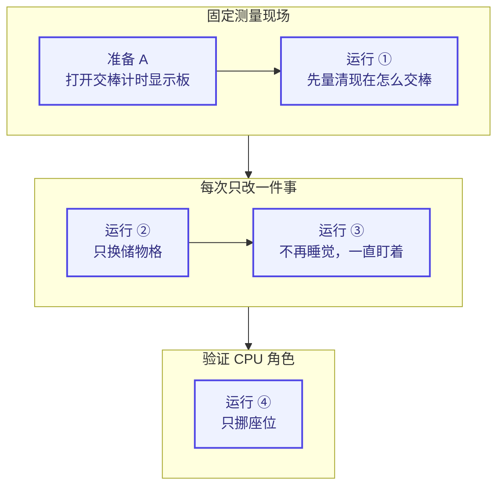

# 第五部分：C++ 软件热路径——队列、忙轮询与 CPU 隔离

## 订单先在 C++ 里交一次棒

前四章已经把真实交易应用、线上协议和测量尺准备好。本章第一次改动被测系统本身：一笔订单进入 `.2` 的 C++ 之后，要从**管理线程**交给**下单线程**，再真正发出去。

先不要背缩写。把它想成接力赛：**订单是接力棒，两条线程是两名运动员，中间那块地方是交接区。** 本章重点量「交棒要多久」，逐次改变储物格、等待方式和 CPU 位置，同时观察整笔订单能省下多少时间。

<div style="background:#f8fafc;border:1px solid #cbd5e1;border-radius:12px;padding:10px;max-width:820px;margin:14px auto;">

</div>

| 先记住的说法 | 后文才会写全的名字 | 它管什么 |
|---|---|---|
| 接力棒 | 订单 / OUCH Enter Order | 被交接的那份工作 |
| 交接区里的储物格 | 队列：`deque` 或固定 Ring | 棒暂时放哪、格子会不会临时扩缩 |
| 交棒规则 | 锁与等待，或 SPSC + 忙轮询 | 是喊一声再睡，还是盯着交接区 |
| 运动员站位 | CPU 亲和性 / 隔离核 | 专人专核，还是和杂活挤同一核 |

实验按三步推进：

1. 先量清「现在怎么交棒」要多久，并确认现场稳定。
2. 每次只改一件事：先改储物格，再改交棒规则。
3. 代码不变，只比较「独占座位」和「与杂活挤同一核」。

<div style="border-left:6px solid #7e22ce;background:#f3e8ff;padding:12px 16px;border-radius:8px;margin:14px 0;"><span style="display:inline-block;padding:3px 12px;border-radius:6px;background:#7e22ce;color:#fff;font-weight:800;">运行前提</span> <span style="font-weight:700;color:#581c87;">座位分两层安排，缺一层，交棒时间就会被别的活打断。</span></div>

1. **物理服务器先把 CPU 预留给这台虚拟机。** 第一部分已经做完。
2. **虚拟机里面，再给线程安排座位。** 这就是第二件；本章负责这一件。

<div style="border-left:6px solid #7e22ce;background:#f3e8ff;padding:12px 16px;border-radius:8px;margin:14px 0;"><span style="display:inline-block;padding:3px 12px;border-radius:6px;background:#7e22ce;color:#fff;font-weight:800;">关键图</span> <span style="font-weight:700;color:#581c87;">下面这张图说明整门课在哪一层动手。本章动的是最右上角那一格，后面几章再往更底层走。</span></div>

<div style="background:#f8fafc;border:1px solid #cbd5e1;border-radius:12px;padding:10px;max-width:820px;margin:14px auto;">

</div>

## 本章学习目标

完成本章后，你应能：

- 把一笔订单分成交棒、发出到回执两段，并核对合起来的客户端总耗时。
- 分清「换储物格」「改交棒规则」「改站位」三件事，不把它们混成一句「换个队列就一定更快」。
- 会用旁边那个陪跑策略和多跑几轮，判断这一轮数字能不能拿来比较。

## 本章导航

<div style="border-left:6px solid #7e22ce;background:#f3e8ff;padding:12px 16px;border-radius:8px;margin:14px 0;"><span style="display:inline-block;padding:3px 12px;border-radius:6px;background:#7e22ce;color:#fff;font-weight:800;">本章导航</span> <span style="font-weight:700;color:#581c87;">本章分成 3 部分，共 5 个导航项；先用总图看完整路线，再在每节导航卡里查看全章与本组位置。先固定测量现场，再逐次只改一件事，最后单独验证 CPU 角色。</span></div>



固定顺序就是：**固定测量现场 → 每次只改一件事 → 验证 CPU 角色**。

## 任务地图

五个导航项各自只回答一个问题：

| 导航项 | 所属部分 | 这一项回答什么 |
| --- | --- | --- |
| 准备 A：打开交棒计时那一页显示板 | 固定测量现场 | 打开交棒计时显示板 |
| 运行 ①：先量清现在怎么交棒 | 固定测量现场 | 先量清当前交棒方式 |
| 运行 ②：只换储物格 | 每次只改一件事 | 只替换储物格并保持其它条件不变 |
| 运行 ③：不再睡觉，一直盯着 | 每次只改一件事 | 只改变等待方式并观察交接段 |
| 运行 ④：只挪座位，看专座还在不在 | 验证 CPU 角色 | 只改变 CPU 站位并复核效果 |

## 准备 A：打开交棒计时那一页显示板

第四部分已经把 Grafana 这个驾驶舱装好了。Grafana 里一页一页的显示板，课程里常写成 **dashboard**。第四章那一页看的是整笔订单往返；本章还要多看「交棒要多久」，所以再装一页专门给这段用的显示板。

本步只做这一件事：**把已经画好的 8 块表拷进 Grafana，确认页面打得开。** 它不开始量交棒，也不改交易进程。真正计时从运行 ① 才开始。

脚本末尾的 `sha256sum` 和 `SHA256SUMS`，就是哈希里的 **SHA-256**：给本轮几份证据文件各算一个指纹，以后能核对文件有没有被改过。全课写「封 SHA」，都是这件事。

<div style="border:2px solid #4f46e5;background:#eef2ff;padding:10px 12px;border-radius:8px;margin:14px 0;"><div style="font-weight:900;color:#312e81;margin-bottom:4px;">导航卡 · 固定测量现场</div><div style="font-weight:700;color:#312e81;margin-bottom:8px;">范畴：工具准备　本步知识：打开交棒计时显示板　位置：全章第 1 / 5 项 · 本组第 1 / 2 项</div><span style="display:inline-block;margin:3px;padding:4px 10px;border-radius:6px;background:#15803d;color:#fff;font-weight:800;">准备 A：打开交棒计时那一页显示板</span><span style="display:inline-block;margin:3px;padding:4px 10px;border-radius:6px;background:#f8fafc;border:1px solid #a5b4fc;color:#312e81;font-weight:800;">运行 ①：先量清现在怎么交棒</span></div>

<div style="border-left:6px solid #15803d;background:#dcfce7;padding:12px 16px;border-radius:8px;margin:14px 0;"><span style="display:inline-block;padding:3px 12px;border-radius:6px;background:#15803d;color:#fff;font-weight:800;">需要运行 · 准备 A</span> <span style="font-weight:700;color:#14532d;">在【持久管理机】以 root 运行；前置是第四部分 Grafana 已在线；只拷一页显示板，不改交易进程；通常 1～10 秒；预期终端写清 8 块表已收下，并给出打开地址。</span></div>

```bash
#!/usr/bin/env bash
set -euo pipefail
cd /financial-low-latency
REPO_ROOT=/financial-low-latency
SELF="$REPO_ROOT/Documents/newDoc/assets/05-live-software/00-install-hot-path-dashboard.sh"
DASHBOARD="$REPO_ROOT/apps/flle-trading-lab/observability/flle-software-hot-path.json"
source "$REPO_ROOT/Documents/reports/run-state/04-observability-stack.env"
RUN_ID="$(date -u +%Y%m%dT%H%M%SZ)-05-software-dashboard"
OUT="$REPO_ROOT/Documents/reports/course-runs/$RUN_ID"
mkdir -p "$OUT/raw"
printf 'RUN_ID=%s\nDASHBOARD_URL=http://10.1.1.101:3000/d/flle-software-hot-path/\n' "$RUN_ID" >"$OUT/run.env"
# ~~~~~校验 dashboard JSON，再同步到 .101 Grafana~~~~~
python3 -m json.tool "$DASHBOARD" >/dev/null
scp -q "$DASHBOARD" root@10.1.1.101:/var/tmp/flle-software-hot-path.json
ssh root@10.1.1.101 "set -eu; install -o grafana -g grafana -m 0644 /var/tmp/flle-software-hot-path.json /var/lib/grafana/dashboards/flle/flle-software-hot-path.json; rm -f /var/tmp/flle-software-hot-path.json; systemctl is-active grafana-server" | tee "$OUT/raw/service.txt"
# ~~~~~等 UID 可取回，确认 8 块 panel~~~~~
for _ in $(seq 1 15); do curl -fsS http://10.1.1.101:3000/api/dashboards/uid/flle-software-hot-path >"$OUT/raw/dashboard.json" 2>/dev/null && break; sleep 1; done
python3 - "$OUT/raw/dashboard.json" <<'PY' | tee "$OUT/raw/result.txt"
import json,sys
value=json.load(open(sys.argv[1], encoding="utf-8"))
assert value["dashboard"]["uid"] == "flle-software-hot-path"
assert len(value["dashboard"]["panels"]) == 8
print("Grafana 收下了这 8 块表")
print("服务在跑，可以匿名打开")
print("打开这一页：http://10.1.1.101:3000/d/flle-software-hot-path/")
PY
# ~~~~~给本轮证据文件算 SHA-256 指纹，写出驾驶舱 URL~~~~~
sha256sum "$SELF" "$DASHBOARD" "$OUT/raw/service.txt" "$OUT/raw/dashboard.json" "$OUT/raw/result.txt" "$OUT/run.env" >"$OUT/SHA256SUMS"
printf 'DASHBOARD_RUN_ID=%s\nDASHBOARD_URL=http://10.1.1.101:3000/d/flle-software-hot-path/\n' "$RUN_ID" >Documents/reports/run-state/05-software-dashboard.env
printf '本轮证据目录：%s\n' "$OUT"
```

<div style="border-left:6px solid #7e22ce;background:#f3e8ff;padding:12px 16px;border-radius:8px;margin:14px 0;"><span style="display:inline-block;padding:3px 12px;border-radius:6px;background:#7e22ce;color:#fff;font-weight:800;">仅供展示 · 输出解读</span> <span style="font-weight:700;color:#581c87;">三行只说明 Grafana 收下了这 8 块表，页面可以打开。交棒快慢还没量；那是运行 ① 的事。</span></div>

```text
Grafana 收下了这 8 块表
服务在跑，可以匿名打开
打开这一页：http://10.1.1.101:3000/d/flle-software-hot-path/
```

浏览器入口：`http://10.1.1.101:3000/d/flle-software-hot-path/`。

下面是 2026-08-30 刚打开时的现场。八块表都在，说明准备 A 这一页装好了。样本和三段时间都是 0，因为还没跑运行 ①；这是本步的正常样子，不是坏了。

<div style="background:#f8fafc;border:1px solid #cbd5e1;border-radius:12px;padding:10px;max-width:820px;margin:14px auto;">

</div>

| 面板 | 它看什么 | 这张图上 |
|---|---|---|
| 本轮固定样本 | 本章测量已经记下了多少笔交棒 | **0**，红底。还没开始量 |
| 队列 → 发送 P99 | 交棒要多久：订单进交接区，到下单线程发出去。这是本章主秒表 | **0 s**。还没有交棒样本 |
| 发送 → 最终结果 P99 | 发出去之后，等到成交或拒绝。这是第四章那把尺子 | **0 s**。本页当前窗口里还没有这轮摘要 |
| 入队 → 最终结果 P99 | 从进交接区一直加到收到回执，大约是上面两段加起来 | **0 s**。同样还没量 |
| 线程交接尾部 | 交棒时间的两条时间线，线名见下表 | 两条都是 **0 s**，叠在一起 |
| Order thread 与 RX CPU | `order thread` 是下单线程最近坐在哪颗核；`socket RX` 是订单连接最近在哪颗核收包 | 两个都是 **2**。只说明最近一次看到的座位 |
| 完整软件段与网络段 | 整段客户端和发出去之后的两条时间线，线名见下表 | 两条都是 **0 s**，叠在一起 |
| 队列当前深度 | 交接区里现在还堆着几根棒 | **0**，绿底。现在是空的，没有单子在等 |

左边两张图，每张图里只有两条线。图例上的「浮动」就是英文名 `floating`：座位还没锁死在一颗核上。现在都是 0，所以两条叠成一条。

| 图 | 线的名字 | 这条线是什么意思 |
|---|---|---|
| 线程交接尾部 | `DEQUE_CV / floating p50` | 交棒的普通情况：一半订单不比这条慢 |
| 线程交接尾部 | `DEQUE_CV / floating p99` | 交棒偏慢的尾巴：100 笔里最慢那几笔到这条 |
| 完整软件段与网络段 | `总段 DEQUE_CV / floating p99` | 从进交接区一直加到收到回执 |
| 完整软件段与网络段 | `OUCH RTT p99` | 从发出去到收到回执，第四章那把尺子 |

以后跑运行 ①～④，先看「本轮固定样本」从 0 涨起来，再看上面这两张图的线会不会分开、会不会下降。座位那一格和队列深度用来确认现场还坐在原位、交接区没有堆住。

<div style="border-left:6px solid #0891b2;background:#cffafe;padding:12px 16px;border-radius:8px;margin:14px 0;"><span style="display:inline-block;padding:3px 12px;border-radius:6px;background:#0891b2;color:#fff;font-weight:800;">继续条件</span> <span style="font-weight:700;color:#164e63;">请确认页面标题是「C++ 软件热路径」、能数出 8 块表，且样本为 0 也算本步通过。打不开或块数不对时，停在本 RUN 的 `service.txt` 与 `dashboard.json`。</span></div>

## 运行 ①：先量清现在怎么交棒

本步只问一件事：**现在这套交棒方式重复跑时，秒表会不会自己乱跳？** 先把三个名字讲清，再量时间。

<div style="border:2px solid #4f46e5;background:#eef2ff;padding:10px 12px;border-radius:8px;margin:14px 0;"><div style="font-weight:900;color:#312e81;margin-bottom:4px;">导航卡 · 固定测量现场</div><div style="font-weight:700;color:#312e81;margin-bottom:8px;">范畴：现场只读　本步知识：先量清当前交棒方式　位置：全章第 2 / 5 项 · 本组第 2 / 2 项</div><span style="display:inline-block;margin:3px;padding:4px 10px;border-radius:6px;background:#f8fafc;border:1px solid #a5b4fc;color:#312e81;font-weight:800;">准备 A：打开交棒计时那一页显示板</span><span style="display:inline-block;margin:3px;padding:4px 10px;border-radius:6px;background:#15803d;color:#fff;font-weight:800;">运行 ①：先量清现在怎么交棒</span></div>

### 本步理论：储物格、钥匙、喊一声

接力赛已经有了。下面三件都是 C++ 写的，都在内存里。

| 先记住 | 程序里的名字 | 它干什么 |
|---|---|---|
| 储物格 | `deque`（读作 deck） | 排队盒子；忙了自己加长 |
| 钥匙 | `mutex` | 整排格子共用一把钥匙；拿着才能打开 `deque` |
| 喊一声再睡 | `condition_variable`（后文写成 CV） | 下单线程看见 `deque` 空了就睡；管理线程放进订单后再把它叫醒 |

这三件合在一起，程序叫 **`DEQUE_CV`**。`MANUAL` 和 `AUTO` 出厂默认都是这一套。本步两边都还用它，还不换。

<div style="border-left:6px solid #7e22ce;background:#f3e8ff;padding:12px 16px;border-radius:8px;margin:14px 0;"><span style="display:inline-block;padding:3px 12px;border-radius:6px;background:#7e22ce;color:#fff;font-weight:800;">仅供展示 · 官方原文</span> <span style="font-weight:700;color:#581c87;">下面三句英文来自 cppreference，课堂可以跳过。点名词即可打开原文。</span></div>

- [`deque`](https://en.cppreference.com/w/cpp/container/deque)：indexed sequence container; storage expanded and contracted as needed
- [`mutex`](https://en.cppreference.com/w/cpp/thread/mutex)：protect shared data from being simultaneously accessed by multiple threads
- [`condition_variable`](https://en.cppreference.com/w/cpp/thread/condition_variable)：block until another thread notifies; wait releases the mutex

<div style="border-left:6px solid #7e22ce;background:#f3e8ff;padding:12px 16px;border-radius:8px;margin:14px 0;"><span style="display:inline-block;padding:3px 12px;border-radius:6px;background:#7e22ce;color:#fff;font-weight:800;">仅供展示</span> <span style="font-weight:700;color:#581c87;">这张图只回答：当前实现怎样交棒。后文的固定格子和忙轮询先不要看。</span></div>

<div style="background:#f8fafc;border:1px solid #cbd5e1;border-radius:12px;padding:10px;max-width:820px;margin:14px auto;">

</div>

所以这套交棒里天生带两段等待：**等钥匙**，以及 **睡醒再回到跑道**。本步先把这段时间量稳，后面几步再逐个去掉它们。

<div style="border-left:6px solid #7e22ce;background:#f3e8ff;padding:12px 16px;border-radius:8px;margin:14px 0;"><span style="display:inline-block;padding:3px 12px;border-radius:6px;background:#7e22ce;color:#fff;font-weight:800;">本章证据边界</span> <span style="font-weight:700;color:#581c87;">本章的数字，都是在下面这套现场量出来的。</span></div>

| 这次实验的现场 | 具体是什么 |
|---|---|
| 被测的那条单 | 测量脚本替 `MANUAL` 进程发，目标间隔 20 毫秒，约每秒 50 笔。`MANUAL` 是进程名，不是人手点单；人手点不了这么快 |
| 旁边谁在陪跑 | 隔壁 `AUTO` 策略自己每秒 10 笔；本章不动它，用它看机器自己有没有忽快忽慢 |
| 机器多大 | 这台交易虚拟机 4 颗 CPU |
| 量哪一段 | 重点看交棒，同时保留订单往返与客户端全段耗时 |

后文会出现「这一段快了几倍」。这个倍数就是在上面这套现场量到的：换一台机器、换一个下单速度，倍数会变。

### 本步理论：先确认秒表没有乱跳

一辆车只跑一圈，最快圈没有意义。所以先用同一套 `DEQUE_CV` 连续跑 8 轮：如果同一套东西自己都忽快忽慢，那后面换储物格、改交棒规则量出来的差，也说明不了任何事。

C++ 程序通过 `CLOCK_MONOTONIC` 读取单调时钟：它只往前走，不被墙上时钟回调带走。一笔手工订单只打三个点：

| 人话 | 公式 | 本章用途 |
|---|---|---|
| 交棒要多久 | `queue_to_send = t1 - t0` | 本章主秒表 |
| 发出去到回执 | `order_rtt = t2 - t1` | 交棒之后的那一段，只做参考 |
| 整段客户端路径 | `submit_to_final = t2 - t0` | 看局部变快之后，整段是不是真的省下来了 |

<div style="border-left:6px solid #7e22ce;background:#f3e8ff;padding:12px 16px;border-radius:8px;margin:14px 0;"><span style="display:inline-block;padding:3px 12px;border-radius:6px;background:#7e22ce;color:#fff;font-weight:800;">仅供展示</span> <span style="font-weight:700;color:#581c87;">三个区间必须来自同一笔订单。逐笔的两段耗时可以相加；各段的 p99 通常来自不同订单，不能直接相加或相减。</span></div>

<div style="background:#f8fafc;border:1px solid #cbd5e1;border-radius:12px;padding:10px;max-width:820px;margin:14px auto;">

</div>

<div style="border-left:6px solid #7e22ce;background:#f3e8ff;padding:12px 16px;border-radius:8px;margin:14px 0;">
<span style="display:inline-block;padding:3px 12px;border-radius:6px;background:#7e22ce;color:#fff;font-weight:800;">仅供展示 · P99 是什么</span>
<span style="font-weight:700;color:#581c87;">后面终端里的交棒、发出去到回执、整段，默认都看 P99。先把这把尺子读懂。</span>
</div>

把很多笔订单的时间从小到大排好。**P99** 是排到大约 99% 那里的那个数：100 笔里大约 99 笔不超过它，大约 1 笔比它慢。数的是订单，不是用户。它不是最慢那一笔——最慢那笔叫 **max**，通常比 P99 更大。

| 名字 | 100 笔里怎么读 | 本章拿它干什么 |
|---|---|---|
| 中位 P50 | 大约一半不超过它 | AUTO 只看稳不稳 |
| **P99** | 大约 99 笔不超过它，大约 1 笔更慢 | MANUAL / AUTO 比快慢用这把 |
| max | 最慢那一笔 | 偶尔看一眼，不当主尺子 |

本章每轮计入 400 笔，P99 大约是第 396 快的那笔，不是第 400 笔。后面「8 轮最快多少、最慢多少」，比的都是这 8 个 P99。

### 理论落到实验

运行 ① 什么都不改：`MANUAL` 和 `AUTO` 用的是**同一套** `DEQUE_CV`，两边同起点，才谈得上后面一步一步换。

<div style="border-left:6px solid #7e22ce;background:#f3e8ff;padding:12px 16px;border-radius:8px;margin:14px 0;"><span style="display:inline-block;padding:3px 12px;border-radius:6px;background:#7e22ce;color:#fff;font-weight:800;">仅供展示</span> <span style="font-weight:700;color:#581c87;">这张图只回答：现在两边是不是同一套。后面怎么变，下一张图再说。</span></div>

<div style="background:#f8fafc;border:1px solid #cbd5e1;border-radius:12px;padding:10px;max-width:820px;margin:14px auto;">

</div>

### AUTO 为什么跟着跑

`AUTO` 不是来一起改交棒的。设计初衷就一件事：看现场自己有没有变。

本步不改它的交棒。它和 `MANUAL` 坐在同一台机器、同一套行情旁边。机器、行情或网络发生共同变化时，`AUTO` 的往返时间也可能变化。`AUTO` 漂移超过门限，这轮就不能作为基线；通过这项检查也不等于排除了全部干扰。

<div style="border-left:6px solid #7e22ce;background:#f3e8ff;padding:12px 16px;border-radius:8px;margin:14px 0;"><span style="display:inline-block;padding:3px 12px;border-radius:6px;background:#7e22ce;color:#fff;font-weight:800;">仅供展示</span> <span style="font-weight:700;color:#581c87;">这张图只回答：AUTO 跟着跑是为了看现场有没有自己变。</span></div>

<div style="background:#f8fafc;border:1px solid #cbd5e1;border-radius:12px;padding:10px;max-width:820px;margin:14px auto;">

</div>

<div style="border-left:6px solid #7e22ce;background:#f3e8ff;padding:12px 16px;border-radius:8px;margin:14px 0;"><span style="display:inline-block;padding:3px 12px;border-radius:6px;background:#7e22ce;color:#fff;font-weight:800;">仅供展示</span> <span style="font-weight:700;color:#581c87;">这张图只回答：1000、40、400 各干什么。</span></div>

<div style="background:#f8fafc;border:1px solid #cbd5e1;border-radius:12px;padding:10px;max-width:820px;margin:14px auto;">

</div>

| 固定项 | 本步值 | 人话 |
|---|---|---|
| AUTO 有没有自己变 | 半窗漂移不超过 20% | AUTO 中位前半后半差太多，这一轮就不可信 |
| 8 轮交棒稳不稳 | 最慢一轮 / 最快一轮不超过 1.50 | 同一套自己先要比得住，才能当后面的尺子 |
| 业务状态 | 每阶段重读持仓；随后买卖交替，净仓位为 0 | 不是靠堆仓换数字 |

<div style="border-left:6px solid #15803d;background:#dcfce7;padding:12px 16px;border-radius:8px;margin:14px 0;"><span style="display:inline-block;padding:3px 12px;border-radius:6px;background:#15803d;color:#fff;font-weight:800;">需要运行 · 运行 ①</span> <span style="font-weight:700;color:#14532d;">在【持久管理机】以 root 运行。准备 A 那一页已经打开，交易程序还在跑。本步先热身 1000 笔，再连跑 8 轮（每轮预热 40、计入 400），量现在这套交棒要多久。大约 2 分钟。预期 8 轮都能用，AUTO 没有自己乱跳。</span></div>

```bash
#!/usr/bin/env bash
set -euo pipefail
cd /financial-low-latency
REPO_ROOT=/financial-low-latency
SELF="$REPO_ROOT/Documents/newDoc/assets/05-live-software/01-measure-deque-cv.sh"
HELPER="$REPO_ROOT/apps/flle-trading-lab/tests/software_measurement.py"
source "$REPO_ROOT/Documents/reports/run-state/02-trading-baseline.env"
APP_RUN_ID="$RUN_ID"
RUN_ID="$(date -u +%Y%m%dT%H%M%SZ)-05-deque-cv"
OUT="$REPO_ROOT/Documents/reports/course-runs/$RUN_ID"
mkdir -p "$OUT/raw"
printf 'RUN_ID=%s\nAPP_RUN_ID=%s\nPROFILE=DEQUE_CV_REPEAT8_ISOLATED_AUTO_SENTINEL_V14\n' "$RUN_ID" "$APP_RUN_ID" >"$OUT/run.env"
# ~~~~~8 轮 DEQUE_CV/dedicated，AUTO 当环境哨兵~~~~~
python3 "$HELPER" --profiles DEQUE_CV:dedicated --repeat 8 --control-port 48121 --treatment-cpu 2 --control-cpu 3 --housekeeping-cpus 0-1 --precondition-samples 1000 --warmup 40 \
  --samples 400 --interval-us 20000 --control-every 5 --stability-limit-pct 20 \
  --environment-equivalence-pct 40 --direction-consistency-pct 87.5 --single-profile-spread-limit 1.5 \
  --bootstrap-resamples 4000 --bootstrap-seed 20260828 --output "$OUT/raw/software.csv" \
  2>&1 | tee "$OUT/raw/result.txt"
# ~~~~~封 SHA，把 DEQUE 摘要交给下一张卡~~~~~
sha256sum "$SELF" "$HELPER" "$OUT/raw/software.csv" \
  "$OUT/raw/software.summary.json" "$OUT/raw/result.txt" "$OUT/run.env" >"$OUT/SHA256SUMS"
printf 'DEQUE_RUN_ID=%s\nDEQUE_SUMMARY=%s\n' "$RUN_ID" "$OUT/raw/software.summary.json" >Documents/reports/run-state/05-deque-cv.env
printf '本轮证据目录：%s\n' "$OUT"
```

<div style="border-left:6px solid #7e22ce;background:#f3e8ff;padding:12px 16px;border-radius:8px;margin:14px 0;"><span style="display:inline-block;padding:3px 12px;border-radius:6px;background:#7e22ce;color:#fff;font-weight:800;">仅供展示 · 输出解读</span> <span style="font-weight:700;color:#581c87;">RUN `20260830T053740Z-05-deque-cv`。先看「能不能用」，再看同一把 p99 尺子上 MANUAL 和 AUTO 各是多少。</span></div>

```text
~~~~~~~~~~~~~~~~~~~~~测量摘要~~~~~~~~~~~~~~~~~~~~~
这一轮能不能用：能用
AUTO 有没有自己乱跳：8/8 轮都稳
8 轮交棒最快 12873 ns（12.9 µs），最慢 15174 ns（15.2 µs）；最慢是最快的 1.18 倍（门限 1.50）
格子有没有装满丢掉：没有
先热身 1000 笔，每轮预热 40、计入 400，共 8 轮

原来的格子（独占座位）
  同一把尺子，都是 p99
  MANUAL 计入 3200 笔
    交棒：14830 ns（14.8 µs）
    发出去到回执：62563 ns（62.6 µs）
    整段：73884 ns（73.9 µs）
  AUTO 计入 640 笔
    交棒：15765 ns（15.8 µs）
    发出去到回执：67860 ns（67.9 µs）
    整段：78859 ns（78.9 µs）
    往返中位：49572 ns（49.6 µs）（只看稳不稳）

MANUAL 独占座位时坐 CPU 2
AUTO 一直坐 CPU 3
行情还在播，AUTO 策略没关
```

| 看哪一行 | 本轮 | 它表示什么 |
|---|---|---|
| 这一轮能不能用 | 能用 | 8 轮都能当基线 |
| AUTO 有没有自己乱跳 | 8/8 轮都稳 | 现场没有自己变乱 |
| 8 轮交棒稳不稳 | 最快 12.9 µs / 最慢 15.2 µs = 1.18 倍 | 最慢不到最快的 1.50 倍，同一套比得住 |
| 交棒 p99 | MANUAL 14.8 µs / AUTO 15.8 µs | 同一把尺子；AUTO 没有更快 |
| 发出去到回执 p99 | MANUAL 62.6 µs / AUTO 67.9 µs | 同一把尺子；AUTO 没有更快 |
| 往返中位 | 49.6 µs | 只看 AUTO 稳不稳，不跟 p99 比快慢 |

<div style="border-left:6px solid #0891b2;background:#cffafe;padding:12px 16px;border-radius:8px;margin:14px 0;"><span style="display:inline-block;padding:3px 12px;border-radius:6px;background:#0891b2;color:#fff;font-weight:800;">关键现象</span> <span style="font-weight:700;color:#164e63;">本轮基线有效。`14.8 µs` 是这一轮的观察值；下一张卡先看「能不能用」，再比数字。</span></div>

## 运行 ②：只换储物格

本步只问：格子改成一次摆好、转圈复用，交棒会不会更快？

<div style="border:2px solid #4f46e5;background:#eef2ff;padding:10px 12px;border-radius:8px;margin:14px 0;"><div style="font-weight:900;color:#312e81;margin-bottom:4px;">导航卡 · 每次只改一件事</div><div style="font-weight:700;color:#312e81;margin-bottom:8px;">范畴：现场只读　本步知识：只替换储物格并保持其它条件不变　位置：全章第 3 / 5 项 · 本组第 1 / 2 项</div><span style="display:inline-block;margin:3px;padding:4px 10px;border-radius:6px;background:#15803d;color:#fff;font-weight:800;">运行 ②：只换储物格</span><span style="display:inline-block;margin:3px;padding:4px 10px;border-radius:6px;background:#f8fafc;border:1px solid #a5b4fc;color:#312e81;font-weight:800;">运行 ③：不再睡觉，一直盯着</span></div>

### 本步理论：不够再要，还是转圈复用

跟上一步比，只改 `MANUAL` 的储物格。钥匙、喊一声、`AUTO` 都不动。

以前的 `deque`：格子不够，交棒当中还要向内存再要一截。现在的 **`FIXED_CV`**：启动时一次摆好 1024 格，写到第 1024 格就转回第 1 格，写进已经交出去的那一格。可用 1023 格，留一格分辨满和空。

<div style="border-left:6px solid #7e22ce;background:#f3e8ff;padding:12px 16px;border-radius:8px;margin:14px 0;"><span style="display:inline-block;padding:3px 12px;border-radius:6px;background:#7e22ce;color:#fff;font-weight:800;">仅供展示</span> <span style="font-weight:700;color:#581c87;">这张图只回答：运行 ② 跟上一步比，改了哪一块。</span></div>

<div style="background:#f8fafc;border:1px solid #cbd5e1;border-radius:12px;padding:10px;max-width:820px;margin:14px auto;">

</div>

<div style="border-left:6px solid #7e22ce;background:#f3e8ff;padding:12px 16px;border-radius:8px;margin:14px 0;"><span style="display:inline-block;padding:3px 12px;border-radius:6px;background:#7e22ce;color:#fff;font-weight:800;">仅供展示</span> <span style="font-weight:700;color:#581c87;">这张图只回答：格子以前怎么长，现在怎么一次摆好。</span></div>

<div style="background:#f8fafc;border:1px solid #cbd5e1;border-radius:12px;padding:10px;max-width:820px;margin:14px auto;">

</div>

钥匙和喊一声都没动，只有格子换了。要提前说明的是：本步下单大约 50 次/秒，`deque` 很少真的需要加长，所以这一改能省下多少，要看绿卡里的数字。

| | 以前 `DEQUE_CV` | 现在 `FIXED_CV` |
|---|---|---|
| 格子从哪来 | 不够了再向内存要一截 | 启动时一次摆好 1024 格 |
| 写到头 | 再要一截 | 转回第 1 格，写进已经交出去的那一格 |
| 交棒当中问内存 | 可能要 | 不用 |

### 理论落到实验

要比的是 **MANUAL 的两套格子**，不是手工对自动。

- **原来的格子**：运行 ① 那套，不够再要一截。
- **固定格子**：本步要换上的那套，1024 格转圈用。

每套各跑 8 轮，一共 16 轮。AUTO 每轮都跟着，用的还是原来那套，只看现场稳不稳。

后跑的那套机器更热，交棒会显得更快。如果先连跑 4 轮原来的、再连跑 4 轮固定的，后跑的那套会占这个便宜。所以穿插着跑，两套都有偏前的轮和偏后的轮：

| 轮次 | 1 | 2 | 3 | 4 | 5 | 6 | 7 | 8 |
|---|---|---|---|---|---|---|---|---|
| MANUAL 用哪套 | 原来的 | 固定 | 固定 | 原来的 | 固定 | 原来的 | 原来的 | 固定 |

切的是整一轮，不是每一笔。每一轮先丢掉预热 40 笔，再计入 400 笔；刚换过去那一下不进成绩。

第 9～16 轮把上面这一段再走一遍。程序里把这两套叫 profile，绿卡写成 `DEQUE_CV` 和 `FIXED_CV`。

比完以后会先给一个差，再给一段「这个差大概落在哪」。如果这一段一头说原来的更快、一头说固定的更快，结论就写成说不出谁更快。

<div style="border-left:6px solid #15803d;background:#dcfce7;padding:12px 16px;border-radius:8px;margin:14px 0;"><span style="display:inline-block;padding:3px 12px;border-radius:6px;background:#15803d;color:#fff;font-weight:800;">需要运行 · 运行 ②</span> <span style="font-weight:700;color:#14532d;">在【持久管理机】以 root 运行；前置是运行 ① 已写出 `05-deque-cv.env`；约 3 分钟；原来的格子和固定格子穿插着各跑 8 轮；预期这一轮能用，再看换格子有没有让交棒更快。</span></div>

```bash
#!/usr/bin/env bash
set -euo pipefail
cd /financial-low-latency
REPO_ROOT=/financial-low-latency
SELF="$REPO_ROOT/Documents/newDoc/assets/05-live-software/02-measure-fixed-cv.sh"
HELPER="$REPO_ROOT/apps/flle-trading-lab/tests/software_measurement.py"
source "$REPO_ROOT/Documents/reports/run-state/02-trading-baseline.env"
APP_RUN_ID="$RUN_ID"
# ~~~~~读取运行 ① 的 DEQUE 摘要~~~~~
source "$REPO_ROOT/Documents/reports/run-state/05-deque-cv.env"
RUN_ID="$(date -u +%Y%m%dT%H%M%SZ)-05-fixed-cv"
OUT="$REPO_ROOT/Documents/reports/course-runs/$RUN_ID"
mkdir -p "$OUT/raw"
printf 'RUN_ID=%s\nAPP_RUN_ID=%s\nBASELINE_RUN_ID=%s\nPROFILE=DEQUE_FIXED_ABBA_ISOLATED_AUTO_SENTINEL_V14\n' "$RUN_ID" "$APP_RUN_ID" "$DEQUE_RUN_ID" >"$OUT/run.env"
# ~~~~~DEQUE↔FIXED 配平，只换储存~~~~~
python3 "$HELPER" --profiles DEQUE_CV:dedicated,FIXED_CV:dedicated --repeat 8 --control-port 48121 --treatment-cpu 2 --control-cpu 3 --housekeeping-cpus 0-1 --precondition-samples 1000 --warmup 40 \
  --samples 400 --interval-us 20000 --control-every 5 --stability-limit-pct 20 \
  --environment-equivalence-pct 40 --direction-consistency-pct 87.5 --single-profile-spread-limit 1.5 \
  --bootstrap-resamples 4000 --bootstrap-seed 20260828 --output "$OUT/raw/software.csv" \
  2>&1 | tee "$OUT/raw/result.txt"
# ~~~~~封 SHA~~~~~
sha256sum "$SELF" "$HELPER" "$OUT/raw/software.csv" \
  "$OUT/raw/software.summary.json" "$OUT/raw/result.txt" "$OUT/run.env" >"$OUT/SHA256SUMS"
printf 'FIXED_RUN_ID=%s\nFIXED_SUMMARY=%s\n' "$RUN_ID" "$OUT/raw/software.summary.json" >Documents/reports/run-state/05-fixed-cv.env
printf '本轮证据目录：%s\n' "$OUT"
```

<div style="border-left:6px solid #7e22ce;background:#f3e8ff;padding:12px 16px;border-radius:8px;margin:14px 0;"><span style="display:inline-block;padding:3px 12px;border-radius:6px;background:#7e22ce;color:#fff;font-weight:800;">仅供展示 · 输出解读</span> <span style="font-weight:700;color:#581c87;">RUN `20260830T072217Z-05-fixed-cv`。先看「能不能用」，再看「交棒谁更快」的可信范围是不是两头同一边。</span></div>

```text
~~~~~~~~~~~~~~~~~~~~~测量摘要~~~~~~~~~~~~~~~~~~~~~
这一轮能不能用：能用
AUTO 有没有自己乱跳：16/16 轮都稳
格子有没有装满丢掉：没有
先热身 1000 笔，每轮预热 40、计入 400，共 16 轮

原来的格子（独占座位）
  同一把尺子，都是 p99
  MANUAL 计入 3200 笔
    交棒：15772 ns（15.8 µs）
    发出去到回执：60309 ns（60.3 µs）
    整段：72379 ns（72.4 µs）
  AUTO 计入 640 笔
    交棒：16674 ns（16.7 µs）
    发出去到回执：72076 ns（72.1 µs）
    整段：87385 ns（87.4 µs）
    往返中位：51996 ns（52.0 µs）（只看稳不稳）

固定格子（独占座位）
  同一把尺子，都是 p99
  MANUAL 计入 3200 笔
    交棒：15040 ns（15.0 µs）
    发出去到回执：60200 ns（60.2 µs）
    整段：72704 ns（72.7 µs）
  AUTO 计入 640 笔
    交棒：16555 ns（16.6 µs）
    发出去到回执：73067 ns（73.1 µs）
    整段：86901 ns（86.9 µs）
    往返中位：52230 ns（52.2 µs）（只看稳不稳）

交棒谁更快
  原来的格子（独占座位） 对比 固定格子（独占座位）
  差了 732 ns（0.7 µs），但可信区间 -188 .. 1503 ns 穿过 0
  所以：说不出谁更快

整段谁更快
  原来的格子（独占座位） 对比 固定格子（独占座位）
  差了 325 ns（0.3 µs），但可信区间 -3177 .. 2281 ns 穿过 0
  所以：说不出谁更快

AUTO 两边现场差多少
  差了 234 ns（0.2 µs）
  可信区间 -1313 .. 829 ns
  所以：两边现场差不多，还能比

MANUAL 独占座位时坐 CPU 2
AUTO 一直坐 CPU 3
行情还在播，AUTO 策略没关
本轮证据目录：/financial-low-latency/Documents/reports/course-runs/20260830T072217Z-05-fixed-cv
```

<div style="border-left:6px solid #7e22ce;background:#f3e8ff;padding:12px 16px;border-radius:8px;margin:14px 0;">
<span style="display:inline-block;padding:3px 12px;border-radius:6px;background:#7e22ce;color:#fff;font-weight:800;">仅供展示 · 可信范围是什么</span>
<span style="font-weight:700;color:#581c87;">终端那句「穿过 0」，说的就是下面这件事。</span>
</div>

差 `732 ns` 是这一轮算出来的。**可信范围** `-188 .. 1503 ns` 是脚本对本批样本重复重采样后，估计出的差值不确定范围；它不是下一次实验的保证区间。

| 范围里的数 | 它表示什么 | 本轮有没有落在里面 |
|---|---|---|
| 小于 0 | 原来的格子更快 | 有，从 `-188` 起 |
| 等于 0 | 两边一样快 | 有，0 也在这一段里 |
| 大于 0 | 固定格子更快 | 有，一直到 `1503` |

三段都在这一段里，所以写「说不出谁更快」。整段那一行同理：`-3177 .. 2281` 也是一头负、一头正。

| 看哪一行 | 本轮 | 它表示什么 |
|---|---|---|
| 这一轮能不能用 | 能用 | 16 轮都能拿来比 |
| 交棒谁更快 | 说不出谁更快 | 可信范围一头负、一头正，0 也在里面 |
| 整段谁更快 | 说不出谁更快 | 整段同样一头负、一头正 |
| AUTO 两边现场 | 还能比 | 现场没有自己变乱 |

<div style="border-left:6px solid #0891b2;background:#cffafe;padding:12px 16px;border-radius:8px;margin:14px 0;"><span style="display:inline-block;padding:3px 12px;border-radius:6px;background:#0891b2;color:#fff;font-weight:800;">关键现象</span> <span style="font-weight:700;color:#164e63;">本轮说不出谁更快。下一步还用这套固定格子，只改怎么等棒。</span></div>

这不是固定格子没用，而是它省掉的那一下——「忙了再向内存要一截」——在当前这个下单速度上本来就很少发生。换一个更高的下单速度，同一改动可能就量得出来了。

## 运行 ③：不再睡觉，一直盯着

格子已经换过了。本步只改 `MANUAL` 怎么等棒：以前空了就睡，等人叫醒；现在不睡，一直盯着交接区。`AUTO` 仍不改。

<div style="border:2px solid #4f46e5;background:#eef2ff;padding:10px 12px;border-radius:8px;margin:14px 0;"><div style="font-weight:900;color:#312e81;margin-bottom:4px;">导航卡 · 每次只改一件事</div><div style="font-weight:700;color:#312e81;margin-bottom:8px;">范畴：现场只读　本步知识：只改变等待方式并观察交接段　位置：全章第 4 / 5 项 · 本组第 2 / 2 项</div><span style="display:inline-block;margin:3px;padding:4px 10px;border-radius:6px;background:#f8fafc;border:1px solid #a5b4fc;color:#312e81;font-weight:800;">运行 ②：只换储物格</span><span style="display:inline-block;margin:3px;padding:4px 10px;border-radius:6px;background:#15803d;color:#fff;font-weight:800;">运行 ③：不再睡觉，一直盯着</span></div>

### 本步理论：接棒者一直盯着交接区

<div style="border-left:6px solid #7e22ce;background:#f3e8ff;padding:12px 16px;border-radius:8px;margin:14px 0;"><span style="display:inline-block;padding:3px 12px;border-radius:6px;background:#7e22ce;color:#fff;font-weight:800;">仅供展示</span> <span style="font-weight:700;color:#581c87;">这张图只回答：运行 ③ 跟上一步比，改了哪一块。</span></div>

<div style="background:#f8fafc;border:1px solid #cbd5e1;border-radius:12px;padding:10px;max-width:820px;margin:14px auto;">

</div>

下单线程就是接棒的那个人。以前交接区一空他就打盹，管理线程放进订单后喊一声，操作系统再去把他叫醒——这中间多了一趟「去叫人」。现在他不睡，眼睛一直盯着交接区，订单一放下就拿走；代价是他坐的那颗核一直被占着。

<div style="border-left:6px solid #7e22ce;background:#f3e8ff;padding:12px 16px;border-radius:8px;margin:14px 0;"><span style="display:inline-block;padding:3px 12px;border-radius:6px;background:#7e22ce;color:#fff;font-weight:800;">仅供展示</span> <span style="font-weight:700;color:#581c87;">这张图只回答：睡着叫醒和一直盯着差在哪。右边浅橙色标题才是本步要换上的。</span></div>

<div style="background:#f8fafc;border:1px solid #cbd5e1;border-radius:12px;padding:10px;max-width:820px;margin:14px auto;">

</div>

| | 睡着叫醒 | 一直盯着 |
|---|---|---|
| 没订单时 | 下单线程睡觉 | 下单线程一直看 |
| 有订单时 | 管理线程喊一声，操作系统再叫醒 | 立刻拿走 |
| 代价 | 叫醒要花时间 | 长期占着一颗 CPU |

钥匙这次也一起拿掉了。理由是全程只有一个人放、一个人取，两边各管自己那一头，没有第二个人来抢同一格——这套写法也只在恰好一个人递、一个人接时才成立。程序里把「一直盯着」写成 `SPSC_SPIN`；盯着的时候他偶尔歇半拍，但不会主动睡眠等待通知。操作系统仍能抢占线程；忙轮询也不能阻止中断。

座位和运行 ② 一样：本课把 `MANUAL` 下单线程安排到 CPU 2，把其它应用线程移开；`AUTO` 坐 CPU 3。这是虚拟机内的线程安排，绑定一个 CPU 不等于占有一颗物理核。[Linux 调度与亲和性](https://man7.org/linux/man-pages/man2/sched_setaffinity.2.html)。两个任务挤到同一颗核，是运行 ④ 才比的事。

### 理论落到实验

要比的是 **MANUAL 的两种等法**，格子都已经是固定的。

- **睡着叫醒**：运行 ② 那套，固定格子 + 钥匙 + 喊一声。
- **一直盯着**：本步要换上的那套，固定格子 + 不拿钥匙 + 一直看。

每套各跑 8 轮，一共 16 轮。AUTO 每轮都跟着，用的还是原来那套，只看现场稳不稳。穿插规则和运行 ② 一样：两套都要有偏前的轮和偏后的轮，切的是整一轮，每轮先丢掉预热 40 笔。

| 轮次 | 1 | 2 | 3 | 4 | 5 | 6 | 7 | 8 |
|---|---|---|---|---|---|---|---|---|
| MANUAL 用哪套 | 睡着叫醒 | 盯着看 | 盯着看 | 睡着叫醒 | 盯着看 | 睡着叫醒 | 睡着叫醒 | 盯着看 |

第 9～16 轮把上面这一段再走一遍。程序里把这两套叫 profile，绿卡写成 `FIXED_CV` 和 `SPSC_SPIN`。

<div style="border-left:6px solid #15803d;background:#dcfce7;padding:12px 16px;border-radius:8px;margin:14px 0;"><span style="display:inline-block;padding:3px 12px;border-radius:6px;background:#15803d;color:#fff;font-weight:800;">需要运行 · 运行 ③</span> <span style="font-weight:700;color:#14532d;">在【持久管理机】以 root 运行；前置是运行 ② 已写出 `05-fixed-cv.env`；约 3 分钟；盯着看时 CPU 2 会一直忙；预期这一轮能用，再看盯着看是不是更快。</span></div>

```bash
#!/usr/bin/env bash
set -euo pipefail
cd /financial-low-latency
REPO_ROOT=/financial-low-latency
SELF="$REPO_ROOT/Documents/newDoc/assets/05-live-software/03-measure-spsc-spin.sh"
HELPER="$REPO_ROOT/apps/flle-trading-lab/tests/software_measurement.py"
source "$REPO_ROOT/Documents/reports/run-state/02-trading-baseline.env"
APP_RUN_ID="$RUN_ID"
# ~~~~~读取运行 ② 的 FIXED 摘要~~~~~
source "$REPO_ROOT/Documents/reports/run-state/05-fixed-cv.env"
RUN_ID="$(date -u +%Y%m%dT%H%M%SZ)-05-spsc-spin"
OUT="$REPO_ROOT/Documents/reports/course-runs/$RUN_ID"
mkdir -p "$OUT/raw"
printf 'RUN_ID=%s\nAPP_RUN_ID=%s\nPREVIOUS_RUN_ID=%s\nPROFILE=FIXED_SPSC_ABBA_BUSY_SPIN_ISOLATED_AUTO_SENTINEL_V14\n' "$RUN_ID" "$APP_RUN_ID" "$FIXED_RUN_ID" >"$OUT/run.env"
# ~~~~~FIXED↔SPSC 配平，只换同步~~~~~
python3 "$HELPER" --profiles FIXED_CV:dedicated,SPSC_SPIN:dedicated --repeat 8 --control-port 48121 --treatment-cpu 2 --control-cpu 3 --housekeeping-cpus 0-1 --precondition-samples 1000 --warmup 40 \
  --samples 400 --interval-us 20000 --control-every 5 --stability-limit-pct 20 \
  --environment-equivalence-pct 40 --direction-consistency-pct 87.5 --single-profile-spread-limit 1.5 \
  --bootstrap-resamples 4000 --bootstrap-seed 20260828 --output "$OUT/raw/software.csv" \
  2>&1 | tee "$OUT/raw/result.txt"
# ~~~~~封 SHA~~~~~
sha256sum "$SELF" "$HELPER" "$OUT/raw/software.csv" \
  "$OUT/raw/software.summary.json" "$OUT/raw/result.txt" "$OUT/run.env" >"$OUT/SHA256SUMS"
printf 'SPSC_RUN_ID=%s\nSPSC_SUMMARY=%s\n' "$RUN_ID" "$OUT/raw/software.summary.json" >Documents/reports/run-state/05-spsc-spin.env
printf '本轮证据目录：%s\n' "$OUT"
```

<div style="border-left:6px solid #7e22ce;background:#f3e8ff;padding:12px 16px;border-radius:8px;margin:14px 0;"><span style="display:inline-block;padding:3px 12px;border-radius:6px;background:#7e22ce;color:#fff;font-weight:800;">仅供展示 · 输出解读</span> <span style="font-weight:700;color:#581c87;">RUN `20260830T074845Z-05-spsc-spin`。先看「能不能用」，再分开看交棒和整段各快多少。</span></div>

```text
~~~~~~~~~~~~~~~~~~~~~测量摘要~~~~~~~~~~~~~~~~~~~~~
这一轮能不能用：能用
AUTO 有没有自己乱跳：16/16 轮都稳
格子有没有装满丢掉：没有
先热身 1000 笔，每轮预热 40、计入 400，共 16 轮

固定格子（独占座位）
  同一把尺子，都是 p99
  MANUAL 计入 3200 笔
    交棒：14932 ns（14.9 µs）
    发出去到回执：59048 ns（59.0 µs）
    整段：71436 ns（71.4 µs）
  AUTO 计入 640 笔
    交棒：16473 ns（16.5 µs）
    发出去到回执：72994 ns（73.0 µs）
    整段：84826 ns（84.8 µs）
    往返中位：49473 ns（49.5 µs）（只看稳不稳）

盯着看（独占座位）
  同一把尺子，都是 p99
  MANUAL 计入 3200 笔
    交棒：2451 ns（2.5 µs）
    发出去到回执：58781 ns（58.8 µs）
    整段：60687 ns（60.7 µs）
  AUTO 计入 640 笔
    交棒：16273 ns（16.3 µs）
    发出去到回执：71019 ns（71.0 µs）
    整段：84027 ns（84.0 µs）
    往返中位：47884 ns（47.9 µs）（只看稳不稳）

交棒谁更快
  固定格子（独占座位） 对比 盯着看（独占座位）
  盯着看（独占座位） 更快 12481 ns（12.5 µs）
  可信范围 8821 .. 13057 ns，两头都是 盯着看（独占座位） 更快
  所以：盯着看（独占座位） 更快

整段谁更快
  固定格子（独占座位） 对比 盯着看（独占座位）
  盯着看（独占座位） 更快 10749 ns（10.7 µs）
  可信范围 8491 .. 12650 ns，两头都是 盯着看（独占座位） 更快
  所以：盯着看（独占座位） 更快

AUTO 两边现场差多少
  差了 1589 ns（1.6 µs）
  可信范围 475 .. 2452 ns
  所以：AUTO 有点顺风，但还在门内

相邻快慢方向：8/8 对都是同一边更快
MANUAL 独占座位时坐 CPU 2
AUTO 一直坐 CPU 3
行情还在播，AUTO 策略没关
本轮证据目录：/financial-low-latency/Documents/reports/course-runs/20260830T074845Z-05-spsc-spin
```

| 看哪一行 | 本轮 | 它表示什么 |
|---|---|---|
| 交棒谁更快 | 盯着看更快 12.5 µs | 14.9 µs → 2.5 µs；可信范围两头都是盯着看更快 |
| 整段谁更快 | 盯着看更快 10.7 µs | 整段也快了；发出去到回执几乎没动 |
| AUTO 交棒 p99 | 16.5 µs / 16.3 µs | 同一把尺子；AUTO 还是原来那套 |
| 相邻快慢方向 | 8/8 对 | 每对都是盯着看更快 |
| AUTO 两边现场 | 还能比 | 略顺风，门还过了 |

这不是运气好碰上的一次。同一条热路径另外做过 5 次独立复测，5 次都是盯着看更快，每次 8 对相邻轮次也都指向同一边：

| RUN | 睡着叫醒 交棒 p99 | 盯着看 交棒 p99 | 快了几倍 | 相邻方向 |
|---|---:|---:|---:|---:|
| `155323Z` | 17977 ns | 6977 ns | 2.58× | 8/8 |
| `155727Z` | 17758 ns | 6801 ns | 2.61× | 8/8 |
| `160132Z` | 17342 ns | 6941 ns | 2.50× | 8/8 |
| `160547Z` | 16997 ns | 6815 ns | 2.49× | 8/8 |
| `160952Z` | 16555 ns | 6185 ns | 2.68× | 8/8 |

这份收益的价格也单独量过。只读收据 RUN `20260828T235221Z-05-busy-spin-cpu-cost` 记下：盯着看稳定跑起来之后，下单线程自己就占掉约 `90.1%` 的 CPU 时间，整机 `load average=1.00`、user `24.9%`、idle `74.8%`。这台 VM 只有 4 颗 CPU，等于长期拿一整颗核，换这十几微秒。

<div style="border-left:6px solid #0891b2;background:#cffafe;padding:12px 16px;border-radius:8px;margin:14px 0;"><span style="display:inline-block;padding:3px 12px;border-radius:6px;background:#0891b2;color:#fff;font-weight:800;">关键现象</span> <span style="font-weight:700;color:#164e63;">本轮盯着看更快。交棒 14.9 µs → 2.5 µs，整段也快了 10.7 µs。代价是 CPU 2 一直被占着。下一步只挪座位，看没有专座会怎样。</span></div>

## 运行 ④：只挪座位，看专座还在不在

本章最后一步。交棒还是盯着看，只改 `MANUAL` 坐哪。

<div style="border:2px solid #4f46e5;background:#eef2ff;padding:10px 12px;border-radius:8px;margin:14px 0;"><div style="font-weight:900;color:#312e81;margin-bottom:4px;">导航卡 · 验证 CPU 角色</div><div style="font-weight:700;color:#312e81;margin-bottom:8px;">范畴：现场只读　本步知识：只改变 CPU 站位并复核效果　位置：全章第 5 / 5 项 · 本组第 1 / 1 项</div><span style="display:inline-block;margin:3px;padding:4px 10px;border-radius:6px;background:#15803d;color:#fff;font-weight:800;">运行 ④：只挪座位，看专座还在不在</span></div>

### 本步理论：一整个人换一张椅子

跟上一步比，交棒规则不动。本步只挪 `MANUAL` 的座位。`AUTO` 仍坐 CPU 3。

开始之前先把两件常被混成一句话的事分开：

| 名字 | 它管什么 | 生活里像什么 |
|---|---|---|
| **盯着看** | 怎么等棒：不睡，一直看交接区 | 这个人一直醒着，不打盹 |
| **座位** | 只准坐哪张椅子 | 规定他坐 2 号椅，还是去 0 号椅 |

盯着看会把他**正在坐的那张椅子**占得很满。运行 ③ 把他单独放在 CPU 2，所以被占满的是 CPU 2；CPU 0、1、3 上的人照常干活。

本步还是这套盯着看，只换椅子：

- **独占座位**：人还是一直醒着，仍只坐 CPU 2。杂活在 CPU 0，各坐各的。
- **挤在杂活核**：人还是一直醒着，**整个人搬到 CPU 0**。杂活也在 CPU 0。操作系统会轮流让他们上这张椅子；这个人不睡觉，杂活还能上，但很难抢到足够时间。CPU 2 这轮空着。

**挤不是两颗核一起用。** 一轮里只坐一个核。杂活没有被关掉，只是和这个不睡觉的人抢同一张椅子。

<div style="border-left:6px solid #7e22ce;background:#f3e8ff;padding:12px 16px;border-radius:8px;margin:14px 0;"><span style="display:inline-block;padding:3px 12px;border-radius:6px;background:#7e22ce;color:#fff;font-weight:800;">仅供展示</span> <span style="font-weight:700;color:#581c87;">这张图只回答：运行 ④ 跟上一步比，改了哪一块。右边浅橙色标题才是本步要换上的。</span></div>

<div style="background:#f8fafc;border:1px solid #cbd5e1;border-radius:12px;padding:10px;max-width:820px;margin:14px auto;">

</div>

| | 独占座位 | 挤在杂活核 |
|---|---|---|
| 下单线程坐哪 | 只坐 CPU 2 | 整个人搬到 CPU 0 |
| 还睡不睡 | 不睡，一直看 | 同样不睡，一直看 |
| CPU 2 这轮 | 只有他 | 空着 |
| 杂活在哪 | 在 CPU 0，各干各的 | 也在 CPU 0，和这个不睡觉的人抢 |

### 理论落到实验

要比的是 **同一套盯着看、两种座位**：只坐 CPU 2，还是整个人搬到 CPU 0。

每套各跑 8 轮，一共 16 轮。AUTO 每轮都跟着，仍坐 CPU 3，只看现场稳不稳。穿插规则和前两步一样：两套都要有偏前的轮和偏后的轮，切的是整一轮，每轮先丢掉预热 40 笔。

| 轮次 | 1 | 2 | 3 | 4 | 5 | 6 | 7 | 8 |
|---|---|---|---|---|---|---|---|---|
| MANUAL 坐哪 | 独占 CPU 2 | 搬到 CPU 0 | 搬到 CPU 0 | 独占 CPU 2 | 搬到 CPU 0 | 独占 CPU 2 | 独占 CPU 2 | 搬到 CPU 0 |

第 9～16 轮把上面这一段再走一遍。程序里绿卡写成 `SPSC_SPIN:dedicated` 和 `SPSC_SPIN:shared`。

<div style="border-left:6px solid #15803d;background:#dcfce7;padding:12px 16px;border-radius:8px;margin:14px 0;"><span style="display:inline-block;padding:3px 12px;border-radius:6px;background:#15803d;color:#fff;font-weight:800;">需要运行 · 运行 ④</span> <span style="font-weight:700;color:#14532d;">在【持久管理机】以 root 运行；前置是运行 ③ 已写出 `05-spsc-spin.env`；约 3 分钟；成功或失败都会恢复盯着看和 CPU 2；预期这一轮能用，再比独占座位和挤在杂活核。</span></div>

```bash
#!/usr/bin/env bash
set -euo pipefail
cd /financial-low-latency
REPO_ROOT=/financial-low-latency
SELF="$REPO_ROOT/Documents/newDoc/assets/05-live-software/04-measure-spsc-shared-cpu.sh"
HELPER="$REPO_ROOT/apps/flle-trading-lab/tests/software_measurement.py"
RESTORE="$REPO_ROOT/apps/flle-trading-lab/tests/restore_software_profile.py"
source "$REPO_ROOT/Documents/reports/run-state/02-trading-baseline.env"
APP_RUN_ID="$RUN_ID"
# ~~~~~读取运行 ③ 的 SPSC 摘要；退出时恢复 CPU 角色~~~~~
source "$REPO_ROOT/Documents/reports/run-state/05-spsc-spin.env"
RUN_ID="$(date -u +%Y%m%dT%H%M%SZ)-05-spsc-shared-cpu"
OUT="$REPO_ROOT/Documents/reports/course-runs/$RUN_ID"
mkdir -p "$OUT/raw"
restore_profile() { python3 "$RESTORE" >"$OUT/raw/restore.txt"; }
trap restore_profile EXIT
printf 'RUN_ID=%s\nAPP_RUN_ID=%s\nPREVIOUS_RUN_ID=%s\nPROFILE=SPSC_DEDICATED_SHARED_ABBA_AUTO_SENTINEL_V14\n' "$RUN_ID" "$APP_RUN_ID" "$SPSC_RUN_ID" >"$OUT/run.env"
# ~~~~~SPSC 隔离核 ↔ 共享核配平~~~~~
python3 "$HELPER" --profiles SPSC_SPIN:dedicated,SPSC_SPIN:shared --repeat 8 --control-port 48121 --treatment-cpu 2 --control-cpu 3 --shared-cpu 0 --housekeeping-cpus 0 --precondition-samples 1000 --warmup 40 \
  --samples 400 --interval-us 20000 --control-every 5 --stability-limit-pct 20 \
  --environment-equivalence-pct 40 --direction-consistency-pct 87.5 --single-profile-spread-limit 1.5 \
  --bootstrap-resamples 4000 --bootstrap-seed 20260828 --output "$OUT/raw/software.csv" \
  2>&1 | tee "$OUT/raw/result.txt"
restore_profile
trap - EXIT
# ~~~~~封 SHA~~~~~
sha256sum "$SELF" "$HELPER" "$RESTORE" "$OUT/raw/software.csv" \
  "$OUT/raw/software.summary.json" "$OUT/raw/result.txt" "$OUT/raw/restore.txt" "$OUT/run.env" >"$OUT/SHA256SUMS"
printf 'SOFTWARE_RUN_ID=%s\nSOFTWARE_PROFILE=SPSC_DEDICATED_SHARED_ABBA_AUTO_SENTINEL_V14\nSOFTWARE_SUMMARY=%s\n' "$RUN_ID" "$OUT/raw/software.summary.json" >Documents/reports/run-state/05-software-current.env
printf '本轮证据目录：%s\n' "$OUT"
```

<div style="border-left:6px solid #7e22ce;background:#f3e8ff;padding:12px 16px;border-radius:8px;margin:14px 0;"><span style="display:inline-block;padding:3px 12px;border-radius:6px;background:#7e22ce;color:#fff;font-weight:800;">仅供展示 · 输出解读</span> <span style="font-weight:700;color:#581c87;">RUN `20260830T075912Z-05-spsc-shared-cpu`。先看「能不能用」，再看独占座位是不是比整个人去 CPU 0 更快。</span></div>

```text
~~~~~~~~~~~~~~~~~~~~~测量摘要~~~~~~~~~~~~~~~~~~~~~
这一轮能不能用：能用
AUTO 有没有自己乱跳：16/16 轮都稳
格子有没有装满丢掉：没有
先热身 1000 笔，每轮预热 40、计入 400，共 16 轮

盯着看（独占座位）
  同一把尺子，都是 p99
  MANUAL 计入 3200 笔
    交棒：2089 ns（2.1 µs）
    发出去到回执：58173 ns（58.2 µs）
    整段：59562 ns（59.6 µs）
  AUTO 计入 640 笔
    交棒：15871 ns（15.9 µs）
    发出去到回执：72307 ns（72.3 µs）
    整段：82944 ns（82.9 µs）
    往返中位：51720 ns（51.7 µs）（只看稳不稳）

盯着看（挤在杂活核）
  同一把尺子，都是 p99
  MANUAL 计入 3200 笔
    交棒：46115 ns（46.1 µs）
    发出去到回执：63307 ns（63.3 µs）
    整段：101659 ns（101.7 µs）
  AUTO 计入 640 笔
    交棒：17230 ns（17.2 µs）
    发出去到回执：76490 ns（76.5 µs）
    整段：88913 ns（88.9 µs）
    往返中位：54935 ns（54.9 µs）（只看稳不稳）

交棒谁更快
  盯着看（独占座位） 对比 盯着看（挤在杂活核）
  盯着看（独占座位） 更快 44026 ns（44.0 µs）
  可信范围 -46301 .. -43159 ns，两头都是 盯着看（独占座位） 更快
  所以：盯着看（独占座位） 更快

整段谁更快
  盯着看（独占座位） 对比 盯着看（挤在杂活核）
  盯着看（独占座位） 更快 42097 ns（42.1 µs）
  可信范围 -46346 .. -38510 ns，两头都是 盯着看（独占座位） 更快
  所以：盯着看（独占座位） 更快

AUTO 两边现场差多少
  差了 3215 ns（3.2 µs）
  可信范围 -4405 .. -1733 ns
  所以：AUTO 有点顺风，但还在门内

相邻快慢方向：8/8 对都是同一边更快
MANUAL 独占座位时坐 CPU 2
MANUAL 挤杂活核时坐 CPU 0
AUTO 一直坐 CPU 3
行情还在播，AUTO 策略没关
本轮证据目录：/financial-low-latency/Documents/reports/course-runs/20260830T075912Z-05-spsc-shared-cpu
```

| 看哪一行 | 本轮 | 它表示什么 |
|---|---|---|
| 交棒谁更快 | 独占座位更快 44.0 µs | 2.1 µs → 46.1 µs；整个人去 CPU 0 明显更慢 |
| 整段谁更快 | 独占座位更快 42.1 µs | 整段也跟着慢 |
| 相邻快慢方向 | 8/8 对 | 每对都是独占座位更快 |
| AUTO 两边现场 | 有点顺风，还在门内 | 略顺风，门还过了 |
| MANUAL 座位 | 独占 CPU 2 / 挤核 CPU 0 | 两套座位确实分开了 |

这个对比在正式 RUN 之前也复测过六次。六次的数字都指向同一边——挤在杂活核更慢——但相邻轮次的一致程度分三档：

| RUN | 这一轮能不能用 | 相邻方向 |
|---|---|---:|
| `162028Z` | 不能用：相邻方向不一致 | 6/8 |
| `162448Z / 162910Z` | 能用 | 7/8、7/8 |
| `163350Z / 163815Z / 164239Z` | 能用 | 8/8、8/8、8/8 |

最后三次里，挤在杂活核的交棒 p99 是 `64.5 / 57.1 / 61.0 µs`，独占座位是 `6.6 / 7.0 / 6.6 µs`；带自动恢复的正式 RUN `170545Z` 同样是 8/8。第一次那份「不能用」也一并留着：从六次里挑三次好看的报，就不叫测量了。

<div style="border-left:6px solid #0891b2;background:#cffafe;padding:12px 16px;border-radius:8px;margin:14px 0;"><span style="display:inline-block;padding:3px 12px;border-radius:6px;background:#0891b2;color:#fff;font-weight:800;">关键现象</span> <span style="font-weight:700;color:#164e63;">本轮独占座位更快。交棒 2.1 µs → 46.1 µs，整段也慢了 42 µs。盯着看没有专座，就会和杂活抢同一张椅子。</span></div>

## 最终验收与证据边界

| 验收层 | 原始证据 | 本章结论 |
|---|---|---|
| 现场稳不稳 | 正式前 3 次复测跨 RUN 最大/最小 `1.14×`；正式 RUN 8/8 都稳 | 同一套交棒自己先比得住，才能当尺子 |
| 只换储物格 | `072217Z` 交棒差 `732 ns`，可信范围 `-188 .. 1503` 一头负、一头正 | 这个下单速度下说不出谁更快 |
| 只改交棒规则 | `074845Z` 交棒 `14932 → 2451 ns`，差 `12481 ns`，可信范围两头都是盯着看更快 | 睡着叫醒改成一直盯着，交接段明显下降 |
| 整段还剩多少 | 同一轮整段差 `10749 ns` | 交棒省下来的时间，整段还留得住 |
| 座位有多重要 | `075912Z` 交棒 `2089 → 46115 ns`，差 `44026 ns`，8/8 同向 | 同一套盯着看，整个人去 CPU 0 就明显更慢 |
| 正确性 | 全部 `result=E`、`queue_full_drops=0/0` | 不是用丢单换延时 |

五份正式 RUN 的证据清单合计 `32/32` 通过，CPU 成本那份只读收据另算 `2/2`；历史诊断 RUN 不计入这个数。

## 清理、恢复与交接

| 目标 | 操作 | 结果 |
|---|---|---|
| 继续软件实验 | 保持 `SPSC_SPIN`，MANUAL order=CPU2，AUTO order=CPU3，其余线程=CPU0–1 | 本章验证过的低延时软件配置 |
| 回到普通基线 | 重跑第二部分运行 ① | 重新部署默认 `DEQUE_CV`，并从零开始纸面交易轮次 |
| 查看驾驶舱 | 打开 `http://10.1.1.101:3000/d/flle-software-hot-path/` | 图形只展示指标，不参与 C++ 热路径 |
| 保存证据 | 保留每个 RUN 的 CSV、summary、run.env 与 SHA256SUMS | 可从原始样本复算 |
| 下一章 | 保持现在的交棒和座位 | 第六部分只问订单怎样走出这台机器 |

棒已经交到下单线程手里。前五章发出去走的还是 Linux 给所有程序准备的那条公共通道。第六部分接着只问出站这一段：继续走公共海关，还是换快速通道、专用柜台，或把出站闸整道承包下来。

本章四组测量已在本次从恢复后快照建立的第二章统一平台上验证；本轮包含修复和受影响步骤复验，最终代码尚待再次恢复快照后的零修改全课复刷。正文历史样例与本次回执分别保留。详细运行记录与复验边界见[教师说明](TEACHER-FLOW-NOTES.md#第-05-章)。

## 理解检查

1. 为什么要先用同一套交棒连跑 8 轮，才开始比两套？
2. `FIXED_CV` 和以前的格子差在哪？
3. 「一直盯着」为什么消耗 CPU？它能阻止操作系统抢占吗？
4. 为什么用旁边的 AUTO 看现场稳不稳，比看 MANUAL 自己的往返时间更靠得住？
5. 为什么交棒从 14.9 µs 降到 2.5 µs，不能写成整条交易链也快了同样倍数？
6. 为什么 ESXi 上已经全预留了，虚拟机里面还要再给线程排座位？
7. 为什么运行 ② 那句「说不出谁更快」不算一次失败的实验？

参考答案：

1. 运行 ① 先用同一套连跑 8 轮看稳不稳；运行 ② 再把原来的格子和固定格子穿插着各跑 8 轮，后跑的不总占便宜。
2. 以前不够再要一截；现在 1024 格转圈写，写进已经交出去的那一格。钥匙和喊一声还在。
3. 线程反复检查交接区，不主动睡眠，因此持续消耗 CPU；操作系统仍可以抢占。专门安排 CPU 是为了减少竞争，不是取消调度。[Linux 调度说明](https://man7.org/linux/man-pages/man7/sched.7.html)
4. MANUAL 正是被改动的那一方，它的数字会跟着改动一起变；AUTO 是另一个进程、另一条连接，保持原配置，为共同环境变化提供参照，但不能发现所有干扰。
5. 交棒快了 12.5 µs，整段只快了 10.7 µs，发出去到回执那一段几乎没动。局部的倍数不能直接搬到全程。
6. 预留解决的是这台虚拟机有没有 CPU 可用；排座位解决的是虚拟机里面谁和谁挤同一颗 CPU。
7. 它给出的是一个诚实的结论：在这个下单速度上，换格子省下来的时间小到量不出来。能拒绝漂亮但站不住的结论，测量装置才有用。

## 本地配套资产

| 路径 | 用途 |
|---|---|
| `apps/flle-trading-lab/src/order_queue.hpp` | 三种真实 C++ 队列实现 |
| `apps/flle-trading-lab/tests/software_measurement.py` | 发单、穿插配平、可信范围与各道门限 |
| `apps/flle-trading-lab/tests/restore_software_profile.py` | 运行 ④ 成功或失败后，恢复交棒方式与座位 |

## 外部参考资料

| 官方入口 | 本章用途 |
|---|---|
| [C++ working draft · Atomic order and consistency](https://eel.is/c++draft/atomics.order) | release/acquire 的语言规则 |
| [Linux man-pages · sched_setaffinity(2)](https://man7.org/linux/man-pages/man2/sched_setaffinity.2.html) | 线程 CPU affinity 的系统调用边界 |
| [Linux kernel · Scaling in the Linux Networking Stack](https://docs.kernel.org/networking/scaling.html) | 收包分流与中断落在哪颗 CPU 的背景资料 |
