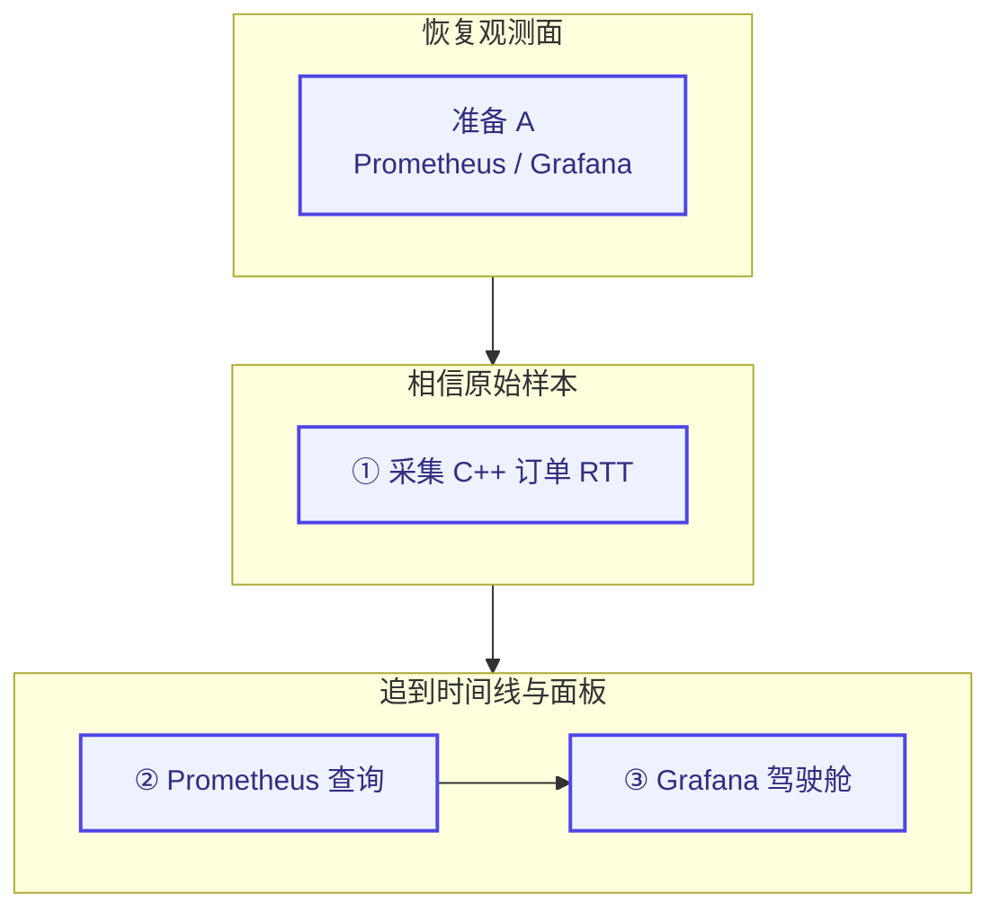

# 第四部分：给交易系统装仪表——Tail Latency、Prometheus 与 Grafana

## 先给一笔交易装上可复算的秒表

上一章已经抓到订单请求与回报。现在给这段往返计时：大多数订单要多久，最慢的那一小部分又要多久？本章要回答：**秒表从哪里开始、在哪里停止、用了哪些样本，以及面板上的数字能不能退回原始记录重新算出来。**

把交易系统想成一辆赛车：C++ 程序按秒表，每笔耗时留成一张原始计时单（raw sample）。Prometheus 定期保存指标，Grafana 把它画成看板；有疑问时，回到计时单重算。

把耗时从小到大排列，p50 是中间位置，p99 是覆盖约 99% 样本的位置；后者帮助我们关注少数慢订单，这就是尾延迟（tail latency）。准确取第几个样本，在运行①说明。

| 官方入口 | 本章采用什么 |
| --- | --- |
| [Prometheus Overview](https://prometheus.io/docs/introduction/overview/) | 时间序列、pull 模型与 labels |
| [Prometheus Exposition formats](https://prometheus.io/docs/instrumenting/exposition_formats/) | `/metrics` 文本格式、`HELP`、`TYPE` |
| [PromQL basics](https://prometheus.io/docs/prometheus/latest/querying/basics/) | instant query 与 HTTP API |
| [Grafana Dashboards](https://grafana.com/docs/grafana/latest/visualizations/dashboards/) | datasource、panel 与 dashboard |

本章继续观察已经在线的真实 Trading Lab：`.1 Exchange` 回放 AAPL/NVDA 历史 ITCH；`.2 AUTO` 与 `.2 MANUAL` 独立交易；`.101 Gateway` 只在旁路暴露 `/metrics`；`.101 Prometheus/Grafana` 只负责抓取、保存和展示。

<div style="border-left:6px solid #7e22ce;background:#f3e8ff;padding:12px 16px;border-radius:8px;margin:14px 0;"><span style="display:inline-block;padding:3px 12px;border-radius:6px;background:#7e22ce;color:#fff;font-weight:800;">事故钩子</span> <span style="font-weight:700;color:#581c87;">只看 Grafana 上的 p99，不足以维护低延迟交易系统。说不清样本来源时，后面换成 Onload 或 DPDK，也只是更快地展示一个无法复算的数字。</span></div>

## 本章学习目标

1. 指出 **订单 RTT（往返耗时）从发出订单到收到最终成交或拒绝**，Accepted `A` 不停止秒表。
2. 用 raw CSV 复算 **p50、p99、max**，并说明 20 个 warmup 为什么保留但不进摘要。
3. 把 Grafana 面板追到 **PromQL → `/metrics` → C++ 固定窗口**，并说明 `up=1` 只证明最近一次 scrape 成功。

## 本章导航

<div style="border-left:6px solid #7e22ce;background:#f3e8ff;padding:12px 16px;border-radius:8px;margin:14px 0;"><span style="display:inline-block;padding:3px 12px;border-radius:6px;background:#7e22ce;color:#fff;font-weight:800;">本章导航</span> <span style="font-weight:700;color:#581c87;">本章分成 3 部分，共 4 个导航项；先用总图看完整路线，再在每节导航卡里查看全章与本组位置。一张准备卡恢复观测面，三张运行卡依次相信原始样本、复算分位数并追到 Grafana。</span></div>



固定顺序就是：**恢复观测面 → 相信原始样本 → 追到时间线与面板**。

## 任务地图

| 导航项 | 所属部分 | 这一项回答什么 |
| --- | --- | --- |
| 准备 A：恢复宿主机 Prometheus 与 Grafana | 恢复观测面 | 恢复 Prometheus 与 Grafana 服务 |
| 运行 ①：采集第一份可复算的 C++ 订单 RTT | 相信原始样本 | 采集并复算 C++ 订单 RTT |
| 运行 ②：让 Prometheus 把指标变成时间序列 | 追到时间线与面板 | 让 Prometheus 读取同一组指标 |
| 运行 ③：在 Grafana 中读懂同一组证据 | 追到时间线与面板 | 在 Grafana 中核对同一证据链 |

计时点由 C++ 记录，观测工具在测量区间之外。课堂先复算逐笔样本，再核对看板；200 个样本只描述本次实验。

## 先画清楚秒表和旁路

<div style="border-left:6px solid #7e22ce;background:#f3e8ff;padding:12px 16px;border-radius:8px;margin:14px 0;"><span style="display:inline-block;padding:3px 12px;border-radius:6px;background:#7e22ce;color:#fff;font-weight:800;">关键图</span> <span style="font-weight:700;color:#581c87;">左边是 C++ 交易热路径，右边是 .101 观测旁路。Gateway 只读交易状态；Prometheus 定期取回指标，Grafana 再把指标画出来。</span></div>

<div style="background:#f8fafc;border:1px solid #cbd5e1;border-radius:12px;padding:10px;max-width:820px;margin:14px auto;">

</div>

## 准备 A：恢复宿主机 Prometheus 与 Grafana

本步只恢复工具。即使 `.101` 刚从快照恢复，也从持久 `.111` 管理机复制已验 deb，由 `.101` 的 systemd 直接启动，不经 Docker 或容器网络。

<div style="border:2px solid #4f46e5;background:#eef2ff;padding:10px 12px;border-radius:8px;margin:14px 0;"><div style="font-weight:900;color:#312e81;margin-bottom:4px;">导航卡 · 恢复观测面</div><div style="font-weight:700;color:#312e81;margin-bottom:8px;">范畴：工具准备　本步知识：恢复 Prometheus 与 Grafana 服务　位置：全章第 1 / 4 项 · 本组第 1 / 1 项</div><span style="display:inline-block;margin:3px;padding:4px 10px;border-radius:6px;background:#15803d;color:#fff;font-weight:800;">准备 A：恢复宿主机 Prometheus 与 Grafana</span></div>

| 项目 | 固定值 |
| --- | --- |
| 主机 | `.101 / 10.1.1.101` |
| Prometheus | `2.31.2`，端口 `9090` |
| Grafana | `13.1.0`，端口 `3000` |
| 入口 | `http://10.1.1.101:3000/d/flle-trading-baseline/` |
| 影响 | 首次安装约占 1.4 GB；重复执行只同步配置并重启两项服务 |

<div style="border-left:6px solid #ea580c;background:#ffedd5;padding:12px 16px;border-radius:8px;margin:14px 0;"><span style="display:inline-block;padding:3px 12px;border-radius:6px;background:#ea580c;color:#fff;font-weight:800;">课前准备</span> <span style="font-weight:700;color:#7c2d12;">Grafana、Prometheus 和配套依赖均从 `.111` 已校验的缓存分发。首次安装需要解包并启动服务；后续重复执行沿用这些本地制品。</span></div>

等价文件入口：`bash Documents/newDoc/assets/04-live-observability/00-restore-observability.sh`。

<div style="border-left:6px solid #15803d;background:#dcfce7;padding:12px 16px;border-radius:8px;margin:14px 0;"><span style="display:inline-block;padding:3px 12px;border-radius:6px;background:#15803d;color:#fff;font-weight:800;">需要运行 · 准备 A</span> <span style="font-weight:700;color:#14532d;">在【持久管理机 `/financial-low-latency`】以 root 运行；前置是第一部分准备 A 已完成离线工具准备、第二章 Gateway `/metrics` 在线；会安装或更新 `.101` 的宿主机服务与课程 dashboard，重复执行幂等；预计 15 秒，首次安装可能数分钟；预期两个版本、两个 `active`、Prometheus Ready 与 Grafana `database=ok`。</span></div>

```bash
#!/usr/bin/env bash
set -euo pipefail
cd /financial-low-latency
REPO_ROOT=/financial-low-latency
SELF="$REPO_ROOT/Documents/newDoc/assets/04-live-observability/00-restore-observability.sh"
CTL="$REPO_ROOT/apps/flle-trading-lab/scripts/observabilityctl.sh"
RUN_ID="$(date -u +%Y%m%dT%H%M%SZ)-04-observability-restore"
OUT="$REPO_ROOT/Documents/reports/course-runs/$RUN_ID"
mkdir -p "$OUT/raw"
printf 'RUN_ID=%s\nPROFILE=HOST_NATIVE_PROMETHEUS_GRAFANA\n' "$RUN_ID" >"$OUT/run.env"
# ~~~~~装或同步 .101 上的宿主机 Prometheus / Grafana，不用 Docker~~~~~
"$CTL" install 2>&1 | tee "$OUT/raw/restore.txt"
# ~~~~~读两项 systemd 状态；封 SHA，并写出观测栈 URL~~~~~
ssh root@10.1.1.101 'systemctl show prometheus grafana-server -p Id -p ActiveState -p SubState -p MainPID' >"$OUT/raw/services.txt"
sha256sum "$SELF" "$CTL" \
  "$REPO_ROOT/apps/flle-trading-lab/observability/prometheus.yml" \
  "$REPO_ROOT/apps/flle-trading-lab/observability/grafana.ini" \
  "$REPO_ROOT/apps/flle-trading-lab/observability/grafana-datasource.yml" \
  "$REPO_ROOT/apps/flle-trading-lab/observability/grafana-dashboard-provider.yml" \
  "$REPO_ROOT/apps/flle-trading-lab/observability/flle-trading-baseline.json" \
  "$OUT/raw/restore.txt" "$OUT/raw/services.txt" "$OUT/run.env" >"$OUT/SHA256SUMS"
printf 'STACK_RUN_ID=%s\nPROMETHEUS_URL=http://10.1.1.101:9090/\nGRAFANA_URL=http://10.1.1.101:3000/d/flle-trading-baseline/\n' "$RUN_ID" >Documents/reports/run-state/04-observability-stack.env
printf 'evidence=%s\n' "$OUT"
```

<div style="border-left:6px solid #7e22ce;background:#f3e8ff;padding:12px 16px;border-radius:8px;margin:14px 0;"><span style="display:inline-block;padding:3px 12px;border-radius:6px;background:#7e22ce;color:#fff;font-weight:800;">仅供展示 · 输出解读</span> <span style="font-weight:700;color:#581c87;">下面摘自 RUN `20260829T103653Z-04-observability-restore`。先看两个版本，再按命令参数顺序读取两个 `active`，最后看 Prometheus ready 与 Grafana database。</span></div>

```text
prometheus, version 2.31.2+ds1 (branch: debian/sid, revision: 2.31.2+ds1-1ubuntu1.22.04.3)
Version 13.1.0 (commit: b309c9bb3b81a748c3a75289236a27309ed2566a, branch: release-13.1.0#patched)
active
active
Prometheus is Ready.
{
  "database": "ok",
```

| 字段 | 实测例子 | 学员读什么 |
| --- | --- | --- |
| Prometheus version | `2.31.2+ds1` | 使用固定 Jammy 包 |
| Grafana version | `13.1.0` | dashboard 由固定版本读取 |
| `active` / `active` | 两行均为 `active` | Prometheus、Grafana 两项 systemd 服务在线 |
| ready / database | `Ready`、`ok` | HTTP 层已经可以继续 |

<div style="border-left:6px solid #0891b2;background:#cffafe;padding:12px 16px;border-radius:8px;margin:14px 0;"><span style="display:inline-block;padding:3px 12px;border-radius:6px;background:#0891b2;color:#fff;font-weight:800;">关键现象</span> <span style="font-weight:700;color:#164e63;">请确认两个版本、两个 `active`、Prometheus `Ready` 和 Grafana `database=ok` 同时存在。完整安装输出、service PID 与 SHA 位于该 RUN 目录。</span></div>

下一线索：工具已经在线，但看板还没有资格宣布系统快；先回到 C++ raw sample。

## 运行 ①：采集第一份可复算的 C++ 订单 RTT

本步只回答：一笔订单从 C++ 发出到收到最终结果，用了多久？行情继续播放，AUTO 策略继续运行，MANUAL 以固定 50 Hz 产生独立样本。

<div style="border:2px solid #4f46e5;background:#eef2ff;padding:10px 12px;border-radius:8px;margin:14px 0;"><div style="font-weight:900;color:#312e81;margin-bottom:4px;">导航卡 · 相信原始样本</div><div style="font-weight:700;color:#312e81;margin-bottom:8px;">范畴：现场只读　本步知识：采集并复算 C++ 订单 RTT　位置：全章第 2 / 4 项 · 本组第 1 / 1 项</div><span style="display:inline-block;margin:3px;padding:4px 10px;border-radius:6px;background:#15803d;color:#fff;font-weight:800;">运行 ①：采集第一份可复算的 C++ 订单 RTT</span></div>

<div style="border-left:6px solid #7e22ce;background:#f3e8ff;padding:12px 16px;border-radius:8px;margin:14px 0;"><span style="display:inline-block;padding:3px 12px;border-radius:6px;background:#7e22ce;color:#fff;font-weight:800;">关键图</span> <span style="font-weight:700;color:#581c87;">同一份 C++ 内存里的 RTT 有两条读法：上条 helper 取逐笔样本，下条 Gateway 取当前摘要。两条都走管理口。</span></div>

<div style="background:#f8fafc;border:1px solid #cbd5e1;border-radius:12px;padding:10px;max-width:820px;margin:14px auto;">

</div>

| 名词 | 它是什么 | 交给谁继续 |
| --- | --- | --- |
| 管理口 | 课程自定义 TCP：发一行 ASCII 命令，回一行 JSON；MANUAL 在 `.2:48122` | 两条读法都走它 |
| helper | `.111` 上的一次性 Python `apps/flle-trading-lab/tests/baseline_measurement.py`：连 C++、下测量单、写 CSV，跑完退出 | 运行 ① |
| `MEASUREMENT_SAMPLES` | helper 要回这批测量单的逐笔 `order_rtt_ns`，JSON 回到 `.111` 后**在本机写** `order-rtt.csv` | 课堂复算 p50/p99/max |
| `STATE` | Gateway 每秒取一次当前摘要（含窗口 p50/p99/max），渲染成 `10.1.1.101:8088/metrics` 的低基数文本 | Prometheus 每秒 **HTTP GET** |
| Prometheus / Grafana | 保存**摘要随时间的取值**，再用 PromQL 把它组织成驾驶舱 | 运行 ②③ |

### 本步理论：先约定秒表怎么按，再看数字

**`order_rtt_ns` 的起点是 MANUAL C++ 调用 SoupBinTCP 发送 OUCH `O` 之前；终点是同一 C++ 进程收到最终 `E` 或 `J` 之后。** 中间的 Accepted `A` 只是状态变化，不停止秒表。

<div style="border-left:6px solid #7e22ce;background:#f3e8ff;padding:12px 16px;border-radius:8px;margin:14px 0;"><span style="display:inline-block;padding:3px 12px;border-radius:6px;background:#7e22ce;color:#fff;font-weight:800;">关键图</span> <span style="font-weight:700;color:#581c87;">只看秒表的两个读数点，以及 warmup 与 measured 的分界。</span></div>

<div style="background:#f8fafc;border:1px solid #cbd5e1;border-radius:12px;padding:10px;max-width:820px;margin:14px auto;">

</div>

| 合同项 | 本章固定值 | 为什么固定 |
| --- | --- | --- |
| Profile | `HOST_NATIVE_ORDER_RTT_50HZ_V1` | 后续知道在和什么比较 |
| 时钟 | 同一 MANUAL C++ `CLOCK_MONOTONIC` | 只在同一 C++ 进程内相减 |
| 起点 → 终点 | OUCH send → final `E/J` | 名称与代码边界一致 |
| 到达过程 | 每 20 ms 一笔，即 50 Hz（`--interval-us 20000`） | 固定到达过程，方便后文比较 |
| Warmup / Measured | 前 20 笔热身 / 后 200 笔正式 | warmup 完整写入 CSV，摘要只算 measured |
| 并发背景 | 行情 PLAYING，AUTO 开关不变 | 测量时应用保持原状 |

200 个 measured 样本使用 nearest-rank：**p50 是排序后的第 100 个，p99 是第 198 个。** 平均值没有进入主判据，因为少量慢样本很容易被平均值稀释。

**理论落到实验：** helper 对 `.2:48122` 发下面两类管理口命令，按固定节奏打测量单，只有带测量标记的单进入这本窗口。终端最后打出 p50/p99/max，逐笔纳秒值留在 raw CSV。

| 名词 | 它是什么 |
| --- | --- |
| `MEASUREMENT_RESET` | 新开一本计时本，清空上一轮课堂窗口 |
| `MEASUREMENT_ORDER` | 下一笔测量单：1 股 AAPL，带测量标记 |
| 纸面 IOC | **纸面** = 按历史盘口在纸面账本上成交；**IOC** = Immediate-Or-Cancel，立刻成交或立刻取消，秒表停在 `E` 或 `J` |

<div style="border-left:8px solid #4f46e5;background:#e0e7ff;padding:14px 18px;border-radius:8px;margin:16px 0;"><span style="display:inline-block;padding:4px 12px;border-radius:6px;background:#4f46e5;color:#fff;font-weight:900;">实验资源与 Profile 卡</span><div style="font-weight:800;color:#312e81;margin-top:8px;">资源：`.2` MANUAL trader、`.1` Exchange、订单 TCP `43120`；绑定：现有 AUTO/MANUAL 两个 client；Profile：`HOST_NATIVE_ORDER_RTT_50HZ_V1`；本步变量：只增加带测量标记的 20+200 笔 MANUAL IOC；保护边界：不暂停回放、不关 AUTO、不改 CPU/IRQ；验证/释放：raw CSV + summary JSON，进程保持在线。</div></div>

等价文件入口：`bash Documents/newDoc/assets/04-live-observability/01-capture-order-rtt-baseline.sh`。

<div style="border-left:6px solid #15803d;background:#dcfce7;padding:12px 16px;border-radius:8px;margin:14px 0;"><span style="display:inline-block;padding:3px 12px;border-radius:6px;background:#15803d;color:#fff;font-weight:800;">需要运行 · 运行 ①</span> <span style="font-weight:700;color:#14532d;">在【持久管理机】以 root 运行；前置是准备 A 通过且第二章应用仍在线；不暂停行情、不关闭 AUTO；产生 20+200 笔 MANUAL 纸面 IOC；约 5 秒；预期 raw CSV 与主机 profile 一并封存，终端打出 p50/p99/max。</span></div>

```bash
#!/usr/bin/env bash
set -euo pipefail
cd /financial-low-latency
REPO_ROOT=/financial-low-latency
SELF="$REPO_ROOT/Documents/newDoc/assets/04-live-observability/01-capture-order-rtt-baseline.sh"
HELPER="$REPO_ROOT/apps/flle-trading-lab/tests/baseline_measurement.py"
source "$REPO_ROOT/Documents/reports/run-state/02-trading-baseline.env"
RUN_ID="$(date -u +%Y%m%dT%H%M%SZ)-04-order-rtt-baseline"
OUT="$REPO_ROOT/Documents/reports/course-runs/$RUN_ID"
mkdir -p "$OUT/raw"
printf 'RUN_ID=%s\nAPP_RUN_ID=%s\nPROFILE=HOST_NATIVE_ORDER_RTT_50HZ_V1\n' "$RUN_ID" "$RUN_DIR" >"$OUT/run.env"
# ~~~~~记下 MANUAL PID 与 CPU 座位；不改绑定~~~~~
ssh root@10.1.1.2 "set -eu; pid=\$(cat '$RUN_DIR/trader-manual.pid'); hostname; uname -r; taskset -pc \"\$pid\"; chrt -p \"\$pid\"; grep '^Cpus_allowed_list' /proc/\$pid/status" >"$OUT/raw/host-profile.txt"
# ~~~~~50 Hz 采 20 warmup + 200 measured；不暂停行情、不关 AUTO~~~~~
python3 "$HELPER" --warmup 20 --samples 200 --interval-us 20000 \
  --output "$OUT/raw/order-rtt.csv" 2>&1 | tee "$OUT/raw/result.txt"
# ~~~~~封 SHA，并把 raw CSV 路径交给后续卡~~~~~
sha256sum "$SELF" "$HELPER" "$OUT/raw/host-profile.txt" \
  "$OUT/raw/order-rtt.csv" "$OUT/raw/order-rtt.summary.json" \
  "$OUT/raw/result.txt" "$OUT/run.env" >"$OUT/SHA256SUMS"
printf 'BASELINE_RUN_ID=%s\nBASELINE_PROFILE=HOST_NATIVE_ORDER_RTT_50HZ_V1\nRAW_CSV=%s\n' "$RUN_ID" "$OUT/raw/order-rtt.csv" >Documents/reports/run-state/04-order-rtt-baseline.env
printf 'evidence=%s\n' "$OUT"
```

`host-profile.txt` 记录的是 MANUAL **进程主线程**当时的调度策略和允许 CPU 集合，不是订单线程每一笔实际运行在哪颗 CPU 的证明。本章只确认“没有主动改放置”；第五部分才按 `order_thread_tid` 读取订单线程自己的 affinity，并把 CPU 放置作为实验变量。

<div style="border-left:6px solid #7e22ce;background:#f3e8ff;padding:12px 16px;border-radius:8px;margin:14px 0;"><span style="display:inline-block;padding:3px 12px;border-radius:6px;background:#7e22ce;color:#fff;font-weight:800;">仅供展示 · 输出解读</span> <span style="font-weight:700;color:#581c87;">RUN `20260829T103858Z-04-order-rtt-baseline` 的六行输出依次冻结负载、边界、测量代次、Tail、并发背景和原始文件。</span></div>

```text
profile=HOST_NATIVE_ORDER_RTT_50HZ_V1 warmup=20 measured=200 interval_us=20000
measurement=OUCH_SEND_TO_FINAL_RESPONSE clock=CLOCK_MONOTONIC
paper_epoch=2 measurement_generation=4 replay_loop=2 replay_status=PLAYING
p50_ns=49677 p99_ns=69414 max_ns=79373
source_advance_ns=4568887114 auto_strategy_unchanged=true
raw_csv=/financial-low-latency/Documents/reports/course-runs/20260829T103858Z-04-order-rtt-baseline/raw/order-rtt.csv summary_json=/financial-low-latency/Documents/reports/course-runs/20260829T103858Z-04-order-rtt-baseline/raw/order-rtt.summary.json
```

| 字段 | 实测例子 | 学员读什么 |
| --- | --- | --- |
| `warmup / measured / interval_us` | `20 / 200 / 20000` | 样本资格和到达过程事先固定 |
| `measurement / clock` | `OUCH_SEND_TO_FINAL_RESPONSE / CLOCK_MONOTONIC` | 同一 C++ 进程内的 RTT |
| `measurement_generation` | `4` | 当前 C++ 固定窗口的身份；普通订单不进入 |
| `p50_ns` / `p99_ns` / `max_ns` | `49677` / `69414` / `79373` | 一半样本不超过约 49.7 μs；第 198 个排序样本约 69.4 μs；本轮最慢约 79.4 μs |
| `source_advance_ns` | `4568887114` | 测量期间行情继续前进约 4.6 秒 |

这组数字只属于当前 profile、当前虚拟机和这 200 个 measured 样本，不代表长期 p99。

<div style="border-left:6px solid #0891b2;background:#cffafe;padding:12px 16px;border-radius:8px;margin:14px 0;"><span style="display:inline-block;padding:3px 12px;border-radius:6px;background:#0891b2;color:#fff;font-weight:800;">关键现象</span> <span style="font-weight:700;color:#164e63;">请先确认行情仍为 PLAYING、AUTO 状态未改变，再在 CSV 中找到 20 行 `warmup` 与 200 行 `measured`，最后才接受 p50/p99/max。</span></div>

下一线索：raw sample 已经可信，接下来才允许把摘要交给时间序列系统。

## 运行 ②：让 Prometheus 把指标变成时间序列

逐笔计时已经有了，现在把摘要持续记下来。target 是 Prometheus 要访问的地址；scrape 是一次主动读取。当前 target 是 `.101:8088/metrics`，每秒抓取一次。

<div style="border:2px solid #4f46e5;background:#eef2ff;padding:10px 12px;border-radius:8px;margin:14px 0;"><div style="font-weight:900;color:#312e81;margin-bottom:4px;">导航卡 · 追到时间线与面板</div><div style="font-weight:700;color:#312e81;margin-bottom:8px;">范畴：现场只读　本步知识：让 Prometheus 读取同一组指标　位置：全章第 3 / 4 项 · 本组第 1 / 2 项</div><span style="display:inline-block;margin:3px;padding:4px 10px;border-radius:6px;background:#15803d;color:#fff;font-weight:800;">运行 ②：让 Prometheus 把指标变成时间序列</span><span style="display:inline-block;margin:3px;padding:4px 10px;border-radius:6px;background:#f8fafc;border:1px solid #a5b4fc;color:#312e81;font-weight:800;">运行 ③：在 Grafana 中读懂同一组证据</span></div>

### 本步理论：Prometheus 记录趋势，不接管秒表

Gateway 每秒从 C++ 管理状态读取一次，再按 Prometheus 文本格式暴露取值种类有限的指标。官方格式按行写 sample；本课再用 `HELP`、`TYPE` 明确描述合同。细节见 [Exposition formats](https://prometheus.io/docs/instrumenting/exposition_formats/)。

| 指标 | 类型 | 回答的问题 |
| --- | --- | --- |
| `flle_component_up{component=...}` | Gauge | 最近状态是否 ONLINE |
| `flle_market_messages_total` | Counter | 当前 epoch 已回放多少 ITCH 消息 |
| `flle_order_rtt_seconds{client,stat}` | Gauge | C++ 当前轮次 p50/p99/max 是多少 |
| `flle_baseline_order_rtt_seconds{client,stat}` | Gauge | 最近一次固定 measurement generation 的摘要 |
| `flle_feed_pending_messages` / `flle_feed_gap_messages` | Gauge | gap 后是否有消息在等、当前还缺多少序号 |

每组标签组合都会形成一条单独的时间序列，所以标签只使用 `client`、`component`、`stat` 等有限集合。`session`、订单 ID 和 RUN_ID 会不断变化，属于高基数，留在 raw evidence 里。

这里要分清两本账：Prometheus 每秒保存的是“当前 p50/p99/max 摘要”的时间点，**不是 200 笔逐单 RTT**。它能画出摘要怎样变化，却不能反推出当时那 200 个值；争议仍要回到运行 ① 的 raw CSV 重新排序。

**理论落到实验：** 脚本先保存完整 exposition，再通过 Prometheus HTTP API 执行三个 PromQL：target 是否可抓取、MANUAL p99、30 秒行情速率。

等价文件入口：`bash Documents/newDoc/assets/04-live-observability/02-query-prometheus.sh`。

<div style="border-left:6px solid #15803d;background:#dcfce7;padding:12px 16px;border-radius:8px;margin:14px 0;"><span style="display:inline-block;padding:3px 12px;border-radius:6px;background:#15803d;color:#fff;font-weight:800;">需要运行 · 运行 ②</span> <span style="font-weight:700;color:#14532d;">在【持久管理机】以 root 运行；前置是运行 ① 已写出 raw CSV，Prometheus 已在抓取 `.101:8088/metrics`；等待两个 scrape 周期后只读 `/metrics` 与 Prometheus API；不改变交易或服务；预计数秒；预期 `up=1`，baseline p99 秒值能换算回运行 ① 的纳秒值。</span></div>

```bash
#!/usr/bin/env bash
set -euo pipefail
cd /financial-low-latency
REPO_ROOT=/financial-low-latency
SELF="$REPO_ROOT/Documents/newDoc/assets/04-live-observability/02-query-prometheus.sh"
RUN_ID="$(date -u +%Y%m%dT%H%M%SZ)-04-prometheus-query"
OUT="$REPO_ROOT/Documents/reports/course-runs/$RUN_ID"
mkdir -p "$OUT/raw"
printf 'RUN_ID=%s\nPROMETHEUS_URL=http://10.1.1.101:9090\n' "$RUN_ID" >"$OUT/run.env"
# ~~~~~等两个 scrape 周期，再保存完整 /metrics~~~~~
sleep 2
curl -fsS http://10.1.1.101:8088/metrics >"$OUT/raw/exposition.txt"
# ~~~~~promtool 校验 exposition，再查 ready / up / p99 / rate~~~~~
ssh root@10.1.1.101 'promtool check metrics' <"$OUT/raw/exposition.txt" 2>&1 | tee "$OUT/raw/promtool.txt"
curl -fsS http://10.1.1.101:9090/-/ready | tee "$OUT/raw/ready.txt"; echo
curl -fsSG --data-urlencode 'query=up{job="flle-trading"}' http://10.1.1.101:9090/api/v1/query | tee "$OUT/raw/up.json"; echo
curl -fsSG --data-urlencode 'query=flle_baseline_order_rtt_seconds{client="manual",stat="p99"}' http://10.1.1.101:9090/api/v1/query | tee "$OUT/raw/p99.json"; echo
curl -fsSG --data-urlencode 'query=rate(flle_market_messages_total[30s])' http://10.1.1.101:9090/api/v1/query | tee "$OUT/raw/rate.json"; echo
# ~~~~~封 SHA~~~~~
sha256sum "$SELF" "$OUT/raw/exposition.txt" "$OUT/raw/promtool.txt" \
  "$OUT/raw/ready.txt" "$OUT/raw/up.json" "$OUT/raw/p99.json" \
  "$OUT/raw/rate.json" "$OUT/run.env" >"$OUT/SHA256SUMS"
printf 'evidence=%s\n' "$OUT"
```

<div style="border-left:6px solid #7e22ce;background:#f3e8ff;padding:12px 16px;border-radius:8px;margin:14px 0;"><span style="display:inline-block;padding:3px 12px;border-radius:6px;background:#7e22ce;color:#fff;font-weight:800;">仅供展示 · 输出解读</span> <span style="font-weight:700;color:#581c87;">RUN `20260829T104032Z-04-prometheus-query` 保留三份原始 JSON。每个 `value` 数组都是 `[Prometheus求值时间, 指标字符串值]`。</span></div>

```text
Prometheus is Ready.
{"status":"success","data":{"resultType":"vector","result":[{"metric":{"__name__":"up","course":"flle","instance":"10.1.1.101:8088","job":"flle-trading","profile":"display"},"value":[1788000035.395,"1"]}]}}
{"status":"success","data":{"resultType":"vector","result":[{"metric":{"__name__":"flle_baseline_order_rtt_seconds","client":"manual","course":"flle","instance":"10.1.1.101:8088","job":"flle-trading","profile":"display","stat":"p99"},"value":[1788000035.402,"0.000069414"]}]}}
{"status":"success","data":{"resultType":"vector","result":[{"metric":{"course":"flle","instance":"10.1.1.101:8088","job":"flle-trading","profile":"display"},"value":[1788000035.409,"1032.689655172414"]}]}}
```

| 查询 | 实测值 | 学员读什么 |
| --- | --- | --- |
| `up{job="flle-trading"}` | `1` | 最后一次 scrape 成功 |
| MANUAL baseline p99 | `0.000069414 s` | 等于运行 ① 的 `69414 ns` |
| 30 秒 `rate(...)` | `1032.6896...` | 当时窗口约 1033 ITCH msg/s，这是瞬时速率 |

`up` 是“传感器在线灯”：灯亮只说明这次读到了传感器，与 Feed 有没有 gap、订单 p99 是否达标无关。

<div style="border-left:6px solid #0891b2;background:#cffafe;padding:12px 16px;border-radius:8px;margin:14px 0;"><span style="display:inline-block;padding:3px 12px;border-radius:6px;background:#0891b2;color:#fff;font-weight:800;">关键现象</span> <span style="font-weight:700;color:#164e63;">请把 `0.000069414 s × 10^9` 换算回 `69414 ns`。两处一致，说明 Prometheus 里的固定基线仍能追到 C++ measured 窗口。</span></div>

下一线索：Prometheus 已保存这组摘要的时间线，最后只需让 Grafana 有秩序地展示它。

## 运行 ③：在 Grafana 中读懂同一组证据

最后把已核对的指标放上看板。Grafana 的 dashboard（看板）由多个 panel（面板）组成；每个面板通过 datasource（数据源）查询数据，再画成图。它展示已有指标，不替 C++ 重新计时。

<div style="border:2px solid #4f46e5;background:#eef2ff;padding:10px 12px;border-radius:8px;margin:14px 0;"><div style="font-weight:900;color:#312e81;margin-bottom:4px;">导航卡 · 追到时间线与面板</div><div style="font-weight:700;color:#312e81;margin-bottom:8px;">范畴：现场只读　本步知识：在 Grafana 中核对同一证据链　位置：全章第 4 / 4 项 · 本组第 2 / 2 项</div><span style="display:inline-block;margin:3px;padding:4px 10px;border-radius:6px;background:#f8fafc;border:1px solid #a5b4fc;color:#312e81;font-weight:800;">运行 ②：让 Prometheus 把指标变成时间序列</span><span style="display:inline-block;margin:3px;padding:4px 10px;border-radius:6px;background:#15803d;color:#fff;font-weight:800;">运行 ③：在 Grafana 中读懂同一组证据</span></div>

<div style="border-left:6px solid #7e22ce;background:#f3e8ff;padding:12px 16px;border-radius:8px;margin:14px 0;"><span style="display:inline-block;padding:3px 12px;border-radius:6px;background:#7e22ce;color:#fff;font-weight:800;">关键图</span> <span style="font-weight:700;color:#581c87;">三层证据由下向上逐渐便于阅读；发生争议时，要沿箭头反向回到 raw sample。</span></div>

<div style="background:#f8fafc;border:1px solid #cbd5e1;border-radius:12px;padding:10px;max-width:820px;margin:14px auto;">

</div>

### 本步理论：一个面板只回答一个问题

当前 dashboard 只保留与低延时课程直接相关的八块：

| 区域 | 面板 | 证据来源 |
| --- | --- | --- |
| 顶部状态 | 在线组件、回放进度、行情速率、AUTO p99 | `flle_component_up`、progress、rate、RTT |
| 延迟主图 | AUTO p50、AUTO p99、MANUAL baseline p99 | display 与固定 profile 两类 RTT |
| Feed 状态 | pending、gap、duplicate | 三个 Feed 指标 |
| 负载与样本 | 订单/成交速率、AUTO/固定 MANUAL 样本累计 | Counter rate 与 sample gauge |

重跑运行 ① 时，固定 MANUAL 样本会从 0 增至 200。普通 GUI 手工单仍进入交易历史，这份测量曲线只记带测量标记的单；AUTO 继续按自己的策略并行运行。

**理论落到实验：** 准备 A 已经把 Grafana 拉起来，本步只需打开页面，把八块面板追回运行 ①② 的 raw 与 PromQL。浏览器只读，不进入任何订单 RTT。

<div style="border-left:6px solid #15803d;background:#dcfce7;padding:12px 16px;border-radius:8px;margin:14px 0;"><span style="display:inline-block;padding:3px 12px;border-radius:6px;background:#15803d;color:#fff;font-weight:800;">需要运行 · 运行 ③</span> <span style="font-weight:700;color:#14532d;">在【Windows Server 2019 浏览器】打开下面 URL；前置是运行 ② 的 `up=1` 与 p99 对账已通过；只读驾驶舱；预期八块面板与截图同构，MANUAL baseline p99 换算后与本轮运行 ①② 一致、样本为 200。</span></div>

```text
http://10.1.1.101:3000/d/flle-trading-baseline/
```

下面是 2026-08-29 18:40 的归档截图，其中 p99 为 `69.4 μs`。它用于教你认面板，**不是下一次重跑必须复现的性能常数**；现场验收应对照本轮运行 ①② 的值。

<div style="background:#f8fafc;border:1px solid #cbd5e1;border-radius:12px;padding:10px;max-width:820px;margin:14px auto;">

</div>

| 区域 | 这张图上的读数 | 它对应什么 |
| --- | --- | --- |
| 顶部四格 | 在线组件 **4**；回放 **23.9%**；行情约 **774** ITCH/s；AUTO p99 **228.830 μs** | 四进程 ONLINE；历史源仍在走；AUTO 自己的当前轮次摘要 |
| C++ 订单 RTT | 蓝线 **MANUAL baseline p99 = 69.4 μs** | 就是运行 ① / ② 的 `69414 ns` |
| Feed Handler | **pending 0 / gap 0 / duplicate 0** | 当前 pending/gap 应为 0；duplicate 是累计数，可能保留上一章双路实验的读数 |
| 订单与成交速率 | MANUAL 在 18:39 附近一根尖峰 | 运行 ① 那 50 Hz 测量突发 |
| RTT 样本累计 | MANUAL baseline **200**；AUTO **2201** | 只有带测量标记的 200 笔进固定窗口；AUTO 按自己的节奏另记 |

图表保留的是注明日期的历史读数。第二章完整平台默认还启动 Onload、TCPDirect，本次“在线组件”为 6；不要把旧图中的 4 当作当前必须相等的验收值。

Feed 三格分别是：`pending` = 缺号后面压着的未交付条数，`gap` = 当前缺的序号个数，`duplicate` = 本 epoch 见过的重复副本。连续交付时 pending 和 gap 为 0。第三章双路实验会增加 duplicate，切回单路不会清掉这个累计数；因此沿课顺刷时 duplicate 非零可以是正常的历史计数，不能据此判断当前仍有重复流量。

页面右上角是时间窗口与刷新间隔，截图当时为最近 15 分钟、5 s，dashboard JSON 默认是 2 s。行情速率取 30 秒窗口的瞬时值，所以这里的 774 与运行 ② 的 1033 可以不同。

<div style="border-left:6px solid #0891b2;background:#cffafe;padding:12px 16px;border-radius:8px;margin:14px 0;"><span style="display:inline-block;padding:3px 12px;border-radius:6px;background:#0891b2;color:#fff;font-weight:800;">关键现象</span> <span style="font-weight:700;color:#164e63;">请按上表逐块对照页面读数，再点开任一 panel 的 query，确认它来自 `FLLE Prometheus`，而不是面板自己算出来的数字。</span></div>

下一线索：普通 Linux 基线已经有秒表、原始计时单和驾驶舱；后续技术只能在相同合同下与它比较。

## 最终验收与证据边界

| 验收层 | 当前实测证据 | 学员判断标准 |
| --- | --- | --- |
| 宿主机服务 | RUN `20260829T103653Z-04-observability-restore` | 两个版本、两个 active、ready/database 正常 |
| C++ raw baseline | RUN `20260829T103858Z-04-order-rtt-baseline` | 20 warmup + 独立 200 measured；p50/p99/max = `49677` / `69414` / `79373` |
| Prometheus | RUN `20260829T104032Z-04-prometheus-query` | `up=1`，`0.000069414 s` 等于 raw `69414 ns` |
| Grafana | 2026-08-29 18:40 驾驶舱截图 | 八块面板在线；MANUAL baseline p99 **69.4 μs**、样本 **200** |

验证范围：准备 A、运行①②已有干净快照记录；运行③以列出的浏览器截图为据。这些证据覆盖本次功能与固定样本窗口，不能外推为长期性能保证。

后续每种技术都要记录 profile、warmup、样本数、到达过程和 raw CSV；其中任何一项改变，就标成新的测量合同。

本章把同一应用的订单 RTT 与实时状态变成了可复算、可查询、可展示的课堂基线。跨主机 one-way 延迟、硬件时间戳、告警、长期 retention、HA 与生产 SLA 都不在这条证据链里。

第五章继续使用同一套 Trading Lab，把秒表进一步放进 C++ 内部：先看两个线程怎样交接订单，再逐项改变存放方式、等待方式和 CPU 位置。Grafana 继续当计分牌，不进入被测 C++ 热路径。

## 理解检查

1. Grafana 上的 p99 和 raw CSV 各证明什么？
2. `up=1` 能否证明订单没有被拒绝？
3. 为什么 RUN_ID 和订单 ID 不放进 Prometheus 常驻 label？
4. warmup 进 CSV、measured 进摘要，各自证明什么？
5. Python 负载发生器会不会进入本章的 `order_rtt_ns`？

## 参考答案

1. Grafana 展示的是 Prometheus 中的聚合时间序列；raw CSV 才保存逐笔订单与原始纳秒值，可重新排序和复算。
2. 不能。`up=1` 只说明最近一次 scrape 成功。
3. 它们会持续产生新值，造成高基数；精确身份应留在 raw evidence 或日志中。
4. Warmup 资格在运行前固定。保留它们可以审计边界，又不会把热身状态混入 measured 分布。
5. 不会。Python 只在 t0 之前提交工作；t0/t1 都由 MANUAL C++ 在 OUCH send 与 final response 两点读取。

## 清理、恢复与交接

Prometheus 与 Grafana 是后续章节共用的观测面，本章结束后保持运行。交易网页仍是 `http://10.1.1.101:8088/`，驾驶舱是 `http://10.1.1.101:3000/d/flle-trading-baseline/`。随时可复核：

```bash
bash apps/flle-trading-lab/scripts/observabilityctl.sh verify
```

旧 `assets/04-observability/` 中的 Python 构造样本、Compose 与 Loki 三态实验继续保留审计，不属于当前教学主线。

## 本地配套资产

| 路径 | 用途 |
| --- | --- |
| `apps/flle-trading-lab/src/trader.cpp` | C++ t0/t1、raw sample 与只读 `MEASUREMENT_SAMPLES` 收据 |
| `apps/flle-trading-lab/flle_trading/gateway.py` | `/metrics` 旁路 exposition |
| `apps/flle-trading-lab/tests/baseline_measurement.py` | 运行 ① 的 helper：50 Hz 负载、订单 ID 对账与本机 raw CSV |
| `apps/flle-trading-lab/observability/` | Prometheus、Grafana provisioning 与 dashboard JSON |
| `Documents/newDoc/assets/04-live-observability/` | 准备 A / 运行 ① / 运行 ② 的学生 shell；`03-verify-grafana-dashboard.sh` 只留审计 |
| `images/course-visuals/04-diagrams/04-grafana-baseline-dashboard.png` | 运行 ③ 打开 URL 后的驾驶舱页面 |

## 外部参考资料

| 资料 | 本章用途 |
| --- | --- |
| [Prometheus Overview](https://prometheus.io/docs/introduction/overview/) | 时间序列、pull 模型与 labels |
| [Prometheus Exposition formats](https://prometheus.io/docs/instrumenting/exposition_formats/) | 文本格式、`HELP`、`TYPE` 与 sample |
| [PromQL basics](https://prometheus.io/docs/prometheus/latest/querying/basics/) | instant query、range query 与 HTTP API |
| [Grafana Dashboards](https://grafana.com/docs/grafana/latest/visualizations/dashboards/) | datasource、query、panel 与 dashboard 职责 |
