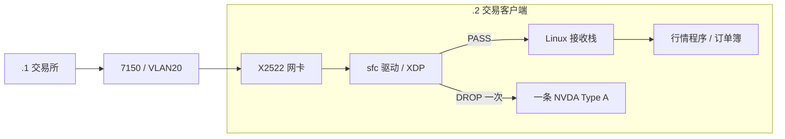
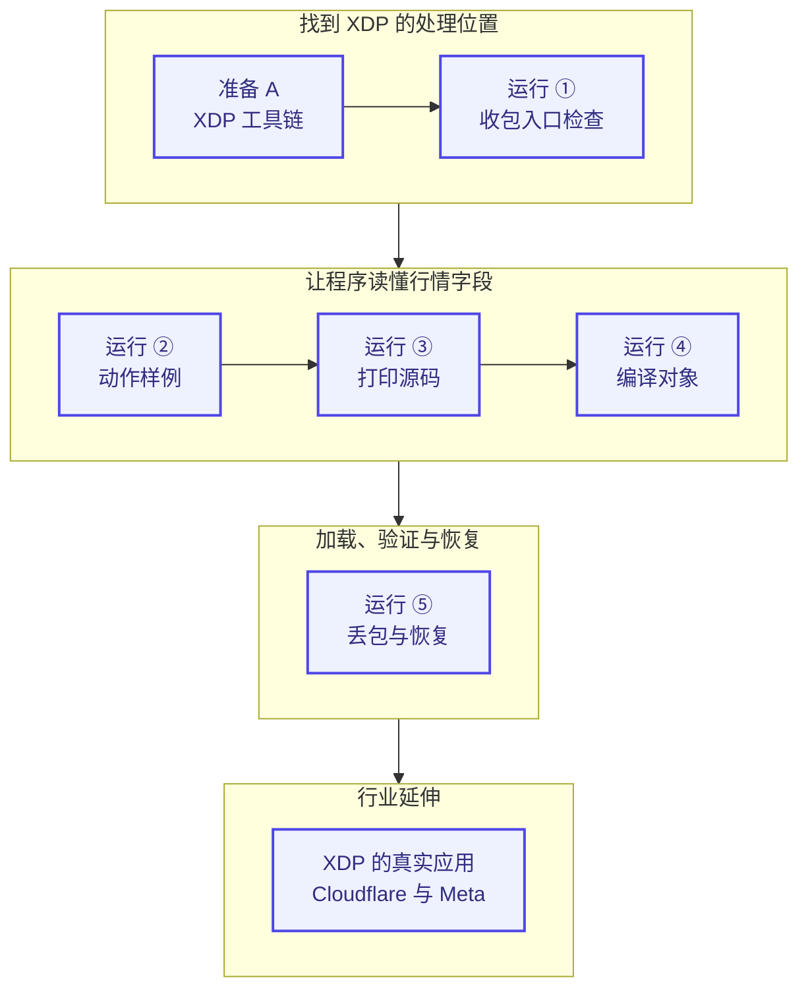

# 第 08 章：eBPF/XDP——在真实交易路径上提前处理

## eBPF 与 XDP 是什么

前一章用队列记录和时间戳解释报文为什么晚到。现在主动制造一次明确的缺失：**在 `.2` 收包入口只丢一条 NVDA 行情，检查接收端能否发现缺口、暂停下单，再恢复。**

[Cilium 项目的 BPF 参考手册](https://docs.cilium.io/en/latest/reference-guides/bpf/index.html)将 BPF 描述为 “a highly flexible and efficient virtual machine-like construct in the Linux kernel”。本课可把 eBPF 理解为经过内核安全审核的小程序，XDP 是收包时调用它的入口；[无需为此修改内核源码](https://ebpf.io/what-is-ebpf/)。

沿用原来的 `.1 → 7150 → .2` 路径。这里的目标是 ITCH Type A（Add Order，新增订单行情）；这条消息来自市场，并不是客户端发出的下单请求。

<div style="border-left:6px solid #7e22ce;background:#f3e8ff;padding:12px 16px;border-radius:8px;margin:14px 0;"><span style="display:inline-block;padding:3px 12px;border-radius:6px;background:#7e22ce;color:#fff;font-weight:800;">关键图</span> <span style="font-weight:700;color:#581c87;">上层是应用，中层是内核，下层是硬件。先看右侧网络列：Syscall（系统调用）是应用请求内核服务的窗口，再经套接字、协议栈到网卡。</span></div>

<div style="background:#f8fafc;border:1px solid #cbd5e1;border-radius:12px;padding:10px;max-width:820px;margin:14px auto;">

</div>

本章把检验员放在客户端自己的收货口：`.2 ens64np1` 的 native XDP。沿用 `.1 ↔ 7150 VLAN20 ↔ .2`，不改交换机接线或 VLAN，也不引入虚拟交换机。过滤规则与后两章相同：只给一条目标 NVDA 行情一次丢弃机会。稍后会展开消息类型、股票编号和股票代码这三个条件，订单连接继续走原路。

只丢一条 NVDA Type A，Trader 的行情接收程序就会发现序号中断、订单簿冻结、AUTO/MANUAL 停单；8088 出现固定红条 <code>FEED GAP</code>。关闭策略不会补回旧序号，必须 Replay Restart。

从第 07 章继续时，保留现有交易进程和网卡驱动，依次刷下面六张绿色卡；无需提前安装后续章节的工具。每张卡在跳板机仓库根目录执行。

## 一张图看懂本章实验环境

<div style="border-left:6px solid #7e22ce;background:#f3e8ff;padding:12px 16px;border-radius:8px;margin:14px 0;"><span style="display:inline-block;padding:3px 12px;border-radius:6px;background:#7e22ce;color:#fff;font-weight:800;">关键图</span> <span style="font-weight:700;color:#581c87;">行情先到 `.2` 的网卡，由驱动中的 XDP 判断，再交给本机行情程序。像在收货口验货：放行才入库，丢弃就不会进入订单簿。</span></div>



这里只改变 `.2` 的行情接收入口。OUCH 下单连接保持原职责；BMv2 到第 09 章才登场。

## 本章导航

<div style="border-left:6px solid #7e22ce;background:#f3e8ff;padding:12px 16px;border-radius:8px;margin:14px 0;"><span style="display:inline-block;padding:3px 12px;border-radius:6px;background:#7e22ce;color:#fff;font-weight:800;">本章导航</span> <span style="font-weight:700;color:#581c87;">本章分 4 部分、7 个导航项；总图看顺序，表格看每一步解决什么问题。</span></div>



固定顺序就是：**找到 XDP 的处理位置 → 让程序读懂行情字段 → 加载、验证与恢复 → 行业延伸**。

## 任务地图

| 导航项 | 所属部分 | 这一项回答什么 |
| --- | --- | --- |
| 准备 A：XDP 工具链 | 找到 XDP 的处理位置 | 编译器、装载器与查看工具各做什么 |
| 运行 ①：收包入口检查 | 找到 XDP 的处理位置 | 核对网卡身份、驱动和程序挂载 |
| 运行 ②：动作样例 | 让程序读懂行情字段 | 把格式、Locate、Stock 与 action 分层 |
| 运行 ③：打印源码 | 让程序读懂行情字段 | 打印代码，对照流程图看规则 |
| 运行 ④：编译对象 | 让程序读懂行情字段 | 把 C 源码编成可装载的 BPF 文件 |
| 运行 ⑤：丢一条行情，核对缺口 | 加载、验证与恢复 | 在实际接收路径丢一条 NVDA 行情，核对缺口 |
| 行业延伸：XDP 的真实应用 | 行业延伸 | 看 Cloudflare 挡攻击、Meta 分配访问流量 |

## 找到 XDP 的处理位置

本部分先分清“程序怎样进入内核”和“每个包怎样调用程序”，再安装工具、确认实验口。

### 准备 A：XDP 工具链

<div style="border:2px solid #4f46e5;background:#eef2ff;padding:10px 12px;border-radius:8px;margin:14px 0;"><div style="font-weight:900;color:#312e81;margin-bottom:4px;">导航卡 · 找到 XDP 的处理位置</div><div style="font-weight:700;color:#312e81;margin-bottom:8px;">范畴：工具准备　本步知识：编译器、装载器与查看工具各做什么　位置：全章第 1 / 7 项 · 本组第 1 / 2 项</div><span style="display:inline-block;margin:3px;padding:4px 10px;border-radius:6px;background:#15803d;color:#fff;font-weight:800;">准备 A：XDP 工具链</span><span style="display:inline-block;margin:3px;padding:4px 10px;border-radius:6px;background:#f8fafc;border:1px solid #a5b4fc;color:#312e81;font-weight:800;">运行 ①：收包入口检查</span></div>

Clang 把 C 源码编成 BPF 指令，装在 ELF 文件里；Loader 负责装载。图中 DMA 是网卡把数据搬到主机内存，NAPI 是驱动批量收包机制。`skb` 的含义见运行 ①。

<div style="border-left:6px solid #7e22ce;background:#f3e8ff;padding:12px 16px;border-radius:8px;margin:14px 0;"><span style="display:inline-block;padding:3px 12px;border-radius:6px;background:#7e22ce;color:#fff;font-weight:800;">关键图</span> <span style="font-weight:700;color:#581c87;">上半是装载流程，下半是 native XDP 的逐包路径。Verifier 与 JIT 不会在每个包到达时重跑。</span></div>

<div style="background:#f8fafc;border:1px solid #cbd5e1;border-radius:12px;padding:10px;max-width:820px;margin:14px auto;">

</div>

装载时先经过 Verifier 审核（运行 ③ 解释），JIT（即时编译）再将 BPF 指令转换成主机 CPU 机器码。本卡只准备编译、装载和查看工具。

<div style="border-left:6px solid #15803d;background:#dcfce7;padding:12px 16px;border-radius:8px;margin:14px 0;"><span style="display:inline-block;padding:3px 12px;border-radius:6px;background:#15803d;color:#fff;font-weight:800;">需要运行 · 准备 A</span> <span style="font-weight:700;color:#14532d;">教师在跳板机执行，前置为第 07 章已交还 `SFC/READY/sfc`、`.2` 管理 SSH 可用；工具齐全时直接复用，缺包时才安装用户态工具；不替换 sfc、不重启网络服务。从 `.111` 已校验的离线缓存分发安装；预期读到 clang、bpftool、iproute2 与 libbpf 版本。可在同一终端反复粘贴，每次独立留证；失败会打印退出码和日志路径。</span></div>

```bash
#!/usr/bin/env bash
(
set -Eeuo pipefail
cd /financial-low-latency
mkdir -p Documents/reports/course-runs
OUT="$(mktemp -d "Documents/reports/course-runs/$(date -u +%Y%m%dT%H%M%SZ)-08-xdp-toolchain-prep-XXXXXX")"
RUN_ID="${OUT##*/}"; mkdir -p "$OUT/raw"
printf 'RUN_ID=%s\n' "$RUN_ID" >"$OUT/run.env"
finish(){ rc=$?; trap - EXIT; printf 'EXIT_CODE=%s\n' "$rc" >>"$OUT/run.env"; (cd "$OUT" && sha256sum raw/result.txt run.env >SHA256SUMS) || rc=1; printf 'exit_code=%s evidence=%s\n' "$rc" "$OUT"; exit "$rc"; }
trap finish EXIT
trap 'printf "本地失败 rc=%s line=%s；日志：%s/raw/result.txt\n" "$?" "$LINENO" "$OUT" >&2' ERR
: >"$OUT/raw/result.txt"
source Documents/newDoc/assets/common/flle-remote.sh
python3 Documents/newDoc/assets/common/install-offline-packages.py 10.1.1.2 xdp 2>&1 | tee -a "$OUT/raw/result.txt"
ssh "${FLLE_SSH_OPTS[@]}" root@10.1.1.2 bash -s <<'REMOTE' 2>&1 | tee -a "$OUT/raw/result.txt"
set -Eeuo pipefail
trap 'rc=$?; printf "远端失败 rc=%s line=%s command=%s\n" "$rc" "$LINENO" "$BASH_COMMAND" >&2' ERR
printf '%s\n' '' 'vm-2522-02 / prepare' '===== 查安装编译与查看工具 =====' '[工具链] 对: 安装过程无错误  证: 准备 clang、LLVM、libbpf 与当前内核配套 bpftool'
printf '%s\n' '' 'vm-2522-02 / verify' '===== 查C 编译器版本 =====' '[clang] 对: Ubuntu clang 14.0.0  证: 把 XDP C 源码编成 BPF 指令的编译器可用' '$ clang --version'; clang --version | sed -n '1,2p'
printf '%s\n' '' 'vm-2522-02 / verify' '===== 查BPF 查看工具版本 =====' '[bpftool] 对: v5.15.193  证: 可查询内核中的 BPF 程序和 map' '$ bpftool version'; bpftool version
printf '%s\n' '' 'vm-2522-02 / verify' '===== 查网络配置工具版本 =====' '[iproute2] 对: iproute2-5.15.0 / libbpf 0.5.0  证: 挂载 XDP 所用的 ip 工具及其 BPF 库版本明确' '$ ip -V'; ip -V
REMOTE
)
```

<div style="border-left:6px solid #7e22ce;background:#f3e8ff;padding:12px 16px;border-radius:8px;margin:14px 0;"><span style="display:inline-block;padding:3px 12px;border-radius:6px;background:#7e22ce;color:#fff;font-weight:800;">仅供展示 · 输出解读</span> <span style="font-weight:700;color:#581c87;">依次读取 clang、bpftool、iproute2 与 libbpf 版本；这里只证明工具入口。</span></div>

本次从 `.111` 缓存完成离线安装；下面摘录安装结束后的版本检查，完整安装日志保存在本 RUN。已安装相同版本时，重复执行会跳过安装。

```text
离线安装完成；全部来自 .111 缓存，公网下载 0 字节。

vm-2522-02 / prepare
===== 查安装编译与查看工具 =====
[工具链] 对: 安装过程无错误  证: 准备 clang、LLVM、libbpf 与当前内核配套 bpftool

vm-2522-02 / verify
===== 查C 编译器版本 =====
[clang] 对: Ubuntu clang 14.0.0  证: 把 XDP C 源码编成 BPF 指令的编译器可用
$ clang --version
Ubuntu clang version 14.0.0-1ubuntu1.1
Target: x86_64-pc-linux-gnu

vm-2522-02 / verify
===== 查BPF 查看工具版本 =====
[bpftool] 对: v5.15.193  证: 可查询内核中的 BPF 程序和 map
$ bpftool version
/usr/lib/linux-tools/5.15.0-164-generic/bpftool v5.15.193
features:

vm-2522-02 / verify
===== 查网络配置工具版本 =====
[iproute2] 对: iproute2-5.15.0 / libbpf 0.5.0  证: 挂载 XDP 所用的 ip 工具及其 BPF 库版本明确
$ ip -V
ip utility, iproute2-5.15.0, libbpf 0.5.0
```

证据：`Documents/reports/course-runs/20260907T151613Z-08-xdp-toolchain-prep-gI3q0t`；`run.env` 保存 `EXIT_CODE=0`，`SHA256SUMS` 覆盖日志和运行态。

<div style="border-left:6px solid #0891b2;background:#cffafe;padding:12px 16px;border-radius:8px;margin:14px 0;"><span style="display:inline-block;padding:3px 12px;border-radius:6px;background:#0891b2;color:#fff;font-weight:800;">关键现象</span> <span style="font-weight:700;color:#164e63;">四个版本入口均可读，工具准备通过。</span></div>

### 运行 ①：收包入口检查

<div style="border:2px solid #4f46e5;background:#eef2ff;padding:10px 12px;border-radius:8px;margin:14px 0;"><div style="font-weight:900;color:#312e81;margin-bottom:4px;">导航卡 · 找到 XDP 的处理位置</div><div style="font-weight:700;color:#312e81;margin-bottom:8px;">范畴：现场只读　本步知识：核对网卡身份、驱动和程序挂载　位置：全章第 2 / 7 项 · 本组第 2 / 2 项</div><span style="display:inline-block;margin:3px;padding:4px 10px;border-radius:6px;background:#f8fafc;border:1px solid #a5b4fc;color:#312e81;font-weight:800;">准备 A：XDP 工具链</span><span style="display:inline-block;margin:3px;padding:4px 10px;border-radius:6px;background:#15803d;color:#fff;font-weight:800;">运行 ①：收包入口检查</span></div>

<div style="border-left:6px solid #7e22ce;background:#f3e8ff;padding:12px 16px;border-radius:8px;margin:14px 0;"><span style="display:inline-block;padding:3px 12px;border-radius:6px;background:#7e22ce;color:#fff;font-weight:800;">关键图</span> <span style="font-weight:700;color:#581c87;">Hook 是事件触发入口：程序先挂好，事件经过时才执行。小蜜蜂表示不同位置的接入能力，不表示每个位置都运行本课程序。</span></div>

<div style="background:#f8fafc;border:1px solid #cbd5e1;border-radius:12px;padding:10px;max-width:820px;margin:14px auto;">

</div>

**正常收包不需要 XDP；没有挂载程序时，走图中最上面的路径。** [`skb`](https://docs.kernel.org/networking/skbuff.html)（socket buffer，结构名 `sk_buff`）记录包长、接收接口和数据位置，供协议栈处理。

<div style="border-left:6px solid #7e22ce;background:#f3e8ff;padding:12px 16px;border-radius:8px;margin:14px 0;"><span style="display:inline-block;padding:3px 12px;border-radius:6px;background:#7e22ce;color:#fff;font-weight:800;">关键图</span> <span style="font-weight:700;color:#581c87;">先看普通收包，再看加了 XDP 后多在哪一步；绿色框是本课选择。</span></div>

<div style="background:#f8fafc;border:1px solid #cbd5e1;border-radius:12px;padding:10px;max-width:820px;margin:14px auto;">

</div>

**Native 在建 `skb` 前过滤，需要驱动支持；Generic 在建 `skb` 后过滤，驱动没有原生入口也能用。** 两者都由主机 CPU 执行，“通用”指适配范围，不代表默认开启。

**本课 `.2` 的 X2522 + OpenOnload `sfc 6.1.0.1009` 支持 Native，不提供 XDP 硬件卸载。** 后者是[固定驱动源码核验](https://github.com/Xilinx-CNS/onload/blob/9f330e7058f6062596f2a7316952c67963a0aac3/src/driver/linux_net/drivers/net/ethernet/sfc/xdp.c#L417-L455)结论；网卡的校验和卸载不等于能运行 XDP 程序。

运行 ⑤ 用 `xdpdrv` 明确选择 Native，结束后卸载并回到普通路径；PASS 继续交给本机行情程序，DROP 就地丢弃。普通 `tcpdump` 看不到 Native 已丢的包，本课用 map 账本与下游序号缺口对证。

**本卡核对接收口和旧挂载：** `.2` 数据口为 `ens64np1 / 20.1.1.2 / sfc`；BDF（PCI 地址）`0000:03:00.0`、MAC 尾号 `af:21` 用来认设备。`ens33` 是管理口。检查发现未知程序会停止，交由教师确认归属。

<div style="border-left:6px solid #15803d;background:#dcfce7;padding:12px 16px;border-radius:8px;margin:14px 0;"><span style="display:inline-block;padding:3px 12px;border-radius:6px;background:#15803d;color:#fff;font-weight:800;">需要运行 · 运行 ①</span> <span style="font-weight:700;color:#14532d;">教师在跳板机执行，前置为准备 A 完成；只读 `.2` 接收口，预计不足 1 分钟。预期 `ens64np1 / 03:00.0 / sfc / UP / 20.1.1.2`，无既有 XDP 或 RTL 适配器。</span></div>

```bash
#!/usr/bin/env bash
set -Eeuo pipefail
cd /financial-low-latency
RUN_ID="$(date -u +%Y%m%dT%H%M%SZ)-08-xdp-readiness"
OUT="Documents/reports/course-runs/$RUN_ID"; mkdir -p "$OUT/raw"
printf 'RUN_ID=%s\n' "$RUN_ID" >"$OUT/run.env"

bash Documents/newDoc/assets/common/check-filter-handoff.sh receiver 2>&1 | tee "$OUT/raw/result.txt"
(cd "$OUT" && sha256sum raw/result.txt run.env >SHA256SUMS)
echo "evidence=$OUT"
```

<div style="border-left:6px solid #7e22ce;background:#f3e8ff;padding:12px 16px;border-radius:8px;margin:14px 0;"><span style="display:inline-block;padding:3px 12px;border-radius:6px;background:#7e22ce;color:#fff;font-weight:800;">仅供展示 · 输出解读</span> <span style="font-weight:700;color:#581c87;">接口和驱动信息用于认口；XDP 看挂载列表，RTL 看进程与控制文件查询，分别判断。</span></div>

历史输出节选（`20260905T111619Z-08-xdp-readiness`，不代表你的本次结果）；“对 / 证”由脚本打印。

```text
===== 查接收口状态与地址 =====
[ens64np1] 对: UP / 原 MAC / 20.1.1.2  证: 接收口身份与地址保持前章状态
$ ip -brief link show dev ens64np1
ens64np1         UP             00:0f:53:d3:af:21 <BROADCAST,MULTICAST,UP,LOWER_UP>
$ ip -brief addr show dev ens64np1
ens64np1         UP             20.1.1.2/24 fe80::20f:53ff:fed3:af21/64

===== 查接收口驱动 =====
[ens64np1] 对: sfc / 0000:03:00.0  证: X2522 仍由前章驱动管理
$ ethtool -i ens64np1
driver: sfc
version: 6.1.0.1009
bus-info: 0000:03:00.0

===== 查 XDP 挂载 =====
[ens64np1] 对: xdp: 段没有程序条目  证: 该接口没有已挂载的 XDP 程序
$ bpftool net show dev ens64np1
xdp:

tc:

flow_dissector:

===== 查 RTL 适配器进程 =====
[RTL] 对: 无匹配行且退出码为 1  证: 未找到本课 mold_filter_adapter 进程
$ pgrep -af '[m]old_filter_adapter'
pgrep exit_code=1

===== 查 RTL 控制文件 =====
[RTL] 对: No such file or directory  证: 本课控制文件不存在
$ ls -ld -- /var/tmp/flle-market-filter.cmd
ls: cannot access '/var/tmp/flle-market-filter.cmd': No such file or directory
```

`xdp:` 到 `tc:` 之间没有程序条目，才是无 XDP 挂载的依据；`pgrep exit_code=1` 是查询状态，表示未找到匹配进程。RTL 检查只覆盖本课进程名与控制文件。

完整输出：`Documents/reports/course-runs/20260905T111619Z-08-xdp-readiness/raw/result.txt`。

<div style="border-left:6px solid #0891b2;background:#cffafe;padding:12px 16px;border-radius:8px;margin:14px 0;"><span style="display:inline-block;padding:3px 12px;border-radius:6px;background:#0891b2;color:#fff;font-weight:800;">关键现象</span> <span style="font-weight:700;color:#164e63;">接口一直保持 sfc、UP 和原 IP；运行 ⑤ 只增加 XDP 挂载，结束时卸掉本次程序，不重绑驱动或关闭数据口。</span></div>

## 让程序读懂行情字段

本部分直接处理 Exchange 当前发送的 `20.1.1.1 → 233.74.125.32:31032`；Session、Sequence Number、Message Count、Message Length、Message Type 和 Stock 都来自真实行情。

### 运行 ②：动作样例

<div style="border:2px solid #4f46e5;background:#eef2ff;padding:10px 12px;border-radius:8px;margin:14px 0;"><div style="font-weight:900;color:#312e81;margin-bottom:4px;">导航卡 · 让程序读懂行情字段</div><div style="font-weight:700;color:#312e81;margin-bottom:8px;">范畴：纸面模型　本步知识：把格式、Locate、Stock 与 action 分层　位置：全章第 3 / 7 项 · 本组第 1 / 3 项</div><span style="display:inline-block;margin:3px;padding:4px 10px;border-radius:6px;background:#15803d;color:#fff;font-weight:800;">运行 ②：动作样例</span><span style="display:inline-block;margin:3px;padding:4px 10px;border-radius:6px;background:#f8fafc;border:1px solid #a5b4fc;color:#312e81;font-weight:800;">运行 ③：打印源码</span><span style="display:inline-block;margin:3px;padding:4px 10px;border-radius:6px;background:#f8fafc;border:1px solid #a5b4fc;color:#312e81;font-weight:800;">运行 ④：编译对象</span></div>

本课只用 PASS 和 DROP：明确命中丢包条件才 DROP，其余 PASS。无法按本课格式解析的包也交回 Linux 继续处理，这叫 **fail-open**；XDP 放行不等于后续协议栈一定接收。

<div style="border-left:6px solid #7e22ce;background:#f3e8ff;padding:12px 16px;border-radius:8px;margin:14px 0;"><span style="display:inline-block;padding:3px 12px;border-radius:6px;background:#7e22ce;color:#fff;font-weight:800;">关键图</span> <span style="font-weight:700;color:#581c87;">图中列出 PASS、DROP、TX、REDIRECT 四种业务出口；另有 XDP_ABORTED 错误动作，本课不主动使用。</span></div>

<div style="background:#f8fafc;border:1px solid #cbd5e1;border-radius:12px;padding:10px;max-width:820px;margin:14px auto;">

</div>

| 动作 | 用一句话理解 |
| --- | --- |
| `XDP_PASS` | 放行，继续交给本机 Linux 协议栈处理。 |
| `XDP_DROP` | 就地丢弃，结束这个包的接收。 |
| `XDP_TX` | 从**收到包的同一接口发出去**；不会自动生成回复。 |
| `XDP_REDIRECT` | 交给**程序指定的目标**：可以从本机另一网卡发出，也可以交给另一 CPU 或 AF_XDP 用户态收包程序。 |
| `XDP_ABORTED` | 异常终止：丢包，并触发内核 XDP 异常跟踪事件，供排错。 |

<a id="xdp-wire-fields"></a>

<div style="border-left:6px solid #7e22ce;background:#f3e8ff;padding:12px 16px;border-radius:8px;margin:14px 0;"><span style="display:inline-block;padding:3px 12px;border-radius:6px;background:#7e22ce;color:#fff;font-weight:800;">关键图</span> <span style="font-weight:700;color:#581c87;">从外到内拆一包行情：UDP 里装 MoldUDP64“信封”，信封里装 ITCH 消息。橙色字段决定筛选目标，底部开关决定是否真的丢包。</span></div>

<div style="background:#f8fafc;border:1px solid #cbd5e1;border-radius:12px;padding:10px;max-width:820px;margin:14px auto;">

</div>

**Stock 才是平时看到的股票代码。** 这里用 ASCII 编码，每个字母、每个空格各占 1 字节；`NVDA` 和 `AAPL` 都是 4 字节，因此右侧各补 4 个空格，填满固定的 8 字节字段。

**Locate 是行情系统用于快速查表的内部编号。** 同一交易日内不变，换一个交易日可能重新分配，并非每天一定变化；每天应从证券目录消息（Type R）取得编号与股票代码的对应关系。本课数据中 `37 ↔ AAPL`、`8095 ↔ NVDA`，换一天的数据不能直接照用。[Nasdaq ITCH 5.0 规范](https://www.nasdaqtrader.com/content/technicalsupport/specifications/dataproducts/NQTVITCHSpecification.pdf)。

**Type 表示发生了什么行情事件**，下面这些都是市场发来的通知：

| Type | 含义 |
| --- | --- |
| `A` | 新增一笔订单，不带市场参与者标识。 |
| `F` | 新增一笔订单，另带市场参与者标识。 |
| `E` | 某笔订单有数量成交。 |
| `D` | 删除某笔订单的全部剩余数量。 |
| `U` | 替换原订单，给出新订单编号、数量和价格。 |

图中展开的是 **A 的布局**；F 多 4 字节参与者标识。D/E/U 有 Locate，但没有明文 Stock 字段。MoldUDP64 的心跳是 `count=0`、没有 ITCH 消息，**HEARTBEAT 不是一个 ITCH Type**。[MoldUDP64 规范](https://nasdaqtrader.com/content/technicalsupport/specifications/dataproducts/moldudp64.pdf)。

**只有一条丢包规则：** 在本课行情流与解析条件内，`Type=A + Locate=8095 + Stock="NVDA    "` 全部匹配，且主机内开关为 BLOCK、额度为 1、未过期，才 DROP 一包。其它包 PASS；价格、数量、买卖方向不参与筛选。这里是按字段决定整包去留，不是修改字段。

**运行 ② 的六行是六组预置教学样例，不是六条策略。** 脚本直接打印预先填写的动作，帮助读懂规则；它没有解析真实报文，也没有验证 C 程序执行结果。

| 预置输入 | 怎样理解 | 预期动作 |
| --- | --- | --- |
| A + Locate 37 + `AAPL    `，长度 36 | 苹果新增订单；不是丢包目标。37 是示例编号，AAPL 放行不依赖它。 | PASS |
| A + Locate 8095 + `NVDA    `，长度 36 | 英伟达新增订单；假定上述开关与额度有效。 | DROP |
| F + Locate 8095 + `NVDA    `，长度 40 | 也是英伟达，但事件类型不属于本课目标。 | PASS |
| D，长度 19 | 删除订单；E/U 等其它类型也放行。 | PASS |
| HEARTBEAT，count=0 | 只有信封头，没有行情消息。 | PASS |
| A + Locate 8095 + `NVDA    `，长度 20 | 声明长度不是 36，按非目标格式放行。 | PASS |

<div style="border-left:6px solid #15803d;background:#dcfce7;padding:12px 16px;border-radius:8px;margin:14px 0;"><span style="display:inline-block;padding:3px 12px;border-radius:6px;background:#15803d;color:#fff;font-weight:800;">需要运行 · 运行 ②</span> <span style="font-weight:700;color:#14532d;">在跳板机仓库根目录以有仓库写权限的用户运行，需本机 Python 3；不访问设备，预计数秒。预期打印六行样例：仅目标 Type A 为 DROP，其余 PASS。</span></div>

```bash
#!/usr/bin/env bash
set -Eeuo pipefail
cd /financial-low-latency
RUN_ID="$(date -u +%Y%m%dT%H%M%SZ)-08-xdp-actions"
OUT="Documents/reports/course-runs/$RUN_ID"; mkdir -p "$OUT/raw"
printf 'RUN_ID=%s\n' "$RUN_ID" >"$OUT/run.env"

printf '%s\n' '' '跳板机 / action-model' '===== 查六类输入的动作 =====' '[Action] 对: 仅目标 Type A 为 DROP，其余 PASS  证: 区分格式判断、证券条件与最终 action' '$ python3 - < Documents/newDoc/assets/08-xdp/xdp_action_model.py' \
  | tee "$OUT/raw/result.txt"
python3 - < Documents/newDoc/assets/08-xdp/xdp_action_model.py \
  2>&1 | tee -a "$OUT/raw/result.txt"
(cd "$OUT" && sha256sum raw/result.txt run.env >SHA256SUMS)
echo "evidence=$OUT"
```

<div style="border-left:6px solid #7e22ce;background:#f3e8ff;padding:12px 16px;border-radius:8px;margin:14px 0;"><span style="display:inline-block;padding:3px 12px;border-radius:6px;background:#7e22ce;color:#fff;font-weight:800;">仅供展示 · 输出解读</span> <span style="font-weight:700;color:#581c87;">type 是事件、locate 是证券编号、stock 是股票代码；count 是消息条数、length 是消息字节数。action 与 COUNT_* 都是预填的预期标签，不是现场动作或 map 读数。</span></div>

本轮本地输出（`20260905T112542Z-08-xdp-actions`，仅打印样例）：

```text
跳板机 / action-model
===== 查六类输入的动作 =====
[Action] 对: 仅目标 Type A 为 DROP，其余 PASS  证: 区分格式判断、证券条件与最终 action
$ python3 - < Documents/newDoc/assets/08-xdp/xdp_action_model.py
type=A         locate=37    stock=AAPL     count=1 length=36 action=COUNT_AAPL+XDP_PASS
type=A         locate=8095  stock=NVDA     count=1 length=36 action=COUNT_NVDA+XDP_DROP
type=F         locate=8095  stock=NVDA     count=1 length=40 action=COUNT_OTHER_ITCH+XDP_PASS
type=D         locate=0     stock=-        count=1 length=19 action=COUNT_OTHER_ITCH+XDP_PASS
type=HEARTBEAT locate=0     stock=-        count=0 length=0  action=COUNT_HEARTBEAT+XDP_PASS
type=A         locate=8095  stock=NVDA     count=1 length=20 action=COUNT_OTHER_ITCH+XDP_PASS
```

`D locate=0 stock=-` 是省略字段的占位样例；`HEARTBEAT` 是脚本的心跳名称，都不能照作真实 ITCH 字段。

本地记录：`Documents/reports/course-runs/20260905T112542Z-08-xdp-actions/raw/result.txt`。

<div style="border-left:6px solid #0891b2;background:#cffafe;padding:12px 16px;border-radius:8px;margin:14px 0;"><span style="display:inline-block;padding:3px 12px;border-radius:6px;background:#0891b2;color:#fff;font-weight:800;">关键现象</span> <span style="font-weight:700;color:#164e63;">六组样例只有目标 Type A 预期 DROP，其余 PASS；这一步没有执行真实过滤。</span></div>

### 运行 ③：打印源码：对照检查与过滤规则

<div style="border:2px solid #4f46e5;background:#eef2ff;padding:10px 12px;border-radius:8px;margin:14px 0;"><div style="font-weight:900;color:#312e81;margin-bottom:4px;">导航卡 · 让程序读懂行情字段</div>
<div style="font-weight:700;color:#312e81;margin-bottom:8px;">范畴：源码展示　本步知识：打印代码，对照流程图看规则　位置：全章第 4 / 7 项 · 本组第 2 / 3 项</div><span style="display:inline-block;margin:3px;padding:4px 10px;border-radius:6px;background:#f8fafc;border:1px solid #a5b4fc;color:#312e81;font-weight:800;">运行 ②：动作样例</span><span style="display:inline-block;margin:3px;padding:4px 10px;border-radius:6px;background:#15803d;color:#fff;font-weight:800;">运行 ③：打印源码</span><span style="display:inline-block;margin:3px;padding:4px 10px;border-radius:6px;background:#f8fafc;border:1px solid #a5b4fc;color:#312e81;font-weight:800;">运行 ④：编译对象</span></div>

控制程序要把规则交给 XDP，XDP 也要留下处理结果。Linux 把这张放在内核里的共享表叫 [BPF map](https://docs.kernel.org/bpf/maps.html)：它 “provide generic storage of different types for sharing data between kernel and user space”。

<div style="border-left:6px solid #7e22ce;background:#f3e8ff;padding:12px 16px;border-radius:8px;margin:14px 0;"><span style="display:inline-block;padding:3px 12px;border-radius:6px;background:#7e22ce;color:#fff;font-weight:800;">关键图</span> <span style="font-weight:700;color:#581c87;">map 是内核里的一张共享表。控制程序先把今天的规则写进去；XDP 程序每个包都来查这张表，按表里的内容处理，再把结果记回去。</span></div>

<div style="background:#f8fafc;border:1px solid #cbd5e1;border-radius:12px;padding:10px;max-width:820px;margin:14px auto;">

</div>

表里每一格都有名字和当前内容。本课启用丢包时写入「丢掉 1 条 NVDA 加单」，账本从「已经丢掉 0 条」开始；检验员丢掉一条后，账本变成 1 条。实际分三张表：`policy` 管规则和剩余额度，`drop_audit` 记丢了哪条，`counters` 记各 CPU 的数量；运行 ⑤ 再展开。刚挂载时额度为 0，先全部放行。

**Verifier 是 Linux 自带的程序安全审核器，加载 eBPF 时必须通过。** 它检查内存访问等安全条件；逐包读哪些字段、匹配什么股票，由我们写的程序决定。[内核说明](https://docs.kernel.org/bpf/verifier.html)。

<div style="border-left:6px solid #7e22ce;background:#f3e8ff;padding:12px 16px;border-radius:8px;margin:14px 0;"><span style="display:inline-block;padding:3px 12px;border-radius:6px;background:#7e22ce;color:#fff;font-weight:800;">关键图</span> <span style="font-weight:700;color:#581c87;">上半图审核程序，下半图逐包判断。先读框里的中文，再对照 C 条件和箭头：装载审核不过，程序装不上；收包条件不满足，本课选择 PASS。</span></div>

<div style="background:#f8fafc;border:1px solid #cbd5e1;border-radius:12px;padding:10px;max-width:820px;margin:14px auto;">

</div>

`data_end` 是可读区域末尾之后的位置。消息声明 36 字节、缓冲区却只剩 20 字节时，程序停止读取并 PASS；字节足够才继续比较[报文字段](#xdp-wire-fields)。

**本步只打印源码，对照图看检查与过滤规则，不执行过滤。** 重点看下面第 140～147 行：声明长度必须为 36，内存中也必须有完整的 36 字节。

<div style="border-left:6px solid #15803d;background:#dcfce7;padding:12px 16px;border-radius:8px;margin:14px 0;"><span style="display:inline-block;padding:3px 12px;border-radius:6px;background:#15803d;color:#fff;font-weight:800;">需要运行 · 运行 ③</span> <span style="font-weight:700;color:#14532d;">在跳板机仓库根目录运行，需有仓库写权限，预计数秒。预期打印带行号的 C 源码，让你看看有哪些检查和过滤规则；同时保存输出和文件指纹。只打印，不执行过滤。</span></div>

```bash
#!/usr/bin/env bash
set -Eeuo pipefail
cd /financial-low-latency
RUN_ID="$(date -u +%Y%m%dT%H%M%SZ)-08-xdp-bounds"
OUT="Documents/reports/course-runs/$RUN_ID"; mkdir -p "$OUT/raw"
printf 'RUN_ID=%s\n' "$RUN_ID" >"$OUT/run.env"
SOURCE="Documents/newDoc/assets/08-xdp/flle_xdp_mold_itch.c"
{
  printf '%s\n' '' '跳板机 / source-review' '===== 查源码指纹 =====' '[SHA-256] 对: 与本轮使用的源码一致  证: 后续审查针对同一份 C 文件'; printf '$ sha256sum %s\n' "$SOURCE"; sha256sum "$SOURCE"
  printf '%s\n' '' '跳板机 / source-review' '===== 查带行号的访问边界 =====' '[Parser] 对: 先证明 data_end 边界，再读取字段  证: 可以定位每次解引用前的检查'; printf '$ nl -ba %s\n' "$SOURCE"; nl -ba "$SOURCE"
} 2>&1 | tee "$OUT/raw/result.txt"
(cd "$OUT" && sha256sum raw/result.txt run.env >SHA256SUMS)
echo "evidence=$OUT"
```

<div style="border-left:6px solid #7e22ce;background:#f3e8ff;padding:12px 16px;border-radius:8px;margin:14px 0;"><span style="display:inline-block;padding:3px 12px;border-radius:6px;background:#7e22ce;color:#fff;font-weight:800;">仅供展示 · 输出解读</span> <span style="font-weight:700;color:#581c87;">`ITCH_ADD_LEN` 是 36，`end` 对应 `data_end`。第 140 行检查声明长度，第 144 行检查整条消息是否可读；检查通过后才读字段。</span></div>

本轮本地输出节选（`20260905T112542Z-08-xdp-bounds`，仅打印源码）：

```text
跳板机 / source-review
===== 查源码指纹 =====
[SHA-256] 对: 与本轮使用的源码一致  证: 后续审查针对同一份 C 文件
$ sha256sum Documents/newDoc/assets/08-xdp/flle_xdp_mold_itch.c
7780bccc8c4b24511d43e0455983ed6007e4bed1eb353458b4f6865dd7f54cd4  Documents/newDoc/assets/08-xdp/flle_xdp_mold_itch.c

跳板机 / source-review
===== 查带行号的访问边界 =====
[Parser] 对: 先证明 data_end 边界，再读取字段  证: 可以定位每次解引用前的检查
$ nl -ba Documents/newDoc/assets/08-xdp/flle_xdp_mold_itch.c
   140	    if (message_length != ITCH_ADD_LEN) {
   141	        count(OTHER_ITCH);
   142	        return XDP_PASS;
   143	    }
   144	    if ((void *)(itch + ITCH_ADD_LEN) > end) {
   145	        count(SHORT_INPUT);
   146	        return XDP_PASS;
   147	    }
```

本地记录：`Documents/reports/course-runs/20260905T112542Z-08-xdp-bounds/raw/result.txt`。

<div style="border-left:6px solid #0891b2;background:#cffafe;padding:12px 16px;border-radius:8px;margin:14px 0;"><span style="display:inline-block;padding:3px 12px;border-radius:6px;background:#0891b2;color:#fff;font-weight:800;">关键现象</span> <span style="font-weight:700;color:#164e63;">声明长度不合要求，或实际字节不足，本课都 PASS；通过整条消息的边界检查后，才继续匹配 Type、Locate 和 Stock。</span></div>

### 运行 ④：编译对象

<div style="border:2px solid #4f46e5;background:#eef2ff;padding:10px 12px;border-radius:8px;margin:14px 0;"><div style="font-weight:900;color:#312e81;margin-bottom:4px;">导航卡 · 让程序读懂行情字段</div><div style="font-weight:700;color:#312e81;margin-bottom:8px;">范畴：工具准备　本步知识：把 C 源码编成可装载的 BPF 文件　位置：全章第 5 / 7 项 · 本组第 3 / 3 项</div><span style="display:inline-block;margin:3px;padding:4px 10px;border-radius:6px;background:#f8fafc;border:1px solid #a5b4fc;color:#312e81;font-weight:800;">运行 ②：动作样例</span><span style="display:inline-block;margin:3px;padding:4px 10px;border-radius:6px;background:#f8fafc;border:1px solid #a5b4fc;color:#312e81;font-weight:800;">运行 ③：打印源码</span><span style="display:inline-block;margin:3px;padding:4px 10px;border-radius:6px;background:#15803d;color:#fff;font-weight:800;">运行 ④：编译对象</span></div>

ELF 是装编译结果的文件；其中 `xdp` 段装指令，`.maps` 描述共享表，BTF 保存类型信息。本卡用 `llvm-objdump` 查看这些分区，再用 SHA 记录文件指纹。

<div style="border-left:6px solid #15803d;background:#dcfce7;padding:12px 16px;border-radius:8px;margin:14px 0;"><span style="display:inline-block;padding:3px 12px;border-radius:6px;background:#15803d;color:#fff;font-weight:800;">需要运行 · 运行 ④</span> <span style="font-weight:700;color:#14532d;">教师在跳板机执行，需准备 A 与 `.2` SSH 就绪；仅远端临时编译后取回并清理，不挂载程序。预计不足 3 分钟；预期获得 BPF object、xdp/maps/BTF 分区及 SHA。</span></div>

```bash
#!/usr/bin/env bash
set -Eeuo pipefail
cd /financial-low-latency
source Documents/newDoc/assets/common/flle-remote.sh
RUN_ID="$(date -u +%Y%m%dT%H%M%SZ)-08-xdp-build"
OUT="Documents/reports/course-runs/$RUN_ID"; REMOTE="/var/tmp/$RUN_ID"
SOURCE=Documents/newDoc/assets/08-xdp/flle_xdp_mold_itch.c
SOURCE_SHA="$(sha256sum "$SOURCE" | awk '{print $1}')"
mkdir -p "$OUT/raw" "$OUT/artifacts"; printf 'RUN_ID=%s\n' "$RUN_ID" >"$OUT/run.env"
printf 'SOURCE_SHA256=%s\n' "$SOURCE_SHA" >>"$OUT/run.env"
cleanup(){ ssh -n "${FLLE_SSH_OPTS[@]}" root@10.1.1.2 "find '$REMOTE' -type f -delete 2>/dev/null; rmdir '$REMOTE' 2>/dev/null || true"; }
trap cleanup EXIT
ssh -n "${FLLE_SSH_OPTS[@]}" root@10.1.1.2 "mkdir '$REMOTE'"
scp -q "${FLLE_SSH_OPTS[@]}" "$SOURCE" root@10.1.1.2:"$REMOTE/"
ssh -n "${FLLE_SSH_OPTS[@]}" root@10.1.1.2 "set -Eeuo pipefail; cd '$REMOTE'; test \"\$(sha256sum flle_xdp_mold_itch.c | cut -d' ' -f1)\" = '$SOURCE_SHA'; printf '%s\\n' '' 'vm-2522-02 / build' '===== 查编译 BPF 对象 =====' '[clang] 对: 生成 flle_xdp_mold_itch.o  证: -target bpf 选择 BPF 指令，-O2 优化，-g 保留类型与调试信息' '\$ clang -O2 -g -target bpf ... -c flle_xdp_mold_itch.c -o flle_xdp_mold_itch.o'; clang -O2 -g -fdebug-prefix-map='$REMOTE'=/flle/ch08 -target bpf -D__TARGET_ARCH_x86 -I/usr/include/x86_64-linux-gnu -c flle_xdp_mold_itch.c -o flle_xdp_mold_itch.o; printf '%s\\n' '' 'vm-2522-02 / build' '===== 查ELF 分区 =====' '[ELF] 对: elf64-bpf，并有 xdp / .maps / .BTF  证: 目标指令、程序段、共享表和类型信息都在对象中' '\$ llvm-objdump -h flle_xdp_mold_itch.o'; llvm-objdump -h flle_xdp_mold_itch.o; printf '%s\\n' '' 'vm-2522-02 / build' '===== 查源码与对象指纹 =====' '[SHA-256] 对: 两份文件各有完整指纹  证: 把后续加载对象与本次编译对应起来' '\$ sha256sum flle_xdp_mold_itch.*'; sha256sum flle_xdp_mold_itch.*" 2>&1 | tee "$OUT/raw/build.txt"
scp -q "${FLLE_SSH_OPTS[@]}" root@10.1.1.2:"$REMOTE/flle_xdp_mold_itch.o" "$OUT/artifacts/"
printf 'OBJECT_SHA256=%s\n' "$(sha256sum "$OUT/artifacts/flle_xdp_mold_itch.o" | awk '{print $1}')" >>"$OUT/run.env"
(cd "$OUT" && sha256sum raw/build.txt artifacts/flle_xdp_mold_itch.o run.env >SHA256SUMS)
printf 'evidence=%s\n' "$OUT"
```

<div style="border-left:6px solid #7e22ce;background:#f3e8ff;padding:12px 16px;border-radius:8px;margin:14px 0;"><span style="display:inline-block;padding:3px 12px;border-radius:6px;background:#7e22ce;color:#fff;font-weight:800;">仅供展示 · 输出解读</span> <span style="font-weight:700;color:#581c87;">看目标是否为 elf64-bpf、所需分区是否齐全，再记录源码与对象指纹。</span></div>

历史输出节选（`20260905T111620Z-08-xdp-build`，不代表你的本次结果）：

```text
vm-2522-02 / build
===== 查ELF 分区 =====
[ELF] 对: elf64-bpf，并有 xdp / .maps / .BTF  证: 目标指令、程序段、共享表和类型信息都在对象中
$ llvm-objdump -h flle_xdp_mold_itch.o
flle_xdp_mold_itch.o:	file format elf64-bpf
  3 xdp                    00000980 0000000000000000 TEXT
  5 .maps                  00000060 0000000000000000 DATA
 16 .BTF                   0000050d 0000000000000000

vm-2522-02 / build
===== 查源码与对象指纹 =====
[SHA-256] 对: 两份文件各有完整指纹  证: 把后续加载对象与本次编译对应起来
$ sha256sum flle_xdp_mold_itch.*
7780bccc8c4b24511d43e0455983ed6007e4bed1eb353458b4f6865dd7f54cd4  flle_xdp_mold_itch.c
f374913b23e93c3ad505b2aaaf233194318d73514fa5735678385068e5f5e09d  flle_xdp_mold_itch.o
```

历史证据：`Documents/reports/course-runs/20260905T111620Z-08-xdp-build/raw/build.txt`。

<div style="border-left:6px solid #0891b2;background:#cffafe;padding:12px 16px;border-radius:8px;margin:14px 0;"><span style="display:inline-block;padding:3px 12px;border-radius:6px;background:#0891b2;color:#fff;font-weight:800;">关键现象</span> <span style="font-weight:700;color:#164e63;">编译通过不等于能挂载；运行 ⑤ 才验证内核审核与 Native XDP 挂载。</span></div>

运行 ⑤ 会自行校验源码并重新编译；④ 是独立的编译观察步骤。这里与运行 ⑤ 所引历史 RUN 的对象 SHA 均为 `f374913b…e09d`。

## 加载、验证与恢复

### 运行 ⑤：丢一条行情，核对缺口

<div style="border:2px solid #4f46e5;background:#eef2ff;padding:10px 12px;border-radius:8px;margin:14px 0;"><div style="font-weight:900;color:#312e81;margin-bottom:4px;">导航卡 · 加载、验证与恢复</div><div style="font-weight:700;color:#312e81;margin-bottom:8px;">范畴：教师维护窗　本步知识：在实际接收路径丢一条 NVDA 行情，核对缺口　位置：全章第 6 / 7 项 · 本组第 1 / 1 项</div><span style="display:inline-block;margin:3px;padding:4px 10px;border-radius:6px;background:#15803d;color:#fff;font-weight:800;">运行 ⑤：丢一条行情，核对缺口</span></div>

**这一步真正加载并运行过滤程序。** 脚本在 `.2 ens64np1` 挂载 native XDP：先确认全部放行时行情正常，再丢一个目标 NVDA 包，最后自动卸载、重放行情并恢复交易。丢包额度由所有 CPU 共用，用掉一次后，其它包继续放行。

<div style="border-left:6px solid #7e22ce;background:#f3e8ff;padding:12px 16px;border-radius:8px;margin:14px 0;"><span style="display:inline-block;padding:3px 12px;border-radius:6px;background:#7e22ce;color:#fff;font-weight:800;">关键图</span> <span style="font-weight:700;color:#581c87;">左边是脚本步骤，右边是对应输出。重点看第 5 步：XDP 丢包序号与行情缺口是否相同。</span></div>

<div style="background:#f8fafc;border:1px solid #cbd5e1;border-radius:12px;padding:10px;max-width:820px;margin:14px auto;">

</div>

<div style="border-left:6px solid #15803d;background:#dcfce7;padding:12px 16px;border-radius:8px;margin:14px 0;"><span style="display:inline-block;padding:3px 12px;border-radius:6px;background:#15803d;color:#fff;font-weight:800;">需要运行 · 运行 ⑤</span> <span style="font-weight:700;color:#14532d;">教师在跳板机仓库根目录执行，先完成准备 A 与运行 ①，且不要同时运行第 09/10 章过滤实验。预计约 1 分钟；预期只丢一包、出现行情缺口，最后恢复健康。</span></div>

```bash
bash Documents/newDoc/assets/08-xdp/05-xdp-inline-live.sh
```

<div style="border-left:6px solid #7e22ce;background:#f3e8ff;padding:12px 16px;border-radius:8px;margin:14px 0;"><span style="display:inline-block;padding:3px 12px;border-radius:6px;background:#7e22ce;color:#fff;font-weight:800;">仅供展示 · 输出解读</span> <span style="font-weight:700;color:#581c87;">重点看三件事：丢包数为 1、缺口与被丢序号对上、最后恢复 HEALTHY。</span></div>

**按上图①～⑦逐段看输出。** 以下来自同一次[历史运行](../reports/course-runs/20260905T084150Z-08-xdp-receiver-live/)：保留关键行，JSON 只摘相关字段；历史序号仅为示例，本次以实际输出为准。`#` 是教材注释。标为“文件记录”的内容，当前脚本只存文件，不直接打印。

**① 预检、编译｜文件记录 `raw/handoff-before.txt`**

```text
# 先核对接收端设备；编译成功没有单独的成功提示，通过后才继续挂载。
trading_profile=SFC/READY/sfc
bus-info: 0000:03:00.0
```

这里两行只说明设备身份；完整预检结果保存在该文件中，不能仅凭这两行判断有无旧挂载。

**② 挂载 XDP｜终端打印，并保存 `raw/xdp-link-attached.txt`**

```text
===== 查XDP 挂载身份 =====
# ens64np1 上出现 xdp 和 prog/xdp：程序已经挂上；此时还没有证明丢包。
154: ens64np1: <BROADCAST,MULTICAST,UP,LOWER_UP> mtu 1500 xdp qdisc mq state UP mode DEFAULT group default qlen 1000
    prog/xdp id 794 tag 2825c80b3631830d jited
```

**③ 先全部放行｜终端打印，并保存 `raw/feed-baseline.json`**

```text
===== 查行情放行基线 =====
# HEALTHY = 行情完整；OPEN = 允许交易。先确认不丢包时正常。
{"feed":{"gap_size":0,"integrity":"HEALTHY","trading_gate":"OPEN"}}
```

**④ 开放一次丢包额度｜文件记录 `raw/policy-block.txt`**

```text
# block = 启用目标规则；remaining=1 = 最多丢一包；5 秒后策略失效。
policy_id=7 mode=block remaining=1 ttl_seconds=5.0
```

这只证明策略已设置；**到底丢没丢，要看下一步。**

**⑤ 看缺口、拒单，再对上丢包序号｜以下各段均在终端打印**

```text
===== 查行情缺口 =====
# raw/feed-gap.json：已收到 755，正在等 756，却先收到了 757；缺 1 条。
{"feed":{"last_delivered":755,"next_expected":756,"first_pending":757,"gap_size":1,"integrity":"GAP","trading_gate":"INHIBITED_FEED_GAP"}}

===== 查缺口期间拒单 =====
# raw/order-gate.json：行情不完整，订单被拒绝，保护生效。
{"http_status":400,"error":"FEED_NOT_HEALTHY"}

===== 查界面与 GAP 状态合同 =====
# raw/gui-gap-contract.json：自动检查页面提示和禁用条件通过；不是浏览器截图。
{"result":"PASS","live_feed_integrity":"GAP","banner_dom":true,"book_gray_css":true,"manual_order_disabled":true,"transport_orders_disabled":true}

===== 查被丢序号与 Feed 对账 =====
# raw/drop-proof.txt：XDP 丢了 1 包，序号 756；正好等于上面接收端等待的 756。
xdp_drop_packets=1 sequence=756 locate=8095
```

**`sequence` 与 `next_expected` 相等，说明丢包记录与缺口对上；`FEED_NOT_HEALTHY` 说明交易保护生效。**

**⑥ 关闭丢包、重放行情｜策略存文件，行情结果在终端打印**

```text
# raw/policy-allow.txt（仅文件）：恢复放行，剩余额度为 0。
policy_id=7 mode=allow remaining=0 ttl_seconds=0

===== 查撤销策略后重放 =====
# raw/feed-recovered-inline.json：XDP 还挂着，但已放行；重放后行情完整、交易开放。
{"feed":{"gap_size":0,"integrity":"HEALTHY","trading_gate":"OPEN"}}
```

**⑦ 卸载、恢复原模式，确认交易恢复｜卸载存文件，其余在终端打印**

```text
# raw/cleanup.txt（仅文件）：卸载本次挂载的 XDP。
owned_xdp=detached

===== 查清理后的行情 =====
# raw/feed-final.json：历史这次恢复原来的 UNICAST 模式，行情健康。
{"market_mode":"UNICAST","feed":{"gap_size":0,"integrity":"HEALTHY","trading_gate":"OPEN"}}

===== 查恢复后两笔订单 =====
# raw/post-restore-orders.json：一卖一买均成交，AAPL 持仓恢复到原来的 0。
{"result":"PASS","orders":[{"side":"SELL","result":"ORDER_EXECUTED"},{"side":"BUY","result":"ORDER_EXECUTED"}],"position_AAPL":[0,0]}
```

脚本最后还会检查是否有残留，记录在 `raw/handoff-after.txt`；**全部检查通过才打印 `result=PASS`**。本次完整记录在终端最后的 `evidence=` 路径，包含上述所有 `raw/` 文件。

若脚本报错，先停在本章；教师按[维护与恢复说明](assets/07-xdp/TEACHER-LIVE-NOTES.md)处理。完整编排仍在 `assets/08-xdp/live-support/run-xdp-receiver-live.sh`（115 行），正常操作只需上面一条命令。

## 行业延伸：XDP 的真实应用

<div style="border:2px solid #4f46e5;background:#eef2ff;padding:10px 12px;border-radius:8px;margin:14px 0;"><div style="font-weight:900;color:#312e81;margin-bottom:4px;">导航卡 · 行业延伸</div><div style="font-weight:700;color:#312e81;margin-bottom:8px;">范畴：行业旁支　本步知识：看 Cloudflare 挡攻击、Meta 分配访问流量　位置：全章第 7 / 7 项 · 本组第 1 / 1 项</div><span style="display:inline-block;margin:3px;padding:4px 10px;border-radius:6px;background:#15803d;color:#fff;font-weight:800;">行业延伸：XDP 的真实应用</span></div>

**Cloudflare 用它挡攻击，Meta 用它做负载均衡。** 下面直接看“遇到什么问题 → XDP 怎么处理 → 业务得到什么”。

<div style="border-left:6px solid #7e22ce;background:#f3e8ff;padding:12px 16px;border-radius:8px;margin:14px 0;"><span style="display:inline-block;padding:3px 12px;border-radius:6px;background:#7e22ce;color:#fff;font-weight:800;">关键图</span> <span style="font-weight:700;color:#581c87;">上半图：L4Drop 尽早丢弃命中攻击规则的包，减轻后续处理负担。下半图：Katran 为访问连接选择后端服务器，再把包转过去。</span></div>

<div style="background:#f8fafc;border:1px solid #cbd5e1;border-radius:12px;padding:10px;max-width:820px;margin:14px auto;">

</div>

图据 [Cloudflare L4Drop（2018）](https://blog.cloudflare.com/l4drop-xdp-ebpf-based-ddos-mitigations/)、[Cloudflare 边缘防护流程（2021）](https://blog.cloudflare.com/deep-dive-cloudflare-autonomous-edge-ddos-protection/)和 [Meta Katran（2018）](https://engineering.fb.com/2018/05/22/open-source/open-sourcing-katran-a-scalable-network-load-balancer/)的公开案例简化，仅画入站方向。

**本课练的是按字段 PASS/DROP：故意丢一条行情，检验缺口检测与交易保护。** 图中两个案例属于 XDP 应用；AF_XDP 收包接口另见[补充图](images/course-visuals/07-diagrams/07-af-xdp-explained.png)。

### 把第 08–10 章放到同一张图上

<div style="border-left:6px solid #7e22ce;background:#f3e8ff;padding:12px 16px;border-radius:8px;margin:14px 0;"><span style="display:inline-block;padding:3px 12px;border-radius:6px;background:#7e22ce;color:#fff;font-weight:800;">关键图</span> <span style="font-weight:700;color:#581c87;">这三章实验使用同一条规则；真机方案改变执行位置、交付物和管理入口。下面按位置比较，不给未测的性能排名。</span></div>

<div style="background:#f8fafc;border:1px solid #cbd5e1;border-radius:12px;padding:10px;max-width:820px;margin:14px auto;">

</div>

| 同一问题 | 第 08 章 XDP | 第 09 章 P4 / 7130 FPGA | 第 10 章 RTL / FPGA 网卡 |
| --- | --- | --- | --- |
| 写什么 | CPU 执行的过滤程序 | P4 处理规则；真机分支用 FDK/RTL 实现 | 比较器、寄存器与接口电路 |
| 先证明什么 | 安全装载与 native 命中 | target 的解析/表行为；真机再验端口映射 | 周期行为；真卡再验时序与 DMA |
| 主要工程成本 | 每包 CPU、共享状态 | target 资源限制、交换路径与回退 | 板级约束、缓存、时钟域、驱动 |

[第 09 章真机路线](08-p4-programmable-data-plane.md#arista-fpga-hardware)逐步讲“换成 7130 如何接管原帧”；[第 10 章真卡路线](09-verilator-fpga-smartnic-simulation.md#fpga-nic-hardware)逐步讲“如何生成、装载和验收板卡镜像”。

## 理解检查

1. 本课 XDP 在哪执行，需要桥吗？
2. 为什么先检查字节，再匹配股票？
3. 六组样例是六条策略吗，Type F 会丢吗？
4. 多 CPU 怎样保证只丢一次？
5. 怎样证明规则生效？
6. 为什么关闭策略后还要 Replay Restart？
7. 真实世界用来做什么？

### 参考答案

1. `.2` 驱动收包入口、主机 CPU；PASS 交给本机行情程序，无需桥。
2. 先保证读取不越界，才能比较 Type、Locate、Stock。
3. 只有一条目标 Type A 规则；F 和其余未命中包 PASS。
4. 共用一个额度，原子操作把 1 改成 0，只有一个 CPU 能成功；per-CPU 计数读出后要相加。
5. 先确认放行健康，再核对丢包数为 1、两侧序号一致、GAP 触发拒单。
6. 放行不会补回旧包；重放新 Session 重建订单簿，再验证健康与成交。
7. Cloudflare 提前过滤攻击包；Meta Katran 把访问连接分配给后端。

## 清理、回滚与交接

脚本成功结束后，`.2` 应保持 `sfc / UP / 20.1.1.2`，本次 XDP 已卸载；行情接收程序恢复直接收包且健康，交易系统恢复正常。下一章把同一条规则移到两端之间的软件交换机，比较程序怎样接到另一种报文处理位置；教师的跨章状态核对见[维护说明](assets/07-xdp/TEACHER-LIVE-NOTES.md)。

## 本地配套资产

| 文件 | 用途 |
| --- | --- |
| `assets/08-xdp/00-xdp-toolchain-prep.sh` | 安装并记录 Clang/bpftool/libbpf |
| `01-xdp-hook-readiness.sh` | `.2` 的 BDF、driver、IP 与 hook 基线 |
| `02-xdp-action-model.sh`、`xdp_action_model.py` | 六组预填动作样例；不执行 C parser |
| `03-xdp-parser-bounds.sh` | 打印 C 源码，查看检查和过滤规则；不执行过滤 |
| `04-xdp-build.sh` | 编译并取回 BPF ELF，不 attach |
| `flle_xdp_mold_itch.c` | 现役 MoldUDP64/ITCH XDP 程序 |
| `05-xdp-inline-live.sh` | 学生可见的教师维护短入口 |
| `live-support/run-xdp-receiver-live.sh` | `.2` 原生 XDP、前置门、取证与恢复 |
| `live-support/xdp-session.py` | 按接口/program ID 管理本次挂载、map 和远端看门狗 |
| `live-support/set-xdp-policy.py` | 清审计后把 `policy` map 写成 allow / block |

教师恢复与[历史资产清单](assets/07-xdp/TEACHER-LIVE-NOTES.md#retired-assets)见 `TEACHER-LIVE-NOTES.md`。本地回归为 `test-toolchain-repeat.py` 和 `live-support/test_xdp_session.py`，使用工具替身，不连接设备。

## 外部参考资料

| 资料 | 用途 |
| --- | --- |
| [Linux BPF program types](https://docs.kernel.org/bpf/libbpf/program_types.html) | BPF 程序类型与装载入口 |
| [Linux BPF verifier](https://docs.kernel.org/bpf/verifier.html) | 寄存器、控制流与直接报文访问边界 |
| [Linux BPF maps](https://docs.kernel.org/bpf/maps.html) | map 类型与用户态共享状态 |
| [Linux struct sk_buff](https://docs.kernel.org/networking/skbuff.html) | skb 如何记录报文信息并关联数据缓冲区 |
| [Cilium：XDP 执行模式](https://docs.cilium.io/en/latest/reference-guides/bpf/progtypes/#xdp) | Native、Generic 与 Offloaded XDP 的执行位置 |
| [Linux XDP Redirect](https://docs.kernel.org/bpf/redirect.html) | 把包交给指定网卡、CPU 或 AF_XDP 接收目标 |
| [ip link：XDP 挂载模式](https://man7.org/linux/man-pages/man8/ip-link.8.html) | `xdp` 的回退行为与 `xdpdrv` 的强制 Native 语义 |
| [OpenOnload 9f330e7：sfc XDP 实现](https://github.com/Xilinx-CNS/onload/blob/9f330e7058f6062596f2a7316952c67963a0aac3/src/driver/linux_net/drivers/net/ethernet/sfc/xdp.c) | 本课驱动的 Native 执行路径与无硬件卸载入口边界 |
| [AMD X2522 产品规格](https://www.amd.com/en/products/ethernet-adapters/x2522.html) | 网卡预设硬件卸载功能；不能据此推断 XDP 程序卸载 |
| [xdp-tools：XDP 层抓包](https://github.com/xdp-project/xdp-tools/tree/main/xdp-dump) | XDP 入口／出口抓包与普通抓包的观察范围 |
| [Cloudflare L4Drop（2018）](https://blog.cloudflare.com/l4drop-xdp-ebpf-based-ddos-mitigations/) | 将攻击规则编译为 eBPF，在 XDP 入口提前丢包 |
| [Cloudflare 边缘防护流程（2021）](https://blog.cloudflare.com/deep-dive-cloudflare-autonomous-edge-ddos-protection/) | 检测、L4Drop、后续负载均衡与安全/代理处理的关系 |
| [Meta Katran（2018）](https://engineering.fb.com/2018/05/22/open-source/open-sourcing-katran-a-scalable-network-load-balancer/) | 选择后端并用 XDP 转发，减轻四层负载均衡处理开销 |
| [Linux AF_XDP](https://docs.kernel.org/networking/af_xdp.html) | 应用接收完整报文的接口，以及复制/零拷贝模式 |
| [xdp-project/xdp-tutorial](https://github.com/xdp-project/xdp-tutorial) | XDP parser、action 与 map 的练习入口 |
| [Nasdaq TotalView-ITCH 5.0](https://www.nasdaqtrader.com/content/technicalsupport/specifications/dataproducts/NQTVITCHSpecification.pdf) | 消息类型、Stock Locate 与 Type A 字段布局 |
| [Nasdaq MoldUDP64 Specification](https://nasdaqtrader.com/content/technicalsupport/specifications/dataproducts/moldudp64.pdf) | MoldUDP64 原始字段合同 |
