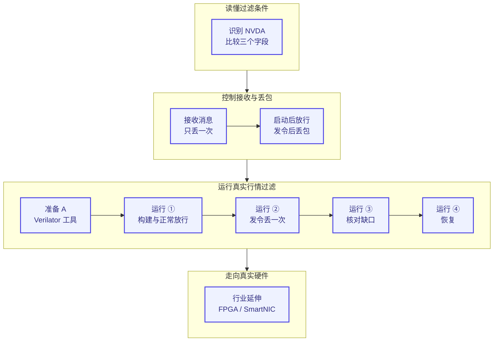

# 第10章：FPGA 网卡——从 RTL 模型到真卡过滤

## Verilator 软件模拟是什么

前两章已经用程序认出并丢弃指定行情。本章进一步看：**怎样把这个判断写成电路设计，让它将来能在 FPGA 芯片上工作。** 手头没有真卡，先在电脑里模拟同样的判断过程。

[Verilator 官方说明](https://verilator.org/guide/latest/overview.html)将它称为“a compiler”（编译器）：它把硬件设计转换为 C++ 模型代码，用来在电脑上模拟电路。我们希望让 FPGA（可编程硬件芯片）在行情进入主机前完成过滤；本课没有实体 FPGA 卡，就先用这个工具，在 CPU 上模拟过滤电路的判断过程。

**本章要做的事：只丢掉一条指定的 NVDA 行情，确认接收端恰好缺少这一条，然后恢复正常转发。** 行情由 Exchange 主机 `.1` 重放；过滤程序在 Trader 主机 `.2` 编译和运行。读懂过滤规则、一次丢包和发令方式后，我们按“准备、发令、核对、恢复”四步操作，每步结束都可以停下来讲解；章末再看同一份过滤逻辑怎样接到真实 FPGA。先用下图认清设计、工具和硬件之间的关系。

<div style="border-left:6px solid #7e22ce;background:#f3e8ff;padding:12px 16px;border-radius:8px;margin:14px 0;"><span style="display:inline-block;padding:3px 12px;border-radius:6px;background:#7e22ce;color:#fff;font-weight:800;">关键图 · 从设计到软件或硬件</span> <span style="font-weight:700;color:#581c87;">同一份电路设计分成两条路线：左边在 CPU 上模拟，右边在 FPGA 上实现。两边生成的文件用途不同。</span></div>

<div style="background:#f8fafc;border:1px solid #cbd5e1;border-radius:12px;padding:10px;max-width:820px;margin:14px auto;">

</div>

**SystemVerilog 是语言，RTL 是描述电路的方式。** RTL（Register Transfer Level，寄存器传输级）说明电路怎样计算，以及在时钟规定的更新点保存什么状态。把电路想成自动分拣机，“写 RTL”就是用代码画设计图：比较股票字段，命中且有丢包额度（还允许丢几条消息）就丢弃。额度从 1 变成 0，就表示这一次机会已经用完。

**本章用 C++ 编译出的可执行程序，在 CPU 上模拟 FPGA 中的电路逻辑。** Verilator 先把 RTL 电路设计转成 C++ 模型代码，再由 C++ 编译器把模型、手写的 adapter（适配程序）和运行库编成同一个可执行文件。适配程序负责收发报文，调用生成的模型代码算出放行/丢弃，以及更新后的额度。

**FPGA 是可以配置的硬件芯片，像已经做进芯片的一盒电子积木。** 里面的逻辑单元能计算、保存数据，连接也可以配置。Vivado 等工具把完整设计变成 bitstream（配置比特流），加载后让这些单元组成真实电路。**CPU 可执行文件不能直接用来配置 FPGA。** [AMD FPGA 架构](https://docs.amd.com/r/en-US/ug1291-viv/FPGA-Architecture)、[Vivado 构建流程](https://www.amd.com/en/developer/resources/vivado.html)

**两条路线共用的是 RTL 过滤逻辑。** 软件路线执行生成的 C++ 模型；硬件路线还要把这份逻辑接入板卡的收发接口，才能构建完整 FPGA 配置。

| 官方入口 | 用途 |
| --- | --- |
| [Verilator Guide](https://verilator.org/guide/latest/) | 硬件描述怎样生成可执行模型；本课安装版本固定为 4.038 |
| [AMD FPGA 架构](https://docs.amd.com/r/en-US/ug1291-viv/FPGA-Architecture) / [Vivado](https://www.amd.com/en/developer/resources/vivado.html) | 芯片有哪些可配置资源；设计怎样成为硬件配置 |
| [Ready/Valid 握手](https://docs.amd.com/r/en-US/pg085-axi4stream-infrastructure/Handshaking) | 发送方有数据、接收方能接，在时钟沿完成交付 |
| [Nasdaq TotalView-ITCH 5.0](https://www.nasdaqtrader.com/content/technicalsupport/specifications/dataproducts/NQTVITCHspecification.pdf) | Type A、Stock Locate 与 8 字节 Stock |
| [Nasdaq MoldUDP64](https://nasdaqtrader.com/content/technicalsupport/specifications/dataproducts/moldudp64.pdf) | Session、Sequence 与消息边界 |

## 本章学习目标

学完后应能：

- 从 RTL 代码读出“匹配哪条消息、什么时候处理、为什么只丢一次”。
- 用模拟程序丢弃一条真实行情，再核对接收端是否确实少了这一条。
- 讲清同一份逻辑如何接入 FPGA，以及编译、加载和查询策略分别做什么。

## 本章导航

<div style="border-left:6px solid #7e22ce;background:#f3e8ff;padding:12px 16px;border-radius:8px;margin:14px 0;"><span style="display:inline-block;padding:3px 12px;border-radius:6px;background:#7e22ce;color:#fff;font-weight:800;">本章导航</span> <span style="font-weight:700;color:#581c87;">本章分成 4 部分，共 9 个导航项；先认清输入字段，再控制接收与丢包，把模型接到 `.2` 的真实行情，最后看真卡怎样完成同一任务。</span></div>



固定顺序就是：**读懂过滤条件 → 控制接收与丢包 → 运行真实行情过滤 → 走向真实硬件**。

## 任务地图

| 导航项 | 所属部分 | 这一项回答什么 |
| --- | --- | --- |
| 按字段识别 NVDA 行情 | 读懂过滤条件 | 按字节位置取出三个匹配字段 |
| 接收一条消息，只丢一次 | 控制接收与丢包 | 消息何时被接受，丢包额度怎样用完 |
| 启动后放行，发令后丢包 | 控制接收与丢包 | 发令后只丢一条匹配行情，随后继续放行 |
| 准备 A：Verilator 工具 | 运行真实行情过滤 | 准备 .2 的编译器与构建工具 |
| 运行 ①：编译自测，确认正常放行 | 运行真实行情过滤 | 构建和六项自测通过，真实行情正常放行，尚未发令 |
| 运行 ②：发令丢一次 | 运行真实行情过滤 | 给模型一次额度，短暂重放后保留现场 |
| 运行 ③：核对丢包与缺口 | 运行真实行情过滤 | 丢弃与缺失的序号相同，数量都是 1 |
| 运行 ④：恢复行情与交易 | 运行真实行情过滤 | 恢复原接收路径，确认行情与交易恢复 |
| 行业延伸：真实 FPGA / SmartNIC | 走向真实硬件 | 找到卡、编译加载、查看镜像与策略状态 |

## 读懂过滤条件

### 按字段识别 NVDA 行情

第一步是认出目标消息。本课使用 ITCH 行情协议中的 Type A，即 Add Order（新增订单消息）；其中 Stock Locate 是股票的内部编号，Stock 是股票代码。本课这份行情中，目标编号为 `8095`，股票代码字段为 `NVDA` 加四个空格。三个字段都匹配且还有额度，才丢弃。

<div style="border:2px solid #4f46e5;background:#eef2ff;padding:10px 12px;border-radius:8px;margin:14px 0;"><div style="font-weight:900;color:#312e81;margin-bottom:4px;">导航卡 · 读懂过滤条件</div><div style="font-weight:700;color:#312e81;margin-bottom:8px;">范畴：源码展示　本步知识：按字节位置取出三个匹配字段　位置：全章第 1 / 9 项 · 本组第 1 / 1 项</div><span style="display:inline-block;margin:3px;padding:4px 10px;border-radius:6px;background:#15803d;color:#fff;font-weight:800;">按字段识别 NVDA 行情</span></div>

<div style="border-left:6px solid #7e22ce;background:#f3e8ff;padding:12px 16px;border-radius:8px;margin:14px 0;"><span style="display:inline-block;padding:3px 12px;border-radius:6px;background:#7e22ce;color:#fff;font-weight:800;">关键图</span> <span style="font-weight:700;color:#581c87;">先看两份代码怎样编成一个程序，再看收包代码怎样调用模型；底部展开模型中的字段比较和额度更新。</span></div>

<div style="background:#f8fafc;border:1px solid #cbd5e1;border-radius:12px;padding:10px;max-width:820px;margin:14px auto;">

</div>

**两份代码合成一个程序。** 紫色部分由 RTL 自动生成，蓝色部分是手写的收发代码；“把消息交给模型”就是在同一程序里填写 C++ 对象的输入，再调用它计算，得到结果后继续转发或丢弃。

适配程序先从报文中取出消息。本课的一包一条行情，在 UDP 载荷中依次是 **20 字节 MoldUDP64 包头 → 2 字节消息长度 → 36 字节 ITCH 消息**。包头包含行情包序号；股票字段则在后面的 ITCH 消息中。[MoldUDP64 格式](https://nasdaqtrader.com/content/technicalsupport/specifications/dataproducts/moldudp64.pdf)

下面看编译前的 SystemVerilog 设计。`s_itch` 是那条 36 字节消息的输入，共 288 bit；生成的 C++ 模型中有同名成员，供适配程序填写。SystemVerilog 用 `[高位:低位]` 取出其中一段，`s_itch[287:280]` 就是第 0 字节。序号由适配程序从包头单独取出，填到另一个输入；它用于核对丢了哪条，不参与股票匹配。

| 字段 | 消息中的字节位置 | SystemVerilog 取位写法 | 目标值 |
| --- | ---: | --- | --- |
| Message Type | 0 | `[287:280]` | `8'h41` / `A` |
| Stock Locate | 1–2 | `[279:264]` | `16'd8095` |
| Stock | 24–31 | `[95:32]` | `64'h4e56444120202020` / `NVDA    ` |
| Mold Sequence（包序号） | MoldUDP64 包头的 10–17 字节 | 独立 `[63:0]` | 记录序号，不设匹配目标 |

表里是消息实际携带的字段；比较时还需要目标值作为模型输入。适配程序把 `cfg_locate` 设为 `8095`，把 `cfg_stock` 设为 `0x4e56444120202020`（NVDA 加四个空格）。下面的 `remaining_drops` 是剩余丢包额度，`s_valid && s_ready` 表示双方都准备好交付消息，下一节展开这个交付条件。

<div style="border-left:6px solid #7e22ce;background:#f3e8ff;padding:12px 16px;border-radius:8px;margin:14px 0;"><span style="display:inline-block;padding:3px 12px;border-radius:6px;background:#7e22ce;color:#fff;font-weight:800;">关键代码 · SystemVerilog</span> <span style="font-weight:700;color:#581c87;">下面来自 market_filter.sv，是用 SystemVerilog 写的 RTL 电路设计。前三行取字段，最后三行判断是否命中。</span></div>

```systemverilog
assign in_type = s_itch[287:280];
assign in_locate = s_itch[279:264];
assign in_stock = s_itch[95:32];
assign hit = s_valid && s_ready && in_type == 8'h41 &&
             in_locate == cfg_locate && in_stock == cfg_stock &&
             remaining_drops != 32'd0;
```

这里的 `==`、`&&` 看起来与 C 语言相似，但这段代码描述的是硬件电路关系。`assign` 表示持续根据右边的输入计算左边的信号；输入变化时，比较结果也会随之更新。

| 写法 | 可以怎样读 |
| --- | --- |
| `==` / `!=` | 等于 / 不等于 |
| `&&` | 各个条件必须同时成立 |
| `8'h41` | 8 位的十六进制数 41，也就是字符 A |
| `32'd0` | 32 位的十进制数 0 |

`hit` 表示“命中丢包条件”：消息可以交付、三个字段都匹配，而且剩余额度不为 0。Stock 要比较完整 8 字节，包括末尾四个空格；消息中的买卖方向、数量和价格不参与本策略。**字段比较由 RTL 定义，仿真时执行它生成的 C++ 代码；IP、端口和消息长度由手写适配程序核对。** [RTL 源码](assets/09-verilator/market_filter.sv)、[C++ 适配程序](assets/09-verilator/mold_filter_adapter.cpp)

## 控制接收与丢包

### 接收一条消息，只丢一次

认出目标消息后，还要决定什么时候接收它，以及怎样记住“已经丢过一次”。这部分把字段比较的结果接到丢包判决和额度更新上。

<div style="border:2px solid #4f46e5;background:#eef2ff;padding:10px 12px;border-radius:8px;margin:14px 0;"><div style="font-weight:900;color:#312e81;margin-bottom:4px;">导航卡 · 控制接收与丢包</div><div style="font-weight:700;color:#312e81;margin-bottom:8px;">范畴：机制讲解　本步知识：消息何时被接受，丢包额度怎样用完　位置：全章第 2 / 9 项 · 本组第 1 / 2 项</div><span style="display:inline-block;margin:3px;padding:4px 10px;border-radius:6px;background:#15803d;color:#fff;font-weight:800;">接收一条消息，只丢一次</span><span style="display:inline-block;margin:3px;padding:4px 10px;border-radius:6px;background:#f8fafc;border:1px solid #a5b4fc;color:#312e81;font-weight:800;">启动后放行，发令后丢包</span></div>

<div style="border-left:6px solid #7e22ce;background:#f3e8ff;padding:12px 16px;border-radius:8px;margin:14px 0;"><span style="display:inline-block;padding:3px 12px;border-radius:6px;background:#7e22ce;color:#fff;font-weight:800;">关键图</span> <span style="font-weight:700;color:#581c87;">上方是原始报文的收发路径，下方是模型的判断过程；有消息、准备好接收、上升沿到来，三项缺一不可。</span></div>

<div style="background:#f8fafc;border:1px solid #cbd5e1;border-radius:12px;padding:10px;max-width:820px;margin:14px auto;">

</div>

**原始报文由手写 C++ 代码接收、保存和转发，模型负责给出判决。** 收包代码把其中的 36 字节消息复制给模型，原始报文留在收包缓冲区；模型读取这份副本后给出放行或丢弃结果，收包代码再执行相应动作。`remaining_drops`（还能丢几条）和 `drop_count`（已经丢了几条）由 RTL 定义，仿真时保存在同一个生成模型对象中。

图里的几个 0/1 分工不同，先按“谁提供、表示什么”来读：

| 名字 | 谁提供或保存 | 表示什么 |
| --- | --- | --- |
| `s_valid` | 手写 C++ 收发代码提供 | 1 表示有一条消息请模型处理 |
| `s_ready` | 模型给出 | 1 表示现在可以接收这条消息 |
| `clk` | 手写 C++ 改变这个模拟信号 | 从 0 变成 1 的瞬间，叫时钟上升沿，是保存状态的时刻 |
| `remaining_drops` | 模型内部保存 | 还允许丢几条；为 0 时仍能接收，只是会放行 |

**在时钟上升沿，`s_valid` 和 `s_ready` 同时为 1，模型才接受消息，保存判决并更新额度。** 一个时钟周期常简称“一拍”。当前由 C++ 推进模拟时钟，检查的是这个处理顺序；它不能用来推算真实 FPGA 的处理速度。

当适配程序要设置或清零额度时，它给出 `cfg_load_valid=1`，意思是“这次额度设置有效”。模型据此给出 `s_ready=0`，先保存新额度，暂不接受消息；其余正常工作时为 1。源码用 `s_ready = !cfg_load_valid` 表达这一关系。**`ready` 可以随输入变化；等上升沿的是接受消息、保存判决和更新额度。**

图中的额度和判决由下面这段 RTL 定义，仿真时执行的是它生成的 C++ 模型。原文件用 `always_ff @(posedge clk)` 指定“在时钟上升沿更新”；下面节选其中接受消息后的分支，省略外层复位、配置和接收条件。[完整 SystemVerilog 源码](assets/09-verilator/market_filter.sv)

<div style="border-left:6px solid #7e22ce;background:#f3e8ff;padding:12px 16px;border-radius:8px;margin:14px 0;"><span style="display:inline-block;padding:3px 12px;border-radius:6px;background:#7e22ce;color:#fff;font-weight:800;">关键代码 · SystemVerilog</span> <span style="font-weight:700;color:#581c87;">market_filter.sv 中的 RTL 设计节选：命中且有额度时扣减额度并输出丢弃；否则输出放行。</span></div>

```systemverilog
if (hit) begin
    remaining_drops <= remaining_drops - 32'd1;
    drop_count <= drop_count + 32'd1;
    drop_valid <= 1'b1;
end else begin
    pass_count <= pass_count + 32'd1;
    m_valid <= 1'b1;
end
```

`if (hit)` 选择命中分支，`begin/end` 包住同一分支的语句，`<=` 在此安排寄存器写入新值。`drop_valid=1` 表示丢弃，`m_valid=1` 表示放行，它们都是模型输出的判决信号。手写代码读出结果后，把 `s_valid` 清为 0，再推进一次模拟时钟，清掉本次判决；这时没有新消息，不会重复扣额度。下一条消息到来后再处理。

模型接受消息后，按下面的规则给出结果；PASS 表示放行，DROP 表示丢弃：

| 消息与额度 | 判决 | 状态变化 |
| --- | --- | --- |
| 额度为 0 | PASS | 放行数 `pass_count` 加 1 |
| 匹配目标，额度为 1 | DROP | 丢弃数 `drop_count` 加 1，额度 1→0 |
| 紧接着又来一条目标消息 | PASS | 额度已经为 0 |
| Type、Locate 或 Stock 任一不匹配，额度为 1 | PASS | 保留这一次额度，等目标消息 |

### 启动后放行，发令后丢包

过滤规则和“只丢一次”的状态已经有了，还差把这一次额度交给模型。后面的运行①会在 Trader 主机 `.2` 启动编译后的 `mold_filter_adapter`，一个进程里包含收发代码和生成的模型；初始额度是 0，所以默认正常转发。讲完正常放行后，再执行运行②，通过文本文件给这个正在运行的程序发令。

<div style="border:2px solid #4f46e5;background:#eef2ff;padding:10px 12px;border-radius:8px;margin:14px 0;"><div style="font-weight:900;color:#312e81;margin-bottom:4px;">导航卡 · 控制接收与丢包</div><div style="font-weight:700;color:#312e81;margin-bottom:8px;">范畴：机制讲解　本步知识：发令后只丢一条匹配行情，随后继续放行　位置：全章第 3 / 9 项 · 本组第 2 / 2 项</div><span style="display:inline-block;margin:3px;padding:4px 10px;border-radius:6px;background:#f8fafc;border:1px solid #a5b4fc;color:#312e81;font-weight:800;">接收一条消息，只丢一次</span><span style="display:inline-block;margin:3px;padding:4px 10px;border-radius:6px;background:#15803d;color:#fff;font-weight:800;">启动后放行，发令后丢包</span></div>

<div style="border-left:6px solid #7e22ce;background:#f3e8ff;padding:12px 16px;border-radius:8px;margin:14px 0;"><span style="display:inline-block;padding:3px 12px;border-radius:6px;background:#7e22ce;color:#fff;font-weight:800;">关键图 · 一次丢包控制</span> <span style="font-weight:700;color:#581c87;">运行①启动过滤程序；运行②写入 block 指令，程序读到后只丢一次，随后继续放行。</span></div>

<div style="background:#f8fafc;border:1px solid #cbd5e1;border-radius:12px;padding:10px;max-width:820px;margin:14px auto;">

</div>

<div style="border-left:6px solid #7e22ce;background:#f3e8ff;padding:12px 16px;border-radius:8px;margin:14px 0;"><span style="display:inline-block;padding:3px 12px;border-radius:6px;background:#7e22ce;color:#fff;font-weight:800;">仅供展示 · Shell 发令命令</span> <span style="font-weight:700;color:#581c87;">运行②会在 .2 执行这一行；这里先解释它的作用。</span></div>

```bash
printf 'block\n' > /var/tmp/flle-market-filter.cmd
```

`printf` 产生 `block` 和换行，`>` 把它们写进右边的文件，所以成功时终端没有文字输出。

**运行中的 C++ 收发程序会自动检查并读取这个文件，把模型的丢包额度设为 1。** 有效期内，第一条匹配的 NVDA 行情被丢弃，额度随即归零，后续继续放行；一直没有匹配消息，这次额度也会自动过期。[具体实现](assets/09-verilator/TEACHER-LIVE-NOTES.md#控制指令与输入边界)

后面会把启动、发令、查看结果、恢复分成四步，每步讲完再贴下一步。接下来先准备编译工具。

## 运行真实行情过滤

### 准备 A：Verilator 工具

在 `.2` 安装 Verilator、g++ 和 make；运行 ① 会在同一台机器上编译、自测并运行模型。编译位置是部署选择：本课直接在目标机完成，便于使用该机的编译器与运行库。

<div style="border:2px solid #4f46e5;background:#eef2ff;padding:10px 12px;border-radius:8px;margin:14px 0;"><div style="font-weight:900;color:#312e81;margin-bottom:4px;">导航卡 · 运行真实行情过滤</div><div style="font-weight:700;color:#312e81;margin-bottom:8px;">范畴：分步实验　本步知识：准备 .2 的编译器与构建工具　位置：全章第 4 / 9 项 · 本组第 1 / 5 项</div><span style="display:inline-block;margin:3px;padding:4px 10px;border-radius:6px;background:#15803d;color:#fff;font-weight:800;">准备 A：Verilator 工具</span><span style="display:inline-block;margin:3px;padding:4px 10px;border-radius:6px;background:#f8fafc;border:1px solid #a5b4fc;color:#312e81;font-weight:800;">运行 ①：编译自测，确认正常放行</span><span style="display:inline-block;margin:3px;padding:4px 10px;border-radius:6px;background:#f8fafc;border:1px solid #a5b4fc;color:#312e81;font-weight:800;">运行 ②：发令丢一次</span><span style="display:inline-block;margin:3px;padding:4px 10px;border-radius:6px;background:#f8fafc;border:1px solid #a5b4fc;color:#312e81;font-weight:800;">运行 ③：核对丢包与缺口</span><span style="display:inline-block;margin:3px;padding:4px 10px;border-radius:6px;background:#f8fafc;border:1px solid #a5b4fc;color:#312e81;font-weight:800;">运行 ④：恢复行情与交易</span></div>

同步源：`assets/10-verilator/00-verilator-toolchain-prep.sh`（完整脚本）。

<div style="border-left:6px solid #15803d;background:#dcfce7;padding:12px 16px;border-radius:8px;margin:14px 0;"><span style="display:inline-block;padding:3px 12px;border-radius:6px;background:#15803d;color:#fff;font-weight:800;">需要运行 · 准备 A · Verilator 工具</span> <span style="font-weight:700;color:#14532d;">教师在跳板机以 root 身份 SSH 到 `.2`；前置为管理网络与 `.111` 离线缓存可用。从本机缓存分发并安装 Verilator/g++/make。预期读到 Verilator 4.038 及编译工具版本。</span></div>

```bash
#!/usr/bin/env bash
(
set -Eeuo pipefail
cd /financial-low-latency
source Documents/newDoc/assets/common/flle-remote.sh
RUN_ID="$(date -u +%Y%m%dT%H%M%SZ)-10-verilator-toolchain-prep"
OUT="Documents/reports/course-runs/$RUN_ID"; mkdir -p "$OUT/raw"
printf 'RUN_ID=%s\n' "$RUN_ID" >"$OUT/run.env"
printf 'BUILD_HOST=10.1.1.2\n' >>"$OUT/run.env"
cp "$OUT/run.env" Documents/reports/run-state/10-verilator-toolchain-prep.env
cp Documents/newDoc/assets/10-verilator/00-verilator-toolchain-prep.sh "$OUT/source.sh"
trap 'rc=$?; printf "EXIT_CODE=%s\n" "$rc" >>"$OUT/run.env"; cp "$OUT/run.env" Documents/reports/run-state/10-verilator-toolchain-prep.env; (cd "$OUT" && sha256sum raw/result.txt run.env source.sh >SHA256SUMS); printf "evidence=%s\n" "$OUT"; exit "$rc"' EXIT

python3 Documents/newDoc/assets/common/install-offline-packages.py 10.1.1.2 verilator 2>&1 | tee "$OUT/raw/result.txt"
ssh "${FLLE_SSH_OPTS[@]}" root@10.1.1.2 bash -s <<'REMOTE' 2>&1 | tee -a "$OUT/raw/result.txt"
set -Eeuo pipefail
printf '===== root@10.1.1.2 =====\n'
printf '%s\n' '' 'vm-2522-02 / verify' '===== 查构建工具包 =====' '[工具包] 对: verilator 4.038-1，g++ 和 make 已安装  证: 仿真构建所需三类工具齐备' '$ dpkg-query -W verilator g++ make'; dpkg-query -W -f='${Package} ${Version}\n' verilator g++ make
printf '%s\n' '' 'vm-2522-02 / verify' '===== 查RTL 翻译器版本 =====' '[Verilator] 对: 4.038  证: 把 SystemVerilog 翻译成 C++ 周期模型的工具可用' '$ verilator --version'; verilator --version
printf '%s\n' '' 'vm-2522-02 / verify' '===== 查C++ 编译器版本 =====' '[g++] 对: 能打印版本  证: 把 Verilator 生成的 C++ 与 adapter 编成程序' '$ g++ --version'; g++ --version
printf '%s\n' '' 'vm-2522-02 / verify' '===== 查构建工具版本 =====' '[make] 对: 能打印版本  证: 按生成的 Makefile 编译并链接模型' '$ make --version'; make --version
REMOTE
)
```

<div style="border-left:6px solid #7e22ce;background:#f3e8ff;padding:12px 16px;border-radius:8px;margin:14px 0;"><span style="display:inline-block;padding:3px 12px;border-radius:6px;background:#7e22ce;color:#fff;font-weight:800;">仅供展示 · 输出解读</span> <span style="font-weight:700;color:#581c87;">工具版本来自编译主机；版本可读才进入运行 ①。工具安装成功不等于 RTL 自测通过。</span></div>

下面是 2026-09-07 在 `.2` 执行准备 A 的原始关键行；完整安装记录见该 RUN 的 `raw/`。

```text
vm-2522-02 / verify
===== 查构建工具包 =====
[工具包] 对: verilator 4.038-1，g++ 和 make 已安装  证: 仿真构建所需三类工具齐备
$ dpkg-query -W verilator g++ make
g++ 4:11.2.0-1ubuntu1
make 4.3-4.1build1
verilator 4.038-1

vm-2522-02 / verify
===== 查RTL 翻译器版本 =====
[Verilator] 对: 4.038  证: 把 SystemVerilog 翻译成 C++ 周期模型的工具可用
$ verilator --version
Verilator 4.038 2020-07-11 rev v4.036-114-g0cd4a57ad

vm-2522-02 / verify
===== 查C++ 编译器版本 =====
[g++] 对: 能打印版本  证: 把 Verilator 生成的 C++ 与 adapter 编成程序
$ g++ --version
g++ (Ubuntu 11.4.0-1ubuntu1~22.04.3) 11.4.0

vm-2522-02 / verify
===== 查构建工具版本 =====
[make] 对: 能打印版本  证: 按生成的 Makefile 编译并链接模型
$ make --version
GNU Make 4.3
```

实测证据：`Documents/reports/course-runs/20260907T152502Z-10-verilator-toolchain-prep/raw/result.txt`。

<div style="border-left:6px solid #0891b2;background:#cffafe;padding:12px 16px;border-radius:8px;margin:14px 0;"><span style="display:inline-block;padding:3px 12px;border-radius:6px;background:#0891b2;color:#fff;font-weight:800;">关键现象</span> <span style="font-weight:700;color:#164e63;">Verilator 为 4.038，g++ 与 make 版本均可读，才进入运行 ①；失败看本次 evidence 目录中的 raw/result.txt。</span></div>

### 运行 ①：编译自测，确认正常放行

前面已经写清“匹配哪条、只丢一次、怎样发令”。现在分四次操作验证它：**先看正常放行，再发令，再查结果，最后恢复。每一步执行完都会停下来，等你讲完再贴下一步。**

教师先核对[分步运行与恢复说明](assets/09-verilator/TEACHER-LIVE-NOTES.md#分步课堂运行)。运行①生成本次实验目录，后三步写入同一目录；前三步结束后暂停行情，讲解时间不限，贴下一条命令才继续。脚本执行异常仍会尝试恢复；正常课堂停顿不会触发恢复。

<div style="border:2px solid #4f46e5;background:#eef2ff;padding:10px 12px;border-radius:8px;margin:14px 0;"><div style="font-weight:900;color:#312e81;margin-bottom:4px;">导航卡 · 运行真实行情过滤</div><div style="font-weight:700;color:#312e81;margin-bottom:8px;">范畴：分步实验　本步知识：构建和六项自测通过，真实行情正常放行，尚未发令　位置：全章第 5 / 9 项 · 本组第 2 / 5 项</div><span style="display:inline-block;margin:3px;padding:4px 10px;border-radius:6px;background:#f8fafc;border:1px solid #a5b4fc;color:#312e81;font-weight:800;">准备 A：Verilator 工具</span><span style="display:inline-block;margin:3px;padding:4px 10px;border-radius:6px;background:#15803d;color:#fff;font-weight:800;">运行 ①：编译自测，确认正常放行</span><span style="display:inline-block;margin:3px;padding:4px 10px;border-radius:6px;background:#f8fafc;border:1px solid #a5b4fc;color:#312e81;font-weight:800;">运行 ②：发令丢一次</span><span style="display:inline-block;margin:3px;padding:4px 10px;border-radius:6px;background:#f8fafc;border:1px solid #a5b4fc;color:#312e81;font-weight:800;">运行 ③：核对丢包与缺口</span><span style="display:inline-block;margin:3px;padding:4px 10px;border-radius:6px;background:#f8fafc;border:1px solid #a5b4fc;color:#312e81;font-weight:800;">运行 ④：恢复行情与交易</span></div>

这一步在 `.2` 编译模型与收发代码，先执行六项自测，再启动过滤程序，额度保持 0。自测消息由程序内部构造，不需要 `.1` 先发行情；自测通过后才接入真实重放。

为了让行情处理程序（Feed Guardian）只看过滤后的行情，脚本让统一 Socket 接收器退出原组播，仅收过滤程序发到 `.2:42121` 的本机单播，再经 Unix Socket 交给 Guardian。组播 `233.74.125.32:31032` 此时由 adapter 加入并接收。输出中的 `Exchange=MULTICAST` 表示发送端发组播，`Guardian=UNICAST` 表示 Guardian 的上游接收器只收过滤程序转发的单播副本。确认行情完整后，脚本暂停重放，留下正常放行的现场。

<div style="border-left:6px solid #15803d;background:#dcfce7;padding:12px 16px;border-radius:8px;margin:14px 0;"><span style="display:inline-block;padding:3px 12px;border-radius:6px;background:#15803d;color:#fff;font-weight:800;">需要运行 · 运行 ①</span> <span style="font-weight:700;color:#14532d;">教师在跳板机执行；前置为准备 A 完成、行情交易系统正常、原网络路径及管理连接可用。在 .2 构建并接流，通常 1～2 分钟，执行上限 7 分钟；预期六项自测通过、额度 0、策略丢包数 0、行情 HEALTHY。</span></div>

```bash
bash Documents/newDoc/assets/10-verilator/08a-prepare-rtl-filter.sh
```

<div style="border-left:6px solid #7e22ce;background:#f3e8ff;padding:12px 16px;border-radius:8px;margin:14px 0;"><span style="display:inline-block;padding:3px 12px;border-radius:6px;background:#7e22ce;color:#fff;font-weight:800;">仅供展示 · 输出解读</span> <span style="font-weight:700;color:#581c87;">以下是本次构建和正常放行的回执。六个 1 表示六项检查通过；adapter_ready 是随后启动的接流进程，额度为 0。HEALTHY 表示行情完整，session 是本次重放会话号。</span></div>

```text
vm-2522-02 / build
===== 查构建自测与正常放行 =====
[RTL] 对: 六项自测通过 / 真实行情尚未丢包  证: 发令前先确认过滤路径正常
$ bash Documents/newDoc/assets/10-verilator/08a-prepare-rtl-filter.sh
rtl_selftest=PASS allow=1 target_drop=1 second_pass=1 locate_mismatch_pass=1 stock_mismatch_pass=1 type_f_pass=1
adapter_ready mode=allow remaining_drops=0
本次策略丢包数：0
Feed：session=0612260009  integrity=HEALTHY  next_expected=220  gap_size=0
路径：Exchange=MULTICAST  Guardian=UNICAST  交易闸门=OPEN
重放已暂停；下一步由你执行发令脚本。
```

| 看什么 | 这一步应满足什么 |
| --- | --- |
| 六项自测 | 默认放行、首条丢弃、第二条放行，以及编号、代码、类型不匹配时放行，全部通过 |
| 接流日志 | 只有初始放行记录，没有发令和 `rtl_drop` 记录 |
| 行情状态 | HEALTHY；脚本最后暂停重放，等你发令 |

<div style="border-left:6px solid #0891b2;background:#cffafe;padding:12px 16px;border-radius:8px;margin:14px 0;"><span style="display:inline-block;padding:3px 12px;border-radius:6px;background:#0891b2;color:#fff;font-weight:800;">关键现象</span> <span style="font-weight:700;color:#164e63;">自测中的 target_drop 是内部测试；接入真实行情的进程还没收到 block，策略丢包数应为 0。准备脚本不会继续发令。</span></div>

### 运行 ②：发令丢一次

正常放行已经确认，现在才给模型一次丢包机会。这一步执行前文讲过的写文件动作：在 `.2` 把 `block` 写进控制文件，运行中的 C++ 程序读到后，把模型额度设为 1。

<div style="border:2px solid #4f46e5;background:#eef2ff;padding:10px 12px;border-radius:8px;margin:14px 0;"><div style="font-weight:900;color:#312e81;margin-bottom:4px;">导航卡 · 运行真实行情过滤</div><div style="font-weight:700;color:#312e81;margin-bottom:8px;">范畴：分步实验　本步知识：给模型一次额度，短暂重放后保留现场　位置：全章第 6 / 9 项 · 本组第 3 / 5 项</div><span style="display:inline-block;margin:3px;padding:4px 10px;border-radius:6px;background:#f8fafc;border:1px solid #a5b4fc;color:#312e81;font-weight:800;">准备 A：Verilator 工具</span><span style="display:inline-block;margin:3px;padding:4px 10px;border-radius:6px;background:#f8fafc;border:1px solid #a5b4fc;color:#312e81;font-weight:800;">运行 ①：编译自测，确认正常放行</span><span style="display:inline-block;margin:3px;padding:4px 10px;border-radius:6px;background:#15803d;color:#fff;font-weight:800;">运行 ②：发令丢一次</span><span style="display:inline-block;margin:3px;padding:4px 10px;border-radius:6px;background:#f8fafc;border:1px solid #a5b4fc;color:#312e81;font-weight:800;">运行 ③：核对丢包与缺口</span><span style="display:inline-block;margin:3px;padding:4px 10px;border-radius:6px;background:#f8fafc;border:1px solid #a5b4fc;color:#312e81;font-weight:800;">运行 ④：恢复行情与交易</span></div>

**额度只有 5 秒有效期，所以发令后由脚本立即恢复重放。** 接收端发现缺少一条消息后，脚本再次暂停重放，让你有时间讲解。下一步只查这个现场，不再发令。

<div style="border-left:6px solid #15803d;background:#dcfce7;padding:12px 16px;border-radius:8px;margin:14px 0;"><span style="display:inline-block;padding:3px 12px;border-radius:6px;background:#15803d;color:#fff;font-weight:800;">需要运行 · 运行 ②</span> <span style="font-weight:700;color:#14532d;">教师在跳板机执行；前置为运行①成功且过滤进程仍在运行。向 .2 写入 block 并短暂重放，通常十几秒内结束；预期指令被读取、出现缺口后重放暂停。</span></div>

```bash
bash Documents/newDoc/assets/10-verilator/08b-arm-rtl-filter.sh
```

<div style="border-left:6px solid #7e22ce;background:#f3e8ff;padding:12px 16px;border-radius:8px;margin:14px 0;"><span style="display:inline-block;padding:3px 12px;border-radius:6px;background:#7e22ce;color:#fff;font-weight:800;">仅供展示 · 输出解读</span> <span style="font-weight:700;color:#581c87;">control_consumed=block 表示运行中的收发程序已读取丢包指令。随后短暂重放并暂停；下一步核对是否恰好丢了一条。</span></div>

```text
vm-2522-02 / control
===== 查一次丢包指令 =====
[block] 对: 指令已消费 / 现场暂停  证: 发令与下一步查看分开
$ bash Documents/newDoc/assets/10-verilator/08b-arm-rtl-filter.sh
control_consumed=block
重放已短暂运行并暂停，现场已保留；下一步查看丢包与缺口。
```

<div style="border-left:6px solid #0891b2;background:#cffafe;padding:12px 16px;border-radius:8px;margin:14px 0;"><span style="display:inline-block;padding:3px 12px;border-radius:6px;background:#0891b2;color:#fff;font-weight:800;">关键现象</span> <span style="font-weight:700;color:#164e63;">发令只执行一次。出现缺口后保留现场，继续贴运行③查看丢了哪条；如果没有捕获到缺口，脚本会报错并尝试恢复。</span></div>

### 运行 ③：核对丢包与缺口

模型是否真的过滤了目标消息，要核对两端：过滤程序记录“丢了哪条”，行情接收程序（Feed Guardian）记录“缺了哪条”。例如序号 101 后直接收到 103，中间缺了 102；日志把这种行情消息缺失记为 `GAP`（缺口）。

<div style="border:2px solid #4f46e5;background:#eef2ff;padding:10px 12px;border-radius:8px;margin:14px 0;"><div style="font-weight:900;color:#312e81;margin-bottom:4px;">导航卡 · 运行真实行情过滤</div><div style="font-weight:700;color:#312e81;margin-bottom:8px;">范畴：分步实验　本步知识：丢弃与缺失的序号相同，数量都是 1　位置：全章第 7 / 9 项 · 本组第 4 / 5 项</div><span style="display:inline-block;margin:3px;padding:4px 10px;border-radius:6px;background:#f8fafc;border:1px solid #a5b4fc;color:#312e81;font-weight:800;">准备 A：Verilator 工具</span><span style="display:inline-block;margin:3px;padding:4px 10px;border-radius:6px;background:#f8fafc;border:1px solid #a5b4fc;color:#312e81;font-weight:800;">运行 ①：编译自测，确认正常放行</span><span style="display:inline-block;margin:3px;padding:4px 10px;border-radius:6px;background:#f8fafc;border:1px solid #a5b4fc;color:#312e81;font-weight:800;">运行 ②：发令丢一次</span><span style="display:inline-block;margin:3px;padding:4px 10px;border-radius:6px;background:#15803d;color:#fff;font-weight:800;">运行 ③：核对丢包与缺口</span><span style="display:inline-block;margin:3px;padding:4px 10px;border-radius:6px;background:#f8fafc;border:1px solid #a5b4fc;color:#312e81;font-weight:800;">运行 ④：恢复行情与交易</span></div>

<div style="border-left:6px solid #7e22ce;background:#f3e8ff;padding:12px 16px;border-radius:8px;margin:14px 0;"><span style="display:inline-block;padding:3px 12px;border-radius:6px;background:#7e22ce;color:#fff;font-weight:800;">关键图 · 核对过滤结果</span> <span style="font-weight:700;color:#581c87;">程序记录丢弃的消息，必须正好是接收端发现缺失的消息。</span></div>

<div style="background:#f8fafc;border:1px solid #cbd5e1;border-radius:12px;padding:10px;max-width:820px;margin:14px auto;">

</div>

这一步读取同一次实验的日志，并检查当前仍是运行②暂停的会话。行情缺失时，交易系统还应拒绝下单；脚本会核对这项保护，然后继续保留现场，便于讲解。

<div style="border-left:6px solid #15803d;background:#dcfce7;padding:12px 16px;border-radius:8px;margin:14px 0;"><span style="display:inline-block;padding:3px 12px;border-radius:6px;background:#15803d;color:#fff;font-weight:800;">需要运行 · 运行 ③</span> <span style="font-weight:700;color:#14532d;">教师在跳板机执行；前置为运行②成功、缺口现场仍保留。读取日志并验证缺口期间拒单，预计 10～30 秒；预期丢弃与缺失序号一致、数量均为 1、订单 API 拒绝下单。</span></div>

```bash
bash Documents/newDoc/assets/10-verilator/08c-verify-rtl-filter.sh
```

<div style="border-left:6px solid #7e22ce;background:#f3e8ff;padding:12px 16px;border-radius:8px;margin:14px 0;"><span style="display:inline-block;padding:3px 12px;border-radius:6px;background:#7e22ce;color:#fff;font-weight:800;">仅供展示 · 输出解读</span> <span style="font-weight:700;color:#581c87;">以下是本次对账结果。图中的 102 只是示意，本次实际序号是 220；每次实验都要核对当次日志，不能预设这个数字。</span></div>

```text
vm-2522-02 / verify
===== 查丢弃与缺失序号 =====
[Feed] 对: 同一序号 / 缺口1 / 拒单  证: 过滤判决与接收结果一致
$ bash Documents/newDoc/assets/10-verilator/08c-verify-rtl-filter.sh
rtl_drop sequence=220 remaining=0 drop_count=1
Feed：session=0612260009  integrity=GAP  next_expected=220  gap_size=1
路径：Exchange=MULTICAST  Guardian=UNICAST  交易闸门=INHIBITED_FEED_GAP
订单API：http_status=400  error=FEED_NOT_HEALTHY
丢弃序号 = 缺失序号，丢弃数 = 缺口数 = 1。现场仍暂停；讲解后执行恢复。
```

| 看什么 | 本次读数 | 为什么要对上 |
| --- | --- | --- |
| 丢弃序号 / `next_expected` | 220 / 220 | 丢掉的正是接收端等待的消息 |
| `drop_count` / `gap_size` | 1 / 1 | 只丢一次，接收端恰缺一条 |
| 交易闸门 / 订单错误 | INHIBITED_FEED_GAP / FEED_NOT_HEALTHY | 因行情缺口暂停下单 |

<div style="border-left:6px solid #0891b2;background:#cffafe;padding:12px 16px;border-radius:8px;margin:14px 0;"><span style="display:inline-block;padding:3px 12px;border-radius:6px;background:#0891b2;color:#fff;font-weight:800;">关键现象</span> <span style="font-weight:700;color:#164e63;">序号相同、数量均为 1，才能把这次缺口与过滤对应起来。运行③可以重复查看，既不重新给额度，也不自动恢复；讲完后再执行运行④。</span></div>

### 运行 ④：恢复行情与交易

丢包效果已经看清，现在退出临时过滤程序，让接收端回到原来的接收方式。脚本重启行情重放，确认数据完整，再用两笔验证订单检查交易恢复；最后恢复实验前的发送和播放方式。

<div style="border:2px solid #4f46e5;background:#eef2ff;padding:10px 12px;border-radius:8px;margin:14px 0;"><div style="font-weight:900;color:#312e81;margin-bottom:4px;">导航卡 · 运行真实行情过滤</div><div style="font-weight:700;color:#312e81;margin-bottom:8px;">范畴：分步实验　本步知识：恢复原接收路径，确认行情与交易恢复　位置：全章第 8 / 9 项 · 本组第 5 / 5 项</div><span style="display:inline-block;margin:3px;padding:4px 10px;border-radius:6px;background:#f8fafc;border:1px solid #a5b4fc;color:#312e81;font-weight:800;">准备 A：Verilator 工具</span><span style="display:inline-block;margin:3px;padding:4px 10px;border-radius:6px;background:#f8fafc;border:1px solid #a5b4fc;color:#312e81;font-weight:800;">运行 ①：编译自测，确认正常放行</span><span style="display:inline-block;margin:3px;padding:4px 10px;border-radius:6px;background:#f8fafc;border:1px solid #a5b4fc;color:#312e81;font-weight:800;">运行 ②：发令丢一次</span><span style="display:inline-block;margin:3px;padding:4px 10px;border-radius:6px;background:#f8fafc;border:1px solid #a5b4fc;color:#312e81;font-weight:800;">运行 ③：核对丢包与缺口</span><span style="display:inline-block;margin:3px;padding:4px 10px;border-radius:6px;background:#15803d;color:#fff;font-weight:800;">运行 ④：恢复行情与交易</span></div>

<div style="border-left:6px solid #15803d;background:#dcfce7;padding:12px 16px;border-radius:8px;margin:14px 0;"><span style="display:inline-block;padding:3px 12px;border-radius:6px;background:#15803d;color:#fff;font-weight:800;">需要运行 · 运行 ④</span> <span style="font-weight:700;color:#14532d;">教师在跳板机执行；运行①成功后可随时提前恢复，正常顺序是运行③讲解完成后执行。停止临时进程、恢复接收与行情并验证两笔订单，预计 30～90 秒；预期 HEALTHY、交易闸门 OPEN、两笔成交、净持仓不变。</span></div>

```bash
bash Documents/newDoc/assets/10-verilator/08d-restore-rtl-filter.sh
```

<div style="border-left:6px solid #7e22ce;background:#f3e8ff;padding:12px 16px;border-radius:8px;margin:14px 0;"><span style="display:inline-block;padding:3px 12px;border-radius:6px;background:#7e22ce;color:#fff;font-weight:800;">仅供展示 · 输出解读</span> <span style="font-weight:700;color:#581c87;">以下为本次恢复回执。重启重放会更换 session；两笔 ORDER_EXECUTED 表示恢复后可以交易，AAPL 前后相等表示验证未改变净持仓。</span></div>

```text
vm-2522-02 / restore
===== 查行情与交易恢复 =====
[恢复] 对: 健康行情 / 两笔成交 / 净持仓不变  证: 实验结束后可继续交易
$ bash Documents/newDoc/assets/10-verilator/08d-restore-rtl-filter.sh
adapter_stopped=1 control_absent=1
恢复后Feed：session=0612260010  integrity=HEALTHY  交易闸门=OPEN
恢复后订单：ORDER_EXECUTED / ORDER_EXECUTED
AAPL持仓：1 → 1
行情发送与播放方式已恢复，临时过滤进程已退出。
```

<div style="border-left:6px solid #0891b2;background:#cffafe;padding:12px 16px;border-radius:8px;margin:14px 0;"><span style="display:inline-block;padding:3px 12px;border-radius:6px;background:#0891b2;color:#fff;font-weight:800;">关键现象</span> <span style="font-weight:700;color:#164e63;">行情 HEALTHY、交易闸门 OPEN、两笔成交且持仓前后相等，才算正常完成。脚本还会核对临时进程和控制文件已清理；具体维护项见教师恢复清单。</span></div>

上述四份输出逐字来自本轮 `20260907T152509Z-10-rtl-stages` 的展示回执；当次序号以终端为准。四步的日志与状态放在同一个 `Documents/reports/course-runs/<本次RUN>/` 目录。正常完成后再次调用恢复脚本只报告已结束，不重复发送验证订单。

## 走向真实硬件

<a id="fpga-nic-hardware"></a>

### 行业延伸：真实 FPGA / SmartNIC

<div style="border:2px solid #4f46e5;background:#eef2ff;padding:10px 12px;border-radius:8px;margin:14px 0;"><div style="font-weight:900;color:#312e81;margin-bottom:4px;">导航卡 · 走向真实硬件</div><div style="font-weight:700;color:#312e81;margin-bottom:8px;">范畴：行业旁支　本步知识：找到卡、编译加载、查看镜像与策略状态　位置：全章第 9 / 9 项 · 本组第 1 / 1 项</div><span style="display:inline-block;margin:3px;padding:4px 10px;border-radius:6px;background:#15803d;color:#fff;font-weight:800;">行业延伸：真实 FPGA / SmartNIC</span></div>

前面的实验已经用软件验证了 NVDA 过滤逻辑。要让真实网卡执行同一逻辑，还需要把模型之外的收发、报文解析和控制接口接成硬件电路。下面用 **Linux 终端的 Shell 命令** 演示这一过程。

| 本例用到的名字 | 它是什么 |
| --- | --- |
| U250 | AMD Alveo FPGA 加速卡；本例把卡装在开发机上，开发机与插卡主机是同一台 |
| OpenNIC | 开源的网卡基础工程，提供收发和数据搬运电路 |
| 过滤插件 | 接入 OpenNIC 的用户电路；要把本章 RTL 判断核心与报文收发、控制接口连起来 |
| JTAG | 给 FPGA 加载配置的管理接口 |

**这是模拟演示：假设默认 OpenNIC 已能收发，完整过滤插件已准备好。** `lspci` 和 Vivado 构建调用有上游依据；完整插件及下面的 `flle-fpga` 管理工具是本课尚未实现的部分。[配套操作单](assets/09-verilator/U250-LAB-STEPS.md)列出其开发与运行条件。

#### ① 找到卡，看看加载之前的状态

<div style="border-left:6px solid #15803d;background:#dcfce7;padding:12px 16px;border-radius:8px;margin:14px 0;"><span style="display:inline-block;padding:3px 12px;border-radius:6px;background:#15803d;color:#fff;font-weight:800;">命令<span style="color:#fde047;background:#166534;border-radius:4px;padding:0 4px;">(模拟)</span> · 找到 FPGA 卡（Shell）</span> <span style="font-weight:700;color:#14532d;">列出设备地址与当前驱动。</span></div>

```bash
lspci -Dnnk -d 10ee:
```

<div style="border-left:6px solid #7e22ce;background:#f3e8ff;padding:12px 16px;border-radius:8px;margin:14px 0;"><span style="display:inline-block;padding:3px 12px;border-radius:6px;background:#7e22ce;color:#fff;font-weight:800;">模拟输出 · 设备信息节选</span> <span style="font-weight:700;color:#581c87;">后续示例统一使用这张卡的地址。</span></div>

```text
0000:65:00.0 Memory controller [0580]: Xilinx Corporation Device [10ee:903f]
        Kernel driver in use: onic
```

`0000:65:00.0` 是设备地址，`onic` 是驱动。输出中的 `Memory controller` 是本例网卡工程采用的设备类别；加载网卡驱动后仍可提供网口。[官方设备示例](https://github.com/Xilinx/open-nic-dpdk#section-7-writing-to-initialize-the-opennic-hardware-registers)

<div style="border-left:6px solid #15803d;background:#dcfce7;padding:12px 16px;border-radius:8px;margin:14px 0;"><span style="display:inline-block;padding:3px 12px;border-radius:6px;background:#15803d;color:#fff;font-weight:800;">命令<span style="color:#fde047;background:#166534;border-radius:4px;padding:0 4px;">(模拟)</span> · 查看加载前的状态（Shell）</span> <span style="font-weight:700;color:#14532d;">由演示管理工具读取已知默认镜像。</span></div>

```bash
flle-fpga show --device 0000:65:00.0
```

<div style="border-left:6px solid #7e22ce;background:#f3e8ff;padding:12px 16px;border-radius:8px;margin:14px 0;"><span style="display:inline-block;padding:3px 12px;border-radius:6px;background:#7e22ce;color:#fff;font-weight:800;">模拟输出 · 默认网卡镜像</span> <span style="font-weight:700;color:#581c87;">过滤器尚不存在。</span></div>

```text
Image:            opennic-pass
NVDA filter:      NOT_PRESENT
Data path:        PASS_THROUGH
```

**加载前就能收发，只是没有 NVDA 过滤功能。** 如果完全没有有效网卡配置，FPGA 才不能直接当网卡使用。本例 U250/OpenNIC 需要独立 100G 对端，不能原样接现有 10G 链路；型号、许可和接线检查见配套操作单。

#### ② 使用本章 RTL，编译成镜像

`market_filter.sv` 是本章用 SystemVerilog 写的过滤源码文件。这里假设完整插件已接好收发接口，且构建入口会读取 `rtl/market_filter.sv`；先把同一份源码复制到它约定的位置：

<div style="border-left:6px solid #15803d;background:#dcfce7;padding:12px 16px;border-radius:8px;margin:14px 0;"><span style="display:inline-block;padding:3px 12px;border-radius:6px;background:#15803d;color:#fff;font-weight:800;">命令<span style="color:#fde047;background:#166534;border-radius:4px;padding:0 4px;">(模拟)</span> · 放入同一份过滤 RTL（Shell）</span> <span style="font-weight:700;color:#14532d;">复制成功通常没有输出。</span></div>

```bash
cp /financial-low-latency/Documents/newDoc/assets/10-verilator/market_filter.sv \
  /work/flle-u250-lab/nvda-plugin/rtl/market_filter.sv
```

接着在 Shell 中启动 Vivado，由它读取工程自带的 `build.tcl` 构建入口，将收发电路和过滤逻辑一起编译。产物叫配置镜像（bitstream），文件后缀为 `.bit`，后面要把这个文件加载到卡上。

<div style="border-left:6px solid #15803d;background:#dcfce7;padding:12px 16px;border-radius:8px;margin:14px 0;"><span style="display:inline-block;padding:3px 12px;border-radius:6px;background:#15803d;color:#fff;font-weight:800;">命令<span style="color:#fde047;background:#166534;border-radius:4px;padding:0 4px;">(模拟)</span> · 编译 NVDA 镜像（Shell）</span> <span style="font-weight:700;color:#14532d;">在开发主机的 Shell 中执行；插件路径与构建标记已明确指定。</span></div>

```bash
cd /work/flle-u250-lab/open-nic-shell/script
vivado -mode batch -source build.tcl -tclargs \
  -board au250 -tag nvda_lab \
  -user_plugin /work/flle-u250-lab/nvda-plugin \
  -bitstream_userid 0xF1100001 -impl 1
```

<div style="border-left:6px solid #7e22ce;background:#f3e8ff;padding:12px 16px;border-radius:8px;margin:14px 0;"><span style="display:inline-block;padding:3px 12px;border-radius:6px;background:#7e22ce;color:#fff;font-weight:800;">模拟输出 · 构建日志节选</span> <span style="font-weight:700;color:#581c87;">参数行来自固定构建脚本的格式，完成行为模拟返回。</span></div>

```text
Set build option -board to au250
Set build option -tag to nvda_lab
Set build option -user_plugin to /work/flle-u250-lab/nvda-plugin
Set build option -bitstream_userid to 0xF1100001
...
write_bitstream completed successfully
```

`0xF1100001` 是本次镜像的标记，后面用它对账。构建成功且时序/设计检查通过后，将生成的文件复制成方便引用的名字；仍在上面的 `script/` 目录执行：

<div style="border-left:6px solid #15803d;background:#dcfce7;padding:12px 16px;border-radius:8px;margin:14px 0;"><span style="display:inline-block;padding:3px 12px;border-radius:6px;background:#15803d;color:#fff;font-weight:800;">命令<span style="color:#fde047;background:#166534;border-radius:4px;padding:0 4px;">(模拟)</span> · 整理待加载文件（Shell）</span> <span style="font-weight:700;color:#14532d;">复制生成的 .bit，不是复制 CPU 可执行程序；成功通常无输出。</span></div>

```bash
cp ../build/au250_nvda_lab/open_nic_shell/open_nic_shell.runs/impl_1/open_nic_shell.bit \
  /work/flle-u250-lab/nvda-filter.bit
```

这条 `cp` 保留原文件内容，只把它复制到较短的路径；下一步的 `load --bit` 就读取这个新路径。前面复制 `.sv` 是提供编译输入，这里复制 `.bit` 是整理编译产物。

完整插件必须实际连接过滤核心，仅把 `.sv` 放进目录并不足够；否则可能构建出不含过滤器的默认镜像。[构建入口与产物路径](https://github.com/Xilinx/open-nic-shell/blob/940907fc99fc8d73dbea0028b3a23095a660a42a/script/build.tcl)

<div style="border-left:6px solid #7e22ce;background:#f3e8ff;padding:12px 16px;border-radius:8px;margin:14px 0;"><span style="display:inline-block;padding:3px 12px;border-radius:6px;background:#7e22ce;color:#fff;font-weight:800;">关键图 · 设计／未实测</span> <span style="font-weight:700;color:#581c87;">网口先收帧，用户 RTL 决定去留，QDMA 只把放行帧搬进主机内存。</span></div>

<div style="background:#f8fafc;border:1px solid #cbd5e1;border-radius:12px;padding:10px;max-width:820px;margin:14px auto;">

</div>

#### ③ 加载镜像，再看它是否装上

演示工具已登记这张卡与 JTAG 管理口的对应关系。停流并释放驱动/虚拟机占用后，用一条 Shell 命令加载：

<div style="border-left:6px solid #15803d;background:#dcfce7;padding:12px 16px;border-radius:8px;margin:14px 0;"><span style="display:inline-block;padding:3px 12px;border-radius:6px;background:#15803d;color:#fff;font-weight:800;">命令<span style="color:#fde047;background:#166534;border-radius:4px;padding:0 4px;">(模拟)</span> · 加载过滤镜像（Shell）</span> <span style="font-weight:700;color:#14532d;">拟设计的 load 入口内部调用 Vivado 完成 JTAG 配置。</span></div>

```bash
flle-fpga load --device 0000:65:00.0 \
  --bit /work/flle-u250-lab/nvda-filter.bit
```

<div style="border-left:6px solid #7e22ce;background:#f3e8ff;padding:12px 16px;border-radius:8px;margin:14px 0;"><span style="display:inline-block;padding:3px 12px;border-radius:6px;background:#7e22ce;color:#fff;font-weight:800;">模拟输出 · 加载完成</span> <span style="font-weight:700;color:#581c87;">演示工具整理配置状态与镜像标记的读回值。</span></div>

```text
Device:           0000:65:00.0
Configuration:    DONE
Build ID:         0xF1100001
```

`DONE` 表示配置完成，标记对上本次构建。重配置会中断收发；按本例固定 OpenNIC 版本的要求，首次加载后需暖重启（保持板卡供电，重启主机），让 PCIe 重新识别设备。恢复驱动后再查策略。[上游装载说明](https://github.com/Xilinx/open-nic-shell/blob/940907fc99fc8d73dbea0028b3a23095a660a42a/README.md#programming-fpga)

<div style="border-left:6px solid #15803d;background:#dcfce7;padding:12px 16px;border-radius:8px;margin:14px 0;"><span style="display:inline-block;padding:3px 12px;border-radius:6px;background:#15803d;color:#fff;font-weight:800;">命令<span style="color:#fde047;background:#166534;border-radius:4px;padding:0 4px;">(模拟)</span> · 查看加载后的策略（Shell）</span> <span style="font-weight:700;color:#14532d;">设备地址须重新核对；本例仍为同一地址。</span></div>

```bash
flle-fpga show --device 0000:65:00.0
```

<div style="border-left:6px solid #7e22ce;background:#f3e8ff;padding:12px 16px;border-radius:8px;margin:14px 0;"><span style="display:inline-block;padding:3px 12px;border-radius:6px;background:#7e22ce;color:#fff;font-weight:800;">模拟输出 · 过滤器已加载，尚未丢包</span> <span style="font-weight:700;color:#581c87;">本设计初始化 NVDA 条件，额度默认为 0。</span></div>

```text
Image:            opennic-nvda
Build ID:         0xF1100001
NVDA filter:      PRESENT
Rule:             Type=A, Locate=8095, Stock="NVDA    "
Policy state:     READY
Remaining drops:  0
Policy drops:     0
```

**`PRESENT` 表示过滤器已装上，`Rule` 是当前规则；额度为 0，所以仍正常放行。** 工具应读取卡上的状态，不能只打印本地配置文件。

#### ④ 发令丢一次，再看额度是否生效

不用重编译、也不用重新加载镜像，只设置一次额度：

<div style="border-left:6px solid #15803d;background:#dcfce7;padding:12px 16px;border-radius:8px;margin:14px 0;"><span style="display:inline-block;padding:3px 12px;border-radius:6px;background:#15803d;color:#fff;font-weight:800;">命令<span style="color:#fde047;background:#166534;border-radius:4px;padding:0 4px;">(模拟)</span> · 设置一次额度并查看（Shell）</span> <span style="font-weight:700;color:#14532d;">假设两条命令之间尚无匹配消息到达。</span></div>

```bash
flle-fpga arm --device 0000:65:00.0 --drops 1
flle-fpga show --device 0000:65:00.0
```

<div style="border-left:6px solid #7e22ce;background:#f3e8ff;padding:12px 16px;border-radius:8px;margin:14px 0;"><span style="display:inline-block;padding:3px 12px;border-radius:6px;background:#7e22ce;color:#fff;font-weight:800;">模拟输出 · 策略已允许丢一次</span> <span style="font-weight:700;color:#581c87;">只展示随后 show 的关键字段。</span></div>

```text
Policy state:     ARMED
Remaining drops:  1
Policy drops:     0
```

`ARMED` 和额度 `1` 表示下一条匹配消息可以被丢弃。命中后额度归零、丢弃计数加一，后续继续放行；来包很快时，查询可能直接看到用完后的状态。

这里分别看清了 **“镜像装上”与“允许丢包”**。临时 JTAG 配置断电后不保留；Flash 启动与真实收发验收另见[工程说明](assets/09-verilator/HARDWARE-NOTES.md)。

## 回看本章的四件事

- 用 SystemVerilog 写 RTL 过滤逻辑：软件路线生成 C++ 模型，与适配程序一起运行；硬件路线把完整电路设计变成 `.bit` 配置文件。
- 适配程序收发报文，模型比较字段、保存额度并给出判决；有消息且能接收时，在时钟上升沿接受消息并更新状态。
- 启动时额度为 0；写入 `block` 后给一次额度，命中后用完。实验核对丢弃与缺失的序号，再确认拒单保护和恢复交易。
- 软件自测通过说明这些输入下的逻辑符合预期；真实 FPGA 还要完成板卡接口、构建、加载和收发性能验证。

## 理解检查

1. 原始报文由谁保存和转发？模型给它什么结果？
2. 为什么 Stock 要比较完整 8 字节，包括末尾空格？
3. 第一条目标消息消耗额度后，下一条相同消息为什么放行？
4. 复制 `.sv`、构建 `.bit`、加载 `.bit`、设置一次额度，分别改变了什么？
5. 软件自测通过，为什么还不能说明真实 FPGA 达到了要求的处理速度？

参考要点：适配程序保存和转发，模型返回判决；Stock 是右侧补空格的固定长度字段；额度已从 1 变为 0；四步分别提供源码、生成配置、改变卡上电路、改变运行中的丢包次数；软件功能检查没有提供硬件时序与实际收发性能证据。

## 章末状态与课程终点

实验结束后，行情应恢复正常，系统可以继续交易，临时过滤程序已退出。教师按[恢复清单](assets/09-verilator/TEACHER-LIVE-NOTES.md#教师恢复清单)核对网络与进程状态；第十章是当前课程的教学终点。

## 本地配套资产

| 文件 | 用途 |
| --- | --- |
| `assets/10-verilator/00-verilator-toolchain-prep.sh` | 固定 Verilator/g++/make 工具链 |
| `market_filter.sv` | 现役 Type A + Locate 8095 + NVDA 一次性 RTL |
| `mold_filter_adapter.cpp` | `.2` 收行情、调用模型取得判决、放行后转发 |
| `08a-prepare-rtl-filter.sh`～`08d-restore-rtl-filter.sh` | 四个独立阶段：准备、发令、核对、恢复 |
| `08-rtl-filter-live.sh` | 兼容旧文件名，现在只进入准备阶段 |
| `live-support/stage-session.py` / `stage-actions.sh` | 阶段状态与实际动作；保存同一次实验，防止重复发令，负责异常与超时恢复 |
| `live-support/stage-output.py` / `remote-control.py` | 回执核对与展示、远端进程身份和文件发令 |
| `live-support/run-rtl-filter-live.sh` | 保留的旧完整流程，提供历史实测依据，课堂入口已不调用 |
| `live-support/classroom-output.py` | 从原始回执中提取课堂字段，完整原文保留在 raw/ |
| `U250-LAB-STEPS.md` | 真卡检查、构建、加载与状态查询操作单；硬件未实测 |
| `HARDWARE-NOTES.md` | 真卡接口、工具、装载、Flash 与迁移条件 |
| `TEACHER-LIVE-NOTES.md` | 运行编排、回执来源与后续逐节审阅点 |
| `itch_add_order_golden.txt` | 历史真实字节向量，字段审查用 |
| `market_pipeline.sv`、`08-itch-pipeline-live.sh` | `RETIRED / HISTORICAL`：旧 FIFO 对照实验，不是现役主线 |

## 外部参考资料

| 资料 | 用途 |
| --- | --- |
| [Verilator User Guide](https://verilator.org/guide/latest/) | 编译、运行与 warning 语义 |
| [AMD U200/U250 UG1289](https://docs.amd.com/r/en-US/ug1289-u200-u250-reconfig-accel/Introduction) | 板卡、网络、JTAG 与用户/恢复镜像区 |
| [AMD OpenNIC Shell](https://github.com/Xilinx/open-nic-shell) | MAC/DMA、用户 RTL、构建与装载 |
| [AMD OpenNIC Driver](https://github.com/Xilinx/open-nic-driver) | 驱动与基本收发验收 |
| [Vivado UG908](https://docs.amd.com/r/2025.1-English/ug908-vivado-programming-debugging/Programming-a-Configuration-Memory-Device) | 配置存储的写入与校验 |
| [IEEE 1800 SystemVerilog overview](https://standards.ieee.org/ieee/1800/7743/) | SystemVerilog 标准入口 |
| [Nasdaq protocol specifications](https://nasdaqtrader.com/Trader.aspx?id=DPSpecs) | TotalView-ITCH 与 MoldUDP64 官方协议入口 |
