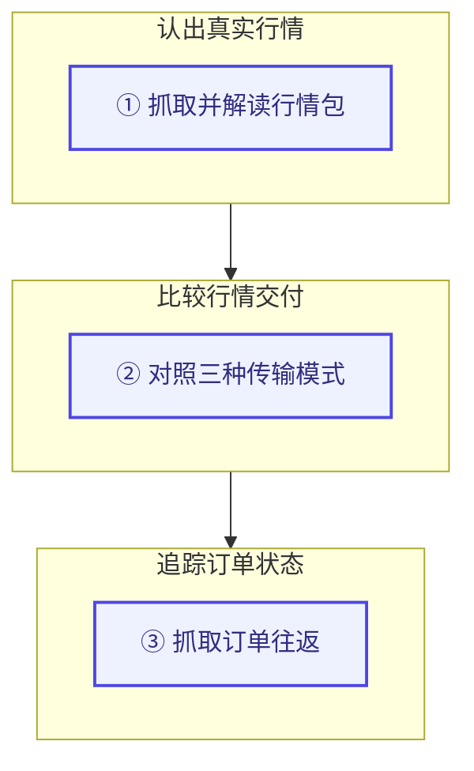

# 第三部分：真实交易流量与协议——从行情事件到订单回报

## 打开行情包与订单回执

第二章已经让行情刷新、订单成交。本章沿着这两个现象读报文：**一包行情写了什么，双路收到的两份是不是同一条消息，一笔订单怎样从请求走到成交。**

ITCH 与 OUCH 是 Nasdaq 的协议产品名。ITCH 描述市场上发生的行情事件；OUCH 让订单接入程序发送请求、接收回报。行情内容装在 MoldUDP64 中，通过 UDP 发送；订单内容装在 SoupBinTCP 中，通过 TCP 发送。可以把它们理解为两组“信件与信封”：

| 业务内容 | 外层封装 | 谁发给谁 |
| --- | --- | --- |
| ITCH 行情事件 | MoldUDP64：标明行情批次、消息序号与边界 | Exchange（课程交易所程序）.1 → .2 行情接收器 |
| OUCH 订单请求与回报 | SoupBinTCP：在 TCP 字节流中标出消息边界 | .2 Trader（订单客户端）→ .1 下单，.1 → .2 回报 |

这里继续使用第二章的两类客户端：**AUTO** 自动策略客户端与 **MANUAL** 手工订单客户端。它们共享同一行情接收器，但各自维护订单 TCP 连接。本章的抓包文件采用 **pcap** 格式，保存报文原始字节及抓取时间，便于事后重新解码。

| 官方入口 | 本章用途 |
| --- | --- |
| [TotalView-ITCH 5.0](https://www.nasdaqtrader.com/content/technicalsupport/specifications/dataproducts/NQTVITCHSpecification_5.0.pdf) | 行情事件类型、股票身份与订单字段 |
| [MoldUDP64](https://www.nasdaqtrader.com/content/technicalsupport/specifications/dataproducts/moldudp64.pdf) | 行情消息的编号与长度 |
| [OUCH 5.0](https://www.nasdaqtrader.com/content/technicalsupport/specifications/TradingProducts/OUCH5.0.pdf) | 下单、受理、成交与拒绝 |
| [SoupBinTCP](https://www.nasdaqtrader.com/content/technicalsupport/specifications/dataproducts/soupbintcp.pdf) | 订单连接的登录与分帧 |

**“真实流量”指实验室网线上的实包。** ITCH 内容来自 Nasdaq 2026-06-12 的公开历史样例，保留 AAPL/NVDA 消息原字节；外层封装与模拟订单由课程程序生成，成交也只记入模拟账本。.2 模拟已有订单通道的会员侧客户端，没有连接 Nasdaq 生产系统，也没有真实资金或清算。

## 本章学习目标

1. 从一份 pcap 读出行情批次、连续消息序号，以及一条新增订单行情的字段。
2. 比较单播、组播与双路的目的地址和副本数量，说明应用怎样避免重复更新盘口。
3. 找出一笔手工单的请求、受理和成交，用客户端编号关联报文与第二章的交易记录。

## 本章导航

<div style="border-left:6px solid #7e22ce;background:#f3e8ff;padding:12px 16px;border-radius:8px;margin:14px 0;"><span style="display:inline-block;padding:3px 12px;border-radius:6px;background:#7e22ce;color:#fff;font-weight:800;">本章导航</span> <span style="font-weight:700;color:#581c87;">本章分成 3 部分，共 3 个导航项。先拆一包行情，再比较交付模式，最后追踪一笔订单；继续使用第二章的在线平台。</span></div>



固定顺序就是：**认出真实行情 → 比较行情交付 → 追踪订单状态**。

## 任务地图

| 导航项 | 所属部分 | 这一项回答什么 |
| --- | --- | --- |
| 运行 ①：抓取并解读真实行情包 | 认出真实行情 | 从 pcap 读出 MoldUDP64 与 ITCH 字段 |
| 运行 ②：对照三种行情传输模式 | 比较行情交付 | 用端点与消息序号判断副本和去重 |
| 运行 ③：抓取一笔真实订单往返 | 追踪订单状态 | 用 UserRefNum 关联 OUCH 请求与回报 |

## 运行 ①：抓取并解读真实行情包

网页上的五档盘口已经是计算结果。本步在 .2 的数据口 ens64np1 保存 200 个组播 UDP 包，再从原始字节还原其中一条新增订单行情。

<div style="border:2px solid #4f46e5;background:#eef2ff;padding:10px 12px;border-radius:8px;margin:14px 0;"><div style="font-weight:900;color:#312e81;margin-bottom:4px;">导航卡 · 认出真实行情</div><div style="font-weight:700;color:#312e81;margin-bottom:8px;">范畴：分步实验　本步知识：从 pcap 读出 MoldUDP64 与 ITCH 字段　位置：全章第 1 / 3 项 · 本组第 1 / 1 项</div><span style="display:inline-block;margin:3px;padding:4px 10px;border-radius:6px;background:#15803d;color:#fff;font-weight:800;">运行 ①：抓取并解读真实行情包</span></div>

### 先分清两条业务路径

<div style="border-left:6px solid #7e22ce;background:#f3e8ff;padding:12px 16px;border-radius:8px;margin:14px 0;"><span style="display:inline-block;padding:3px 12px;border-radius:6px;background:#7e22ce;color:#fff;font-weight:800;">关键图</span> <span style="font-weight:700;color:#581c87;">行情向外发布；订单沿两个客户端各自的连接发送，回报沿原连接返回。本步先看上半条行情路径。</span></div>

<div style="max-width:820px;margin:14px auto;">

</div>

ITCH 的 **Add Order（新增订单，类型 A）** 是通知接收者“市场订单簿新增了一笔挂单”，不是让本机下单。随后可能还有该订单的成交、删除或替换消息。接收这些事件、检查顺序并更新本地订单簿的应用逻辑，称为 **Feed Handler（行情处理逻辑）**；它在 AUTO/MANUAL 内各有一份，不是另一个需要安装的程序。

### 一包行情怎样逐层拆开

**载荷（payload）**是去掉某层包头后剩下的内容。这里 UDP 的载荷依次为：MoldUDP64 包头、消息长度、ITCH 消息。下图展开的是一包只带一条 Type A 的情况，第八章过滤时也使用这张图。

<a id="market-wire-fields"></a>

<div style="border-left:6px solid #7e22ce;background:#f3e8ff;padding:12px 16px;border-radius:8px;margin:14px 0;"><span style="display:inline-block;padding:3px 12px;border-radius:6px;background:#7e22ce;color:#fff;font-weight:800;">关键图 · 行情字段共用图</span> <span style="font-weight:700;color:#581c87;">从外到内读：先找到 UDP 载荷，再切出 Mold 包头与一条 ITCH，最后读 Type A 的字段。每层偏移都从该层第 0 字节起算，不能混用。</span></div>

<div style="max-width:820px;margin:14px auto;">

</div>

图里的 **偏移（offset）**表示距离起点多少字节；**宽度**表示字段占多少字节。**大端（big-endian）**表示多字节整数先放高位字节，例如整数 1 用两字节写成十六进制 00 01。Mold 与这里的 ITCH 数值字段都这样编码；**ASCII** 则用于字母和空格，每个字符占一字节。

**先读 Mold 的交付信息。** 下表偏移相对于 UDP 载荷起点：

| 偏移 / 宽度（字节） | 字段 | 本步怎样理解 |
| --- | --- | --- |
| 0 / 10 | Session | 行情批次标识。课程用市场日期与回放轮次生成，如 0612260001；它不是 TCP 连接号 |
| 10 / 8 | Sequence Number | 本包第一条 ITCH 的消息序号；第 k 条为 first_sequence + k - 1，k 从 1 起算 |
| 18 / 2 | Message Count | 后面装了几条消息。当前发布程序每包发 1 条，协议本身允许多条 |
| 20 / 2 | 第一条 Message Length | 只算这条 ITCH 的长度，不含长度字段自身的 2 字节；Type A 为 36 |
| 22 / 变长 | 第一条 Message Data | ITCH 原字节；有多条时继续读取下一组“长度 + 消息” |

**再读 ITCH 的业务信息。** 图中前 11 字节是共同消息头，后面按类型变化。Type A 的所有字段只在这里解释一次，抓包输出沿用同名：

| 字段 | 含义与读法 |
| --- | --- |
| Message Type | 行情事件类型；A 表示新增展示订单 |
| Stock Locate | 当天分配给证券的短整数索引。本课历史数据为 37 ↔ AAPL、8095 ↔ NVDA；换数据日期应重新读取证券目录消息 R 的对应关系 |
| Tracking Number | Nasdaq 内部跟踪号，不是用于判断丢包的 Mold 消息序号 |
| Timestamp | 事件发生时距源交易日午夜的纳秒数，1 秒 = 10 亿纳秒；不是本机抓包时间，也不能单独算网络延迟 |
| Order Reference Number | 市场挂单的引用号。后续删除、成交等事件凭它找到原订单 |
| Buy/Sell Indicator | 这笔展示挂单的方向：B 为买，S 为卖 |
| Shares | 这笔挂单的股数，整数 200 就是 200 股 |
| Stock | 股票代码。固定 8 字节，NVDA 在线上是 NVDA 加 4 个空格，不是四字节整数 |
| Price | 4 字节整数，隐含四位小数；2044800 表示 204.4800 |

Stock Locate 在同一交易日内稳定，不保证跨日相同；Stock 才是通常阅读的股票代码。后续按股票过滤时，检查的是图中 **Type、Stock Locate、Stock** 三个字段；价格、股数与方向仍保留，但不参与那条筛选规则。[ITCH 字段规范](https://www.nasdaqtrader.com/content/technicalsupport/specifications/dataproducts/NQTVITCHSpecification_5.0.pdf)

### 不是每条行情都带完整订单

读懂 A 后，其余事件只需关注“怎样改变已有状态”，不用重新背一遍共同头：

| ITCH 类型 / 长度 | 事件 | 对本地订单簿的作用 |
| --- | --- | --- |
| A / 36 | Add Order：新增展示订单 | 建立引用号与股票、方向、数量、价格的对应关系 |
| F / 40 | Add Order with Attribution：带参与者标识的新增订单 | 与 A 相同，末尾再带 4 字节参与者标识 |
| E / 31 | Order Executed：挂单有数量成交 | 按引用号扣减 Executed Shares（本次成交股数）；Match Number 标识该次成交 |
| D / 19 | Order Delete：删除 | 按引用号删除全部剩余数量 |
| U / 35 | Order Replace：替换 | 撤下旧引用号，按新引用号、数量、价格建新单；股票与方向继承原单 |
| P / 44 | Trade：非展示订单成交 | 用于成交统计，不增减展示订单簿；其方向字段固定为 B，不能据此判断真实买卖方向 |

E/D/U 仍带 Stock Locate，但没有明文 Stock。即使知道股票，处理程序也要保存原单，才能找到要扣减或移除的价格档。**网页五档是这些订单按价格聚合的结果，不是五种消息类型；P 不改变展示簿。** 历史 ITCH 事件也不会变成 AUTO/MANUAL 模拟账本中的一笔新成交。

Mold 负责另一件事：同一 Session 内按消息序号连续交付。同序号副本记为 **duplicate（重复）**；先来的后续消息暂存为 **pending（等待前序的消息）**；前序缺失形成 **gap（缺口）**。当前课程没有自动补包服务，切换单播或组播也不会把已经缺失的历史消息补回来。

规范还定义了 Message Count = 0 的心跳与 0xffff（65535）的会话结束标记，它们没有 ITCH 消息；心跳中的序号表示下一条预期消息。补包请求则由接收端反向发送。当前 Exchange 只发布数据消息，因此本步抓包只检查数据包，不把心跳误作一种 ITCH 类型。[MoldUDP64 规范](https://www.nasdaqtrader.com/content/technicalsupport/specifications/dataproducts/moldudp64.pdf)

### 抓取、解码与读结果

**理论落到实验：** .111 记录原模式并临时切 MULTICAST；.2 的 tcpdump 保存原始包；scp 将文件取回 .111，解析器按上面的层次解码。以下关键命令已包含在绿色块内，REMOTE 是本次运行生成的临时 pcap 路径：

<div style="border-left:6px solid #7e22ce;background:#f3e8ff;padding:12px 16px;border-radius:8px;margin:14px 0;"><span style="display:inline-block;padding:3px 12px;border-radius:6px;background:#7e22ce;color:#fff;font-weight:800;">仅供展示 · 原始抓包命令</span> <span style="font-weight:700;color:#581c87;">在 .2 执行。-i 选接口，-nn 不把地址和端口改写成名称，-s 0 保存完整包，-c 200 收够即停，-w 写入文件；timeout 8 限制最多等待 8 秒。</span></div>

```text
timeout 8 tcpdump -i ens64np1 -nn -s 0 -c 200 -w "$REMOTE" \
  'udp dst port 31032 and dst host 233.74.125.32'
```

引号内是 tcpdump 的捕获过滤表达式：只保存目的组地址与目的端口匹配的 UDP 包。这里仅选择**保存哪些包**，不会丢弃应用收到的行情；与第八章主动丢包的过滤作用不同。

<div style="border-left:8px solid #4f46e5;background:#e0e7ff;padding:14px 18px;border-radius:8px;margin:16px 0;"><span style="display:inline-block;padding:4px 12px;border-radius:6px;background:#4f46e5;color:#fff;font-weight:900;">实验资源与 Profile 卡</span><div style="font-weight:800;color:#312e81;margin-top:8px;">沿用第二章普通 Linux 配置；使用 .1 Exchange、.2 ens64np1 与组播 233.74.125.32:31032。本步只临时改变行情发送模式，不改网卡驱动、交换机配置、策略或订单连接；完成后保留本地 pcap，删除远端临时文件并尝试恢复原模式。</div></div>

<div style="border-left:6px solid #dc2626;background:#fee2e2;padding:12px 16px;border-radius:8px;margin:14px 0;"><span style="display:inline-block;padding:3px 12px;border-radius:6px;background:#dc2626;color:#fff;font-weight:800;">模式切换与恢复</span> <span style="font-weight:700;color:#7f1d1d;">运行①②前确认网页行情为 HEALTHY（完整）、正在回放，第二章组播检查已通过。脚本切换与恢复后都会回读实际模式；失败时也尝试恢复，恢复请求失败或回读不符则退出125。此时暂停后续下单，检查网页并恢复原模式。出现 GAP 时切模式不能补回缺失行情，须先处理完整性问题。</span></div>

下面 39 行与文件入口 [01-capture-live-market.sh](assets/03-live-traffic/01-capture-live-market.sh) 逐字一致。显示工具只负责分段说明、回读已有文件和标注解析摘要，采集与控制动作均列在本块中。

<div style="border-left:6px solid #15803d;background:#dcfce7;padding:12px 16px;border-radius:8px;margin:14px 0;"><span style="display:inline-block;padding:3px 12px;border-radius:6px;background:#15803d;color:#fff;font-weight:800;">需要运行 · 运行 ①</span> <span style="font-weight:700;color:#14532d;">在管理机 .111 的仓库根目录以 root 执行。临时切 MULTICAST，在 .2 抓 200 包并取回；终端打印捕获统计、连续序号与一条新增订单行情的详细字段。应用保持在线，退出后按上方检查模式与行情健康。</span></div>

```bash
#!/usr/bin/env bash
set -euo pipefail
cd /financial-low-latency
REPO_ROOT=/financial-low-latency
SELF="$REPO_ROOT/Documents/newDoc/assets/03-live-traffic/01-capture-live-market.sh"
TOOLS="$REPO_ROOT/Documents/newDoc/assets/03-live-traffic"
STATE="$REPO_ROOT/Documents/reports/run-state/02-trading-baseline.env"
LABCTL="$REPO_ROOT/apps/flle-trading-lab/scripts/labctl.sh"
source "$STATE"
BASE_RUN_ID="$RUN_ID"
CHAPTER_RUN_ID="$(date -u +%Y%m%dT%H%M%SZ)-03-live-market"
OUT="$REPO_ROOT/Documents/reports/course-runs/$CHAPTER_RUN_ID"
REMOTE="/var/tmp/$CHAPTER_RUN_ID-market.pcap"
API="${WEB_URL%/}"
mkdir -p "$OUT/raw"
{
  python3 "$TOOLS/classroom-output.py" verify market "$LABCTL" "$BASE_RUN_ID"
  bash "$LABCTL" verify "$BASE_RUN_ID" >"$OUT/raw/verify.txt" 2>&1 || { rc=$?; tail -n 20 "$OUT/raw/verify.txt"; exit "$rc"; }
  ORIGINAL_MODE="$(curl -fsS --max-time 10 "$API/api/state" | python3 -c 'import json,sys;print(json.load(sys.stdin)["market_mode"])')"
  source "$TOOLS/market-mode.sh"
  trap cleanup_market EXIT
  python3 "$TOOLS/classroom-output.py" mode market "$API" MULTICAST
  set_mode MULTICAST
  python3 "$TOOLS/classroom-output.py" capture market "$REMOTE"
  ssh root@10.1.1.2 "rm -f '$REMOTE'; timeout 8 tcpdump -i ens64np1 -nn -s 0 -c 200 -w '$REMOTE' 'udp dst port 31032 and dst host 233.74.125.32'" 2>&1 | tee "$OUT/raw/tcpdump.txt"
  scp "root@10.1.1.2:$REMOTE" "$OUT/raw/live-market.pcap" >/dev/null
  python3 "$TOOLS/classroom-output.py" decode market "$OUT"
  python3 "$TOOLS/inspect_market_pcap.py" "$OUT/raw/live-market.pcap" | tee "$OUT/raw/decoded.txt" | python3 "$TOOLS/classroom-output.py" annotate market
  restore_market_mode; trap - EXIT; cleanup_capture
  {
    printf 'CHAPTER_RUN_ID=%s\nBASE_RUN_ID=%s\n' "$CHAPTER_RUN_ID" "$BASE_RUN_ID"
    printf 'CAPTURE_HOST=10.1.1.2\nCAPTURE_INTERFACE=ens64np1\nORIGINAL_MODE=%s\n' "$ORIGINAL_MODE"
  } >"$OUT/run.env"
  sha256sum "$SELF" "$TOOLS/market-mode.sh" "$TOOLS/classroom-output.py" "$TOOLS/pcap_tools.py" "$TOOLS/inspect_market_pcap.py" \
    "$OUT/raw/"*.json \
    "$OUT/raw/"*-native.txt "$OUT/raw/live-market.pcap" "$OUT/raw/tcpdump.txt" "$OUT/raw/decoded.txt" "$OUT/run.env" >"$OUT/SHA256SUMS"
  sha256sum -c "$OUT/SHA256SUMS" >/dev/null
} 2>&1 | tee "$OUT/classroom.txt"
sha256sum "$OUT/classroom.txt" "$OUT/SHA256SUMS" >"$OUT/CLASSROOM_SHA256SUMS"
```

<div style="border-left:6px solid #7e22ce;background:#f3e8ff;padding:12px 16px;border-radius:8px;margin:14px 0;"><span style="display:inline-block;padding:3px 12px;border-radius:6px;background:#7e22ce;color:#fff;font-weight:800;">仅供展示 · 行情输出</span> <span style="font-weight:700;color:#581c87;">下面按新打印格式展示历史抓包的本地回放节选：捕获统计、tcpdump 原生回读、Mold/ITCH 解码。新格式仍待实机确认；展示命令中的长路径以 …/ 简写。重新运行时序号、端口和事件取值会变化，字段位置与读法不变。</span></div>

```text
10.1.1.2 / capture
===== 抓取 200 个组播行情包 =====
[抓包] 对: 200 packets captured；kernel drops 为 0  证: 本窗口的抓包完整性
$ timeout 8 tcpdump -i ens64np1 -nn -s 0 -c 200 -w …/capture.pcap 'udp dst port 31032 and dst host 233.74.125.32'
tcpdump: listening on ens64np1, link-type EN10MB (Ethernet), snapshot length 262144 bytes
200 packets captured
1337 packets received by filter
0 packets dropped by kernel

Low-Latency-Ops / readback
===== 查行情包的原始端点 =====
[报文] 对: 源 20.1.1.1，目的 233.74.125.32.31032  证: 组播包到达 Trader 数据口
$ tcpdump -nn -t -r …/live-market.pcap -c 3
reading from file …/live-market.pcap, link-type EN10MB (Ethernet), snapshot length 262144
IP 20.1.1.1.35580 > 233.74.125.32.31032: UDP, length 41
IP 20.1.1.1.35580 > 233.74.125.32.31032: UDP, length 41
IP 20.1.1.1.35580 > 233.74.125.32.31032: UDP, length 58
[解码说明] 以下字段由配套解析器读取原始文件生成；统计与 verdict 是程序汇总，不是 tcpdump 原文。

Low-Latency-Ops / decode
===== 解码 Mold 与 ITCH 字段 =====
[解码] 对: 同一 session 内序号连续，Type A 长度 36  证: 消息顺序与字段边界
$ python3 /financial-low-latency/Documents/newDoc/assets/03-live-traffic/inspect_market_pcap.py …/live-market.pcap
pcap_magic=d4c3b2a1 linktype=1 packets=200 mold_packets=200
path=20.1.1.1:35580->233.74.125.32:31032 session=0612260001
sequence=287296..287495 message_count=1..1 itch_types=A:36,D:151,P:2,U:11
Frame 3: 100 bytes on wire, 100 bytes captured
Ethernet II, Src: 00:0f:53:d3:af:20, Dst: 01:00:5e:4a:7d:20
Internet Protocol Version 4, Src: 20.1.1.1, Dst: 233.74.125.32
User Datagram Protocol, Src Port: 35580, Dst Port: 31032
MoldUDP64
    Session: 0612260001
    Sequence Number: 287298
    Message Count: 1
    Message Length: 36
Nasdaq TotalView-ITCH 5.0
    Message Type: A (Add Order)
    Stock Locate: 8095
    Tracking Number: 0
    Timestamp: 34260031883202
    Order Reference Number: 85004199
    Buy/Sell Indicator: S
    Shares: 200
    Stock: NVDA
    Price: 2044800
verdict=LIVE_MARKET_FLOW_PASS
[就绪说明] LIVE_MARKET_FLOW_PASS 是解析器自拼的有限检查汇总，表示本窗口解析及内置检查走通；须核对原始端点、序号与字段，不代表长期无丢包。
```

这棵逐层缩进的输出称为 **Packet Details（报文详情）**。它由配套解析器从 pcap 生成，不是 Wireshark 截图；Ethernet/IP/UDP 使用常见协议层名，Mold/ITCH 使用上面的官方字段名。

tcpdump 的 **captured** 是捕获数，**dropped by kernel** 是抓包机制报告的内核丢弃数，**received by filter** 是捕获过滤统计，不要求它与 captured 相等。“抓包未丢”不能代替行情接收 Socket 的健康检查。

itch_types 中 A:36 表示窗口内有 36 条 A，**不是 A 的字节长度**。本例第 3 帧带一条 36 字节 A，与共用图的字段边界对应；窗口没有 E/F 时，统计中不列它们。

<div style="border-left:6px solid #0891b2;background:#cffafe;padding:12px 16px;border-radius:8px;margin:14px 0;"><span style="display:inline-block;padding:3px 12px;border-radius:6px;background:#0891b2;color:#fff;font-weight:800;">关键现象</span> <span style="font-weight:700;color:#164e63;">先核对目的端点，再核对连续消息序号，最后把一条 A 读成“哪只股票、哪一侧、多少股、什么价”。解析通过说明这个抓取窗口中的关系成立，不证明长期无丢包。</span></div>

## 运行 ②：对照三种行情传输模式

同一条 ITCH 可以用不同方式送到 .2。本步不再重复拆字段，改看目的端点与消息序号：一份还是两份，两份是否会使盘口更新两次。

<div style="border:2px solid #4f46e5;background:#eef2ff;padding:10px 12px;border-radius:8px;margin:14px 0;"><div style="font-weight:900;color:#312e81;margin-bottom:4px;">导航卡 · 比较行情交付</div><div style="font-weight:700;color:#312e81;margin-bottom:8px;">范畴：分步实验　本步知识：用端点与消息序号判断副本和去重　位置：全章第 2 / 3 项 · 本组第 1 / 1 项</div><span style="display:inline-block;margin:3px;padding:4px 10px;border-radius:6px;background:#15803d;color:#fff;font-weight:800;">运行 ②：对照三种行情传输模式</span></div>

### 发送模式决定网络上有几份

<div style="border-left:6px solid #7e22ce;background:#f3e8ff;padding:12px 16px;border-radius:8px;margin:14px 0;"><span style="display:inline-block;padding:3px 12px;border-radius:6px;background:#7e22ce;color:#fff;font-weight:800;">关键图</span> <span style="font-weight:700;color:#581c87;">三种模式使用相同的 Mold/ITCH 内容。单播和组播各送一份，双路各送一份；到主机后仍由同一接收器分发给 AUTO/MANUAL。</span></div>

<div style="max-width:820px;margin:14px auto;">

</div>

| 发送模式 | Exchange 发往哪里 | .2 数据口应收到什么 |
| --- | --- | --- |
| UNICAST（单播） | 20.1.1.2:42121 | 一份单播 |
| MULTICAST（组播） | 233.74.125.32:31032 | 交换机按组成员端口转发的一份组播 |
| DUAL（双路） | 同时发往上述两个端点 | 同一 Session、同一 Sequence 的两个副本 |

第二章启用的 direct 接收配置一直保留：flle-feed-receiver 同时监听单播与组播，再通过 **Unix Socket（同机进程通信通道）**分发。切换的是 Exchange 的**发送模式**，不是反复加组或换接收程序。AUTO/MANUAL 各自的 Feed Handler 只把第一份有效且已连续的消息交给订单簿，第二份只增加重复计数；这就是 **去重**。

本课两种副本仍经过同一台 Exchange、同一交换机与同一数据口，不是具有独立故障路径的两套生产行情源。实验只比较副本与处理结果，延迟比较留到第四章统一测量条件后进行。

序号只在同一 Session 内有意义。三窗比较期间保持同一轮回放，不点击“重新开始并清空交易”；当前对照工具按序号求交集，不能用它判断跨 Session 的消息是否相同。中途重置过回放，这组对照结果就应作废。

### 对照时看哪些证据

第二章已经完成组播配置与成员检查。这里先只读查询交换机，确认 VLAN20 的成员转发仍有效，然后切三种模式；若交换机重启过，先回第二章准备 C 恢复并核对，不在本步重复配置。

**理论落到实验：** 用同一个捕获表达式查看两个目的端口，三种模式**各抓 120 包，总计三份 pcap**。DUAL 的 120 包是两个端点的合计，不是每端口各 120 包。应用中的重复计数则在抓包前后读取，观察窗口比 pcap 略长。

<div style="border-left:6px solid #7e22ce;background:#f3e8ff;padding:12px 16px;border-radius:8px;margin:14px 0;"><span style="display:inline-block;padding:3px 12px;border-radius:6px;background:#7e22ce;color:#fff;font-weight:800;">仅供展示 · 三种模式共用的抓包命令</span> <span style="font-weight:700;color:#581c87;">在 .2 执行，remote 是当前模式对应的临时文件。目的端口 31032 或 42121 命中即可保存，解析时再核对完整 IP 与端口。</span></div>

```text
timeout 8 tcpdump -i ens64np1 -nn -s 0 -c 120 -w "$remote" \
  'udp and (dst port 31032 or dst port 42121)'
```

<div style="border-left:8px solid #4f46e5;background:#e0e7ff;padding:14px 18px;border-radius:8px;margin:16px 0;"><span style="display:inline-block;padding:4px 12px;border-radius:6px;background:#4f46e5;color:#fff;font-weight:900;">实验资源与 Profile 卡</span><div style="font-weight:800;color:#312e81;margin-top:8px;">沿用第二章普通 Linux 配置与现有行情接收器；使用 .1、.2 ens64np1、UDP 31032/42121。本步变量仅为 Exchange 的发送模式；不改策略、网卡归属、主机地址或交换机配置。三份 pcap 留在 .111，远端临时文件清理，退出后核对原模式与行情健康。</div></div>

下面 41 行与文件入口 [02-compare-market-transports.sh](assets/03-live-traffic/02-compare-market-transports.sh) 逐字一致。显示工具只负责分段说明、回读已有文件和标注解析摘要，采集与控制动作均列在本块中。

<div style="border-left:6px solid #15803d;background:#dcfce7;padding:12px 16px;border-radius:8px;margin:14px 0;"><span style="display:inline-block;padding:3px 12px;border-radius:6px;background:#15803d;color:#fff;font-weight:800;">需要运行 · 运行 ②</span> <span style="font-weight:700;color:#14532d;">在 .111 仓库根目录以 root 执行，前置为运行①通过、组播成员正常且行情健康。依次切 UNICAST、MULTICAST、DUAL，每种模式抓 120 包；终端打印端点计数、序号重合与应用重复增量。退出后按运行①的恢复说明检查。</span></div>

```bash
#!/usr/bin/env bash
set -euo pipefail
REPO_ROOT=/financial-low-latency; cd "$REPO_ROOT"
SELF="$REPO_ROOT/Documents/newDoc/assets/03-live-traffic/02-compare-market-transports.sh"
TOOLS="$REPO_ROOT/Documents/newDoc/assets/03-live-traffic"
source "$REPO_ROOT/Documents/reports/run-state/02-trading-baseline.env"
BASE_RUN_ID="$RUN_ID"; API="${WEB_URL%/}"
CHAPTER_RUN_ID="$(date -u +%Y%m%dT%H%M%SZ)-03-market-paths"
OUT="$REPO_ROOT/Documents/reports/course-runs/$CHAPTER_RUN_ID"; mkdir -p "$OUT/raw"
{
  python3 Documents/newDoc/assets/common/eos_cli.py --mode show --plan "Documents/newDoc/assets/02-trading-baseline/igmp-show.plan" --output "$OUT/raw/switch-igmp.txt" >/dev/null
  python3 Documents/newDoc/assets/02-trading-baseline/inspect-igmp.py "$OUT/raw/switch-igmp.txt" --members --display
  ORIGINAL_MODE="$(curl -fsS --max-time 10 "$API/api/state" | python3 -c 'import json,sys;print(json.load(sys.stdin)["market_mode"])')"
  source "$TOOLS/market-mode.sh"
  trap cleanup_market EXIT
  capture() {
    set_mode "$1"; remote="/var/tmp/$CHAPTER_RUN_ID-$1.pcap"
    python3 "$TOOLS/classroom-output.py" capture transports "$remote" "$1"
    ssh root@10.1.1.2 "rm -f '$remote'; timeout 8 tcpdump -i ens64np1 -nn -s 0 -c 120 -w '$remote' 'udp and (dst port 31032 or dst port 42121)'" 2>&1 | tee "$OUT/raw/$1-tcpdump.txt"
    scp "root@10.1.1.2:$remote" "$OUT/raw/$1.pcap" >/dev/null
  }
  capture UNICAST
  capture MULTICAST
  set_mode DUAL
  BEFORE="$(curl -fsS "$API/api/state" | python3 -c 'import json,sys;print(json.load(sys.stdin)["feed"]["duplicates"])')"
  capture DUAL
  for _ in $(seq 1 20); do
    AFTER="$(curl -fsS "$API/api/state" | python3 -c 'import json,sys;print(json.load(sys.stdin)["feed"]["duplicates"])')"; [ "$AFTER" -gt "$BEFORE" ] && break; sleep 0.2
  done
  FINAL="$(curl -fsS "$API/api/state")"
  read -r PENDING GAPS < <(python3 -c 'import json,sys;d=json.load(sys.stdin)["feed"];print(d["pending"], d["gaps"])' <<<"$FINAL")
  ssh root@10.1.1.2 'ip maddr show dev ens64np1' >"$OUT/raw/membership.txt"
  USERS="$(awk '$1=="inet" && $2=="233.74.125.32" {print ($3=="users" ? $4 : 1)}' "$OUT/raw/membership.txt")"
  python3 "$TOOLS/classroom-output.py" decode transports "$OUT" "$BEFORE" "$AFTER" "$USERS" "$PENDING" "$GAPS"
  python3 "$TOOLS/inspect_transport_pcaps.py" "$OUT/raw/UNICAST.pcap" "$OUT/raw/MULTICAST.pcap" "$OUT/raw/DUAL.pcap" --duplicates-before "$BEFORE" --duplicates-after "$AFTER" --membership-users "$USERS" --pending "$PENDING" --gaps "$GAPS" | tee "$OUT/raw/decoded.txt" | python3 "$TOOLS/classroom-output.py" annotate transports
  restore_market_mode; trap - EXIT; cleanup_capture
  printf 'CHAPTER_RUN_ID=%s\nBASE_RUN_ID=%s\nORIGINAL_MODE=%s\n' "$CHAPTER_RUN_ID" "$BASE_RUN_ID" "$ORIGINAL_MODE" >"$OUT/run.env"
  sha256sum "$SELF" "$TOOLS/market-mode.sh" "$TOOLS/classroom-output.py" "$TOOLS/pcap_tools.py" "$TOOLS/inspect_transport_pcaps.py" "$OUT"/raw/* "$OUT/run.env" >"$OUT/SHA256SUMS"
  sha256sum -c "$OUT/SHA256SUMS" >/dev/null
} 2>&1 | tee "$OUT/classroom.txt"
sha256sum "$OUT/classroom.txt" "$OUT/SHA256SUMS" >"$OUT/CLASSROOM_SHA256SUMS"
```

<div style="border-left:6px solid #7e22ce;background:#f3e8ff;padding:12px 16px;border-radius:8px;margin:14px 0;"><span style="display:inline-block;padding:3px 12px;border-radius:6px;background:#7e22ce;color:#fff;font-weight:800;">仅供展示 · 三模式输出</span> <span style="font-weight:700;color:#581c87;">下面是历史原件按新打印格式的本地回放节选：交换机成员、三份 pcap 的原生端点、主机订阅、解析对照。新格式仍待实机确认，长路径以 …/ 简写；重合数和应用重复增量随窗口变化。</span></div>

```text
10.1.1.253 / verify
===== 查行情组的成员端口 =====
[成员] 对: VLAN20 / 233.74.125.32 / Dynamic / Et2  证: 接收者在 Trader 数据口
$ show ip igmp snooping groups
20    233.74.125.32    Dynamic  -                      Et2

Low-Latency-Ops / readback
===== 查 UNICAST 的原始目的地址 =====
[报文] 对: 单播 .2:42121；组播 233.74.125.32:31032  证: 识别本窗口的交付路径
$ tcpdump -nn -t -r …/UNICAST.pcap -c 2
reading from file …/UNICAST.pcap, link-type EN10MB (Ethernet), snapshot length 262144
IP 20.1.1.1.35580 > 20.1.1.2.42121: UDP, length 41
IP 20.1.1.1.35580 > 20.1.1.2.42121: UDP, length 58

Low-Latency-Ops / readback
===== 查 MULTICAST 的原始目的地址 =====
[报文] 对: 单播 .2:42121；组播 233.74.125.32:31032  证: 识别本窗口的交付路径
$ tcpdump -nn -t -r …/MULTICAST.pcap -c 2
reading from file …/MULTICAST.pcap, link-type EN10MB (Ethernet), snapshot length 262144
IP 20.1.1.1.35580 > 233.74.125.32.31032: UDP, length 41
IP 20.1.1.1.35580 > 233.74.125.32.31032: UDP, length 41

Low-Latency-Ops / readback
===== 查 DUAL 的原始目的地址 =====
[报文] 对: 单播 .2:42121；组播 233.74.125.32:31032  证: 识别本窗口的交付路径
$ tcpdump -nn -t -r …/DUAL.pcap -c 2
reading from file …/DUAL.pcap, link-type EN10MB (Ethernet), snapshot length 262144
IP 20.1.1.1.35580 > 233.74.125.32.31032: UDP, length 58
IP 20.1.1.1.35580 > 20.1.1.2.42121: UDP, length 58

10.1.1.2 / membership
===== 查行情组的主机订阅 =====
[成员] 对: inet 233.74.125.32；一个订阅时省略 users  证: 行情接收器已加组
$ ip maddr show dev ens64np1
	inet  233.74.125.32
[解码说明] 以下字段由配套解析器读取原始文件生成；统计与 verdict 是程序汇总，不是 tcpdump 原文。

Low-Latency-Ops / decode
===== 对照三种模式与应用计数 =====
[解码] 对: DUAL 两端点有包、重合与 duplicate_delta 大于 0、pending/gaps 为 0  证: 短窗口副本及去重关系
$ python3 /financial-low-latency/Documents/newDoc/assets/03-live-traffic/inspect_transport_pcaps.py …/UNICAST.pcap …/MULTICAST.pcap …/DUAL.pcap --duplicates-before 0 --duplicates-after 921 --membership-users 1 --pending 0 --gaps 0
mode=UNICAST captured=120 multicast=0 unicast=120
mode=MULTICAST captured=120 multicast=120 unicast=0
mode=DUAL captured=120 multicast=60 unicast=60
membership=233.74.125.32 users=1 dual_sequence_overlap=60 duplicate_delta=921 pending=0 gaps=0
verdict=THREE_TRANSPORT_MODES_PASS
[就绪说明] THREE_TRANSPORT_MODES_PASS 是解析器自拼的有限检查汇总，表示三窗解析及内置检查走通；须核对目的地址、序号重合和应用计数，不代表长期无丢包。
```

本例 dual_sequence_overlap=60，表示两个目的端点共有 60 个消息序号；duplicate_delta=921 是应用在另一段观察窗口中的重复增量，二者无需相等。这里比较的是同一 Session 内的数值序号。

原始 ip maddr 输出只有一个订阅时通常省略 users；解析器将它归一化为 users=1。交换机成员表说明转发端口，主机成员说明订阅，pcap 说明到达的字节，应用计数说明处理结果，四者不能互相替代。

<div style="border-left:6px solid #0891b2;background:#cffafe;padding:12px 16px;border-radius:8px;margin:14px 0;"><span style="display:inline-block;padding:3px 12px;border-radius:6px;background:#0891b2;color:#fff;font-weight:800;">关键现象</span> <span style="font-weight:700;color:#164e63;">请核对 DUAL 的两个目的端点都有包、序号重合与应用重复增量均大于 0，再看 pending/gaps 是否为 0。“收到 120 包”不能直接读成“处理了 120 条不同事件”，两路都有包也不能代替缺口检查。</span></div>

## 运行 ③：抓取一笔真实订单往返

前两步只研究行情。本步沿 MANUAL 现有 TCP 连接再发一笔模拟订单，抓出请求和回报，并把报文中的客户端编号与交易结果对上。

<div style="border:2px solid #4f46e5;background:#eef2ff;padding:10px 12px;border-radius:8px;margin:14px 0;"><div style="font-weight:900;color:#312e81;margin-bottom:4px;">导航卡 · 追踪订单状态</div><div style="font-weight:700;color:#312e81;margin-bottom:8px;">范畴：分步实验　本步知识：用 UserRefNum 关联 OUCH 请求与回报　位置：全章第 3 / 3 项 · 本组第 1 / 1 项</div><span style="display:inline-block;margin:3px;padding:4px 10px;border-radius:6px;background:#15803d;color:#fff;font-weight:800;">运行 ③：抓取一笔真实订单往返</span></div>

### 先分帧，再认请求和回报

TCP 提供有序字节流，不保留应用消息的边界：一条消息可能跨多个 TCP 报文，多条消息也可能合在一个报文中。**分帧（framing）**就是从字节流里重新切出完整消息。SoupBinTCP 用“2 字节 Packet Length + 1 字节 Packet Type + 消息内容”完成这件事；Packet Length 计算后两项，不包括自身的 2 字节。

Soup 的 **U（Unsequenced Data，未编号业务数据）**承载客户端请求，**S（Sequenced Data，按会话顺序编号的业务数据）**承载服务端回报。U/S 属于外层，里面才是 OUCH 的消息类型。S 也不是像 Mold 那样在每条消息中显式携带序号，而是由会话双方按消息计数。[SoupBinTCP 规范](https://www.nasdaqtrader.com/content/technicalsupport/specifications/dataproducts/soupbintcp.pdf)

<div style="border-left:6px solid #7e22ce;background:#f3e8ff;padding:12px 16px;border-radius:8px;margin:14px 0;"><span style="display:inline-block;padding:3px 12px;border-radius:6px;background:#7e22ce;color:#fff;font-weight:800;">关键图 · 一笔订单的消息与编号</span> <span style="font-weight:700;color:#581c87;">沿 MANUAL 的既有连接向下读。请求 O 装在 Soup U 内，受理 A 与成交 E 分别装在 Soup S 内；客户端编号贯穿三条消息，服务端另外分配订单引用号和成交编号。</span></div>

<div style="max-width:820px;margin:14px auto;">

</div>

| OUCH 类型 | 谁发给谁 | 表示什么 |
| --- | --- | --- |
| O / Enter Order | 客户端 → Exchange | 申请下单 |
| A / Order Accepted | Exchange → 客户端 | 订单已受理，尚不能据此认定成交 |
| E / Order Executed | Exchange → 客户端 | 回报本次成交数量与价格 |
| J / Rejected | Exchange → 客户端 | 订单被拒绝，需查看原因 |

这里的 OUCH A 与前面的 ITCH A 不是一回事：前者回答“你的订单已受理”，后者通知“市场新增了展示订单”。**必须先认协议层，再读字母。** Soup 自己还有登录 L/A（申请/接受）与登录拒绝 J；连接在抓包前已建立，因此短窗口没有这些登录消息是正常的。

### 四个编号分别归谁

第二章管理接口返回的 **client_order_id（客户端编号）**，在线上对应 OUCH 的 **UserRefNum**。它由客户端按规则生成，返回给网页只表示本地已接收并排队，不等于 Exchange 已受理。

| 字段 / 宽度 | 谁生成 | 出现在哪里、用来做什么 |
| --- | --- | --- |
| UserRefNum / 4 字节整数 | 客户端 | O/A/E/J 都带回同一个值，本步靠它把请求、受理、成交对成一笔 |
| ClOrdID / 14 字节字符 | 客户端 | 请求 O 与回报 A/J 中的客户自定义标识；课程 MANUAL 使用 MANU 加客户端编号，E 不带它 |
| Order Reference Number / 8 字节整数 | Exchange | 在 A 中分配给已受理订单的服务端引用号，输出简写为 order_ref |
| Match Number / 8 字节整数 | Exchange | 在 E 中标识这一次成交，输出简写为 match；一笔订单可以有多次成交 |

客户端能决定的是自己负责的标识，不能替交易所决定服务端编号。Nasdaq 的 UserRefNum 在规定账户与编号流范围内要保持当日唯一、严格递增；它不是随意填写的备注。ClOrdID 则是另一项字符标识，不能代替 UserRefNum 的去重与关联规则。[OUCH 5.0 编号规则](https://www.nasdaqtrader.com/content/technicalsupport/specifications/TradingProducts/OUCH5.0.pdf)

课程 OUCH 的订单引用号、成交编号由本次模拟 Exchange 生成；ITCH 中同名字段来自历史市场数据。**本课不能用两边同名的号把一笔模拟成交硬对到历史成交。**

### 把 Enter Order 读成一笔委托

请求 O 的字段从 OUCH 消息起点算偏移。四个编号已在上面讲过，下面只解释这笔单的业务条件与长度：

| 字段（请求 O 的偏移 / 宽度） | 读法 |
| --- | --- |
| Side（5 / 1） | B 买入、S 卖出；这里的 S 属于订单方向，不是外层 Soup S |
| Quantity（6 / 4） | 下单股数；成交回报 E 中同名字段则是本次成交股数 |
| Symbol（10 / 8） | 股票代码，右侧补空格；同样用途在 ITCH 中叫 Stock |
| Price（18 / 8） | 限价，隐含四位小数；**OUCH 占 8 字节，ITCH A 的 Price 占 4 字节** |
| Time In Force（26 / 1） | 订单有效方式；本课取字符 3，表示 IOC（Immediate Or Cancel，立即成交，剩余取消） |
| Display（27 / 1） | 是否展示，Y 表示展示；它不是网页显隐开关 |
| Capacity（28 / 1） | 参与者交易身份，A 表示代理；课堂固定字段，不证明生产账户授权 |
| InterMarket Sweep Eligibility（29 / 1） | 跨市场扫单资格标志，本课为 N |
| CrossType（30 / 1） | 交易时段/撮合类型，本课 N 表示连续交易 |
| Appendage Length（45 / 2） | 后附可选字段的字节数，本课为 0，故请求固定为 47 字节 |

本课没有附加字段时，O/A/E 分别为 47/64/36 字节；加上 Soup 的一字节 Packet Type，Packet Length 分别为 **48/65/37**。解析器先重组 TCP 字节，再按 Soup 长度切消息，最后按 UserRefNum 找回这笔订单；不能仅凭报文紧挨着就判断属于同一笔。

### 抓包窗口内提交一股

**理论落到实验：** .111 先记录 AUTO/MANUAL 的进程号和连接；通过 SSH 在 .2 后台抓 TCP 43120；窗口内调用第二章同一首单检查程序，取得一笔一股 IOC 成交，再取回 pcap 解码。检查程序在确认前次零成交后最多尝试三次，首次成交即停止；AUTO 与行情回放继续运行。

<div style="border-left:6px solid #7e22ce;background:#f3e8ff;padding:12px 16px;border-radius:8px;margin:14px 0;"><span style="display:inline-block;padding:3px 12px;border-radius:6px;background:#7e22ce;color:#fff;font-weight:800;">仅供展示 · 原始订单抓包命令</span> <span style="font-weight:700;color:#581c87;">在 .2 执行。tcp port 43120 同时捕获请求与回报；-U 及时写出完整包记录，4 秒后以 INT 信号结束 tcpdump 并保存统计。</span></div>

```text
timeout -s INT 4 tcpdump -i ens64np1 -nn -s 0 -U -w "$REMOTE" 'tcp port 43120'
```

<div style="border-left:6px solid #dc2626;background:#fee2e2;padding:12px 16px;border-radius:8px;margin:14px 0;"><span style="display:inline-block;padding:3px 12px;border-radius:6px;background:#dc2626;color:#fff;font-weight:800;">下单影响与失败检查</span> <span style="font-weight:700;color:#7f1d1d;">本步不是只读：会提交新的模拟委托，成交后持仓改变一股并留下记录；AUTO 也继续交易。抓包期间不要在网页另下一笔 MANUAL 单。解码器按首单检查输出的 order_id 选择实际成交的请求及回报；即使前一次尝试被拒绝，也不拿前笔代替本单。解码失败时先按该客户端编号查网页订单和成交，不能立即重跑来“补抓”；删除 pcap 不会撤销成交，本步不清空账本。</span></div>

下面 36 行与文件入口 [03-capture-live-order.sh](assets/03-live-traffic/03-capture-live-order.sh) 逐字一致。显示工具只负责分段说明、回读已有文件和标注解析摘要，采集与控制动作均列在本块中。

<div style="border-left:6px solid #15803d;background:#dcfce7;padding:12px 16px;border-radius:8px;margin:14px 0;"><span style="display:inline-block;padding:3px 12px;border-radius:6px;background:#15803d;color:#fff;font-weight:800;">需要运行 · 运行 ③</span> <span style="font-weight:700;color:#14532d;">在 .111 仓库根目录以 root 执行。先确认行情 HEALTHY、回放推进且交易闸门开放；抓取 MANUAL 既有连接中的一股 IOC 请求与回报。终端打印会话归属、O/A/E 编号链及请求详情；进程、行情模式和策略保持。</span></div>

```bash
#!/usr/bin/env bash
set -euo pipefail
cd /financial-low-latency
REPO_ROOT=/financial-low-latency
SELF="$REPO_ROOT/Documents/newDoc/assets/03-live-traffic/03-capture-live-order.sh"
TOOLS="$REPO_ROOT/Documents/newDoc/assets/03-live-traffic"
TRADE_TEST="$REPO_ROOT/apps/flle-trading-lab/tests/first_trade.py"
source "$REPO_ROOT/Documents/reports/run-state/02-trading-baseline.env"
BASE_RUN_ID="$RUN_ID"; API="${WEB_URL%/}"
CHAPTER_RUN_ID="$(date -u +%Y%m%dT%H%M%SZ)-03-live-order"
OUT="$REPO_ROOT/Documents/reports/course-runs/$CHAPTER_RUN_ID"; mkdir -p "$OUT/raw"
{
  REMOTE="/var/tmp/$CHAPTER_RUN_ID-order.pcap"
  cleanup() { rc=$?; trap - EXIT; test -z "${CAPTURE_PID:-}" || wait "$CAPTURE_PID" || true; ssh root@10.1.1.2 "rm -f '$REMOTE'" || true; exit "$rc"; }
  trap cleanup EXIT
  python3 "$TOOLS/classroom-output.py" sessions order "$RUN_DIR"
  ssh root@10.1.1.2 "printf 'auto_pid='; cat '$RUN_DIR/trader-auto.pid'; printf 'manual_pid='; cat '$RUN_DIR/trader-manual.pid'; ss -ntpH state established '( dport = :43120 )'" >"$OUT/raw/sessions.txt"
  cat "$OUT/raw/sessions.txt"
  python3 "$TOOLS/classroom-output.py" capture order "$REMOTE"
  ssh root@10.1.1.2 "rm -f '$REMOTE'; timeout -s INT 4 tcpdump -i ens64np1 -nn -s 0 -U -w '$REMOTE' 'tcp port 43120'" >"$OUT/raw/tcpdump.txt" 2>&1 &
  CAPTURE_PID=$!
  sleep 0.5
  python3 "$TOOLS/classroom-output.py" trade order "$TRADE_TEST" "$API"
  python3 "$TRADE_TEST" --base-url "$API" >"$OUT/raw/first-trade.txt" 2>&1 || { rc=$?; tail -n 20 "$OUT/raw/first-trade.txt"; exit "$rc"; }
  RC=0; wait "$CAPTURE_PID" || RC=$?
  python3 "$TOOLS/classroom-output.py" capture-result order "$OUT"
  [ "$RC" -eq 0 ] || [ "$RC" -eq 124 ]
  scp "root@10.1.1.2:$REMOTE" "$OUT/raw/live-order.pcap" >/dev/null
  python3 "$TOOLS/classroom-output.py" decode order "$OUT"
  python3 "$TOOLS/inspect_order_pcap.py" "$OUT/raw/live-order.pcap" "$OUT/raw/sessions.txt" --first-trade "$OUT/raw/first-trade.txt" | tee "$OUT/raw/decoded.txt" | python3 "$TOOLS/classroom-output.py" annotate order
  printf 'CHAPTER_RUN_ID=%s\nBASE_RUN_ID=%s\nWEB_URL=%s\n' "$CHAPTER_RUN_ID" "$BASE_RUN_ID" "$WEB_URL" >"$OUT/run.env"
  sha256sum "$SELF" "$TOOLS/classroom-output.py" "$TOOLS/pcap_tools.py" "$TOOLS/inspect_order_pcap.py" "$TRADE_TEST" \
    "$OUT/raw/"*-native.txt "$OUT/raw/live-order.pcap" "$OUT/raw/tcpdump.txt" "$OUT/raw/sessions.txt" "$OUT/raw/first-trade.txt" "$OUT/raw/decoded.txt" "$OUT/run.env" >"$OUT/SHA256SUMS"
  sha256sum -c "$OUT/SHA256SUMS" >/dev/null
} 2>&1 | tee "$OUT/classroom.txt"
sha256sum "$OUT/classroom.txt" "$OUT/SHA256SUMS" >"$OUT/CLASSROOM_SHA256SUMS"
```

<div style="border-left:6px solid #7e22ce;background:#f3e8ff;padding:12px 16px;border-radius:8px;margin:14px 0;"><span style="display:inline-block;padding:3px 12px;border-radius:6px;background:#7e22ce;color:#fff;font-weight:800;">仅供展示 · 订单输出</span> <span style="font-weight:700;color:#581c87;">下面是历史原件按新打印格式的本地回放节选：连接归属、本次成交、原生端点及 O/A/E 解码。新格式仍待实机确认，长路径以 …/ 简写；重新运行时端口、进程号、编号和价格会变化。</span></div>

```text
10.1.1.2 / sessions
===== 查订单连接与进程归属 =====
[连接] 对: AUTO/MANUAL 各有到 .1:43120 的已建立连接  证: 用 PID 区分两条会话
$ printf 'auto_pid='; cat …/trader-auto.pid; printf 'manual_pid='; cat …/trader-manual.pid; ss -ntpH state established '( dport = :43120 )'
auto_pid=56502
manual_pid=56508
0      0      20.1.1.2:43831 20.1.1.1:43120 users:(("flle-trader",pid=56508,fd=7))
0      0      20.1.1.2:33821 20.1.1.1:43120 users:(("flle-trader",pid=56502,fd=6))

Low-Latency-Ops / first-trade
===== 提交一股 MANUAL IOC =====
[本单] 对: ORDER_EXECUTED、filled=1；记下 order_id  证: 关联本次成交与报文
$ python3 /financial-low-latency/apps/flle-trading-lab/tests/first_trade.py --base-url http://10.1.1.101:8088

Low-Latency-Ops / first-trade
===== 查本次提交结果 =====
[本单] 对: ORDER_EXECUTED、filled=1；记下 order_id  证: 与 O/A/E 的 user_ref 对号
$ sed -n '/^order_id=/p; /^result=/p' …/first-trade.txt
order_id=2100000001 attempts=1 origin=MANUAL_GUI symbol=AAPL side=SELL quantity=1
result=ORDER_EXECUTED filled=1

Low-Latency-Ops / readback
===== 查订单包的原始端点 =====
[报文] 对: MANUAL 临时端口与 Exchange 43120 双向通信  证: 订单沿同一 TCP 连接往返
$ tcpdump -nn -t -r …/live-order.pcap -c 2
reading from file …/live-order.pcap, link-type EN10MB (Ethernet), snapshot length 262144
IP 20.1.1.2.43831 > 20.1.1.1.43120: Flags [P.], seq 3920993132:3920993182, ack 1375701519, win 502, options [nop,nop,TS val 1968210299 ecr 979631870], length 50
IP 20.1.1.1.43120 > 20.1.1.2.43831: Flags [P.], seq 1:68, ack 50, win 509, options [nop,nop,TS val 979793449 ecr 1968210299], length 67
[解码说明] 以下字段由配套解析器读取原始文件生成；统计与 verdict 是程序汇总，不是 tcpdump 原文。

Low-Latency-Ops / decode
===== 关联 OUCH 请求与回报 =====
[解码] 对: O/A/E 的 user_ref 等于本单 order_id，E 的 filled=1  证: 同一笔订单受理并成交
$ python3 /financial-low-latency/Documents/newDoc/assets/03-live-traffic/inspect_order_pcap.py …/live-order.pcap …/sessions.txt
pcap_magic=d4c3b2a1 linktype=1 established_sessions=2 captured_payload_flows=1 auto_pid=56502 manual_pid=56508
manual_flow=20.1.1.2:43831->20.1.1.1:43120 soup_client=U soup_server=S
OUCH_O user_ref=2100000001 clordid=MANU2100000001 symbol=AAPL side=SELL quantity=1 limit_x10000=2912500
OUCH_A user_ref=2100000001 order_ref=100062 state=L
OUCH_E user_ref=2100000001 filled=1 fill_x10000=2962500 match=900062
identity=user_ref:O=A=E clordid:O=A verdict=LIVE_ORDER_FLOW_PASS
[就绪说明] LIVE_ORDER_FLOW_PASS 是解析器自拼的有限检查汇总，表示所选订单解析及内置检查走通；须核对本单 order_id、O/A/E 和 filled，不代表长期无丢包或所有订单均成功。
Frame 1: 116 bytes on wire, 116 bytes captured
Ethernet II, Src: 00:0f:53:d3:af:21, Dst: 00:0f:53:d3:af:20
Internet Protocol Version 4, Src: 20.1.1.2, Dst: 20.1.1.1
Transmission Control Protocol, Src Port: 43831, Dst Port: 43120
SoupBinTCP
    Packet Length: 48
    Packet Type: U (Unsequenced Data)
Nasdaq OUCH 5.0
    Type: O (Enter Order)
    UserRefNum: 2100000001
    Side: S
    Quantity: 1
    Symbol: AAPL
    Price: 2912500
    Time In Force: 3
    Display: Y
    Capacity: A
    InterMarket Sweep Eligibility: N
    CrossType: N
    ClOrdID: MANU2100000001
    Appendage Length: 0
```

这份输出已能回答三个问题，不必再把全部字段抄成另一张表：

1. **连接有没有混？** established_sessions=2 来自 ss 保存的已建立连接及进程归属；captured_payload_flows=1 只表示短窗口有一条连接带了业务数据，不表示 AUTO 已断开。43831 是本次 MANUAL 连接由本机分配的临时源端口，服务端目的端口仍为 43120。
2. **是不是同一笔？** O/A/E 的 user_ref 都是 2100000001，O/A 的 clordid 相同。提交一股时打印的 order_id 也是这个客户端编号，与第二章和网页一致；服务端 order_ref=100062 是另一个编号。
3. **是否真的成交？** A 的 state=L 表示受理后订单有效；E 的 filled=1 才表示一股成交。请求是限价 291.2500 的卖单，实际以 296.2500 成交，match=900062 标识此次成交；受理本身不承诺一定成交。

本例完整的 Enter Order 恰好在一个 TCP 报文中，所以解析器能打印对应帧详情；发生 TCP 拆分时，仍应按重组后的 O/A/E 判断，不能要求总有同样的一帧详情。解析入口不会替你证明所有生产重连、重传与订单恢复情形。

<div style="border-left:6px solid #0891b2;background:#cffafe;padding:12px 16px;border-radius:8px;margin:14px 0;"><span style="display:inline-block;padding:3px 12px;border-radius:6px;background:#0891b2;color:#fff;font-weight:800;">关键现象</span> <span style="font-weight:700;color:#164e63;">先按客户端编号找请求，再找受理与成交。只有 O 不能认定已受理，只有 A 不能认定已成交；J 是拒绝。网页返回客户端编号、交易所受理、最终成交是三个不同时间点。</span></div>

## 最终验收

对照运行①②③已经打印的结果完成下表，无需再切一次模式、抓包或提交订单。表中明确区分命令原文、从报文字节解码的字段与程序汇总；不能只凭 verdict 判定通过。

| 验收层 | 原始输出字段 | 学员判断标准 |
| --- | --- | --- |
| 功能状态：行情到达 | ① tcpdump 的源/目的端点；解码 Session、Sequence Number | 源为 20.1.1.1，组播目的为 233.74.125.32:31032；同一 Session 内消息序号连续。本例 287296～287495 共 200 条 |
| 功能状态：三种交付 | ② tcpdump 目的端点；pcap 汇总的 multicast / unicast | UNICAST 只有 .2:42121，MULTICAST 只有组地址 :31032，DUAL 两者均有包；不要求双路计数永远各占一半 |
| 资源状态：订阅与连接 | ② EOS 的 VLAN / Group / Type / Port-List，ip maddr 的 inet / users；③ ss 的端点与 pid | VLAN20 目标组动态成员为 Et2；ens64np1 只有一个目标组订阅；AUTO/MANUAL 的 PID 各对应一条到 .1:43120 的连接 |
| 证据完整性：捕获窗口 | ①②③ tcpdump 的 packets captured / packets dropped by kernel；①解码的 packets / mold_packets | ①捕获 200 包，②每窗捕获 120 包，③捕获到订单包；抓包丢弃为 0。①目标 Mold 包数应与捕获包数对应；抓包零丢弃不单独证明应用无缺口 |
| 证据完整性：消息与订单关联 | ① Message Count / Message Length；③提交结果 order_id 与解码 O/A/E 的 user_ref、O/A 的 clordid、E 的 filled | 本课行情一包一条，A 长度为 36；本单 order_id 与 O/A/E 三处编号一致，O/A 的 clordid 相同，E 的 filled=1，提交结果为 ORDER_EXECUTED |
| 观察指标：双路副本 | ② pcap 计算的 dual_sequence_overlap、应用计数差 duplicate_delta | 同一 Session 的双路序号重合大于 0，应用重复计数增加；两个观察窗口不同，数值无需相等 |
| 观察指标：应用缺口 | ②状态接口读出的 pending / gaps | 观察时两者为 0；仅代表该次读数，不能推出长期无丢包 |
| 交接状态：模式与健康 | 网页此刻的行情模式、HEALTHY、回放状态与交易保护闸 | ①②已回到进入前的模式，行情 HEALTHY、回放推进、保护闸 OPEN；历史抓包与 PASS 汇总不能代替此刻查看 |

本次验收证明短窗口内的行情路径、双路副本及一笔订单的请求—受理—成交关系。证据适用于本次采样条件，不能据此给出延迟排名、长期丢包率或生产交易所兼容结论。

**清理与恢复：** 入口退出时删除本次 .2 上的临时 pcap，.111 的证据文件保留；①②尝试恢复进入时的行情发送模式，须确认网页模式与行情健康。③的成交保留，不自动清空或反向下单。平台继续在线，下一步进入[第四部分的延迟测量](04-low-latency-software-design.md)。

**验证范围：** 本章三组输出来自 2026-09-08 同一平台批次的实际抓取，可由原 pcap 复算；第三章仍待在当前第二章平台上重新执行。现有短窗口结果不能外推为完整回放或稳定性验收。

后续再次使用这些字段时，职责不同：第八章[行情过滤](07-ebpf-xdp-programmable-network.md#xdp-wire-fields)复用本章共用图，检查 Type、Stock Locate、Stock 来选择整包去留；第九章沿用同样的字段匹配，第十章把相同字节交给电路模型。它们改变的是处理位置，不改变协议字段的含义与宽度。

## 理解检查

1. Mold 的 Sequence Number、ITCH 的 Order Reference Number 和 OUCH 的 UserRefNum，分别标识什么？
2. 一包只有一条 ITCH 是协议限制吗？Message Count=0 时能否继续读取 Type？
3. D/E/U 没有 Stock，行情处理逻辑为什么仍能更新正确的股票和价格档？
4. DUAL 抓到 120 包，为什么不能直接认定有 120 条不同事件？duplicate_delta 是否必须等于 pcap 中的重合数？
5. 为什么网页已有客户端编号、抓到 OUCH A，都不能单独证明成交？
6. 后续过滤的 Type、Locate、Stock 从哪里起算偏移？抓包过滤和主动丢包有什么区别？

## 参考答案

1. Mold Sequence 标识当前行情 Session 内的消息；ITCH Order Reference 标识历史市场挂单；OUCH UserRefNum 是客户端给当前委托选择的请求编号。本课历史行情与模拟订单不能靠同名字段直接关联。
2. 不是。Mold 可带多条“长度 + 消息”；当前发布程序选择一包一条。Count=0 是心跳，没有 ITCH，不能再读 Type。
3. 它们带 Stock Locate 和原订单引用号。处理逻辑保存新增订单时的股票、方向、价格、数量，再按引用号定位和修改；U 同时建立新引用号。
4. 双路会为同一 Session、同一 Sequence 产生两份副本。应用计数的时间窗口比 pcap 长，两者不必相等；仍须检查 pending 与 gaps。
5. 客户端编号在本地接收时就可返回；A 只表示 Exchange 受理。E 才包含本次成交数量、价格与成交编号。
6. 相对 ITCH 起点分别为 0、1～2、24～31 字节，不是相对以太网帧起点。tcpdump 过滤只决定哪些包写入抓包文件；后续主动丢包会阻止目标包继续到达应用。

## 本地配套资产

| 资产 | 职责 |
| --- | --- |
| [01-capture-live-market.sh](assets/03-live-traffic/01-capture-live-market.sh) | 运行①完整入口与自动课堂打印 |
| [02-compare-market-transports.sh](assets/03-live-traffic/02-compare-market-transports.sh) | 运行②完整入口与自动课堂打印 |
| [03-capture-live-order.sh](assets/03-live-traffic/03-capture-live-order.sh) | 运行③完整入口与自动课堂打印 |
| [classroom-output.py](assets/03-live-traffic/classroom-output.py) | 只打印课堂说明、回读已有 pcap 和标注摘要；不切模式、不现场抓包、不下单 |
| [pcap_tools.py](assets/03-live-traffic/pcap_tools.py) | 读取 pcap、网络层与短窗口 TCP 字节流 |
| [inspect_market_pcap.py](assets/03-live-traffic/inspect_market_pcap.py) | 解码 Mold/ITCH，打印行情详情 |
| [inspect_transport_pcaps.py](assets/03-live-traffic/inspect_transport_pcaps.py) | 对照三种模式的端点、序号与应用计数 |
| [inspect_order_pcap.py](assets/03-live-traffic/inspect_order_pcap.py) | 识别订单连接与 O/A/E 编号链，打印请求详情 |

## 外部参考资料

| 资料 | 用途 |
| --- | --- |
| [Nasdaq TotalView-ITCH 5.0](https://www.nasdaqtrader.com/content/technicalsupport/specifications/dataproducts/NQTVITCHSpecification_5.0.pdf) | 新增、执行、删除、替换与非展示成交的字段及语义 |
| [Nasdaq MoldUDP64](https://www.nasdaqtrader.com/content/technicalsupport/specifications/dataproducts/moldudp64.pdf) | 消息序号、消息列表、心跳、会话结束与补包请求 |
| [Nasdaq OUCH 5.0](https://www.nasdaqtrader.com/content/technicalsupport/specifications/TradingProducts/OUCH5.0.pdf) | 请求、受理、成交与编号规则 |
| [Nasdaq SoupBinTCP](https://www.nasdaqtrader.com/content/technicalsupport/specifications/dataproducts/soupbintcp.pdf) | 长度前缀、业务消息与登录流程 |
| [Nasdaq ITCH 数据入口](https://emi.nasdaq.com/ITCH/) | 本课公开历史数据来源 |
