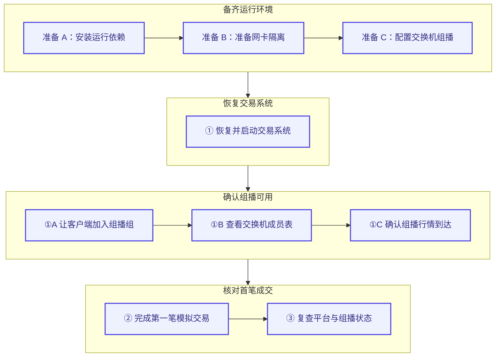
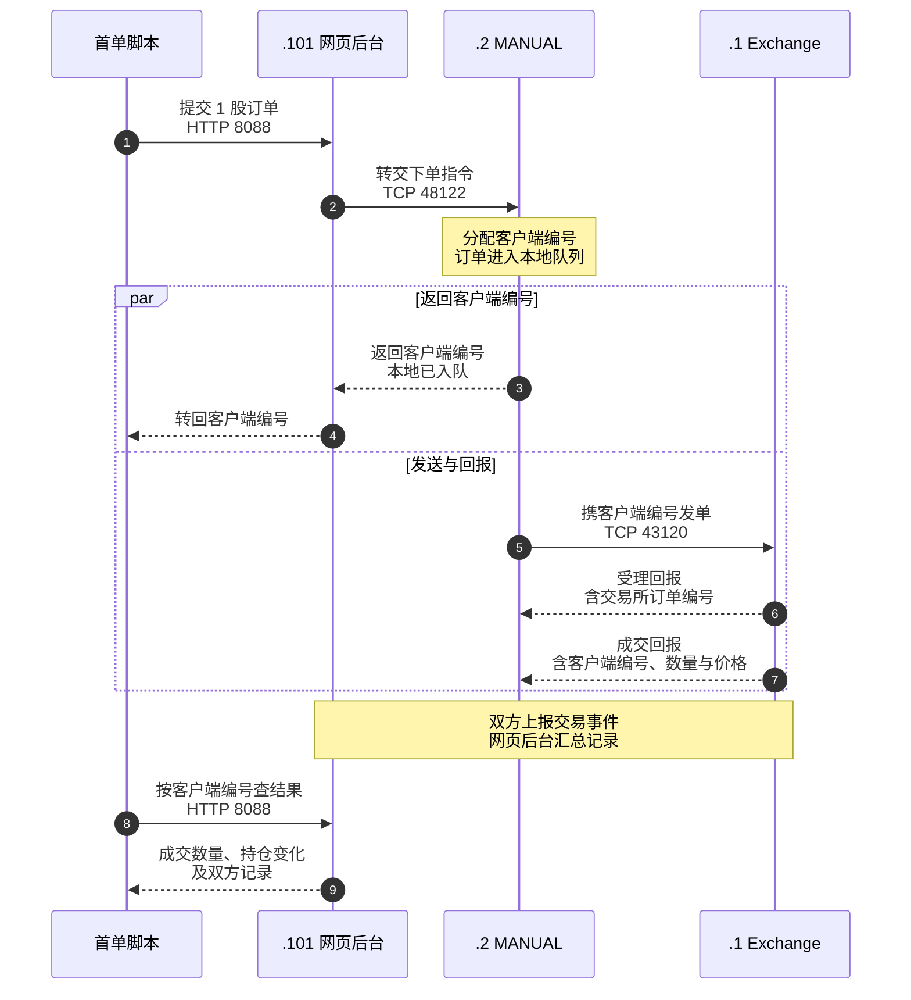

# 第二部分：一次部署完整交易平台——从环境交接到第一笔交易

## 先让市场和两个交易席位同时开张

第一部分已经确认 `.1` 与 `.2` 能互相 ping 通。本章要让这条连接真正跑起交易业务：启动市场回放，在网页上看行情，再完成一笔 1 股的模拟交易。

`.1` 上的 Exchange 是模拟交易所，负责发布行情、接收订单并返回成交结果。`.2` 上有两个独立运行的 Trader：AUTO 按预置策略自动下单，MANUAL 接收你的手工指令。监测 VM `.101` 提供看盘和下单网页；管理机 `.111` 负责准备与部署。

继续用厨房来想：第一部分认清了收货口和内部通道，这次让食材真正送进来，让主厨按单处理。落到交易程序上，就是收到行情、更新报价，再处理一笔订单。订单带有自己的编号，后面用这个编号找回成交结果。

| 官方入口 | 本章用来做什么 |
| --- | --- |
| [Nasdaq TotalView-ITCH 5.0](https://www.nasdaqtrader.com/content/technicalsupport/specifications/dataproducts/NQTVITCHSpecification_5.0.pdf) | 读取历史行情，重建当时的买卖报价 |
| [Nasdaq OUCH 5.0](https://www.nasdaqtrader.com/content/technicalsupport/specifications/TradingProducts/OUCH5.0.pdf) | 表达订单请求和交易所返回的结果 |

## 本章学习目标

1. 认清 Exchange、AUTO、MANUAL 和网页后台各自做什么。
2. 配置交换机组播，启动平台并确认客户端加组、成员端口与实际收包。
3. 提交一笔手动模拟订单，核对成交数量、持仓变化和两端记录，并在交接前确认平台与行情健康。

本章备齐后续使用的交易程序和网页；后面沿用这套应用，切换配置来比较不同收发路径。这里先确认能完成交易，性能从第四部分开始测量。

## 本章导航

<div style="border-left:6px solid #7e22ce;background:#f3e8ff;padding:12px 16px;border-radius:8px;margin:14px 0;"><span style="display:inline-block;padding:3px 12px;border-radius:6px;background:#7e22ce;color:#fff;font-weight:800;">本章导航</span> <span style="font-weight:700;color:#581c87;">按四个阶段完成九步：准备环境、启动系统、确认组播可用、核对首笔成交。每步的脚本会分段打印用途、命令和关键结果。</span></div>



固定顺序就是：**准备环境 → 启动系统 → 确认组播 → 核对成交**。

## 任务地图

| 导航项 | 所属阶段 | 这一项回答什么 |
| --- | --- | --- |
| 准备 A：安装运行依赖 | 备齐运行环境 | 安装交易程序需要的运行库和网卡模块 |
| 准备 B：准备网卡隔离 | 备齐运行环境 | 为网卡访问内存划定范围 |
| 准备 C：配置交换机组播 | 备齐运行环境 | 启用 VLAN20 的组播侦听和查询器 |
| 运行 ①：恢复并启动交易系统 | 恢复交易系统 | 启动交易所、交易客户端和网页 |
| 运行 ①A：让客户端加入组播组 | 确认组播可用 | 用真正的行情接收器订阅组播组 |
| 运行 ①B：查看交换机成员表 | 确认组播可用 | 确认行情组的接收端口是 Et2 |
| 运行 ①C：确认组播行情到达 | 确认组播可用 | 在 Trader 数据口看到实际行情 |
| 运行 ②：完成第一笔模拟交易 | 核对首笔成交 | 核对一笔订单的成交、持仓变化和记录 |
| 运行 ③：复查平台与组播状态 | 核对首笔成交 | 确认交接时的平台、成员与行情健康 |

## 准备 A：安装运行依赖

<div style="border:2px solid #4f46e5;background:#eef2ff;padding:10px 12px;border-radius:8px;margin:14px 0;"><div style="font-weight:900;color:#312e81;margin-bottom:4px;">导航卡 · 备齐运行环境</div><div style="font-weight:700;color:#312e81;margin-bottom:8px;">范畴：工具准备　本步知识：安装交易程序需要的运行库和网卡模块　位置：全章第 1 / 9 项 · 本组第 1 / 3 项</div><span style="display:inline-block;margin:3px;padding:4px 10px;border-radius:6px;background:#15803d;color:#fff;font-weight:800;">准备 A：安装运行依赖</span><span style="display:inline-block;margin:3px;padding:4px 10px;border-radius:6px;background:#f8fafc;border:1px solid #a5b4fc;color:#312e81;font-weight:800;">准备 B：准备网卡隔离</span><span style="display:inline-block;margin:3px;padding:4px 10px;border-radius:6px;background:#f8fafc;border:1px solid #a5b4fc;color:#312e81;font-weight:800;">准备 C：配置交换机组播</span></div>

第一部分确认了网卡能通信，现在要给后续交易客户端备齐加速收发所需的软件。OpenOnload 是本课 X2522 网卡配套的用户态网络库，程序使用 Socket 接口时可以由它处理收发；第六部分再比较具体效果。

这条命令在管理机 `.111` 上发起，通过 SSH 依次准备 Exchange `.1` 和 Trader `.2`。它把校验、分发、安装和检查串成了一个准备过程，按下图从上往下执行。

<div style="border-left:6px solid #7e22ce;background:#f3e8ff;padding:12px 16px;border-radius:8px;margin:14px 0;"><span style="display:inline-block;padding:3px 12px;border-radius:6px;background:#7e22ce;color:#fff;font-weight:800;">关键图 · 准备 A 的五步分工</span> <span style="font-weight:700;color:#581c87;">左边是管理机，右边是当前正在准备的目标机；横向实线表示材料或结果传送，虚线表示 SSH 发起操作。先做①，再为 .1 完成②～⑤，随后为 .2 完成②～⑤。</span></div>

<div style="background:#f8fafc;border:1px solid #cbd5e1;border-radius:12px;padding:10px;max-width:820px;margin:14px auto;">

</div>

**分发的材料分两类。** ②是已缓存的编译工具和内核头文件等软件包；③是 Onload 的源码归档。④由 `.1/.2` 在各自机器上编译，得到与本机内核匹配的模块及运行库，再准备重启后使用的网口命名规则和启动镜像。

这些材料已在课前下载到 `.111` 的本地缓存；本卡通过管理网分发，公网下载为 0。依赖版本已齐全时，②跳过安装；已具备 Onload 设备时，④跳过编译安装，继续检查驱动、配置和地址。⑤检查两端库与模块版本、字符设备、`sfc` 驱动以及 `20.1.1.1/24`、`20.1.1.2/24`，把原始结果留在 `.111`。

首次安装需要编译并重载数据口驱动，数据通信会短暂中断；SSH 使用独立的管理网口。重复执行会检查依赖和现有运行环境，按需补装或更新。交易程序、历史行情和网页在运行 ① 中部署、启动。

<div style="border-left:6px solid #15803d;background:#dcfce7;padding:12px 16px;border-radius:8px;margin:14px 0;"><span style="display:inline-block;padding:3px 12px;border-radius:6px;background:#15803d;color:#fff;font-weight:800;">需要运行 · 准备 A</span> <span style="font-weight:700;color:#14532d;">在管理机 .111 的仓库根目录以 root 执行。首次安装约需 4 分钟；已经安装过会先检查现有依赖。</span></div>

```bash
cd /financial-low-latency && bash Documents/newDoc/assets/02-trading-baseline/00a-runtime-prep.sh
```

<div style="border-left:6px solid #7e22ce;background:#f3e8ff;padding:12px 16px;border-radius:8px;margin:14px 0;"><span style="display:inline-block;padding:3px 12px;border-radius:6px;background:#7e22ce;color:#fff;font-weight:800;">仅供展示 · 输出解读</span> <span style="font-weight:700;color:#581c87;">Trader .2 的四项检查结果：版本、字符设备、驱动归属和数据口地址。每项的用途与判断提示均由脚本打印。</span></div>

```text
vm-2522-02 / verify
===== 查 Onload 版本 =====
[Onload版本] 对: Onload 9f330e7 与 Kernel module: 9f330e7 两行一致  证: 用户态与模块同一棵树
$ onload --version
Onload 9f330e7
Copyright (c) 2002-2026 Advanced Micro Devices, Inc.
Built: Sep 10 2026 11:42:21 (release)
Build profile header: <ci/internal/transport_config_opt_extra.h>
Kernel module: 9f330e7
===== 查字符设备 =====
[字符设备] 对: /dev/onload 与 /dev/sfc_char 都以 c 开头  证: 栈控制和 VI 入口都在
$ ls -l /dev/onload /dev/sfc_char
crw-rw-rw- 1 root root 237, 0 Sep 10 11:42 /dev/onload
crw-rw-rw- 1 root root 238, 0 Sep 10 11:42 /dev/sfc_char
===== 查出站闸主人 =====
[出站闸主人] 对: /sys/bus/pci/drivers/sfc  证: 本步仍由 sfc 管卡
$ readlink -f /sys/bus/pci/devices/0000:03:00.0/driver
/sys/bus/pci/drivers/sfc
===== 查数据口地址 =====
[数据口] 对: ens64np1 上有 20.1.1.2/24  证: reload 后课程地址还在
$ ip -4 -o addr show dev ens64np1
4: ens64np1    inet 20.1.1.2/24 brd 20.1.1.255 scope global ens64np1\       valid_lft forever preferred_lft forever
```

Exchange `.1` 会执行相同的四项检查，对应数据口为 `ens64np0`、地址为 `20.1.1.1/24`。设备编号和时间以各次实际输出为准。

<div style="border-left:6px solid #0891b2;background:#cffafe;padding:12px 16px;border-radius:8px;margin:14px 0;"><span style="display:inline-block;padding:3px 12px;border-radius:6px;background:#0891b2;color:#fff;font-weight:800;">关键现象</span> <span style="font-weight:700;color:#164e63;">确认 Onload 与 Kernel module 的版本一致，驱动和数据口检查也通过后，继续准备网卡隔离。</span></div>


## 准备 B：准备网卡隔离

<div style="border:2px solid #4f46e5;background:#eef2ff;padding:10px 12px;border-radius:8px;margin:14px 0;"><div style="font-weight:900;color:#312e81;margin-bottom:4px;">导航卡 · 备齐运行环境</div><div style="font-weight:700;color:#312e81;margin-bottom:8px;">范畴：工具准备　本步知识：为网卡访问内存划定范围　位置：全章第 2 / 9 项 · 本组第 2 / 3 项</div><span style="display:inline-block;margin:3px;padding:4px 10px;border-radius:6px;background:#f8fafc;border:1px solid #a5b4fc;color:#312e81;font-weight:800;">准备 A：安装运行依赖</span><span style="display:inline-block;margin:3px;padding:4px 10px;border-radius:6px;background:#15803d;color:#fff;font-weight:800;">准备 B：准备网卡隔离</span><span style="display:inline-block;margin:3px;padding:4px 10px;border-radius:6px;background:#f8fafc;border:1px solid #a5b4fc;color:#312e81;font-weight:800;">准备 C：配置交换机组播</span></div>

**这一步为第六部分的 DPDK 收发路径提前准备安全条件。** DPDK（Data Plane Development Kit，数据平面开发套件）让程序在用户态操作网卡队列、收发报文。本课届时会把 Trader `.2` 的数据口交给 DPDK 客户端使用；现在先完成可能需要重启的准备，后面就能在同一套交易平台上切换收发路径。

这里有两件事：**网口交给谁操作，以及网卡能读写哪些内存。** 像把一个收货口交给专人使用，同时限定他能进入的存货区。VFIO（Virtual Function I/O）提供 Linux 向用户态程序开放设备访问的接口；IOMMU（输入输出内存管理单元）负责设备 DMA 的地址转换与访问保护。两者配合，程序可以直接使用网卡，网卡的内存访问仍受映射范围约束。[Linux 5.15 VFIO 文档](https://www.kernel.org/doc/html/v5.15/driver-api/vfio.html)

<div style="border-left:6px solid #7e22ce;background:#f3e8ff;padding:12px 16px;border-radius:8px;margin:14px 0;"><span style="display:inline-block;padding:3px 12px;border-radius:6px;background:#7e22ce;color:#fff;font-weight:800;">关键图 · DPDK 怎样使用网口和内存</span> <span style="font-weight:700;color:#581c87;">上半图区分现在准备与后续接管；下半图分开设备访问、映射配置和网卡搬运数据的路径。</span></div>

<div style="background:#f8fafc;border:1px solid #cbd5e1;border-radius:12px;padding:10px;max-width:820px;margin:14px auto;">

</div>

| 对象 | 在本课 DPDK 路径中负责什么 |
| --- | --- |
| DPDK 客户端 | 操作网卡收发队列，处理缓冲区中的报文 |
| VFIO / `vfio-pci` | 向程序开放设备访问，并通过内核建立 DMA 内存映射 |
| IOMMU | 按映射转换 DMA 地址、检查访问权限，阻止越界访问 |
| IOMMU 隔离组 | 内核认定可与其他设备隔离的最小设备集合；决定能否单独交付目标设备 |

本课检查目标网口所在组只有它对应的 PCI 功能，才能在不牵连组内其他设备的条件下交给 VFIO。**启用 IOMMU 提供了保护条件；真正的网口接管还需要把驱动从 `sfc` 改绑为 `vfio-pci`，再由 DPDK 程序打开设备。** 这是本课 X2522 采用的方式；DPDK 也有与内核驱动共存的其他驱动模型。[DPDK 21.11 驱动说明](https://doc.dpdk.org/guides-21.11/linux_gsg/linux_drivers.html)

准备 B 为 `.1/.2` 统一检查启动参数和隔离组，按需写入 `intel_iommu=on`、`iommu=pt` 并重启，再加载 VFIO 支持、禁止无 IOMMU 的不安全模式。完成后两端数据口仍由 `sfc` 管理。IOMMU 也用于虚拟机设备直通等场景，这里是为本课的 DPDK 路径检查它。

<div style="border-left:6px solid #15803d;background:#dcfce7;padding:12px 16px;border-radius:8px;margin:14px 0;"><span style="display:inline-block;padding:3px 12px;border-radius:6px;background:#15803d;color:#fff;font-weight:800;">需要运行 · 准备 B</span> <span style="font-weight:700;color:#14532d;">在 .111 仓库根目录以 root 执行。需要重启的主机，SSH 会暂时断开，脚本会等待它恢复。</span></div>

```bash
bash Documents/newDoc/assets/02-trading-baseline/00b-iommu-prep.sh
```

<div style="border-left:6px solid #7e22ce;background:#f3e8ff;padding:12px 16px;border-radius:8px;margin:14px 0;"><span style="display:inline-block;padding:3px 12px;border-radius:6px;background:#7e22ce;color:#fff;font-weight:800;">仅供展示 · 输出解读</span> <span style="font-weight:700;color:#581c87;">两台主机的安全模式检查示例。</span></div>

```text
vm-2522-01 / vfio
===== 查 VFIO DMA 安全模式 =====
[unsafe no-IOMMU] 对: N  证: VFIO 不允许绕过 IOMMU
$ cat /sys/module/vfio/parameters/enable_unsafe_noiommu_mode
N
vm-2522-02 / vfio
===== 查 VFIO DMA 安全模式 =====
[unsafe no-IOMMU] 对: N  证: VFIO 不允许绕过 IOMMU
$ cat /sys/module/vfio/parameters/enable_unsafe_noiommu_mode
N
```

`N` 表示 VFIO 不允许使用绕过 IOMMU 的不安全模式。它本身不证明 DPDK 已接管网口；还需结合脚本打印的启动参数、隔离组及组内设备，确认后续交接的前提已具备。

<div style="border-left:6px solid #0891b2;background:#cffafe;padding:12px 16px;border-radius:8px;margin:14px 0;"><span style="display:inline-block;padding:3px 12px;border-radius:6px;background:#0891b2;color:#fff;font-weight:800;">关键现象</span> <span style="font-weight:700;color:#164e63;">确认两端启动参数生效、隔离组只有目标设备，且安全模式为 N。此时备好了后续 DPDK 的交接条件，网口仍由 sfc 管理；接下来配置交换机组播。</span></div>


## 准备 C：配置交换机组播

<div style="border:2px solid #4f46e5;background:#eef2ff;padding:10px 12px;border-radius:8px;margin:14px 0;"><div style="font-weight:900;color:#312e81;margin-bottom:4px;">导航卡 · 备齐运行环境</div><div style="font-weight:700;color:#312e81;margin-bottom:8px;">范畴：分步实验　本步知识：启用 VLAN20 的组播侦听和查询器　位置：全章第 3 / 9 项 · 本组第 3 / 3 项</div><span style="display:inline-block;margin:3px;padding:4px 10px;border-radius:6px;background:#f8fafc;border:1px solid #a5b4fc;color:#312e81;font-weight:800;">准备 A：安装运行依赖</span><span style="display:inline-block;margin:3px;padding:4px 10px;border-radius:6px;background:#f8fafc;border:1px solid #a5b4fc;color:#312e81;font-weight:800;">准备 B：准备网卡隔离</span><span style="display:inline-block;margin:3px;padding:4px 10px;border-radius:6px;background:#15803d;color:#fff;font-weight:800;">准备 C：配置交换机组播</span></div>

### 本步理论

交换机需要知道“哪个端口后面有人要收这个组”。IGMP 是主机报告组播成员关系的协议；IGMP Snooping（组播侦听）让交换机从报告中学到“组 → 端口”的对应。查询器（Querier）定期询问成员是否仍在，使这张表持续更新。

先给 VLAN20 启用这两项功能，查询器地址使用 `20.1.1.254`。下一步启动平台时，Trader 的接收器就会向网络报告自己要收 `233.74.125.32`。本地仍是一台交换机内的二层通信。

在 `.111` 执行下面的 Bash 后，`eos_cli.py` 通过 SSH 连接交换机 `10.1.1.253`，按 `igmp-configure.plan` 中的顺序发送 EOS 命令：先启用组播侦听，再配置查询器，最后读取状态。返回 `.111` 后，`inspect-igmp.py` 从交换机原始输出中选出 VLAN20 的关键字段。实际发送的命令及用途列在 Bash 之后。

**理论落到实验：** 用 `show ip igmp snooping` 查看 VLAN20 是否按成员转发，再用 `show igmp snooping querier` 查看谁发查询；这一步判断交换机配置，成员端口随后再看。

<div style="border-left:6px solid #dc2626;background:#fee2e2;padding:12px 16px;border-radius:8px;margin:14px 0;"><span style="display:inline-block;padding:3px 12px;border-radius:6px;background:#dc2626;color:#fff;font-weight:800;">配置影响与恢复</span> <span style="font-weight:700;color:#7f1d1d;">本步调整 VLAN20 的组播转发方式，只写 running-config，未执行 write memory。保持交换机控制台可用，异常时暂停后续实验；需要回到第一部分保存的初始化配置时，在维护阶段重启交换机。重启后继续课程，回到本步重新配置并核对输出。</span></div>

<div style="border-left:6px solid #15803d;background:#dcfce7;padding:12px 16px;border-radius:8px;margin:14px 0;"><span style="display:inline-block;padding:3px 12px;border-radius:6px;background:#15803d;color:#fff;font-weight:800;">需要运行 · 准备 C</span> <span style="font-weight:700;color:#14532d;">在管理机 .111，以 root 执行；第一部分的 Et1/Et2、VLAN20 和交换机管理连接应已准备好。本步启用 VLAN20 的组播侦听与查询器，完成后核对输出。</span></div>

```bash
#!/usr/bin/env bash
set -Eeuo pipefail
cd /financial-low-latency
TOOLS=Documents/newDoc/assets/02-trading-baseline
RUN_ID="$(date -u +%Y%m%dT%H%M%SZ)-02-igmp-configure"
OUT="Documents/reports/course-runs/$RUN_ID"; mkdir -p "$OUT/raw"
printf 'RUN_ID=%s\n' "$RUN_ID" >"$OUT/run.env"
{
  printf '10.1.1.253 / configure\n===== 配置 VLAN20 的组播侦听与查询器 =====\n让交换机学习接收端口，并持续查询成员。\n'
  printf '$ python3 Documents/newDoc/assets/common/eos_cli.py --mode controlled-config --plan %s --output %s\n' "$TOOLS/igmp-configure.plan" "$OUT/raw/switch.txt"
  if python3 Documents/newDoc/assets/common/eos_cli.py --mode controlled-config --plan "$TOOLS/igmp-configure.plan" --output "$OUT/raw/switch.txt" >"$OUT/raw/cli.txt" 2>&1; then rc=0; else rc=$?; fi
  if test "$rc" -ne 0; then cat "$OUT/raw/cli.txt"; exit "$rc"; fi
  printf '$ python3 %s/inspect-igmp.py %s --configuration --display\n' "$TOOLS" "$OUT/raw/switch.txt"
  python3 "$TOOLS/inspect-igmp.py" "$OUT/raw/switch.txt" --configuration --display
} 2>&1 | tee "$OUT/raw/classroom.txt"
sha256sum "$TOOLS/00c-igmp-configure.sh" "$TOOLS/igmp-configure.plan" "$TOOLS/inspect-igmp.py" "$OUT"/raw/* "$OUT/run.env" >"$OUT/SHA256SUMS"
```

<div style="border-left:6px solid #7e22ce;background:#f3e8ff;padding:12px 16px;border-radius:8px;margin:14px 0;"><span style="display:inline-block;padding:3px 12px;border-radius:6px;background:#7e22ce;color:#fff;font-weight:800;">仅供展示 · 交换机实际命令</span> <span style="font-weight:700;color:#581c87;">以下是脚本依次发给交换机的 EOS 命令，与命令计划逐行一致；由上面的 Bash 自动执行，无需再手工输入一遍。</span></div>

```text
configure terminal
ip igmp snooping
ip igmp snooping vlan 20
ip igmp snooping vlan 20 querier address 20.1.1.254
ip igmp snooping vlan 20 querier
end
show ip igmp snooping
show igmp snooping querier
show ip igmp snooping groups
```

终端按第 1～9 条命令逐段打印“这一步做什么 → 实际命令 → 返回结果”。配置命令通常只回显命令本身，配置效果由后面三条 `show` 查询确认；本步也会显示当前成员表，运行①B再重点查看平台启动后的行情组成员。

`20.1.1.254` 是交换机发出成员查询时使用的**源地址**；`233.74.125.32` 是行情的**组播目的地址**。这里为交换机启用学习和查询功能；等平台接收器启动、报告要加入哪个组后，交换机才会学到对应的动态成员端口。[Arista IGMP Snooping 命令说明](https://www.arista.com/en/um-eos/eos-igmp-and-igmp-snooping)

<div style="border-left:6px solid #7e22ce;background:#f3e8ff;padding:12px 16px;border-radius:8px;margin:14px 0;"><span style="display:inline-block;padding:3px 12px;border-radius:6px;background:#7e22ce;color:#fff;font-weight:800;">仅供展示 · 输出解读</span> <span style="font-weight:700;color:#581c87;">节选第 4 条命令设置查询源地址、第 7～9 条命令查看状态的结果。当前成员表为空，启动平台并加组后再检查成员端口。</span></div>

```text
===== 第 4 条命令：设置查询报文源地址 =====
20.1.1.254 是查询报文的源 IP；行情组播目的地址为 233.74.125.32。
$ ip igmp snooping vlan 20 querier address 20.1.1.254
10.1.1.253 / verify
===== 第 7 条命令：查 VLAN20 的组播转发方式 =====
[转发] 对: Enabled、pruning True、Flooding False  证: 按成员端口转发
$ show ip igmp snooping
Vlan 20 :
IGMP snooping                  : Enabled
IGMP snooping pruning active   : True
Flooding traffic to VLAN       : False
===== 第 8 条命令：查谁发成员查询 =====
[查询器] 对: VLAN20 / 20.1.1.254 / Switch  证: 交换机持续询问成员
$ show igmp snooping querier
20    20.1.1.254       v2       Switch
===== 第 9 条命令：查当前组播成员表 =====
按 VLAN、Group、Port-List 读出组与端口；平台尚未启动时，目标行情组可能没有成员。
$ show ip igmp snooping groups
show ip igmp snooping groups | no-more
[成员说明] 当前回执未见 VLAN20 的 233.74.125.32 成员；平台启动并成功加组后，在运行①B核对动态成员 Et2。
```

**这次查询没有成员记录。** `show ip igmp snooping groups | no-more` 是交换机的命令回显，`no-more` 表示不分页显示；它后面没有 VLAN、Group、Port-List 数据行，不能当成已经有成员。开启侦听和查询器也不会凭空产生接收者。

接下来运行①启动平台，运行①A确认接收器已加入 `233.74.125.32`，再运行①B查看交换机：预期出现 `VLAN20 / 233.74.125.32 / Dynamic / Et2`。如果届时仍没有成员，就停在成员检查排查；出现成员后，还要在运行①C确认实际收到了行情报文。

| 字段 | 怎样理解 |
| --- | --- |
| `IGMP snooping: Enabled` | 已开启成员学习；还要看是否按学到的成员转发 |
| `pruning active: True` | 对组播的复制范围按成员关系收窄 |
| `Flooding traffic to VLAN: False` | 没有采用向整个 VLAN 泛洪的方式；与上一项一起判断 |
| 查询器的 `20 / 20.1.1.254 / Switch` | VLAN20 的查询由交换机发出，持续询问哪些主机仍要接收 |

脚本展示原始读数，不替你判断配置是否符合预期。

<div style="border-left:6px solid #0891b2;background:#cffafe;padding:12px 16px;border-radius:8px;margin:14px 0;"><span style="display:inline-block;padding:3px 12px;border-radius:6px;background:#0891b2;color:#fff;font-weight:800;">关键现象</span> <span style="font-weight:700;color:#164e63;">VLAN20 应为 Enabled，pruning active 为 True，Flooding 为 False；查询器应为 20.1.1.254 / Switch。确认后再启动平台。</span></div>

## 运行 ①：恢复并启动交易系统

运行库、网卡隔离和交换机组播准备好后，从管理机 `.111` 把交易程序和历史行情送到 `.1/.2/.101`，让交易所、客户端和网页一起运行。恢复快照时 `.111` 保留，部署所需文件从这里重新分发。

<div style="border:2px solid #4f46e5;background:#eef2ff;padding:10px 12px;border-radius:8px;margin:14px 0;"><div style="font-weight:900;color:#312e81;margin-bottom:4px;">导航卡 · 恢复交易系统</div><div style="font-weight:700;color:#312e81;margin-bottom:8px;">范畴：工具准备　本步知识：启动交易所、交易客户端和网页　位置：全章第 4 / 9 项 · 本组第 1 / 1 项</div><span style="display:inline-block;margin:3px;padding:4px 10px;border-radius:6px;background:#15803d;color:#fff;font-weight:800;">运行 ①：恢复并启动交易系统</span></div>

### 先看本章最终要得到什么

<div style="border-left:6px solid #7e22ce;background:#f3e8ff;padding:12px 16px;border-radius:8px;margin:14px 0;"><span style="display:inline-block;padding:3px 12px;border-radius:6px;background:#7e22ce;color:#fff;font-weight:800;">关键图</span> <span style="font-weight:700;color:#581c87;">先认出四台主机：管理机负责部署，监测 VM 负责编译和网页，Exchange 发布行情，Trader 看盘并下单。图中 Builder / UI 指监测 VM .101 内的这两项工作。</span></div>

<div style="background:#f8fafc;border:1px solid #cbd5e1;border-radius:12px;padding:10px;max-width:820px;margin:14px auto;">

</div>

图中的实线是交易程序之间的收发：`.1` 发布行情，`.2` 更新订单簿并发送订单；虚线表示部署、看盘和网页控制。订单簿记录买卖双方当前的报价和数量，像两份按价格排好的等候单。

| 主机 / 程序 | 本章做什么 |
| --- | --- |
| 管理机 `.111` | 保存源码和历史行情，发起部署 |
| Exchange VM `.1` | 回放行情，接收订单，在模拟账户中记录成交 |
| Trader VM `.2` · AUTO | 维护自己的订单簿，按预置策略自动下单 |
| Trader VM `.2` · MANUAL | 维护自己的订单簿，接收网页下单请求 |
| 监测 VM `.101` | 编译原生客户端；运行网页后台（Gateway），汇总状态并提供下单入口 |
| 实验 VM `.11` | 保持第一部分准备好的状态，后续用作流量工具主机 |

除管理机 `.111` 外，四台 VM 都会随课程快照恢复。监测 VM 的编译工具已在第一部分备齐，本步继续部署应用。

#### 网页上的历史行情与模拟成交

| 网页看到什么 | 来自哪里 |
| --- | --- |
| AAPL / NVDA 行情 | Nasdaq 官方公开的 `2026-06-12` 历史样例，保留消息原字节和原始时间 |
| 买卖报价随时间变化 | 回放当天 `09:30–16:00` 的事件；1 倍速播放需 6 小时 30 分，可在网页调整倍速 |
| 今天提交的订单与成交 | Exchange 按当前回放盘口模拟成交，记入独立账本；历史行情保持原样 |

部署会先用 09:30 前的事件准备好开盘订单簿，再从常规交易时段开始显示。AUTO 使用固定的课堂策略；本章先观察它运行，手工下单则交给 MANUAL。

#### 行情统一接收，下单各走自己的连接

`.2` 的 `flle-feed-receiver` 用普通 UDP 套接字（Socket）从网卡接收行情，再把完整消息分别交给同机的 AUTO 和 MANUAL。**接收器到两个 Trader 的这一段使用 Unix Socket**，也就是同一台主机内的进程通信接口，不需要额外的 IP 或 TCP/UDP 端口。像收货员收到一份到货清单后，在内部给两个工位各送一份；两个 Trader 各自维护订单簿，各自连接 Exchange 下单。

| 通信 | 目的地址与端口 | 谁接收 |
| --- | --- | --- |
| 单播行情（默认） | `20.1.1.2:42121/UDP` | `.2` 的共享行情接收器 |
| 组播行情 | `233.74.125.32:31032/UDP` | 同一个接收器加入组后接收 |
| 本机行情分发 | `.2` 内的 Unix Socket，不使用 IP 端口 | AUTO 和 MANUAL 各接收一份完整消息 |
| 订单与回报 | `20.1.1.1:43120/TCP` | Exchange 监听；每个下单客户端建立自己的连接 |

组播地址和目的端口取自 Nasdaq 的真实接入案例；跨路由传播过程见本章末的[延伸阅读](#nasdaq-multicast)。本章 ①A～①C 先完成本地组播检查，第三部分再比较三种交付方式。

本步也备齐后续要比较的下单路径：普通 Socket、OpenOnload、TCPDirect 默认同时在线；TCPDirect 是使用专用接口的用户态 TCP 库。另一条 DPDK 路径由用户态程序直接收发，需要独占数据口，在网页切换后启动，期间普通 Socket 行情接收器停止。切回普通交易时，接收器重新启动。

这些选择改变的是订单收发方式。切换按钮由 `.101` 网页后台请求 `.2:48606` 的控制服务，在 `.2` 本机完成切换；各条路径的差异留到第六部分展开。

### 本步理论：从部署文件到服务在线

像照菜谱备好工具，再安排每个工位开工：源码是程序的文字，编译器把它变成可执行文件，启动后才有正在工作的进程。本步既检查文件完整，也检查程序在线。

<div style="border-left:6px solid #7e22ce;background:#f3e8ff;padding:12px 16px;border-radius:8px;margin:14px 0;"><span style="display:inline-block;padding:3px 12px;border-radius:6px;background:#7e22ce;color:#fff;font-weight:800;">关键图</span> <span style="font-weight:700;color:#581c87;">运行①先在 <code>.101</code> 构建，再分发并启动服务，确认系统在线；运行②才提交第一笔订单并核对成交。图中分别标出源码、可执行文件和运行中的程序。</span></div>

<div style="background:#f8fafc;border:1px solid #cbd5e1;border-radius:12px;padding:10px;max-width:820px;margin:14px auto;">

</div>

**理论落到实验：** 脚本依次检查部署条件、核对运行包、编译并分发、启动普通交易、确认平台就绪。原生客户端在 `.101` 编译；Exchange 和其他路径使用已核验的运行包。启动时先准备接收器与两个 Trader，再让 Exchange 发布行情，确保它们能收到开头的消息。

每段自动打印用途、实际命令、关键结果及字段说明：先读文件与构建检查，再读进程在线状态，最后区分当前配置和已备齐的能力。平台已正常部署时，重复执行会核对并复用它，并说明本次没有重新部署。

<div style="border-left:6px solid #15803d;background:#dcfce7;padding:12px 16px;border-radius:8px;margin:14px 0;"><span style="display:inline-block;padding:3px 12px;border-radius:6px;background:#15803d;color:#fff;font-weight:800;">需要运行 · 运行 ①</span> <span style="font-weight:700;color:#14532d;">在管理机 .111 的 /financial-low-latency 目录以 root 执行。第一部分及准备 A～C 应已完成；本步编译、分发并启动交易平台。</span></div>

```bash
bash Documents/newDoc/assets/02-trading-baseline/01-restore-trading-lab.sh
```

<div style="border-left:6px solid #7e22ce;background:#f3e8ff;padding:12px 16px;border-radius:8px;margin:14px 0;"><span style="display:inline-block;padding:3px 12px;border-radius:6px;background:#7e22ce;color:#fff;font-weight:800;">仅供展示 · 带注释展示</span> <span style="font-weight:700;color:#581c87;">本次完整顺刷的部署末尾节选，字段说明也由脚本打印。进程编号以各次实际输出为准。</span></div>

```text
exchange=ONLINE pid=8439
trader-auto=ONLINE pid=33649
trader-manual=ONLINE pid=33655
gateway=ONLINE pid=18357
deployed_sha256=PASS exchange,trader_auto,trader_manual,source,replay,manifest,opening_book_checkpoint
restore_verdict=TRADING_LAB_READY
[进程说明] exchange 是 .1 交易所；trader-auto / trader-manual 是 .2 自动与手动客户端；gateway 是 .101 网页后台。
[在线说明] ONLINE 表示对应进程在线；pid 是该主机上的进程编号，每次启动可能不同，不是端口号。
[文件说明] deployed_sha256=PASS 表示所列部署文件摘要核验通过；进程在线与文件一致需要一起看。
[就绪说明] restore_verdict=TRADING_LAB_READY 表示部署核验通过，不代表已经完成首笔成交或延迟测试。
platform=READY profile=SOFTWARE capabilities=Socket,Onload,TCPDirect,DPDK,FeedGuardian
[配置说明] platform=READY 表示本次部署流程完成；profile=SOFTWARE 表示当前采用普通交易配置。
[能力说明] capabilities 列出已备齐的收发路径及 FeedGuardian 行情完整性保护能力，不是同时运行的进程清单；DPDK 要切换后才接管数据口。
[下一步] 打开 http://10.1.1.101:8088/ 查看网页，再按运行①A～①C确认组播；运行②才提交首笔模拟订单。
```

### 打开网页，先把系统看懂

在 Windows Server 2019 浏览器打开 `http://10.1.1.101:8088/`。

先按三张截图认清网页各区的用途。行情和成交数字会随回放变化。

<div style="background:#f8fafc;border:1px solid #cbd5e1;border-radius:12px;padding:10px;max-width:820px;margin:14px auto;">

</div>

顶栏显示历史行情播到了什么时间；回放条显示进度、剩余播放时间和倍速。左下是两只股票的最新价格，中间是五档买卖报价，右下是 MANUAL 手工下单入口。默认的 IOC 表示立即尝试成交、未成交部分取消，运行 ② 会用一笔订单说明它。

价格旁的 bps 表示基点，1 bps = 0.01%。例如 `+3.04 bps` 表示价格在图示窗口内上涨约 `0.0304%`；这里衡量的是价格变化。

<div style="background:#f8fafc;border:1px solid #cbd5e1;border-radius:12px;padding:10px;max-width:820px;margin:14px auto;">

</div>

左图显示最近 360 个页面采样的价格走势。右图的“延时基线”统计 AUTO 从发出订单到收到最终结果的往返时间（RTT）；手工单的 RTT 在交易记录里。两者都由 C++ 客户端计时，网页负责展示。

策略区控制 AUTO 是否按预置规则下单，并显示持仓与模拟盈亏。本章观察状态即可，性能比较从第四部分开始。

<div style="background:#f8fafc;border:1px solid #cbd5e1;border-radius:12px;padding:10px;max-width:820px;margin:14px auto;">

</div>

交易记录把自动单和手工单放在同一张表，用来源列区分。`.1` 的 Exchange 和 `.2` 的 Trader 各自记录成交，`.101` 网页后台汇总展示。

回放到 16:00，或点击“重新开始并清空交易”时，会开始新一轮回放，清空上一轮订单、成交、持仓、模拟盈亏和网页历史。手动重新开始前，先确认这些模拟记录可以清空。现在先保持系统运行，确认主机加组、交换机成员与实际收包，再下首笔手工单。

## 运行 ①A：让客户端加入组播组

<div style="border:2px solid #4f46e5;background:#eef2ff;padding:10px 12px;border-radius:8px;margin:14px 0;"><div style="font-weight:900;color:#312e81;margin-bottom:4px;">导航卡 · 确认组播可用</div><div style="font-weight:700;color:#312e81;margin-bottom:8px;">范畴：分步实验　本步知识：用真正的行情接收器订阅组播组　位置：全章第 5 / 9 项 · 本组第 1 / 3 项</div><span style="display:inline-block;margin:3px;padding:4px 10px;border-radius:6px;background:#15803d;color:#fff;font-weight:800;">运行 ①A：让客户端加入组播组</span><span style="display:inline-block;margin:3px;padding:4px 10px;border-radius:6px;background:#f8fafc;border:1px solid #a5b4fc;color:#312e81;font-weight:800;">运行 ①B：查看交换机成员表</span><span style="display:inline-block;margin:3px;padding:4px 10px;border-radius:6px;background:#f8fafc;border:1px solid #a5b4fc;color:#312e81;font-weight:800;">运行 ①C：确认组播行情到达</span></div>

### 本步理论

**在 `.2` 上，直接启动行情接收程序就能申请接收组播。** 下面把程序路径、接口地址、组地址、端口和接收开关全部写出来。

<div style="border-left:6px solid #7e22ce;background:#f3e8ff;padding:12px 16px;border-radius:8px;margin:14px 0;"><span style="display:inline-block;padding:3px 12px;border-radius:6px;background:#7e22ce;color:#fff;font-weight:800;">仅供展示 · 接收器原生命令</span> <span style="font-weight:700;color:#581c87;">使用本次运行①的真实部署路径，默认参数全部展开，与本次接收器启动配置等效。接收器已经运行，不要再手动启动第二份。各次部署的目录不同，本卡终端会打印当次的完整路径。</span></div>

```text
/var/tmp/flle-trading-lab-20260910T081653Z-02-trading-platform/flle-feed-receiver \
  --data-ip 20.1.1.2 \
  --unicast-port 42121 \
  --multicast-group 233.74.125.32 \
  --multicast-port 31032 \
  --multicast-receiver 1 \
  --receive-buffer-bytes 4194304 \
  --client-queue-bytes 8388608 --client-queue-packets 32768 \
  --telemetry-host 10.1.1.101 \
  --socket /var/tmp/flle-trading-lab-20260910T081653Z-02-trading-platform/feed.sock
```

`--multicast-receiver 1` 是开启组播的开关；`--socket` 指定分发用的 Unix Socket 路径。命令里的收包参数分别指定：

| 参数 | 本次值 | 用途 |
| --- | --- | --- |
| `--multicast-group` | `233.74.125.32` | 要加入的行情组 |
| `--data-ip` | `20.1.1.2` | 选择 `.2` 的数据口 `ens64np1` |
| `--multicast-port` | `31032` | 接收行情的 UDP 端口 |

`--unicast-port 42121` 保留单播接收；`--receive-buffer-bytes 4194304` 为每个 UDP 接收 Socket 请求 4 MiB 缓冲，容纳短时突发。后面自动执行入口中的 `direct` 只是这套接收配置的名称。

收到报文后，还要向本机交易进程分发。`--client-queue-bytes` / `--client-queue-packets` 为每个进程的待发队列设定 8 MiB / 32768 包上限：短暂发不出去时保留原包并按序重试，超过任一上限就明确断开该进程，由它保持停单等待重新同步。`--telemetry-host` 把这些分发计数送到 `.101`，用于查看状态，不发送交易报文。

程序读到开关为 `1` 后，创建组播 UDP Socket，再调用 `setsockopt(..., IP_ADD_MEMBERSHIP, ...)`，把组地址和本机地址交给 Linux 完成加组。Linux 发送 IGMP 成员报告，交换机据此学习 Et2。[Linux 加组接口说明](https://man7.org/linux/man-pages/man2/IP_ADD_MEMBERSHIP.2const.html)

运行①已经这样启动接收器；本卡确认它仍在运行并启用组播，再用 `ip maddr` 查询成员。**本卡不切换 Exchange 的发送模式，也不把网卡交给 DPDK。** 主机加组、交换机学到成员和实际收到报文，分别在①A、①B、①C检查。

**理论落到实验：** 控制脚本让真实行情接收器保持订阅；ip maddr 显示 Linux 已加入的组。由你从目标组与 users 字段判断订阅数量。

<div style="border-left:6px solid #15803d;background:#dcfce7;padding:12px 16px;border-radius:8px;margin:14px 0;"><span style="display:inline-block;padding:3px 12px;border-radius:6px;background:#15803d;color:#fff;font-weight:800;">需要运行 · 运行 ①A</span> <span style="font-weight:700;color:#14532d;">在管理机 .111，以 root 执行；平台已启动且网卡由 sfc 管理。已订阅时复用接收器；配置不同会重启它，期间行情接收短暂中断。命令失败时先检查报错，暂停后续下单。</span></div>

```bash
#!/usr/bin/env bash
set -Eeuo pipefail
cd /financial-low-latency
TOOLS=Documents/newDoc/assets/02-trading-baseline
source Documents/reports/run-state/02-trading-baseline.env
BASE_RUN_ID="$RUN_ID"; RUN_ID="$(date -u +%Y%m%dT%H%M%SZ)-02-igmp-join"
OUT="Documents/reports/course-runs/$RUN_ID"; mkdir -p "$OUT/raw"
printf 'RUN_ID=%s\nBASE_RUN_ID=%s\n' "$RUN_ID" "$BASE_RUN_ID" >"$OUT/run.env"
CTL=apps/flle-trading-lab/scripts/transport_labctl.sh
{
  printf '10.1.1.2 / join\n===== 确认网卡由 sfc 管理 =====\n$ bash %s status %s\n' "$CTL" "$BASE_RUN_ID"
  bash "$CTL" status "$BASE_RUN_ID" >"$OUT/raw/status.json"
  check='import json,sys; s=json.load(open(sys.argv[1])); print("mode=%s transition=%s owner=%s" % (s["mode"],s["transition"],s["owner"])); assert (s["mode"],s["transition"],s["owner"]) == ("SFC","READY","sfc")'
  printf '$ python3 -c %q %q\n' "$check" "$OUT/raw/status.json"
  python3 -c "$check" "$OUT/raw/status.json"
  printf '%s\n' '===== 让统一接收器保持组播订阅 =====' '[配置说明] direct 是本项目的接收配置：保留单播并开启组播，对应 --multicast-receiver 1，不是网卡直通。' '[范围说明] 本步不切换 Exchange 的行情发送模式；主机加组、交换机学到成员和实际收包分别检查。'
  printf '$ bash %s feed-profile %s direct\n' "$CTL" "$BASE_RUN_ID"
  printf '[接收器原生命令：默认参数已展开，仅展示；已有匹配进程时不重复启动]\n$ %q --data-ip 20.1.1.2 --unicast-port 42121 --multicast-group 233.74.125.32 --multicast-port 31032 --multicast-receiver 1 --receive-buffer-bytes 4194304 --client-queue-bytes 8388608 --client-queue-packets 32768 --telemetry-host 10.1.1.101 --socket %q\n' "$RUN_DIR/flle-feed-receiver" "$RUN_DIR/feed.sock"
  bash "$CTL" feed-profile "$BASE_RUN_ID" direct
  printf '===== 查 Trader 数据口加入了哪些组 =====\n[成员] 对: inet 233.74.125.32，只有一个订阅  证: 加组发生在 ens64np1\n$ ssh -o BatchMode=yes -o StrictHostKeyChecking=yes root@10.1.1.2 ip maddr show dev ens64np1\n'
  ssh -o BatchMode=yes -o StrictHostKeyChecking=yes root@10.1.1.2 'ip maddr show dev ens64np1' | tee "$OUT/raw/membership.txt"
} 2>&1 | tee "$OUT/raw/classroom.txt"
sha256sum "$TOOLS/01a-join-multicast.sh" "$OUT"/raw/* "$OUT/run.env" >"$OUT/SHA256SUMS"
```

<div style="border-left:6px solid #7e22ce;background:#f3e8ff;padding:12px 16px;border-radius:8px;margin:14px 0;"><span style="display:inline-block;padding:3px 12px;border-radius:6px;background:#7e22ce;color:#fff;font-weight:800;">预期样例 · 输出解读</span> <span style="font-weight:700;color:#581c87;">主机成员输出的预期样例，节选行情组和所有主机组。</span></div>

```text
===== 查 Trader 数据口加入了哪些组 =====
[成员] 对: inet 233.74.125.32，只有一个订阅  证: 加组发生在 ens64np1
$ ssh -o BatchMode=yes -o StrictHostKeyChecking=yes root@10.1.1.2 ip maddr show dev ens64np1
	inet  233.74.125.32
	inet  224.0.0.1
```

<div style="border-left:6px solid #0891b2;background:#cffafe;padding:12px 16px;border-radius:8px;margin:14px 0;"><span style="display:inline-block;padding:3px 12px;border-radius:6px;background:#0891b2;color:#fff;font-weight:800;">关键现象</span> <span style="font-weight:700;color:#164e63;">请在 inet 行找到 233.74.125.32。只有一个订阅时通常不打印 users 1；若显示 users 2，说明同一接口还有其他订阅者，应先查清来源。224.0.0.1 是本链路所有 IPv4 组播主机的组。</span></div>

## 运行 ①B：查看交换机成员表

<div style="border:2px solid #4f46e5;background:#eef2ff;padding:10px 12px;border-radius:8px;margin:14px 0;"><div style="font-weight:900;color:#312e81;margin-bottom:4px;">导航卡 · 确认组播可用</div><div style="font-weight:700;color:#312e81;margin-bottom:8px;">范畴：现场只读　本步知识：确认行情组的接收端口是 Et2　位置：全章第 6 / 9 项 · 本组第 2 / 3 项</div><span style="display:inline-block;margin:3px;padding:4px 10px;border-radius:6px;background:#f8fafc;border:1px solid #a5b4fc;color:#312e81;font-weight:800;">运行 ①A：让客户端加入组播组</span><span style="display:inline-block;margin:3px;padding:4px 10px;border-radius:6px;background:#15803d;color:#fff;font-weight:800;">运行 ①B：查看交换机成员表</span><span style="display:inline-block;margin:3px;padding:4px 10px;border-radius:6px;background:#f8fafc;border:1px solid #a5b4fc;color:#312e81;font-weight:800;">运行 ①C：确认组播行情到达</span></div>

### 本步理论

主机已加入组，再去交换机上找这份报告：组 `233.74.125.32` 应出现在 VLAN20，类型为 `Dynamic`，成员端口为 Et2。Et2 接的是 Trader 的 X2522 数据口。

脚本分别查看转发方式、查询器和组成员表，每项都会打印查询命令与关键行。如果刚加组时尚未学到 Et2，等成员报告或查询响应到达后再执行本卡，确认后才继续。

成员关系按主机端口维护。只切换 Exchange 的单播或组播发送方式，接收器仍保留订阅，因此单播时也可能看到这个表项。

**理论落到实验：** show ip igmp snooping groups 把组地址与端口列在同一行；对照 VLAN20、233.74.125.32、Dynamic 和 Et2，判断主机报告是否被交换机学到。

<div style="border-left:6px solid #15803d;background:#dcfce7;padding:12px 16px;border-radius:8px;margin:14px 0;"><span style="display:inline-block;padding:3px 12px;border-radius:6px;background:#15803d;color:#fff;font-weight:800;">需要运行 · 运行 ①B</span> <span style="font-weight:700;color:#14532d;">在管理机 .111，以 root 执行；先完成①A。本步只查询交换机状态，不改配置；从输出判断是否学到 Et2。</span></div>

```bash
#!/usr/bin/env bash
set -Eeuo pipefail
cd /financial-low-latency
TOOLS=Documents/newDoc/assets/02-trading-baseline
RUN_ID="$(date -u +%Y%m%dT%H%M%SZ)-02-igmp-members"
OUT="Documents/reports/course-runs/$RUN_ID"; mkdir -p "$OUT/raw"
printf 'RUN_ID=%s\n' "$RUN_ID" >"$OUT/run.env"
{
  printf '10.1.1.253 / verify\n===== 查看交换机组播状态与成员表 =====\n查询 VLAN20 的转发方式、查询器和行情组成员，不修改配置。\n'
  printf '$ python3 Documents/newDoc/assets/common/eos_cli.py --mode show --plan %s --output %s\n' "$TOOLS/igmp-show.plan" "$OUT/raw/switch.txt"
  if python3 Documents/newDoc/assets/common/eos_cli.py --mode show --plan "$TOOLS/igmp-show.plan" --output "$OUT/raw/switch.txt" >"$OUT/raw/cli.txt" 2>&1; then rc=0; else rc=$?; fi
  if test "$rc" -ne 0; then cat "$OUT/raw/cli.txt"; exit "$rc"; fi
  printf '$ python3 %s/inspect-igmp.py %s --members --display\n' "$TOOLS" "$OUT/raw/switch.txt"
  python3 "$TOOLS/inspect-igmp.py" "$OUT/raw/switch.txt" --members --display
} 2>&1 | tee "$OUT/raw/classroom.txt"
sha256sum "$TOOLS/01b-inspect-multicast.sh" "$TOOLS/igmp-show.plan" "$TOOLS/inspect-igmp.py" "$OUT"/raw/* "$OUT/run.env" >"$OUT/SHA256SUMS"
```

<div style="border-left:6px solid #7e22ce;background:#f3e8ff;padding:12px 16px;border-radius:8px;margin:14px 0;"><span style="display:inline-block;padding:3px 12px;border-radius:6px;background:#7e22ce;color:#fff;font-weight:800;">预期样例 · 输出解读</span> <span style="font-weight:700;color:#581c87;">本卡重点看目标组的成员行。转发方式与查询器沿用准备 C 的读法，脚本仍会一并展示。</span></div>

```text
===== 查行情组的成员端口 =====
[成员] 对: VLAN20 / 233.74.125.32 / Dynamic / Et2  证: 接收者在 Trader 数据口
$ show ip igmp snooping groups
20    233.74.125.32    Dynamic  -                      Et2
```

| 字段 | 怎样理解 |
| --- | --- |
| `Vlan` / `Group` | 先找 VLAN20 中的 `233.74.125.32`，把网络范围和行情组对上 |
| `Type: Dynamic` | 这项成员关系是从主机报告中动态学到的 |
| `Port-List: Et2` | 组成员在 Et2 后面，对应 Trader 的数据口；管理口走另一张网络 |

先看交换机准备从哪些端口复制，再到①C看报文是否真正抵达。

<div style="border-left:6px solid #0891b2;background:#cffafe;padding:12px 16px;border-radius:8px;margin:14px 0;"><span style="display:inline-block;padding:3px 12px;border-radius:6px;background:#0891b2;color:#fff;font-weight:800;">关键现象</span> <span style="font-weight:700;color:#164e63;">行情组的动态成员端口应只有 Et2，且 pruning 为 True、Flooding 为 False。只有 Enabled 而没有后两项，仍不能确认按成员转发。</span></div>

## 运行 ①C：确认组播行情到达

<div style="border:2px solid #4f46e5;background:#eef2ff;padding:10px 12px;border-radius:8px;margin:14px 0;"><div style="font-weight:900;color:#312e81;margin-bottom:4px;">导航卡 · 确认组播可用</div><div style="font-weight:700;color:#312e81;margin-bottom:8px;">范畴：分步实验　本步知识：在 Trader 数据口看到实际行情　位置：全章第 7 / 9 项 · 本组第 3 / 3 项</div><span style="display:inline-block;margin:3px;padding:4px 10px;border-radius:6px;background:#f8fafc;border:1px solid #a5b4fc;color:#312e81;font-weight:800;">运行 ①A：让客户端加入组播组</span><span style="display:inline-block;margin:3px;padding:4px 10px;border-radius:6px;background:#f8fafc;border:1px solid #a5b4fc;color:#312e81;font-weight:800;">运行 ①B：查看交换机成员表</span><span style="display:inline-block;margin:3px;padding:4px 10px;border-radius:6px;background:#15803d;color:#fff;font-weight:800;">运行 ①C：确认组播行情到达</span></div>

### 本步理论

成员表说明交换机准备往哪里送，还要确认真实报文到了接收口。本卡先确认当前行情完整性为 `HEALTHY`，再临时把 Exchange 切为组播，在 `.2 ens64np1` 看五个行情包并检查应用接收状态；结束时恢复原来的行情模式。

`GAP` 表示应用正在等待缺失的行情序号。即使网口不断收到后续包，也不能据此把缺口视为补齐；若执行前已有 GAP，本卡会打印状态并停止，不切换模式。

实际路径是 `20.1.1.1 → Et1 → Arista → Et2 → .2 ens64np1`，目的地址为 `233.74.125.32:31032`。把这次收包与上一张成员表合起来，确认本地组播已可用。第三部分再比较三种传输模式的报文与去重行为。

**理论落到实验：** tcpdump 显示实际抵达 ens64np1 的五个包；对照源地址、组地址和 UDP 端口，再查看应用的 integrity。这两份输出分别说明网口收到了什么、应用接收状态怎样。

<div style="border-left:6px solid #15803d;background:#dcfce7;padding:12px 16px;border-radius:8px;margin:14px 0;"><span style="display:inline-block;padding:3px 12px;border-radius:6px;background:#15803d;color:#fff;font-weight:800;">需要运行 · 运行 ①C</span> <span style="font-weight:700;color:#14532d;">在管理机 .111，以 root 执行；先确认主机与交换机成员一致、当前行情为 HEALTHY。本步临时切换 MULTICAST，抓五包后恢复原模式。失败时打印详情并尝试恢复；若退出码为125，先在网页检查行情模式，暂停后续下单。</span></div>

```bash
#!/usr/bin/env bash
set -Eeuo pipefail
cd /financial-low-latency
TOOLS=Documents/newDoc/assets/02-trading-baseline
source Documents/reports/run-state/02-trading-baseline.env
BASE_RUN_ID="$RUN_ID"; API="${WEB_URL%/}"
RUN_ID="$(date -u +%Y%m%dT%H%M%SZ)-02-igmp-feed"
OUT="Documents/reports/course-runs/$RUN_ID"; mkdir -p "$OUT/raw"
printf 'RUN_ID=%s\nBASE_RUN_ID=%s\n' "$RUN_ID" "$BASE_RUN_ID" >"$OUT/run.env"
# Keep the original mode, and restore it even when capture or verification fails.
printf '===== 记下当前行情模式 =====\n$ curl -fsS --max-time 10 %q\n' "$API/api/state"
curl -fsS --max-time 10 "$API/api/state" >"$OUT/raw/before.json"
ORIGINAL_MODE="$(python3 -c 'import json,sys;print(json.load(open(sys.argv[1]))["market_mode"])' "$OUT/raw/before.json")"
case "$ORIGINAL_MODE" in UNICAST|MULTICAST|DUAL) ;; *) exit 2;; esac
printf 'market_mode=%s\n' "$ORIGINAL_MODE"
precheck='import json,sys; s=json.load(open(sys.argv[1])); f=s.get("feed") or {}; print("integrity=%s next_expected=%s trading_gate=%s" % (f.get("integrity"),f.get("next_expected"),f.get("trading_gate")),flush=True); sys.exit(0 if f.get("integrity")=="HEALTHY" else "检查前行情已非 HEALTHY；本次不切换模式、不抓包。先处理行情缺口，再重试；不要继续下单。")'
printf '$ python3 -c %q %q\n' "$precheck" "$OUT/raw/before.json"; python3 -c "$precheck" "$OUT/raw/before.json"
set_mode() {
  printf '$ curl -fsS --max-time 10 -X POST -H %q -d %q %q\n' 'Content-Type: application/json' "{\"market_mode\":\"$1\"}" "$API/api/market"
  curl -fsS --max-time 10 -X POST -H 'Content-Type: application/json' -d "{\"market_mode\":\"$1\"}" "$API/api/market" >"$OUT/raw/set-$1.json" || return $?
  printf '轮询确认模式已切换：$ curl -fsS --max-time 10 %q\n' "$API/api/state"
  for _ in {1..30}; do
    curl -fsS --max-time 10 "$API/api/state" >"$OUT/raw/state.json" || return $?
    if python3 -c 'import json,sys;assert json.load(open(sys.argv[1]))["market_mode"]==sys.argv[2]' "$OUT/raw/state.json" "$1" 2>/dev/null; then printf 'market_mode=%s\n' "$1"; return 0; fi
    sleep 0.1
  done; return 1
}
cleanup() {
  rc=$?; trap - EXIT
  printf '===== 恢复检查前的行情模式 =====\n'
  if ! set_mode "$ORIGINAL_MODE"; then echo '行情模式恢复失败，请停止后续下单并检查网页状态。' >&2; exit 125; fi
  exit "$rc"
}
{
  trap cleanup EXIT
  printf '10.1.1.1 / market\n===== 临时发送组播行情 =====\n只切换行情目的地址；检查结束恢复原模式。\n'
  set_mode MULTICAST
  printf '10.1.1.2 / capture\n===== 在 Trader 数据口看五个行情包 =====\n[报文] 对: 源 20.1.1.1，目的 233.74.125.32.31032  证: 行情到了 Et2 对应的数据口\n$ ssh -o BatchMode=yes -o StrictHostKeyChecking=yes root@10.1.1.2 timeout 12 tcpdump -p -i ens64np1 -nn -c 5 %q\n' 'udp and src host 20.1.1.1 and dst host 233.74.125.32 and dst port 31032'
  ssh -o BatchMode=yes -o StrictHostKeyChecking=yes root@10.1.1.2 "timeout 12 tcpdump -p -i ens64np1 -nn -c 5 'udp and src host 20.1.1.1 and dst host 233.74.125.32 and dst port 31032'" 2>&1 | tee "$OUT/raw/packets.txt"
  printf '===== 查应用接收状态 =====\n$ python3 Documents/newDoc/assets/common/wait-feed-state.py %s HEALTHY --timeout 25\n' "$API/api/state"
  if python3 Documents/newDoc/assets/common/wait-feed-state.py "$API/api/state" HEALTHY --timeout 25 >"$OUT/raw/feed.json" 2>"$OUT/raw/feed-error.txt"; then :; else
    rc=$?; printf '应用接收检查失败，退出码 %s；以下为最后状态与错误，随后恢复原行情模式。\n' "$rc"; cat "$OUT/raw/feed.json" "$OUT/raw/feed-error.txt"; exit "$rc"
  fi
  summary='import json,sys; s=json.load(open(sys.argv[1])); print("market_mode=%s integrity=%s next_expected=%s" % (s["market_mode"],s["feed"]["integrity"],s["feed"]["next_expected"]))'
  printf '$ python3 -c %q %q\n' "$summary" "$OUT/raw/feed.json"
  python3 -c "$summary" "$OUT/raw/feed.json"
  printf '===== 恢复检查前的行情模式 =====\n'; set_mode "$ORIGINAL_MODE"; trap - EXIT
} 2>&1 | tee "$OUT/raw/classroom.txt"
sha256sum "$TOOLS/01c-check-multicast-feed.sh" "$OUT"/raw/* "$OUT/run.env" >"$OUT/SHA256SUMS"
```

<div style="border-left:6px solid #7e22ce;background:#f3e8ff;padding:12px 16px;border-radius:8px;margin:14px 0;"><span style="display:inline-block;padding:3px 12px;border-radius:6px;background:#7e22ce;color:#fff;font-weight:800;">仅供展示 · 输出解读</span> <span style="font-weight:700;color:#581c87;">五包抓包、应用状态和模式恢复结果节选；包抵达和应用 HEALTHY 两项都要看。</span></div>

```text
16:18:28.743878 IP 20.1.1.1.49872 > 233.74.125.32.31032: UDP, length 58
16:18:28.744910 IP 20.1.1.1.49872 > 233.74.125.32.31032: UDP, length 58
16:18:28.745116 IP 20.1.1.1.49872 > 233.74.125.32.31032: UDP, length 58
16:18:28.749225 IP 20.1.1.1.49872 > 233.74.125.32.31032: UDP, length 41
16:18:28.752362 IP 20.1.1.1.49872 > 233.74.125.32.31032: UDP, length 41
5 packets captured
1401 packets received by filter
0 packets dropped by kernel
market_mode=MULTICAST integrity=HEALTHY next_expected=103102
===== 恢复检查前的行情模式 =====
market_mode=UNICAST
```

<div style="border-left:6px solid #0891b2;background:#cffafe;padding:12px 16px;border-radius:8px;margin:14px 0;"><span style="display:inline-block;padding:3px 12px;border-radius:6px;background:#0891b2;color:#fff;font-weight:800;">关键现象</span> <span style="font-weight:700;color:#164e63;">应看到 20.1.1.1 发往 233.74.125.32.31032 的五个 UDP 包，应用 integrity 为 HEALTHY。脚本恢复原行情模式后，再运行首单实验；报文或成员检查失败时先处理对应问题。</span></div>

## 运行 ②：完成第一笔模拟交易

这一笔订单从网页后台交给 MANUAL，再送到 Exchange；成交结果返回后，要能查到成交数量、这笔订单带来的持仓变化，以及双方记录。

<div style="border:2px solid #4f46e5;background:#eef2ff;padding:10px 12px;border-radius:8px;margin:14px 0;"><div style="font-weight:900;color:#312e81;margin-bottom:4px;">导航卡 · 核对首笔成交</div><div style="font-weight:700;color:#312e81;margin-bottom:8px;">范畴：分步实验　本步知识：核对一笔订单的成交、持仓变化和记录　位置：全章第 8 / 9 项 · 本组第 1 / 2 项</div><span style="display:inline-block;margin:3px;padding:4px 10px;border-radius:6px;background:#15803d;color:#fff;font-weight:800;">运行 ②：完成第一笔模拟交易</span><span style="display:inline-block;margin:3px;padding:4px 10px;border-radius:6px;background:#f8fafc;border:1px solid #a5b4fc;color:#312e81;font-weight:800;">运行 ③：复查平台与组播状态</span></div>

### 本步理论：在并发系统里按订单 ID 核对单笔订单

Exchange 像持续营业的交易所，AUTO 像机器人交易席位，MANUAL 像学员自己的席位。三者各自独立工作。要确认某一笔手工单做成了，就拿这封挂号信自己的订单 ID 和回执核对。网页上点「发送买入订单」和本步运行的 `first_trade.py`，走的是同一条手动下单接口：网页把按钮交给你点，脚本替你发同一条请求，再把回执打印出来。

#### 第一步：认出盘口上的两个价

订单簿分两边。卖方从低到高排，买方从高到低排，最靠近中间的两个价就是当前最优报价。下面用一份 AAPL 盘口举例：

| 位置 | 价格 | 叫什么 | 谁在这里成交 |
| --- | --- | --- | --- |
| 卖方 L2 | `296.30` | | |
| 卖方 L1 | `296.29` | **Best Ask**（最低卖价） | 买入先看这里是否有满足条件的卖单 |
| 中间 | `0.05` | 价差（Spread） | 两个最优价之间的距离 |
| 买方 L1 | `296.24` | **Best Bid**（最高买价） | 卖出先看这里是否有满足条件的买单 |
| 买方 L2 | `296.23` | | |

一句话记法：**买入看卖方最低价，卖出看买方最高价。** 这个价叫「对手价」，因为它来自愿意跟你做成这笔交易的那一边。

#### 第二步：买单设价格上限，卖单设价格下限

先看下单界面里的限价。网页「手动下单」卡片里的**限价**输入框，和 `first_trade.py` 发出的 `limit_price_x10000`，是同一个字段。买单用它限定最高可接受价格，卖单用它限定最低可接受价格。

假设买入 AAPL 时，订单到达前后最低卖价都为 `296.29`，且有足够数量可买：

| 项目 | 值 | 说明 |
| --- | --- | --- |
| 对手价 | `296.29` | 盘口上当前的 Best Ask |
| 限价（你填的数） | `301.29` | 比对手价宽松一点，表示「最多认到这个价」 |
| 成交价 | `296.29` | 本例中订单到达时的最低卖价 |

从看盘到订单抵达，报价可能变化。本课脚本把限价设得较宽，是为了更容易完成这次功能验收；实际仍按订单到达时、满足限价的对手报价模拟成交。**买单上限越高，允许的成交价也越高，不能保证还是提交前看到的报价。**

卖单方向相反：限价是最低可接受价格。以 Best Bid `296.24` 为例，填 `291.24` 表示允许以不低于它的价格卖出。

网页留空时，网页后台会用它当前看到的对手价补成明确限价，再交给下单客户端。`first_trade.py` 则明确填写限价，必要时重新读盘并作有限次重试。

#### 第三步：IOC 决定没成交的部分怎么办

IOC 是 Immediate-Or-Cancel（立即成交或取消）：

| 情况 | 结果 |
| --- | --- |
| 1 股能马上成交 | `ORDER_EXECUTED`，`filled=1` |
| 到达时没有可成交的对手价 | 这一笔直接取消，不挂在订单簿上等 |
| 取消之后 | 脚本重新读一次盘口再试，最多 3 次 |

限价决定可接受的价格，IOC 决定未成交部分怎样处理。本步只下 1 股，尝试后就能知道是否成交。

自动策略可能恰好同时成交，所以账户合计持仓在下单前后不一定只变化 1 股。`first_trade.py` 用唯一 `client_order_id` 找回这笔 `origin=MANUAL_GUI` 的订单，核对它自己的 `filled_quantity=1` 与 `position_delta=+1/-1`，再确认相同订单已经进入统一交易记录和成交记录。脚本根据 MANUAL 当前的 AAPL 持仓决定买卖：已有正持仓就卖出 1 股，否则买入 1 股。核对结果时始终按本单编号查找。

<div style="border-left:6px solid #7e22ce;background:#f3e8ff;padding:12px 16px;border-radius:8px;margin:14px 0;"><span style="display:inline-block;padding:3px 12px;border-radius:6px;background:#7e22ce;color:#fff;font-weight:800;">关键图</span> <span style="font-weight:700;color:#581c87;">沿本单成交的路径读图：MANUAL 先分配客户端编号并将订单入队，再并行返回编号和发送订单。拿到客户端编号只说明本地已入队；交易所受理与成交分别由后续回报确认。行情回放和 AUTO 同时继续。</span></div>



本课的 `client_order_id` 对应 OUCH 的 `UserRefNum`，由 MANUAL 程序自动分配，用来关联请求和回报。Exchange 接受订单后另行分配 `order_reference`，随受理回报返回；两个编号的生成方和用途不同。订单若被拒绝，返回的是拒绝回报，不能凭客户端编号认定已受理或已成交。

网页后台只转交下单指令并汇总结果；订单编码、发送和成交处理由 `.2/.1` 的 C++ 程序完成。首单脚本按客户端编号查找本单结果，还会检查行情继续推进、AUTO 策略开关保持原值。

**理论落到实验：** 脚本先检查平台，再通过网页后台提交手工单，按客户端编号查询成交数量、持仓变化和两端记录。可以整段粘贴，也可以执行 `bash Documents/newDoc/assets/02-trading-baseline/02-first-trade.sh`。

<div style="border-left:6px solid #15803d;background:#dcfce7;padding:12px 16px;border-radius:8px;margin:14px 0;"><span style="display:inline-block;padding:3px 12px;border-radius:6px;background:#15803d;color:#fff;font-weight:800;">需要运行 · 运行 ②</span> <span style="font-weight:700;color:#14532d;">在管理机 .111 以 root 执行；平台应保持在线，①A～①C 的组播检查已通过。本步提交 AAPL 1 股模拟订单，并核对成交与记录。</span></div>

```bash
#!/usr/bin/env bash
set -euo pipefail
cd /financial-low-latency
REPO_ROOT=/financial-low-latency
SELF="$REPO_ROOT/Documents/newDoc/assets/02-trading-baseline/02-first-trade.sh"
STATE="$REPO_ROOT/Documents/reports/run-state/02-trading-baseline.env"
LABCTL="$REPO_ROOT/apps/flle-trading-lab/scripts/transport_labctl.sh"
TRADE_TEST="$REPO_ROOT/apps/flle-trading-lab/tests/first_trade.py"
test -s "$STATE"
source "$STATE"
case "$RUN_ID" in ""|*[!A-Za-z0-9._-]*) exit 2;; esac
OUT="$REPO_ROOT/Documents/reports/course-runs/$RUN_ID"
mkdir -p "$OUT/raw"

{
  printf '\n%s / first-trade\n===== ① 查下单前的平台状态 =====\n核对当前配置与进程；通过后才发送订单。完整状态写入日志。\n$ bash %q verify %q\n' "$(hostname)" "$LABCTL" "$RUN_ID"
  if bash "$LABCTL" verify "$RUN_ID" >"$OUT/raw/verify-before-trade.txt" 2>&1; then rc=0; else rc=$?; fi
  if test "$rc" -ne 0; then
    printf '检查失败，退出码 %s；本次不下单。\n$ tail -n 20 %q\n' "$rc" "$OUT/raw/verify-before-trade.txt"
    tail -n 20 "$OUT/raw/verify-before-trade.txt"; exit "$rc"
  fi
  printf '检查命令退出码：0；完整输出：%s\n' "$OUT/raw/verify-before-trade.txt"
  filter='/^[A-Za-z][A-Za-z0-9_-]*=/ && length($0)<=240 { if(++n<=8) print }'
  printf '$ awk %q %q\n' "$filter" "$OUT/raw/verify-before-trade.txt"
  awk "$filter" "$OUT/raw/verify-before-trade.txt"
  printf '\n===== ② 完成一笔手动纸面交易 =====\n[本单] 对: 成交 1 股、持仓变化一致、两端都有记录  证: 下单到成交的链路通了\n$ python3 %q --base-url %q\n' "$TRADE_TEST" "$WEB_URL"
  python3 "$TRADE_TEST" --base-url "$WEB_URL" 2>&1 | tee "$OUT/raw/first-trade.txt"
} 2>&1 | tee "$OUT/raw/first-trade-classroom.txt"
sha256sum "$SELF" "$TRADE_TEST" "$OUT/raw/verify-before-trade.txt" \
  "$OUT/raw/first-trade.txt" "$OUT/raw/first-trade-classroom.txt" >"$OUT/FIRST_TRADE_SHA256SUMS"
sha256sum -c "$OUT/FIRST_TRADE_SHA256SUMS" >/dev/null
echo "evidence=$OUT"
```

<div style="border-left:6px solid #7e22ce;background:#f3e8ff;padding:12px 16px;border-radius:8px;margin:14px 0;"><span style="display:inline-block;padding:3px 12px;border-radius:6px;background:#7e22ce;color:#fff;font-weight:800;">仅供展示 · 输出解读</span> <span style="font-weight:700;color:#581c87;">首单结果示例。方向、价格、订单号和 RTT 随当时状态变化；对照同一笔订单核对。</span></div>

```text
system=READY source=NASDAQ_PUBLIC_ITCH_SAMPLE date=2026-06-12 replay=PLAYING
market_clock=09:30:31.995868072->09:30:33.183195778 source_advance_ns=1187327706
order_id=2100000000 attempts=1 origin=MANUAL_GUI symbol=AAPL side=BUY quantity=1
limit_price_x10000=3006300 fill_price_x10000=2955700
result=ORDER_EXECUTED filled=1
position_delta=+1 manual_position=1 order_rtt_ns=42988
history=CLIENT_AND_EXCHANGE strategy_unchanged=true
verdict=FIRST_TRADE_PASS
```

输出里的 `order_id` 是本单的客户端编号（`client_order_id`）；交易所自己的 `order_reference` 在受理回报里。价格用整数保存，带 `x10000` 的值除以 10000 才是界面价格：本例限价 `3006300` 是 `300.63`，成交价 `2955700` 是 `295.57`。`order_rtt_ns` 是本单往返时间，性能需要在后续固定条件下测量。

网页“本轮最后一笔手动订单”应能找到相同的客户端编号、成交价与持仓变化。

<div style="border-left:6px solid #0891b2;background:#cffafe;padding:12px 16px;border-radius:8px;margin:14px 0;"><span style="display:inline-block;padding:3px 12px;border-radius:6px;background:#0891b2;color:#fff;font-weight:800;">关键现象</span> <span style="font-weight:700;color:#164e63;">本单应成交 1 股，买入增加 1 股持仓、卖出减少 1 股，且客户端与交易所都有记录。回放继续推进，策略开关保持原值；脚本全部核对通过后打印 FIRST_TRADE_PASS。</span></div>

## 运行 ③：复查平台与组播状态

<div style="border:2px solid #4f46e5;background:#eef2ff;padding:10px 12px;border-radius:8px;margin:14px 0;"><div style="font-weight:900;color:#312e81;margin-bottom:4px;">导航卡 · 核对首笔成交</div><div style="font-weight:700;color:#312e81;margin-bottom:8px;">范畴：现场只读　本步知识：确认交接时的平台、成员与行情健康　位置：全章第 9 / 9 项 · 本组第 2 / 2 项</div><span style="display:inline-block;margin:3px;padding:4px 10px;border-radius:6px;background:#f8fafc;border:1px solid #a5b4fc;color:#312e81;font-weight:800;">运行 ②：完成第一笔模拟交易</span><span style="display:inline-block;margin:3px;padding:4px 10px;border-radius:6px;background:#15803d;color:#fff;font-weight:800;">运行 ③：复查平台与组播状态</span></div>

### 本步理论

平台进程、主机订阅和交换机成员描述的是不同位置的当前状态；行情完整性还要单独看。进程ONLINE并不排除GAP，交接时应同时看到行情HEALTHY与保护闸OPEN。

**理论落到实验：** 交接前确认平台、成员和行情的**当前状态**。前面抓到包、完成成交属于当时的结果；继续回放后仍可能出现行情缺口。这里不重做实验，也不重复打印首单记录。

<div style="border-left:6px solid #15803d;background:#dcfce7;padding:12px 16px;border-radius:8px;margin:14px 0;"><span style="display:inline-block;padding:3px 12px;border-radius:6px;background:#15803d;color:#fff;font-weight:800;">需要运行 · 运行 ③</span> <span style="font-weight:700;color:#14532d;">运行②完成后在管理机执行。可重复查看，不改设备配置、接收模式或策略，不提交新订单；命令失败时按终端提示检查。</span></div>

```bash
#!/usr/bin/env bash
set -Eeuo pipefail
cd /financial-low-latency
TOOLS=Documents/newDoc/assets/02-trading-baseline
source Documents/reports/run-state/02-trading-baseline.env
BASE_RUN_ID="$RUN_ID"; API="${WEB_URL%/}"
RUN_ID="$(date -u +%Y%m%dT%H%M%SZ)-02-readonly-review"
OUT="Documents/reports/course-runs/$RUN_ID"; mkdir -p "$OUT/raw"
printf 'RUN_ID=%s\nBASE_RUN_ID=%s\n' "$RUN_ID" "$BASE_RUN_ID" >"$OUT/run.env"
{
  printf '===== 复查平台进程与部署文件 =====\n$ bash apps/flle-trading-lab/scripts/transport_labctl.sh verify %s\n' "$BASE_RUN_ID"
  if bash apps/flle-trading-lab/scripts/transport_labctl.sh verify "$BASE_RUN_ID" >"$OUT/raw/platform.txt" 2>&1; then rc=0; else rc=$?; fi
  if test "$rc" -ne 0; then tail -n 20 "$OUT/raw/platform.txt"; exit "$rc"; fi
  filter='/^[A-Za-z][A-Za-z0-9_-]*=/ && length($0)<=240 {print}'
  printf '$ awk %q %q\n' "$filter" "$OUT/raw/platform.txt"; awk "$filter" "$OUT/raw/platform.txt"
  printf '===== 复查主机成员 =====\n$ ssh -o BatchMode=yes -o StrictHostKeyChecking=yes root@10.1.1.2 ip maddr show dev ens64np1\n'
  ssh -o BatchMode=yes -o StrictHostKeyChecking=yes root@10.1.1.2 'ip maddr show dev ens64np1' | tee "$OUT/raw/membership.txt"
  printf '===== 复查交换机成员 =====\n$ python3 Documents/newDoc/assets/common/eos_cli.py --mode show --plan %s --output %s\n' "$TOOLS/igmp-show.plan" "$OUT/raw/switch.txt"
  if python3 Documents/newDoc/assets/common/eos_cli.py --mode show --plan "$TOOLS/igmp-show.plan" --output "$OUT/raw/switch.txt" >"$OUT/raw/cli.txt" 2>&1; then rc=0; else rc=$?; fi
  if test "$rc" -ne 0; then cat "$OUT/raw/cli.txt"; exit "$rc"; fi
  printf '$ python3 %s/inspect-igmp.py %s --members --display\n' "$TOOLS" "$OUT/raw/switch.txt"
  python3 "$TOOLS/inspect-igmp.py" "$OUT/raw/switch.txt" --members --display
  printf '===== 查看此刻的行情完整性 =====\nONLINE 只表示进程在线；继续下单前还要确认行情为 HEALTHY、保护闸为 OPEN。\n$ curl -fsS --max-time 10 %q\n' "$API/api/state"
  curl -fsS --max-time 10 "$API/api/state" >"$OUT/raw/state.json"
  summary='import json,sys; s=json.load(open(sys.argv[1])); f=s.get("feed") or {}; print("market_mode=%s integrity=%s next_expected=%s trading_gate=%s" % (s.get("market_mode"),f.get("integrity"),f.get("next_expected"),f.get("trading_gate")))'
  printf '$ python3 -c %q %q\n' "$summary" "$OUT/raw/state.json"; python3 -c "$summary" "$OUT/raw/state.json"
} 2>&1 | tee "$OUT/raw/classroom.txt"
sha256sum "$TOOLS/03-readonly-review.sh" "$TOOLS/igmp-show.plan" "$TOOLS/inspect-igmp.py" "$OUT"/raw/* "$OUT/run.env" >"$OUT/SHA256SUMS"
```

<div style="border-left:6px solid #7e22ce;background:#f3e8ff;padding:12px 16px;border-radius:8px;margin:14px 0;"><span style="display:inline-block;padding:3px 12px;border-radius:6px;background:#7e22ce;color:#fff;font-weight:800;">仅供展示 · 复查输出</span> <span style="font-weight:700;color:#581c87;">交接检查的关键行节选：保留一个接收端进程、一个成员表项和当前行情状态，其余字段按前面各步的标准查看。</span></div>

```text
trader-auto=ONLINE pid=33649
20    233.74.125.32    Dynamic  -                      Et2
market_mode=UNICAST integrity=HEALTHY next_expected=192890 trading_gate=OPEN
```

## 本章总结：对照输出逐项确认

| 验收层 | 原始输出字段 | 学员判断标准 |
| --- | --- | --- |
| 平台进程与文件 | `exchange`、`trader-auto`、`trader-manual`、`gateway`，`deployed_sha256` | 本章默认运行配置下，进程为 `ONLINE`，部署文件为 `PASS` |
| 主机订阅 | `ip maddr` 的 `inet` 行 | `ens64np1` 有 `233.74.125.32`；无 `users` 表示一个订阅，`users 2` 表示有两个 |
| 交换机转发 | `pruning active`、`Flooding traffic to VLAN`、组成员行 | VLAN20 分别为 `True`、`False`，目标组为 `Dynamic`、端口为 Et2 |
| 实际行情与当前健康 | 运行①C的报文源目地址；复查的 `integrity`、`trading_gate` | 当时收到发往 `233.74.125.32:31032` 的行情；当前还应为 `HEALTHY / OPEN`，出现 `GAP` 就暂停下单 |
| 首单执行 | `source_advance_ns`、`result`、`filled`、`position_delta`、`history` | 当时回放推进；本单成交 1 股，持仓变化为 `+1/-1`，两端都有记录 |

**本次验收证明什么：** 复查确认当前平台、成员和行情健康状态，不重新抓包或下单。已收包和已成交的证据保留在①C和②；历史成功不能代替此刻的 `HEALTHY / OPEN`。

**验证范围：** 准备 A～C、部署、①A～①C、首单与运行③已在当前环境完整顺刷通过；额外观察约 520 秒，两路 UDP 接收 Socket 丢包与系统接收缓冲错误均为 0。本次是功能验证，完整 6.5 小时回放与后续性能比较仍需分别验证。

## 继续学习与可选清理

进入[第三部分](03-live-trading-traffic-and-protocols.md)时保持平台在线，接着抓取行情与订单报文。需要结束实验、停止平台时，再执行下面的清理命令。

<div style="border-left:6px solid #dc2626;background:#fee2e2;padding:12px 16px;border-radius:8px;margin:14px 0;"><span style="display:inline-block;padding:3px 12px;border-radius:6px;background:#dc2626;color:#fff;font-weight:800;">可选清理</span> <span style="font-weight:700;color:#7f1d1d;">停止当前平台的交易程序和网页服务，保留历史行情和实验记录。继续第三部分时跳过此步。</span></div>

```bash
cd /financial-low-latency
source Documents/reports/run-state/02-trading-baseline.env
bash apps/flle-trading-lab/scripts/transport_labctl.sh stop "$RUN_ID"
```

## 理解检查

1. 四台 VM 恢复快照后，从哪里取得部署所需的程序和历史行情？
2. 为什么 Python 网页不会掩盖后续 C++ 热路径的低延迟变化？
3. 网页上的“历史行情”与“模拟成交”分别说明哪一层真实、哪一层模拟？
4. 本课为何使用较宽的 IOC 限价？它能保证按提交前看到的价格成交吗？
5. 自动订单可能并行成交时，为什么要判断本单的 `position_delta`，而不能只比较账户总持仓前后差？
6. 主机已经加入组，为什么还要看交换机的 pruning、Flooding 和成员端口？
7. 成员表里已经有 Et2，为什么还要看实际行情包？

## 参考答案

1. 管理机 `.111` 保留源码、运行包和 AAPL/NVDA 历史行情，部署时从这里重新分发。
2. 行情读取、订单簿、策略、风控、订单发送、回报处理和时间戳都在 C++；Python 只旁路消费状态并服务浏览器，停止网页不阻塞自动交易。
3. 行情消息和源时间来自 Nasdaq 官方历史样例；今天提交的订单不会改写历史市场，只在独立内存账本里模拟成交。
4. 行情、AUTO 与 MANUAL 同时在线，读取报价到订单抵达之间盘口可能变化；放宽限价是提高买入上限或降低卖出下限，并不保证任何条件下都能成交，因此脚本采用有上限的重读与重试。
5. 自动单可能在同一时间改变账户总持仓；`position_delta` 绑定唯一订单 ID，只描述本单造成的 `+1/-1`，因此不会把别的订单误算进验收结果。
6. 主机成员只说明 Linux 有订阅；交换机还需学习动态成员并按成员关系转发。目标组应属于 VLAN20、列出 Et2，同时 pruning 为 True、Flooding 为 False。
7. 成员表给出复制目标；实际抓包才能看到报文是否抵达 Trader 数据口。应用的 HEALTHY 状态又回答另一层问题：应用当前是否保持正常接收。

<a id="trading-protocols"></a>

## 延伸阅读：本课采用哪些交易协议

平台在线后，可以把图中的协议名与应用职责对起来。第三部分会抓包查看具体字段。

| 名称 | 负责什么 | 本课采用的范围 |
| --- | --- | --- |
| ITCH 5.0 | 描述市场上的委托与成交事件 | 保留官方样例中 AAPL/NVDA 的原始消息与时间 |
| MoldUDP64 | 把行情消息装入 UDP 报文，附上会话标识和顺序号 | 提供单播、组播与双路；尚未实现重传服务器 |
| OUCH 5.0 | 描述订单和交易所回报 | 采用 `O` 下单、`A` 接收、`E` 成交、`J` 拒绝四类消息的必要字段布局 |
| SoupBinTCP | 在 TCP 连接上登录，并划分每条消息的边界 | 采用课堂子集，未实现完整的生产会话续传与心跳 |

每个下单客户端分别连接 Exchange 的 TCP `43120`，在同一条连接中发送订单、接收回报。

Exchange 在独立内存账本中做 IOC 模拟成交；AUTO 按五档买卖数量的不平衡、仓位上限和冷却时间决定是否下单。这套系统用于课堂观察与比较，连接对象是本地 Exchange，账户与成交都是模拟的。

行情处理、订单发送和成交回报由 C++ 程序完成；Python 网页后台负责汇总状态和接收网页请求。行情接收器保留网络接收时间戳，订单簿处理时间也包含本机分发的开销。

<a id="nasdaq-multicast"></a>

## 延伸阅读：Nasdaq 真实组播地址与传播过程

接收真实行情前，参与方先拿到交易所或接入服务商发布的连接参数：**哪台机器发送、发往哪个组、程序监听哪个 UDP 端口、从哪条接入线路接收**。端口按行情服务或频道分配，接收端采用普通 Socket、Onload 或其他技术，并不要求交易所为这些技术分别换一个目的端口。

本课采用下面真实案例的 `233.74.125.32:31032` 作为组播频道。组播地址不是某一台接收机的单播 IP。标准 IPv4 特定源组播（SSM）地址段是 `232.0.0.0/8`；`239.0.0.0/8` 是管理域范围组播。本课使用按组加入的接口，没有指定源过滤条件。[RFC 2365](https://www.rfc-editor.org/rfc/rfc2365.html)、[RFC 4607](https://www.rfc-editor.org/rfc/rfc4607.html)

下面采用 **Nasdaq INET Nordic 的 Equities & Warrants、Direct Connect 接入**。这是另一市场的真实生产接入案例，用于解释网络分发；本地回放内容仍是前述美国市场 AAPL/NVDA 历史样例。地址来自 **v4.0 生产接入表第 1 页**；表的版本和官方链接列在文末。

| 参数 | 主站 VASBY · A 路 | 备用站 STOCKHOLM SOUTH · B 路 |
| --- | --- | --- |
| 行情源 IP（S） | `159.79.85.1` | `159.79.78.145` |
| 组播目的 IP（G） | `233.74.125.32` | `233.74.125.202` |
| 行情 UDP 目的端口 | `31032` | `31202` |
| RP（Rendezvous Point，汇合点） | `159.79.85.252/32` | `159.79.85.249/32` |
| 丢包重请求服务 · UDP | `159.79.81.8:31532` | `159.79.76.8:31702` |

这些是[官方生产接入表](https://www.nasdaq.com/docs/2025/09/09/Connectivity-Guideline-INET-PROD-20250909-v4.0.pdf)中的真实地址。表中 RP 对应 Direct Connect / NODE 的 PIM-SM 接入条件；使用 Extranet 服务商时，应按服务商交付的路由参数配置。公开地址不等于可从普通互联网直接订阅，参与方需要已开通的行情服务与接入线路。

**A 路的一份行情报文就是：源 `159.79.85.1` → 目的 `233.74.125.32`，UDP 目的端口 `31032`。** 源 UDP 端口未在该表公布，不补造；组地址代表接收者集合，不作为客户端自己的网卡 IP。参与方机器仍使用自己接收接口的单播 IP，再由程序加入这个组。

### 跨多个设备时：先建立组播树，再沿树分发

**IGMP** 负责接收主机与本地组播路由器之间的成员报告；**PIM-SM**（Protocol Independent Multicast – Sparse Mode，协议无关组播稀疏模式）负责路由器之间按接收需求建立分发树。**RP** 是该组共享树的汇合点，帮助接收方找到发送方；它的地址与行情源地址各有职责。[PIM-SM 标准 RFC 7761](https://www.rfc-editor.org/rfc/rfc7761.html)

<div style="border-left:6px solid #7e22ce;background:#f3e8ff;padding:12px 16px;border-radius:8px;margin:14px 0;"><span style="display:inline-block;padding:3px 12px;border-radius:6px;background:#7e22ce;color:#fff;font-weight:800;">关键图 · 真实端点与机制示意</span> <span style="font-weight:700;color:#581c87;">橙线表示 A 路行情向接收端传播；蓝色虚线表示路由器朝 RP 建树。源、组、端口与 RP 来自官方接入表，中间设备和客户端为机制示意，未公开接口不编造 IP。</span></div>

<div style="background:#f8fafc;border:1px solid #cbd5e1;border-radius:12px;padding:10px;max-width:820px;margin:14px auto;">

</div>

按接收端开始订阅的顺序理解：

1. **参与方程序加入组。** 程序绑定行情 UDP 端口，并通过接收接口加入 `233.74.125.32`；主机用 IGMP 报告成员关系。Nasdaq 的[组播接入说明](https://www.nasdaq.com/docs/inet_itch_nls_multicast_1.pdf)第 7～8 页展示了 `IP_ADD_MEMBERSHIP`、IGMP 报告与查询的关系；该说明为历史机制资料，地址以本节 v4.0 接入表为准。
2. **参与方路由器向上游建立分支。** 在此 PIM-SM 接入方式下，路由器使用 `G → RP` 映射，逐跳向 RP 的方向发送 Join，形成 `(*,G)` 共享树分支。前提是沿途存在到 RP 与行情源的路由、PIM 邻居关系及允许该行情的转发配置；加入本地主机组本身不会自动完成这些配置。
3. **源端与接收分支接通。** 标准 PIM-SM 中，源侧路由器向 RP 注册源，接收分支接入后，行情按树上的出接口列表复制。路由器可随后建立朝向源的 `(S,G)` 最短路径树，因此 RP 不一定是每份行情永久经过的中转站。`(S,G)` 状态也不等于接收应用已经采用 SSM 订阅。[RFC 7761 §3](https://www.rfc-editor.org/rfc/rfc7761.html#section-3)
4. **行情经过路由器和接入交换机抵达程序。** 未做地址转换时，源 IP、组播目的 IP 与 UDP 端口保持，路由器递减 TTL、重新封装下一跳以太网帧。接入交换机根据有效成员表，把该组行情复制到有接收者的主机端口。两个接收者都获得完整消息流，而不是各分到一半。

图中的路径是依据公开接入参数和协议工作方式还原的角色关系，**不是 Nasdaq 内网的逐跳实测拓扑**。实际的中间路由器数量、接口 IP 与客户主机地址没有公开；本地 `.1 → Arista → .2` 在同一 VLAN 中，只复现其中的二层交付与应用接收。

本课的本地操作见准备 C 和运行 ①A～①C：只使用一台 Arista 交换机，配置 IGMP、让客户端加组、核对成员与实际收包。此处的 PIM 和 RP 用来理解生产接入，不在本地配置。

## 预置准备工具说明

准备 A/B 和运行①使用仓库中的部署工具，技术实验仍在相邻卡片中展开。工具的职责与重复执行行为如下：

| 入口 | 行数 | 任务与重复执行 |
| --- | ---: | --- |
| [00a-runtime-prep.sh](assets/02-trading-baseline/00a-runtime-prep.sh) | 78 | 从管理机分发固定依赖，安装并检查运行库；已安装的先检查，必要时才更新 |
| [00b-iommu-prep.sh](assets/02-trading-baseline/00b-iommu-prep.sh) | 57 | 检查启动参数与隔离组；参数未生效时配置并重启对应主机 |
| [01-restore-trading-lab.sh](assets/02-trading-baseline/01-restore-trading-lab.sh) | 72 | 使用管理机保存的源码、行情与运行包部署平台；已有正常平台就复核复用，中断部署先清理自身残留 |

这些工具以已有课程环境和管理机文件为输入，输出安装或部署状态。返回0表示本次动作完成；失败返回非0并停止，终端给出失败命令和完整输出的位置。完成后仍按各卡的原始读数判断，不用退出码代替技术结论。

## 外部参考资料

| 资料 | 本章用途 |
| --- | --- |
| [Linux 5.15 VFIO 文档](https://www.kernel.org/doc/html/v5.15/driver-api/vfio.html) | 设备访问、DMA 映射与 IOMMU 隔离组的职责 |
| [DPDK 21.11 Linux 驱动说明](https://doc.dpdk.org/guides-21.11/linux_gsg/linux_drivers.html) | VFIO 绑定、IOMMU 前提与不同驱动模型 |
| [Nasdaq TotalView-ITCH 5.0](https://www.nasdaqtrader.com/content/technicalsupport/specifications/dataproducts/NQTVITCHSpecification_5.0.pdf) | 历史行情消息与字段定义 |
| [Nasdaq MoldUDP64](https://www.nasdaqtrader.com/content/technicalsupport/specifications/dataproducts/moldudp64.pdf) | 行情分发的会话容器 |
| [Nasdaq OUCH 5.0](https://www.nasdaqtrader.com/content/technicalsupport/specifications/TradingProducts/OUCH5.0.pdf) | 订单进入与响应消息格式 |
| [Nasdaq SoupBinTCP](https://www.nasdaqtrader.com/content/technicalsupport/specifications/dataproducts/soupbintcp.pdf) | 订单连接的登录与消息分帧 |
| [Nasdaq ITCH 数据入口](https://emi.nasdaq.com/ITCH/) | 官方公开历史样例入口 |
| [Nasdaq INET Nordic 生产接入表 v4.0，2025-09-09](https://www.nasdaq.com/docs/2025/09/09/Connectivity-Guideline-INET-PROD-20250909-v4.0.pdf) | Direct Connect A/B 路的行情源、组、目的端口、RP 与重请求端点 |
| [Nasdaq INET Nordic NLS 组播说明 v1.0，2016-10-28](https://www.nasdaq.com/docs/inet_itch_nls_multicast_1.pdf) | 第 7～8 页的主机加入与 IGMP 机制；历史地址由 v4.0 接入表接管 |
| [RFC 2365：管理域范围组播](https://www.rfc-editor.org/rfc/rfc2365.html) / [RFC 4607：SSM](https://www.rfc-editor.org/rfc/rfc4607.html) | 区分 239/8 与标准 SSM 的 232/8 |
| [RFC 7761：PIM-SM](https://www.rfc-editor.org/rfc/rfc7761.html) | RP、共享树、源树和逐跳分发机制 |
| [Arista：IGMP 与 IGMP Snooping](https://www.arista.com/en/um-eos/eos-igmp-and-igmp-snooping) | 成员学习与 Querier 的职责；本机 EOS 命令与效果需实机核验 |
